# 📬 E-mail : liens et messages

Les messages que LibreFolio envoie une fois que l'e-mail fonctionne, flux par flux :

- les **liens** d'invitation et de réinitialisation du mot de passe ;
- les **mots de passe oubliés** ;
- les **limites** applicables à ces e-mails ;
- la **vérification** des nouvelles adresses ;
- l'avis de **changement d'adresse**.

L'e-mail doit d'abord fonctionner : les variables SMTP, l'onglet **E-mail** et l'e-mail de test se trouvent dans [E-mail](email.md).
Lorsqu'un message ne part pas : [E-mail : quand cela ne fonctionne pas](email_troubleshooting.md).

---

## 🌐 E-mails contenant un lien {: #public-url }

Un lien d'invitation ou de réinitialisation du mot de passe envoyé par e-mail est construit **uniquement** à partir de `LIBREFOLIO_PUBLIC_URL`.
Jamais à partir de l'adresse utilisée par le navigateur, ni de quoi que ce soit d'autre dans une requête.

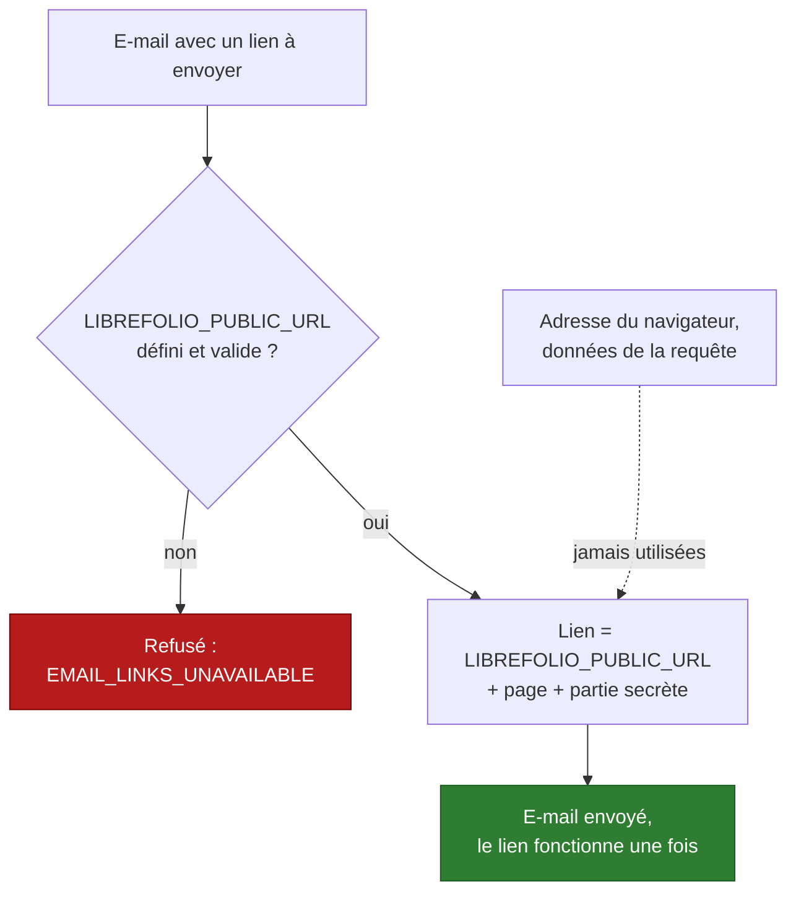

L'e-mail nomme l'instance, par l'hôte de `LIBREFOLIO_PUBLIC_URL`, et indique combien de temps le lien reste valable.

```text
https://librefolio.example.com/reset-password#token=…
```

!!! info "🛡️ Pourquoi"

    N'importe qui peut envoyer à LibreFolio une requête qui indique une autre adresse.
    Si le lien était construit à partir de la requête, un inconnu pourrait faire envoyer par LibreFolio à l'un de vos utilisateurs un vrai lien
    vers un site lui appartenant, et récupérer sa partie secrète lorsque l'utilisateur l'ouvre.

**Où le définir : dans le fichier `.env` de LibreFolio.** L'adresse à laquelle vos utilisateurs ouvrent LibreFolio :

```bash
LIBREFOLIO_PUBLIC_URL=https://librefolio.example.com
```

| Règle | Valeur |
| --- | --- |
| Schéma | `http://` ou `https://`, puis un nom d'hôte |
| Interdits | nom d'utilisateur ou mot de passe, `?` ou `#`, espaces |

C'est la même variable que la ligne de commande place devant les liens qu'elle affiche : [Comptes et inscriptions](configuration_accounts.md#accounts).

**La branche « non »** du schéma (variable absente, ou adresse qui enfreint ces règles), en plus du refus `EMAIL_LINKS_UNAVAILABLE` :

- l'e-mail de test continue de fonctionner ;
- **Vérification Email Requise** ne peut pas être activée ([Vérification de l'adresse e-mail](#verification)) ;
- les liens que vous copiez, depuis la [ligne de commande](cli_tools.md) par exemple, restent inchangés.

**Combien de temps les liens restent valables**, indiqué dans l'e-mail :

| Lien | Valable |
| --- | --- |
| Nouvelle invitation | 7 jours |
| Réinitialisation du mot de passe | 30 minutes |
| Vérification | 24 heures |
| Installation de l'administrateur initial | 72 heures |

**La partie secrète** du lien vient après `#` : les navigateurs ne l'envoient jamais au serveur, elle reste donc hors des journaux du serveur et du proxy.

**Pour le vérifier :**

- Lorsque l'e-mail est **Prêt**, Paramètres › Administration › E-mail affiche un avertissement si `LIBREFOLIO_PUBLIC_URL` n'est pas défini ou ne peut pas être utilisé, et le journal de démarrage contient une ligne ([Ce que dit le journal](email_troubleshooting.md#logs)).
- Une fois l'adresse utilisable, l'onglet affiche l'adresse et vérifie, depuis votre navigateur, que cette instance y répond : [L'adresse dans les liens envoyés par e-mail](email.md#links-check).
- Depuis n'importe où, `/api/v1/system/instance` affiche `"links": true` lorsque l'e-mail et l'adresse fonctionnent tous les deux.

---

## 📨 Liens envoyés par un administrateur {: #admin-links }

Un lien d'invitation ou de réinitialisation du mot de passe créé par un administrateur peut être envoyé par e-mail, au lieu d'être copié à la main.

Condition : e-mail **Prêt** et `LIBREFOLIO_PUBLIC_URL` utilisable ([E-mails contenant un lien](#public-url)).
Les boîtes de dialogue d'invitation et de réinitialisation du mot de passe de [Utilisateurs et invitations](users.md#send-by-email) affichent alors **Envoyer par e-mail** sous le lien.

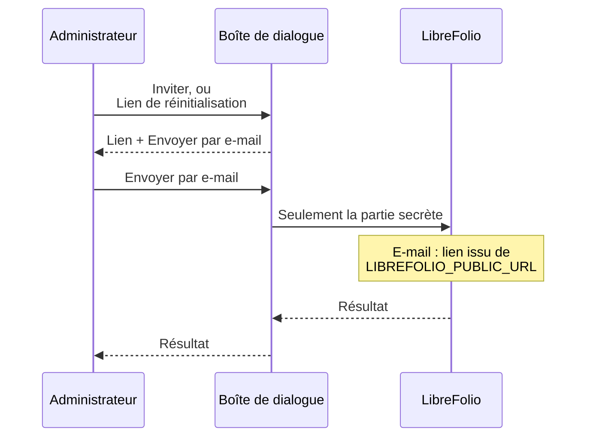

**Le résultat**, affiché dans la boîte de dialogue :

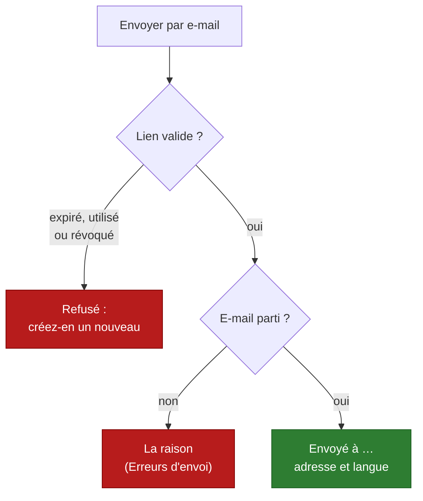

| | Invitation | Lien de réinitialisation du mot de passe |
| --- | --- | --- |
| **Envoyer à** | Commence par l'adresse indiquée dans l'invitation ; vous pouvez la modifier. | Pas de champ : il est envoyé à l'adresse de son compte. |
| **Langue de l'e-mail** | Choisie dans la boîte de dialogue (tableau ci-dessous) ; sans choix, la **Langue par Défaut** de l'instance. | La langue de son compte. |
| Contenu | Vous nomme comme la personne qui invite et précise, le cas échéant, que le nouveau compte sera administrateur. | — |
| Condition | — | Uniquement tant que le compte est actif. |

| Choix de la langue | Effet |
| --- | --- |
| **La langue de l'instance** | L'e-mail est dans la **Langue par Défaut** de l'instance ([Paramètres globaux](settings.md)). |
| English, Italiano, Français, Español | Pour une personne qui en lit une autre. |

La langue de l'e-mail est celle de l'e-mail seulement : elle ne devient pas la langue du compte que l'invitation crée.

Pour définir la **Langue par Défaut** avant qu'un administrateur ne l'ait enregistrée, **dans le fichier `.env`** (`en`, `it`, `fr` ou `es`) :

```bash
LIBREFOLIO_DEFAULT_LANGUAGE=it
```

Voir [Variables d'environnement](configuration_accounts.md#accounts).

- **Le lien contenu dans l'e-mail commence par `LIBREFOLIO_PUBLIC_URL`**, quelle que soit l'**Adresse du serveur** affichée dans la boîte de dialogue : seule la partie secrète du lien provient de la boîte de dialogue. La boîte de dialogue le précise au-dessus du bouton.
- Pourquoi un e-mail n'est pas parti : [Erreurs d'envoi](email_troubleshooting.md#sending-errors).
- Chaque e-mail compte dans la limite horaire.

---

## 🗝️ Mots de passe oubliés {: #forgot-password }

Une personne qui a oublié son mot de passe peut demander un lien de réinitialisation par e-mail, avec son nom d'utilisateur ou son adresse e-mail, sans se connecter.

**Avant la réponse :**

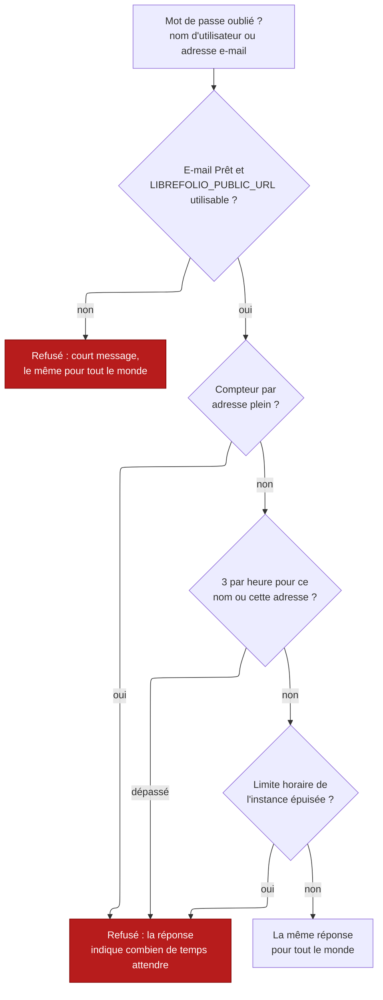

**Après la réponse, en silence :**

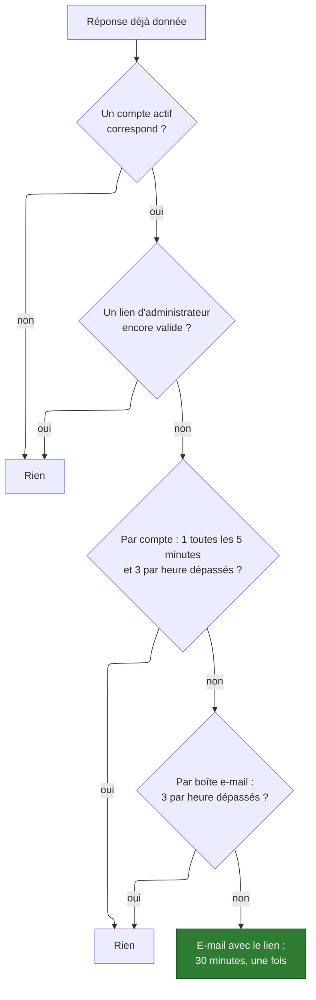

L'e-mail contenant le lien est dans la langue du compte.

**La même réponse pour tout le monde**, qu'un compte corresponde ou non :

> Si un compte actif correspond, son propriétaire reçoit un e-mail contenant un lien pour choisir un nouveau mot de passe

La recherche du compte et l'envoi interviennent après la réponse : personne ne peut s'en servir pour découvrir quels comptes existent.

- **Le compte** est trouvé comme lors de la connexion : nom d'utilisateur ou adresse e-mail. L'e-mail est envoyé à son adresse.
- **Le lien** remplace les liens de réinitialisation que les demandes précédentes ont envoyés au compte. Un lien créé par un administrateur, en revanche, n'est jamais annulé par une demande.

C'est sûr parce que changer l'adresse e-mail d'un compte demande le mot de passe actuel ([Profil](../user/settings/profile.md)) : voir [Notes de sécurité](email_troubleshooting.md#security).

**La page de connexion :**

| État de l'instance | Ce que la page affiche |
| --- | --- |
| E-mail **Prêt** et `LIBREFOLIO_PUBLIC_URL` utilisable | **Mot de passe oublié ?** ouvre le formulaire correspondant. En dessous, un panneau fermé jusqu'au clic conserve la commande qu'un administrateur peut exécuter sur le serveur. |
| Sinon | Cette commande, ouverte, sous l'avertissement : *La récupération par email n'est pas disponible sur cette instance. Réinitialisez votre mot de passe depuis le terminal du serveur, ou demandez à votre administrateur un lien de réinitialisation.* |
| La page ne peut pas lire la configuration de l'instance depuis le serveur | Seulement le conseil : *Demandez à votre administrateur un lien de réinitialisation du mot de passe : il peut en créer un pour votre compte.* |

Un administrateur crée ce lien dans **Paramètres › Administration › Utilisateurs**, même sans e-mail ([Liens de réinitialisation du mot de passe](users.md#reset-links)).

**Les limites :**

| Limite | Au-delà |
| --- | --- |
| `LIBREFOLIO_SIGNUP_EMAILS_PER_ADDRESS` demandes par heure (20 par défaut) depuis la même adresse. Un décompte partagé avec les inscriptions et avec **Renvoyer le lien** ([Limites des e-mails d'activation et de réinitialisation du mot de passe](#activation-limits)). Une adresse IPv6 compte par son /64, le bloc qu'un abonné détient généralement. | Refusé jusqu'à ce qu'une place se libère dans ce décompte, ou dans la limite horaire de l'instance si celle-ci attend plus longtemps. La réponse indique combien de temps. |
| 3 demandes par heure pour le même nom d'utilisateur ou la même adresse e-mail, qu'un compte corresponde ou non | Refusé jusqu'à ce que la plus ancienne ait une heure. |
| La limite horaire de l'instance, `LIBREFOLIO_SMTP_MAX_PER_HOUR` | Refusé jusqu'à ce qu'un e-mail puisse à nouveau être envoyé. |
| 3 e-mails par heure vers la même boîte e-mail, quel que soit le compte concerné et quelle que soit la façon d'écrire son adresse | Rien n'est envoyé ; la réponse reste la même. |
| 1 e-mail toutes les 5 minutes, et 3 par heure, pour le même compte, liens créés par un administrateur compris | Rien n'est envoyé ; la réponse reste la même. Deux demandes au même instant ne peuvent pas être envoyées toutes les deux. |

Où vivent les décomptes :

- la limite par compte compte les liens de réinitialisation du compte dans la base de données ;
- les autres sont conservées dans la mémoire de chaque processus du serveur : avec plusieurs processus, chacun a son propre décompte, et un redémarrage les oublie ;
- un e-mail de réinitialisation qui n'est pas parti compte quand même, pour le compte et pour la boîte e-mail.

**Une boîte e-mail, quelle que soit la façon d'écrire son adresse.** La limite par boîte e-mail compte les alias d'une adresse comme une seule boîte :

| Écriture | Boîte comptée |
| --- | --- |
| Majuscules | Ne comptent pas. |
| `name+news@example.com` | `name@example.com` : un `+tag` ne compte pas, sur aucun domaine. |
| `first.last@googlemail.com` | `firstlast@gmail.com` : les points d'une adresse Gmail ne comptent pas, et `googlemail.com` est `gmail.com`. |

- Les limites des [e-mails de vérification](#verification-limits) et des [avis de changement d'adresse e-mail](#email-change-notice) comptent de la même façon.
- Chaque e-mail part quand même vers l'adresse exactement telle que le compte la possède.
- Une boîte qui reçoit le courrier sous n'importe quel nom, comme un domaine catch-all ou le `anything@user.fastmail.com` de Fastmail, compte chaque nom séparément : seule la limite horaire de l'instance les retient.

**Derrière un proxy inverse**, l'adresse qui compte est celle du visiteur, telle que LibreFolio la lit ([L'adresse du visiteur](connection_proxy.md#client-address)) :

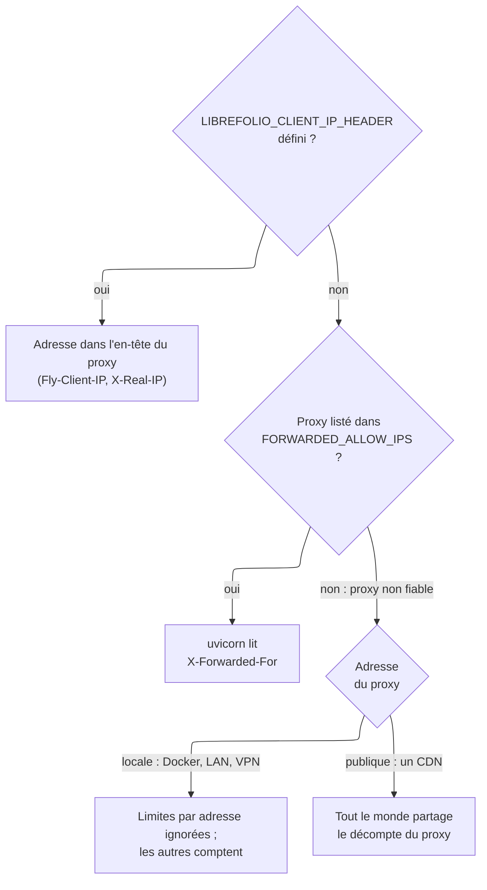

- **Avec `LIBREFOLIO_CLIENT_IP_HEADER`**, **dans le fichier `.env`**, LibreFolio lit l'adresse dans l'en-tête que votre proxy renseigne avec l'adresse du visiteur (`Fly-Client-IP` sur Fly.io, `X-Real-IP` depuis Nginx) :

    ```bash
    LIBREFOLIO_CLIENT_IP_HEADER=X-Real-IP
    ```

    Ne le définissez que si chaque requête traverse ce proxy : un visiteur qui atteint directement LibreFolio pourrait écrire l'en-tête.

- **Sinon**, c'est l'adresse que le serveur (uvicorn) voit. uvicorn ne prend l'adresse du visiteur dans l'en-tête `X-Forwarded-For` du proxy que si l'adresse du proxy figure dans `FORWARDED_ALLOW_IPS` (`127.0.0.1` si elle n'est pas définie). Indiquez-y les adresses ou les réseaux de votre proxy, **dans le fichier `.env`** :

    ```bash
    FORWARDED_ALLOW_IPS=172.18.0.0/16
    ```

    Jamais `*` : uvicorn prendrait la première adresse de l'en-tête, que le visiteur peut écrire.

- **Un proxy non fiable sur une adresse locale**, comme un conteneur proxy devant l'image Docker, la configuration habituelle : un visiteur ne peut pas épuiser le décompte de **Mot de passe oublié ?**, **Renvoyer le lien** et des inscriptions pour tout le monde. Les limites par nom d'utilisateur ou adresse e-mail, par compte et par boîte e-mail, ainsi que la limite horaire de l'instance, comptent toujours. Le journal avertit une fois par processus du serveur, et les vérifications de sécurité le signalent comme un avertissement de `platform.client_address` ([L'adresse du visiteur](connection_proxy.md#client-address)).
- **Un proxy non fiable sur une adresse publique**, comme un CDN : les `LIBREFOLIO_SIGNUP_EMAILS_PER_ADDRESS` premières requêtes de n'importe qui épuisent le décompte via le proxy pour tout le monde, pendant une heure au plus. Informez LibreFolio de l'existence du proxy.

---

## 🚦 Limites des e-mails d'activation et de réinitialisation du mot de passe {: #activation-limits }

Les e-mails qui activent un compte et ceux qui réinitialisent un mot de passe sont retenus par **deux compteurs**, les mêmes pour toutes les façons de les demander.
Chacun compte sur les 60 dernières minutes, dans la mémoire de chaque processus du serveur.

| Compteur | Variable | Par défaut | Ce qu'il compte |
| --- | --- | --- | --- |
| **Par adresse** | `LIBREFOLIO_SIGNUP_EMAILS_PER_ADDRESS` | 20 par heure | Les e-mails qui partent pour une adresse cliente (une adresse IPv6 par son /64), en un seul décompte : les inscriptions, chaque **Renvoyer le lien** avec le bon mot de passe et chaque **Mot de passe oublié ?** pour un compte qui existe. Les tentatives ne sont pas comptées (schéma ci-dessous). |
| **Par instance** | `LIBREFOLIO_SMTP_MAX_PER_HOUR` | 50 par heure | Chaque e-mail que l'instance envoie : activations, réinitialisations, invitations, avis. |

**Le compteur par adresse compte les e-mails qui partent, pas les tentatives :**

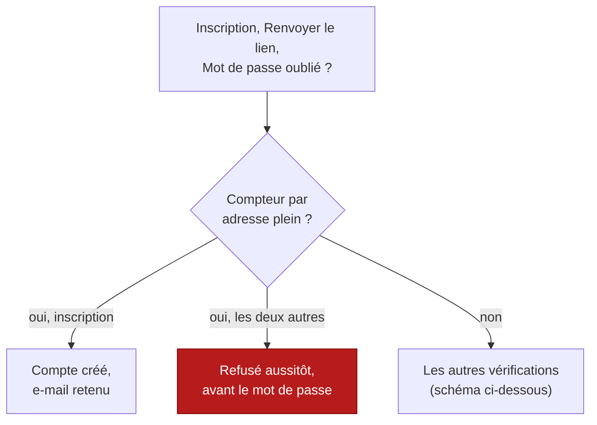

**Lorsque le compteur n'est pas plein**, la place n'est dépensée que si les autres vérifications passent :

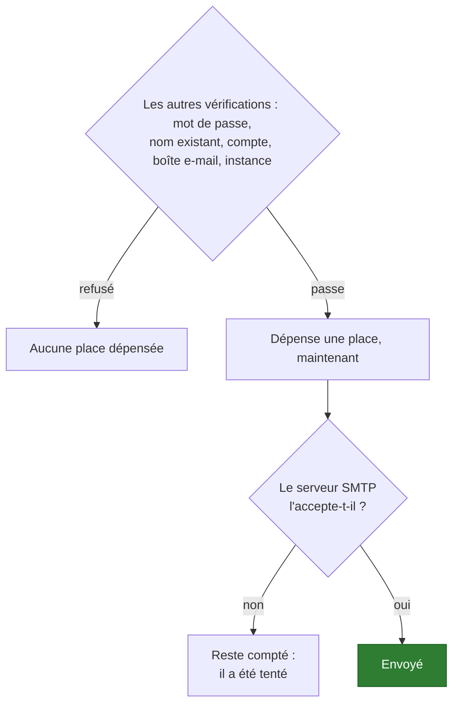

Ceux-ci ne lui coûtent rien :

- un mot de passe erroné : il a sa propre limite ;
- une demande pour un nom qu'aucun compte ne possède (pour **Mot de passe oublié ?**, la réponse est la même qu'un compte corresponde ou non) ;
- une demande refusée par une autre limite, comme un **Renvoyer le lien** refusé par la limite par compte ou par boîte e-mail.

Trois autres limites restent telles quelles. Ce ne sont pas des compteurs d'e-mails d'activation, et elles comptent rarement pour un compte dont l'e-mail a été retenu : rien n'est encore arrivé dans sa boîte.

| Limite | S'applique à |
| --- | --- |
| La limite de la connexion sur les **mots de passe erronés** ([Connexions échouées](configuration_accounts.md#login-limit)) | **Renvoyer le lien**, qui la partage avec la page de connexion. |
| **3 e-mails par heure vers la même boîte e-mail** | LibreFolio ne peut pas servir à inonder l'adresse de quelqu'un d'autre. |
| **1 e-mail toutes les 5 minutes, et 3 par heure, pour le même compte** | **Renvoyer le lien**. |

**Combien de temps attendre.** La réponse indique combien de secondes attendre, et ce délai est exact : le **plus long** des délais des compteurs qui ont retenu la demande.
La même demande faite à ce moment-là passe, sauf si d'autres personnes du même réseau ont utilisé la place entre-temps : la réponse indique alors le nouveau délai.

**Un exemple.** Un bureau avec une seule adresse Internet et une limite de 20.

| Heure | Ce qui se passe |
| --- | --- |
| 9:00 – 9:40 | Vingt collègues s'inscrivent : leurs vingt e-mails partent. |
| 9:45 | Le vingt et unième, Mario, s'inscrit. Son compte est créé, mais son e-mail est retenu : la page lui dit de réessayer dans environ 15 minutes, le temps que l'e-mail de 9:00 sorte du décompte à 10:00. |
| 9:46 | Mario se connecte et demande à nouveau le lien : le même compteur le refuse, pendant 14 minutes. |
| 10:00 | Il demande à nouveau avec son nom d'utilisateur et son mot de passe : le lien part. |

Le compteur par adresse est partagé exprès, avec une conséquence à connaître : lorsqu'un réseau a épuisé son décompte avec des inscriptions, **Mot de passe oublié ?** depuis ce réseau attend aussi, jusqu'à ce qu'une place se libère.

Pour un réseau où beaucoup de personnes s'inscrivent ensemble, comme une école ou un bureau, augmentez `LIBREFOLIO_SIGNUP_EMAILS_PER_ADDRESS` **dans le fichier `.env`**.
Redémarrez LibreFolio. Avec Docker Compose, exécutez `docker compose up -d`.

---

## ✅ Vérification de l'adresse e-mail {: #verification }

Avec **Vérification Email Requise** activée, un nouveau compte ne peut pas se connecter tant que son propriétaire n'a pas confirmé l'adresse avec un lien que LibreFolio envoie par e-mail au compte.

**Où :** l'interrupteur se trouve dans **Paramètres › Administration › Paramètres Globaux**, catégorie **Sécurité** ([Paramètres globaux](settings.md)). Il est désactivé par défaut.

**L'inscription :**

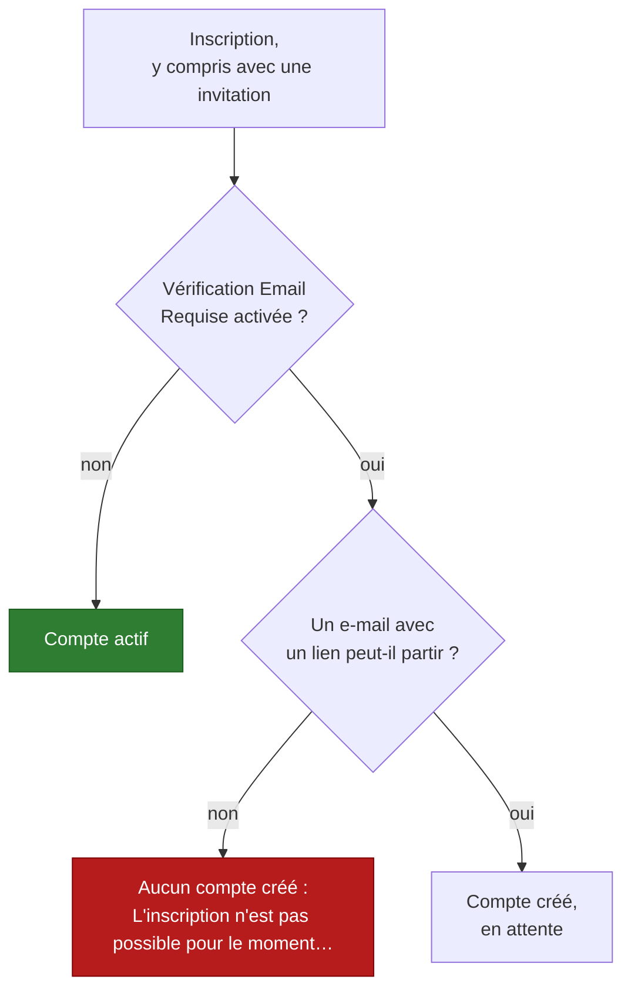

**Puis l'e-mail de vérification :**

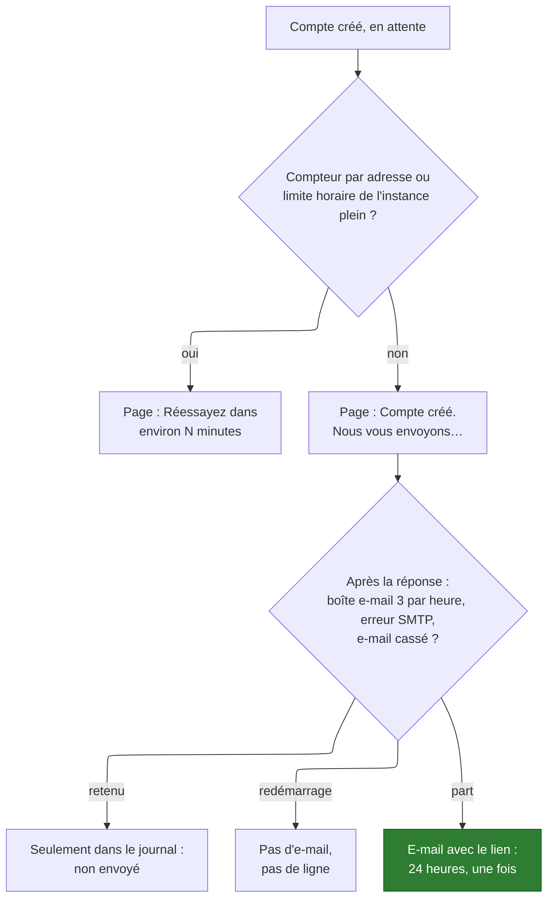

**Enfin le clic sur le lien :**

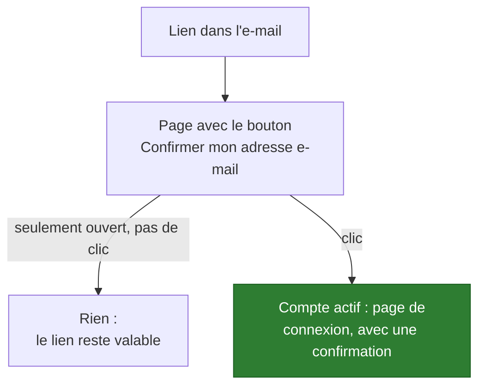

**Qui attend :** tout compte créé depuis la page d'inscription tant que l'interrupteur est activé, y compris ceux ouverts avec une invitation.

Ils n'attendent jamais :

- le premier compte d'une nouvelle instance, son administrateur ;
- l'administrateur que LibreFolio crée à partir de `LIBREFOLIO_ADMIN_EMAIL`, activé par son lien d'installation ;
- les comptes créés avec `user create` sur la [ligne de commande](cli_tools.md) ;
- les comptes qui existent déjà.

**Les textes de la page de connexion** juste après l'inscription :

| Cas | Texte |
| --- | --- |
| L'e-mail peut partir | *Compte créé. Nous vous envoyons un e-mail avec un lien pour l'activer : ouvrez-le dans les 24 heures, puis connectez-vous. Pas d'e-mail après quelques minutes ? Vérifiez les spams, puis connectez-vous avec votre nom d'utilisateur et votre mot de passe : un nouveau lien vous sera proposé.* |
| L'adresse cliente a déjà eu les e-mails de `LIBREFOLIO_SIGNUP_EMAILS_PER_ADDRESS` inscriptions (20 par défaut) dans la dernière heure, ou la limite horaire de l'instance est épuisée | *Compte créé, mais l'e-mail d'activation n'a pas pu partir maintenant. Réessayez dans environ N minutes : connectez-vous avec votre nom d'utilisateur et votre mot de passe, et un nouveau lien vous sera proposé.* |

- N est exact : le temps jusqu'à ce que les deux compteurs admettent un nouvel e-mail ([Limites des e-mails d'activation et de réinitialisation du mot de passe](#activation-limits)).
- Derrière un proxy inverse auquel LibreFolio ne fait pas confiance, sur une adresse locale (la configuration Docker habituelle), rien n'est compté par adresse, donc le second texte ne s'affiche jamais ([Mots de passe oubliés](#forgot-password)).
- *Nous vous envoyons un e-mail* signifie que l'e-mail est en file d'attente, pas qu'il a été livré : il part après la réponse, et il peut encore ne pas partir ([Limites des e-mails de vérification](#verification-limits)).

**L'e-mail**, *Confirmez votre adresse e-mail*, est dans la **Langue par Défaut** de l'instance : un nouveau compte n'a pas encore de langue propre.
Son lien commence par `LIBREFOLIO_PUBLIC_URL` ([E-mails contenant un lien](#public-url)).

!!! info "🔍 Pourquoi un clic est nécessaire"

    Les filtres de messagerie qui analysent les liens, comme Microsoft Defender Safe Links, ouvrent les liens d'un message dans un
    navigateur qui exécute des scripts : si l'ouverture suffisait, le filtre activerait le compte à la place de son propriétaire.
    Une telle ouverture ne dépense rien ; le lien reste valable pour son propriétaire.
    Une personne qui ouvre un lien sans s'être inscrite n'a qu'à fermer la page.

**Tant que l'adresse n'est pas confirmée**, le compte ne peut pas se connecter, mais il peut demander un nouveau lien :

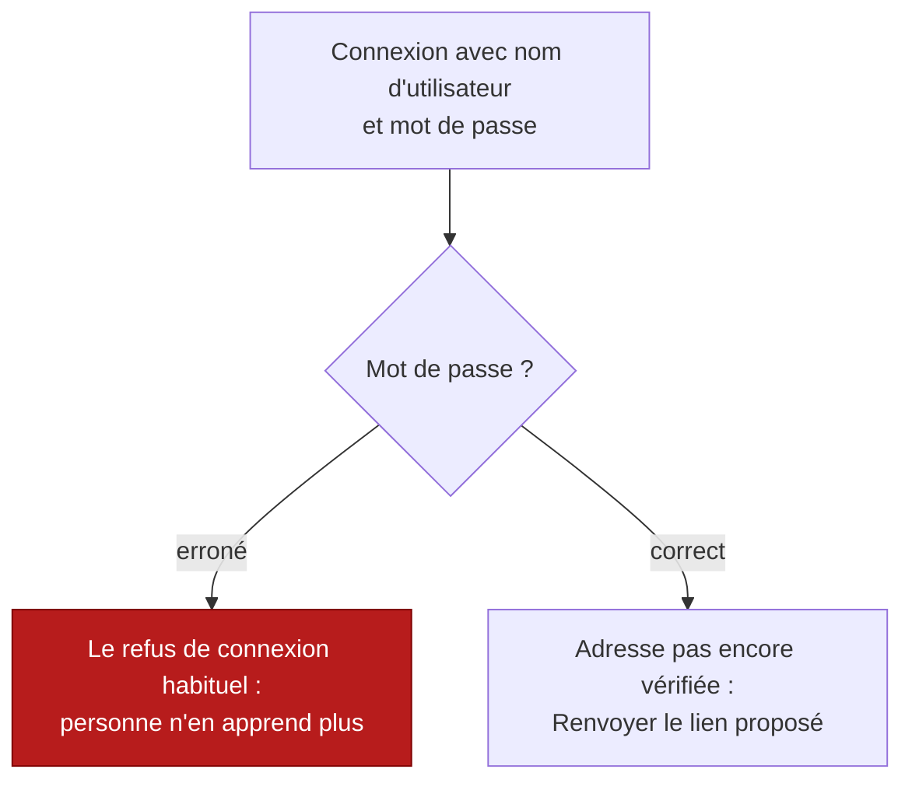

**Renvoyer le lien**, les premières vérifications :

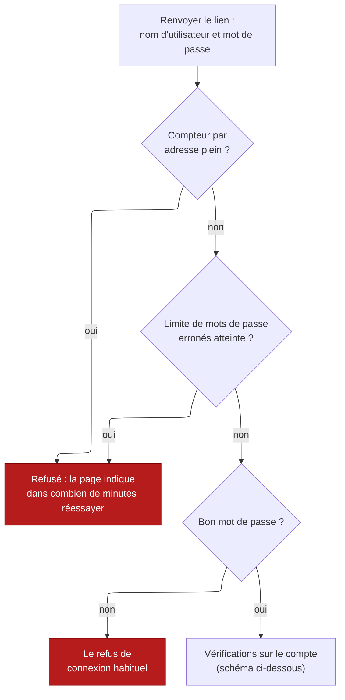

**Avec le bon mot de passe**, les vérifications sur le compte :

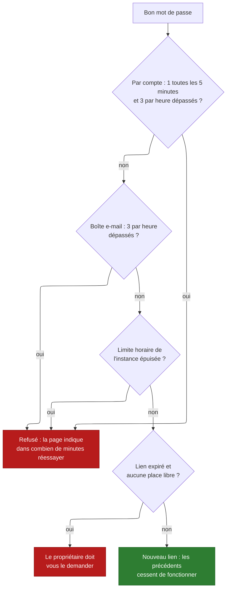

Ce que voit la personne, pas à pas : *Si LibreFolio vous demande de confirmer votre adresse e-mail* dans [Premiers pas](../user/getting-started.md).

### 🔀 L'activer et la désactiver {: #verification-switch }

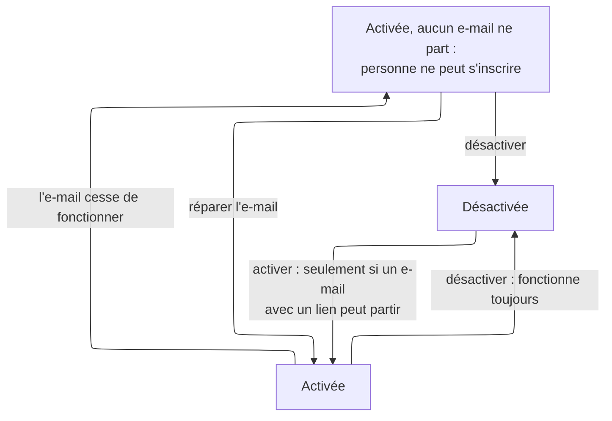

« Un e-mail avec un lien peut partir » = e-mail **Prêt** ([Paramètres › Administration › E-mail](email.md#email-tab)) et `LIBREFOLIO_PUBLIC_URL` utilisable ([E-mails contenant un lien](#public-url)).

| Étape | Ce que dit LibreFolio |
| --- | --- |
| Activer, alors qu'aucun e-mail avec un lien ne peut partir | L'interrupteur est grisé, avec l'indication : *Il faut qu'un e-mail avec un lien puisse partir : configurez d'abord SMTP et LIBREFOLIO_PUBLIC_URL (Paramètres › Administration › E-mail).* |
| Cela change entre l'ouverture de l'onglet et l'enregistrement | L'enregistrement est refusé et rien n'est conservé : *La vérification de l'e-mail demande qu'un e-mail avec un lien puisse partir, et aucun ne peut partir maintenant : vérifiez Paramètres › Administration › E-mail.* |
| Activée : enregistrer les autres paramètres | Fonctionne toujours, même si l'e-mail a cessé de fonctionner depuis. |
| Désactiver | Les comptes déjà en attente continuent d'attendre : leurs liens fonctionnent encore, tout comme **Renvoyer le lien**. Pour en laisser entrer un tout de suite, activez-le ([Comptes en attente](#verification-waiting)). |
| L'e-mail cesse de fonctionner alors que la vérification est activée (le serveur ou une variable tombe en panne) | Plus personne ne peut s'inscrire, pas même avec une invitation, qui reste valable ; aucun compte n'est créé. La page d'inscription dit : *L'inscription n'est pas possible pour le moment : cette instance ne peut pas envoyer l'e-mail de vérification. Réessayez plus tard, ou demandez à son administrateur.* Seul le premier compte d'une nouvelle instance passe. **Renvoyer le lien** échoue de la même façon. Réparez l'e-mail ([Quand cela ne fonctionne pas](email_troubleshooting.md#troubleshooting)) ou désactivez l'interrupteur. |

### ⏳ Comptes en attente {: #verification-waiting }

**Vers Actif :**

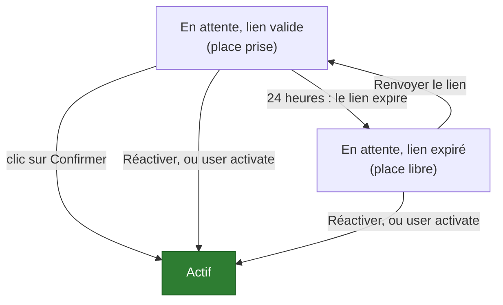

**Pour l'écarter :**

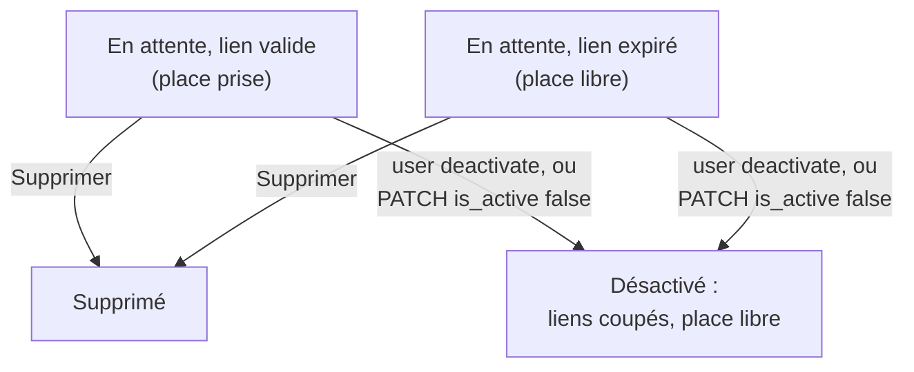

**Où :** dans **Paramètres › Administration › Utilisateurs**, un compte en attente affiche le badge **En attente de vérification**, et non **Désactivé**, même une fois son lien expiré.
Survolez le badge, ou ouvrez la ligne, pour voir l'indication : le propriétaire n'a pas encore ouvert le lien, la connexion en propose un nouveau, et **Réactiver** laisse entrer le compte tout de suite.

| Étape | Faits que le schéma ne dit pas |
| --- | --- |
| La place de la limite d'utilisateurs (`LIBREFOLIO_MAX_USERS`) | Prise comme par une invitation ouverte. La place est de nouveau libre lorsque le dernier lien envoyé expire, 24 heures plus tard ; sur une instance pleine, **Renvoyer le lien** dit au propriétaire de vous le demander. |
| **Réactiver** ([Comptes en attente de leur e-mail](users.md#waiting)), ou `user activate` sur la [ligne de commande](cli_tools.md) | Laisse entrer le compte sans l'e-mail : il peut se connecter tout de suite, et les liens déjà envoyés cessent de fonctionner. Tant que le lien est valide, la place est déjà comptée, donc **Réactiver** fonctionne même sur une instance pleine et `user activate` n'affiche aucun avertissement de limite. Une fois le lien expiré, il faut une place libre, comme pour tout compte désactivé. |
| **Supprimer** ([Supprimer un compte](users.md#delete)) | Pour l'écarter. L'onglet Utilisateurs lui-même ne propose pas **Désactiver** pour un compte qui n'est pas actif : là, **Supprimer** est la voie. |
| `user deactivate` sur la ligne de commande, ou l'API d'administration avec `is_active: false` | Pour l'écarter. Désactivé, il cesse d'attendre : ses liens cessent de fonctionner, sa place est libre, sa ligne indique **Désactivé** à partir de là, et la connexion dit au propriétaire que le compte est désactivé. |

Le point d'accès de l'API d'administration :

```text
PATCH /api/v1/users/{id}
```

### 📏 Limites des e-mails de vérification {: #verification-limits }

Les vérifications de **Renvoyer le lien** figurent dans le schéma de [Vérification de l'adresse e-mail](#verification) ; ici, les chiffres, et ce que voit la personne qui les franchit.

| Limite | Au-delà |
| --- | --- |
| `LIBREFOLIO_SIGNUP_EMAILS_PER_ADDRESS` e-mails par heure (20 par défaut) depuis la même adresse, en comptant les e-mails qui partent : les inscriptions, **Renvoyer le lien** avec le bon mot de passe et **Mot de passe oublié ?** pour un compte qui existe. Une adresse IPv6 compte par son /64. | Les nouveaux comptes suivants sont quand même créés et attendent, mais leurs e-mails ne partent pas : la page de connexion le dit juste après l'inscription, avec le temps d'attente ; les propriétaires redemandent le lien depuis la page de connexion une fois ce temps écoulé. **Renvoyer le lien** est refusé pendant le même temps. |
| La limite propre de la connexion sur les mots de passe erronés, partagée avec la page de connexion : 10 toutes les 15 minutes pour le même nom d'utilisateur ou la même adresse e-mail, 50 depuis la même adresse ([Connexions échouées](configuration_accounts.md#login-limit)) | Refusé avant la vérification du mot de passe : la page indique dans combien de minutes réessayer. Le bon mot de passe efface les échecs de ce qui a été saisi. |
| 1 e-mail toutes les 5 minutes, et 3 par heure, pour le même compte, e-mail de l'inscription compris | Refusé : la page indique dans combien de minutes réessayer. |
| 3 e-mails par heure vers la même boîte e-mail, quel que soit le compte concerné et quelle que soit la façon d'écrire son adresse ([Mots de passe oubliés](#forgot-password)) : l'e-mail d'une inscription comme les liens renvoyés, et seulement les e-mails qui sont partis | **Renvoyer le lien** est refusé : la page indique dans combien de minutes réessayer. Après une inscription, le compte est créé et attend, mais aucun e-mail ne part, et rien ne le dit au propriétaire : la page affiche son texte habituel, qui dit déjà quoi faire (vérifier les spams, puis se connecter pour obtenir un nouveau lien). |
| La limite horaire de l'instance, `LIBREFOLIO_SMTP_MAX_PER_HOUR` | Refusé jusqu'à ce qu'un e-mail puisse à nouveau être envoyé. Une inscription faite alors qu'elle est épuisée est retenue comme une inscription au-delà de la limite de son adresse. |
| Une place libre, une fois le lien du compte expiré | Refusé : le propriétaire doit vous le demander. |

**Ce qui reste invisible** après une inscription. Rien de tout cela n'arrive à la page :

- la limite de 3 e-mails de vérification par heure par boîte e-mail ;
- la limite horaire de l'instance ;
- une erreur SMTP ;
- l'e-mail ou `LIBREFOLIO_PUBLIC_URL` qui a cessé de fonctionner entre-temps ;
- un redémarrage.

Seul le journal le dit ([Ce que dit le journal](email_troubleshooting.md#logs)) :

```text
Verification email: not sent
Verification email: the request failed
```

Un redémarrage avant le départ de l'e-mail ne laisse aucune ligne.
Le compte reste en attente avec son e-mail retenu, et **Renvoyer le lien** le récupère : c'est pourquoi le texte de la page dit à la personne quoi faire lorsque rien n'arrive.

!!! info "🔍 Pourquoi la limite de la boîte e-mail n'est pas vérifiée avant la réponse"

    C'est voulu. Une inscription qui répondrait différemment lorsque la boîte vient de recevoir des e-mails
    dirait à quiconque s'inscrit avec l'adresse de quelqu'un d'autre si cette boîte les reçoit.

En outre :

- un lien dont l'e-mail n'est pas parti ne compte ni pour le compte ni pour la boîte e-mail ;
- si le compte cesse d'attendre entre-temps (adresse confirmée, ou activé ou désactivé par un administrateur), aucun nouveau lien n'est envoyé ;
- les limites par adresse et par boîte e-mail sont conservées dans la mémoire de chaque processus du serveur (chacun a son propre décompte ; un redémarrage les oublie), et derrière un proxy inverse l'adresse qui compte suit les règles de [Mots de passe oubliés](#forgot-password).

---

## 🔔 Changements d'adresse e-mail {: #email-change-notice }

Lorsqu'une personne change l'adresse e-mail de son compte, dans [Profil](../user/settings/profile.md), LibreFolio écrit à l'adresse que le compte avait **avant**.

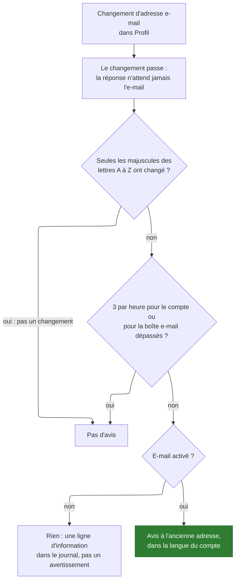

| | L'avis |
| --- | --- |
| **Destinataire** | Seulement l'ancienne adresse : la nouvelle ne reçoit rien. |
| **Ce qu'il ne dit pas** | Rien de la nouvelle adresse, pas même le domaine, et aucun nom d'utilisateur : il commence par un simple « Bonjour, » ([Notes de sécurité](email_troubleshooting.md#security)). |
| **Ce qu'il dit** | Que l'adresse a changé. Si le propriétaire n'est pas à l'origine du changement, quelqu'un utilise peut-être son compte : il doit changer le mot de passe tout de suite s'il le peut encore, et vous prévenir. Pas de lien. |
| **Nom de l'instance** | L'hôte de `LIBREFOLIO_PUBLIC_URL`, avec son port s'il en a un, ou « LibreFolio » lorsque la variable n'est pas définie ou ne peut pas être utilisée : sans lien, l'avis n'en a pas besoin. |
| **Limite horaire** | Compte comme n'importe quel e-mail. |
| **3 par heure par compte et par boîte e-mail** | La boîte e-mail est comptée quelle que soit la façon d'écrire son adresse ([Mots de passe oubliés](#forgot-password)). Sans ces limites, un compte pourrait pointer son e-mail vers n'importe quelle adresse puis le changer à nouveau, pour faire écrire votre instance à cette adresse. |
| **Majuscules** | `Anna@example.com` pour `anna@example.com` n'est pas un changement d'adresse : aucun avis ne part. Les lettres accentuées comptent comme différentes : `Émile@example.com` pour `émile@example.com` est un changement, avec son avis. |

---

## 🔗 Voir aussi

- 📄 **[E-mail](email.md)** — Où se trouve la configuration, Les variables, Exemples, …
- 📄 **[E-mail : quand cela ne fonctionne pas](email_troubleshooting.md)** — Quand cela ne fonctionne pas, Notes de sécurité
