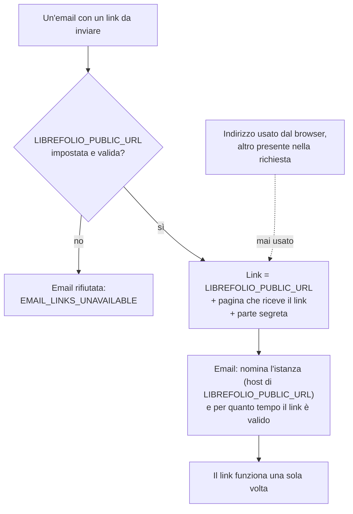
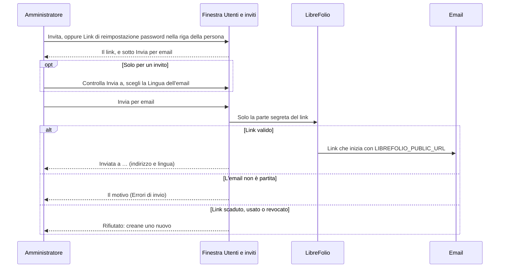
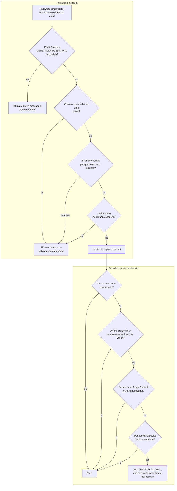
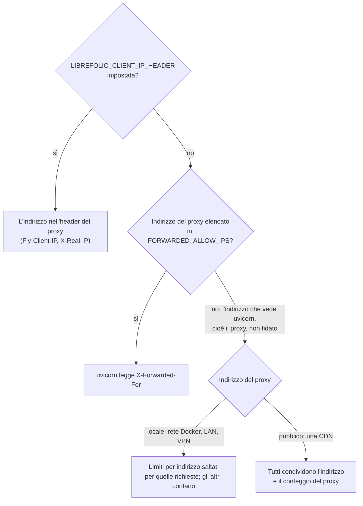
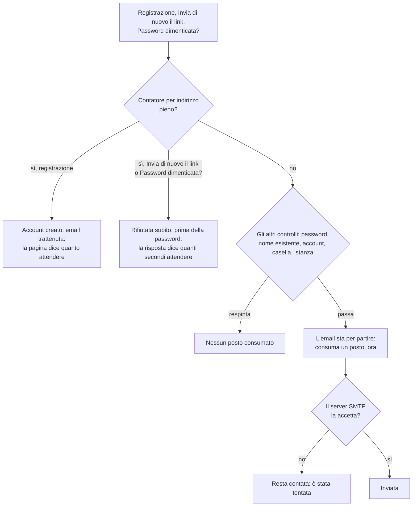
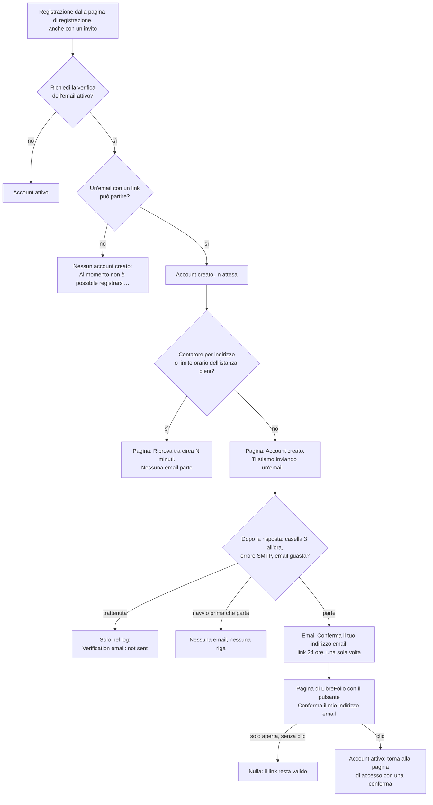
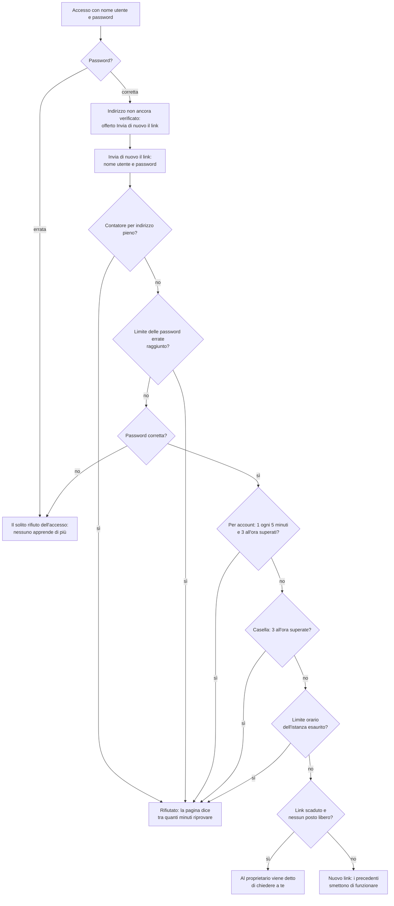
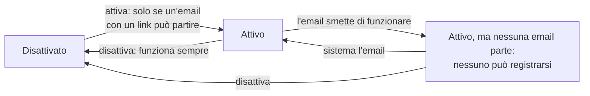
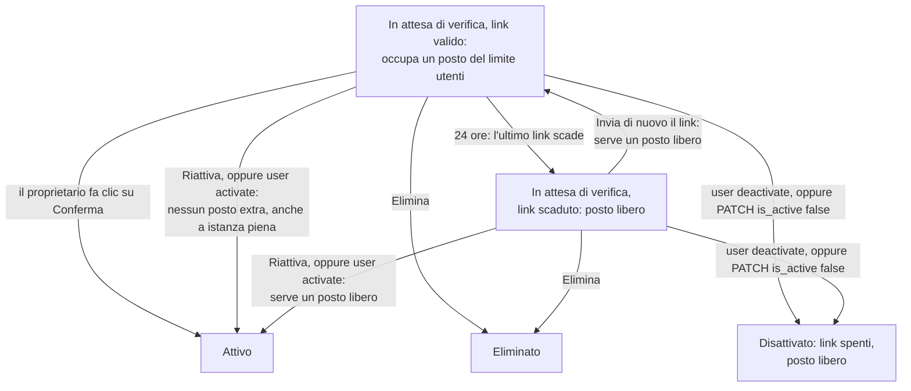
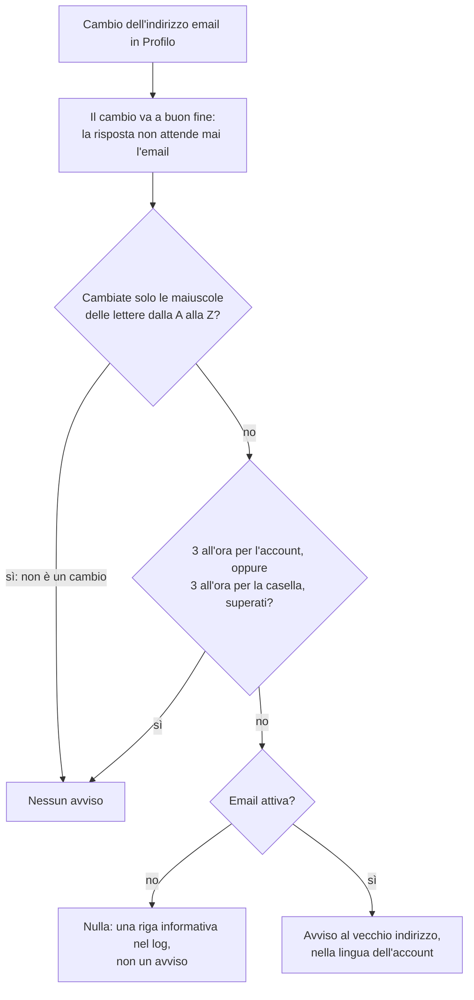

# 📬 Email: Link e messaggi

I messaggi che LibreFolio invia una volta che l'email funziona, flusso per flusso:

- i **link** per inviti e reimpostazioni della password;
- le **password dimenticate**;
- i **limiti** su queste email;
- la **verifica** dei nuovi indirizzi;
- l'avviso di un **cambio di indirizzo**.

Prima deve funzionare l'email: variabili SMTP, scheda **Email** ed email di prova sono in [Email](email.md).
Quando un messaggio non parte: [Email: quando non funziona](email_troubleshooting.md).

---

## 🌐 Email con un link {: #public-url }

Un link di invito o di reimpostazione della password inviato per email viene costruito **solo** da `LIBREFOLIO_PUBLIC_URL`.
Mai dall'indirizzo usato dal browser, né da altro presente in una richiesta.



```text
https://librefolio.example.com/reset-password#token=…
```

!!! info "🛡️ Perché"

    Chiunque può inviare a LibreFolio una richiesta che indica un altro indirizzo.
    Se il link venisse costruito dalla richiesta, un estraneo potrebbe far inviare per email a un tuo utente un link
    reale verso un sito suo, e catturarne la parte segreta quando l'utente lo apre.

**Dove si imposta: il file `.env` di LibreFolio.** L'indirizzo con cui i tuoi utenti aprono LibreFolio:

```bash
LIBREFOLIO_PUBLIC_URL=https://librefolio.example.com
```

| Regola | Valore |
| --- | --- |
| Schema | `http://` o `https://`, poi un nome host |
| Vietati | nome utente o password, `?` o `#`, spazi |

È la stessa variabile che la riga di comando antepone ai link che stampa: [Account e registrazioni](configuration_accounts.md#accounts).

**Il ramo «no»** del diagramma (variabile assente, o indirizzo che viola queste regole), oltre al rifiuto `EMAIL_LINKS_UNAVAILABLE`:

- l'email di prova funziona ancora;
- **Richiedi la verifica dell'email** non può essere attivata ([Verifica email](#verification));
- i link che copi, ad esempio dalla [riga di comando](cli_tools.md), restano come sono.

**Validità dei link**, scritta nell'email:

| Link | Valido per |
| --- | --- |
| Nuovo invito | 7 giorni |
| Reimpostazione della password | 30 minuti |
| Verifica | 24 ore |
| Configurazione dell'amministratore iniziale | 72 ore |

**La parte segreta** del link viene dopo `#`: i browser non la inviano mai al server, quindi resta fuori dai log del server e del proxy.

**Per verificarlo:**

- Con l'email **Pronta**, Impostazioni › Amministrazione › Email mostra un avviso quando `LIBREFOLIO_PUBLIC_URL` non è impostata o non può essere usata, e il log di avvio contiene una riga ([Cosa dice il log](email_troubleshooting.md#logs)).
- Una volta utilizzabile, la scheda mostra l'indirizzo e controlla, dal tuo browser, che questa istanza risponda lì: [L'indirizzo nelle email con link](email.md#links-check).
- Da qualsiasi punto, `/api/v1/system/instance` mostra `"links": true` quando sia l'email sia l'indirizzo sono a posto.

---

## 📨 Link inviati da un amministratore {: #admin-links }

Un link di invito o di reimpostazione della password creato da un amministratore può essere inviato per email, invece di essere copiato a mano.

Condizione: email **Pronta** e `LIBREFOLIO_PUBLIC_URL` utilizzabile ([Email con un link](#public-url)).
Allora le finestre di invito e di reimpostazione della password di [Utenti e inviti](users.md#send-by-email) mostrano **Invia per email** sotto il link.



| | Invito | Link di reimpostazione della password |
| --- | --- | --- |
| **Invia a** | Parte dall'indirizzo scritto nell'invito; puoi modificarlo. | Nessun campo: va all'indirizzo del suo account. |
| **Lingua dell'email** | Scelta nella finestra (tabella sotto); senza una scelta, la **Lingua predefinita** dell'istanza. | La lingua del suo account. |
| Contenuto | Indica te come persona che invita e precisa, quando è così, che il nuovo account sarà un amministratore. | — |
| Condizione | — | Solo finché l'account è attivo. |

| Scelta della lingua | Effetto |
| --- | --- |
| **La lingua dell'istanza** | L'email è nella **Lingua predefinita** dell'istanza ([Impostazioni globali](settings.md)). |
| English, Italiano, Français, Español | Per chi ne legge un'altra. |

La lingua dell'email è solo quella dell'email: non diventa la lingua dell'account creato dall'invito.

Per impostare la **Lingua predefinita** prima che un amministratore l'abbia salvata, **nel file `.env`** (`en`, `it`, `fr` o `es`):

```bash
LIBREFOLIO_DEFAULT_LANGUAGE=it
```

Vedi [Variabili d'ambiente](configuration_accounts.md#accounts).

- **Il link nell'email inizia con `LIBREFOLIO_PUBLIC_URL`**, qualunque sia l'**Indirizzo del server** mostrato nella finestra: solo la parte segreta del link viaggia dalla finestra. La finestra lo dice sopra il pulsante.
- Perché un'email non è partita: [Errori di invio](email_troubleshooting.md#sending-errors).
- Ogni email conta ai fini del limite orario.

---

## 🗝️ Password dimenticate {: #forgot-password }

Chi ha dimenticato la password può richiedere un link di reimpostazione via email, con il proprio nome utente o indirizzo email, senza accedere.



**La stessa risposta per tutti**, che un account corrisponda o no:

> Se un account attivo corrisponde, il suo proprietario riceve un'email con un link per scegliere una nuova password

Ricerca dell'account e invio avvengono dopo la risposta: nessuno può usarla per scoprire quali account esistono.

- **L'account** viene trovato come lo trova l'accesso: nome utente o indirizzo email. L'email va al suo indirizzo.
- **Il link** sostituisce i link di reimpostazione inviati all'account dalle richieste precedenti. Un link creato da un amministratore, invece, non viene mai annullato da una richiesta.

È sicuro perché cambiare l'indirizzo email di un account richiede la password attuale ([Profilo](../user/settings/profile.md)): vedi [Note di sicurezza](email_troubleshooting.md#security).

**La pagina di accesso:**

| Stato dell'istanza | Cosa mostra la pagina |
| --- | --- |
| Email **Pronta** e `LIBREFOLIO_PUBLIC_URL` utilizzabile | **Password dimenticata?** apre il modulo per farlo. Sotto, un pannello chiuso finché non viene cliccato conserva il comando che un amministratore può eseguire sul server. |
| Altrimenti | Quel comando, aperto, sotto l'avviso: *Il recupero via email non è disponibile su questa istanza. Reimposta la password dal terminale del server oppure chiedi all'amministratore un link di reimpostazione della password.* |
| La pagina non riesce a leggere la configurazione dell'istanza dal server | Solo il suggerimento: *Chiedi all'amministratore un link di reimpostazione della password: può crearne uno per il tuo account.* |

Un amministratore crea quel link in **Impostazioni › Amministrazione › Utenti**, anche senza email ([Link di reimpostazione password](users.md#reset-links)).

**I limiti:**

| Limite | Se superato |
| --- | --- |
| `LIBREFOLIO_SIGNUP_EMAILS_PER_ADDRESS` richieste all'ora (20 per impostazione predefinita) dallo stesso indirizzo. Conteggio condiviso con le registrazioni e con **Invia di nuovo il link** ([Limiti sulle email di attivazione e di reimpostazione della password](#activation-limits)). Un indirizzo IPv6 conta per il suo /64, il blocco che di solito ha un abbonato. | Rifiutata finché non si libera un posto in quel conteggio, o nel limite orario dell'istanza se quello fa attendere più a lungo. La risposta indica per quanto tempo. |
| 3 richieste all'ora per lo stesso nome utente o indirizzo email, che un account corrisponda o meno | Rifiutata finché la più vecchia non ha un'ora. |
| Il limite orario dell'istanza, `LIBREFOLIO_SMTP_MAX_PER_HOUR` | Rifiutata finché non rientra di nuovo un'email. |
| 3 email all'ora alla stessa casella di posta, per qualunque account siano e comunque sia scritto il suo indirizzo | Non viene inviato nulla; la risposta resta la stessa. |
| 1 email ogni 5 minuti, e 3 all'ora, per lo stesso account, compresi i link creati da un amministratore | Non viene inviato nulla; la risposta resta la stessa. Due richieste nello stesso momento non possono essere inviate entrambe. |

Dove vivono i conteggi:

- il limite per account conta i link di reimpostazione dell'account nel database;
- gli altri stanno nella memoria di ciascun processo del server: con più processi, ognuno ha il proprio conteggio, e un riavvio li dimentica;
- un'email di reimpostazione che non è partita conta comunque, per l'account e per la casella di posta.

**Una casella di posta, comunque sia scritto il suo indirizzo.** Il limite per casella conta gli alias di un indirizzo come un'unica casella:

| Scrittura | Casella contata |
| --- | --- |
| Maiuscole | Non contano. |
| `name+news@example.com` | `name@example.com`: un `+tag` non conta, su qualsiasi dominio. |
| `first.last@googlemail.com` | `firstlast@gmail.com`: i punti di un indirizzo Gmail non contano, e `googlemail.com` è `gmail.com`. |

- I limiti delle [email di verifica](#verification-limits) e degli [avvisi di cambio email](#email-change-notice) contano allo stesso modo.
- Ogni email va comunque all'indirizzo esattamente come lo ha l'account.
- Una casella che accetta posta sotto qualsiasi nome, come un dominio catch-all o `anything@user.fastmail.com` di Fastmail, conta ogni nome a parte: solo il limite orario dell'istanza trattiene quelli.

**Dietro un reverse proxy**, l'indirizzo che conta è quello del visitatore, come lo legge LibreFolio ([L'indirizzo del visitatore](connection_proxy.md#client-address)):



- **Con `LIBREFOLIO_CLIENT_IP_HEADER`**, **nel file `.env`**, LibreFolio legge l'indirizzo nell'header che il tuo proxy imposta con l'indirizzo del visitatore (`Fly-Client-IP` su Fly.io, `X-Real-IP` da Nginx):

    ```bash
    LIBREFOLIO_CLIENT_IP_HEADER=X-Real-IP
    ```

    Impostalo solo se ogni richiesta passa da quel proxy: un visitatore che raggiunge LibreFolio direttamente potrebbe scrivere l'header.

- **Altrimenti** è l'indirizzo che vede il server (uvicorn). uvicorn prende l'indirizzo del visitatore dall'header `X-Forwarded-For` del proxy solo quando l'indirizzo del proxy è elencato in `FORWARDED_ALLOW_IPS` (`127.0.0.1` se non impostato). Elenca lì, **nel file `.env`**, gli indirizzi o le reti del tuo proxy:

    ```bash
    FORWARDED_ALLOW_IPS=172.18.0.0/16
    ```

    Mai `*`: uvicorn prenderebbe il primo indirizzo dell'header, che il visitatore può scrivere.

- **Proxy non fidato su un indirizzo locale**, ad esempio un container proxy davanti all'immagine Docker, la configurazione abituale: un visitatore non può esaurire il conteggio di **Password dimenticata?**, **Invia di nuovo il link** e delle registrazioni per tutti. I limiti per nome utente o indirizzo email, per account e per casella di posta, e il limite orario dell'istanza, continuano a contare. Il log avvisa una volta per processo del server, e i controlli di sicurezza lo segnalano come avviso di `platform.client_address` ([L'indirizzo del visitatore](connection_proxy.md#client-address)).
- **Proxy non fidato su un indirizzo pubblico**, come una CDN: le prime `LIBREFOLIO_SIGNUP_EMAILS_PER_ADDRESS` richieste di chiunque esauriscono il conteggio attraverso il proxy per tutti, per un massimo di un'ora. Comunica il proxy a LibreFolio.

---

## 🚦 Limiti sulle email di attivazione e di reimpostazione della password {: #activation-limits }

Le email che attivano un account e quelle che reimpostano una password sono trattenute da **due contatori**, gli stessi per ogni modo di richiederle.
Ognuno conta negli ultimi 60 minuti, nella memoria di ciascun processo del server.

| Contatore | Variabile | Predefinito | Cosa conta |
| --- | --- | --- | --- |
| **Per indirizzo** | `LIBREFOLIO_SIGNUP_EMAILS_PER_ADDRESS` | 20 all'ora | Le email che partono per un indirizzo client (un indirizzo IPv6 per il suo /64), in un unico conteggio: le registrazioni, ogni **Invia di nuovo il link** con la password corretta e ogni **Password dimenticata?** per un account esistente. I tentativi non vengono contati (diagramma sotto). |
| **Per istanza** | `LIBREFOLIO_SMTP_MAX_PER_HOUR` | 50 all'ora | Ogni email inviata dall'istanza: attivazioni, reimpostazioni, inviti, avvisi. |

**Il contatore per indirizzo conta le email che partono, non i tentativi:**



Non gli costano nulla:

- una password errata: ha il proprio limite;
- una richiesta per un nome che nessun account ha (per **Password dimenticata?**, la risposta è la stessa che un account corrisponda o no);
- una richiesta rifiutata da un altro limite, ad esempio un **Invia di nuovo il link** rifiutato dal limite per account o per casella di posta.

Altri tre limiti restano come sono. Non sono contatori di email di attivazione, e raramente contano per un account la cui email è stata trattenuta: nulla ha ancora raggiunto la sua casella di posta.

| Limite | Vale per |
| --- | --- |
| Il limite dell'accesso sulle **password errate** ([Accessi non riusciti](configuration_accounts.md#login-limit)) | **Invia di nuovo il link**, che lo condivide con la pagina di accesso. |
| **3 email all'ora alla stessa casella di posta** | LibreFolio non può essere usato per inondare l'indirizzo di qualcun altro. |
| **1 email ogni 5 minuti, e 3 all'ora, per lo stesso account** | **Invia di nuovo il link**. |

**Quanto attendere.** La risposta indica quanti secondi attendere, e quel tempo è esatto: il **più lungo** dei tempi di attesa dei contatori che hanno trattenuto la richiesta.
La stessa richiesta fatta in quel momento passa, a meno che altri dalla stessa rete abbiano usato il posto nel frattempo: la risposta indica allora il nuovo tempo.

**Un esempio.** Un ufficio con un solo indirizzo internet e un limite di 20.

| Ora | Cosa succede |
| --- | --- |
| 9:00 – 9:40 | Si registrano venti colleghi: partono le loro venti email. |
| 9:45 | Si registra il ventunesimo, Mario. Il suo account viene creato, ma la sua email è trattenuta: la pagina gli dice di riprovare tra circa 15 minuti, il tempo che manca perché l'email delle 9:00 esca dal conteggio alle 10:00. |
| 9:46 | Mario accede e chiede di nuovo il link: lo stesso contatore lo rifiuta, per 14 minuti. |
| 10:00 | Chiede di nuovo con nome utente e password: il link parte. |

Il contatore per indirizzo è condiviso di proposito, con una conseguenza da conoscere: quando una rete ha esaurito il proprio conteggio con le registrazioni, anche **Password dimenticata?** da quella rete attende, finché non si libera un posto.

Per una rete in cui molte persone si registrano insieme, come una scuola o un ufficio, aumenta `LIBREFOLIO_SIGNUP_EMAILS_PER_ADDRESS` **nel file `.env`**.
Riavvia LibreFolio. Con Docker Compose, esegui `docker compose up -d`.

---

## ✅ Verifica email {: #verification }

Con **Richiedi la verifica dell'email** attivo, un nuovo account non può accedere finché il suo proprietario non conferma l'indirizzo con un link che LibreFolio invia per email all'account.

**Dove:** l'interruttore è in **Impostazioni › Amministrazione › Impostazioni globali**, categoria **Sicurezza** ([Impostazioni globali](settings.md)). È disattivato per impostazione predefinita.



**Chi attende:** ogni account creato dalla pagina di registrazione mentre l'interruttore è attivo, compresi quelli aperti con un invito.

Non attendono mai:

- il primo account di una nuova istanza, il suo amministratore;
- l'amministratore che LibreFolio crea da `LIBREFOLIO_ADMIN_EMAIL`, attivato dal suo link di configurazione;
- gli account creati con `user create` sulla [riga di comando](cli_tools.md);
- gli account già esistenti.

**I testi della pagina di accesso** subito dopo la registrazione:

| Caso | Testo |
| --- | --- |
| L'email può partire | *Account creato. Ti stiamo inviando un'email con un link per attivarlo: aprilo entro 24 ore, poi accedi. Nessuna email dopo qualche minuto? Controlla la cartella spam, poi accedi con nome utente e password: ti verrà offerto un nuovo link.* |
| L'indirizzo client ha già ricevuto le email di `LIBREFOLIO_SIGNUP_EMAILS_PER_ADDRESS` registrazioni (20 per impostazione predefinita) nell'ultima ora, oppure il limite orario dell'istanza è esaurito | *Account creato, ma non è stato possibile inviare ora l'email di attivazione. Riprova tra circa N minuti: accedi con nome utente e password, e ti verrà offerto un nuovo link.* |

- N è esatto: il tempo perché entrambi i contatori ammettano una nuova email ([Limiti sulle email di attivazione e di reimpostazione della password](#activation-limits)).
- Dietro un reverse proxy di cui LibreFolio non si fida, su un indirizzo locale (la configurazione Docker abituale), non viene contato nulla per indirizzo, quindi il secondo testo non compare mai ([Password dimenticate](#forgot-password)).
- *Ti stiamo inviando un'email* significa che l'email è in coda, non che è stata consegnata: parte dopo la risposta, e può comunque non partire ([Limiti delle email di verifica](#verification-limits)).

**L'email**, *Conferma il tuo indirizzo email*, è nella **Lingua predefinita** dell'istanza: un nuovo account non ha ancora una lingua propria.
Il suo link inizia con `LIBREFOLIO_PUBLIC_URL` ([Email con un link](#public-url)).

!!! info "🔍 Perché serve un clic"

    I filtri della posta che analizzano i link, come Microsoft Defender Safe Links, aprono i link di un messaggio in un
    browser che esegue script: se bastasse aprirli, il filtro attiverebbe l'account al posto del proprietario.
    Una tale apertura non consuma nulla; il link resta valido per il suo proprietario.
    Chi apre un link senza essersi registrato deve solo chiudere la pagina.

**Finché l'indirizzo non è confermato**, l'account non può accedere, ma può chiedere un nuovo link:



Cosa vede la persona, passo dopo passo: *Se LibreFolio ti chiede di confermare la tua email* in [Per iniziare](../user/getting-started.md).

### 🔀 Attivarlo e disattivarlo {: #verification-switch }



«Un'email con un link può partire» = email **Pronta** ([Impostazioni › Amministrazione › Email](email.md#email-tab)) e `LIBREFOLIO_PUBLIC_URL` utilizzabile ([Email con un link](#public-url)).

| Passaggio | Cosa dice LibreFolio |
| --- | --- |
| Attiva, ma nessuna email con un link può partire | L'interruttore è in grigio, con il suggerimento: *Richiede un'email con un link da inviare: configura prima SMTP e LIBREFOLIO_PUBLIC_URL (Impostazioni › Amministrazione › Email).* |
| Ciò cambia tra l'apertura della scheda e il salvataggio | Il salvataggio viene rifiutato e non se ne memorizza nulla: *La verifica email richiede un'email con un link da inviare, e ora nessuna può partire: controlla Impostazioni › Amministrazione › Email.* |
| Attivo: salvare le altre impostazioni | Funziona sempre, anche quando da allora l'email ha smesso di funzionare. |
| Disattiva | Gli account già in attesa continuano ad attendere: i loro link funzionano ancora, e anche **Invia di nuovo il link**. Per farne entrare uno subito, attivalo ([Account in attesa](#verification-waiting)). |
| L'email smette di funzionare mentre è attivo (il server o una variabile si guastano) | Nessuno può più registrarsi, nemmeno con un invito, che resta valido; nessun account viene creato. La pagina di registrazione dice: *Al momento non è possibile registrarsi: questa istanza non può inviare l'email di verifica. Riprova più tardi oppure chiedi al suo amministratore.* Solo il primo account di una nuova istanza viene lasciato passare. **Invia di nuovo il link** fallisce allo stesso modo. Sistema l'email ([Quando non funziona](email_troubleshooting.md#troubleshooting)) oppure disattiva l'interruttore. |

### ⏳ Account in attesa {: #verification-waiting }



**Dove:** in **Impostazioni › Amministrazione › Utenti**, un account in attesa mostra il badge **In attesa di verifica**, non **Disattivato**, anche una volta scaduto il suo link.
Passa il mouse sul badge, o apri la riga, per il suggerimento: il proprietario non ha ancora aperto il link, accedendo ne viene offerto uno nuovo, e **Riattiva** fa entrare l'account subito.

| Passaggio | Fatti che il diagramma non dice |
| --- | --- |
| Il posto del limite utenti (`LIBREFOLIO_MAX_USERS`) | Occupato come da un invito aperto. Il posto torna libero quando l'ultimo link inviato scade, 24 ore dopo; su un'istanza piena, **Invia di nuovo il link** dice al proprietario di chiedere a te. |
| **Riattiva** ([Account in attesa della loro email](users.md#waiting)), oppure `user activate` sulla [riga di comando](cli_tools.md) | Fa entrare l'account senza l'email: può accedere subito, e i link già inviati smettono di funzionare. Finché il link è valido il posto è già contato, quindi **Riattiva** funziona anche su un'istanza piena e `user activate` non stampa alcun avviso di limite. Una volta scaduto il link, serve un posto libero, come per qualsiasi account disattivato. |
| **Elimina** ([Elimina un account](users.md#delete)) | Per rifiutarlo. La scheda Utenti stessa non offre **Disattiva** per un account non attivo: lì, **Elimina** è la via. |
| `user deactivate` sulla riga di comando, oppure l'API amministratore con `is_active: false` | Per rifiutarlo. Disattivato, smette di attendere: i suoi link smettono di funzionare, il suo posto è libero, la sua riga indica da quel momento **Disattivato**, e accedendo viene detto al proprietario che l'account è disabilitato. |

L'endpoint dell'API amministratore:

```text
PATCH /api/v1/users/{id}
```

### 📏 Limiti delle email di verifica {: #verification-limits }

I controlli di **Invia di nuovo il link** sono nel diagramma di [Verifica email](#verification); qui i numeri e cosa vede chi li supera.

| Limite | Se superato |
| --- | --- |
| `LIBREFOLIO_SIGNUP_EMAILS_PER_ADDRESS` email all'ora (20 per impostazione predefinita) dallo stesso indirizzo, contando le email che partono: le registrazioni, **Invia di nuovo il link** con la password corretta e **Password dimenticata?** per un account esistente. Un indirizzo IPv6 conta per il suo /64. | I successivi nuovi account vengono comunque creati e attendono, ma le loro email non partono: la pagina di accesso lo dice subito dopo la registrazione, con quanto tempo attendere; i proprietari chiedono di nuovo il link dalla pagina di accesso una volta trascorso quel tempo. **Invia di nuovo il link** viene rifiutato per lo stesso tempo. |
| Il limite proprio dell'accesso sulle password errate, condiviso con la pagina di accesso: 10 ogni 15 minuti per lo stesso nome utente o indirizzo email, 50 dallo stesso indirizzo ([Accessi non riusciti](configuration_accounts.md#login-limit)) | Rifiutata prima che la password sia verificata: la pagina dice tra quanti minuti riprovare. La password corretta azzera i fallimenti di ciò che era stato digitato. |
| 1 email ogni 5 minuti, e 3 all'ora, per lo stesso account, compresa l'email della registrazione | Rifiutata: la pagina dice tra quanti minuti riprovare. |
| 3 email all'ora alla stessa casella di posta, per qualunque account siano e comunque sia scritto il suo indirizzo ([Password dimenticate](#forgot-password)): sia l'email di una registrazione sia i link inviati di nuovo, e solo le email che sono partite | **Invia di nuovo il link** viene rifiutato: la pagina dice tra quanti minuti riprovare. Dopo una registrazione, l'account viene creato e attende, ma nessuna email parte, e nulla lo dice al proprietario: la pagina mostra il suo testo abituale, che già indica cosa fare (controlla la cartella spam, poi accedi per ricevere un nuovo link). |
| Il limite orario dell'istanza, `LIBREFOLIO_SMTP_MAX_PER_HOUR` | Rifiutata finché non rientra di nuovo un'email. Una registrazione effettuata mentre è esaurito viene trattenuta come una oltre il limite del suo indirizzo. |
| Un posto libero, una volta scaduto il link dell'account | Rifiutata: al proprietario viene detto di chiedere a te. |

**Cosa resta invisibile** dopo una registrazione. Nessuno di questi raggiunge la pagina:

- il limite della casella di 3 email di verifica all'ora;
- il limite orario dell'istanza;
- un errore SMTP;
- l'email o `LIBREFOLIO_PUBLIC_URL` che hanno smesso di funzionare nel frattempo;
- un riavvio.

Solo il log lo dice ([Cosa dice il log](email_troubleshooting.md#logs)):

```text
Verification email: not sent
Verification email: the request failed
```

Un riavvio prima che l'email parta non lascia alcuna riga.
L'account resta in attesa con l'email trattenuta, e **Invia di nuovo il link** rimedia: per questo il testo della pagina dice alla persona cosa fare quando non arriva nulla.

!!! info "🔍 Perché il limite della casella non viene controllato prima della risposta"

    È deliberato. Una registrazione che rispondesse diversamente quando la casella avesse appena ricevuto email
    direbbe a chiunque si registri con l'indirizzo di qualcun altro se quella casella le sta ricevendo.

Inoltre:

- un link la cui email non è partita non conta né per l'account né per la casella di posta;
- se nel frattempo l'account smette di attendere (indirizzo confermato, oppure un amministratore lo ha attivato o disattivato), non viene inviato alcun nuovo link;
- i limiti per indirizzo e per casella di posta stanno nella memoria di ciascun processo del server (ognuno ha il proprio conteggio; un riavvio li dimentica), e dietro un reverse proxy l'indirizzo che conta segue le regole di [Password dimenticate](#forgot-password).

---

## 🔔 Cambi di indirizzo email {: #email-change-notice }

Quando qualcuno cambia l'indirizzo email del proprio account, in [Profilo](../user/settings/profile.md), LibreFolio scrive all'indirizzo che l'account aveva **prima**.



| | L'avviso |
| --- | --- |
| **Destinatario** | Solo il vecchio indirizzo: il nuovo non riceve nulla. |
| **Cosa non dice** | Nulla del nuovo indirizzo, nemmeno il dominio, e nessun nome utente: si apre con un semplice «Ciao,» ([Note di sicurezza](email_troubleshooting.md#security)). |
| **Cosa dice** | Che l'indirizzo è cambiato. Se non è stato il proprietario a fare il cambio, qualcuno potrebbe stare usando il suo account: deve cambiare subito la password se può ancora e segnalartelo. Nessun link. |
| **Nome dell'istanza** | L'host di `LIBREFOLIO_PUBLIC_URL`, con la sua porta se ne ha una, oppure «LibreFolio» quando la variabile non è impostata o non può essere usata: senza link, l'avviso non ne ha bisogno. |
| **Limite orario** | Conta come qualsiasi email. |
| **3 all'ora per account e per casella** | La casella è contata comunque sia scritto il suo indirizzo ([Password dimenticate](#forgot-password)). Senza questi limiti, un account potrebbe puntare la propria email a un indirizzo qualsiasi e cambiarlo di nuovo, per far scrivere la tua istanza lì. |
| **Maiuscole** | `Anna@example.com` per `anna@example.com` non è un cambio di indirizzo: nessun avviso parte. Le lettere accentate contano come diverse: `Émile@example.com` per `émile@example.com` è un cambio, con il suo avviso. |

---

## 🔗 Correlati

- 📄 **[Email](email.md)** — Dove si trova la configurazione, Le variabili, Esempi, …
- 📄 **[Email: quando non funziona](email_troubleshooting.md)** — Quando non funziona, Note di sicurezza
