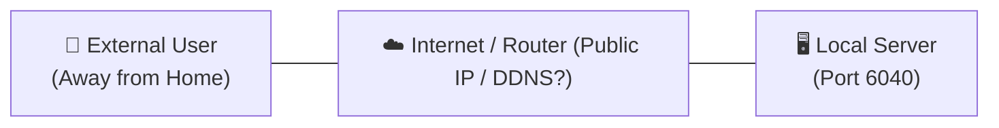
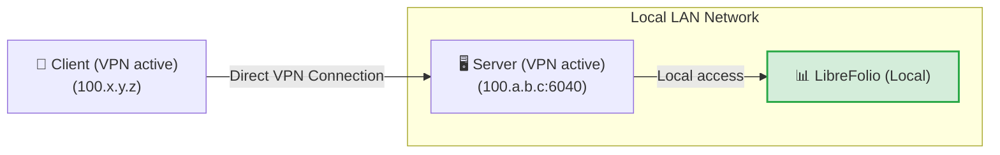
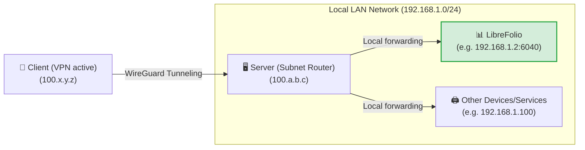

# 🌐 Exposing Securely

This guide shows how to reach LibreFolio away from home **without opening any port on your router**, using [Tailscale](https://tailscale.com/), a secure mesh VPN that is free for home use. The same steps work for any other service on your local network.

You need **Step 0** plus the one level that fits you. Levels 3 and 4 also need the one-time [Funnel setup on the console](service_exposure_funnel.md#enabling-funnel-and-acls-on-the-console).

| Level | Best for | Tailscale on your phone/PC | Public HTTPS address |
|---|---|---|---|
| 🏃 1. Private VPN | Just you, with the quickest setup | Needed | No |
| 🥉 2. Subnet router | Every device of your home LAN, not only LibreFolio | Needed | No |
| 🥈 [3. Funnel](service_exposure_funnel.md#level-3-public-https-address-with-tailscale-funnel) | A public address for LibreFolio, and installing it as an app | Not needed | Yes |
| 🥇 [4. Multi-Funnel with Docker](service_exposure_funnel.md#level-4-multi-funnel-with-docker-sidecars) | One public address per service, each in its own container | Not needed | Yes |

!!! tip "⭐ Our recommendation: Level 4"

    Level 4 needs little more setup than Level 3, keeps every service isolated in its own container and gives each one its own public address. Levels 1–3 are simpler alternatives, and they show the path that leads there.

Everywhere in this guide, `6040` is LibreFolio's default port: if you set a different `PORT` in your `.env`, use that number instead. LibreFolio serves the web app, its API and the built-in documentation on this one port, so it is the only port to expose.

!!! info "📚 This guide is in several pages"

    This page explains why Tailscale beats port forwarding, installs it (Step 0) and covers the two **private** levels, 1 and 2, plus MagicDNS. The **public** levels, with the one-time Funnel setup, are on [Exposing Securely: Public Access with Funnel](service_exposure_funnel.md): Level 3, a public HTTPS address, and Level 4, one address per service with Docker.

---

## 🔒 Why not plain port forwarding?

The classic way is to open a port on your home router and point a dynamic DNS name (such as DuckDNS) at your public IP. It works, but:

- **The whole internet can see it**: anyone can scan your public IP and attack the open port.
- **HTTPS is your job**: you must run a reverse proxy (Nginx, Caddy…) and keep its SSL certificates renewed.
- **Without HTTPS, data travels in clear**: your password and financial data can be intercepted on the way.



Tailscale avoids all three: no router port is opened, the traffic between your devices is encrypted, and Funnel (Levels 3 and 4) adds HTTPS with certificates that Tailscale manages for you.

---

## 🏁 Step 0: Install Tailscale on your devices

[Tailscale](https://tailscale.com/) is a mesh VPN built on the **WireGuard** protocol: your devices join a private network (your *tailnet*) and talk to each other through encrypted tunnels. It runs on Linux, macOS, Windows, iOS and Android, on a NAS or inside Docker, and its free **Personal** plan is enough for home use (see [Tailscale pricing](https://tailscale.com/pricing) for the current limits).

Install it and log in on at least two devices: the **server** that runs LibreFolio and a **client**, such as your phone or laptop.

=== "Linux"

    Run the official installation command on the server:

    ```bash
    curl -fsSL https://tailscale.com/install.sh | sh
    sudo tailscale up
    ```

    For more details, see the [Generic Installation Guide](https://tailscale.com/docs/install).

=== "macOS"

    Install the official app from the **Mac App Store** or use Homebrew:

    ```bash
    brew install --cask tailscale
    sudo tailscale up
    ```

    For more details, see the [Generic Installation Guide](https://tailscale.com/docs/install).

=== "Windows"

    Download the official installer from the Tailscale portal and follow the login wizard.

    For details, see the [Windows Installation Guide](https://tailscale.com/docs/install/windows).

=== "Android"

    Install the official application from the [Google Play Store](https://play.google.com/store/apps/details?id=com.tailscale.ipn).

=== "iOS (iPhone/iPad)"

    Install the official application from the [Apple App Store](https://apps.apple.com/us/app/tailscale/id1470499037).

??? tip "🔑 Keep the server connected — disable key expiry"

    By default, Tailscale asks every device to log in again after 180 days. A server should not drop off your tailnet for that, so turn it off for the server:

    1. On the **Machines** page of the admin console, locate your server.
    2. Click the **three dots (...) icon** on the right of the device row.
    3. Select the **Disable Key Expiry** option.

---

## 🏃 Level 1: Private point-to-point VPN

**Best for you alone, with the quickest setup.** Your phone or laptop reaches LibreFolio through your private tailnet, and nothing is exposed to the internet.



### ▶️ Step 1: Check that LibreFolio answers on its port

Nothing to share: with Tailscale switched on on the server, LibreFolio's port `6040` is already
reachable from your tailnet at the server's Tailscale IP.

??? tip "Prefer an HTTPS address inside your tailnet?"

    Run this on the server, then open `https://<server-name>.your-tailnet.ts.net` instead of the IP:

    ```bash
    tailscale serve --bg 6040
    ```

    `--bg` keeps it running after you close the terminal; `tailscale serve reset` removes it. The
    first time, Tailscale may ask you to enable HTTPS certificates for your tailnet. The address is
    still private: only your tailnet devices can open it.

### 📱 Step 2: Open LibreFolio from your device

With Tailscale switched on on your phone or PC, type the server's Tailscale IP (or its MagicDNS name) followed by the port in the browser, for example `http://100.a.b.c:6040`.

To check the result, see [Checking Connection Security](connection_checks.md#indicator).

⚠️ **Limits:** every device you connect from needs Tailscale switched on, and you reach only the server, not the rest of your home LAN (Level 2 adds that).

---

## 🥉 Level 2: Subnet router for your whole home LAN

**Best for reaching every device at home, not only LibreFolio.** The server becomes a *subnet router*: with Tailscale on, your client opens any local IP as if it were at home, for example `http://192.168.1.2:6040` for LibreFolio.



### 🔀 Step 1: Enable subnet routing on the server

=== "Linux"

    Enable IP forwarding at the kernel level:

    ```bash
    echo 'net.ipv4.ip_forward = 1' | sudo tee -a /etc/sysctl.d/99-tailscale.conf
    echo 'net.ipv6.conf.all.forwarding = 1' | sudo tee -a /etc/sysctl.d/99-tailscale.conf
    sudo sysctl -p /etc/sysctl.d/99-tailscale.conf
    ```

    Start advertising the subnet (replace the IP range with your local network, e.g., `192.168.1.0/24`):

    ```bash
    sudo tailscale up --advertise-routes=192.168.1.0/24
    ```

=== "macOS"

    Use the Tailscale executable path to advertise the local subnet:

    ```bash
    /Applications/Tailscale.app/Contents/MacOS/Tailscale up --advertise-routes=192.168.1.0/24
    ```

=== "Windows"

    Run Command Prompt (`cmd.exe`) or PowerShell as **Administrator** and advertise the local subnet:

    ```cmd
    tailscale up --advertise-routes=192.168.1.0/24
    ```

### ✅ Step 2: Approve the route in the admin console

1. Go to the [Tailscale Admin Console](https://login.tailscale.com/admin/machines).
2. Click the three dots next to your server -> **Edit route settings**.
3. Enable the advertised subnet.

A subnet router is part of your network's plumbing: if you skipped it, disable key expiry for the server now (tip at the end of Step 0).

⚠️ **Limits:** the client still needs Tailscale switched on, you must know the local IPs of your devices, and inside your LAN the traffic travels as plain HTTP.

---

## 🔮 MagicDNS and custom domains

**MagicDNS** gives each device of your tailnet a name: instead of an IP like `100.110.x.x`, you can type `http://your-server` in the browser. Public Funnel addresses end in `.ts.net` (for example, `https://librefolio.your-tailnet.ts.net`, where `librefolio` is the `TS_HOSTNAME` of Level 4).

Prefer your own domain, such as `librefolio.mydomain.com`? Two methods work for **private** access, through the VPN:

??? tip "🌍 Method 1 — A public DNS record pointing to the Tailscale IP (simplest)"

    1. Log into your domain registrar's console (e.g., Cloudflare, GoDaddy, Namecheap).
    2. Create a type **A** (or **AAAA** for IPv6) DNS record for the chosen subdomain (e.g., `librefolio.mydomain.com`).
    3. Point the record directly to the **private Tailscale IP** of your server (e.g., `100.77.x.x`).

    Addresses in the `100.64.0.0/10` network are not routable on the internet, so the name works **only** while you are connected to your tailnet: no outsider can reach or scan the service. For details, see the [Official documentation on DNS settings](https://tailscale.com/kb/1054/dns#public-dns).

??? tip "🧭 Method 2 — Split DNS with your own DNS server"

    For internal records that you manage yourself and never publish on the internet:

    1. Configure a private DNS server in your LAN (such as Pi-hole, AdGuard Home, or CoreDNS).
    2. Add local records of your domain pointing them to your Tailscale IPs.
    3. In the Tailscale admin console, go to *DNS -> Nameservers -> Add Nameserver* and add the Tailscale IP of your private DNS as a global nameserver or restricted to your domain. For details, see the [Official documentation on Split DNS](https://tailscale.com/kb/1054/dns#split-dns).

For **public** access, keep the `*.ts.net` address: Funnel serves it with a certificate signed for that name, so pointing your own domain at it (CNAME) causes SSL/TLS errors in browsers, unless you add your own reverse proxy (such as Caddy or Nginx) with certificates for your domain.

---

## 🔗 Useful links

* 🖥️ [Tailscale Administration Console (Machines)](https://login.tailscale.com/admin/machines)
* 🔐 [Access Controls Management (ACLs)](https://login.tailscale.com/admin/acls)
* 📖 [Official Guide to Tailscale Funnel (English Documentation)](https://tailscale.com/kb/1223/tailscale-funnel)
* 🐳 [Running Tailscale in Docker](https://tailscale.com/kb/1282/docker)

---

## 🔗 Related

- 📄 **[Exposing Securely: Public Access with Funnel](service_exposure_funnel.md)** — Enabling Funnel and ACLs on the console, Level 3: Public HTTPS address with Tailscale Funnel, Level 4: Multi-Funnel with Docker sidecars
