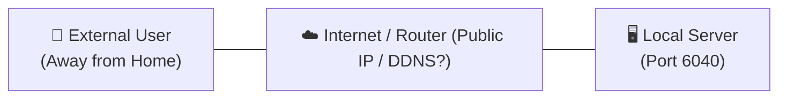
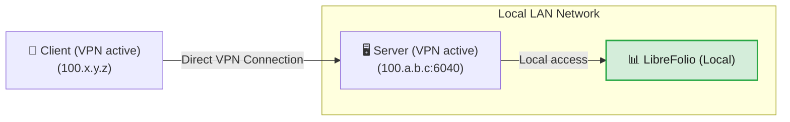
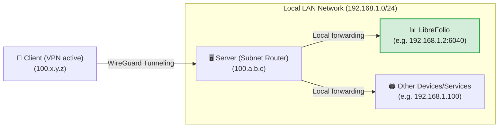

# 🌐 Exposing Securely

Reach LibreFolio away from home **without opening any port on your router**, with [Tailscale](https://tailscale.com/), a mesh VPN that is free for home use. The same steps work for any other service on your local network.

Do **Step 0**, then only the level you need. Levels 1 and 2, **private**, on this page; Levels 3 and 4, **public**, in [Exposing Securely: Public Access with Funnel](service_exposure_funnel.md), after the [one-time Funnel setup on the console](service_exposure_funnel.md#enabling-funnel-and-acls-on-the-console).

| Level | Best for | Tailscale on your phone/PC | Public HTTPS address | Where it is set up |
|---|---|---|---|---|
| 🏃 1. Private VPN | Just you, with the quickest setup | Needed | No | Step 0 only |
| 🥉 2. Subnet router | Every device of your home LAN, not only LibreFolio | Needed | No | Server terminal + Tailscale console |
| 🥈 [3. Funnel](service_exposure_funnel.md#level-3-public-https-address-with-tailscale-funnel) | A public address for LibreFolio, and installing it as an app | Not needed | Yes | Tailscale console + server terminal |
| 🥇 [4. Multi-Funnel with Docker](service_exposure_funnel.md#level-4-multi-funnel-with-docker-sidecars) | One public address per service, each in its own container | Not needed | Yes | Tailscale console + `docker-compose.yml` |

!!! tip "⭐ Our recommendation: Level 4"

    Little more setup than Level 3; every service stays isolated in its own container, with a public address of its own. Levels 1–3 are simpler alternatives and stages on the way to it.

`6040` is LibreFolio's default port: if you set a different `PORT` in your `.env`, use that number. Web app, API and built-in documentation all go through this port: it is the only one to expose.

!!! info "📚 This guide is in several pages"

    Here: why Tailscale, Step 0, Levels 1 and 2, MagicDNS. Levels 3 and 4 and the Funnel setup: [Exposing Securely: Public Access with Funnel](service_exposure_funnel.md).

---

## 🔒 Why not plain port forwarding?

Opening a port on the router and pointing a dynamic DNS name (such as DuckDNS) at it works, but:

- **The open port is visible to anyone** on the internet, who can scan it and attack it.
- **HTTPS is your job**: a reverse proxy (Nginx, Caddy…) and its SSL certificates to renew.
- **Without HTTPS, data travels in clear**: password and financial data can be intercepted.



With Tailscale no router port is opened, the traffic between your devices is encrypted, and Funnel (Levels 3 and 4) adds HTTPS with certificates that Tailscale manages.

---

## 🏁 Step 0: Install Tailscale on your devices

[Tailscale](https://tailscale.com/) (**WireGuard** protocol) links your devices in an encrypted private network, your *tailnet*. It runs on Linux, macOS, Windows, iOS and Android, on a NAS or in Docker; the free **Personal** plan is enough for home use ([Tailscale pricing](https://tailscale.com/pricing) for the current limits).

Install it and log in on at least two devices: LibreFolio's **server** and a **client**, phone or laptop.

=== "Linux"

    **On the server, in a terminal**:

    ```bash
    curl -fsSL https://tailscale.com/install.sh | sh
    sudo tailscale up
    ```

    The server joins your tailnet. Details: [Generic Installation Guide](https://tailscale.com/docs/install).

=== "macOS"

    **On the server**: official app from the **Mac App Store**, or from a terminal with Homebrew:

    ```bash
    brew install --cask tailscale
    sudo tailscale up
    ```

    Details: [Generic Installation Guide](https://tailscale.com/docs/install).

=== "Windows"

    **On the server**: download the official installer from the Tailscale portal and follow the login wizard. Details: [Windows Installation Guide](https://tailscale.com/docs/install/windows).

=== "Android"

    **On the phone**: official app from the [Google Play Store](https://play.google.com/store/apps/details?id=com.tailscale.ipn).

=== "iOS (iPhone/iPad)"

    **On the device**: official app from the [Apple App Store](https://apps.apple.com/us/app/tailscale/id1470499037).

??? tip "🔑 Keep the server connected — disable key expiry"

    Tailscale asks every device to log in again after 180 days. A server must not drop off the tailnet for that. **In the Tailscale admin console, Machines page**:

    1. Locate your server.
    2. Click the **three dots (...) icon** on the right of its row.
    3. Select **Disable Key Expiry**.

---

## 🏃 Level 1: Private point-to-point VPN

**Best if you are on your own, with the quickest setup.** The client reaches LibreFolio through the tailnet; nothing is exposed to the internet.



### ▶️ Step 1: Check that LibreFolio answers on its port

Nothing to configure: with Tailscale on on the server, port `6040` is already reachable from the tailnet at the server's Tailscale IP.

??? tip "Prefer an HTTPS address inside your tailnet?"

    **On the server, in a terminal**:

    ```bash
    tailscale serve --bg 6040
    ```

    Open `https://<server-name>.your-tailnet.ts.net` instead of the IP; it stays private, only the devices of your tailnet open it. `--bg` keeps it on after you close the terminal; `tailscale serve reset` removes it. The first time, Tailscale may ask you to enable HTTPS certificates for the tailnet.

### 📱 Step 2: Open LibreFolio from your device

**On the phone or PC, with Tailscale on**, type the server's Tailscale IP (or its MagicDNS name) and the port in the browser:

```text
http://100.a.b.c:6040
```

LibreFolio opens. To check its security: [Checking Connection Security](connection_checks.md#indicator).

⚠️ **Limits:** every device you connect from must have Tailscale on; you reach only the server, not the rest of the LAN (Level 2 adds that).

---

## 🥉 Level 2: Subnet router for your whole home LAN

**Best for reaching every device at home, not only LibreFolio.** The server becomes a *subnet router*: the client, with Tailscale on, opens any local IP as if at home, for example `http://192.168.1.2:6040` for LibreFolio.



### 🔀 Step 1: Enable subnet routing on the server

Replace `192.168.1.0/24` with your local network.

=== "Linux"

    1. **On the server, in a terminal**, enable IP forwarding in the kernel:

        ```bash
        echo 'net.ipv4.ip_forward = 1' | sudo tee -a /etc/sysctl.d/99-tailscale.conf
        echo 'net.ipv6.conf.all.forwarding = 1' | sudo tee -a /etc/sysctl.d/99-tailscale.conf
        sudo sysctl -p /etc/sysctl.d/99-tailscale.conf
        ```

    2. Advertise the subnet:

        ```bash
        sudo tailscale up --advertise-routes=192.168.1.0/24
        ```

        The route appears in the console, waiting for approval.

=== "macOS"

    **On the server, in a terminal**, with the path of the Tailscale executable:

    ```bash
    /Applications/Tailscale.app/Contents/MacOS/Tailscale up --advertise-routes=192.168.1.0/24
    ```

    The route appears in the console, waiting for approval.

=== "Windows"

    **On the server, in Command Prompt (`cmd.exe`) or PowerShell as Administrator**:

    ```cmd
    tailscale up --advertise-routes=192.168.1.0/24
    ```

    The route appears in the console, waiting for approval.

### ✅ Step 2: Approve the route in the admin console

**In the [Tailscale admin console](https://login.tailscale.com/admin/machines), Machines page**:

1. Click the three dots next to your server -> **Edit route settings**.
2. Enable the advertised subnet.

From the client you now reach every IP of the LAN. The server is now network infrastructure: if you have not yet, disable its key expiry (tip at the end of Step 0).

⚠️ **Limits:** the client must have Tailscale on, you must know the local IPs of your devices and, inside the LAN, the traffic travels as plain HTTP.

---

## 🔮 MagicDNS and custom domains

**MagicDNS** gives each device of the tailnet a name: instead of an IP like `100.110.x.x`, you type `http://your-server`. Public Funnel addresses end in `.ts.net` (for example `https://librefolio.your-tailnet.ts.net`, where `librefolio` is the `TS_HOSTNAME` of Level 4).

A domain of your own, such as `librefolio.mydomain.com`, for **private** access through the VPN: two methods.

??? tip "🌍 Method 1 — A public DNS record pointing to the Tailscale IP (simplest)"

    **In the console of your domain registrar** (e.g. Cloudflare, GoDaddy, Namecheap):

    1. Create a type **A** (or **AAAA** for IPv6) DNS record for the chosen subdomain (e.g. `librefolio.mydomain.com`).
    2. Point it at the server's **private Tailscale IP** (e.g. `100.77.x.x`).

    The name works **only** while you are connected to the tailnet: the `100.64.0.0/10` network is not routable on the internet, no outsider can reach or scan the service. Details: [official documentation on DNS settings](https://tailscale.com/kb/1054/dns#public-dns).

??? tip "🧭 Method 2 — Split DNS with your own DNS server"

    For internal records that you manage, never published on the internet:

    1. **In your LAN**: set up a private DNS server (Pi-hole, AdGuard Home or CoreDNS).
    2. **In your DNS server**: add the records of your domain, pointing them at your Tailscale IPs.
    3. **In the Tailscale admin console**, *DNS -> Nameservers -> Add Nameserver*: add the Tailscale IP of your private DNS, as a global nameserver or restricted to your domain. Details: [official documentation on Split DNS](https://tailscale.com/kb/1054/dns#split-dns).

For **public** access, keep the `*.ts.net` address: Funnel's certificate is signed for that name, so a CNAME from your domain gives SSL/TLS errors in browsers, unless you add a reverse proxy of your own (Caddy or Nginx) with certificates for your domain.

---

## 🔗 Useful links

* 🖥️ [Tailscale admin console (Machines)](https://login.tailscale.com/admin/machines)
* 🔐 [Access controls management (ACLs)](https://login.tailscale.com/admin/acls)
* 📖 [Official guide to Tailscale Funnel (documentation in English)](https://tailscale.com/kb/1223/tailscale-funnel)
* 🐳 [Running Tailscale in Docker](https://tailscale.com/kb/1282/docker)

---

## 🔗 Related

- 📄 **[Exposing Securely: Public Access with Funnel](service_exposure_funnel.md)** — Enabling Funnel and ACLs on the console, Level 3: Public HTTPS address with Tailscale Funnel, Level 4: Multi-Funnel with Docker sidecars
