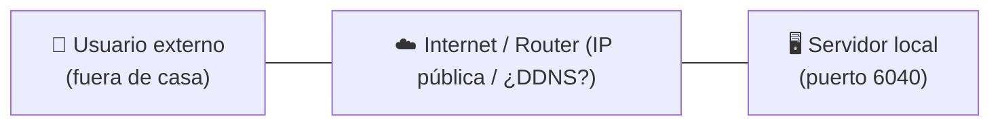
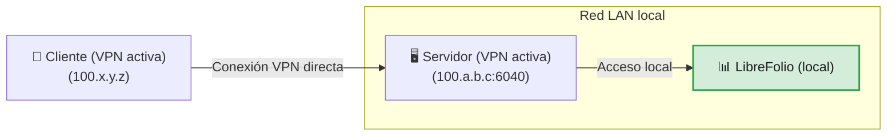
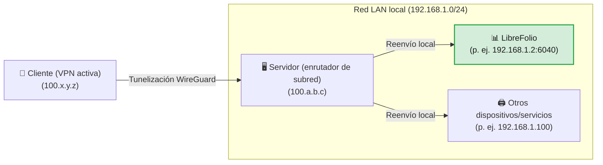

# 🌐 Exponer de forma segura

Accede a LibreFolio fuera de casa **sin abrir ningún puerto en tu router**, con [Tailscale](https://tailscale.com/), una VPN de malla gratuita para uso doméstico. Los mismos pasos sirven para cualquier otro servicio de tu red local.

Haz el **Paso 0** y luego solo el nivel que necesites. Los Niveles 1 y 2, **privados**, en esta página; los Niveles 3 y 4, **públicos**, en [Exponer de forma segura: acceso público con Funnel](service_exposure_funnel.md), después de la [configuración única de Funnel en la consola](service_exposure_funnel.md#enabling-funnel-and-acls-on-the-console).

| Nivel | Ideal para | Tailscale en tu teléfono/PC | Dirección HTTPS pública | Dónde se configura |
|---|---|---|---|---|
| 🏃 1. VPN privada | Solo para ti, con la configuración más rápida | Necesario | No | Solo el Paso 0 |
| 🥉 2. Enrutador de subred | Todos los dispositivos de tu LAN doméstica, no solo LibreFolio | Necesario | No | Terminal del servidor + consola de Tailscale |
| 🥈 [3. Funnel](service_exposure_funnel.md#level-3-public-https-address-with-tailscale-funnel) | Una dirección pública para LibreFolio, e instalarlo como aplicación | No necesario | Sí | Consola de Tailscale + terminal del servidor |
| 🥇 [4. Multi-Funnel con Docker](service_exposure_funnel.md#level-4-multi-funnel-with-docker-sidecars) | Una dirección pública por servicio, cada uno en su propio contenedor | No necesario | Sí | Consola de Tailscale + `docker-compose.yml` |

!!! tip "⭐ Nuestra recomendación: Nivel 4"

    Poca configuración más que el Nivel 3; cada servicio queda aislado en su propio contenedor, con una dirección pública propia. Los Niveles 1–3 son alternativas más sencillas y etapas en el camino hacia él.

`6040` es el puerto predeterminado de LibreFolio: si estableces un `PORT` diferente en tu `.env`, usa ese número. La aplicación web, la API y la documentación integrada pasan todas por este puerto: es el único que hay que exponer.

!!! info "📚 Esta guía está repartida en varias páginas"

    Aquí: por qué Tailscale, el Paso 0, los Niveles 1 y 2, MagicDNS. Los Niveles 3 y 4 y la configuración de Funnel: [Exponer de forma segura: acceso público con Funnel](service_exposure_funnel.md).

---

## 🔒 ¿Por qué no un simple reenvío de puertos?

Abrir un puerto en el router y apuntar a él un nombre de DNS dinámico (como DuckDNS) funciona, pero:

- **El puerto abierto lo ve cualquiera** en internet, que puede escanearlo y atacarlo.
- **HTTPS es cosa tuya**: un proxy inverso (Nginx, Caddy…) y sus certificados SSL que renovar.
- **Sin HTTPS, los datos viajan en claro**: la contraseña y los datos financieros pueden ser interceptados.



Con Tailscale no se abre ningún puerto del router, el tráfico entre tus dispositivos va cifrado, y Funnel (Niveles 3 y 4) añade HTTPS con certificados que gestiona Tailscale.

---

## 🏁 Paso 0: Instalar Tailscale en tus dispositivos

[Tailscale](https://tailscale.com/) (protocolo **WireGuard**) une tus dispositivos en una red privada cifrada, tu *tailnet*. Funciona en Linux, macOS, Windows, iOS y Android, en un NAS o en Docker; el plan gratuito **Personal** basta para uso doméstico ([precios de Tailscale](https://tailscale.com/pricing) para conocer los límites actuales).

Instálalo e inicia sesión en al menos dos dispositivos: el **servidor** de LibreFolio y un **cliente**, teléfono o portátil.

=== "Linux"

    **En el servidor, en una terminal**:

    ```bash
    curl -fsSL https://tailscale.com/install.sh | sh
    sudo tailscale up
    ```

    El servidor se une a tu tailnet. Detalles: [Guía de instalación genérica](https://tailscale.com/docs/install).

=== "macOS"

    **En el servidor**: la aplicación oficial desde el **Mac App Store**, o desde una terminal con Homebrew:

    ```bash
    brew install --cask tailscale
    sudo tailscale up
    ```

    Detalles: [Guía de instalación genérica](https://tailscale.com/docs/install).

=== "Windows"

    **En el servidor**: descarga el instalador oficial desde el portal de Tailscale y sigue el asistente de inicio de sesión. Detalles: [Guía de instalación para Windows](https://tailscale.com/docs/install/windows).

=== "Android"

    **En el teléfono**: la aplicación oficial desde [Google Play Store](https://play.google.com/store/apps/details?id=com.tailscale.ipn).

=== "iOS (iPhone/iPad)"

    **En el dispositivo**: la aplicación oficial desde [Apple App Store](https://apps.apple.com/us/app/tailscale/id1470499037).

??? tip "🔑 Mantén el servidor conectado — desactiva la caducidad de la clave"

    Tailscale pide a cada dispositivo que vuelva a iniciar sesión después de 180 días. Un servidor no debe desconectarse del tailnet por eso. **En la consola de administración de Tailscale, página Machines**:

    1. Localiza tu servidor.
    2. Haz clic en el **icono de tres puntos (...)** a la derecha de su fila.
    3. Selecciona **Disable Key Expiry**.

---

## 🏃 Nivel 1: VPN privada punto a punto

**Ideal si estás solo tú, con la configuración más rápida.** El cliente accede a LibreFolio a través del tailnet; nada queda expuesto a internet.



### ▶️ Paso 1: Comprobar que LibreFolio responde en su puerto

Nada que configurar: con Tailscale activado en el servidor, el puerto `6040` ya es accesible desde el tailnet en la IP de Tailscale del servidor.

??? tip "¿Prefieres una dirección HTTPS dentro de tu tailnet?"

    **En el servidor, en una terminal**:

    ```bash
    tailscale serve --bg 6040
    ```

    Abre `https://<server-name>.your-tailnet.ts.net` en lugar de la IP; sigue siendo privada, solo la abren los dispositivos de tu tailnet. `--bg` lo mantiene en ejecución después de cerrar la terminal; `tailscale serve reset` lo elimina. La primera vez, Tailscale puede pedirte que habilites los certificados HTTPS para el tailnet.

### 📱 Paso 2: Abrir LibreFolio desde tu dispositivo

**En el teléfono o el PC, con Tailscale activado**, escribe en el navegador la IP de Tailscale del servidor (o su nombre MagicDNS) y el puerto:

```text
http://100.a.b.c:6040
```

LibreFolio se abre. Para comprobar su seguridad: [Comprobación de la seguridad de la conexión](connection_checks.md#indicator).

⚠️ **Límites:** cada dispositivo desde el que te conectes debe tener Tailscale activado; llegas solo al servidor, no al resto de la LAN (el Nivel 2 añade eso).

---

## 🥉 Nivel 2: Enrutador de subred para toda tu LAN doméstica

**Ideal para acceder a todos los dispositivos de casa, no solo a LibreFolio.** El servidor se convierte en un *enrutador de subred*: el cliente, con Tailscale activado, abre cualquier IP local como si estuviera en casa, por ejemplo `http://192.168.1.2:6040` para LibreFolio.



### 🔀 Paso 1: Habilitar el enrutamiento de subred en el servidor

Sustituye `192.168.1.0/24` por tu red local.

=== "Linux"

    1. **En el servidor, en una terminal**, habilita el reenvío de IP en el kernel:

        ```bash
        echo 'net.ipv4.ip_forward = 1' | sudo tee -a /etc/sysctl.d/99-tailscale.conf
        echo 'net.ipv6.conf.all.forwarding = 1' | sudo tee -a /etc/sysctl.d/99-tailscale.conf
        sudo sysctl -p /etc/sysctl.d/99-tailscale.conf
        ```

    2. Anuncia la subred:

        ```bash
        sudo tailscale up --advertise-routes=192.168.1.0/24
        ```

        La ruta aparece en la consola, a la espera de aprobación.

=== "macOS"

    **En el servidor, en una terminal**, con la ruta del ejecutable de Tailscale:

    ```bash
    /Applications/Tailscale.app/Contents/MacOS/Tailscale up --advertise-routes=192.168.1.0/24
    ```

    La ruta aparece en la consola, a la espera de aprobación.

=== "Windows"

    **En el servidor, en el Símbolo del sistema (`cmd.exe`) o en PowerShell como Administrador**:

    ```cmd
    tailscale up --advertise-routes=192.168.1.0/24
    ```

    La ruta aparece en la consola, a la espera de aprobación.

### ✅ Paso 2: Aprobar la ruta en la consola de administración

**En la [consola de administración de Tailscale](https://login.tailscale.com/admin/machines), página Machines**:

1. Haz clic en los tres puntos junto a tu servidor -> **Edit route settings**.
2. Habilita la subred anunciada.

Desde el cliente ya llegas a todas las IP de la LAN. El servidor es ahora infraestructura de red: si aún no lo has hecho, desactiva la caducidad de su clave (consejo al final del Paso 0).

⚠️ **Límites:** el cliente debe tener Tailscale activado, debes conocer las IP locales de tus dispositivos y, dentro de la LAN, el tráfico viaja como HTTP simple.

---

## 🔮 MagicDNS y dominios personalizados

**MagicDNS** da un nombre a cada dispositivo del tailnet: en lugar de una IP como `100.110.x.x`, escribes `http://your-server`. Las direcciones públicas de Funnel terminan en `.ts.net` (por ejemplo `https://librefolio.your-tailnet.ts.net`, donde `librefolio` es el `TS_HOSTNAME` del Nivel 4).

Un dominio propio, como `librefolio.mydomain.com`, para el acceso **privado** a través de la VPN: dos métodos.

??? tip "🌍 Método 1 — Un registro DNS público que apunta a la IP de Tailscale (el más sencillo)"

    **En la consola de tu registrador de dominios** (p. ej. Cloudflare, GoDaddy, Namecheap):

    1. Crea un registro DNS de tipo **A** (o **AAAA** para IPv6) para el subdominio elegido (p. ej. `librefolio.mydomain.com`).
    2. Apúntalo a la **IP privada de Tailscale** del servidor (p. ej. `100.77.x.x`).

    El nombre funciona **solo** mientras estás conectado al tailnet: la red `100.64.0.0/10` no es enrutable en internet, ningún externo puede alcanzar ni escanear el servicio. Detalles: [documentación oficial sobre la configuración de DNS](https://tailscale.com/kb/1054/dns#public-dns).

??? tip "🧭 Método 2 — DNS dividido con tu propio servidor DNS"

    Para registros internos que gestionas tú y que nunca se publican en internet:

    1. **En tu LAN**: configura un servidor DNS privado (Pi-hole, AdGuard Home o CoreDNS).
    2. **En tu servidor DNS**: añade los registros de tu dominio, apuntándolos a tus IP de Tailscale.
    3. **En la consola de administración de Tailscale**, *DNS -> Nameservers -> Add Nameserver*: añade la IP de Tailscale de tu DNS privado, como servidor de nombres global o restringido a tu dominio. Detalles: [documentación oficial sobre DNS dividido](https://tailscale.com/kb/1054/dns#split-dns).

Para el acceso **público**, conserva la dirección `*.ts.net`: el certificado de Funnel está firmado para ese nombre, así que un CNAME desde tu dominio da errores SSL/TLS en los navegadores, a menos que añadas un proxy inverso propio (Caddy o Nginx) con certificados para tu dominio.

---

## 🔗 Enlaces útiles

* 🖥️ [Consola de administración de Tailscale (Machines)](https://login.tailscale.com/admin/machines)
* 🔐 [Gestión de los controles de acceso (ACL)](https://login.tailscale.com/admin/acls)
* 📖 [Guía oficial de Tailscale Funnel (documentación en inglés)](https://tailscale.com/kb/1223/tailscale-funnel)
* 🐳 [Ejecutar Tailscale en Docker](https://tailscale.com/kb/1282/docker)

---

## 🔗 Relacionado

- 📄 **[Exponer de forma segura: acceso público con Funnel](service_exposure_funnel.md)** — Habilitar Funnel y las ACL en la consola, Nivel 3: dirección HTTPS pública con Tailscale Funnel, Nivel 4: Multi-Funnel con sidecars de Docker
