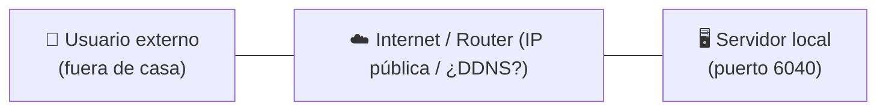
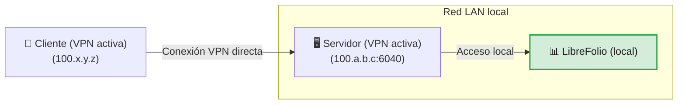
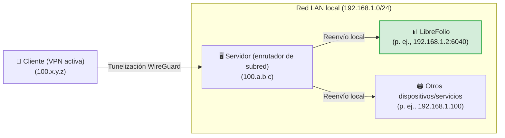

# 🌐 Exponer de forma segura

Esta guía muestra cómo acceder a LibreFolio fuera de casa **sin abrir ningún puerto en tu router**, usando [Tailscale](https://tailscale.com/), una VPN de malla segura y gratuita para uso doméstico. Los mismos pasos sirven para cualquier otro servicio de tu red local.

Necesitas el **Paso 0** y el nivel que mejor se adapte a tus necesidades. Los niveles 3 y 4 también necesitan la [configuración de Funnel en la consola](service_exposure_funnel.md#enabling-funnel-and-acls-on-the-console), que solo hay que hacer una vez.

| Nivel | Ideal para | Tailscale en tu teléfono/PC | Dirección HTTPS pública |
|---|---|---|---|
| 🏃 1. VPN privada | Solo para ti, con la configuración más rápida | Se necesita | No |
| 🥉 2. Enrutador de subred | Todos los dispositivos de tu LAN doméstica, no solo LibreFolio | Se necesita | No |
| 🥈 [3. Funnel](service_exposure_funnel.md#level-3-public-https-address-with-tailscale-funnel) | Una dirección pública para LibreFolio e instalarlo como aplicación | No se necesita | Sí |
| 🥇 [4. Multi-Funnel con Docker](service_exposure_funnel.md#level-4-multi-funnel-with-docker-sidecars) | Una dirección pública por servicio, cada uno en su propio contenedor | No se necesita | Sí |

!!! tip "⭐ Nuestra recomendación: Nivel 4"

    El nivel 4 necesita poco más de configuración que el nivel 3, mantiene cada servicio aislado en su propio contenedor y da a cada uno su propia dirección pública. Los niveles 1–3 son alternativas más sencillas y muestran el camino que lleva hasta ahí.

A lo largo de esta guía, `6040` es el puerto predeterminado de LibreFolio: si configuras un `PORT` distinto en tu `.env`, usa ese número en su lugar. LibreFolio sirve la aplicación web, su API y la documentación integrada en este único puerto, así que es el único puerto que hay que exponer.

!!! info "📚 Esta guía está repartida en varias páginas"

    Esta página explica por qué Tailscale supera al reenvío de puertos, incluye su instalación (Paso 0) y cubre los dos niveles **privados**, 1 y 2, además de MagicDNS. Los niveles **públicos**, con la configuración inicial de Funnel, están en [Exponer de forma segura: acceso público con Funnel](service_exposure_funnel.md): el nivel 3, una dirección HTTPS pública, y el nivel 4, una dirección por servicio con Docker.

---

## 🔒 ¿Por qué no usar el reenvío de puertos simple?

La forma clásica consiste en abrir un puerto en tu router doméstico y apuntar un nombre de DNS dinámico (como DuckDNS) a tu IP pública. Funciona, pero:

- **Todo internet puede verlo**: cualquiera puede escanear tu IP pública y atacar el puerto abierto.
- **HTTPS es tu responsabilidad**: debes ejecutar un proxy inverso (Nginx, Caddy…) y mantener renovados sus certificados SSL.
- **Sin HTTPS, los datos viajan sin cifrar**: tu contraseña y tus datos financieros pueden ser interceptados durante la transmisión.



Tailscale evita las tres cosas: no se abre ningún puerto del router, el tráfico entre tus dispositivos va cifrado y Funnel (niveles 3 y 4) añade HTTPS con certificados que Tailscale gestiona por ti.

---

## 🏁 Paso 0: Instala Tailscale en tus dispositivos

[Tailscale](https://tailscale.com/) es una VPN de malla basada en el protocolo **WireGuard**: tus dispositivos se unen a una red privada (tu *tailnet*) y se comunican entre sí mediante túneles cifrados. Funciona en Linux, macOS, Windows, iOS y Android, en un NAS o dentro de Docker, y su plan gratuito **Personal** es suficiente para uso doméstico (consulta los [precios de Tailscale](https://tailscale.com/pricing) para conocer los límites actuales).

Instálalo e inicia sesión en al menos dos dispositivos: el **servidor** que ejecuta LibreFolio y un **cliente**, como tu teléfono o portátil.

=== "Linux"

    Ejecuta el comando oficial de instalación en el servidor:

    ```bash
    curl -fsSL https://tailscale.com/install.sh | sh
    sudo tailscale up
    ```

    Para más detalles, consulta la [Guía de instalación genérica](https://tailscale.com/docs/install).

=== "macOS"

    Instala la aplicación oficial desde el **Mac App Store** o usa Homebrew:

    ```bash
    brew install --cask tailscale
    sudo tailscale up
    ```

    Para más detalles, consulta la [Guía de instalación genérica](https://tailscale.com/docs/install).

=== "Windows"

    Descarga el instalador oficial desde el portal de Tailscale y sigue el asistente de inicio de sesión.

    Para más detalles, consulta la [Guía de instalación para Windows](https://tailscale.com/docs/install/windows).

=== "Android"

    Instala la aplicación oficial desde [Google Play Store](https://play.google.com/store/apps/details?id=com.tailscale.ipn).

=== "iOS (iPhone/iPad)"

    Instala la aplicación oficial desde [Apple App Store](https://apps.apple.com/us/app/tailscale/id1470499037).

??? tip "🔑 Mantén el servidor conectado — desactiva la caducidad de claves"

    De forma predeterminada, Tailscale pide a cada dispositivo que vuelva a iniciar sesión después de 180 días. Un servidor no debería desconectarse de tu tailnet por eso, así que desactiva la caducidad de claves para el servidor:

    1. En la página **Máquinas** de la consola de administración, localiza tu servidor.
    2. Haz clic en el **icono de tres puntos (...)** a la derecha de la fila del dispositivo.
    3. Selecciona la opción **Desactivar la caducidad de claves**.

---

## 🏃 Nivel 1: VPN privada punto a punto

**Ideal para uso exclusivamente personal, con la configuración más rápida.** Tu teléfono o portátil accede a LibreFolio a través de tu tailnet privada, y nada queda expuesto a internet.



### ▶️ Paso 1: Comprueba que LibreFolio responde en su puerto

No hay nada que compartir: con Tailscale activado en el servidor, el puerto `6040` de LibreFolio ya es accesible desde tu tailnet en la IP de Tailscale del servidor.

??? tip "¿Prefieres una dirección HTTPS dentro de tu tailnet?"

    Ejecuta esto en el servidor y luego abre `https://<server-name>.your-tailnet.ts.net` en lugar de la IP:

    ```bash
    tailscale serve --bg 6040
    ```

    `--bg` lo mantiene en ejecución después de cerrar la terminal; `tailscale serve reset` lo elimina. La primera vez, Tailscale puede pedirte que habilites los certificados HTTPS para tu tailnet. La dirección sigue siendo privada: solo los dispositivos de tu tailnet pueden abrirla.

### 📱 Paso 2: Abre LibreFolio desde tu dispositivo

Con Tailscale activado en tu teléfono o PC, escribe en el navegador la IP de Tailscale del servidor (o su nombre MagicDNS) seguida del puerto, por ejemplo `http://100.a.b.c:6040`.

Para comprobar el resultado, consulta [Comprobación de la seguridad de la conexión](connection_checks.md#indicator).

⚠️ **Limitaciones:** cada dispositivo desde el que te conectes debe tener Tailscale activado, y solo llegas al servidor, no al resto de tu LAN doméstica (el nivel 2 añade eso).

---

## 🥉 Nivel 2: Enrutador de subred para toda tu LAN doméstica

**Ideal para acceder a todos los dispositivos de casa, no solo a LibreFolio.** El servidor se convierte en un *enrutador de subred*: con Tailscale activado, tu cliente abre cualquier IP local como si estuvieras en casa, por ejemplo `http://192.168.1.2:6040` para LibreFolio.



### 🔀 Paso 1: Habilita el enrutamiento de subred en el servidor

=== "Linux"

    Habilita el reenvío de IP a nivel del kernel:

    ```bash
    echo 'net.ipv4.ip_forward = 1' | sudo tee -a /etc/sysctl.d/99-tailscale.conf
    echo 'net.ipv6.conf.all.forwarding = 1' | sudo tee -a /etc/sysctl.d/99-tailscale.conf
    sudo sysctl -p /etc/sysctl.d/99-tailscale.conf
    ```

    Empieza a anunciar la subred (sustituye el rango de IP por tu red local, p. ej., `192.168.1.0/24`):

    ```bash
    sudo tailscale up --advertise-routes=192.168.1.0/24
    ```

=== "macOS"

    Usa la ruta del ejecutable de Tailscale para anunciar la subred local:

    ```bash
    /Applications/Tailscale.app/Contents/MacOS/Tailscale up --advertise-routes=192.168.1.0/24
    ```

=== "Windows"

    Ejecuta el Símbolo del sistema (`cmd.exe`) o PowerShell como **Administrador** y anuncia la subred local:

    ```cmd
    tailscale up --advertise-routes=192.168.1.0/24
    ```

### ✅ Paso 2: Aprueba la ruta en la consola de administración

1. Ve a la [Consola de administración de Tailscale](https://login.tailscale.com/admin/machines).
2. Haz clic en los tres puntos junto a tu servidor -> **Editar la configuración de rutas**.
3. Habilita la subred anunciada.

Un enrutador de subred forma parte de la infraestructura de tu red: si no desactivaste la caducidad de claves, hazlo ahora para el servidor (consejo al final del Paso 0).

⚠️ **Limitaciones:** el cliente sigue necesitando Tailscale activado, debes conocer las IP locales de tus dispositivos y, dentro de tu LAN, el tráfico viaja como HTTP sin cifrar.

---

## 🔮 MagicDNS y dominios personalizados

**MagicDNS** asigna un nombre a cada dispositivo de tu tailnet: en lugar de una IP como `100.110.x.x`, puedes escribir `http://your-server` en el navegador. Las direcciones públicas de Funnel terminan en `.ts.net` (por ejemplo, `https://librefolio.your-tailnet.ts.net`, donde `librefolio` es el `TS_HOSTNAME` del nivel 4).

¿Prefieres tu propio dominio, como `librefolio.mydomain.com`? Hay dos métodos que funcionan para el acceso **privado**, a través de la VPN:

??? tip "🌍 Método 1 — Un registro DNS público que apunta a la IP de Tailscale (el más sencillo)"

    1. Inicia sesión en la consola de tu registrador de dominios (p. ej., Cloudflare, GoDaddy, Namecheap).
    2. Crea un registro DNS de tipo **A** (o **AAAA** para IPv6) para el subdominio elegido (p. ej., `librefolio.mydomain.com`).
    3. Apunta el registro directamente a la **IP privada de Tailscale** de tu servidor (p. ej., `100.77.x.x`).

    Las direcciones de la red `100.64.0.0/10` no son enrutables en internet, por lo que el nombre funciona **solo** mientras estás conectado a tu tailnet: ningún externo puede alcanzar ni escanear el servicio. Para más detalles, consulta la [documentación oficial sobre la configuración de DNS](https://tailscale.com/kb/1054/dns#public-dns).

??? tip "🧭 Método 2 — DNS dividido con tu propio servidor DNS"

    Para registros internos que gestionas tú mismo y que nunca publicas en internet:

    1. Configura un servidor DNS privado en tu LAN (como Pi-hole, AdGuard Home o CoreDNS).
    2. Añade registros locales de tu dominio apuntando a tus IP de Tailscale.
    3. En la consola de administración de Tailscale, ve a *DNS -> Servidores de nombres -> Añadir servidor de nombres* y añade la IP de Tailscale de tu DNS privado como servidor de nombres global o restringido a tu dominio. Para más detalles, consulta la [documentación oficial sobre DNS dividido](https://tailscale.com/kb/1054/dns#split-dns).

Para el acceso **público**, conserva la dirección `*.ts.net`: Funnel la sirve con un certificado firmado para ese nombre, así que apuntar tu propio dominio a ella (CNAME) provoca errores SSL/TLS en los navegadores, a menos que añadas tu propio proxy inverso (como Caddy o Nginx) con certificados para tu dominio.

---

## 🔗 Enlaces útiles

* 🖥️ [Consola de administración de Tailscale (Máquinas)](https://login.tailscale.com/admin/machines)
* 🔐 [Gestión de controles de acceso (ACLs)](https://login.tailscale.com/admin/acls)
* 📖 [Guía oficial de Tailscale Funnel (documentación en inglés)](https://tailscale.com/kb/1223/tailscale-funnel)
* 🐳 [Ejecutar Tailscale en Docker](https://tailscale.com/kb/1282/docker)

---

## 🔗 Relacionado

- 📄 **[Exponer de forma segura: acceso público con Funnel](service_exposure_funnel.md)** — Habilitar Funnel y las ACL en la consola, Nivel 3: dirección HTTPS pública con Tailscale Funnel, Nivel 4: Multi-Funnel con sidecars de Docker
