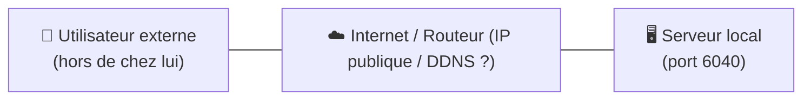
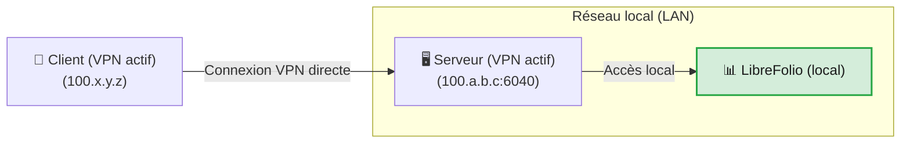
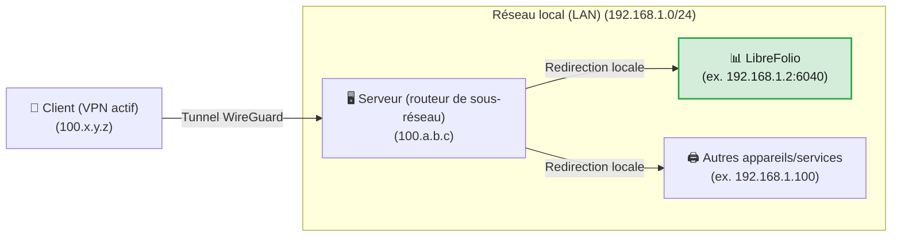

# 🌐 Exposer en toute sécurité

Accédez à LibreFolio hors de chez vous **sans ouvrir aucun port sur votre routeur**, avec [Tailscale](https://tailscale.com/), un VPN maillé gratuit pour un usage domestique. Les mêmes étapes fonctionnent pour tout autre service de votre réseau local.

Faites l’**étape 0**, puis seulement le niveau dont vous avez besoin. Les niveaux 1 et 2, **privés**, sur cette page ; les niveaux 3 et 4, **publics**, dans [Exposer en toute sécurité : accès public avec Funnel](service_exposure_funnel.md), après la [configuration unique de Funnel sur la console](service_exposure_funnel.md#enabling-funnel-and-acls-on-the-console).

| Niveau | Idéal pour | Tailscale sur votre téléphone/PC | Adresse HTTPS publique | Où le configurer |
|---|---|---|---|---|
| 🏃 1. VPN privé | Vous seul, avec la configuration la plus rapide | Nécessaire | Non | Étape 0 seulement |
| 🥉 2. Routeur de sous-réseau | Tous les appareils de votre réseau local domestique, pas seulement LibreFolio | Nécessaire | Non | Terminal du serveur + console Tailscale |
| 🥈 [3. Funnel](service_exposure_funnel.md#level-3-public-https-address-with-tailscale-funnel) | Une adresse publique pour LibreFolio, et son installation comme application | Pas nécessaire | Oui | Console Tailscale + terminal du serveur |
| 🥇 [4. Multi-Funnel avec Docker](service_exposure_funnel.md#level-4-multi-funnel-with-docker-sidecars) | Une adresse publique par service, chacun dans son propre conteneur | Pas nécessaire | Oui | Console Tailscale + `docker-compose.yml` |

!!! tip "⭐ Notre recommandation : niveau 4"

    À peine plus de configuration que le niveau 3 ; chaque service reste isolé dans son propre conteneur, avec sa propre adresse publique. Les niveaux 1 à 3 sont des alternatives plus simples et des étapes sur le chemin qui y mène.

`6040` est le port par défaut de LibreFolio : si vous définissez un autre `PORT` dans votre `.env`, utilisez ce nombre. L’application web, l’API et la documentation intégrée passent toutes par ce port : c’est le seul à exposer.

!!! info "📚 Ce guide est réparti sur plusieurs pages"

    Ici : pourquoi Tailscale, l’étape 0, les niveaux 1 et 2, MagicDNS. Les niveaux 3 et 4 et la configuration de Funnel : [Exposer en toute sécurité : accès public avec Funnel](service_exposure_funnel.md).

---

## 🔒 Pourquoi ne pas faire une simple redirection de port ?

Ouvrir un port sur le routeur et y faire pointer un nom DNS dynamique (comme DuckDNS) fonctionne, mais :

- **Le port ouvert est visible de n’importe qui** sur internet, qui peut le scanner et l’attaquer.
- **HTTPS est à votre charge** : un proxy inverse (Nginx, Caddy…) et ses certificats SSL à renouveler.
- **Sans HTTPS, les données circulent en clair** : le mot de passe et les données financières peuvent être interceptés.



Avec Tailscale, aucun port du routeur n’est ouvert, le trafic entre vos appareils est chiffré, et Funnel (niveaux 3 et 4) ajoute HTTPS avec des certificats que Tailscale gère.

---

## 🏁 Étape 0 : installer Tailscale sur vos appareils

[Tailscale](https://tailscale.com/) (protocole **WireGuard**) relie vos appareils dans un réseau privé chiffré, votre *tailnet*. Il fonctionne sous Linux, macOS, Windows, iOS et Android, sur un NAS ou dans Docker ; l’offre gratuite **Personal** suffit pour un usage domestique (voir la [tarification Tailscale](https://tailscale.com/pricing) pour connaître les limites actuelles).

Installez-le et connectez-vous sur au moins deux appareils : le **serveur** de LibreFolio et un **client**, téléphone ou ordinateur portable.

=== "Linux"

    **Sur le serveur, dans un terminal** :

    ```bash
    curl -fsSL https://tailscale.com/install.sh | sh
    sudo tailscale up
    ```

    Le serveur rejoint votre tailnet. Détails : [guide d’installation générique](https://tailscale.com/docs/install).

=== "macOS"

    **Sur le serveur** : l’application officielle depuis le **Mac App Store**, ou depuis un terminal avec Homebrew :

    ```bash
    brew install --cask tailscale
    sudo tailscale up
    ```

    Détails : [guide d’installation générique](https://tailscale.com/docs/install).

=== "Windows"

    **Sur le serveur** : téléchargez l’installateur officiel depuis le portail Tailscale et suivez l’assistant de connexion. Détails : [guide d’installation pour Windows](https://tailscale.com/docs/install/windows).

=== "Android"

    **Sur le téléphone** : l’application officielle depuis le [Google Play Store](https://play.google.com/store/apps/details?id=com.tailscale.ipn).

=== "iOS (iPhone/iPad)"

    **Sur l’appareil** : l’application officielle depuis l’[App Store d’Apple](https://apps.apple.com/us/app/tailscale/id1470499037).

??? tip "🔑 Gardez le serveur connecté — désactivez l’expiration des clés"

    Tailscale demande à chaque appareil de se reconnecter après 180 jours. Un serveur ne doit pas quitter le tailnet pour cette raison. **Dans la console d’administration Tailscale, page Machines** :

    1. Repérez votre serveur.
    2. Cliquez sur l’**icône à trois points (...)** à droite de sa ligne.
    3. Sélectionnez **Disable Key Expiry**.

---

## 🏃 Niveau 1 : VPN privé point à point

**Idéal si vous êtes seul, avec la configuration la plus rapide.** Le client accède à LibreFolio via le tailnet ; rien n’est exposé à internet.



### ▶️ Étape 1 : vérifier que LibreFolio répond sur son port

Rien à configurer : avec Tailscale activé sur le serveur, le port `6040` est déjà accessible depuis le tailnet à l’adresse IP Tailscale du serveur.

??? tip "Vous préférez une adresse HTTPS au sein de votre tailnet ?"

    **Sur le serveur, dans un terminal** :

    ```bash
    tailscale serve --bg 6040
    ```

    Ouvrez `https://<server-name>.your-tailnet.ts.net` au lieu de l’IP ; elle reste privée, seuls les appareils de votre tailnet l’ouvrent. `--bg` la maintient active après la fermeture du terminal ; `tailscale serve reset` la supprime. La première fois, Tailscale peut vous demander d’activer les certificats HTTPS pour le tailnet.

### 📱 Étape 2 : ouvrir LibreFolio depuis votre appareil

**Sur le téléphone ou le PC, avec Tailscale activé**, saisissez dans le navigateur l’adresse IP Tailscale du serveur (ou son nom MagicDNS) et le port :

```text
http://100.a.b.c:6040
```

LibreFolio s’ouvre. Pour vérifier sa sécurité : [Vérification de la sécurité de la connexion](connection_checks.md#indicator).

⚠️ **Limites :** chaque appareil depuis lequel vous vous connectez doit avoir Tailscale activé ; vous n’atteignez que le serveur, pas le reste du réseau local (le niveau 2 ajoute cela).

---

## 🥉 Niveau 2 : routeur de sous-réseau pour tout votre réseau local domestique

**Idéal pour atteindre tous les appareils à la maison, pas seulement LibreFolio.** Le serveur devient un *routeur de sous-réseau* : le client, avec Tailscale activé, ouvre n’importe quelle IP locale comme s’il était chez vous, par exemple `http://192.168.1.2:6040` pour LibreFolio.



### 🔀 Étape 1 : activer le routage de sous-réseau sur le serveur

Remplacez `192.168.1.0/24` par votre réseau local.

=== "Linux"

    1. **Sur le serveur, dans un terminal**, activez le transfert IP dans le noyau :

        ```bash
        echo 'net.ipv4.ip_forward = 1' | sudo tee -a /etc/sysctl.d/99-tailscale.conf
        echo 'net.ipv6.conf.all.forwarding = 1' | sudo tee -a /etc/sysctl.d/99-tailscale.conf
        sudo sysctl -p /etc/sysctl.d/99-tailscale.conf
        ```

    2. Annoncez le sous-réseau :

        ```bash
        sudo tailscale up --advertise-routes=192.168.1.0/24
        ```

        La route apparaît dans la console, en attente d’approbation.

=== "macOS"

    **Sur le serveur, dans un terminal**, avec le chemin de l’exécutable Tailscale :

    ```bash
    /Applications/Tailscale.app/Contents/MacOS/Tailscale up --advertise-routes=192.168.1.0/24
    ```

    La route apparaît dans la console, en attente d’approbation.

=== "Windows"

    **Sur le serveur, dans l’invite de commandes (`cmd.exe`) ou PowerShell en tant qu’Administrateur** :

    ```cmd
    tailscale up --advertise-routes=192.168.1.0/24
    ```

    La route apparaît dans la console, en attente d’approbation.

### ✅ Étape 2 : approuver la route dans la console d’administration

**Dans la [console d’administration Tailscale](https://login.tailscale.com/admin/machines), page Machines** :

1. Cliquez sur les trois points à côté de votre serveur -> **Edit route settings**.
2. Activez le sous-réseau annoncé.

Depuis le client, vous atteignez maintenant chaque IP du réseau local. Le serveur fait désormais partie de l’infrastructure réseau : si ce n’est pas encore fait, désactivez l’expiration de sa clé (astuce à la fin de l’étape 0).

⚠️ **Limites :** le client doit avoir Tailscale activé, vous devez connaître les IP locales de vos appareils et, dans le réseau local, le trafic circule en HTTP simple.

---

## 🔮 MagicDNS et domaines personnalisés

**MagicDNS** donne un nom à chaque appareil du tailnet : au lieu d’une IP comme `100.110.x.x`, vous saisissez `http://your-server`. Les adresses publiques Funnel se terminent par `.ts.net` (par exemple `https://librefolio.your-tailnet.ts.net`, où `librefolio` est le `TS_HOSTNAME` du niveau 4).

Un domaine à vous, comme `librefolio.mydomain.com`, pour un accès **privé** via le VPN : deux méthodes.

??? tip "🌍 Méthode 1 — Un enregistrement DNS public pointant vers l’IP Tailscale (la plus simple)"

    **Dans la console de votre registrar de domaine** (par exemple Cloudflare, GoDaddy, Namecheap) :

    1. Créez un enregistrement DNS de type **A** (ou **AAAA** pour IPv6) pour le sous-domaine choisi (par exemple `librefolio.mydomain.com`).
    2. Faites-le pointer vers l’**IP Tailscale privée** du serveur (par exemple `100.77.x.x`).

    Le nom ne fonctionne **que** lorsque vous êtes connecté au tailnet : le réseau `100.64.0.0/10` n’est pas routable sur internet, aucun tiers ne peut atteindre ni scanner le service. Détails : [documentation officielle sur les paramètres DNS](https://tailscale.com/kb/1054/dns#public-dns).

??? tip "🧭 Méthode 2 — Split DNS avec votre propre serveur DNS"

    Pour des enregistrements internes que vous gérez, jamais publiés sur internet :

    1. **Dans votre réseau local** : configurez un serveur DNS privé (Pi-hole, AdGuard Home ou CoreDNS).
    2. **Dans votre serveur DNS** : ajoutez les enregistrements de votre domaine, en les faisant pointer vers vos IP Tailscale.
    3. **Dans la console d’administration Tailscale**, *DNS -> Nameservers -> Add Nameserver* : ajoutez l’IP Tailscale de votre DNS privé, comme serveur de noms global ou limité à votre domaine. Détails : [documentation officielle sur le Split DNS](https://tailscale.com/kb/1054/dns#split-dns).

Pour un accès **public**, conservez l’adresse `*.ts.net` : le certificat de Funnel est signé pour ce nom, donc un CNAME depuis votre domaine provoque des erreurs SSL/TLS dans les navigateurs, sauf si vous ajoutez votre propre proxy inverse (Caddy ou Nginx) avec des certificats pour votre domaine.

---

## 🔗 Liens utiles

* 🖥️ [Console d’administration Tailscale (Machines)](https://login.tailscale.com/admin/machines)
* 🔐 [Gestion des contrôles d’accès (ACLs)](https://login.tailscale.com/admin/acls)
* 📖 [Guide officiel de Tailscale Funnel (documentation en anglais)](https://tailscale.com/kb/1223/tailscale-funnel)
* 🐳 [Exécuter Tailscale dans Docker](https://tailscale.com/kb/1282/docker)

---

## 🔗 Voir aussi

- 📄 **[Exposer en toute sécurité : accès public avec Funnel](service_exposure_funnel.md)** — Activer Funnel et les ACL sur la console, niveau 3 : adresse HTTPS publique avec Tailscale Funnel, niveau 4 : Multi-Funnel avec des sidecars Docker
