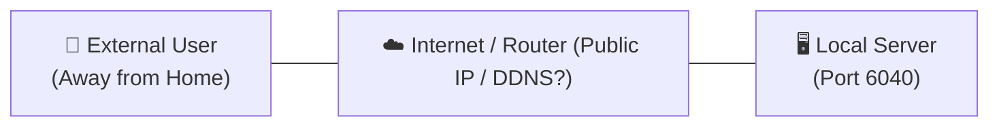
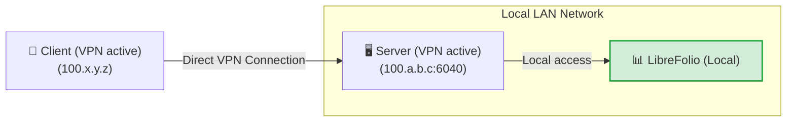
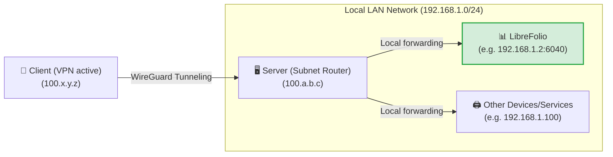

# 🌐 Exposer en toute sécurité

Ce guide montre comment accéder à LibreFolio depuis l'extérieur de chez vous **sans ouvrir aucun port sur votre routeur**, grâce à [Tailscale](https://tailscale.com/), un VPN maillé sécurisé gratuit pour un usage domestique. Les mêmes étapes fonctionnent pour tout autre service de votre réseau local.

Vous devez suivre l'**étape 0** ainsi que le niveau qui vous convient. Les niveaux 3 et 4 nécessitent également la [configuration initiale de Funnel sur la console](service_exposure_funnel.md#enabling-funnel-and-acls-on-the-console).

| Niveau | Idéal pour | Tailscale sur votre téléphone/PC | Adresse HTTPS publique |
|---|---|---|---|
| 🏃 1. VPN privé | Vous seul, avec la configuration la plus rapide | Nécessaire | Non |
| 🥉 2. Routeur de sous-réseau | Tous les appareils de votre réseau local domestique, pas seulement LibreFolio | Nécessaire | Non |
| 🥈 [3. Funnel](service_exposure_funnel.md#level-3-public-https-address-with-tailscale-funnel) | Une adresse publique pour LibreFolio, et son installation en tant qu'application | Pas nécessaire | Oui |
| 🥇 [4. Multi-Funnel avec Docker](service_exposure_funnel.md#level-4-multi-funnel-with-docker-sidecars) | Une adresse publique par service, chacun dans son propre conteneur | Pas nécessaire | Oui |

!!! tip "⭐ Notre recommandation : niveau 4"

    Le niveau 4 demande à peine plus de configuration que le niveau 3, garde chaque service isolé dans son propre conteneur et donne à chacun sa propre adresse publique. Les niveaux 1 à 3 sont des alternatives plus simples, et ils montrent le chemin qui y mène.

Partout dans ce guide, `6040` est le port par défaut de LibreFolio : si vous définissez un `PORT` différent dans votre `.env`, utilisez ce numéro à la place. LibreFolio sert l'application web, son API et la documentation intégrée sur ce seul port ; c'est donc le seul port à exposer.

!!! info "📚 Ce guide est réparti sur plusieurs pages"

    Cette page explique pourquoi Tailscale est préférable à la redirection de port, décrit son installation (étape 0) et couvre les deux niveaux **privés**, 1 et 2, ainsi que MagicDNS. Les niveaux **publics**, avec la configuration initiale de Funnel, se trouvent sur [Exposer en toute sécurité : accès public avec Funnel](service_exposure_funnel.md) : niveau 3, une adresse HTTPS publique, et niveau 4, une adresse par service avec Docker.

---

## 🔒 Pourquoi ne pas utiliser une simple redirection de port ?

La méthode classique consiste à ouvrir un port sur votre routeur domestique et à faire pointer un nom DNS dynamique (comme DuckDNS) vers votre IP publique. Cela fonctionne, mais :

- **N'importe qui sur Internet peut le voir** : n'importe qui peut scanner votre IP publique et attaquer le port ouvert.
- **HTTPS est à votre charge** : vous devez gérer un proxy inverse (Nginx, Caddy…) et veiller au renouvellement de ses certificats SSL.
- **Sans HTTPS, les données circulent en clair** : votre mot de passe et vos données financières peuvent être interceptés en chemin.



Tailscale évite ces trois écueils : aucun port du routeur n'est ouvert, le trafic entre vos appareils est chiffré, et Funnel (niveaux 3 et 4) ajoute HTTPS avec des certificats que Tailscale gère pour vous.

---

## 🏁 Étape 0 : Installer Tailscale sur vos appareils

[Tailscale](https://tailscale.com/) est un VPN maillé basé sur le protocole **WireGuard** : vos appareils rejoignent un réseau privé (votre *tailnet*) et communiquent entre eux via des tunnels chiffrés. Il fonctionne sous Linux, macOS, Windows, iOS et Android, sur un NAS ou dans Docker, et son offre **Personal** gratuite suffit pour un usage domestique (voir la [tarification Tailscale](https://tailscale.com/pricing) pour connaître les limites actuelles).

Installez-le et connectez-vous sur au moins deux appareils : le **serveur** qui exécute LibreFolio et un **client**, comme votre téléphone ou votre ordinateur portable.

=== "Linux"

    Exécutez la commande d'installation officielle sur le serveur :

    ```bash
    curl -fsSL https://tailscale.com/install.sh | sh
    sudo tailscale up
    ```

    Pour plus de détails, consultez le [guide d'installation générique](https://tailscale.com/docs/install).

=== "macOS"

    Installez l'application officielle depuis le **Mac App Store** ou utilisez Homebrew :

    ```bash
    brew install --cask tailscale
    sudo tailscale up
    ```

    Pour plus de détails, consultez le [guide d'installation générique](https://tailscale.com/docs/install).

=== "Windows"

    Téléchargez l'installateur officiel depuis le portail Tailscale et suivez l'assistant de connexion.

    Pour plus de détails, consultez le [guide d'installation pour Windows](https://tailscale.com/docs/install/windows).

=== "Android"

    Installez l'application officielle depuis le [Google Play Store](https://play.google.com/store/apps/details?id=com.tailscale.ipn).

=== "iOS (iPhone/iPad)"

    Installez l'application officielle depuis l'[App Store d'Apple](https://apps.apple.com/us/app/tailscale/id1470499037).

??? tip "🔑 Gardez le serveur connecté — désactivez l'expiration des clés"

    Par défaut, Tailscale demande à chaque appareil de se reconnecter après 180 jours. Un serveur ne doit pas être exclu de votre tailnet pour cette raison ; désactivez donc cette option pour le serveur :

    1. Sur la page **Machines** de la console d'administration, repérez votre serveur.
    2. Cliquez sur l'**icône à trois points (...)** à droite de la ligne de l'appareil.
    3. Sélectionnez l'option **Désactiver l'expiration des clés**.

---

## 🏃 Niveau 1 : VPN privé point à point

**Idéal pour vous seul, avec la configuration la plus rapide.** Votre téléphone ou votre ordinateur portable accède à LibreFolio via votre tailnet privé, et rien n'est exposé à Internet.



### ▶️ Étape 1 : Vérifier que LibreFolio répond sur son port

Rien à exposer : avec Tailscale activé sur le serveur, le port `6040` de LibreFolio est déjà accessible depuis votre tailnet à l'adresse IP Tailscale du serveur.

??? tip "Vous préférez une adresse HTTPS au sein de votre tailnet ?"

    Exécutez ceci sur le serveur, puis ouvrez `https://<server-name>.your-tailnet.ts.net` au lieu de l'IP :

    ```bash
    tailscale serve --bg 6040
    ```

    `--bg` le maintient actif après la fermeture du terminal ; `tailscale serve reset` le supprime. La première fois, Tailscale peut vous demander d'activer les certificats HTTPS pour votre tailnet. L'adresse reste privée : seuls les appareils de votre tailnet peuvent l'ouvrir.

### 📱 Étape 2 : Ouvrir LibreFolio depuis votre appareil

Avec Tailscale activé sur votre téléphone ou votre PC, saisissez dans le navigateur l'adresse IP Tailscale du serveur (ou son nom MagicDNS) suivie du port, par exemple `http://100.a.b.c:6040`.

Pour vérifier le résultat, consultez [Vérification de la sécurité de la connexion](connection_checks.md#indicator).

⚠️ **Limites :** chaque appareil depuis lequel vous vous connectez doit avoir Tailscale activé, et vous n'atteignez que le serveur, pas le reste de votre réseau local domestique (le niveau 2 ajoute cela).

---

## 🥉 Niveau 2 : Routeur de sous-réseau pour tout votre réseau local domestique

**Idéal pour atteindre tous les appareils à la maison, pas seulement LibreFolio.** Le serveur devient un *routeur de sous-réseau* : avec Tailscale activé, votre client ouvre n'importe quelle IP locale comme s'il était à la maison, par exemple `http://192.168.1.2:6040` pour LibreFolio.



### 🔀 Étape 1 : Activer le routage de sous-réseau sur le serveur

=== "Linux"

    Activez le transfert IP au niveau du noyau :

    ```bash
    echo 'net.ipv4.ip_forward = 1' | sudo tee -a /etc/sysctl.d/99-tailscale.conf
    echo 'net.ipv6.conf.all.forwarding = 1' | sudo tee -a /etc/sysctl.d/99-tailscale.conf
    sudo sysctl -p /etc/sysctl.d/99-tailscale.conf
    ```

    Commencez à annoncer le sous-réseau (remplacez la plage d'IP par votre réseau local, par exemple `192.168.1.0/24`) :

    ```bash
    sudo tailscale up --advertise-routes=192.168.1.0/24
    ```

=== "macOS"

    Utilisez le chemin de l'exécutable Tailscale pour annoncer le sous-réseau local :

    ```bash
    /Applications/Tailscale.app/Contents/MacOS/Tailscale up --advertise-routes=192.168.1.0/24
    ```

=== "Windows"

    Ouvrez l'invite de commandes (`cmd.exe`) ou PowerShell en tant qu'**Administrateur** et annoncez le sous-réseau local :

    ```cmd
    tailscale up --advertise-routes=192.168.1.0/24
    ```

### ✅ Étape 2 : Approuver la route dans la console d'administration

1. Accédez à la [console d'administration Tailscale](https://login.tailscale.com/admin/machines).
2. Cliquez sur les trois points à côté de votre serveur -> **Modifier les paramètres de route**.
3. Activez le sous-réseau annoncé.

Un routeur de sous-réseau fait partie de l'infrastructure de votre réseau : si vous êtes passé à côté de cette astuce, désactivez dès maintenant l'expiration des clés pour le serveur (astuce à la fin de l'étape 0).

⚠️ **Limites :** le client doit toujours avoir Tailscale activé, vous devez connaître les IP locales de vos appareils, et au sein de votre réseau local, le trafic circule en HTTP en clair.

---

## 🔮 MagicDNS et domaines personnalisés

**MagicDNS** attribue un nom à chaque appareil de votre tailnet : au lieu d'une IP comme `100.110.x.x`, vous pouvez saisir `http://your-server` dans le navigateur. Les adresses publiques Funnel se terminent par `.ts.net` (par exemple, `https://librefolio.your-tailnet.ts.net`, où `librefolio` est le `TS_HOSTNAME` du niveau 4).

Vous préférez votre propre domaine, comme `librefolio.mydomain.com` ? Deux méthodes fonctionnent pour un accès **privé**, via le VPN :

??? tip "🌍 Méthode 1 — Un enregistrement DNS public pointant vers l'IP Tailscale (la méthode la plus simple)"

    1. Connectez-vous à la console de votre registrar de domaine (par exemple Cloudflare, GoDaddy, Namecheap).
    2. Créez un enregistrement DNS de type **A** (ou **AAAA** pour IPv6) pour le sous-domaine choisi (par exemple `librefolio.mydomain.com`).
    3. Faites pointer l'enregistrement directement vers l'**IP Tailscale privée** de votre serveur (par exemple `100.77.x.x`).

    Les adresses du réseau `100.64.0.0/10` ne sont pas routables sur Internet ; le nom ne fonctionne donc **que** lorsque vous êtes connecté à votre tailnet : aucun tiers ne peut atteindre ni scanner le service. Pour plus de détails, consultez la [documentation officielle sur les paramètres DNS](https://tailscale.com/kb/1054/dns#public-dns).

??? tip "🧭 Méthode 2 — Split DNS avec votre propre serveur DNS"

    Pour des enregistrements internes que vous gérez vous-même et ne publiez jamais sur Internet :

    1. Configurez un serveur DNS privé dans votre réseau local (comme Pi-hole, AdGuard Home ou CoreDNS).
    2. Ajoutez des enregistrements locaux de votre domaine en les faisant pointer vers vos IP Tailscale.
    3. Dans la console d'administration Tailscale, allez dans *DNS -> Nameservers -> Add Nameserver* et ajoutez l'IP Tailscale de votre DNS privé comme serveur de noms global ou limité à votre domaine. Pour plus de détails, consultez la [documentation officielle sur le Split DNS](https://tailscale.com/kb/1054/dns#split-dns).

Pour un accès **public**, conservez l'adresse `*.ts.net` : Funnel la sert avec un certificat signé pour ce nom ; faire pointer votre propre domaine vers elle (CNAME) provoque donc des erreurs SSL/TLS dans les navigateurs, sauf si vous ajoutez votre propre proxy inverse (comme Caddy ou Nginx) avec des certificats pour votre domaine.

---

## 🔗 Liens utiles

* 🖥️ [Console d'administration Tailscale (Machines)](https://login.tailscale.com/admin/machines)
* 🔐 [Gestion des contrôles d'accès (ACLs)](https://login.tailscale.com/admin/acls)
* 📖 [Guide officiel de Tailscale Funnel (documentation en anglais)](https://tailscale.com/kb/1223/tailscale-funnel)
* 🐳 [Exécuter Tailscale dans Docker](https://tailscale.com/kb/1282/docker)

---

## 🔗 Voir aussi

- 📄 **[Exposer en toute sécurité : accès public avec Funnel](service_exposure_funnel.md)** — Activation de Funnel et des ACL sur la console, niveau 3 : adresse HTTPS publique avec Tailscale Funnel, niveau 4 : Multi-Funnel avec des sidecars Docker
