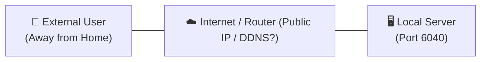
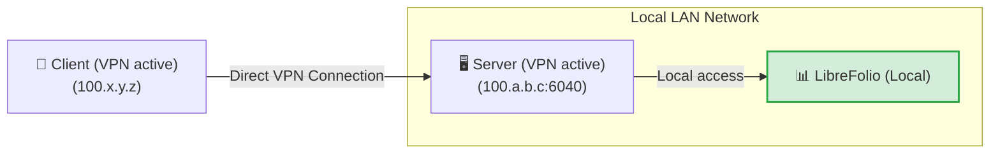
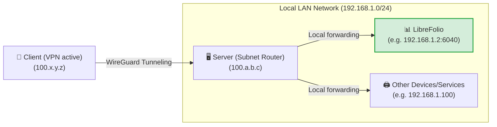

# 🌐 Esposizione sicura

Raggiungi LibreFolio fuori casa **senza aprire alcuna porta sul router**, con [Tailscale](https://tailscale.com/), una VPN mesh gratuita per uso domestico. Gli stessi passi valgono per qualsiasi altro servizio della tua rete locale.

Fai il **Passaggio 0**, poi solo il livello che ti serve. Livelli 1 e 2, **privati**, in questa pagina; Livelli 3 e 4, **pubblici**, in [Esposizione sicura: accesso pubblico con Funnel](service_exposure_funnel.md), dopo la [configurazione una tantum di Funnel sulla console](service_exposure_funnel.md#enabling-funnel-and-acls-on-the-console).

| Livello | Ideale per | Tailscale sul tuo telefono/PC | Indirizzo HTTPS pubblico | Dove si configura |
|---|---|---|---|---|
| 🏃 1. VPN privata | Solo per te, con la configurazione più rapida | Necessario | No | Solo il Passaggio 0 |
| 🥉 2. Router di subnet | Ogni dispositivo della tua LAN domestica, non solo LibreFolio | Necessario | No | Terminale del server + console Tailscale |
| 🥈 [3. Funnel](service_exposure_funnel.md#level-3-public-https-address-with-tailscale-funnel) | Un indirizzo pubblico per LibreFolio e installazione come app | Non necessario | Sì | Console Tailscale + terminale del server |
| 🥇 [4. Multi-Funnel con Docker](service_exposure_funnel.md#level-4-multi-funnel-with-docker-sidecars) | Un indirizzo pubblico per servizio, ciascuno nel proprio container | Non necessario | Sì | Console Tailscale + `docker-compose.yml` |

!!! tip "⭐ La nostra raccomandazione: Livello 4"

    Poco più di configurazione del Livello 3; ogni servizio resta isolato nel proprio container, con un indirizzo pubblico suo. I Livelli 1–3 sono alternative più semplici e tappe verso di esso.

`6040` è la porta predefinita di LibreFolio: se nel tuo `.env` hai impostato un `PORT` diverso, usa quel numero. App web, API e documentazione integrata passano tutte da questa porta: è l'unica da esporre.

!!! info "📚 Questa guida è su più pagine"

    Qui: il perché di Tailscale, il Passaggio 0, i Livelli 1 e 2, MagicDNS. Livelli 3 e 4 e configurazione di Funnel: [Esposizione sicura: accesso pubblico con Funnel](service_exposure_funnel.md).

---

## 🔒 Perché non usare il semplice port forwarding?

Aprire una porta sul router e puntarci un DNS dinamico (come DuckDNS) funziona, ma:

- **La porta aperta è visibile a chiunque** su Internet, che può scansionarla e attaccarla.
- **HTTPS è compito tuo**: un reverse proxy (Nginx, Caddy…) e i suoi certificati SSL da rinnovare.
- **Senza HTTPS i dati viaggiano in chiaro**: password e dati finanziari intercettabili.



Con Tailscale nessuna porta del router si apre, il traffico tra i tuoi dispositivi è cifrato e Funnel (Livelli 3 e 4) aggiunge HTTPS con certificati gestiti da Tailscale.

---

## 🏁 Passaggio 0: installa Tailscale sui tuoi dispositivi

[Tailscale](https://tailscale.com/) (protocollo **WireGuard**) collega i tuoi dispositivi in una rete privata cifrata, il tuo *tailnet*. Gira su Linux, macOS, Windows, iOS e Android, su un NAS o in Docker; il piano **Personal** gratuito basta per casa ([prezzi di Tailscale](https://tailscale.com/pricing) per i limiti attuali).

Installalo e accedi su almeno due dispositivi: il **server** di LibreFolio e un **client**, telefono o laptop.

=== "Linux"

    **Sul server, da terminale**:

    ```bash
    curl -fsSL https://tailscale.com/install.sh | sh
    sudo tailscale up
    ```

    Il server entra nel tuo tailnet. Dettagli: [Guida di installazione generica](https://tailscale.com/docs/install).

=== "macOS"

    **Sul server**: app ufficiale dal **Mac App Store**, oppure da terminale con Homebrew:

    ```bash
    brew install --cask tailscale
    sudo tailscale up
    ```

    Dettagli: [Guida di installazione generica](https://tailscale.com/docs/install).

=== "Windows"

    **Sul server**: scarica il programma di installazione ufficiale dal portale Tailscale e segui l'accesso guidato. Dettagli: [Guida di installazione per Windows](https://tailscale.com/docs/install/windows).

=== "Android"

    **Sul telefono**: app ufficiale dal [Google Play Store](https://play.google.com/store/apps/details?id=com.tailscale.ipn).

=== "iOS (iPhone/iPad)"

    **Sul dispositivo**: app ufficiale dall'[Apple App Store](https://apps.apple.com/us/app/tailscale/id1470499037).

??? tip "🔑 Mantieni il server connesso — disabilita la scadenza della chiave"

    Tailscale chiede a ogni dispositivo di accedere di nuovo dopo 180 giorni. Un server non deve uscire dal tailnet per questo. **Nella console di amministrazione di Tailscale, pagina Machines**:

    1. Individua il tuo server.
    2. Fai clic sull'**icona con i tre puntini (...)** a destra della sua riga.
    3. Seleziona **Disable Key Expiry**.

---

## 🏃 Livello 1: VPN privata punto a punto

**Ideale se sei da solo, con la configurazione più rapida.** Il client raggiunge LibreFolio attraverso il tailnet; nulla è esposto a Internet.



### ▶️ Passaggio 1: verifica che LibreFolio risponda sulla sua porta

Nulla da configurare: con Tailscale attivo sul server, la porta `6040` è già raggiungibile dal tailnet all'IP Tailscale del server.

??? tip "Preferisci un indirizzo HTTPS all'interno del tuo tailnet?"

    **Sul server, da terminale**:

    ```bash
    tailscale serve --bg 6040
    ```

    Apri `https://<server-name>.your-tailnet.ts.net` invece dell'IP; resta privato, lo aprono solo i dispositivi del tuo tailnet. `--bg` lo mantiene attivo dopo la chiusura del terminale; `tailscale serve reset` lo rimuove. La prima volta Tailscale può chiederti di abilitare i certificati HTTPS per il tailnet.

### 📱 Passaggio 2: apri LibreFolio dal tuo dispositivo

**Sul telefono o PC, con Tailscale attivo**, digita nel browser l'IP Tailscale del server (o il suo nome MagicDNS) e la porta:

```text
http://100.a.b.c:6040
```

LibreFolio si apre. Per verificarne la sicurezza: [Verifica della sicurezza della connessione](connection_checks.md#indicator).

⚠️ **Limiti:** ogni dispositivo da cui ti connetti deve avere Tailscale attivo; raggiungi solo il server, non il resto della LAN (lo aggiunge il Livello 2).

---

## 🥉 Livello 2: router di subnet per tutta la tua LAN domestica

**Ideale per raggiungere ogni dispositivo di casa, non solo LibreFolio.** Il server diventa *router di subnet*: il client, con Tailscale attivo, apre qualsiasi IP locale come da casa, ad esempio `http://192.168.1.2:6040` per LibreFolio.



### 🔀 Passaggio 1: abilita il routing di subnet sul server

Sostituisci `192.168.1.0/24` con la tua rete locale.

=== "Linux"

    1. **Sul server, da terminale**, abilita l'inoltro IP nel kernel:

        ```bash
        echo 'net.ipv4.ip_forward = 1' | sudo tee -a /etc/sysctl.d/99-tailscale.conf
        echo 'net.ipv6.conf.all.forwarding = 1' | sudo tee -a /etc/sysctl.d/99-tailscale.conf
        sudo sysctl -p /etc/sysctl.d/99-tailscale.conf
        ```

    2. Annuncia la subnet:

        ```bash
        sudo tailscale up --advertise-routes=192.168.1.0/24
        ```

        La route compare nella console, in attesa di approvazione.

=== "macOS"

    **Sul server, da terminale**, con il percorso dell'eseguibile Tailscale:

    ```bash
    /Applications/Tailscale.app/Contents/MacOS/Tailscale up --advertise-routes=192.168.1.0/24
    ```

    La route compare nella console, in attesa di approvazione.

=== "Windows"

    **Sul server, nel Prompt dei comandi (`cmd.exe`) o PowerShell come Amministratore**:

    ```cmd
    tailscale up --advertise-routes=192.168.1.0/24
    ```

    La route compare nella console, in attesa di approvazione.

### ✅ Passaggio 2: approva la route nella console di amministrazione

**Nella [Console di amministrazione di Tailscale](https://login.tailscale.com/admin/machines), pagina Machines**:

1. Fai clic sui tre puntini accanto al tuo server -> **Edit route settings**.
2. Abilita la subnet annunciata.

Dal client raggiungi ora ogni IP della LAN. Il server è ora infrastruttura di rete: se non l'hai fatto, disabilita la scadenza della sua chiave (suggerimento alla fine del Passaggio 0).

⚠️ **Limiti:** il client deve avere Tailscale attivo, devi conoscere gli IP locali dei dispositivi e, nella LAN, il traffico viaggia come HTTP in chiaro.

---

## 🔮 MagicDNS e domini personalizzati

**MagicDNS** dà un nome a ogni dispositivo del tailnet: invece di un IP come `100.110.x.x`, digiti `http://your-server`. Gli indirizzi Funnel pubblici terminano con `.ts.net` (ad esempio `https://librefolio.your-tailnet.ts.net`, dove `librefolio` è il `TS_HOSTNAME` del Livello 4).

Un tuo dominio, come `librefolio.mydomain.com`, per l'accesso **privato** tramite la VPN: due metodi.

??? tip "🌍 Metodo 1 — Un record DNS pubblico che punta all'IP Tailscale (il più semplice)"

    **Nella console del tuo registrar di dominio** (ad es. Cloudflare, GoDaddy, Namecheap):

    1. Crea un record DNS di tipo **A** (o **AAAA** per IPv6) per il sottodominio scelto (ad es. `librefolio.mydomain.com`).
    2. Puntalo all'**IP Tailscale privato** del server (ad es. `100.77.x.x`).

    Il nome funziona **solo** mentre sei connesso al tailnet: la rete `100.64.0.0/10` non è instradabile su Internet, nessun esterno può raggiungere o scansionare il servizio. Dettagli: [documentazione ufficiale sulle impostazioni DNS](https://tailscale.com/kb/1054/dns#public-dns).

??? tip "🧭 Metodo 2 — Split DNS con il tuo server DNS"

    Per record interni gestiti da te, mai pubblicati su Internet:

    1. **Nella tua LAN**: configura un server DNS privato (Pi-hole, AdGuard Home o CoreDNS).
    2. **Nel tuo server DNS**: aggiungi i record del tuo dominio puntandoli ai tuoi IP Tailscale.
    3. **Nella console di amministrazione di Tailscale**, *DNS -> Nameservers -> Add Nameserver*: aggiungi l'IP Tailscale del tuo DNS privato, come nameserver globale o limitato al tuo dominio. Dettagli: [documentazione ufficiale sullo Split DNS](https://tailscale.com/kb/1054/dns#split-dns).

Per l'accesso **pubblico**, tieni l'indirizzo `*.ts.net`: il certificato di Funnel è firmato per quel nome, quindi un CNAME dal tuo dominio dà errori SSL/TLS nei browser, a meno di un tuo reverse proxy (Caddy o Nginx) con certificati per il tuo dominio.

---

## 🔗 Link utili

* 🖥️ [Console di amministrazione di Tailscale (Machines)](https://login.tailscale.com/admin/machines)
* 🔐 [Gestione dei controlli di accesso (ACLs)](https://login.tailscale.com/admin/acls)
* 📖 [Guida ufficiale a Tailscale Funnel (documentazione in inglese)](https://tailscale.com/kb/1223/tailscale-funnel)
* 🐳 [Eseguire Tailscale in Docker](https://tailscale.com/kb/1282/docker)

---

## 🔗 Correlati

- 📄 **[Esposizione sicura: accesso pubblico con Funnel](service_exposure_funnel.md)** — Abilitazione di Funnel e ACL sulla console, Livello 3: indirizzo HTTPS pubblico con Tailscale Funnel, Livello 4: Multi-Funnel con Docker sidecar
