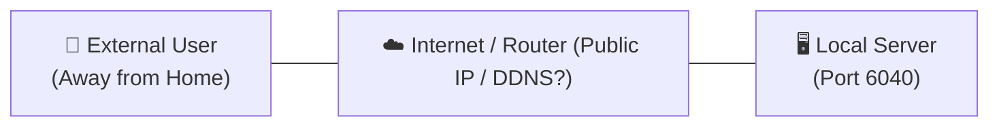
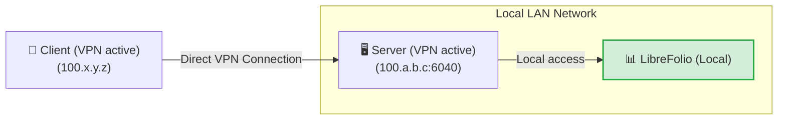
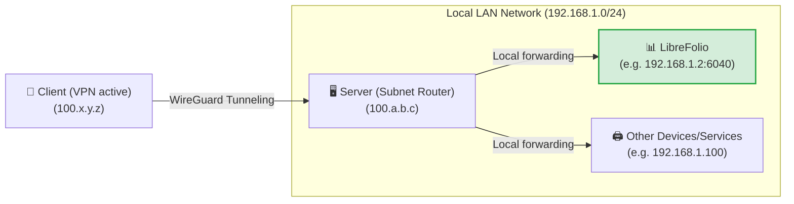

# 🌐 Esposizione sicura

Questa guida mostra come raggiungere LibreFolio fuori casa **senza aprire alcuna porta sul tuo router**, usando [Tailscale](https://tailscale.com/), una VPN mesh sicura e gratuita per uso domestico. Gli stessi passaggi funzionano per qualsiasi altro servizio sulla tua rete locale.

Ti servono il **Passaggio 0** e il livello più adatto alle tue esigenze. I livelli 3 e 4 richiedono anche la [configurazione una tantum di Funnel sulla console](service_exposure_funnel.md#enabling-funnel-and-acls-on-the-console).

| Livello | Ideale per | Tailscale sul tuo telefono/PC | Indirizzo HTTPS pubblico |
|---|---|---|---|
| 🏃 1. VPN privata | Solo per te, con la configurazione più rapida | Necessario | No |
| 🥉 2. Router di subnet | Ogni dispositivo della tua LAN domestica, non solo LibreFolio | Necessario | No |
| 🥈 [3. Funnel](service_exposure_funnel.md#level-3-public-https-address-with-tailscale-funnel) | Un indirizzo pubblico per LibreFolio e installazione come app | Non necessario | Sì |
| 🥇 [4. Multi-Funnel con Docker](service_exposure_funnel.md#level-4-multi-funnel-with-docker-sidecars) | Un indirizzo pubblico per servizio, ciascuno nel proprio container | Non necessario | Sì |

!!! tip "⭐ La nostra raccomandazione: Livello 4"

    Il Livello 4 richiede solo un po’ più di configurazione rispetto al Livello 3, mantiene ogni servizio isolato nel proprio container e assegna a ciascuno il proprio indirizzo pubblico. I Livelli 1–3 sono alternative più semplici e mostrano il percorso che porta fin lì.

In tutta questa guida, `6040` è la porta predefinita di LibreFolio: se hai impostato un `PORT` diverso nel tuo `.env`, usa quel numero. LibreFolio serve l'app web, la sua API e la documentazione integrata su questa unica porta, quindi è l'unica porta da esporre.

!!! info "📚 Questa guida è su più pagine"

    Questa pagina spiega perché Tailscale è preferibile al port forwarding, mostra come installarlo (Passaggio 0) e tratta i due livelli **privati**, 1 e 2, oltre a MagicDNS. I livelli **pubblici**, con la configurazione una tantum di Funnel, sono in [Esposizione sicura: accesso pubblico con Funnel](service_exposure_funnel.md): Livello 3, un indirizzo HTTPS pubblico, e Livello 4, un indirizzo per servizio con Docker.

---

## 🔒 Perché non usare il semplice port forwarding?

Il metodo classico consiste nell'aprire una porta sul router di casa e far puntare un nome DNS dinamico (come DuckDNS) al tuo IP pubblico. Funziona, ma:

- **Chiunque su Internet può vedere la porta aperta**: chiunque può scansionare il tuo IP pubblico e attaccare la porta aperta.
- **HTTPS è compito tuo**: devi gestire un reverse proxy (Nginx, Caddy…) e mantenere rinnovati i suoi certificati SSL.
- **Senza HTTPS, i dati viaggiano in chiaro**: la tua password e i tuoi dati finanziari possono essere intercettati lungo il percorso.



Tailscale evita tutti e tre questi problemi: nessuna porta del router viene aperta, il traffico tra i tuoi dispositivi è cifrato e Funnel (Livelli 3 e 4) aggiunge HTTPS con certificati che Tailscale gestisce per te.

---

## 🏁 Passaggio 0: installa Tailscale sui tuoi dispositivi

[Tailscale](https://tailscale.com/) è una VPN mesh basata sul protocollo **WireGuard**: i tuoi dispositivi entrano a far parte di una rete privata (il tuo *tailnet*) e comunicano tra loro tramite tunnel cifrati. Funziona su Linux, macOS, Windows, iOS e Android, su un NAS o dentro Docker, e il piano **Personal** gratuito è sufficiente per l'uso domestico (vedi i [prezzi di Tailscale](https://tailscale.com/pricing) per i limiti attuali).

Installalo e accedi su almeno due dispositivi: il **server** che esegue LibreFolio e un **client**, come il tuo telefono o laptop.

=== "Linux"

    Esegui il comando di installazione ufficiale sul server:

    ```bash
    curl -fsSL https://tailscale.com/install.sh | sh
    sudo tailscale up
    ```

    Per maggiori dettagli, vedi la [Guida di installazione generica](https://tailscale.com/docs/install).

=== "macOS"

    Installa l'app ufficiale dal **Mac App Store** o usa Homebrew:

    ```bash
    brew install --cask tailscale
    sudo tailscale up
    ```

    Per maggiori dettagli, vedi la [Guida di installazione generica](https://tailscale.com/docs/install).

=== "Windows"

    Scarica il programma di installazione ufficiale dal portale Tailscale e segui la procedura guidata di accesso.

    Per i dettagli, vedi la [Guida di installazione per Windows](https://tailscale.com/docs/install/windows).

=== "Android"

    Installa l'applicazione ufficiale dal [Google Play Store](https://play.google.com/store/apps/details?id=com.tailscale.ipn).

=== "iOS (iPhone/iPad)"

    Installa l'applicazione ufficiale dall'[Apple App Store](https://apps.apple.com/us/app/tailscale/id1470499037).

??? tip "🔑 Mantieni il server connesso — disabilita la scadenza della chiave"

    Per impostazione predefinita, Tailscale chiede a ogni dispositivo di accedere di nuovo dopo 180 giorni. Un server non dovrebbe uscire dal tuo tailnet per questo motivo, quindi disabilita questa opzione per il server:

    1. Nella pagina **Machines** della console di amministrazione, individua il tuo server.
    2. Fai clic sull'**icona con i tre puntini (...)** a destra della riga del dispositivo.
    3. Seleziona l'opzione **Disable Key Expiry**.

---

## 🏃 Livello 1: VPN privata punto a punto

**Ideale se sei da solo, con la configurazione più rapida.** Il tuo telefono o laptop raggiunge LibreFolio attraverso il tuo tailnet privato e nulla è esposto a Internet.



### ▶️ Passaggio 1: verifica che LibreFolio risponda sulla sua porta

Nessuna porta da esporre pubblicamente: con Tailscale attivo sul server, la porta `6040` di LibreFolio è già
raggiungibile dal tuo tailnet all'IP Tailscale del server.

??? tip "Preferisci un indirizzo HTTPS all'interno del tuo tailnet?"

    Esegui questo comando sul server, poi apri `https://<server-name>.your-tailnet.ts.net` invece dell'IP:

    ```bash
    tailscale serve --bg 6040
    ```

    `--bg` lo mantiene in esecuzione dopo aver chiuso il terminale; `tailscale serve reset` lo rimuove. La
    prima volta, Tailscale potrebbe chiederti di abilitare i certificati HTTPS per il tuo tailnet. L'indirizzo è
    ancora privato: solo i dispositivi del tuo tailnet possono aprirlo.

### 📱 Passaggio 2: apri LibreFolio dal tuo dispositivo

Con Tailscale attivo sul telefono o sul PC, digita nel browser l'IP Tailscale del server (o il suo nome MagicDNS) seguito dalla porta, ad esempio `http://100.a.b.c:6040`.

Per verificare il risultato, vedi [Verifica della sicurezza della connessione](connection_checks.md#indicator).

⚠️ **Limiti:** ogni dispositivo da cui ti connetti deve avere Tailscale attivo e raggiungi solo il server, non il resto della tua LAN domestica (il Livello 2 aggiunge questo).

---

## 🥉 Livello 2: router di subnet per tutta la tua LAN domestica

**Ideale per raggiungere ogni dispositivo di casa, non solo LibreFolio.** Il server diventa un *router di subnet*: con Tailscale attivo, il tuo client apre qualsiasi IP locale come se fossi a casa, ad esempio `http://192.168.1.2:6040` per LibreFolio.



### 🔀 Passaggio 1: abilita il routing di subnet sul server

=== "Linux"

    Abilita l'inoltro IP a livello di kernel:

    ```bash
    echo 'net.ipv4.ip_forward = 1' | sudo tee -a /etc/sysctl.d/99-tailscale.conf
    echo 'net.ipv6.conf.all.forwarding = 1' | sudo tee -a /etc/sysctl.d/99-tailscale.conf
    sudo sysctl -p /etc/sysctl.d/99-tailscale.conf
    ```

    Inizia ad annunciare la subnet (sostituisci l'intervallo IP con la tua rete locale, ad es. `192.168.1.0/24`):

    ```bash
    sudo tailscale up --advertise-routes=192.168.1.0/24
    ```

=== "macOS"

    Usa il percorso dell'eseguibile Tailscale per annunciare la subnet locale:

    ```bash
    /Applications/Tailscale.app/Contents/MacOS/Tailscale up --advertise-routes=192.168.1.0/24
    ```

=== "Windows"

    Apri il Prompt dei comandi (`cmd.exe`) o PowerShell come **Amministratore** e annuncia la subnet locale:

    ```cmd
    tailscale up --advertise-routes=192.168.1.0/24
    ```

### ✅ Passaggio 2: approva la route nella console di amministrazione

1. Vai alla [Console di amministrazione di Tailscale](https://login.tailscale.com/admin/machines).
2. Fai clic sui tre puntini accanto al tuo server -> **Edit route settings**.
3. Abilita la subnet annunciata.

Un router di subnet fa parte dell'infrastruttura della tua rete: se non l'hai fatto, disabilita ora la scadenza della chiave per il server (suggerimento alla fine del Passaggio 0).

⚠️ **Limiti:** il client deve comunque avere Tailscale attivo, devi conoscere gli IP locali dei tuoi dispositivi e, all'interno della tua LAN, il traffico viaggia come HTTP in chiaro.

---

## 🔮 MagicDNS e domini personalizzati

**MagicDNS** assegna un nome a ogni dispositivo del tuo tailnet: invece di un IP come `100.110.x.x`, puoi digitare `http://your-server` nel browser. Gli indirizzi Funnel pubblici terminano con `.ts.net` (ad esempio, `https://librefolio.your-tailnet.ts.net`, dove `librefolio` è il `TS_HOSTNAME` del Livello 4).

Preferisci un tuo dominio, come `librefolio.mydomain.com`? Due metodi funzionano per l'accesso **privato**, tramite la VPN:

??? tip "🌍 Metodo 1 — Un record DNS pubblico che punta all'IP Tailscale (il più semplice)"

    1. Accedi alla console del tuo registrar di dominio (ad es. Cloudflare, GoDaddy, Namecheap).
    2. Crea un record DNS di tipo **A** (o **AAAA** per IPv6) per il sottodominio scelto (ad es. `librefolio.mydomain.com`).
    3. Punta il record direttamente all'**IP Tailscale privato** del tuo server (ad es. `100.77.x.x`).

    Gli indirizzi nella rete `100.64.0.0/10` non sono instradabili su Internet, quindi il nome funziona **solo** mentre sei connesso al tuo tailnet: nessun esterno può raggiungere o scansionare il servizio. Per i dettagli, vedi la [documentazione ufficiale sulle impostazioni DNS](https://tailscale.com/kb/1054/dns#public-dns).

??? tip "🧭 Metodo 2 — Split DNS con il tuo server DNS"

    Per i record interni che gestisci tu stesso e che non pubblichi mai su Internet:

    1. Configura un server DNS privato nella tua LAN (come Pi-hole, AdGuard Home o CoreDNS).
    2. Aggiungi record locali del tuo dominio facendoli puntare ai tuoi IP Tailscale.
    3. Nella console di amministrazione di Tailscale, vai su *DNS -> Nameservers -> Add Nameserver* e aggiungi l'IP Tailscale del tuo DNS privato come nameserver globale o limitato al tuo dominio. Per i dettagli, vedi la [documentazione ufficiale sullo Split DNS](https://tailscale.com/kb/1054/dns#split-dns).

Per l'accesso **pubblico**, mantieni l'indirizzo `*.ts.net`: Funnel lo serve con un certificato firmato per quel nome, quindi se fai puntare il tuo dominio a esso (CNAME), si verificano errori SSL/TLS nei browser, a meno che tu non aggiunga un tuo reverse proxy (come Caddy o Nginx) con certificati per il tuo dominio.

---

## 🔗 Link utili

* 🖥️ [Console di amministrazione di Tailscale (Machines)](https://login.tailscale.com/admin/machines)
* 🔐 [Gestione dei controlli di accesso (ACLs)](https://login.tailscale.com/admin/acls)
* 📖 [Guida ufficiale a Tailscale Funnel (documentazione in inglese)](https://tailscale.com/kb/1223/tailscale-funnel)
* 🐳 [Eseguire Tailscale in Docker](https://tailscale.com/kb/1282/docker)

---

## 🔗 Correlati

- 📄 **[Esposizione sicura: accesso pubblico con Funnel](service_exposure_funnel.md)** — Abilitazione di Funnel e ACL sulla console, Livello 3: indirizzo HTTPS pubblico con Tailscale Funnel, Livello 4: Multi-Funnel con Docker sidecar
