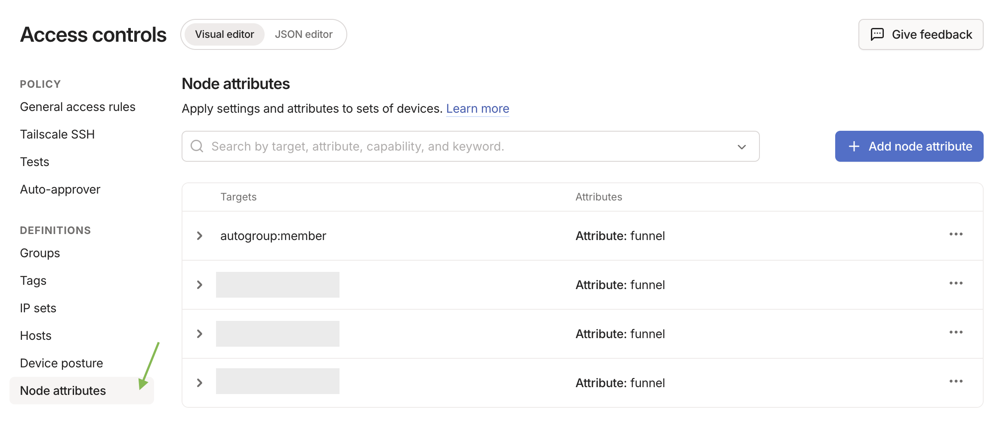
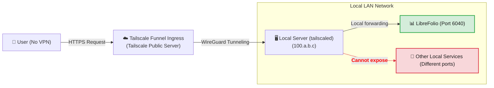
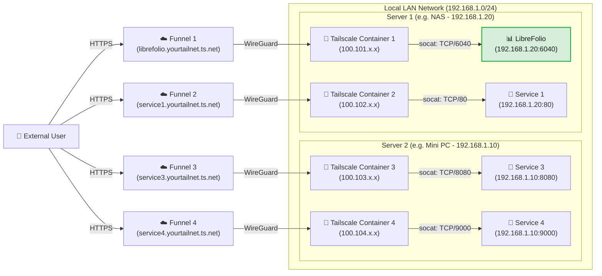

# 🌍 Exposing Securely: Public Access with Funnel

LibreFolio on the internet with Tailscale Funnel, at a public HTTPS address, with no port opened on your router:

- the one-time setup of **Funnel and the ACLs** in the Tailscale console;
- **Level 3**: one address for LibreFolio, with one command on the server;
- **Level 4**: one address per service, each with its own Docker container.

Tailscale must already be installed on the server: why Tailscale, **Step 0** (the installation) and the private Levels 1 and 2 are in [Exposing Securely](service_exposure.md).
`6040` is LibreFolio's default port: if you set a different `PORT` in your `.env`, use that number.

---

## 🔑 Enabling Funnel and ACLs on the console {: #enabling-funnel-and-acls-on-the-console }

**One-time setup, needed by Levels 3 and 4.** It allows Funnel in the access control rules (ACLs) of your whole tailnet.

!!! warning "🔐 Before you make the service public"

    With Funnel, anyone on the internet can open LibreFolio's login page.
    Create your own account first: until one exists, anyone can register, and the first account registered becomes the administrator.
    After that, a new instance lets people in only with an invitation link (**Registration** is **By invitation** by default): send one to each person.
    An instance upgraded from an earlier version keeps its mode: if **Registration** in **Global Settings** is **Open**, switch it to **By invitation**, or to **Closed** if nobody else should join ([Who Can Sign Up](settings.md)).

**Where: in the Tailscale admin console, [Access Controls](https://login.tailscale.com/admin/acls) page.**

1. Click **Add node attribute**.
2. Fill in the form:

    | Field | Value |
    |---|---|
    | **Targets** | The nodes allowed to use Funnel. **We suggest `tag:external_access`** (you will give it to the Level 4 containers) or `autogroup:member` (all the devices of your account). |
    | **Attributes** | `funnel` |
    | **Note** | A few words on why the rule exists. |
    | **IP Pools, App, Capability, etc.** | Leave them empty or at their default values. |



Result: the nodes listed can turn Funnel on. This rule is not an auth key: auth keys (Level 4) only register a new device or container in the tailnet.

??? example "📄 View the complete ACL JSON configuration to enable Funnel"

    **Where: in the tailnet policy file**, if you prefer to edit it directly. It enables Funnel for your own devices and for the containers tagged `tag:external_access`:

    ```json
    {
      // Declaration of authorized tags
      "tagOwners": {
        "tag:external_access": ["autogroup:admin"]
      },

      // Standard access rules
      "acls": [
        // Allows all nodes in your private network to communicate
        {"action": "accept", "src": ["*"], "dst": ["*:*"]}
      ],

      "ssh": [
        {
          "action": "check",
          "src":    ["autogroup:member"],
          "dst":    ["autogroup:self"],
          "users":  ["autogroup:nonroot", "root"]
        }
      ],

      // Enabling Funnel on specific nodes or tags
      "nodeAttrs": [
        {
          "target": ["autogroup:member"],
          "attr":   ["funnel"]
        },
        {
          "target": ["tag:external_access"],
          "attr":   ["funnel"]
        }
      ]
    }
    ```

---

## 🥈 Level 3: Public HTTPS address with Tailscale Funnel {: #level-3-public-https-address-with-tailscale-funnel }

**Best for a public address, with no VPN on the client.** Funnel publishes LibreFolio at `https://<server-name>.your-tailnet.ts.net`, which anyone opens **without installing Tailscale**.
HTTPS is also what lets you [install LibreFolio as an app (PWA)](../user/pwa.md) on your phone.

**Before you start:** complete [Funnel and ACLs on the console](#enabling-funnel-and-acls-on-the-console).



### ▶️ Step 1: Start the Funnel on the server

**Where: on the server, in a terminal.** Publish LibreFolio's local port:

```bash
tailscale funnel --bg 6040
```

Result: LibreFolio is served at `https://<server-name>.your-tailnet.ts.net` on port 443. `--bg` keeps it running after you close the terminal; `tailscale funnel reset` stops it.

- No auth key: the server already joined the tailnet in [Step 0](service_exposure.md).
- Nothing to configure in LibreFolio: Funnel sends `X-Forwarded-Proto: https`, so with the default `SESSION_COOKIE_SECURE=auto` the [session cookie](configuration.md) is marked `Secure`. `never` is only for a proxy that claims HTTPS to a browser on plain, unencrypted HTTP.

### ✅ Step 2: Approve and wait for propagation {: #step-2-approve-and-wait-for-propagation }

The first time, the terminal warns that Funnel is not yet allowed for this node:

```text
Funnel is enabled, but the list of allowed nodes in the tailnet policy file does not include the one you are using.
To give access to this node you can edit the tailnet policy file, or visit:

         https://login.tailscale.com/f/funnel?node=xxxxxx
```

1. **In the browser**: open the link, log in to Tailscale and approve Funnel for this node.
2. **In the server's terminal**: your public URL appears.
3. **From an outside network**: wait a few minutes for the MagicDNS records to propagate, then open the URL.

To check the result: [Checking Connection Security](connection_checks.md#checklist).

⚠️ **Limits:** one machine has one public name, shared by every service it publishes. Level 4 gives each service its own.

---

## 🥇 Level 4: Multi-Funnel with Docker sidecars {: #level-4-multi-funnel-with-docker-sidecars }

**Best for Docker users who want one public address per service.** Each service gets a small Tailscale container (a *sidecar*), a node of the tailnet in its own right with its own `https://<name>.your-tailnet.ts.net`. A startup script installs **socat** in the sidecar, which forwards the Funnel traffic to the static LAN IP of the service.

**Before you start:** complete [Funnel and ACLs on the console](#enabling-funnel-and-acls-on-the-console).

??? info "🧰 What is socat?"

    **socat** (SOcket CAT) relays data between two connections: it listens on a port inside the Tailscale container and passes everything to the real port of the service on your LAN.

One sidecar for every service you want to publish, on one host or several; the only limit is the number of tagged devices of your [Tailscale plan](https://tailscale.com/pricing). Here two hosts run two sidecars each:



### 📁 Step 1: Prepare the folder and the script

**Where: on the server, in a terminal.** Create a folder, for example where you keep your Docker persistent volumes:

```bash
# Create a folder for the Tailscale nodes and enter it
mkdir -p <path_chosen>/tailscale-nodes
cd <path_chosen>/tailscale-nodes
```

Download the startup script <a href="https://raw.githubusercontent.com/Librefolio/LibreFolio/main/mkdocs_src/docs/static/tailscale-guide/custom_startup.sh" target="_blank" rel="noopener noreferrer">custom_startup.sh</a> into it:

```bash
# Download the script from the official repository
wget https://raw.githubusercontent.com/Librefolio/LibreFolio/main/mkdocs_src/docs/static/tailscale-guide/custom_startup.sh
# Make the script executable
chmod +x custom_startup.sh
```

Result: the folder `<path_chosen>/tailscale-nodes` holds an executable `custom_startup.sh`; in Step 2 you mount it in the container.

??? info "🔄 Set up the sidecar before? Update your copy of the script"

    The current script also works as a **watchdog** and has a Docker health check (Step 2). If your sidecar runs an older copy:

    1. **On the server, in the script's folder**: download the script again. `-O custom_startup.sh` overwrites the old file (without it, `wget` saves the download as `custom_startup.sh.1`).

        ```bash
        cd <path_chosen>/tailscale-nodes
        wget -O custom_startup.sh https://raw.githubusercontent.com/Librefolio/LibreFolio/main/mkdocs_src/docs/static/tailscale-guide/custom_startup.sh
        chmod +x custom_startup.sh
        ```

    2. **In your `docker-compose.yml`**: add `TS_ENABLE_HEALTH_CHECK`, `TS_LOCAL_ADDR_PORT` and, optionally, `STARTUP_TIMEOUT` to the Tailscale service, together with the `healthcheck` block, exactly as in Step 2.

    3. **In the folder of the `docker-compose.yml`**: recreate the container, a restart does not apply compose changes.

        ```bash
        docker compose up -d
        ```

        It recreates the services whose configuration changed. Alternatively, the *Recreate* / re-deploy action of Portainer or CasaOS.

    4. **In the container log**: `docker logs -f tailscale-librefolio` shows `Tailscale is running.`, then `Starting the funnel on port 6040...` and `Available on the internet:` with your public URL. Within the 2-minute `start_period` of the health check, Docker shows the container as **healthy** (`docker ps`, Portainer, CasaOS). If it keeps restarting: troubleshooting panel in [Step 3](#3-startup-and-approval).

### 🐳 Step 2: Configure Docker Compose

**Where: in the `docker-compose.yml` of the exposed service** (for example LibreFolio), so the two stay together. Add the Tailscale service:

```yaml
services:
  tailscale-librefolio:
    image: tailscale/tailscale:latest
    container_name: tailscale-librefolio
    hostname: tailscale-librefolio
    restart: unless-stopped
    privileged: false
    network_mode: bridge
    cap_add:
      - NET_ADMIN
      - NET_RAW
    devices:
      - /dev/net/tun:/dev/net/tun
    command:
      - /custom_startup.sh
    environment:
      - HOST_IP=192.168.1.20                # Local IP of the service to expose (e.g. Server 1)
      - HOST_PORT=6040                      # Real port of the service to expose
      - TAILSCALE_FUNNEL_PORT=6040          # Internal Funnel port
      - TS_HOSTNAME=librefolio              # Custom public hostname (e.g. librefolio)
      - TS_AUTHKEY=tskey-auth-...           # Authentication key generated by Tailscale
      - TS_ACCEPT_DNS=true
      - TS_STATE_DIR=/var/lib/tailscale
      - TS_USERSPACE=false
      - TS_ENABLE_HEALTH_CHECK=true         # Expose /healthz for the healthcheck below (Tailscale ≥ 1.78)
      - TS_LOCAL_ADDR_PORT=127.0.0.1:9002   # Where /healthz listens: inside the container only
      - STARTUP_TIMEOUT=180                 # Optional: seconds to reach the Running state (default 180)
    volumes:
      - <path_chosen>/tailscale-nodes/tailscale-librefolio/state:/var/lib/tailscale
      - <path_chosen>/tailscale-nodes/custom_startup.sh:/custom_startup.sh
      - /etc/localtime:/etc/localtime:ro
      - /etc/timezone:/etc/timezone:ro
    # Shows healthy/unhealthy in Docker, Portainer or CasaOS; the restart itself comes from custom_startup.sh exiting
    healthcheck:
      test: ["CMD", "wget", "-q", "-O", "/dev/null", "http://127.0.0.1:9002/healthz"]
      interval: 30s
      timeout: 5s
      retries: 3
      start_period: 120s
```

Set these values for your network:

| Value | What to put |
|---|---|
| `<path_chosen>` | The absolute path of Step 1, where the script and the state data live (for example `/home/user/docker`). |
| `HOST_IP` | The static LAN IP of the machine that runs the service. |
| `HOST_PORT` | The real port of the service on that machine: for LibreFolio, the `PORT` of your `.env` (`6040` by default). |
| `TAILSCALE_FUNNEL_PORT` | The port the container listens on and publishes through Funnel. Same value as `HOST_PORT`. |
| `TS_HOSTNAME` | The name of the node: the public address becomes `https://TS_HOSTNAME.your-tailnet.ts.net`. |
| `TS_AUTHKEY` | The key that registers the container in the tailnet (below). |

**Where to get `TS_AUTHKEY`: in the Tailscale console, [Keys](https://login.tailscale.com/admin/settings/keys) page.**

1. In the **Auth keys** section (*not* in the API access tokens section), click **Generate auth key...**.
2. Turn on the **Tags** toggle and select your tag (for example `tag:external_access`). Add a description you will recognize, such as `docker-librefolio-funnel`.
3. Click **Generate** and copy the key (`tskey-auth-...`) into `TS_AUTHKEY`.

Result: on the container's first start the one-time key is used up, it disappears from **Keys** and the new device appears in **Machines**.

??? info "🩺 Watchdog and health check — what the extra settings do"

    * **Watchdog (automatic restart)**, in the script: if Tailscale does not start (no internet at boot, a wrong flag), does not reach the *Running* state within `STARTUP_TIMEOUT` seconds, or Tailscale, socat or the Funnel stop later on, the script exits with an error and Docker restarts the container (`restart: unless-stopped`). The container never stays "running" with nothing behind it; `docker stop` still shuts everything down cleanly.
    * **Health check (status only)**, in the compose: `TS_ENABLE_HEALTH_CHECK=true` turns on Tailscale's `/healthz` endpoint (Tailscale 1.78 or later): `200` while the node has a Tailscale IP, `503` otherwise. Docker, Portainer and CasaOS show *healthy* or *unhealthy*.

    Plain Docker (outside Swarm) does **not** restart an *unhealthy* container: the restart comes from the script exiting. No "autoheal" container is needed: it would also require the Docker socket, that is full control of the host.

    | Optional setting | What it does |
    |---|---|
    | `TS_LOCAL_ADDR_PORT` | Where `/healthz` listens. The endpoint needs no authentication, and Tailscale's default, `[::]:9002`, listens on all interfaces: `127.0.0.1:9002` keeps it inside the container. If you change it, update the URL of the `healthcheck` test too. |
    | `STARTUP_TIMEOUT` | Seconds to wait for the *Running* state (default `180`) before exiting and having the container restarted. Raise it only on a very slow server. |
    | `DEBUG` | Not in the example above. `DEBUG=1` prints every command the script runs to the container log. Off by default to keep the log readable. |

??? tip "📈 Watching LibreFolio with a monitor (Uptime Kuma)"

    The `librefolio` service has a health check of its own, on `GET /api/v1/system/health` (see the compose file below): it tells Docker that the server answers.
    To watch it from another device, for example with **Uptime Kuma**, point the monitor at `/api/v1/system/ready` on the address you open LibreFolio with, such as `https://librefolio.your-tailnet.ts.net/api/v1/system/ready`. It needs no sign-in and answers:

    * **`200`** when LibreFolio is ready to serve requests;
    * **`503`** when it is not, with the check at fault in the answer: `database` (`unreachable`) or `migrations` (`behind`, `ahead`, `unknown`).

    The codes: [Advanced Docker Guide](docker_advanced.md), section «Service: `librefolio`».

??? example "📄 View the complete production Docker Compose file (LibreFolio + Tailscale)"

    The `librefolio` service of the official `docker-compose.prod.yml` file, with the Tailscale sidecar next to it:

    ```yaml
    # =============================================================================
    # LibreFolio — Production Docker Compose
    # =============================================================================
    # Optimized for end-users running the official pre-built image from GHCR.
    # =============================================================================

    services:
      librefolio:
        image: ${LIBREFOLIO_IMAGE:-ghcr.io/librefolio/librefolio:latest}
        container_name: librefolio
        restart: unless-stopped
        ports:
          - "${PORT:-6040}:6040"
        volumes:
          - ./LibreFolio-data:/app/backend/data/prod-docker
        env_file: .env
        environment:
          - LIBREFOLIO_DATA_DIR=/app/backend/data/prod-docker
          - HOST=0.0.0.0
          - PORT=6040
        healthcheck:
          test: ["CMD", "python", "-c", "import urllib.request; urllib.request.urlopen('http://localhost:6040/api/v1/system/health')"]
          interval: 30s
          timeout: 10s
          start_period: 15s
          retries: 3

      tailscale-librefolio:
        image: tailscale/tailscale:latest
        container_name: tailscale-librefolio
        hostname: tailscale-librefolio
        restart: unless-stopped
        privileged: false
        network_mode: bridge
        cap_add:
          - NET_ADMIN
          - NET_RAW
        devices:
          - /dev/net/tun:/dev/net/tun
        command:
          - /custom_startup.sh
        environment:
          - HOST_IP=192.168.1.20                # Local IP of the service to expose (e.g. Server 1)
          - HOST_PORT=6040                      # Real port of the service to expose
          - TAILSCALE_FUNNEL_PORT=6040          # Internal Funnel port
          - TS_HOSTNAME=librefolio              # Custom public hostname (e.g. librefolio)
          - TS_AUTHKEY=tskey-auth-...           # Replace with your generated key
          - TS_ACCEPT_DNS=true
          - TS_STATE_DIR=/var/lib/tailscale
          - TS_USERSPACE=false
          - TS_ENABLE_HEALTH_CHECK=true         # Expose /healthz for the healthcheck below (Tailscale ≥ 1.78)
          - TS_LOCAL_ADDR_PORT=127.0.0.1:9002   # Where /healthz listens: inside the container only
          - STARTUP_TIMEOUT=180                 # Optional: seconds to reach the Running state (default 180)
        volumes:
          - /DATA/AppData/tailscale-nodes/tailscale-librefolio/state:/var/lib/tailscale
          - /DATA/AppData/tailscale-nodes/custom_startup.sh:/custom_startup.sh
          - /etc/localtime:/etc/localtime:ro
          - /etc/timezone:/etc/timezone:ro
        # Shows healthy/unhealthy in Docker, Portainer or CasaOS; the restart itself comes from custom_startup.sh exiting
        healthcheck:
          test: ["CMD", "wget", "-q", "-O", "/dev/null", "http://127.0.0.1:9002/healthz"]
          interval: 30s
          timeout: 5s
          retries: 3
          start_period: 120s
    ```

### 🚀 Step 3: Start and approve the Funnel {: #3-startup-and-approval }

1. **On the server, in the folder of the `docker-compose.yml`**: start the stack, service and sidecar together.

    ```bash
    docker compose up -d
    ```

2. **In the Tailscale container log**: on the first start, the approval link for the new node appears.

    ```bash
    docker logs -f tailscale-librefolio
    ```

    ```text
    Funnel is enabled, but the list of allowed nodes in the tailnet policy file does not include the one you are using.
    To give access to this node you can edit the tailnet policy file, or visit:

             https://login.tailscale.com/f/funnel?node=nsKGo6k9ZF11CNTRL
    ```

3. **In the browser**: open the link, log in to Tailscale and approve the Funnel activation. Right after, the log confirms the public URL and the local proxy:

    ```text
    Available on the internet:

    https://librefolio.yourtailnet.ts.net/
    |-- proxy http://127.0.0.1:6040

    Press Ctrl+C to exit.
    ```

4. **From an outside network**: wait a few minutes for the MagicDNS records to propagate, then open the URL.

Result: the service is online. Nothing to configure in LibreFolio: Funnel sends `X-Forwarded-Proto: https` and socat passes it on, so the [session cookie](configuration.md) is `Secure` with the default `SESSION_COOKIE_SECURE=auto` (see Level 3, Step 1).

To check the result: [Checking Connection Security](connection_checks.md#checklist).

??? question "🛠️ The container restarts in a loop or is marked unhealthy"

    A persistent problem is a container that keeps restarting (Docker, Portainer or CasaOS may also mark it *unhealthy*), not one that looks "running" but does not work.
    **In the log**, `docker logs tailscale-librefolio`: before each restart, the script prints what went wrong, usually followed by `Exiting so Docker restarts the container.` The most common causes:

    * **A flag in `TS_EXTRA_ARGS` has no value.** This optional variable (not in the compose above) passes extra flags to `tailscale up`, split on spaces. A flag without a value makes `tailscale up` fail: the reason is on the line right after `Running 'tailscale up'`, above the help text that starts with `USAGE` (for example `flag needs an argument: -advertise-tags`), followed by `failed to auth tailscale: … tailscale up failed: exit status 2` and `containerboot exited before Tailscale was running.` Write each value as `--flag=value` or `--flag value`: `--advertise-tags=tag:container` and `--advertise-tags tag:container` both work.
    * **A management panel truncated the value.** The environment-variable editor of CasaOS (and of similar panels) truncates a value at its second `=`: `TS_EXTRA_ARGS=--advertise-tags=tag:container` becomes `--advertise-tags`, which fails as above. In these panels, write the flags with a space: `--advertise-tags tag:container`.
    * **A required variable is missing**: the script stops at once with `HOST_IP is not set` (or the same message for `HOST_PORT` or `TAILSCALE_FUNNEL_PORT`).
    * **No internet at boot**: the container restarts until Tailscale starts, then works normally. This is expected.
    * **Very slow start**: the log shows `Tailscale is not running after 180s.`; raise `STARTUP_TIMEOUT`.
    * **Unhealthy, but not restarting**: no successful answer from `/healthz`. If you have just added it, check that `TS_ENABLE_HEALTH_CHECK=true` is set and that the URL of the `healthcheck` test matches `TS_LOCAL_ADDR_PORT`; otherwise, the node has no Tailscale IP at the moment.

    To trace every command of the script: **in the `docker-compose.yml`**, add `DEBUG=1` to the `environment` section, recreate the container and read the log again.

Because its auth key carries a tag, Tailscale disables key expiry for the container by default. With an untagged key, disable it as for the server (tip at the end of [Step 0](service_exposure.md)).

⚠️ **Limits:** it takes a terminal and some editing of Docker Compose files.

---

## 🔗 Related

- 📄 **[Exposing Securely](service_exposure.md)** — Why not plain port forwarding?, Step 0: Install Tailscale on your devices, Level 1: Private point-to-point VPN, …
- 🔗 **[Useful links](service_exposure.md)** — The Tailscale console, the ACLs and the official guides to Funnel and Docker
