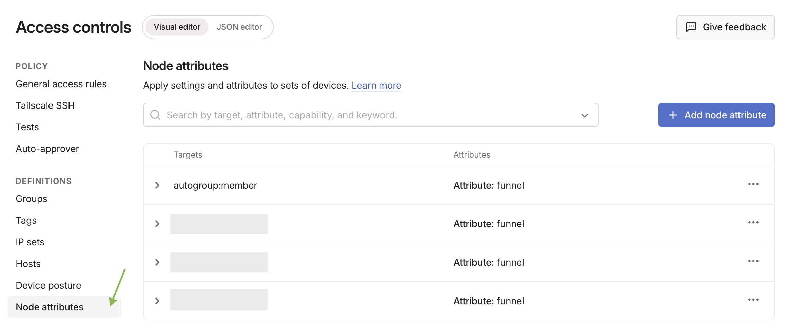
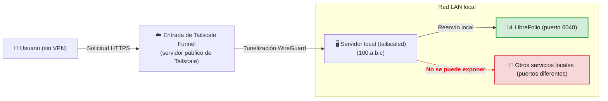
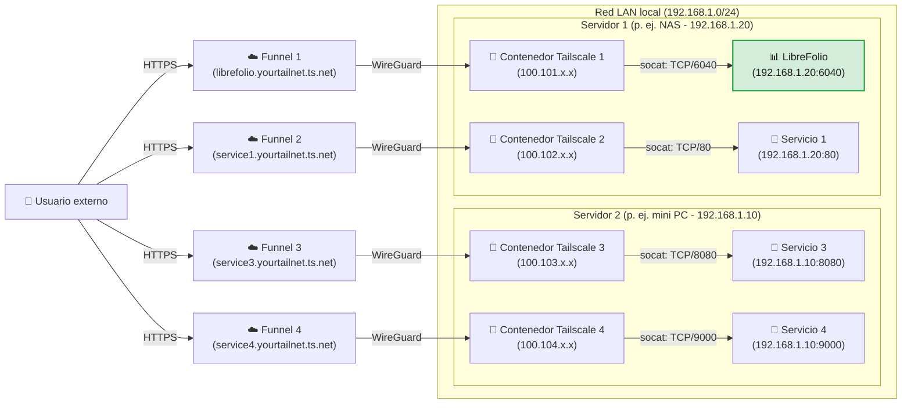

# 🌍 Exponer de forma segura: acceso público con Funnel

LibreFolio en internet con Tailscale Funnel, en una dirección HTTPS pública, sin abrir ningún puerto en tu router:

- la configuración única de **Funnel y las ACL** en la consola de Tailscale;
- **Nivel 3**: una dirección para LibreFolio, con un solo comando en el servidor;
- **Nivel 4**: una dirección por servicio, cada uno con su propio contenedor Docker.

Tailscale ya debe estar instalado en el servidor: el porqué de Tailscale, el **Paso 0** (la instalación) y los Niveles 1 y 2 privados están en [Exponer de forma segura](service_exposure.md).
`6040` es el puerto predeterminado de LibreFolio: si estableces un `PORT` diferente en tu `.env`, usa ese número.

---

## 🔑 Habilitar Funnel y las ACL en la consola {: #enabling-funnel-and-acls-on-the-console }

**Configuración única, necesaria para los Niveles 3 y 4.** Permite Funnel en las reglas de control de acceso (ACL) de todo tu tailnet.

!!! warning "🔐 Antes de hacer público el servicio"

    Con Funnel, cualquiera en internet puede abrir la página de inicio de sesión de LibreFolio.
    Crea primero tu propia cuenta: hasta que exista una, cualquiera puede registrarse, y la primera cuenta registrada pasa a ser administradora.
    Después, una instancia nueva solo deja entrar a las personas con un enlace de invitación (**Registro** está en **Por invitación** de forma predeterminada): envía uno a cada persona.
    Una instancia actualizada desde una versión anterior conserva su modo: si **Registro** en **Configuración Global** está en **Abierto**, cámbialo a **Por invitación**, o a **Cerrado** si nadie más debe unirse ([Quién puede registrarse](settings.md)).

**Dónde: en la consola de administración de Tailscale, página [Access Controls](https://login.tailscale.com/admin/acls).**

1. Haz clic en **Add node attribute**.
2. Rellena el formulario:

    | Campo | Valor |
    |---|---|
    | **Targets** | Los nodos a los que se permite usar Funnel. **Sugerimos `tag:external_access`** (se lo darás a los contenedores del Nivel 4) o `autogroup:member` (todos los dispositivos de tu cuenta). |
    | **Attributes** | `funnel` |
    | **Note** | Unas palabras sobre por qué existe la regla. |
    | **IP Pools, App, Capability, etc.** | Déjalos vacíos o con sus valores predeterminados. |



Resultado: los nodos indicados pueden activar Funnel. Esta regla no es una clave de autenticación: las claves de autenticación (Nivel 4) solo registran un nuevo dispositivo o contenedor en el tailnet.

??? example "📄 Ver la configuración JSON completa de las ACL para habilitar Funnel"

    **Dónde: en el archivo de políticas del tailnet**, si prefieres editarlo directamente. Habilita Funnel para tus propios dispositivos y para los contenedores etiquetados `tag:external_access`:

    ```json
    {
      // Declaration of authorized tags
      "tagOwners": {
        "tag:external_access": ["autogroup:admin"]
      },

      // Standard access rules
      "acls": [
        // Allows all nodes in your private network to communicate
        {"action": "accept", "src": ["*"], "dst": ["*:*"]}
      ],

      "ssh": [
        {
          "action": "check",
          "src":    ["autogroup:member"],
          "dst":    ["autogroup:self"],
          "users":  ["autogroup:nonroot", "root"]
        }
      ],

      // Enabling Funnel on specific nodes or tags
      "nodeAttrs": [
        {
          "target": ["autogroup:member"],
          "attr":   ["funnel"]
        },
        {
          "target": ["tag:external_access"],
          "attr":   ["funnel"]
        }
      ]
    }
    ```

---

## 🥈 Nivel 3: dirección HTTPS pública con Tailscale Funnel {: #level-3-public-https-address-with-tailscale-funnel }

**Ideal para una dirección pública, sin VPN en el cliente.** Funnel publica LibreFolio en `https://<server-name>.your-tailnet.ts.net`, que cualquiera abre **sin instalar Tailscale**.
HTTPS también es lo que te permite [instalar LibreFolio como aplicación (PWA)](../user/pwa.md) en tu teléfono.

**Antes de empezar:** completa [Funnel y las ACL en la consola](#enabling-funnel-and-acls-on-the-console).



### ▶️ Paso 1: Iniciar Funnel en el servidor

**Dónde: en el servidor, en una terminal.** Publica el puerto local de LibreFolio:

```bash
tailscale funnel --bg 6040
```

Resultado: LibreFolio se sirve en `https://<server-name>.your-tailnet.ts.net` en el puerto 443. `--bg` lo mantiene en ejecución después de cerrar la terminal; `tailscale funnel reset` lo detiene.

- Sin clave de autenticación: el servidor ya se unió al tailnet en el [Paso 0](service_exposure.md).
- Nada que configurar en LibreFolio: Funnel envía `X-Forwarded-Proto: https`, así que, con el valor predeterminado `SESSION_COOKIE_SECURE=auto`, la [cookie de sesión](configuration.md) se marca como `Secure`. `never` solo es para un proxy que declara HTTPS a un navegador que usa HTTP simple, sin cifrar.

### ✅ Paso 2: Aprobar y esperar la propagación {: #step-2-approve-and-wait-for-propagation }

La primera vez, la terminal advierte de que Funnel aún no está permitido para este nodo:

```text
Funnel is enabled, but the list of allowed nodes in the tailnet policy file does not include the one you are using.
To give access to this node you can edit the tailnet policy file, or visit:

         https://login.tailscale.com/f/funnel?node=xxxxxx
```

1. **En el navegador**: abre el enlace, inicia sesión en Tailscale y aprueba Funnel para este nodo.
2. **En la terminal del servidor**: aparece tu URL pública.
3. **Desde una red externa**: espera unos minutos a que se propaguen los registros de MagicDNS y luego abre la URL.

Para comprobar el resultado: [Comprobación de la seguridad de la conexión](connection_checks.md#checklist).

⚠️ **Límites:** una máquina tiene un solo nombre público, compartido por todos los servicios que publica. El Nivel 4 da a cada servicio el suyo.

---

## 🥇 Nivel 4: Multi-Funnel con sidecars de Docker {: #level-4-multi-funnel-with-docker-sidecars }

**Ideal para usuarios de Docker que quieren una dirección pública por servicio.** Cada servicio recibe un pequeño contenedor de Tailscale (un *sidecar*), un nodo del tailnet por derecho propio con su propia dirección `https://<name>.your-tailnet.ts.net`. Un script de inicio instala **socat** en el sidecar, que reenvía el tráfico de Funnel a la IP estática de la LAN del servicio.

**Antes de empezar:** completa [Funnel y las ACL en la consola](#enabling-funnel-and-acls-on-the-console).

??? info "🧰 ¿Qué es socat?"

    **socat** (SOcket CAT) retransmite datos entre dos conexiones: escucha en un puerto dentro del contenedor de Tailscale y pasa todo al puerto real del servicio en tu LAN.

Un sidecar por cada servicio que quieras publicar, en uno o varios hosts; el único límite es el número de dispositivos etiquetados de tu [plan de Tailscale](https://tailscale.com/pricing). Aquí dos hosts ejecutan dos sidecars cada uno:



### 📁 Paso 1: Preparar la carpeta y el script

**Dónde: en el servidor, en una terminal.** Crea una carpeta, por ejemplo donde guardas tus volúmenes persistentes de Docker:

```bash
# Create a folder for the Tailscale nodes and enter it
mkdir -p <path_chosen>/tailscale-nodes
cd <path_chosen>/tailscale-nodes
```

Descarga en ella el script de inicio <a href="https://raw.githubusercontent.com/Librefolio/LibreFolio/main/mkdocs_src/docs/static/tailscale-guide/custom_startup.sh" target="_blank" rel="noopener noreferrer">custom_startup.sh</a>:

```bash
# Download the script from the official repository
wget https://raw.githubusercontent.com/Librefolio/LibreFolio/main/mkdocs_src/docs/static/tailscale-guide/custom_startup.sh
# Make the script executable
chmod +x custom_startup.sh
```

Resultado: la carpeta `<path_chosen>/tailscale-nodes` contiene un `custom_startup.sh` ejecutable; en el Paso 2 lo montas en el contenedor.

??? info "🔄 ¿Ya configuraste el sidecar antes? Actualiza tu copia del script"

    El script actual también funciona como **watchdog** y tiene una comprobación de estado de Docker (Paso 2). Si tu sidecar ejecuta una copia anterior:

    1. **En el servidor, en la carpeta del script**: descarga el script de nuevo. `-O custom_startup.sh` sobrescribe el archivo antiguo (sin esa opción, `wget` guarda la descarga como `custom_startup.sh.1`).

        ```bash
        cd <path_chosen>/tailscale-nodes
        wget -O custom_startup.sh https://raw.githubusercontent.com/Librefolio/LibreFolio/main/mkdocs_src/docs/static/tailscale-guide/custom_startup.sh
        chmod +x custom_startup.sh
        ```

    2. **En tu `docker-compose.yml`**: añade `TS_ENABLE_HEALTH_CHECK`, `TS_LOCAL_ADDR_PORT` y, opcionalmente, `STARTUP_TIMEOUT` al servicio de Tailscale, junto con el bloque `healthcheck`, exactamente como en el Paso 2.

    3. **En la carpeta del `docker-compose.yml`**: vuelve a crear el contenedor, un reinicio no aplica los cambios de compose.

        ```bash
        docker compose up -d
        ```

        Vuelve a crear los servicios cuya configuración cambió. Alternativamente, la acción *Recreate* / volver a desplegar de Portainer o CasaOS.

    4. **En el log del contenedor**: `docker logs -f tailscale-librefolio` muestra `Tailscale is running.`, luego `Starting the funnel on port 6040...` y `Available on the internet:` con tu URL pública. Dentro del `start_period` de 2 minutos de la comprobación de estado, Docker muestra el contenedor como **healthy** (`docker ps`, Portainer, CasaOS). Si se sigue reiniciando: panel de solución de problemas en el [Paso 3](#3-startup-and-approval).

### 🐳 Paso 2: Configurar Docker Compose

**Dónde: en el `docker-compose.yml` del servicio expuesto** (por ejemplo LibreFolio), para que ambos permanezcan juntos. Añade el servicio de Tailscale:

```yaml
services:
  tailscale-librefolio:
    image: tailscale/tailscale:latest
    container_name: tailscale-librefolio
    hostname: tailscale-librefolio
    restart: unless-stopped
    privileged: false
    network_mode: bridge
    cap_add:
      - NET_ADMIN
      - NET_RAW
    devices:
      - /dev/net/tun:/dev/net/tun
    command:
      - /custom_startup.sh
    environment:
      - HOST_IP=192.168.1.20                # Local IP of the service to expose (e.g. Server 1)
      - HOST_PORT=6040                      # Real port of the service to expose
      - TAILSCALE_FUNNEL_PORT=6040          # Internal Funnel port
      - TS_HOSTNAME=librefolio              # Custom public hostname (e.g. librefolio)
      - TS_AUTHKEY=tskey-auth-...           # Authentication key generated by Tailscale
      - TS_ACCEPT_DNS=true
      - TS_STATE_DIR=/var/lib/tailscale
      - TS_USERSPACE=false
      - TS_ENABLE_HEALTH_CHECK=true         # Expose /healthz for the healthcheck below (Tailscale ≥ 1.78)
      - TS_LOCAL_ADDR_PORT=127.0.0.1:9002   # Where /healthz listens: inside the container only
      - STARTUP_TIMEOUT=180                 # Optional: seconds to reach the Running state (default 180)
    volumes:
      - <path_chosen>/tailscale-nodes/tailscale-librefolio/state:/var/lib/tailscale
      - <path_chosen>/tailscale-nodes/custom_startup.sh:/custom_startup.sh
      - /etc/localtime:/etc/localtime:ro
      - /etc/timezone:/etc/timezone:ro
    # Shows healthy/unhealthy in Docker, Portainer or CasaOS; the restart itself comes from custom_startup.sh exiting
    healthcheck:
      test: ["CMD", "wget", "-q", "-O", "/dev/null", "http://127.0.0.1:9002/healthz"]
      interval: 30s
      timeout: 5s
      retries: 3
      start_period: 120s
```

Establece estos valores para tu red:

| Valor | Qué poner |
|---|---|
| `<path_chosen>` | La ruta absoluta del Paso 1, donde viven el script y los datos de estado (por ejemplo `/home/user/docker`). |
| `HOST_IP` | La IP estática de la LAN de la máquina que ejecuta el servicio. |
| `HOST_PORT` | El puerto real del servicio en esa máquina: para LibreFolio, el `PORT` de tu `.env` (`6040` de forma predeterminada). |
| `TAILSCALE_FUNNEL_PORT` | El puerto en el que escucha el contenedor y que publica a través de Funnel. Mismo valor que `HOST_PORT`. |
| `TS_HOSTNAME` | El nombre del nodo: la dirección pública pasa a ser `https://TS_HOSTNAME.your-tailnet.ts.net`. |
| `TS_AUTHKEY` | La clave que registra el contenedor en el tailnet (abajo). |

**Dónde obtener `TS_AUTHKEY`: en la consola de Tailscale, página [Keys](https://login.tailscale.com/admin/settings/keys).**

1. En la sección **Auth keys** (*no* en la sección de API access tokens), haz clic en **Generate auth key...**.
2. Activa el interruptor **Tags** y selecciona tu etiqueta (por ejemplo `tag:external_access`). Añade una descripción que reconozcas, como `docker-librefolio-funnel`.
3. Haz clic en **Generate** y copia la clave (`tskey-auth-...`) en `TS_AUTHKEY`.

Resultado: en el primer inicio del contenedor se consume la clave de un solo uso, desaparece de **Keys** y el nuevo dispositivo aparece en **Machines**.

??? info "🩺 Watchdog y comprobación de estado: qué hace la configuración adicional"

    * **Watchdog (reinicio automático)**, en el script: si Tailscale no se inicia (sin internet al arrancar, un flag incorrecto), no alcanza el estado *Running* dentro de `STARTUP_TIMEOUT` segundos, o Tailscale, socat o Funnel se detienen más adelante, el script termina con un error y Docker reinicia el contenedor (`restart: unless-stopped`). El contenedor nunca se queda "en ejecución" sin nada detrás; `docker stop` sigue apagando todo de forma limpia.
    * **Comprobación de estado (solo estado)**, en el compose: `TS_ENABLE_HEALTH_CHECK=true` activa el endpoint `/healthz` de Tailscale (Tailscale 1.78 o posterior): `200` mientras el nodo tiene una IP de Tailscale, `503` en caso contrario. Docker, Portainer y CasaOS muestran *healthy* o *unhealthy*.

    Docker estándar (fuera de Swarm) **no** reinicia un contenedor *unhealthy*: el reinicio proviene de que el script termina. No hace falta ningún contenedor "autoheal": también necesitaría el socket de Docker, es decir, control total del host.

    | Configuración opcional | Qué hace |
    |---|---|
    | `TS_LOCAL_ADDR_PORT` | Donde escucha `/healthz`. El endpoint no necesita autenticación, y el valor predeterminado de Tailscale, `[::]:9002`, escucha en todas las interfaces: `127.0.0.1:9002` lo mantiene dentro del contenedor. Si lo cambias, actualiza también la URL de la prueba `healthcheck`. |
    | `STARTUP_TIMEOUT` | Segundos que se espera al estado *Running* (predeterminado `180`) antes de terminar y hacer que se reinicie el contenedor. Auméntalo solo en un servidor muy lento. |
    | `DEBUG` | No está en el ejemplo anterior. `DEBUG=1` imprime en el log del contenedor cada comando que ejecuta el script. Desactivado de forma predeterminada para mantener legible el log. |

??? tip "📈 Supervisar LibreFolio con un monitor (Uptime Kuma)"

    El servicio `librefolio` tiene una comprobación de estado propia, en `GET /api/v1/system/health` (consulta el archivo compose de abajo): le indica a Docker que el servidor responde.
    Para supervisarlo desde otro dispositivo, por ejemplo con **Uptime Kuma**, apunta el monitor a `/api/v1/system/ready` en la dirección con la que abres LibreFolio, como `https://librefolio.your-tailnet.ts.net/api/v1/system/ready`. No necesita inicio de sesión y responde:

    * **`200`** cuando LibreFolio está listo para atender solicitudes;
    * **`503`** cuando no lo está, con la comprobación que falla indicada en la respuesta: `database` (`unreachable`) o `migrations` (`behind`, `ahead`, `unknown`).

    Los códigos: [Guía avanzada de Docker](docker_advanced.md), sección «Servicio: `librefolio`».

??? example "📄 Ver el archivo Docker Compose de producción completo (LibreFolio + Tailscale)"

    El servicio `librefolio` del archivo oficial `docker-compose.prod.yml`, con el sidecar de Tailscale al lado:

    ```yaml
    # =============================================================================
    # LibreFolio — Production Docker Compose
    # =============================================================================
    # Optimized for end-users running the official pre-built image from GHCR.
    # =============================================================================

    services:
      librefolio:
        image: ${LIBREFOLIO_IMAGE:-ghcr.io/librefolio/librefolio:latest}
        container_name: librefolio
        restart: unless-stopped
        ports:
          - "${PORT:-6040}:6040"
        volumes:
          - ./LibreFolio-data:/app/backend/data/prod-docker
        env_file: .env
        environment:
          - LIBREFOLIO_DATA_DIR=/app/backend/data/prod-docker
          - HOST=0.0.0.0
          - PORT=6040
        healthcheck:
          test: ["CMD", "python", "-c", "import urllib.request; urllib.request.urlopen('http://localhost:6040/api/v1/system/health')"]
          interval: 30s
          timeout: 10s
          start_period: 15s
          retries: 3

      tailscale-librefolio:
        image: tailscale/tailscale:latest
        container_name: tailscale-librefolio
        hostname: tailscale-librefolio
        restart: unless-stopped
        privileged: false
        network_mode: bridge
        cap_add:
          - NET_ADMIN
          - NET_RAW
        devices:
          - /dev/net/tun:/dev/net/tun
        command:
          - /custom_startup.sh
        environment:
          - HOST_IP=192.168.1.20                # Local IP of the service to expose (e.g. Server 1)
          - HOST_PORT=6040                      # Real port of the service to expose
          - TAILSCALE_FUNNEL_PORT=6040          # Internal Funnel port
          - TS_HOSTNAME=librefolio              # Custom public hostname (e.g. librefolio)
          - TS_AUTHKEY=tskey-auth-...           # Replace with your generated key
          - TS_ACCEPT_DNS=true
          - TS_STATE_DIR=/var/lib/tailscale
          - TS_USERSPACE=false
          - TS_ENABLE_HEALTH_CHECK=true         # Expose /healthz for the healthcheck below (Tailscale ≥ 1.78)
          - TS_LOCAL_ADDR_PORT=127.0.0.1:9002   # Where /healthz listens: inside the container only
          - STARTUP_TIMEOUT=180                 # Optional: seconds to reach the Running state (default 180)
        volumes:
          - /DATA/AppData/tailscale-nodes/tailscale-librefolio/state:/var/lib/tailscale
          - /DATA/AppData/tailscale-nodes/custom_startup.sh:/custom_startup.sh
          - /etc/localtime:/etc/localtime:ro
          - /etc/timezone:/etc/timezone:ro
        # Shows healthy/unhealthy in Docker, Portainer or CasaOS; the restart itself comes from custom_startup.sh exiting
        healthcheck:
          test: ["CMD", "wget", "-q", "-O", "/dev/null", "http://127.0.0.1:9002/healthz"]
          interval: 30s
          timeout: 5s
          retries: 3
          start_period: 120s
    ```

### 🚀 Paso 3: Iniciar y aprobar Funnel {: #3-startup-and-approval }

1. **En el servidor, en la carpeta del `docker-compose.yml`**: inicia el stack, servicio y sidecar juntos.

    ```bash
    docker compose up -d
    ```

2. **En el log del contenedor de Tailscale**: en el primer inicio, aparece el enlace de aprobación del nuevo nodo.

    ```bash
    docker logs -f tailscale-librefolio
    ```

    ```text
    Funnel is enabled, but the list of allowed nodes in the tailnet policy file does not include the one you are using.
    To give access to this node you can edit the tailnet policy file, or visit:

             https://login.tailscale.com/f/funnel?node=nsKGo6k9ZF11CNTRL
    ```

3. **En el navegador**: abre el enlace, inicia sesión en Tailscale y aprueba la activación de Funnel. Justo después, el log confirma la URL pública y el proxy local:

    ```text
    Available on the internet:

    https://librefolio.yourtailnet.ts.net/
    |-- proxy http://127.0.0.1:6040

    Press Ctrl+C to exit.
    ```

4. **Desde una red externa**: espera unos minutos a que se propaguen los registros de MagicDNS y luego abre la URL.

Resultado: el servicio está en línea. Nada que configurar en LibreFolio: Funnel envía `X-Forwarded-Proto: https` y socat lo transmite, así que la [cookie de sesión](configuration.md) es `Secure` con el valor predeterminado `SESSION_COOKIE_SECURE=auto` (consulta el Nivel 3, Paso 1).

Para comprobar el resultado: [Comprobación de la seguridad de la conexión](connection_checks.md#checklist).

??? question "🛠️ El contenedor se reinicia en bucle o está marcado como unhealthy"

    Un problema persistente es un contenedor que se reinicia continuamente (Docker, Portainer o CasaOS también pueden marcarlo como *unhealthy*), no uno que parece "en ejecución" pero no funciona.
    **En el log**, `docker logs tailscale-librefolio`: antes de cada reinicio, el script imprime qué ha fallado, normalmente seguido de `Exiting so Docker restarts the container.` Las causas más habituales:

    * **Un flag de `TS_EXTRA_ARGS` no tiene valor.** Esta variable opcional (no está en el compose anterior) pasa flags adicionales a `tailscale up`, separados por espacios. Un flag sin valor hace que `tailscale up` falle: el motivo está en la línea justo después de `Running 'tailscale up'`, encima del texto de ayuda que empieza por `USAGE` (por ejemplo `flag needs an argument: -advertise-tags`), seguido de `failed to auth tailscale: … tailscale up failed: exit status 2` y `containerboot exited before Tailscale was running.` Escribe cada valor como `--flag=value` o `--flag value`: `--advertise-tags=tag:container` y `--advertise-tags tag:container` funcionan ambos.
    * **Un panel de administración truncó el valor.** El editor de variables de entorno de CasaOS (y de paneles similares) trunca un valor en su segundo `=`: `TS_EXTRA_ARGS=--advertise-tags=tag:container` pasa a ser `--advertise-tags`, que falla como arriba. En estos paneles, escribe los flags con un espacio: `--advertise-tags tag:container`.
    * **Falta una variable obligatoria**: el script se detiene de inmediato con `HOST_IP is not set` (o el mismo mensaje para `HOST_PORT` o `TAILSCALE_FUNNEL_PORT`).
    * **Sin internet al arrancar**: el contenedor se reinicia hasta que Tailscale se inicia, y luego funciona con normalidad. Es lo esperado.
    * **Inicio muy lento**: el log muestra `Tailscale is not running after 180s.`; aumenta `STARTUP_TIMEOUT`.
    * **Unhealthy, pero sin reiniciarse**: no hay una respuesta correcta de `/healthz`. Si acabas de añadirla, comprueba que `TS_ENABLE_HEALTH_CHECK=true` esté establecido y que la URL de la prueba `healthcheck` coincida con `TS_LOCAL_ADDR_PORT`; de lo contrario, el nodo no tiene una IP de Tailscale en este momento.

    Para rastrear cada comando del script: **en el `docker-compose.yml`**, añade `DEBUG=1` a la sección `environment`, vuelve a crear el contenedor y lee de nuevo el log.

Como su clave de autenticación lleva una etiqueta, Tailscale desactiva de forma predeterminada la caducidad de la clave del contenedor. Con una clave sin etiqueta, desactívala como para el servidor (consejo al final del [Paso 0](service_exposure.md)).

⚠️ **Límites:** requiere una terminal y editar algunos archivos Docker Compose.

---

## 🔗 Relacionado

- 📄 **[Exponer de forma segura](service_exposure.md)** — ¿Por qué no un simple reenvío de puertos?, Paso 0: Instalar Tailscale en tus dispositivos, Nivel 1: VPN privada punto a punto, …
- 🔗 **[Enlaces útiles](service_exposure.md)** — La consola de Tailscale, las ACL y las guías oficiales de Funnel y Docker
