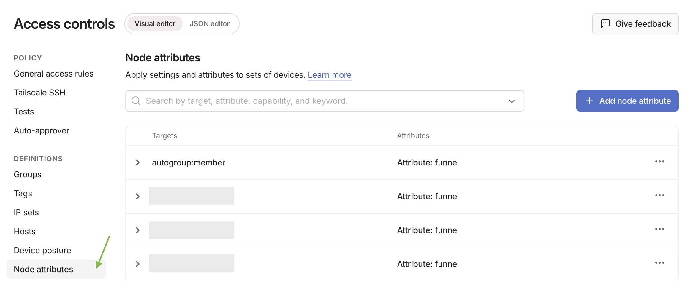
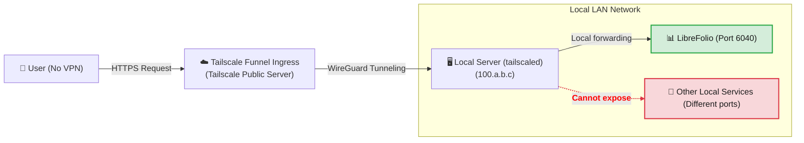
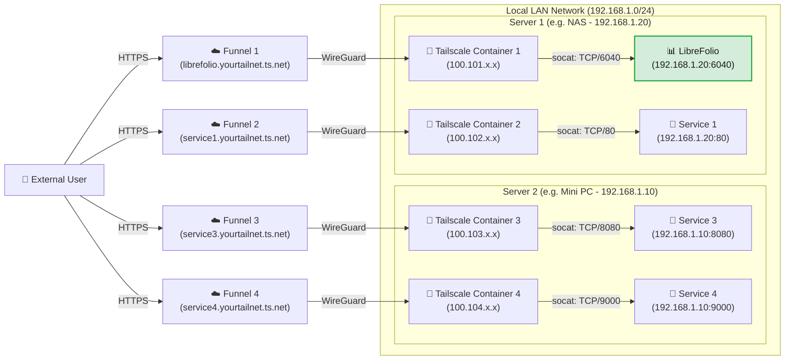

# 🌍 Exposer en toute sécurité : accès public avec Funnel

Cette page met LibreFolio sur internet avec Tailscale Funnel, à une adresse HTTPS publique, sans
ouvrir de port sur votre routeur : la configuration initiale de Funnel et des ACL, puis le niveau 3 (une adresse
pour LibreFolio) ou le niveau 4 (une adresse par service, chacun dans son propre conteneur Docker).

Elle suppose que Tailscale est déjà installé sur votre serveur. Pourquoi Tailscale, l'**étape 0** (l'installation) et les niveaux privés 1 et 2 se trouvent dans [Exposer en toute sécurité](service_exposure.md). Ici,
`6040` est le port par défaut de LibreFolio : si vous avez défini un autre `PORT` dans votre `.env`, utilisez plutôt ce nombre.

---

## 🔑 Activer Funnel et les ACL sur la console {: #enabling-funnel-and-acls-on-the-console }

**Configuration initiale, requise par les niveaux 3 et 4.** Elle autorise Funnel dans les règles de contrôle d'accès (ACL) de l'ensemble de votre tailnet.

!!! warning "🔐 Avant de vous exposer publiquement"

    Avec Funnel, n'importe qui sur internet peut ouvrir votre page de connexion LibreFolio. Créez d'abord votre propre compte : tant qu'aucun compte n'existe, n'importe qui peut s'inscrire, et le premier compte inscrit devient l'administrateur. Ensuite, une nouvelle instance ne laisse entrer les gens que par un lien d'invitation (**Registration** est réglé sur **By invitation** par défaut) : envoyez-en un à chaque personne que vous voulez laisser entrer. Une instance mise à jour depuis une version antérieure conserve son mode : si **Registration** dans les **Paramètres globaux** est sur **Open**, passez ce réglage à **By invitation**, ou à **Closed** si personne d'autre ne doit rejoindre (voir [Qui peut s'inscrire](settings.md)).

1. Rendez-vous sur la page [Access Controls](https://login.tailscale.com/admin/acls) dans la console d'administration Tailscale.
2. Cliquez sur le bouton **Add node attribute**.
3. Remplissez le formulaire :
    * **Targets** : les nœuds autorisés à utiliser Funnel. **Nous suggérons `tag:external_access`** (vous donnerez ce tag aux conteneurs Docker du niveau 4) ou `autogroup:member` (tous les appareils enregistrés sous votre compte personnel).
    * **Attributes** : saisissez `funnel`.
    * **Note** : quelques mots sur la raison d'être de la règle.
    * **IP Pools, App, Capability, etc.** : non nécessaires ici ; laissez-les vides ou à leurs valeurs par défaut.



Cette règle n'est pas une clé d'authentification : les clés d'authentification (niveau 4) servent uniquement à enregistrer un nouvel appareil ou conteneur dans votre tailnet.

??? example "📄 Afficher la configuration JSON complète des ACL pour activer Funnel"

    Si vous préférez modifier directement le fichier de politique, cet exemple fonctionnel active Funnel pour vos propres appareils et pour les conteneurs tagués `tag:external_access` :

    ```json
    {
      // Declaration of authorized tags
      "tagOwners": {
        "tag:external_access": ["autogroup:admin"]
      },

      // Standard access rules
      "acls": [
        // Allows all nodes in your private network to communicate
        {"action": "accept", "src": ["*"], "dst": ["*:*"]}
      ],

      "ssh": [
        {
          "action": "check",
          "src":    ["autogroup:member"],
          "dst":    ["autogroup:self"],
          "users":  ["autogroup:nonroot", "root"]
        }
      ],

      // Enabling Funnel on specific nodes or tags
      "nodeAttrs": [
        {
          "target": ["autogroup:member"],
          "attr":   ["funnel"]
        },
        {
          "target": ["tag:external_access"],
          "attr":   ["funnel"]
        }
      ]
    }
    ```

---

## 🥈 Niveau 3 : adresse HTTPS publique avec Tailscale Funnel {: #level-3-public-https-address-with-tailscale-funnel }

**Idéal pour une adresse publique, sans VPN sur le client.** Funnel publie LibreFolio à une adresse sécurisée `https://<server-name>.your-tailnet.ts.net` que n'importe qui peut ouvrir **sans installer Tailscale**. HTTPS est aussi ce qui vous permet d'[installer LibreFolio comme application (PWA)](../user/pwa.md) sur votre téléphone.

**Avant de commencer :** effectuez la [configuration initiale de Funnel et des ACL sur la console](#enabling-funnel-and-acls-on-the-console).



### ▶️ Étape 1 : démarrer le Funnel sur le serveur

Sur le serveur, publiez le port local de LibreFolio :

```bash
tailscale funnel --bg 6040
```

Funnel le sert à l'adresse `https://<server-name>.your-tailnet.ts.net` sur le port 443 ; `--bg` le maintient en fonctionnement
après la fermeture du terminal, et `tailscale funnel reset` l'arrête. Aucune clé d'authentification n'est nécessaire ici : le
serveur a déjà rejoint votre tailnet à l'[étape 0](service_exposure.md).
Rien à configurer dans LibreFolio non plus : Funnel envoie `X-Forwarded-Proto: https`, donc avec la
valeur par défaut `SESSION_COOKIE_SECURE=auto`, LibreFolio marque son
[cookie de session](configuration.md) comme `Secure`. `never` ne convient qu'à un proxy qui
annonce HTTPS à un navigateur en HTTP simple.

### ✅ Étape 2 : approuver et attendre la propagation {: #step-2-approve-and-wait-for-propagation }

La première fois, le terminal avertit que Funnel n'est pas encore autorisé pour ce nœud et affiche un lien comme celui-ci :

```text
Funnel is enabled, but the list of allowed nodes in the tailnet policy file does not include the one you are using.
To give access to this node you can edit the tailnet policy file, or visit:

         https://login.tailscale.com/f/funnel?node=xxxxxx
```

1. Ouvrez le lien dans votre navigateur, connectez-vous à Tailscale et approuvez Funnel pour ce nœud.
2. Le terminal affiche alors votre URL publique.
3. Attendez quelques minutes que les enregistrements MagicDNS se propagent avant de l'ouvrir depuis un réseau externe.

Pour vérifier le résultat, voir [Vérifier la sécurité de la connexion](connection_checks.md#checklist).

⚠️ **Limites :** une machine a un seul nom public, que chaque service que vous publiez depuis elle doit partager. Le niveau 4 donne à chaque service le sien.

---

## 🥇 Niveau 4 : Multi-Funnel avec sidecars Docker {: #level-4-multi-funnel-with-docker-sidecars }

**Idéal pour les utilisateurs de Docker qui veulent une adresse publique par service.** Chaque service reçoit un petit conteneur Tailscale (un *sidecar*) qui rejoint votre tailnet comme un nœud à part entière, avec sa propre adresse `https://<name>.your-tailnet.ts.net`. Un script de démarrage installe **socat** dans le sidecar, et socat transmet le trafic de Funnel vers l'IP LAN statique du service.

**Avant de commencer :** effectuez la [configuration initiale de Funnel et des ACL sur la console](#enabling-funnel-and-acls-on-the-console).

??? info "🧰 Qu'est-ce que socat ?"

    **socat** (SOcket CAT) est un petit outil en ligne de commande qui relaie les données entre deux connexions. Ici, il agit comme un **mini redirecteur** : il écoute sur un port à l'intérieur du conteneur Tailscale et transmet tout ce qu'il reçoit au port réel du service sur votre LAN.

Ajoutez un sidecar pour chaque service que vous voulez publier, sur un hôte ou plusieurs ; la seule limite est le nombre d'appareils tagués que votre [offre Tailscale](https://tailscale.com/pricing) autorise. Dans cet exemple, deux hôtes exécutent chacun deux sidecars :



### 📁 Étape 1 : préparer le dossier et le script

Créez un dossier sur le serveur, par exemple là où vous conservez vos volumes persistants Docker :

```bash
# Create a folder for the Tailscale nodes and enter it
mkdir -p <path_chosen>/tailscale-nodes
cd <path_chosen>/tailscale-nodes
```

Téléchargez ensuite le script de démarrage <a href="https://raw.githubusercontent.com/Librefolio/LibreFolio/main/mkdocs_src/docs/static/tailscale-guide/custom_startup.sh" target="_blank" rel="noopener noreferrer">custom_startup.sh</a> dedans :

```bash
# Download the script from the official repository
wget https://raw.githubusercontent.com/Librefolio/LibreFolio/main/mkdocs_src/docs/static/tailscale-guide/custom_startup.sh
# Make the script executable
chmod +x custom_startup.sh
```

??? info "🔄 Sidecar configuré auparavant ? Mettez à jour votre copie du script"

    Le script actuel agit aussi comme un **watchdog** et est fourni avec une vérification de santé Docker (voir l'étape 2). Si votre sidecar utilise une ancienne copie, mettez-la à jour :

    1. **Retéléchargez le script** dans le même dossier. L'option `-O custom_startup.sh` écrase l'ancien fichier (sans elle, `wget` enregistre le téléchargement sous `custom_startup.sh.1`). Assurez-vous ensuite que le script est exécutable :

        ```bash
        cd <path_chosen>/tailscale-nodes
        wget -O custom_startup.sh https://raw.githubusercontent.com/Librefolio/LibreFolio/main/mkdocs_src/docs/static/tailscale-guide/custom_startup.sh
        chmod +x custom_startup.sh
        ```

    2. **Mettez à jour votre fichier compose** : ajoutez `TS_ENABLE_HEALTH_CHECK`, `TS_LOCAL_ADDR_PORT` et, éventuellement, `STARTUP_TIMEOUT` au service Tailscale, ainsi que le bloc `healthcheck`, exactement comme à l'étape 2.

    3. **Recréez le conteneur** : un redémarrage n'applique pas les modifications du compose. Lancez `docker compose up -d` dans le dossier de votre `docker-compose.yml` (il recrée les services dont la configuration a changé), ou utilisez l'action *Recreate* / redéployer de Portainer ou CasaOS.

    4. **Vérifiez le journal** avec `docker logs -f tailscale-librefolio` : vous devriez voir `Tailscale is running.`, puis `Starting the funnel on port 6040...` et `Available on the internet:` avec votre URL publique. Pendant les 2 minutes du `start_period` de la vérification de santé, Docker affiche le conteneur comme **healthy** (`docker ps`, Portainer, CasaOS). S'il continue de redémarrer à la place, consultez le panneau de dépannage de l'[étape 3](#3-startup-and-approval).

### 🐳 Étape 2 : configurer Docker Compose

Ajoutez le service Tailscale au **même `docker-compose.yml` que le service** qu'il expose (par exemple LibreFolio), afin que les deux restent ensemble :

```yaml
services:
  tailscale-librefolio:
    image: tailscale/tailscale:latest
    container_name: tailscale-librefolio
    hostname: tailscale-librefolio
    restart: unless-stopped
    privileged: false
    network_mode: bridge
    cap_add:
      - NET_ADMIN
      - NET_RAW
    devices:
      - /dev/net/tun:/dev/net/tun
    command:
      - /custom_startup.sh
    environment:
      - HOST_IP=192.168.1.20                # Local IP of the service to expose (e.g. Server 1)
      - HOST_PORT=6040                      # Real port of the service to expose
      - TAILSCALE_FUNNEL_PORT=6040          # Internal Funnel port
      - TS_HOSTNAME=librefolio              # Custom public hostname (e.g. librefolio)
      - TS_AUTHKEY=tskey-auth-...           # Authentication key generated by Tailscale
      - TS_ACCEPT_DNS=true
      - TS_STATE_DIR=/var/lib/tailscale
      - TS_USERSPACE=false
      - TS_ENABLE_HEALTH_CHECK=true         # Expose /healthz for the healthcheck below (Tailscale ≥ 1.78)
      - TS_LOCAL_ADDR_PORT=127.0.0.1:9002   # Where /healthz listens: inside the container only
      - STARTUP_TIMEOUT=180                 # Optional: seconds to reach the Running state (default 180)
    volumes:
      - <path_chosen>/tailscale-nodes/tailscale-librefolio/state:/var/lib/tailscale
      - <path_chosen>/tailscale-nodes/custom_startup.sh:/custom_startup.sh
      - /etc/localtime:/etc/localtime:ro
      - /etc/timezone:/etc/timezone:ro
    # Shows healthy/unhealthy in Docker, Portainer or CasaOS; the restart itself comes from custom_startup.sh exiting
    healthcheck:
      test: ["CMD", "wget", "-q", "-O", "/dev/null", "http://127.0.0.1:9002/healthz"]
      interval: 30s
      timeout: 5s
      retries: 3
      start_period: 120s
```

Définissez ensuite ces valeurs pour votre réseau :

| Valeur | Ce qu'il faut indiquer |
|---|---|
| `<path_chosen>` | Le chemin absolu choisi à l'étape 1, où se trouvent le script et les données d'état (par exemple `/home/user/docker`). |
| `HOST_IP` | L'IP LAN statique de la machine qui exécute le service. |
| `HOST_PORT` | Le port réel du service sur cette machine : pour LibreFolio, le `PORT` de votre `.env` (`6040` par défaut). |
| `TAILSCALE_FUNNEL_PORT` | Le port sur lequel le conteneur écoute et publie via Funnel. Définissez-le à la même valeur que `HOST_PORT`. |
| `TS_HOSTNAME` | Le nom du nœud : l'adresse publique devient `https://TS_HOSTNAME.your-tailnet.ts.net`. |
| `TS_AUTHKEY` | La clé d'authentification qui enregistre le conteneur dans votre tailnet (voir ci-dessous). |

Pour obtenir la clé d'authentification pour `TS_AUTHKEY` :

1. Rendez-vous sur [Clés des paramètres d'administration Tailscale](https://login.tailscale.com/admin/settings/keys).
2. Dans la section **Auth keys** (*pas* dans la section des jetons d'accès API), cliquez sur le bouton **Generate auth key...**.
3. Activez l'interrupteur **Tags** et sélectionnez votre tag (par exemple `tag:external_access`). Ajoutez une description que vous reconnaîtrez, comme `docker-librefolio-funnel`.
4. Cliquez sur **Generate** et copiez la clé (`tskey-auth-...`).

Une fois le conteneur démarré, la clé à usage unique est consommée : elle disparaît de la liste **Keys**, et le nouvel appareil apparaît dans **Machines**.

??? info "🩺 Watchdog et vérification de santé — ce que font les paramètres supplémentaires"

    Le script de démarrage agit aussi comme un **watchdog**, tandis que le bloc `healthcheck` rend visible l'état du conteneur :

    * **Watchdog (redémarrage automatique)** : si Tailscale ne peut pas démarrer (par exemple, pas de connexion internet au démarrage ou une option erronée), n'atteint pas l'état *Running* dans le délai de `STARTUP_TIMEOUT` secondes, ou si Tailscale, socat ou le Funnel s'arrêtent ensuite, le script se termine avec une erreur et Docker redémarre le conteneur (`restart: unless-stopped`). Le conteneur ne reste jamais « en cours d'exécution » sans rien derrière, et un `docker stop` arrête toujours tout proprement.
    * **Vérification de santé (état uniquement)** : `TS_ENABLE_HEALTH_CHECK=true` active le point de terminaison `/healthz` de Tailscale (Tailscale 1.78 ou ultérieur), qui répond `200` tant que le nœud a une adresse IP Tailscale et `503` sinon. Docker l'interroge régulièrement et marque le conteneur *healthy* ou *unhealthy* ; Portainer et CasaOS affichent le même état.

    Le Docker simple (hors mode Swarm) ne redémarre **pas** un conteneur marqué *unhealthy* : le redémarrage vient de la fin du script, donc vous n'avez besoin d'aucun conteneur « autoheal » supplémentaire (ces assistants ont aussi besoin du socket Docker, ce qui signifie un contrôle total de l'hôte).

    | Paramètre facultatif | Ce qu'il fait |
    |---|---|
    | `TS_LOCAL_ADDR_PORT` | Où `/healthz` écoute. Le point de terminaison ne nécessite aucune authentification, et la valeur par défaut de Tailscale, `[::]:9002`, écoute sur toutes les interfaces : `127.0.0.1:9002` le maintient à l'intérieur du conteneur. Si vous le modifiez, mettez aussi à jour l'URL du test `healthcheck`. |
    | `STARTUP_TIMEOUT` | Secondes pendant lesquelles le script attend l'état *Running* (par défaut `180`) avant de s'arrêter ; Docker redémarre alors le conteneur. Ne l'augmentez que sur un serveur très lent. |
    | `DEBUG` | Absent de l'exemple ci-dessus. `DEBUG=1` affiche dans le journal du conteneur chaque commande exécutée par le script, pour le dépannage. Désactivé par défaut pour garder le journal lisible. |

??? tip "📈 Surveiller LibreFolio avec un moniteur (Uptime Kuma)"

    Le service `librefolio` a sa propre vérification de santé, sur `GET /api/v1/system/health` (voir le fichier compose ci-dessous) : elle indique à Docker que le serveur répond. Pour surveiller LibreFolio depuis un autre appareil, par exemple avec **Uptime Kuma**, pointez le moniteur vers `/api/v1/system/ready` sur l'adresse avec laquelle vous ouvrez LibreFolio, comme `https://librefolio.your-tailnet.ts.net/api/v1/system/ready`. Cela ne nécessite aucune authentification et répond :

    * **`200`** lorsque LibreFolio est prêt à traiter les requêtes ;
    * **`503`** lorsqu'il ne l'est pas, avec la vérification en cause dans la réponse : `database` (`unreachable`) ou `migrations` (`behind`, `ahead`, `unknown`).

    Le [Guide Docker avancé](docker_advanced.md), section « Service : `librefolio` », explique les codes.

??? example "📄 Afficher le fichier Docker Compose de production complet (LibreFolio + Tailscale)"

    Un `docker-compose.yml` complet : le service `librefolio` du `docker-compose.prod.yml` officiel, avec le sidecar Tailscale à côté :

    ```yaml
    # =============================================================================
    # LibreFolio — Production Docker Compose
    # =============================================================================
    # Optimized for end-users running the official pre-built image from GHCR.
    # =============================================================================

    services:
      librefolio:
        image: ${LIBREFOLIO_IMAGE:-ghcr.io/librefolio/librefolio:latest}
        container_name: librefolio
        restart: unless-stopped
        ports:
          - "${PORT:-6040}:6040"
        volumes:
          - ./LibreFolio-data:/app/backend/data/prod-docker
        env_file: .env
        environment:
          - LIBREFOLIO_DATA_DIR=/app/backend/data/prod-docker
          - HOST=0.0.0.0
          - PORT=6040
        healthcheck:
          test: ["CMD", "python", "-c", "import urllib.request; urllib.request.urlopen('http://localhost:6040/api/v1/system/health')"]
          interval: 30s
          timeout: 10s
          start_period: 15s
          retries: 3

      tailscale-librefolio:
        image: tailscale/tailscale:latest
        container_name: tailscale-librefolio
        hostname: tailscale-librefolio
        restart: unless-stopped
        privileged: false
        network_mode: bridge
        cap_add:
          - NET_ADMIN
          - NET_RAW
        devices:
          - /dev/net/tun:/dev/net/tun
        command:
          - /custom_startup.sh
        environment:
          - HOST_IP=192.168.1.20                # Local IP of the service to expose (e.g. Server 1)
          - HOST_PORT=6040                      # Real port of the service to expose
          - TAILSCALE_FUNNEL_PORT=6040          # Internal Funnel port
          - TS_HOSTNAME=librefolio              # Custom public hostname (e.g. librefolio)
          - TS_AUTHKEY=tskey-auth-...           # Replace with your generated key
          - TS_ACCEPT_DNS=true
          - TS_STATE_DIR=/var/lib/tailscale
          - TS_USERSPACE=false
          - TS_ENABLE_HEALTH_CHECK=true         # Expose /healthz for the healthcheck below (Tailscale ≥ 1.78)
          - TS_LOCAL_ADDR_PORT=127.0.0.1:9002   # Where /healthz listens: inside the container only
          - STARTUP_TIMEOUT=180                 # Optional: seconds to reach the Running state (default 180)
        volumes:
          - /DATA/AppData/tailscale-nodes/tailscale-librefolio/state:/var/lib/tailscale
          - /DATA/AppData/tailscale-nodes/custom_startup.sh:/custom_startup.sh
          - /etc/localtime:/etc/localtime:ro
          - /etc/timezone:/etc/timezone:ro
        # Shows healthy/unhealthy in Docker, Portainer or CasaOS; the restart itself comes from custom_startup.sh exiting
        healthcheck:
          test: ["CMD", "wget", "-q", "-O", "/dev/null", "http://127.0.0.1:9002/healthz"]
          interval: 30s
          timeout: 5s
          retries: 3
          start_period: 120s
    ```

### 🚀 Étape 3 : démarrer et approuver le Funnel {: #3-startup-and-approval }

Démarrez la pile, le service et son sidecar Tailscale ensemble :

```bash
docker compose up -d
```

Suivez ensuite le journal du conteneur Tailscale :

```bash
docker logs -f tailscale-librefolio
```

Au premier démarrage, le journal affiche le lien d'approbation pour le nouveau nœud :

```text
Funnel is enabled, but the list of allowed nodes in the tailnet policy file does not include the one you are using.
To give access to this node you can edit the tailnet policy file, or visit:

         https://login.tailscale.com/f/funnel?node=nsKGo6k9ZF11CNTRL
```

* Ouvrez le lien dans votre navigateur, connectez-vous à Tailscale et approuvez l'activation de Funnel.
* Juste après l'approbation, le journal confirme l'URL publique et le proxy local :

```text
Available on the internet:

https://librefolio.yourtailnet.ts.net/
|-- proxy http://127.0.0.1:6040

Press Ctrl+C to exit.
```

Le service est maintenant en ligne : attendez quelques minutes que les enregistrements MagicDNS se propagent, puis ouvrez l'URL.
Rien à configurer dans LibreFolio : Funnel envoie `X-Forwarded-Proto: https` et socat le transmet,
donc avec la valeur par défaut `SESSION_COOKIE_SECURE=auto`, LibreFolio marque son
[cookie de session](configuration.md) comme `Secure`. `never` ne convient qu'à un proxy qui
annonce HTTPS à un navigateur en HTTP simple.

Pour vérifier le résultat, voir [Vérifier la sécurité de la connexion](connection_checks.md#checklist).

??? question "🛠️ Le conteneur redémarre en boucle ou est marqué unhealthy"

    Un problème persistant se manifeste par un conteneur qui ne cesse de redémarrer (Docker, Portainer ou CasaOS peuvent aussi le marquer *unhealthy*), et non comme un conteneur qui semble « en cours d'exécution » mais ne fonctionne pas. Lisez le journal avec `docker logs tailscale-librefolio` : avant chaque redémarrage, le script indique ce qui a échoué, généralement suivi de `Exiting so Docker restarts the container.` Les causes les plus courantes :

    * **Une option dans `TS_EXTRA_ARGS` n'a pas de valeur.** Cette variable facultative (absente du compose ci-dessus) transmet des options supplémentaires à `tailscale up`, séparées par des espaces. Une option sans sa valeur fait échouer `tailscale up` : la raison apparaît sur la ligne juste après `Running 'tailscale up'`, au-dessus du texte d'aide qui commence par `USAGE` (par exemple `flag needs an argument: -advertise-tags`), suivie de `failed to auth tailscale: … tailscale up failed: exit status 2` et `containerboot exited before Tailscale was running.` Écrivez chaque valeur sous la forme `--flag=value` ou `--flag value` : `--advertise-tags=tag:container` et `--advertise-tags tag:container` fonctionnent tous les deux.
    * **Un panneau d'administration a tronqué la valeur.** L'éditeur de variables d'environnement de CasaOS (et de panneaux similaires) tronque une valeur à son deuxième `=` : `TS_EXTRA_ARGS=--advertise-tags=tag:container` devient `--advertise-tags`, ce qui échoue comme décrit ci-dessus. Dans ces panneaux, écrivez les valeurs des options avec un espace : `--advertise-tags tag:container`.
    * **Une variable requise est manquante** : le script s'arrête immédiatement avec `HOST_IP is not set` (ou le même message pour `HOST_PORT` ou `TAILSCALE_FUNNEL_PORT`).
    * **Pas de connexion internet au démarrage** : le conteneur ne cesse de redémarrer jusqu'à ce que Tailscale puisse démarrer, puis fonctionne normalement. C'est attendu.
    * **Démarrage très lent** : le journal affiche `Tailscale is not running after 180s.` ; augmentez `STARTUP_TIMEOUT`.
    * **Unhealthy, mais sans redémarrage** : la vérification de santé n'obtient aucune réponse satisfaisante de `/healthz`. Si vous venez de l'ajouter, assurez-vous que `TS_ENABLE_HEALTH_CHECK=true` est défini et que l'URL du test `healthcheck` correspond à `TS_LOCAL_ADDR_PORT` ; sinon, le nœud n'a pas d'adresse IP Tailscale à ce moment-là.

    Pour tracer chaque commande du script, ajoutez `DEBUG=1` à la section `environment`, recréez le conteneur et relisez le journal.

Comme sa clé d'authentification porte un tag, Tailscale désactive par défaut l'expiration de la clé pour le conteneur. Avec une clé non taguée, désactivez cette expiration comme pour le serveur (astuce à la fin de l'[étape 0](service_exposure.md)).

⚠️ **Limites :** cela nécessite un terminal et quelques modifications des fichiers Docker Compose.

---

## 🔗 Voir aussi

- 📄 **[Exposer en toute sécurité](service_exposure.md)** — Pourquoi ne pas faire une simple redirection de port ?, Étape 0 : installer Tailscale sur vos appareils, Niveau 1 : VPN privé point à point, …
- 🔗 **[Liens utiles](service_exposure.md)** — La console Tailscale, les ACL et les guides officiels de Funnel et Docker
