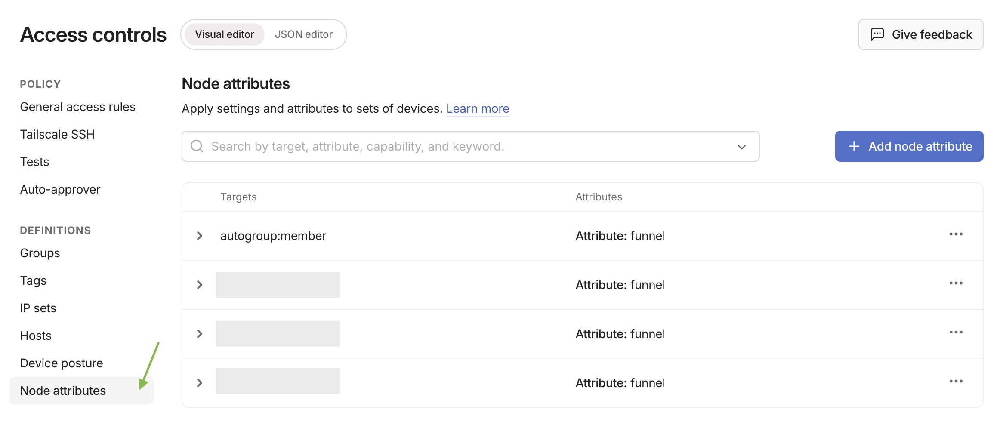
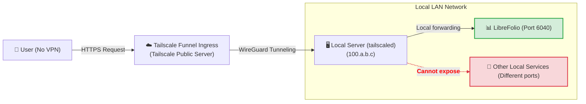
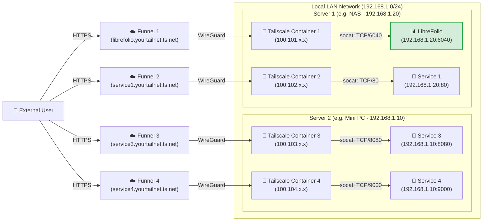

# 🌍 Esporre in sicurezza: accesso pubblico con Funnel

Questa pagina mette LibreFolio su internet con Tailscale Funnel, a un indirizzo HTTPS pubblico, senza aprire alcuna porta sul router: la configurazione una tantum di Funnel e delle ACL, poi il Livello 3 (un indirizzo per LibreFolio) o il Livello 4 (un indirizzo per servizio, ciascuno nel proprio container Docker).

Si presuppone che Tailscale sia già installato sul tuo server. Il perché di Tailscale, il **Passaggio 0** (l'installazione) e i Livelli 1 e 2 privati sono in [Esporre in sicurezza](service_exposure.md). Qui `6040` è la porta predefinita di LibreFolio: se imposti una `PORT` diversa nel tuo `.env`, usa quel numero.

---

## 🔑 Abilitare Funnel e ACL nella console {: #enabling-funnel-and-acls-on-the-console }

**Configurazione una tantum, necessaria per i Livelli 3 e 4.** Consente Funnel nelle regole di controllo degli accessi (ACL) dell'intera tailnet.

!!! warning "🔐 Prima di rendere il servizio pubblico"

    Con Funnel, chiunque su internet può aprire la pagina di accesso di LibreFolio. Crea prima il tuo account: finché non esiste un account, chiunque può registrarsi e il primo account registrato diventa amministratore. Dopodiché, una nuova istanza consente l'accesso solo tramite link di invito (**Registrazione** è **Su invito** per impostazione predefinita): inviane uno a ogni persona che vuoi far entrare. Un'istanza aggiornata da una versione precedente mantiene la propria modalità: se **Registrazione** in **Impostazioni globali** è **Aperta**, passala a **Su invito**, oppure a **Chiusa** se nessun altro deve unirsi (vedi [Chi può registrarsi](settings.md)).

1. Visita la pagina [Controlli di accesso](https://login.tailscale.com/admin/acls) nella console di amministrazione di Tailscale.
2. Fai clic sul pulsante **Aggiungi attributo nodo**.
3. Compila il modulo:
    * **Destinazioni**: i nodi autorizzati a usare Funnel. **Suggeriamo `tag:external_access`** (assegnerai questo tag ai container Docker del Livello 4) oppure `autogroup:member` (tutti i dispositivi registrati nel tuo account personale).
    * **Attributi**: inserisci `funnel`.
    * **Nota**: qualche parola sul motivo per cui esiste la regola.
    * **Pool IP, App, Capacità, ecc.**: non servono qui; lasciali vuoti o ai valori predefiniti.



Questa regola non è una chiave di autenticazione: le chiavi di autenticazione (Livello 4) registrano solo un nuovo dispositivo o container nella tua tailnet.

??? example "📄 Visualizza la configurazione JSON completa delle ACL per abilitare Funnel"

    Se preferisci modificare direttamente il file dei criteri, questo esempio funzionante abilita Funnel per i tuoi dispositivi e per i container con tag `tag:external_access`:

    ```json
    {
      // Declaration of authorized tags
      "tagOwners": {
        "tag:external_access": ["autogroup:admin"]
      },

      // Standard access rules
      "acls": [
        // Allows all nodes in your private network to communicate
        {"action": "accept", "src": ["*"], "dst": ["*:*"]}
      ],

      "ssh": [
        {
          "action": "check",
          "src":    ["autogroup:member"],
          "dst":    ["autogroup:self"],
          "users":  ["autogroup:nonroot", "root"]
        }
      ],

      // Enabling Funnel on specific nodes or tags
      "nodeAttrs": [
        {
          "target": ["autogroup:member"],
          "attr":   ["funnel"]
        },
        {
          "target": ["tag:external_access"],
          "attr":   ["funnel"]
        }
      ]
    }
    ```

---

## 🥈 Livello 3: Indirizzo HTTPS pubblico con Tailscale Funnel {: #level-3-public-https-address-with-tailscale-funnel }

**Ideale per un indirizzo pubblico, senza VPN sul client.** Funnel pubblica LibreFolio a un indirizzo sicuro `https://<server-name>.your-tailnet.ts.net` che chiunque può aprire **senza installare Tailscale**. HTTPS è anche ciò che ti consente di [installare LibreFolio come app (PWA)](../user/pwa.md) sul telefono.

**Prima di iniziare:** completa la [configurazione una tantum di Funnel e ACL nella console](#enabling-funnel-and-acls-on-the-console).



### ▶️ Passaggio 1: Avvia il Funnel sul server

Sul server, pubblica la porta locale di LibreFolio:

```bash
tailscale funnel --bg 6040
```

Funnel lo serve all'indirizzo `https://<server-name>.your-tailnet.ts.net` sulla porta 443; `--bg` lo mantiene in esecuzione dopo la chiusura del terminale, e `tailscale funnel reset` lo arresta. Qui non serve alcuna chiave di autenticazione: il server si è già unito alla tua tailnet nel [Passaggio 0](service_exposure.md).
Non c'è nulla da configurare nemmeno in LibreFolio: Funnel invia `X-Forwarded-Proto: https`, quindi con l'impostazione predefinita `SESSION_COOKIE_SECURE=auto` LibreFolio contrassegna il proprio
[cookie di sessione](configuration.md) come `Secure`. `never` serve solo per un proxy che
dichiara HTTPS a un browser su HTTP non cifrato.

### ✅ Passaggio 2: Approva e attendi la propagazione {: #step-2-approve-and-wait-for-propagation }

La prima volta, il terminale avvisa che Funnel non è ancora consentito per questo nodo e mostra un link come questo:

```text
Funnel is enabled, but the list of allowed nodes in the tailnet policy file does not include the one you are using.
To give access to this node you can edit the tailnet policy file, or visit:

         https://login.tailscale.com/f/funnel?node=xxxxxx
```

1. Apri il link nel browser, accedi a Tailscale e approva Funnel per questo nodo.
2. Il terminale mostra quindi il tuo URL pubblico.
3. Attendi qualche minuto perché i record MagicDNS si propaghino prima di aprirlo da una rete esterna.

Per controllare il risultato, vedi [Verifica della sicurezza della connessione](connection_checks.md#checklist).

⚠️ **Limiti:** una macchina ha un solo nome pubblico, che ogni servizio pubblicato da essa deve condividere. Il Livello 4 assegna a ciascun servizio il proprio.

---

## 🥇 Livello 4: Multi-Funnel con sidecar Docker {: #level-4-multi-funnel-with-docker-sidecars }

**Ideale per gli utenti Docker che vogliono un indirizzo pubblico per servizio.** Ogni servizio riceve un piccolo container Tailscale (un *sidecar*) che si unisce alla tua tailnet come nodo autonomo, con il proprio indirizzo `https://<name>.your-tailnet.ts.net`. Uno script di avvio installa **socat** nel sidecar, e socat inoltra il traffico Funnel all'IP statico LAN del servizio.

**Prima di iniziare:** completa la [configurazione una tantum di Funnel e ACL nella console](#enabling-funnel-and-acls-on-the-console).

??? info "🧰 Che cos'è socat?"

    **socat** (SOcket CAT) è un piccolo strumento da riga di comando che inoltra dati tra due connessioni. Qui funziona come un **mini forwarder**: resta in ascolto su una porta all'interno del container Tailscale e passa tutto ciò che riceve alla porta reale del servizio sulla tua LAN.

Aggiungi un sidecar per ogni servizio che vuoi pubblicare, su uno o più host; l'unico limite è il numero di dispositivi con tag consentiti dal tuo [piano Tailscale](https://tailscale.com/pricing). In questo esempio, due host eseguono due sidecar ciascuno:



### 📁 Passaggio 1: Prepara la cartella e lo script

Crea una cartella sul server, ad esempio dove tieni i volumi persistenti di Docker:

```bash
# Create a folder for the Tailscale nodes and enter it
mkdir -p <path_chosen>/tailscale-nodes
cd <path_chosen>/tailscale-nodes
```

Poi scarica al suo interno lo script di avvio <a href="https://raw.githubusercontent.com/Librefolio/LibreFolio/main/mkdocs_src/docs/static/tailscale-guide/custom_startup.sh" target="_blank" rel="noopener noreferrer">custom_startup.sh</a>:

```bash
# Download the script from the official repository
wget https://raw.githubusercontent.com/Librefolio/LibreFolio/main/mkdocs_src/docs/static/tailscale-guide/custom_startup.sh
# Make the script executable
chmod +x custom_startup.sh
```

??? info "🔄 Hai già configurato il sidecar? Aggiorna la copia dello script"

    Lo script attuale funziona anche come **watchdog** ed è dotato di un health check Docker (vedi il Passaggio 2). Se il tuo sidecar esegue una copia precedente, aggiornala:

    1. **Scarica di nuovo lo script** nella stessa cartella. L'opzione `-O custom_startup.sh` sovrascrive il file vecchio (senza di essa, `wget` salva il download come `custom_startup.sh.1`). Poi assicurati che lo script sia eseguibile:

        ```bash
        cd <path_chosen>/tailscale-nodes
        wget -O custom_startup.sh https://raw.githubusercontent.com/Librefolio/LibreFolio/main/mkdocs_src/docs/static/tailscale-guide/custom_startup.sh
        chmod +x custom_startup.sh
        ```

    2. **Aggiorna il tuo file compose**: aggiungi `TS_ENABLE_HEALTH_CHECK`, `TS_LOCAL_ADDR_PORT` e, facoltativamente, `STARTUP_TIMEOUT` al servizio Tailscale, insieme al blocco `healthcheck`, esattamente come nel Passaggio 2.

    3. **Ricrea il container**: un riavvio non applica le modifiche al compose. Esegui `docker compose up -d` nella cartella del tuo `docker-compose.yml` (ricrea i servizi la cui configurazione è cambiata), oppure usa l'azione *Ricrea* / ridistribuisci di Portainer o CasaOS.

    4. **Controlla il log** con `docker logs -f tailscale-librefolio`: dovresti vedere `Tailscale is running.`, poi `Starting the funnel on port 6040...` e `Available on the internet:` con il tuo URL pubblico. Durante i 2 minuti di `start_period` dell'health check, Docker mostra il container come **healthy** (`docker ps`, Portainer, CasaOS). Se invece continua a riavviarsi, vedi il pannello di risoluzione dei problemi nel [Passaggio 3](#3-startup-and-approval).

### 🐳 Passaggio 2: Configura Docker Compose

Aggiungi il servizio Tailscale allo **stesso `docker-compose.yml` del servizio esposto** (ad esempio LibreFolio), così i due restano insieme:

```yaml
services:
  tailscale-librefolio:
    image: tailscale/tailscale:latest
    container_name: tailscale-librefolio
    hostname: tailscale-librefolio
    restart: unless-stopped
    privileged: false
    network_mode: bridge
    cap_add:
      - NET_ADMIN
      - NET_RAW
    devices:
      - /dev/net/tun:/dev/net/tun
    command:
      - /custom_startup.sh
    environment:
      - HOST_IP=192.168.1.20                # Local IP of the service to expose (e.g. Server 1)
      - HOST_PORT=6040                      # Real port of the service to expose
      - TAILSCALE_FUNNEL_PORT=6040          # Internal Funnel port
      - TS_HOSTNAME=librefolio              # Custom public hostname (e.g. librefolio)
      - TS_AUTHKEY=tskey-auth-...           # Authentication key generated by Tailscale
      - TS_ACCEPT_DNS=true
      - TS_STATE_DIR=/var/lib/tailscale
      - TS_USERSPACE=false
      - TS_ENABLE_HEALTH_CHECK=true         # Expose /healthz for the healthcheck below (Tailscale ≥ 1.78)
      - TS_LOCAL_ADDR_PORT=127.0.0.1:9002   # Where /healthz listens: inside the container only
      - STARTUP_TIMEOUT=180                 # Optional: seconds to reach the Running state (default 180)
    volumes:
      - <path_chosen>/tailscale-nodes/tailscale-librefolio/state:/var/lib/tailscale
      - <path_chosen>/tailscale-nodes/custom_startup.sh:/custom_startup.sh
      - /etc/localtime:/etc/localtime:ro
      - /etc/timezone:/etc/timezone:ro
    # Shows healthy/unhealthy in Docker, Portainer or CasaOS; the restart itself comes from custom_startup.sh exiting
    healthcheck:
      test: ["CMD", "wget", "-q", "-O", "/dev/null", "http://127.0.0.1:9002/healthz"]
      interval: 30s
      timeout: 5s
      retries: 3
      start_period: 120s
```

Poi imposta questi valori per la tua rete:

| Valore | Cosa inserire |
|---|---|
| `<path_chosen>` | Il percorso assoluto scelto nel Passaggio 1, dove risiedono lo script e i dati di stato (ad esempio `/home/user/docker`). |
| `HOST_IP` | L'IP statico LAN della macchina che esegue il servizio. |
| `HOST_PORT` | La porta reale del servizio su quella macchina: per LibreFolio, la `PORT` del tuo `.env` (`6040` per impostazione predefinita). |
| `TAILSCALE_FUNNEL_PORT` | La porta su cui il container resta in ascolto e pubblica tramite Funnel. Impostala allo stesso valore di `HOST_PORT`. |
| `TS_HOSTNAME` | Il nome del nodo: l'indirizzo pubblico diventa `https://TS_HOSTNAME.your-tailnet.ts.net`. |
| `TS_AUTHKEY` | La chiave di autenticazione che registra il container nella tua tailnet (vedi sotto). |

Per ottenere la chiave di autenticazione per `TS_AUTHKEY`:

1. Vai su [Chiavi nelle impostazioni di amministrazione di Tailscale](https://login.tailscale.com/admin/settings/keys).
2. Nella sezione **Chiavi di autenticazione** (*non* nella sezione dei token di accesso API), fai clic sul pulsante **Genera chiave di autenticazione...**.
3. Attiva l'interruttore **Tag** e seleziona il tuo tag (ad esempio `tag:external_access`). Aggiungi una descrizione che riconoscerai, come `docker-librefolio-funnel`.
4. Fai clic su **Genera** e copia la chiave (`tskey-auth-...`).

Una volta avviato il container, la chiave una tantum è consumata: scompare dall'elenco **Chiavi** e il nuovo dispositivo compare in **Macchine**.

??? info "🩺 Watchdog e health check — cosa fanno le impostazioni extra"

    Lo script di avvio funziona anche come **watchdog**, mentre il blocco `healthcheck` rende visibile lo stato del container:

    * **Watchdog (riavvio automatico)**: se Tailscale non riesce ad avviarsi (ad esempio, nessuna connessione internet all'avvio o un flag errato), non raggiunge lo stato *Running* entro `STARTUP_TIMEOUT` secondi, oppure se Tailscale, socat o il Funnel si arrestano in seguito, lo script termina con un errore e Docker riavvia il container (`restart: unless-stopped`). Il container non resta mai "in esecuzione" senza nulla dietro, e un `docker stop` arresta comunque tutto in modo pulito.
    * **Health check (solo stato)**: `TS_ENABLE_HEALTH_CHECK=true` attiva l'endpoint `/healthz` di Tailscale (Tailscale 1.78 o successivo), che risponde `200` mentre il nodo ha un indirizzo IP Tailscale e `503` altrimenti. Docker lo interroga regolarmente e contrassegna il container come *healthy* o *unhealthy*; Portainer e CasaOS mostrano lo stesso stato.

    Docker semplice (al di fuori della modalità Swarm) **non** riavvia un container contrassegnato come *unhealthy*: il riavvio deriva dall'uscita dello script, quindi non serve alcun container "autoheal" aggiuntivo (tali helper richiedono anche il socket Docker, il che significa pieno controllo dell'host).

    | Impostazione facoltativa | Cosa fa |
    |---|---|
    | `TS_LOCAL_ADDR_PORT` | Dove resta in ascolto `/healthz`. L'endpoint non richiede autenticazione, e il valore predefinito di Tailscale, `[::]:9002`, ascolta su tutte le interfacce: `127.0.0.1:9002` lo mantiene all'interno del container. Se lo modifichi, aggiorna anche l'URL del test `healthcheck`. |
    | `STARTUP_TIMEOUT` | Secondi che lo script attende per lo stato *Running* (predefinito `180`) prima di uscire e far riavviare il container da Docker. Aumentalo solo su un server molto lento. |
    | `DEBUG` | Non presente nell'esempio sopra. `DEBUG=1` stampa ogni comando eseguito dallo script nel log del container, per la risoluzione dei problemi. Disattivato per impostazione predefinita per mantenere il log leggibile. |

??? tip "📈 Monitorare LibreFolio con un monitor (Uptime Kuma)"

    Il servizio `librefolio` ha un proprio health check, su `GET /api/v1/system/health` (vedi il file compose sotto): indica a Docker che il server risponde. Per monitorare LibreFolio da un altro dispositivo, ad esempio con **Uptime Kuma**, punta il monitor su `/api/v1/system/ready` all'indirizzo con cui apri LibreFolio, come `https://librefolio.your-tailnet.ts.net/api/v1/system/ready`. Non richiede accesso e risponde:

    * **`200`** quando LibreFolio è pronto a servire richieste;
    * **`503`** quando non lo è, con il controllo in errore nella risposta: `database` (`unreachable`) oppure `migrations` (`behind`, `ahead`, `unknown`).

    La [Guida avanzata a Docker](docker_advanced.md), sezione «Servizio: `librefolio`», spiega i codici.

??? example "📄 Visualizza il file Docker Compose di produzione completo (LibreFolio + Tailscale)"

    Un `docker-compose.yml` completo: il servizio `librefolio` del file ufficiale `docker-compose.prod.yml`, con il sidecar Tailscale accanto:

    ```yaml
    # =============================================================================
    # LibreFolio — Production Docker Compose
    # =============================================================================
    # Optimized for end-users running the official pre-built image from GHCR.
    # =============================================================================

    services:
      librefolio:
        image: ${LIBREFOLIO_IMAGE:-ghcr.io/librefolio/librefolio:latest}
        container_name: librefolio
        restart: unless-stopped
        ports:
          - "${PORT:-6040}:6040"
        volumes:
          - ./LibreFolio-data:/app/backend/data/prod-docker
        env_file: .env
        environment:
          - LIBREFOLIO_DATA_DIR=/app/backend/data/prod-docker
          - HOST=0.0.0.0
          - PORT=6040
        healthcheck:
          test: ["CMD", "python", "-c", "import urllib.request; urllib.request.urlopen('http://localhost:6040/api/v1/system/health')"]
          interval: 30s
          timeout: 10s
          start_period: 15s
          retries: 3

      tailscale-librefolio:
        image: tailscale/tailscale:latest
        container_name: tailscale-librefolio
        hostname: tailscale-librefolio
        restart: unless-stopped
        privileged: false
        network_mode: bridge
        cap_add:
          - NET_ADMIN
          - NET_RAW
        devices:
          - /dev/net/tun:/dev/net/tun
        command:
          - /custom_startup.sh
        environment:
          - HOST_IP=192.168.1.20                # Local IP of the service to expose (e.g. Server 1)
          - HOST_PORT=6040                      # Real port of the service to expose
          - TAILSCALE_FUNNEL_PORT=6040          # Internal Funnel port
          - TS_HOSTNAME=librefolio              # Custom public hostname (e.g. librefolio)
          - TS_AUTHKEY=tskey-auth-...           # Replace with your generated key
          - TS_ACCEPT_DNS=true
          - TS_STATE_DIR=/var/lib/tailscale
          - TS_USERSPACE=false
          - TS_ENABLE_HEALTH_CHECK=true         # Expose /healthz for the healthcheck below (Tailscale ≥ 1.78)
          - TS_LOCAL_ADDR_PORT=127.0.0.1:9002   # Where /healthz listens: inside the container only
          - STARTUP_TIMEOUT=180                 # Optional: seconds to reach the Running state (default 180)
        volumes:
          - /DATA/AppData/tailscale-nodes/tailscale-librefolio/state:/var/lib/tailscale
          - /DATA/AppData/tailscale-nodes/custom_startup.sh:/custom_startup.sh
          - /etc/localtime:/etc/localtime:ro
          - /etc/timezone:/etc/timezone:ro
        # Shows healthy/unhealthy in Docker, Portainer or CasaOS; the restart itself comes from custom_startup.sh exiting
        healthcheck:
          test: ["CMD", "wget", "-q", "-O", "/dev/null", "http://127.0.0.1:9002/healthz"]
          interval: 30s
          timeout: 5s
          retries: 3
          start_period: 120s
    ```

### 🚀 Passaggio 3: Avvia e approva il Funnel {: #3-startup-and-approval }

Avvia lo stack, il servizio e il suo sidecar Tailscale insieme:

```bash
docker compose up -d
```

Poi segui il log del container Tailscale:

```bash
docker logs -f tailscale-librefolio
```

Al primo avvio, il log mostra il link di approvazione per il nuovo nodo:

```text
Funnel is enabled, but the list of allowed nodes in the tailnet policy file does not include the one you are using.
To give access to this node you can edit the tailnet policy file, or visit:

         https://login.tailscale.com/f/funnel?node=nsKGo6k9ZF11CNTRL
```

* Apri il link nel browser, accedi a Tailscale e approva l'attivazione di Funnel.
* Subito dopo l'approvazione, il log conferma l'URL pubblico e il proxy locale:

```text
Available on the internet:

https://librefolio.yourtailnet.ts.net/
|-- proxy http://127.0.0.1:6040

Press Ctrl+C to exit.
```

Il servizio è ora online: attendi qualche minuto perché i record MagicDNS si propaghino, poi apri l'URL.
Non c'è nulla da configurare in LibreFolio: Funnel invia `X-Forwarded-Proto: https` e socat lo inoltra,
quindi con l'impostazione predefinita `SESSION_COOKIE_SECURE=auto` LibreFolio contrassegna il proprio
[cookie di sessione](configuration.md) come `Secure`. `never` serve solo per un proxy che
dichiara HTTPS a un browser su HTTP non cifrato.

Per controllare il risultato, vedi [Verifica della sicurezza della connessione](connection_checks.md#checklist).

??? question "🛠️ Il container si riavvia in loop o viene contrassegnato come unhealthy"

    Un problema persistente si manifesta come un container che continua a riavviarsi (Docker, Portainer o CasaOS potrebbero anche contrassegnarlo come *unhealthy*), non come uno che sembra "in esecuzione" ma non funziona. Leggi il log con `docker logs tailscale-librefolio`: prima di ogni riavvio, lo script stampa cosa è andato storto, di solito seguito da `Exiting so Docker restarts the container.` Le cause più comuni:

    * **Un flag in `TS_EXTRA_ARGS` non ha un valore.** Questa variabile facoltativa (non presente nel compose sopra) passa flag aggiuntivi a `tailscale up`, separati dagli spazi. Un flag senza il suo valore fa fallire `tailscale up`: il motivo è nella riga subito dopo `Running 'tailscale up'`, sopra il testo di aiuto che inizia con `USAGE` (ad esempio `flag needs an argument: -advertise-tags`), seguito da `failed to auth tailscale: … tailscale up failed: exit status 2` e `containerboot exited before Tailscale was running.` Scrivi ogni valore come `--flag=value` o `--flag value`: `--advertise-tags=tag:container` e `--advertise-tags tag:container` funzionano entrambi.
    * **Un pannello di gestione ha troncato il valore.** L'editor delle variabili d'ambiente di CasaOS (e di pannelli simili) tronca un valore al secondo `=`: `TS_EXTRA_ARGS=--advertise-tags=tag:container` diventa `--advertise-tags`, che fallisce come descritto sopra. In questi pannelli, scrivi i valori dei flag con uno spazio: `--advertise-tags tag:container`.
    * **Manca una variabile obbligatoria**: lo script si arresta subito con `HOST_IP is not set` (o lo stesso messaggio per `HOST_PORT` o `TAILSCALE_FUNNEL_PORT`).
    * **Nessuna connessione internet all'avvio**: il container continua a riavviarsi finché Tailscale non riesce ad avviarsi, poi funziona normalmente. È previsto.
    * **Avvio molto lento**: il log mostra `Tailscale is not running after 180s.`; aumenta `STARTUP_TIMEOUT`.
    * **Unhealthy, ma senza riavvio**: il health check non riceve alcuna risposta positiva da `/healthz`. Se lo hai appena aggiunto, assicurati che `TS_ENABLE_HEALTH_CHECK=true` sia impostato e che l'URL del test `healthcheck` corrisponda a `TS_LOCAL_ADDR_PORT`; altrimenti, il nodo non ha un indirizzo IP Tailscale in quel momento.

    Per tracciare ogni comando dello script, aggiungi `DEBUG=1` alla sezione `environment`, ricrea il container e leggi di nuovo il log.

Poiché la sua chiave di autenticazione porta un tag, Tailscale disabilita per impostazione predefinita la scadenza della chiave per il container. Con una chiave senza tag, disabilitala come per il server (suggerimento alla fine del [Passaggio 0](service_exposure.md)).

⚠️ **Limiti:** richiede un terminale e un po' di modifica dei file Docker Compose.

---

## 🔗 Correlati

- 📄 **[Esporre in sicurezza](service_exposure.md)** — Perché non il semplice port forwarding?, Passaggio 0: installa Tailscale sui tuoi dispositivi, Livello 1: VPN privata punto-punto, …
- 🔗 **[Link utili](service_exposure.md)** — La console Tailscale, le ACL e le guide ufficiali a Funnel e Docker
