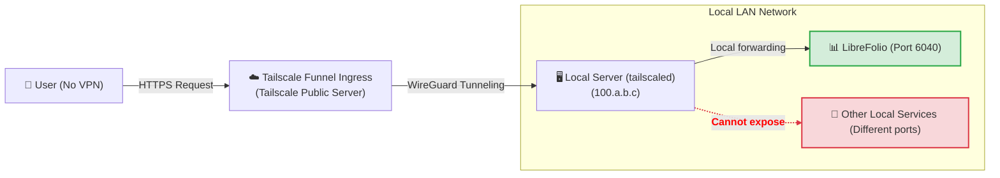
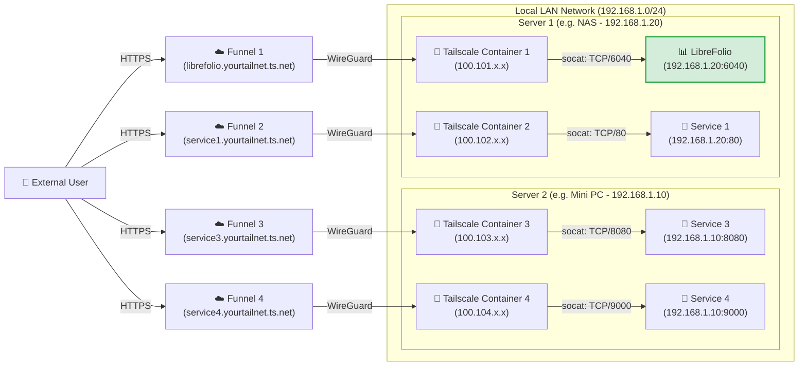

# 🌍 Esporre in sicurezza: accesso pubblico con Funnel

LibreFolio su internet con Tailscale Funnel, a un indirizzo HTTPS pubblico, senza aprire porte sul router:

- la configurazione una tantum di **Funnel e ACL** nella console di Tailscale;
- il **Livello 3**: un indirizzo per LibreFolio, con un comando sul server;
- il **Livello 4**: un indirizzo per servizio, ciascuno con il proprio container Docker.

Tailscale deve essere già installato sul server: il perché di Tailscale, il **Passaggio 0** (l'installazione) e i Livelli 1 e 2 privati sono in [Esporre in sicurezza](service_exposure.md).
`6040` è la porta predefinita di LibreFolio: se nel tuo `.env` imposti una `PORT` diversa, usa quel numero.

---

## 🔑 Abilitare Funnel e ACL nella console {: #enabling-funnel-and-acls-on-the-console }

**Una tantum, necessaria per i Livelli 3 e 4.** Consente Funnel nelle regole di controllo degli accessi (ACL) di tutta la tailnet.

!!! warning "🔐 Prima di rendere il servizio pubblico"

    Con Funnel, chiunque su internet può aprire la pagina di accesso di LibreFolio.
    Crea prima il tuo account: finché non esiste, chiunque può registrarsi e il primo account registrato diventa amministratore.
    Poi una nuova istanza fa entrare solo con link di invito (**Registrazione** è **Su invito** per impostazione predefinita): inviane uno a ogni persona.
    Un'istanza aggiornata da una versione precedente mantiene la propria modalità: se **Registrazione** in **Impostazioni globali** è **Aperta**, passala a **Su invito**, o a **Chiusa** se nessun altro deve unirsi ([Chi può registrarsi](settings.md)).

**Dove: nella console di amministrazione di Tailscale, pagina [Controlli di accesso](https://login.tailscale.com/admin/acls).**

1. Fai clic su **Aggiungi attributo nodo**.
2. Compila il modulo:

    | Campo | Valore |
    |---|---|
    | **Destinazioni** | I nodi autorizzati a usare Funnel. **Suggeriamo `tag:external_access`** (lo assegnerai ai container del Livello 4) oppure `autogroup:member` (tutti i dispositivi del tuo account). |
    | **Attributi** | `funnel` |
    | **Nota** | Qualche parola sul motivo della regola. |
    | **Pool IP, App, Capacità, ecc.** | Lasciali vuoti o ai valori predefiniti. |


Risultato: i nodi indicati possono attivare Funnel. Questa regola non è una chiave di autenticazione: le chiavi di autenticazione (Livello 4) registrano solo un nuovo dispositivo o container nella tailnet.

??? example "📄 Visualizza la configurazione JSON completa delle ACL per abilitare Funnel"

    **Dove: nel file dei criteri della tailnet**, se preferisci modificarlo direttamente. Abilita Funnel per i tuoi dispositivi e per i container con tag `tag:external_access`:

    ```json
    {
      // Declaration of authorized tags
      "tagOwners": {
        "tag:external_access": ["autogroup:admin"]
      },

      // Standard access rules
      "acls": [
        // Allows all nodes in your private network to communicate
        {"action": "accept", "src": ["*"], "dst": ["*:*"]}
      ],

      "ssh": [
        {
          "action": "check",
          "src":    ["autogroup:member"],
          "dst":    ["autogroup:self"],
          "users":  ["autogroup:nonroot", "root"]
        }
      ],

      // Enabling Funnel on specific nodes or tags
      "nodeAttrs": [
        {
          "target": ["autogroup:member"],
          "attr":   ["funnel"]
        },
        {
          "target": ["tag:external_access"],
          "attr":   ["funnel"]
        }
      ]
    }
    ```

---

## 🥈 Livello 3: Indirizzo HTTPS pubblico con Tailscale Funnel {: #level-3-public-https-address-with-tailscale-funnel }

**Ideale per un indirizzo pubblico, senza VPN sul client.** Funnel pubblica LibreFolio a `https://<server-name>.your-tailnet.ts.net`, che chiunque apre **senza installare Tailscale**.
HTTPS è anche ciò che consente di [installare LibreFolio come app (PWA)](../user/pwa.md) sul telefono.

**Prima di iniziare:** completa [Funnel e ACL nella console](#enabling-funnel-and-acls-on-the-console).



### ▶️ Passaggio 1: Avvia il Funnel sul server

**Dove: sul server, in un terminale.** Pubblica la porta locale di LibreFolio:

```bash
tailscale funnel --bg 6040
```

Risultato: LibreFolio è servito a `https://<server-name>.your-tailnet.ts.net` sulla porta 443. `--bg` lo mantiene in esecuzione dopo la chiusura del terminale; `tailscale funnel reset` lo arresta.

- Nessuna chiave di autenticazione: il server si è già unito alla tailnet nel [Passaggio 0](service_exposure.md).
- Nulla da configurare in LibreFolio: Funnel invia `X-Forwarded-Proto: https`, quindi con il valore predefinito `SESSION_COOKIE_SECURE=auto` il [cookie di sessione](configuration.md) è contrassegnato `Secure`. `never` serve solo per un proxy che dichiara HTTPS a un browser su HTTP non cifrato.

### ✅ Passaggio 2: Approva e attendi la propagazione {: #step-2-approve-and-wait-for-propagation }

La prima volta, il terminale avvisa che Funnel non è ancora consentito per questo nodo:

```text
Funnel is enabled, but the list of allowed nodes in the tailnet policy file does not include the one you are using.
To give access to this node you can edit the tailnet policy file, or visit:

         https://login.tailscale.com/f/funnel?node=xxxxxx
```

1. **Nel browser**: apri il link, accedi a Tailscale e approva Funnel per questo nodo.
2. **Nel terminale del server**: compare il tuo URL pubblico.
3. **Da una rete esterna**: attendi qualche minuto perché i record MagicDNS si propaghino, poi apri l'URL.

Per controllare il risultato: [Verifica della sicurezza della connessione](connection_checks.md#checklist).

⚠️ **Limiti:** una macchina ha un solo nome pubblico, condiviso da ogni servizio che pubblica. Il Livello 4 dà a ciascun servizio il proprio.

---

## 🥇 Livello 4: Multi-Funnel con sidecar Docker {: #level-4-multi-funnel-with-docker-sidecars }

**Ideale per gli utenti Docker che vogliono un indirizzo pubblico per servizio.** Ogni servizio riceve un piccolo container Tailscale (un *sidecar*), nodo autonomo della tailnet con il proprio `https://<name>.your-tailnet.ts.net`. Uno script di avvio installa **socat** nel sidecar, che inoltra il traffico Funnel all'IP statico LAN del servizio.

**Prima di iniziare:** completa [Funnel e ACL nella console](#enabling-funnel-and-acls-on-the-console).

??? info "🧰 Che cos'è socat?"

    **socat** (SOcket CAT) inoltra dati tra due connessioni: resta in ascolto su una porta nel container Tailscale e passa tutto alla porta reale del servizio sulla tua LAN.

Un sidecar per ogni servizio da pubblicare, su uno o più host; l'unico limite è il numero di dispositivi con tag del tuo [piano Tailscale](https://tailscale.com/pricing). Qui due host eseguono due sidecar ciascuno:



### 📁 Passaggio 1: Prepara la cartella e lo script

**Dove: sul server, in un terminale.** Crea una cartella, ad esempio dove tieni i volumi persistenti di Docker:

```bash
# Create a folder for the Tailscale nodes and enter it
mkdir -p <path_chosen>/tailscale-nodes
cd <path_chosen>/tailscale-nodes
```

Scarica al suo interno lo script di avvio <a href="https://raw.githubusercontent.com/Librefolio/LibreFolio/main/mkdocs_src/docs/static/tailscale-guide/custom_startup.sh" target="_blank" rel="noopener noreferrer">custom_startup.sh</a>:

```bash
# Download the script from the official repository
wget https://raw.githubusercontent.com/Librefolio/LibreFolio/main/mkdocs_src/docs/static/tailscale-guide/custom_startup.sh
# Make the script executable
chmod +x custom_startup.sh
```

Risultato: la cartella `<path_chosen>/tailscale-nodes` contiene `custom_startup.sh` eseguibile; nel Passaggio 2 la monti nel container.

??? info "🔄 Hai già configurato il sidecar? Aggiorna la copia dello script"

    Lo script attuale funziona anche come **watchdog** e ha un health check Docker (Passaggio 2). Se il tuo sidecar esegue una copia precedente:

    1. **Sul server, nella cartella dello script**: scarica di nuovo lo script. `-O custom_startup.sh` sovrascrive il file vecchio (senza, `wget` salva il download come `custom_startup.sh.1`).

        ```bash
        cd <path_chosen>/tailscale-nodes
        wget -O custom_startup.sh https://raw.githubusercontent.com/Librefolio/LibreFolio/main/mkdocs_src/docs/static/tailscale-guide/custom_startup.sh
        chmod +x custom_startup.sh
        ```

    2. **Nel tuo `docker-compose.yml`**: aggiungi al servizio Tailscale `TS_ENABLE_HEALTH_CHECK`, `TS_LOCAL_ADDR_PORT` e, facoltativamente, `STARTUP_TIMEOUT`, insieme al blocco `healthcheck`, esattamente come nel Passaggio 2.

    3. **Nella cartella del `docker-compose.yml`**: ricrea il container, un riavvio non applica le modifiche al compose.

        ```bash
        docker compose up -d
        ```

        Ricrea i servizi la cui configurazione è cambiata. In alternativa, l'azione *Ricrea* / ridistribuisci di Portainer o CasaOS.

    4. **Nel log del container**: `docker logs -f tailscale-librefolio` mostra `Tailscale is running.`, poi `Starting the funnel on port 6040...` e `Available on the internet:` con il tuo URL pubblico. Durante i 2 minuti di `start_period` dell'health check, Docker mostra il container **healthy** (`docker ps`, Portainer, CasaOS). Se continua a riavviarsi: pannello di risoluzione dei problemi nel [Passaggio 3](#3-startup-and-approval).

### 🐳 Passaggio 2: Configura Docker Compose

**Dove: nel `docker-compose.yml` del servizio esposto** (ad esempio LibreFolio), così i due restano insieme. Aggiungi il servizio Tailscale:

```yaml
services:
  tailscale-librefolio:
    image: tailscale/tailscale:latest
    container_name: tailscale-librefolio
    hostname: tailscale-librefolio
    restart: unless-stopped
    privileged: false
    network_mode: bridge
    cap_add:
      - NET_ADMIN
      - NET_RAW
    devices:
      - /dev/net/tun:/dev/net/tun
    command:
      - /custom_startup.sh
    environment:
      - HOST_IP=192.168.1.20                # Local IP of the service to expose (e.g. Server 1)
      - HOST_PORT=6040                      # Real port of the service to expose
      - TAILSCALE_FUNNEL_PORT=6040          # Internal Funnel port
      - TS_HOSTNAME=librefolio              # Custom public hostname (e.g. librefolio)
      - TS_AUTHKEY=tskey-auth-...           # Authentication key generated by Tailscale
      - TS_ACCEPT_DNS=true
      - TS_STATE_DIR=/var/lib/tailscale
      - TS_USERSPACE=false
      - TS_ENABLE_HEALTH_CHECK=true         # Expose /healthz for the healthcheck below (Tailscale ≥ 1.78)
      - TS_LOCAL_ADDR_PORT=127.0.0.1:9002   # Where /healthz listens: inside the container only
      - STARTUP_TIMEOUT=180                 # Optional: seconds to reach the Running state (default 180)
    volumes:
      - <path_chosen>/tailscale-nodes/tailscale-librefolio/state:/var/lib/tailscale
      - <path_chosen>/tailscale-nodes/custom_startup.sh:/custom_startup.sh
      - /etc/localtime:/etc/localtime:ro
      - /etc/timezone:/etc/timezone:ro
    # Shows healthy/unhealthy in Docker, Portainer or CasaOS; the restart itself comes from custom_startup.sh exiting
    healthcheck:
      test: ["CMD", "wget", "-q", "-O", "/dev/null", "http://127.0.0.1:9002/healthz"]
      interval: 30s
      timeout: 5s
      retries: 3
      start_period: 120s
```

Imposta questi valori per la tua rete:

| Valore | Cosa inserire |
|---|---|
| `<path_chosen>` | Il percorso assoluto del Passaggio 1, dove risiedono lo script e i dati di stato (ad esempio `/home/user/docker`). |
| `HOST_IP` | L'IP statico LAN della macchina che esegue il servizio. |
| `HOST_PORT` | La porta reale del servizio su quella macchina: per LibreFolio, la `PORT` del tuo `.env` (`6040` per impostazione predefinita). |
| `TAILSCALE_FUNNEL_PORT` | La porta su cui il container ascolta e pubblica tramite Funnel. Stesso valore di `HOST_PORT`. |
| `TS_HOSTNAME` | Il nome del nodo: l'indirizzo pubblico diventa `https://TS_HOSTNAME.your-tailnet.ts.net`. |
| `TS_AUTHKEY` | La chiave che registra il container nella tailnet (sotto). |

**Dove ottenere `TS_AUTHKEY`: nella console di Tailscale, pagina [Chiavi](https://login.tailscale.com/admin/settings/keys).**

1. Nella sezione **Chiavi di autenticazione** (*non* nella sezione dei token di accesso API), fai clic su **Genera chiave di autenticazione...**.
2. Attiva l'interruttore **Tag** e seleziona il tuo tag (ad esempio `tag:external_access`). Aggiungi una descrizione riconoscibile, come `docker-librefolio-funnel`.
3. Fai clic su **Genera** e copia la chiave (`tskey-auth-...`) in `TS_AUTHKEY`.

Risultato: al primo avvio del container la chiave una tantum è consumata, scompare da **Chiavi** e il nuovo dispositivo compare in **Macchine**.

??? info "🩺 Watchdog e health check — cosa fanno le impostazioni extra"

    * **Watchdog (riavvio automatico)**, nello script: se Tailscale non si avvia (niente internet all'avvio, un flag errato), non raggiunge lo stato *Running* entro `STARTUP_TIMEOUT` secondi, oppure Tailscale, socat o il Funnel si arrestano in seguito, lo script esce con errore e Docker riavvia il container (`restart: unless-stopped`). Il container non resta mai "in esecuzione" senza nulla dietro; `docker stop` arresta comunque tutto in modo pulito.
    * **Health check (solo stato)**, nel compose: `TS_ENABLE_HEALTH_CHECK=true` attiva l'endpoint `/healthz` di Tailscale (Tailscale 1.78 o successivo): `200` mentre il nodo ha un IP Tailscale, `503` altrimenti. Docker, Portainer e CasaOS mostrano *healthy* o *unhealthy*.

    Docker semplice (fuori da Swarm) **non** riavvia un container *unhealthy*: il riavvio deriva dall'uscita dello script. Non serve un container "autoheal": richiederebbe anche il socket Docker, cioè pieno controllo dell'host.

    | Impostazione facoltativa | Cosa fa |
    |---|---|
    | `TS_LOCAL_ADDR_PORT` | Dove ascolta `/healthz`. L'endpoint non richiede autenticazione e il predefinito di Tailscale, `[::]:9002`, ascolta su tutte le interfacce: `127.0.0.1:9002` lo tiene dentro il container. Se lo modifichi, aggiorna anche l'URL del test `healthcheck`. |
    | `STARTUP_TIMEOUT` | Secondi di attesa per lo stato *Running* (predefinito `180`) prima di uscire e far riavviare il container. Aumentalo solo su un server molto lento. |
    | `DEBUG` | Assente nell'esempio sopra. `DEBUG=1` stampa nel log del container ogni comando eseguito dallo script. Disattivato per impostazione predefinita per tenere il log leggibile. |

??? tip "📈 Monitorare LibreFolio con un monitor (Uptime Kuma)"

    Il servizio `librefolio` ha un proprio health check, su `GET /api/v1/system/health` (vedi il file compose sotto): dice a Docker che il server risponde.
    Per monitorarlo da un altro dispositivo, ad esempio con **Uptime Kuma**, punta il monitor su `/api/v1/system/ready` all'indirizzo con cui apri LibreFolio, come `https://librefolio.your-tailnet.ts.net/api/v1/system/ready`. Non richiede accesso e risponde:

    * **`200`** quando LibreFolio è pronto a servire richieste;
    * **`503`** quando non lo è, con il controllo in errore nella risposta: `database` (`unreachable`) oppure `migrations` (`behind`, `ahead`, `unknown`).

    I codici: [Guida avanzata a Docker](docker_advanced.md), sezione «Servizio: `librefolio`».

??? example "📄 Visualizza il file Docker Compose di produzione completo (LibreFolio + Tailscale)"

    Il servizio `librefolio` del file ufficiale `docker-compose.prod.yml`, con il sidecar Tailscale accanto:

    ```yaml
    # =============================================================================
    # LibreFolio — Production Docker Compose
    # =============================================================================
    # Optimized for end-users running the official pre-built image from GHCR.
    # =============================================================================

    services:
      librefolio:
        image: ${LIBREFOLIO_IMAGE:-ghcr.io/librefolio/librefolio:latest}
        container_name: librefolio
        restart: unless-stopped
        ports:
          - "${PORT:-6040}:6040"
        volumes:
          - ./LibreFolio-data:/app/backend/data/prod-docker
        env_file: .env
        environment:
          - LIBREFOLIO_DATA_DIR=/app/backend/data/prod-docker
          - HOST=0.0.0.0
          - PORT=6040
        healthcheck:
          test: ["CMD", "python", "-c", "import urllib.request; urllib.request.urlopen('http://localhost:6040/api/v1/system/health')"]
          interval: 30s
          timeout: 10s
          start_period: 15s
          retries: 3

      tailscale-librefolio:
        image: tailscale/tailscale:latest
        container_name: tailscale-librefolio
        hostname: tailscale-librefolio
        restart: unless-stopped
        privileged: false
        network_mode: bridge
        cap_add:
          - NET_ADMIN
          - NET_RAW
        devices:
          - /dev/net/tun:/dev/net/tun
        command:
          - /custom_startup.sh
        environment:
          - HOST_IP=192.168.1.20                # Local IP of the service to expose (e.g. Server 1)
          - HOST_PORT=6040                      # Real port of the service to expose
          - TAILSCALE_FUNNEL_PORT=6040          # Internal Funnel port
          - TS_HOSTNAME=librefolio              # Custom public hostname (e.g. librefolio)
          - TS_AUTHKEY=tskey-auth-...           # Replace with your generated key
          - TS_ACCEPT_DNS=true
          - TS_STATE_DIR=/var/lib/tailscale
          - TS_USERSPACE=false
          - TS_ENABLE_HEALTH_CHECK=true         # Expose /healthz for the healthcheck below (Tailscale ≥ 1.78)
          - TS_LOCAL_ADDR_PORT=127.0.0.1:9002   # Where /healthz listens: inside the container only
          - STARTUP_TIMEOUT=180                 # Optional: seconds to reach the Running state (default 180)
        volumes:
          - /DATA/AppData/tailscale-nodes/tailscale-librefolio/state:/var/lib/tailscale
          - /DATA/AppData/tailscale-nodes/custom_startup.sh:/custom_startup.sh
          - /etc/localtime:/etc/localtime:ro
          - /etc/timezone:/etc/timezone:ro
        # Shows healthy/unhealthy in Docker, Portainer or CasaOS; the restart itself comes from custom_startup.sh exiting
        healthcheck:
          test: ["CMD", "wget", "-q", "-O", "/dev/null", "http://127.0.0.1:9002/healthz"]
          interval: 30s
          timeout: 5s
          retries: 3
          start_period: 120s
    ```

### 🚀 Passaggio 3: Avvia e approva il Funnel {: #3-startup-and-approval }

1. **Sul server, nella cartella del `docker-compose.yml`**: avvia lo stack, servizio e sidecar insieme.

    ```bash
    docker compose up -d
    ```

2. **Nel log del container Tailscale**: al primo avvio compare il link di approvazione del nuovo nodo.

    ```bash
    docker logs -f tailscale-librefolio
    ```

    ```text
    Funnel is enabled, but the list of allowed nodes in the tailnet policy file does not include the one you are using.
    To give access to this node you can edit the tailnet policy file, or visit:

             https://login.tailscale.com/f/funnel?node=nsKGo6k9ZF11CNTRL
    ```

3. **Nel browser**: apri il link, accedi a Tailscale e approva l'attivazione di Funnel. Subito dopo, il log conferma l'URL pubblico e il proxy locale:

    ```text
    Available on the internet:

    https://librefolio.yourtailnet.ts.net/
    |-- proxy http://127.0.0.1:6040

    Press Ctrl+C to exit.
    ```

4. **Da una rete esterna**: attendi qualche minuto perché i record MagicDNS si propaghino, poi apri l'URL.

Risultato: il servizio è online. Nulla da configurare in LibreFolio: Funnel invia `X-Forwarded-Proto: https` e socat lo inoltra, quindi il [cookie di sessione](configuration.md) è `Secure` con il predefinito `SESSION_COOKIE_SECURE=auto` (vedi Livello 3, Passaggio 1).

Per controllare il risultato: [Verifica della sicurezza della connessione](connection_checks.md#checklist).

??? question "🛠️ Il container si riavvia in loop o viene contrassegnato come unhealthy"

    Un problema persistente è un container che continua a riavviarsi (Docker, Portainer o CasaOS possono anche segnarlo *unhealthy*), non uno che sembra "in esecuzione" ma non funziona.
    **Nel log**, `docker logs tailscale-librefolio`: prima di ogni riavvio lo script stampa cosa è andato storto, di solito seguito da `Exiting so Docker restarts the container.` Cause più comuni:

    * **Un flag in `TS_EXTRA_ARGS` non ha un valore.** La variabile facoltativa (assente nel compose sopra) passa flag aggiuntivi a `tailscale up`, separati da spazi. Un flag senza valore fa fallire `tailscale up`: il motivo è nella riga subito dopo `Running 'tailscale up'`, sopra il testo di aiuto che inizia con `USAGE` (ad esempio `flag needs an argument: -advertise-tags`), seguito da `failed to auth tailscale: … tailscale up failed: exit status 2` e `containerboot exited before Tailscale was running.` Scrivi ogni valore come `--flag=value` o `--flag value`: `--advertise-tags=tag:container` e `--advertise-tags tag:container` funzionano entrambi.
    * **Un pannello di gestione ha troncato il valore.** L'editor delle variabili d'ambiente di CasaOS (e pannelli simili) tronca un valore al secondo `=`: `TS_EXTRA_ARGS=--advertise-tags=tag:container` diventa `--advertise-tags`, che fallisce come sopra. In questi pannelli scrivi i flag con uno spazio: `--advertise-tags tag:container`.
    * **Manca una variabile obbligatoria**: lo script si arresta subito con `HOST_IP is not set` (o lo stesso messaggio per `HOST_PORT` o `TAILSCALE_FUNNEL_PORT`).
    * **Niente internet all'avvio**: il container si riavvia finché Tailscale non parte, poi funziona normalmente. È previsto.
    * **Avvio molto lento**: il log mostra `Tailscale is not running after 180s.`; aumenta `STARTUP_TIMEOUT`.
    * **Unhealthy, ma senza riavvio**: nessuna risposta positiva da `/healthz`. Se lo hai appena aggiunto, controlla che `TS_ENABLE_HEALTH_CHECK=true` sia impostato e che l'URL del test `healthcheck` corrisponda a `TS_LOCAL_ADDR_PORT`; altrimenti il nodo in quel momento non ha un IP Tailscale.

    Per tracciare ogni comando dello script: **nel `docker-compose.yml`**, aggiungi `DEBUG=1` alla sezione `environment`, ricrea il container e rileggi il log.

Poiché la sua chiave di autenticazione porta un tag, Tailscale disabilita per impostazione predefinita la scadenza della chiave per il container. Con una chiave senza tag, disabilitala come per il server (suggerimento alla fine del [Passaggio 0](service_exposure.md)).

⚠️ **Limiti:** richiede un terminale e un po' di modifica dei file Docker Compose.

---

## 🔗 Correlati

- 📄 **[Esporre in sicurezza](service_exposure.md)** — Perché non il semplice port forwarding?, Passaggio 0: installa Tailscale sui tuoi dispositivi, Livello 1: VPN privata punto-punto, …
- 🔗 **[Link utili](service_exposure.md)** — La console Tailscale, le ACL e le guide ufficiali a Funnel e Docker
