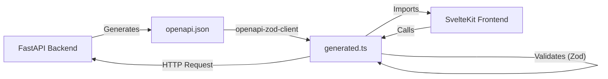

# 🌐 API & Frontend Communication

This section explains how the SvelteKit frontend communicates with the FastAPI backend, ensuring type safety and consistency across the stack.

## 🏗️ Architecture

LibreFolio uses a strict **OpenAPI-first** approach (generated from code) to synchronize the backend and frontend.



## 🔄 The Synchronization Workflow

The synchronization process is automated via `dev.py`:

1. **Backend Definition**: API endpoints and Pydantic models are defined in Python (`backend/app/api/`).
2. **Schema Export**: `./dev.py api schema` imports the application in a temporary process (`scripts/list_api_endpoints.py`) and writes `app.openapi()` to the `openapi.json` file. It starts no server and does not depend on `LIBREFOLIO_API_DOCS`: the `/api/v1/openapi.json` route, like the Swagger UI and ReDoc pages, exists only on debug and test instances.
3. **Client Generation**: `./dev.py api client` uses `openapi-zod-client` to read the JSON schema and generate a TypeScript client (`frontend/src/lib/api/generated.ts`).

!!! tip "One-step sync"

    Use `./dev.py api sync` to run both steps (schema export + client generation) in a single command. This is the recommended workflow after any backend API change.

### 💻 CLI Commands

```bash
# Export OpenAPI schema only
./dev.py api schema

# Generate TypeScript client from existing schema
./dev.py api client

# Both in one step (recommended)
./dev.py api sync
```

### ⚡ Generated Client Features

The generated client provides:

- **TypeScript Interfaces**: Matching the Pydantic models (e.g., `AssetRead`, `TransactionCreate`).
- **Zod Schemas**: Runtime validation schemas for API responses.
- **API Functions**: Typed functions for each endpoint (e.g., `api.getAssets()`).

## 🖥️ Usage in Frontend

In the SvelteKit frontend, developers import the generated client to make API calls.

```typescript
import { api } from '$lib/api';

async function loadPortfolio() {
    // 'data' is fully typed as PortfolioResponse
    const data = await api.getPortfolio();
    return data;
}
```

This ensures that if the backend API changes (e.g., a field is renamed), the frontend build will fail with a type error, preventing runtime crashes.

---

## 📜 Contract Rules

Four rules the pipeline depends on. Breaking one of the first three fails the
**frontend build**, not a backend test — which is why they are written down here. Rule 4 has
a backend guard of its own: what it breaks can pass the build and fail only when the browser
loads the client.

### 1. Every endpoint declares `response_model`

Every API endpoint declares an explicit `response_model` Pydantic schema: the generated client
is only as typed as the OpenAPI schema, and an endpoint without a model silently degrades to
`unknown`. The audit (08) closed the last stragglers; the deliberate exceptions are endpoints
that do not return JSON documents — the SSE stream (`GET /assets/provider/search/stream`),
binary file downloads (`FileResponse` under `/uploads/file/…`, `/brokers/import/files/…/download`),
and a handful of legacy `dict` returns.

### 2. New discriminated-union members register in `fix-openapi-discriminators.mjs`

Pydantic discriminated unions (`Annotated[A | B, Field(discriminator="kind")]`) generate
correct OpenAPI, but `openapi-zod-client` exports each member as
`const Member: z.ZodType<Member> = …` — the exported `z.ZodType<T>` annotation **hides the
`ZodObject` methods** that `z.discriminatedUnion` needs, and the generated client fails to
compile. The post-processor `frontend/scripts/fix-openapi-discriminators.mjs` strips that
annotation for a hardcoded list of schemas (**56 today**), letting TypeScript infer the
concrete type while keeping the exported alias. It runs as part of `npm run generate-api`
(which `./dev.py api sync` / `./dev.py api client` wrap) and **throws** if a registered schema
is not found exactly once — a stale entry fails loud, never silently.

> When you add a new member to a discriminated union, add its schema name to
> `discriminatedSchemas` in `frontend/scripts/fix-openapi-discriminators.mjs`, then re-run
> `./dev.py api sync`.

### 3. Discriminator fields carry an explicit `enum`

The discriminator field of each union member must pin its value with
`Field(json_schema_extra={"enum": [...]})`:

```python
class SchedulerLogCurrentPriceEntry(BaseModel):
    job: Literal["current_price"] = Field(json_schema_extra={"enum": ["current_price"]})
```

Without the extra, the discriminator is emitted without an enum constraint and the generated
TypeScript client fails to compile (real incident, 03/09 — the scheduler log union). This
pattern is used across `schemas/signals.py`, `schemas/ai_export_runtime.py`, `schemas/risk.py`,
`schemas/risk_scenarios.py`, `schemas/settings.py`, `schemas/portfolio.py`, and `schemas/tools.py`.

### 4. Descriptions must survive the client generator

`./dev.py api sync` pastes the descriptions of the OpenAPI document — model docstrings,
`Field(description=…)`, endpoint docstrings — into `frontend/src/lib/api/generated.ts` without
escaping them for JavaScript: in a `.describe()`, a text with a line break becomes a raw template
literal and a one-line text a raw double-quoted string. With `openapi-zod-client` 1.18.3 and the
`generate-api` flags `--export-types --with-docs --with-description`:

| Where the text lands in `generated.ts` | Written as | Must not contain |
|---|---|---|
| `.describe()` of a property, of list items or dictionary values, of a parameter (trimmed) — text with a line break | raw template literal | a backtick, `${` (becomes a substitution), a backslash |
| the same — one-line text | raw double-quoted string | a double quote, a backslash (a backtick is fine) |
| endpoint description, non-2xx response descriptions, request-body description | template literal written by Handlebars, which HTML-escapes backticks and quotes | `${`, a backslash |
| JSDoc inside an exported type (inline fields, list items, union members) | `/** … */` comment | `*/` in the description, `pattern`, `enum`, `default` or examples |

In a multi-line `.describe()` a pair of backticks is a syntax error, and a doubled ``` ``code`` ```
parses as a tagged template that throws `TypeError: "…" is not a function` when the client
loads: every page goes blank (real incident, 15/10 — the `EmailInstanceConfig` docstring). A
backslash is either a syntax error (`\x`, `\u`, a trailing one) or a silently changed text. A
property that is a `$ref` carries the docstring of the model or enum it references; a
description set on the field itself is **ignored**. List items and dictionary values work the
other way round: a description set beside the reference is written, the model's docstring is
not. Many model and enum docstrings span lines with backticks today, harmless only because no
schema uses one of them directly as a field (only in lists, unions, request bodies and
responses): using one directly as a field is enough to break the client.

The pure pytest `backend/test_scripts/test_schemas/test_openapi_client_text.py`, run with
`./dev.py test schemas openapi-client-text`, reads `app.openapi()` — the same source as
`api sync` — and fails naming the exact field, form and character. It is conservative: it may
flag a text the current client would not carry, but never misses one. It also fails when the
generator version in `frontend/package-lock.json` (1.18.3, pinned in the guard) or the
`generate-api` flags change: re-verify these rules before moving the pinned version.

> When the guard is red, keep a model docstring or field description on one line without `"`
> or `\`, or rephrase the text without backticks, `${` and `\`; move a long explanation into a
> code comment (the fix of the incident above). Never put `*/` in the description, `pattern`,
> `enum`, `default` or examples of any schema.

---

## 🗜️ Response Compression

Starlette's `GZipMiddleware` (`minimum_size=1024`, `compresslevel=6`) is the `gzip` entry of
`MIDDLEWARE_STACK` (`backend/app/services/platform/middleware.py`), inside `activity` and
`security_headers` and outside `cors` (the whole stack:
[Steps and Middleware: the Contract](../architecture/overview.md#lifecycle-contract)).
`install_middleware(app)` puts the stack on the whole application, so GZip covers API JSON as well
as the SvelteKit bundle and the documentation served by the same process.

- A response is compressed only when the request's `Accept-Encoding` header contains `gzip`.
  Browsers send it and decompress transparently, so frontend code never handles compressed
  bytes.
- A compressed response carries `Content-Encoding: gzip`. Its `Content-Length` is the
  compressed size; a streamed response drops the header.
- `Vary: Accept-Encoding` is added to every response eligible for compression — 1 KiB or
  more, or streamed — whether or not the client asked for gzip, so a cache keeps the two
  variants apart.
- Left untouched: bodies under 1 KiB sent in one piece, responses that already declare a
  `Content-Encoding`, `206 Partial Content` range replies, Server-Sent Events
  (`text/event-stream`, such as `GET /assets/provider/search/stream`), AVIF, GIF, JPEG, PNG,
  and WebP images, WOFF and WOFF2 fonts, audio, video, and gzip or zip archives. SVG is text
  and is compressed.
- A body chunk of 128 KiB or more is compressed in a worker thread, off the event loop.

`curl` sends no `Accept-Encoding` by default and therefore receives the uncompressed body.
With `--compressed` it asks for gzip and decompresses transparently:

```bash
# Print the response headers of the compressed variant (Content-Encoding, Vary)
# (/api/v1/openapi.json exists on a debug server only: ./dev.py server --debug)
curl -s --compressed -D - -o /dev/null http://localhost:6040/api/v1/openapi.json
```

---

## 📡 Notable Endpoints

### `POST /api/v1/assets/prices/current` — Bulk Current Price

Returns the **current price** of each asset in a list: the assigned provider's latest quote, or the last close stored in the database when no provider answers. The response is designed for the frontend's live-price polling.

**Request body**: `List[int]` — asset IDs.

**Response** (`FACurrentPriceResponse`, a `BaseBulkResponse`): one `results` item per requested ID, in request order; `success_count`, the number of items that carry a `value`; and `errors`, for operation-level errors, which this endpoint leaves empty — a per-asset problem goes in the item's `error`, and a failure of the whole call is an HTTP 500.

```json
{
  "results": [
    {
      "asset_id": 1,
      "value": "123.45",
      "currency": "EUR",
      "as_of_date": "2026-04-10",
      "source": "provider:justetf",
      "error": null,
      "error_code": null,
      "retry_after": null
    },
    {
      "asset_id": 2,
      "value": "98.32",
      "currency": "USD",
      "as_of_date": "2026-04-09",
      "source": "db:last_known",
      "error": null,
      "error_code": "RATE_LIMITED",
      "retry_after": 1834.6
    },
    {
      "asset_id": 3,
      "value": null,
      "currency": null,
      "as_of_date": null,
      "source": null,
      "error": "No price data available",
      "error_code": null,
      "retry_after": null
    }
  ],
  "success_count": 2,
  "errors": []
}
```

`value` is a decimal string, and `as_of_date` is a date (`YYYY-MM-DD`), not a timestamp.

**Resolution strategy** (per asset, all assets in parallel — `get_current_prices_bulk` in `backend/app/services/assets/price_query.py`):

1. If a provider is assigned, ask its `get_current_value()` — at most five calls at a time, ten seconds each — and answer with `source: "provider:<code>"`, the value as the price columns keep it (`storable_current_value()`; X-R40, W-B62): in its own form when the history's truncation (12 decimal places, then 15 significant digits, rounded down) leaves it unchanged (`101.5` stays `101.5`), truncated otherwise (`65432.1234567890999` → `65432.123456789`). Only such a quote is cached, for two minutes, and a cached one is answered the same way. What "current" means is up to the provider: JustETF answers EUR with a real-time gettex quote, kept up to date by a WebSocket feed per ISIN, and otherwise (other currencies, or no quote) with the latest daily quote of its chart API; Yahoo Finance reads `regularMarketPrice` from `ticker.info` (then `currentPrice` or `previousClose`).
2. **Fallback**: with no usable provider, when its call fails or times out, or when its quote is one no price column can keep (not finite, more than 12 digits before the decimal point, non-zero but 0 once truncated, such as `1E-13`, or, since N92, not above 0: never answered, cached or written), return the latest close stored in `PriceHistory` that reads a number (one stored as ±inf is passed over), with `source: "db:last_known"`. A provider paused after «too many requests» is not called at all, and one that refuses is paused ([Provider Pauses](../backend/assets/architecture.md#provider-pauses)): the item then also carries `error_code: "RATE_LIMITED"` and `retry_after`, the seconds until the provider may be called again, as asset 2 above.
3. With no stored price either, `value` is `null` and `error` is `No price data available` — still with `error_code` and `retry_after` when the provider is paused — or `Asset not found` for an unknown ID.

**Side effect**: the call is not read-only. A provider quote dated today creates today's `PriceHistory` row (open, high, low and close all equal to the quote) or extends it (`high` and `low` widened, `open` set if missing, `close` replaced). A database fallback is never written back.

This endpoint is used by the Assets list (inline live prices on cards and table rows) and by the asset detail page (price summary and chart head) — see [Live Prices](../frontend/components/features/live-ticker.md#polling).

### 🔎 `GET /api/v1/assets/provider/search` and `/search/stream` — Asset Search

Both search, in parallel, every provider with search support, or those named in `providers`, for the signed-in user: each provider receives that user's personal plugin settings, such as justETF's preferred currency ([Plugin Settings](../architecture/patterns/plugin_settings.md#scopes)). A provider that fails never fails the request; the answer says which one, and why:

- **`/search`** answers `FAProviderSearchResponse` once every provider is done: `results`, `providers_queried`, `providers_with_errors` (every provider that failed) and `providers_not_configured`, those of them not called because a required setting has no value (`NOT_CONFIGURED`); an empty list otherwise.
- **`/search/stream`** answers Server-Sent Events: one per provider as soon as it finishes, then `done`. The stream has no `response_model` (rule 1 of the Contract Rules above), so its events are not in the generated client:

```text
data: {"event": "provider_results", "provider_code": "justetf", "results": [...]}

data: {"event": "provider_error", "provider_code": "my_provider", "error": "Provider my_provider is not configured: api_key missing", "error_code": "NOT_CONFIGURED"}

data: {"event": "provider_error", "provider_code": "yfinance", "error": "Provider yfinance is paused after too many requests: 1835 s left", "error_code": "RATE_LIMITED", "retry_after": 1834.6}

data: {"event": "done", "total_results": 12, "providers_queried": [...], "providers_with_errors": [...]}
```

`provider_error` carries `error_code` for every `AssetSourceError`: `NOT_CONFIGURED`, `RATE_LIMITED` with `retry_after` (the seconds before the provider may be called again), or the provider's own code, such as `SEARCH_ERROR`. An error of any other type has neither field. The search box, `AssetSearchAutocomplete.svelte`, reads the stream and falls back to `/search` only when the stream is unavailable; for each provider not configured it shows a row with **Configure**. Details: [Interactive Search Stack](../backend/assets/architecture.md#interactive-search).

