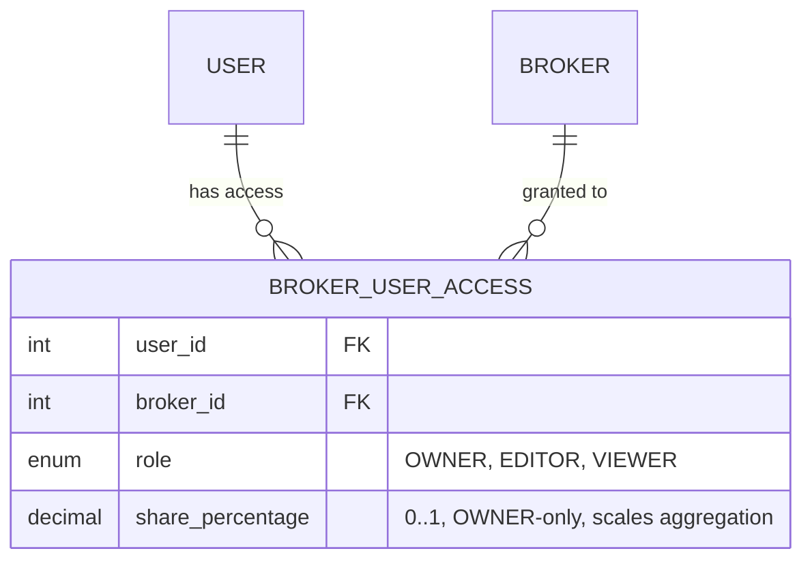

# 🔐 Broker Access Control (RBAC)

LibreFolio implements a granular **Role-Based Access Control (RBAC)** system for Brokers. This allows users to share access to their brokerage accounts with other users (e.g.,
family members, accountants) while maintaining control over permissions.

## 📖 Overview

Access is managed via the `BrokerUserAccess` table, which links a `User` to a `Broker` with a specific `UserRole`.

## 🛡️ Roles and Permissions

There are three roles with increasing levels of privilege:

| Feature                              | VIEWER | EDITOR | OWNER |
|:-------------------------------------|:------:|:------:|:-----:|
| **View Broker Details**              |   ✅    |   ✅    |   ✅   |
| **View Transactions**                |   ✅    |   ✅    |   ✅   |
| **View Reports/Charts**              |   ✅    |   ✅    |   ✅   |
| **View Report Files (BRIM)**         |   ✅    |   ✅    |   ✅   |
| **Add/Edit Transactions**            |   ❌    |   ✅    |   ✅   |
| **Upload/Parse/Delete Files (BRIM)** |   ❌    |   ✅    |   ✅   |
| **Edit Broker Settings**             |   ❌    |   ✅    |   ✅   |
| **Manage Access (Add/Remove Users)** |   ❌    |   ❌    |   ✅   |
| **Delete Broker**                    |   ❌    |   ❌    |   ✅   |

For BRIM report files the administrator (`is_superuser`) needs no role, a file with no broker is its
uploader's and the administrator's only, and a parse also needs EDITOR or OWNER on the broker it
imports into: see [Who reaches a report file](../backend/brim/architecture.md#file-access).

### 📋 Role Definitions

1. 👁️ **VIEWER**: Read-only access. Ideal for sharing portfolio visibility without risk of data modification.
2. ✏️ **EDITOR**: Operational access. Can manage the day-to-day data (transactions, imports) and broker settings (name, icon), but cannot perform destructive administrative actions (deleting the broker) or change who has access.
3. 👑 **OWNER**: Administrative access. Full control over the broker.

## 📏 Key Rules & Constraints

### 📊 Ownership share (`share_percentage`)

Each access row carries a `share_percentage` (0.000000–1.000000) used **only for portfolio
aggregation**, never for permissions:

- **OWNER**: the broker's creator gets 1.00; through `PUT /api/v1/brokers/{broker_id}/access`,
  every OWNER gets the share its item carries — 0 when the item has none, even for an OWNER
  already on the broker. The share may be reduced for co-ownership (e.g. joint accounts);
  **EDITOR** and **VIEWER** default to 0.00 (delegated operator, read-only accountant).
- The sum of shares across a broker's users **must not exceed 1.00** (validated on add/update);
  it **can be less** (a co-owner may simply not be in the system).
- **0 % is a valid share**: a 0 % OWNER keeps full admin rights but contributes nothing to the
  owner's aggregated numbers.
- Aggregation scales by share **only for OWNERs** — EDITOR/VIEWER rows always carry share 0 by
  schema rule yet see full data, so the engine uses scale 1 for them (`effective_share()` in
  `financial_math/native_cash.py`, called by `portfolio_service.py` and
  `financial_math/portfolio/engine.py`). Role/share edits change every scaled number
  but not the underlying data, so they also join the cache fingerprint for instant invalidation.

### 🔒 The "Last Owner" Rule

To prevent brokers from becoming "orphaned" (left without an OWNER to manage their access or delete them), the
system enforces a strict rule:

> **A broker always keeps at least one OWNER.** The last OWNER cannot be removed or downgraded — by anyone,
> themselves included — but can leave, and leaving deletes the broker.

If a broker has only one user with the `OWNER` role:

- ❌ **Nobody** — neither that user nor the administrator — can remove them or change their role to `EDITOR` or
  `VIEWER` without making another user `OWNER`: `PUT /api/v1/brokers/{broker_id}/access` (`bulk_update_access()`)
  refuses any configuration without an `OWNER` (400, "At least one OWNER is required").
- ❌ That user **cannot** demote themselves with `PATCH /api/v1/brokers/{broker_id}/access/me` (`update_own_role()`):
  400, "The last OWNER cannot demote themselves — promote another user first".
- ⚠️ That user **can** leave with `DELETE /api/v1/brokers/{broker_id}/access/me` (`leave_broker()`), and leaving
  **deletes the broker** with its transactions: see [Self-Management](#self-management).
- ✅ To leave without deleting the broker, they first make another user `OWNER` with the `PUT`; they can then leave,
  or drop their own row in that same `PUT`.

### 🔧 Self-Management

- 🚪 **Leaving**: any user can remove *themselves* from a broker at any time (`leave_broker`).
  EDITOR/VIEWER always succeed. An OWNER may leave when at least one other OWNER remains —
  otherwise leaving as the **last OWNER deletes the broker entirely**. Its transactions do not
  go by a database cascade: `delete_by_broker()` deletes them, and the other half of a pair held
  on another broker stays there without its link — as the standalone row a split of the pair
  leaves or, for the giving leg of a `TRANSFER` whose cost needs a missing conversion, still a
  `TRANSFER` (see [Broker Deletion](../backend/transactions/service.md#broker-deletion)). BRIM report files are
  cleaned up by the API layer.
- ⬇️ **Self-demotion** (`update_own_role`): EDITOR → VIEWER is always allowed; OWNER →
  EDITOR/VIEWER is allowed only when another OWNER remains, and demoting from OWNER **zeroes
  the share** (only OWNERs may hold share > 0). Promotions go through the `PUT`, OWNER or administrator only.
- 🗑️ **Deleting an account** applies `leave_broker()` to every broker of the account, in one
  commit: see [Deleting an Account](users_and_brokers.md#account-deletion).

## 🔧 Implementation Details

The logic is centralized in `backend/app/services/brokers/access.py` (`BrokerAccessMixin`, part of `BrokerService`).

- 🔍 **`_check_user_access(broker_id, user_id, min_role)`**: Core internal method to verify permissions.
- 📋 **`list_accesses()`**: The users with access to a broker, with role and share.
- 🔄 **`bulk_update_access()`**: Replaces a broker's whole access configuration in one step (OWNER or
  administrator): adds, role changes and removals; at least one OWNER must remain, and the shares add up to at
  most 100 %.
- 🚪 **`leave_broker()`** / **`update_own_role()`**: The self-service paths described above.

### 🌐 API Endpoints

Access management is exposed via the following endpoints (`backend/app/api/v1/brokers.py`):

- `GET /api/v1/brokers/{broker_id}/access`: the users with access, with role and share (`list_accesses()`). Any
  authenticated user can read the list of any existing broker, email addresses included; 404 only when the broker
  does not exist.
- `PUT /api/v1/brokers/{broker_id}/access`: replaces the whole access configuration in one step
  (`bulk_update_access()`). The body is the **complete** desired list of `{user_id, role, share_percentage}`: users
  missing from it lose their access, new ones are added, roles and shares are updated, in one transaction. Granting,
  changing and revoking access all go through it. `OWNER` or administrator only (403 otherwise); 400 when a rule
  fails (no `OWNER`, shares adding up to more than 1.0, a duplicate or unknown user); 422 for an empty list or a
  share the schema refuses (outside 0–1, or above 0 for an `EDITOR` or `VIEWER`).
- `PATCH /api/v1/brokers/{broker_id}/access/me`: self-demotion only (`update_own_role()`), body `{role}`; 400 for
  any other change and for the last `OWNER`'s demotion, 403 without access to the broker.
- `DELETE /api/v1/brokers/{broker_id}/access/me`: leave the broker (`leave_broker()`); the response's
  `broker_deleted` is true when the last `OWNER`'s leaving deleted it. 403 without access to the broker.

## 👑 Superusers and the User CLI {: #superusers }

Besides the broker roles, every account carries one system-wide flag, `users.is_superuser`: the
*administrator* of the admin manual. It belongs to the account, not to a broker.

- **Granted** to the first account registered (`POST /api/v1/auth/register` while
  `first_account_open()` holds, that is while `count_users()` is 0, inactive accounts counted:
  accepted whatever the [registration mode](#registration-modes), and an administrator even
  when the invitation it spends grants a regular account), to an account registered
  with an invitation that grants it (`grants_admin`, see [Invitations](#invitations)), to an account
  created with `./dev.py user create` without `--role user` (`--role admin` is the default:
  `scripts/user_cli.py` maps it to its internal `create-superuser` command, which calls
  `user_service.create_user()` with `is_superuser=True`), by `./dev.py user promote`, and by
  `PATCH /api/v1/users/{user_id}` with `is_superuser: true`. `./dev.py user create … --role user`
  maps to the internal `create-user` command instead (`is_superuser=False`): a regular account, even
  as the first account of an empty database. The administrator of `LIBREFOLIO_ADMIN_EMAIL` is a
  superuser from its creation by the startup, inactive until its setup link is spent
  ([The Initial Administrator](#initial-admin)).
- **Promote and demote** go through `user_service.set_user_admin()` from the CLI, which refuses a
  no-op (*already an admin*, *not an admin*) and the demotion of the last active administrator, and
  through `user_service.update_user_status()` from the [administrator API](#admin-user-api). A
  demotion also ends every session of the account (`user_service.end_sessions()` raises
  `users.session_version`, see [Session Revocation](security.md#session-revocation)); a promotion
  does not. Self-deletion has the same guard: `DELETE /api/v1/auth/users/me` answers `400` to an
  administrator when no other active administrator remains (`count_active_superusers()`). The
  administrator API deletes no administrator, active or not: `DELETE /api/v1/users/{user_id}` answers
  `409` `DEMOTE_FIRST` until the account is demoted ([Deleting an Account](#admin-account-deletion)).
- **Applied at the next request**: the user CLI writes the database directly, with the server
  running or not, and `get_current_user()` reloads the user on every request. A deactivated
  account (`user deactivate`, `user_service.set_user_active()`, or the administrator API) gets `401`
  *User account is disabled*; its login, with the right password, gets `403` `ACCOUNT_DISABLED` — or
  `403` `EMAIL_NOT_VERIFIED` while it waits for its email verification.
  Deactivation refuses the last active administrator, and ends every session of the account:
  `user activate` lets the user sign in again, but brings none of the old sessions back.
- **Password reset** (`user reset`, `user_service.reset_password()`) sets the new hash, computed
  in a worker thread off the event loop, and ends every session of the account in the same
  commit: each device gets `401` at its next request, and signs in again with the new password.
  The same commit revokes the account's live [password-reset links](#reset-links) (A-27) and
  retires its setup links (A-32, [The Initial Administrator](#initial-admin)). A password-reset
  link does the same when it is spent. To keep the account out altogether, deactivate it.
- **The account's own changes** end its other sessions as well: a password change
  (`POST /api/v1/auth/change-password`) and an email change (`PUT /api/v1/auth/profile`, which asks
  for the current password: see [Changing the Email](security.md#email-change)). The device that
  made the change gets a new cookie and stays signed in; a username change ends no session. Every
  change that ends sessions is in [Session Revocation](security.md#session-revocation).
- **Password rules**: `create` and `reset` call `validate_password()` in `scripts/user_cli.py`,
  a thin wrapper over `password_policy.failed_rules()`: the same rules as the API and the app
  ([Password Rules](security.md#password-rules)), checked before anything is read from the
  database. Each rule missed prints a line that starts with its code, such as
  `digit: the password must contain a digit`, and the command exits with `1`.
- **Usernames and addresses** (lot A-21a): `create` refuses a username holding `@`, and `create`
  and `set-email` an address that is another account's username, in any A–Z case, as registration
  and the Profile do: through `user_service.create_user()` and `user_service.update_profile()`. The
  command prints the service's message after `❌` — *A username cannot contain @: the sign-in
  reads it as an email address*, or *Email already registered* — and exits with `1`. See
  [Which Account an Identifier Names](security.md#sign-in-identifier).

The admin commands are in [Command-Line Tools](../../admin/cli_tools.md).

## 🚪 Registration, Invitations and the Admin API {: #registration }

Who may create an account, how many accounts an instance may hold, and what an administrator can do
to the other accounts. The rules are in `backend/app/services/accounts/registration_service.py`, the
account changes in `user_service.py`, and the variables in `backend/app/config/accounts.py`
(administrator side: [Configuration](../../admin/configuration.md), section «Accounts and Sign-ups»).
The administrator an operator creates from the environment has its own section:
[The Initial Administrator](#initial-admin).

### 🎚️ Registration Modes {: #registration-modes }

`effective_registration_mode(session)` returns a `RegistrationModeState(mode, locked)`:
`LIBREFOLIO_REGISTRATION` when it is set (blank counts as unset; case and surrounding spaces are
ignored), with `locked=True`; otherwise the global setting `registration_mode`
([Settings System](settings.md)), with `locked=False`.

The default of that setting is `invite` (decision 36), and it has one source:
`GLOBAL_SETTINGS_DEFAULTS` in `backend/app/schemas/settings.py`. The startup seeding writes it on a
new install, and `get_setting_value()` answers it while the row is missing: the service passes no
fallback of its own. The seeding creates only missing rows, so an existing install keeps its row,
whatever its value. An install that holds accounts but no row has run with the earlier default,
`open`: migration `008_registration_invite_default` writes that `open` row before the seeding runs
([`GLOBAL_SETTING`](database/users_access.md#global-setting)), so an upgrade never closes
registration in silence.

| Mode | `POST /api/v1/auth/register` accepts |
|------|--------------------------------------|
| `open` | Anyone. An `invite_token` is optional, but must be a valid invitation when given, and then sets the role |
| `invite` | Only a valid invitation |
| `disabled` | Nobody, invitations included |

Both sources fail closed. A `LIBREFOLIO_REGISTRATION` that is not a mode makes the mode `disabled`,
and still locks the setting: `registration_mode_pinned()` only asks whether the variable is set. A
stored value that is not a mode also reads as `disabled`. Either is logged by `_report_invalid()` as
the error event *Invalid account configuration*, with two fields: `problem`, the variable or the row
and its value, and `consequence`, *registration stays closed until it is fixed*. The function is a
`functools.cache`, so each problem is logged once per process. The startup
[configuration checks](security.md#configuration-checks) do not cover these variables.

`register_user()` holds the rule of `POST /api/v1/auth/register` (`AuthRegisterRequest`, with
an optional `invite_token`) and owns its transaction. The route checks the password before calling
it, so `PASSWORD_TOO_WEAK` comes first:

| Situation | Outcome |
|-----------|---------|
| A `password` that misses a [password rule](security.md#password-rules) | `400` `PASSWORD_TOO_WEAK`, with `rules`, the codes missed. Checked by the route before anything else — the mode, the invitation, the limit, a taken username or email — the first account included. Nothing is written, and an invitation given with it stays unspent |
| No account at all (`first_account_open()`: `count_users()` is 0, an inactive account counts) | Created as an administrator, whatever the mode, the limit and the role of an invitation. Without an `invite_token`, nothing else is checked. With one, the invitation must be valid — otherwise `400` `INVITE_INVALID`, and the instance stays empty — and the registration spends it as any other does (row *A valid invitation*): its link then reads `consumed` |
| Mode `disabled` | `403` `REGISTRATION_DISABLED` |
| Mode `invite`, no `invite_token` | `403` `INVITE_REQUIRED` |
| A token that is not a valid invitation: unknown, of another purpose, expired, used or revoked | `400` `INVITE_INVALID` |
| A valid invitation | Created in the invitation's role (`grants_admin`; the first account is an administrator whatever it says). The account and the consumption of the invitation (`consumed_by_user_id`) are committed together. The limit is not checked: the invitation already holds its place |
| Mode `open`, no `invite_token` | Created as a regular account, within the [user limit](#user-limit) |
| `require_email_verification` on, any account but the first | Created inactive, with a verification token that holds its place; the answer says `verification_required: true`, and the email goes after it — unless the client address already had the emails of 10 registrations in the hour: the account then waits without it, and its owner asks for the link again from the sign-in. With no email with a link able to go out, `409` `EMAIL_VERIFICATION_UNAVAILABLE`, and nothing is created: an invitation stays unspent. See [Email Verification](../backend/email.md#verification) |
| A `username` holding `@` (lot A-21a: the sign-in reads it as an email address, see [Which Account an Identifier Names](security.md#sign-in-identifier)) | `400` `USERNAME_INVALID`, the first check of `create_user()`, after the mode and the invitation; the first account included. Nothing is written, and an invitation given with it stays unspent |
| Username or email already taken, or an email that is another account's username, in any A–Z case (lot A-21a) | `400`, with the plain-string `detail` it always had: *Username already taken*, *Email already registered* |

The refusals with a code answer `{"error_code": …, "message": …}` in `detail`, plus `rules` for
`PASSWORD_TOO_WEAK`. Two requests racing for one invitation cannot both spend it: `consume_token()`
is one conditional `UPDATE`, and the loser rolls back with `INVITE_INVALID`.

With `LIBREFOLIO_ADMIN_EMAIL` the row *No account at all* never applies: the startup creates the
waiting administrator before the first request, so the instance is never empty while it serves, and
the mode decides ([The Initial Administrator](#initial-admin)).

`GET /api/v1/system/instance` publishes the effective state as `accounts: {registration_mode,
registration_locked, first_account_open, password_rules}` (`AccountsInstanceConfig`). About the
users it says one thing only, whether there is one: `first_account_open`, from
`first_account_open(session)`, is true while the `users` table is empty (never with
`LIBREFOLIO_ADMIN_EMAIL`, whose waiting administrator is a row), and the login page then
offers **Register here** whatever the mode. No count, no limit
([Public instance configuration](settings.md#public-instance-configuration); why the flag may be
public: [The First-Account Flag](security.md#first-account-open)). `password_rules` is the list of
the [password rules](security.md#password-rules), `[{code, value}]` (`PasswordRuleRead`), the same
on every instance: the app checks a new password against it while the user types.

### ✉️ Invitations {: #invitations }

An invitation is an `invite` [account token](security.md#account-tokens): 7 days, single use, link
`/invite#token=…`, and no `user_id`, as its account does not exist yet.

- **Created** by `create_invite()`, from `POST /api/v1/users/invites` or `./dev.py user invite`, with
  `grants_admin`, `email` and `created_by_user_id` (`NULL` from the command line). It refuses in mode
  `disabled` (`REGISTRATION_DISABLED`), and when the instance is full (`USER_LIMIT_REACHED`) unless
  called with `enforce_limit=False`, as only the command line does. It flushes and does not commit.
- **The email is a suggestion, not a constraint.** It records whom the invitation is for, and
  `POST /api/v1/auth/tokens/inspect` returns it to whoever holds the token, but registration never
  compares it with the address of the new account: the developer rejected D-A16, the proposal to bind
  the two.
- **Listed** by `list_pending_invites()`: the live ones (not consumed, not revoked, not expired),
  oldest first. **Revoked** by `revoke_invite(invite_id)`, which returns `False` for anything that is
  not a live invitation; it flushes and does not commit.
- **Spent** only by `register_user()`, as above.

`POST /api/v1/auth/tokens/inspect` `{token, purpose}`, with `purpose` `invite`, `password_reset` or
`admin_setup` ([The Initial Administrator](#initial-admin)), is public and writes nothing. It answers
`{status, purpose}`, the status being `valid`, `expired`, `consumed`, `revoked` or `unknown` (also for
a token of another purpose). Only a valid token adds `expires_at`, with `grants_admin` and `email` for
an invitation, or `username` for a reset or setup link.

### 📏 The User Limit {: #user-limit }

`LIBREFOLIO_MAX_USERS` (unset or blank: no limit) bounds the places counted by `user_usage()`: the
active accounts (`users.is_active`), the live invitations, and the inactive accounts that wait: those holding a
live email-verification token ([Email Verification](../backend/email.md#verification)) and the administrator
waiting for its setup ([The Initial Administrator](#initial-admin)), each account counted once. A deactivated or
deleted account frees its place; an invitation holds one from its creation until it is revoked or expires, and
hands it to the account it opens; an account waiting for its email verification holds one while its link is
live. A value that is not a whole number of at least 1 is a limit of 0, logged like an invalid mode
(`_max_users()`).

| Request | When `used >= max_users` |
|---------|--------------------------|
| `POST /auth/register` without an invitation | The account is inserted, then counted in the same transaction: over the limit, rollback and `409` `USER_LIMIT_REACHED`, with no numbers and no link, as the caller is anonymous. The first writer holds SQLite's write lock until it commits, so two registrations racing for the last place cannot both take it |
| `POST /auth/register` with a valid invitation, or for the first account | Not checked |
| `POST /users/invites` | `409` `USER_LIMIT_REACHED` with `limit`, `used` and `billing_url` |
| `PATCH /users/{user_id}` reactivating an account | The same `409`, except for an account waiting for its email verification whose link is live: `holds_place()` says that its place is already counted. Once the link has expired, the account needs a free place like any other. Promotions, demotions and deactivations are not checked |
| `./dev.py user create`, `./dev.py user invite`, `./dev.py user activate` of an inactive account | The warning `The instance is at its limit (LIBREFOLIO_MAX_USERS: <used> of <max> places taken): the command line <action> anyway`, `<action>` being `creates the account`, `creates the invitation` or `reactivates the account`; then the command goes ahead. `user activate` prints none for an account waiting for its email verification whose link is live: it already holds its place (`holds_place()`) |

`billing_link()` returns `LIBREFOLIO_BILLING_URL` to administrators only: in `usage.billing_url` of
`GET /users` and `GET /users/invites`, in the `409` `USER_LIMIT_REACHED` of the administrator
routes, and in `billing_url` of `GET /system/block`, the block page of a blocked instance
([Security → Instance Block](security.md#instance-block)). An invalid `LIBREFOLIO_BILLING_URL` or `LIBREFOLIO_PUBLIC_URL` is treated as unset and logged
like an invalid mode, with its own `consequence`: *the billing link stays hidden until it is fixed*,
or *links show the bare path until it is fixed*.

### 🛠️ Administrator API {: #admin-user-api }

`backend/app/api/v1/users.py`, every route behind `require_admin` (`401` without a valid session,
`403` *Admin access required* for a regular account); the last row, the public half of the
[address probe](security.md#address-probe), is in `auth.py`. The static paths are declared before
`/users/{user_id}`, so `/users/invites` and `/users/address-probe` are never read as a user id.

| Route | Body | Does | Answers |
|-------|------|------|---------|
| `GET /users` | — | Every account, oldest first (`id`, `username`, `email`, `is_active`, `is_superuser`, `created_at`, `protected`: see [Protected Accounts](#account-protection), `holds_place`: inactive and waiting for its email verification with a live link, so its place is already counted, from `place_holders()` in one query — see [Email Verification](../backend/email.md#verification) —, and `pending_setup`: the [initial administrator](#initial-admin) waiting for its setup, from `registration_service.pending_admin_ids()` in one query), with `usage: {used, max_users, billing_url}` | `200` |
| `PATCH /users/{user_id}` | `{is_active?, is_superuser?}` | `update_user_status()`, all or nothing: an omitted field, or a value equal to the current one, changes nothing, with one exception: `is_active: false` on an account waiting for its email verification, inactive already, ends the wait as `user deactivate` does — its links revoked, its place free. A deactivation or a demotion ends every session of the account. A change of `is_active` revokes the account's email-verification links, and an activation also retires its setup links ([The Initial Administrator](#initial-admin)) | `200` with the account, `holds_place` and `pending_setup` included (`holds_place` `false` once a wait has ended); `404`; `409` `ACCOUNT_PROTECTED` for a deactivation or a demotion of a [protected account](#account-protection), checked first; `409` `PENDING_SETUP` for `is_active: true` on the initial administrator waiting for its setup (`is_pending_admin()`), checked before the user limit, nothing changed; `409` `LAST_ADMIN` for the last active administrator; `409` `USER_LIMIT_REACHED` for a reactivation over the limit, unless the account `holds_place` |
| `GET /users/{user_id}/deletion-preview` | — | `preview_user_deletion()`: what [deleting the account](#admin-account-deletion) would take with it. Writes nothing | `200` `AccountDeletionPreviewRead`; `404` |
| `DELETE /users/{user_id}` | — | `delete_account()`: the account, and the brokers it is the only `OWNER` of, all or nothing. Cannot be undone: see [Deleting an Account](#admin-account-deletion) | `204` with an empty body; `404`; `409` `SELF_DELETION`, `ACCOUNT_PROTECTED` or `DEMOTE_FIRST`; `500` when the deletion fails, nothing deleted |
| `POST /users/{user_id}/password-reset-link` | — | A [reset link](#reset-links), shown once | `201` `{token, path, url, expires_at}`; `404` |
| `POST /users/{user_id}/sessions/revoke` | — | `end_sessions()`: every device of the account is signed out at its next request | `204`; `404` |
| `POST /users/{user_id}/onboarding/reset` | optional `{flow}` | `reset_onboarding_progress()`: that flow, or every flow, back to `pending`, steps included, with `completed_at` and `skipped_at` cleared (backlog item 21-5) | `204`; `404`; `422` for a flow that does not exist |
| `GET /users/invites` | — | The live invitations, oldest first (`id`, `grants_admin`, `email`, `created_at`, `expires_at`, `created_by_user_id`), with `usage` | `200` |
| `POST /users/invites` | `{grants_admin=false, email?}` | `create_invite()`; the link is shown once | `201` `{invite, token, path, url}`; `409` `REGISTRATION_DISABLED`; `409` `USER_LIMIT_REACHED` |
| `DELETE /users/invites/{invite_id}` | — | `revoke_invite()`: the link stops working and its place is freed | `204`; `404` when it is not a live invitation |
| `POST /users/address-probe` | — | `issue_probe_nonce()`: a signed nonce for the [address probe](security.md#address-probe), valid 120 s and stored nowhere; a new one at every call | `200` `{nonce, expires_at}`; `503` `INSTANCE_KEY_UNAVAILABLE` when the [instance key](security.md#instance-key) cannot be used |
| `GET /auth/address-probe?nonce=…` | — | Public, the same answer with or without a session: `verify_probe_nonce()`, whether this instance issued the nonce. Readable from any origin (`Access-Control-Allow-Origin: *`) | `200` `{match}`: `false` for anything not issued here or expired, never `422` |

- `path` is `token_path()`: the page, with the token in the fragment (`#token=…`, see
  [Links in Use](security.md#account-token-links)). `url` is `LIBREFOLIO_PUBLIC_URL` followed by the
  path (`public_link()`), `null` when the variable is unset or invalid.
- Each change writes a structured log event with the id of the account or of the invitation, and
  the administrator's (`admin_id`, or `created_by_user_id` for an invitation or a reset link):
  *Invitation created*, *Invitation revoked by an administrator*, *Account updated by an
  administrator*, *Account deleted by an administrator*, *Password reset link created*, *Sessions
  ended by an administrator*, *Onboarding reset by an administrator*. None carries the token or its
  hash.

### 🗑️ Deleting an Account {: #admin-account-deletion }

`DELETE /api/v1/users/{user_id}` deletes another account by the rule of deleting one's own: broker by
broker, the last-owner rule of `BrokerService.leave_broker()`. A broker the account is the only `OWNER` of
goes, with its transactions and its report files; on the others only the account's access goes. An inactive
co-owner's `OWNER` row counts as another owner. The rule, the shared helper and the preview are in
[Deleting an Account](users_and_brokers.md#account-deletion).

`GET /api/v1/users/{user_id}/deletion-preview` tells the administrator beforehand what the deletion would
take, by the same rule, writing nothing: `brokers_deleted`, `brokers_left` and `transfers_unpaired`.
`GET /api/v1/auth/users/me/deletion-preview` gives any signed-in user the same for their own account.

After `require_admin`, the deletion refuses, in this order:

1. `404` *User not found*: no such account;
2. `409` `SELF_DELETION`: the caller's own account, which is deleted from the profile
   (`DELETE /api/v1/auth/users/me`);
3. `409` `ACCOUNT_PROTECTED`, with the `reason` of the [protection hook](#account-protection). It comes
   before `DEMOTE_FIRST` because demoting a protected account is refused too;
4. `409` `DEMOTE_FIRST`: an administrator, active or not. It must be demoted first, so the last
   administrator can never be deleted from here.

Each `409` carries `detail` `{error_code, message}`, plus `reason` for `ACCOUNT_PROTECTED`. Otherwise the
route calls `user_service.delete_account()`, the helper of `DELETE /auth/users/me` too, and answers `204`
with an empty body. All or nothing: a technical failure rolls everything back and answers `500` *Account
deletion failed: nothing was deleted*. The deleted account's sessions get `401` at their next request.

- **Log**: one structured event, *Account deleted by an administrator*, with `user_id`, `username`,
  `admin_id`, `brokers_deleted` (the ids of the deleted brokers) and `files_removed`. A failure logs
  *Account deletion by an administrator failed: nothing was deleted*, with `user_id`, `admin_id` and the
  traceback.
- **Blocked instance**: both previews and the administrator's deletion are outside
  `ALLOWED_WHEN_BLOCKED` ([Instance Block](security.md#instance-block)): `423` for a signed-in caller,
  `401` for anyone else. Of the deletion routes, only `DELETE /api/v1/auth/users/me` is on the list.

### 🛡️ Protected Accounts {: #account-protection }

`user_service.account_protection(user) -> Optional[str]` gives the reason why nobody may delete, deactivate
or demote an account, or `None`. It is the hook for the administrator created from the environment on a
managed instance, who pays for it. The [initial administrator](#initial-admin) of lot A7a is not protected
yet: the hook still returns `None` for every account.

- `GET /users` reflects it in `protected` (`AdminUserRead`), as do the accounts `PATCH` returns.
- `DELETE /users/{user_id}`, and a `PATCH /users/{user_id}` that deactivates or demotes the account, answer
  `409` `ACCOUNT_PROTECTED` with that `reason`. The `PATCH` checks it first, before the user limit and the
  last-administrator rule.
- Promoting or reactivating a protected account is not refused.

### 🔑 Password-Reset Links {: #reset-links }

A reset link is a `password_reset` [account token](security.md#account-tokens): 30 minutes, single
use, link `/reset-password#token=…`, bound to its account (`user_id`). Unlike `./dev.py user reset`,
the administrator does not choose the new password: whoever spends the link does.

- **Issued** by `user_service.create_password_reset()`, from
  `POST /api/v1/users/{user_id}/password-reset-link` or `./dev.py user reset-link <username>`, and,
  when email works, from **Forgot Password?** on the login page (`POST /api/v1/email/password-reset`,
  workstream E): that link is never shown, only emailed to the account's own address, within its
  limits, and never while an administrator's reset link is still live
  ([A Forgotten Password](../backend/email.md#flow-forgot)). It first revokes the account's live
  reset links, so only the newest one works. Issuing a link ends no session.
- **Spent** by `POST /api/v1/auth/password-reset` `{token, new_password}`, which is public.
  `new_password` must meet the [password rules](security.md#password-rules), checked before the
  token is read: a weak one is `400` `PASSWORD_TOO_WEAK`, and the link is neither spent nor
  inspected, so a valid link stays valid. `complete_password_reset()` consumes the
  token, hashes the new password with bcrypt in a worker thread, ends every session of the account,
  revokes its other live reset links and retires its setup links
  ([The Initial Administrator](#initial-admin)), in one commit; the answer is `200`. A link that is not valid
  (used, expired, revoked, unknown or of another purpose) changes nothing: `400` `TOKEN_INVALID`.
- **Revoked** with the account's password or address: a password change, an email change (the same
  address in another A–Z case is none) and `./dev.py user reset` revoke its live reset links,
  whoever issued them, in the commit of the change (lot A-27,
  [Session Revocation](security.md#session-revocation)).

Tests: `./dev.py test services registration`
(`backend/test_scripts/test_services/test_registration_service.py`: the variables, the effective
mode, the usage, invitations, every branch of `register_user()`, the limit under a race),
`./dev.py test api registration` (`backend/test_scripts/test_api/test_registration_api.py`:
registration by mode, inspection, the password reset, the password rules on both, the `accounts`
block, the locked setting) and
`./dev.py test api users-admin` (`backend/test_scripts/test_api/test_users_admin_api.py`: the
administrator API with its guards and its logs; the deletion and its preview on the lane's server, and
in process the protection hook replaced, the log event and an injected failure). The address probe has
its own tests, listed in [Address Probe](security.md#address-probe).

The web pages of the links, `/invite` and `/reset-password`, are in
[Authentication Components](../frontend/components/features/auth.md#link-pages).

The administrator's side is in [Global Settings](../../admin/settings.md), section «Who Can Sign Up»;
[Configuration](../../admin/configuration.md), section «Accounts and Sign-ups»; and
[Command-Line Tools](../../admin/cli_tools.md), section «Manage Users».

### 👑 The Initial Administrator (F02) {: #initial-admin }

Feature F02 of the release 1.3 plan (lot A7a): an operator, such as a hosting provider or a
scripted install, names the administrator of a new instance in the environment. The startup creates
it, inactive, with a single-use setup link; whoever spends the link chooses the password, activates
the account and is signed in. The variables are read in `backend/app/config/accounts.py`, the rest
is in `backend/app/services/accounts/bootstrap_admin_service.py`. Administrator side:
[Hosting for Others](../../admin/hosting_providers.md#initial-admin), and «The Initial
Administrator» in [Configuration](../../admin/configuration.md).

**The variables.** `admin_bootstrap_config()` returns an `AdminBootstrapConfig(email, username, token)`,
read at every call from the process environment only, or `None` while `LIBREFOLIO_ADMIN_EMAIL` is
unset or blank: without the variables, an install is unchanged.

| Variable | Rule | Refused with (`AdminBootstrapConfigError.code`) |
|----------|------|-------------------------------------------------|
| `LIBREFOLIO_ADMIN_EMAIL` | An email address (pydantic `EmailStr`), surrounding spaces ignored. Turns F02 on | `ADMIN_EMAIL_INVALID` |
| `LIBREFOLIO_ADMIN_USERNAME` | `admin` when unset (`DEFAULT_ADMIN_USERNAME`); 3 to 50 characters and no `@`, the rules of registration (`ADMIN_USERNAME_MIN_LENGTH`, `ADMIN_USERNAME_MAX_LENGTH`; `USERNAME_RESERVED_CHARACTER` since lot A-21a, see [Which Account an Identifier Names](security.md#sign-in-identifier)); surrounding spaces ignored | `ADMIN_USERNAME_INVALID`, for the length and for the `@`; the message of the `@` names it and says that the administrator signs in with `LIBREFOLIO_ADMIN_EMAIL` anyway. `ADMIN_USERNAME_WITHOUT_EMAIL` without the email |
| `LIBREFOLIO_ADMIN_BOOTSTRAP_TOKEN`, or its `_FILE` ([`env_secret()`](security.md#secrets-from-files)) | Optional: the token of the setup link, given by a hosting panel; `None` for a generated one. 32 to 200 characters (`ADMIN_BOOTSTRAP_TOKEN_MIN_LENGTH`; `ADMIN_BOOTSTRAP_TOKEN_MAX_LENGTH`, the longest token the link's requests accept), each one in `ADMIN_BOOTSTRAP_TOKEN_CHARACTERS`, the unreserved characters of a URL (`A–Z a–z 0–9 - . _ ~`): it travels in `/setup#token=…` as written. Not trimmed: like every secret `env_secret()` reads, it is used as written | `ADMIN_BOOTSTRAP_TOKEN_INVALID_CHARACTERS` (a space included), `ADMIN_BOOTSTRAP_TOKEN_TOO_SHORT`, `ADMIN_BOOTSTRAP_TOKEN_TOO_LONG`; `ADMIN_BOOTSTRAP_TOKEN_WITHOUT_EMAIL` without the email. A `_FILE` that cannot give it raises `SecretFileError` |

`AdminBootstrapConfigError(variable, code, message)`, a `ValueError`, names the variable in
`variable` and in its message, never the token. `log_configuration_audit()` calls
`admin_bootstrap_config()` ([Configuration Checks](security.md#configuration-checks)), so an unusable
value stops the startup, on an instance with accounts too, as an unreadable `LIBREFOLIO_BLOCKED`
does.

**At startup.** The `admin-bootstrap` step, right after `global-settings`
([Server Startup](overview.md#server-startup)), runs `startup_admin_bootstrap()`, which returns at
once with F02 off. Otherwise `run_admin_bootstrap(session, config)` applies the variables, commits
what it writes, and returns a `BootstrapResult` whose `action` (`BootstrapAction`) says what it did:

| `action` | When | What it does |
|----------|------|--------------|
| `off` | F02 off | Nothing |
| `ignored` | Accounts exist and none is waiting, the setup done included, through the link or another way (below) | Logs `LIBREFOLIO_ADMIN_* ignored: this instance already has accounts` (INFO) |
| `created` | No account at all | In one transaction: the `registration_mode` row set to `invite` (inserted when missing, `updated_by_user_id` `NULL`); the administrator, superuser and inactive (`create_user(..., is_superuser=True, is_active=False, commit=False)`), whose password is the bcrypt hash of `secrets.token_urlsafe(32)`, a secret nobody ever sees, so no password signs in and a login attempt costs what it costs for any account; an `admin_setup` token for it, the variable's or a generated one, 72 hours. A variable's token already stored once (an instance emptied after an earlier setup) is not stored again: a token is generated instead, with a warning naming the variable. `link_token` holds the plaintext of a generated token, and only of that |
| `rearmed` | An administrator waits, and the variable's token was never stored (`_token_known()`: no row has its hash, whatever its account or purpose) | Revokes the administrator's setup links and stores the new token, 72 hours. The token is neither logged nor emailed |
| `pending` | An administrator waits, with a live setup link | Nothing new: no link issued, none logged |
| `expired` | An administrator waits, with no live setup link | Logs the WARNING `The initial administrator's setup link has expired: run ./dev.py user setup-link`, followed by `, or set a new LIBREFOLIO_ADMIN_BOOTSTRAP_TOKEN` when the variable is set; at the start that writes a new address, the WARNING of the address change instead, with the same ending (below) |

- **The waiting administrator** is `pending_admin(session)`, built on
  `registration_service.pending_admin_filter()`: an inactive account with at least one `admin_setup`
  token, none of them consumed. An expired or revoked link keeps it waiting; a spent one ends the
  wait, and so does a retired one, the account set up another way (below). Before `rearmed`,
  `pending` or `expired`, the account follows the variables (`_follow_variables()`): a different
  `username` or `email` is written, unless another account holds it, which logs an ERROR and keeps
  the account's own.
- **A new address** (lot A7b-2, A-33) — not the same one in another A–Z case, whose spelling the
  account simply takes (decision P18) — revokes the account's setup links in the transaction that
  writes it: they went to the earlier address. Revoked, not retired: the account still waits. A
  token of the variable never stored re-arms it at that start (`rearmed`); otherwise no live link is
  left and the start is `expired`, with the WARNING
  `The initial administrator's address changed: the setup link handed over before no longer works; run ./dev.py user setup-link`
  (and `, or set a new LIBREFOLIO_ADMIN_BOOTSTRAP_TOKEN` when the variable is set), once: the next
  starts log the expiry. A new username alone, or an address another account holds, revokes
  nothing. `user_service.update_profile()` revokes them the same way on a real change of the
  address (`./dev.py user set-email`): the account then waits for a link of
  `./dev.py user setup-link`, and a next start whose `LIBREFOLIO_ADMIN_EMAIL` names another
  address, the earlier one for instance, writes it, which revokes them again.
- **Registration.** The waiting administrator is a `users` row, so `first_account_open()` is false
  from the first start, and nobody registers as the first account: `register_user()` applies the
  mode, `invite` unless `LIBREFOLIO_REGISTRATION` pins another. The step writes `registration_mode`
  only when it creates the administrator.
- **Delivery**, only after `created` with a generated token. `deliver_setup_link(result, engine=…)`
  writes the link once in the log, at WARNING:
  `Setup link of the initial administrator, single use: open it to choose the password`, with
  `link` (`public_link()`: the full address with `LIBREFOLIO_PUBLIC_URL`, otherwise the path, and a
  `note` asking to put the server's address in front of it) and `expires_at`. Then, when
  `require_email()` and `require_links()` allow it, it emails the link to the account's address with
  `build_admin_setup()` ([Email Service](../backend/email.md#kinds)), in the instance's language
  (`instance_language()`). The startup runs it in a background task (`asyncio.create_task()`), with a
  session of its own, so a slow SMTP server never delays the start. It never raises: an email that
  cannot go logs `Setup link of the initial administrator not emailed` (INFO), with the exception's
  class in `reason`, and the link in the log still works. A token from the variable is neither
  logged nor emailed: the panel that chose it delivers it.
- **Several workers.** Each worker runs the step, and only one creates the administrator. SQLite
  runs in WAL with a 30 s `busy_timeout`: a transaction whose first statement writes waits for the
  write lock, while one that reads first and writes later can fail at once with *database is
  locked* if another connection wrote in between. So `_create_pending_admin()` commits, which ends
  its reads, and starts with a write, the `registration_mode` row: it holds the write lock before it
  counts the accounts. The worker that comes second finds the account, goes on as `pending`, and
  delivers nothing. On a restart, a worker that finds the lock taken while another re-arms or
  renames answers `pending`, and lets that one apply the change.

**The setup.** `POST /api/v1/auth/setup` `{token, new_password}` (`AdminSetupRequest`, `token` of at
most 200 characters) is public:

1. The [password rules](security.md#password-rules) come first: `400` `PASSWORD_TOO_WEAK` with
   `rules`, as for registration, a reset and a password change. Nothing is read or written, and a
   valid link stays valid.
2. `complete_admin_setup(session, token, new_password)` spends the token first, with
   `consume_token()`, as a reset link does: of two requests racing for one link, only one gets it.
   A link that is not a live setup link (used, expired, revoked, unknown, of another purpose)
   changes nothing: `400` `TOKEN_INVALID`. The link of an account that is already active is refused
   the same way: the spending is rolled back, and every setup link of the account is retired
   (`token_service.retire_tokens()`, lot A7b-2), with the WARNING *Setup link refused and retired:
   the account is already active*. Once the account is set up, by any way, none of its links may set
   its password, nor make it wait for its setup again once deactivated.
3. Otherwise, in one commit: the bcrypt hash of the new password, computed in a worker thread; the
   account active; its sessions ended (`end_sessions()`: `session_version` + 1); the link's
   `consumed_by_user_id` set to the account; its other setup links revoked.
4. The answer is the login's: `200` `AuthLoginResponse`, `show_donation_popup` included, and the
   session cookie of `_issue_session_cookie()`. The administrator is signed in.

The route is not in `ALLOWED_WHEN_BLOCKED` (developer's decision P16: a blocked instance stays blocked until the
subscription is paid): on a [blocked instance](security.md#instance-block) it answers `401`, like registration, and the
link keeps running out its 72 hours. The pinned list of `test_instance_block.py` refuses any addition.

`POST /api/v1/auth/tokens/inspect` takes `purpose: "admin_setup"`: a valid setup link answers
`username` and `expires_at`, as a reset link does ([Invitations](#invitations)).

**The command line.** `./dev.py user setup-link`, with no argument (`cmd_setup_link()` in
`scripts/user_cli.py`): `issue_setup_link()` revokes the waiting administrator's setup links and
issues a generated one, 72 hours, which the command prints as `reset-link` prints its link: the
full address with `LIBREFOLIO_PUBLIC_URL`, otherwise the path and a note. It sends no email. Without
a waiting administrator it prints `❌ No administrator account is waiting for its setup link` and
exits with `1`.

**Set up another way** (lot A7b-2, A-32). The setup link is not the only way in, and the command
line stays permissive on purpose: `./dev.py user activate` and `./dev.py user reset` on the waiting
administrator are how an operator sets it up without its link (`activate` alone leaves an active
account whose password nobody knows, until `user reset` or a [reset link](#reset-links) gives it
one). Whatever the way, the account's setup links are retired in the transaction of the change,
with `token_service.retire_tokens(…, purpose=AccountTokenPurpose.ADMIN_SETUP)`: revoked and
consumed at once ([Revocation](security.md#account-token-revocation)). The callers:

- an activation: `user_service.set_user_active()`, behind `user activate`, and
  `user_service.update_user_status()`, behind `PATCH /users/{user_id}`, which refuses the waiting
  administrator itself first (`409` `PENDING_SETUP`);
- a new password: `user_service.reset_password()` (`user reset`),
  `user_service.complete_password_reset()` (a reset link spent, one an administrator issued for the
  waiting account included) and `POST /auth/change-password`;
- `complete_admin_setup()`, when it refuses the link of an account already active (above).

This applies to every account with a setup link, not only the waiting one. Afterwards the old
link inspects `revoked` (the setup page's *withdrawn* card) and sets nothing (`400`
`TOKEN_INVALID`), and the account is out of `pending_admin_filter()`, inactive or not:
`pending_setup` is `false`, `PATCH /users/{user_id}` reactivates it as any inactive account (no
`409` `PENDING_SETUP`), `issue_setup_link()` returns `None` (`user setup-link` prints its error),
and the startup answers `ignored`. A reset link issued and never spent, a demotion or a
deactivation retires nothing: the account keeps waiting, and its link still works.

**The user limit.** `user_usage()` counts the waiting administrator (`pending_admin_filter()`)
beside the active accounts and the live invitations, its link live or not: it holds a place from
its creation, and keeps it once active. Set up another way but still inactive, it waits no more and
holds no place, as any inactive account.

**The administrator API and the Users tab** (lot A7b). The account waiting for its setup is marked:

- `GET /users` and the answer of `PATCH /users/{user_id}` carry `pending_setup` (`AdminUserRead`,
  default `false`), true for an account of `pending_admin_filter()`: inactive, with at least one
  `admin_setup` token and none of them consumed — live, expired or revoked alike, an administrator or
  not; a retired token is consumed, so an account set up another way is `false`.
  `registration_service.pending_admin_ids()` reads it for the list, `is_pending_admin()` for one
  account. An expired link keeps the account waiting: `./dev.py user setup-link` gives it a new one.
- `PATCH /users/{user_id}` with `is_active: true` on that account, alone or with `is_superuser`,
  answers `409` with `detail: {error_code: "PENDING_SETUP", message}` and changes nothing: nobody
  knows its password, and an activation would retire its setup links (above). The check comes before
  the user limit. Any other change is accepted: a demotion, for one, leaves the account waiting.
- The Users tab draws the account with the badge *Waiting for setup*, without **Reactivate**, and
  with a hint that names `dev.py user setup-link` ([UserRow](../frontend/components/features/settings.md#userrow));
  administrator side: [Waiting for Its Setup Link](../../admin/users.md#pending-setup).
- No route issues a new setup link: in release 1.3 the command line does (backlog).

**The web page.** The link opens `/setup`, an anonymous page that reads the token from the fragment,
inspects it with the purpose `admin_setup`, then spends it with `POST /auth/setup` from
[`SetupCard`](../frontend/components/features/auth.md#setupcard), and enters the app signed in:
[Account Link Pages](../frontend/components/features/auth.md#link-pages).

How the setup link is protected (stored by its hash, single use, logged once by design) is in
[Links in Use](security.md#account-token-links).

Tests: `./dev.py test services admin-bootstrap`
(`backend/test_scripts/test_services/test_admin_bootstrap.py`, PURE, every database a private file:
the variables and their codes, `issue_token(token=)`, every action, two engines racing for the
creation, the expiry to the microsecond, the delivery and the logs, `complete_admin_setup()`, the
usage, `user setup-link`, the startup step) and `./dev.py test api admin-setup`
(`backend/test_scripts/test_api/test_admin_setup_api.py`: `POST /auth/setup` and `tokens/inspect`
with `admin_setup`; in process on private databases for every case that needs a waiting
administrator, and on the lane's server only refusals that write nothing). The administrator API's
side is UADM-060 to UADM-067 of `./dev.py test api users-admin`
(`backend/test_scripts/test_api/test_users_admin_api.py`), in process, on a private database where
the bootstrap itself creates the waiting administrator: `pending_setup` on each state of a setup
link, the `409` `PENDING_SETUP`, and what that refusal must not reach. Lot A7b-2 adds A32-001 to
A32-007 and A33-001 to A33-003 to `admin-bootstrap` (set up another way, the refused link of an
active account, a new address in the variables), SETUP-014 and SETUP-015 to `admin-setup`,
UADM-068 to UADM-071 to `users-admin`, UPROF-003 to UPROF-005 of
`./dev.py test services user-profile` (a new address through `update_profile()`), and contract 9 of
`./dev.py test services account-tokens` (`retire_tokens()`).
