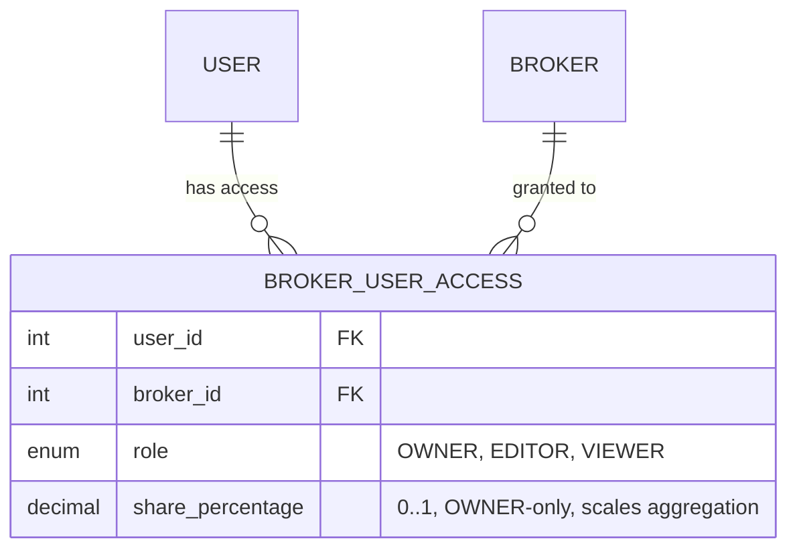

# 🔐 Broker Access Control (RBAC)

LibreFolio implements a granular **Role-Based Access Control (RBAC)** system for Brokers. This allows users to share access to their brokerage accounts with other users (e.g.,
family members, accountants) while maintaining control over permissions.

## 📖 Overview

Access is managed via the `BrokerUserAccess` table, which links a `User` to a `Broker` with a specific `UserRole`.

## 🛡️ Roles and Permissions

There are three roles with increasing levels of privilege:

| Feature                              | VIEWER | EDITOR | OWNER |
|:-------------------------------------|:------:|:------:|:-----:|
| **View Broker Details**              |   ✅    |   ✅    |   ✅   |
| **View Transactions**                |   ✅    |   ✅    |   ✅   |
| **View Reports/Charts**              |   ✅    |   ✅    |   ✅   |
| **View Report Files (BRIM)**         |   ✅    |   ✅    |   ✅   |
| **Add/Edit Transactions**            |   ❌    |   ✅    |   ✅   |
| **Upload/Parse/Delete Files (BRIM)** |   ❌    |   ✅    |   ✅   |
| **Edit Broker Settings**             |   ❌    |   ✅    |   ✅   |
| **Manage Access (Add/Remove Users)** |   ❌    |   ❌    |   ✅   |
| **Delete Broker**                    |   ❌    |   ❌    |   ✅   |

For BRIM report files the administrator (`is_superuser`) needs no role, a file with no broker is its
uploader's and the administrator's only, and a parse also needs EDITOR or OWNER on the broker it
imports into: see [Who reaches a report file](../backend/brim/architecture.md#file-access).

### 📋 Role Definitions

1. 👁️ **VIEWER**: Read-only access. Ideal for sharing portfolio visibility without risk of data modification.
2. ✏️ **EDITOR**: Operational access. Can manage the day-to-day data (transactions, imports) and broker settings (name, icon), but cannot perform destructive administrative actions (deleting the broker) or change who has access.
3. 👑 **OWNER**: Administrative access. Full control over the broker.

## 📏 Key Rules & Constraints

### 📊 Ownership share (`share_percentage`)

Each access row carries a `share_percentage` (0.000000–1.000000) used **only for portfolio
aggregation**, never for permissions:

- **OWNER** defaults to 1.00 and may be reduced for co-ownership (e.g. joint accounts);
  **EDITOR** and **VIEWER** default to 0.00 (delegated operator, read-only accountant).
- The sum of shares across a broker's users **must not exceed 1.00** (validated on add/update);
  it **can be less** (a co-owner may simply not be in the system).
- **0 % is a valid share**: a 0 % OWNER keeps full admin rights but contributes nothing to the
  owner's aggregated numbers.
- Aggregation scales by share **only for OWNERs** — EDITOR/VIEWER rows always carry share 0 by
  schema rule yet see full data, so the engine uses scale 1 for them (`effective_share()` in
  `financial_math/native_cash.py`, called by `portfolio_service.py` and
  `financial_math/portfolio/engine.py`). Role/share edits change every scaled number
  but not the underlying data, so they also join the cache fingerprint for instant invalidation.

### 🔒 The "Last Owner" Rule

To prevent brokers from becoming "orphaned" (inaccessible by anyone with admin rights), the system enforces a strict rule:

> **The last OWNER of a broker cannot be removed or downgraded.**

If a broker has only one user with the `OWNER` role:

- ❌ That user **cannot** remove themselves.
- ❌ That user **cannot** change their role to `EDITOR` or `VIEWER`.
- ✅ To leave the broker, they must first promote another user to `OWNER` or delete the broker entirely.

### 🔧 Self-Management

- 🚪 **Leaving**: any user can remove *themselves* from a broker at any time (`leave_broker`).
  EDITOR/VIEWER always succeed. An OWNER may leave when at least one other OWNER remains —
  otherwise leaving as the **last OWNER deletes the broker entirely** (cascade over
  transactions; BRIM report files are cleaned up by the API layer).
- ⬇️ **Self-demotion** (`update_own_role`): EDITOR → VIEWER is always allowed; OWNER →
  EDITOR/VIEWER is allowed only when another OWNER remains, and demoting from OWNER **zeroes
  the share** (only OWNERs may hold share > 0). Promotions stay on the OWNER-only path.
- 🗑️ **Deleting an account** applies `leave_broker()` to every broker of the account, in one
  commit: see [Deleting an Account](users_and_brokers.md#account-deletion).

## 🔧 Implementation Details

The logic is centralized in `backend/app/services/brokers/access.py` (`BrokerAccessMixin`, part of `BrokerService`).

- 🔍 **`_check_user_access(broker_id, user_id, min_role)`**: Core internal method to verify permissions.
- 📋 **`list_accesses()`**: The users with access to a broker, with role and share.
- 🔄 **`bulk_update_access()`**: Replaces a broker's whole access configuration in one step (OWNER only): adds,
  role changes and removals; at least one OWNER must remain, and the shares add up to at most 100 %.
- 🚪 **`leave_broker()`** / **`update_own_role()`**: The self-service paths described above.

### 🌐 API Endpoints

Access management is exposed via the following endpoints:

- `GET /api/v1/brokers/{id}/access`: List all users with access.
- `POST /api/v1/brokers/{id}/access`: Grant access.
- `PATCH /api/v1/brokers/{id}/access/{user_id}`: Change role.
- `DELETE /api/v1/brokers/{id}/access/{user_id}`: Revoke access.

## 👑 Superusers and the User CLI {: #superusers }

Besides the broker roles, every account carries one system-wide flag, `users.is_superuser`: the
*administrator* of the admin manual. It belongs to the account, not to a broker.

- **Granted** to the first account registered (`POST /api/v1/auth/register` while
  `first_account_open()` holds, that is while `count_users()` is 0, inactive accounts counted:
  accepted whatever the [registration mode](#registration-modes), and an administrator even
  when the invitation it spends grants a regular account), to an account registered
  with an invitation that grants it (`grants_admin`, see [Invitations](#invitations)), to an account
  created with `./dev.py user create` without `--role user` (`--role admin` is the default:
  `scripts/user_cli.py` maps it to its internal `create-superuser` command, which calls
  `user_service.create_user()` with `is_superuser=True`), by `./dev.py user promote`, and by
  `PATCH /api/v1/users/{user_id}` with `is_superuser: true`. `./dev.py user create … --role user`
  maps to the internal `create-user` command instead (`is_superuser=False`): a regular account, even
  as the first account of an empty database.
- **Promote and demote** go through `user_service.set_user_admin()` from the CLI, which refuses a
  no-op (*already an admin*, *not an admin*) and the demotion of the last active administrator, and
  through `user_service.update_user_status()` from the [administrator API](#admin-user-api). A
  demotion also ends every session of the account (`user_service.end_sessions()` raises
  `users.session_version`, see [Session Revocation](security.md#session-revocation)); a promotion
  does not. Self-deletion has the same guard: `DELETE /api/v1/auth/users/me` answers `400` to an
  administrator when no other active administrator remains (`count_active_superusers()`). The
  administrator API deletes no administrator, active or not: `DELETE /api/v1/users/{user_id}` answers
  `409` `DEMOTE_FIRST` until the account is demoted ([Deleting an Account](#admin-account-deletion)).
- **Applied at the next request**: the user CLI writes the database directly, with the server
  running or not, and `get_current_user()` reloads the user on every request. A deactivated
  account (`user deactivate`, `user_service.set_user_active()`, or the administrator API) gets `401`
  *User account is disabled*; its login, with the right password, gets `403` `ACCOUNT_DISABLED`.
  Deactivation refuses the last active administrator, and ends every session of the account:
  `user activate` lets the user sign in again, but brings none of the old sessions back.
- **Password reset** (`user reset`, `user_service.reset_password()`) sets the new hash, computed
  in a worker thread off the event loop, and ends every session of the account in the same
  commit: each device gets `401` at its next request, and signs in again with the new password.
  A [password-reset link](#reset-links) does the same when it is spent. To keep the account out
  altogether, deactivate it.
- **The account's own changes** end its other sessions as well: a password change
  (`POST /api/v1/auth/change-password`) and an email change (`PUT /api/v1/auth/profile`, which asks
  for the current password: see [Changing the Email](security.md#email-change)). The device that
  made the change gets a new cookie and stays signed in; a username change ends no session. Every
  change that ends sessions is in [Session Revocation](security.md#session-revocation).
- **CLI password rules**: `create` and `reset` call `validate_password()` in
  `scripts/user_cli.py`: at least 8 characters, with an upper-case letter, a lower-case letter, a
  digit and a symbol from its `special_chars` set. The API schemas only ask for 8 characters.

The admin commands are in [Command-Line Tools](../../admin/cli_tools.md).

## 🚪 Registration, Invitations and the Admin API {: #registration }

Who may create an account, how many accounts an instance may hold, and what an administrator can do
to the other accounts. The rules are in `backend/app/services/accounts/registration_service.py`, the
account changes in `user_service.py`, and the four variables in `backend/app/config/accounts.py`
(administrator side: [Configuration](../../admin/configuration.md), section «Accounts and Sign-ups»).

### 🎚️ Registration Modes {: #registration-modes }

`effective_registration_mode(session)` returns a `RegistrationModeState(mode, locked)`:
`LIBREFOLIO_REGISTRATION` when it is set (blank counts as unset; case and surrounding spaces are
ignored), with `locked=True`; otherwise the global setting `registration_mode`
([Settings System](settings.md)), with `locked=False`.

The default of that setting is `invite` (decision 36), and it has one source:
`GLOBAL_SETTINGS_DEFAULTS` in `backend/app/schemas/settings.py`. The startup seeding writes it on a
new install, and `get_setting_value()` answers it while the row is missing: the service passes no
fallback of its own. The seeding creates only missing rows, so an existing install keeps its row,
whatever its value. An install that holds accounts but no row has run with the earlier default,
`open`: migration `008_registration_invite_default` writes that `open` row before the seeding runs
([`GLOBAL_SETTING`](database/users_access.md#global-setting)), so an upgrade never closes
registration in silence.

| Mode | `POST /api/v1/auth/register` accepts |
|------|--------------------------------------|
| `open` | Anyone. An `invite_token` is optional, but must be a valid invitation when given, and then sets the role |
| `invite` | Only a valid invitation |
| `disabled` | Nobody, invitations included |

Both sources fail closed. A `LIBREFOLIO_REGISTRATION` that is not a mode makes the mode `disabled`,
and still locks the setting: `registration_mode_pinned()` only asks whether the variable is set. A
stored value that is not a mode also reads as `disabled`. Either is logged by `_report_invalid()` as
the error event *Invalid account configuration*, with two fields: `problem`, the variable or the row
and its value, and `consequence`, *registration stays closed until it is fixed*. The function is a
`functools.cache`, so each problem is logged once per process. The startup
[configuration checks](security.md#configuration-checks) do not cover these variables.

`register_user()` holds the whole rule of `POST /api/v1/auth/register` (`AuthRegisterRequest`, with
an optional `invite_token`) and owns its transaction:

| Situation | Outcome |
|-----------|---------|
| No account at all (`first_account_open()`: `count_users()` is 0, an inactive account counts) | Created as an administrator, whatever the mode, the limit and the role of an invitation. Without an `invite_token`, nothing else is checked. With one, the invitation must be valid — otherwise `400` `INVITE_INVALID`, and the instance stays empty — and the registration spends it as any other does (row *A valid invitation*): its link then reads `consumed` |
| Mode `disabled` | `403` `REGISTRATION_DISABLED` |
| Mode `invite`, no `invite_token` | `403` `INVITE_REQUIRED` |
| A token that is not a valid invitation: unknown, of another purpose, expired, used or revoked | `400` `INVITE_INVALID` |
| A valid invitation | Created in the invitation's role (`grants_admin`; the first account is an administrator whatever it says). The account and the consumption of the invitation (`consumed_by_user_id`) are committed together. The limit is not checked: the invitation already holds its place |
| Mode `open`, no `invite_token` | Created as a regular account, within the [user limit](#user-limit) |
| Username or email already taken | `400`, with the plain-string `detail` it always had |

The refusals with a code answer `{"error_code": …, "message": …}` in `detail`. Two requests racing
for one invitation cannot both spend it: `consume_token()` is one conditional `UPDATE`, and the loser
rolls back with `INVITE_INVALID`.

`GET /api/v1/system/instance` publishes the effective state as `accounts: {registration_mode,
registration_locked, first_account_open}` (`AccountsInstanceConfig`). About the users it says one
thing only, whether there is one: `first_account_open`, from `first_account_open(session)`, is true
while the `users` table is empty, and the login page then offers **Register here** whatever the
mode. No count, no limit ([Public instance configuration](settings.md#public-instance-configuration);
why the flag may be public: [The First-Account Flag](security.md#first-account-open)).

### ✉️ Invitations {: #invitations }

An invitation is an `invite` [account token](security.md#account-tokens): 7 days, single use, link
`/invite#token=…`, and no `user_id`, as its account does not exist yet.

- **Created** by `create_invite()`, from `POST /api/v1/users/invites` or `./dev.py user invite`, with
  `grants_admin`, `email` and `created_by_user_id` (`NULL` from the command line). It refuses in mode
  `disabled` (`REGISTRATION_DISABLED`), and when the instance is full (`USER_LIMIT_REACHED`) unless
  called with `enforce_limit=False`, as only the command line does. It flushes and does not commit.
- **The email is a suggestion, not a constraint.** It records whom the invitation is for, and
  `POST /api/v1/auth/tokens/inspect` returns it to whoever holds the token, but registration never
  compares it with the address of the new account: the developer rejected D-A16, the proposal to bind
  the two.
- **Listed** by `list_pending_invites()`: the live ones (not consumed, not revoked, not expired),
  oldest first. **Revoked** by `revoke_invite(invite_id)`, which returns `False` for anything that is
  not a live invitation; it flushes and does not commit.
- **Spent** only by `register_user()`, as above.

`POST /api/v1/auth/tokens/inspect` `{token, purpose}`, with `purpose` `invite` or `password_reset`,
is public and writes nothing. It answers `{status, purpose}`, the status being `valid`, `expired`,
`consumed`, `revoked` or `unknown` (also for a token of the other purpose). Only a valid token adds
`expires_at`, with `grants_admin` and `email` for an invitation, or `username` for a reset link.

### 📏 The User Limit {: #user-limit }

`LIBREFOLIO_MAX_USERS` (unset or blank: no limit) bounds the places counted by `user_usage()`: the
active accounts (`users.is_active`) plus the live invitations. A deactivated or deleted account frees
its place; an invitation holds one from its creation until it is revoked or expires, and hands it to
the account it opens. A value that is not a whole number of at least 1 is a limit of 0, logged like
an invalid mode (`_max_users()`).

| Request | When `used >= max_users` |
|---------|--------------------------|
| `POST /auth/register` without an invitation | The account is inserted, then counted in the same transaction: over the limit, rollback and `409` `USER_LIMIT_REACHED`, with no numbers and no link, as the caller is anonymous. The first writer holds SQLite's write lock until it commits, so two registrations racing for the last place cannot both take it |
| `POST /auth/register` with a valid invitation, or for the first account | Not checked |
| `POST /users/invites` | `409` `USER_LIMIT_REACHED` with `limit`, `used` and `billing_url` |
| `PATCH /users/{user_id}` reactivating an account | The same `409`. Promotions, demotions and deactivations are not checked |
| `./dev.py user create`, `./dev.py user invite`, `./dev.py user activate` of an inactive account | The warning `The instance is at its limit (LIBREFOLIO_MAX_USERS: <used> of <max> places taken): the command line <action> anyway`, `<action>` being `creates the account`, `creates the invitation` or `reactivates the account`; then the command goes ahead |

`billing_link()` returns `LIBREFOLIO_BILLING_URL` to administrators only: in `usage.billing_url` of
`GET /users` and `GET /users/invites`, in the `409` `USER_LIMIT_REACHED` of the administrator
routes, and in `billing_url` of `GET /system/block`, the block page of a blocked instance
([Security → Instance Block](security.md#instance-block)). An invalid `LIBREFOLIO_BILLING_URL` or `LIBREFOLIO_PUBLIC_URL` is treated as unset and logged
like an invalid mode, with its own `consequence`: *the billing link stays hidden until it is fixed*,
or *links show the bare path until it is fixed*.

### 🛠️ Administrator API {: #admin-user-api }

`backend/app/api/v1/users.py`, every route behind `require_admin` (`401` without a valid session,
`403` *Admin access required* for a regular account); the last row, the public half of the
[address probe](security.md#address-probe), is in `auth.py`. The static paths are declared before
`/users/{user_id}`, so `/users/invites` and `/users/address-probe` are never read as a user id.

| Route | Body | Does | Answers |
|-------|------|------|---------|
| `GET /users` | — | Every account, oldest first (`id`, `username`, `email`, `is_active`, `is_superuser`, `created_at`, and `protected`: see [Protected Accounts](#account-protection)), with `usage: {used, max_users, billing_url}` | `200` |
| `PATCH /users/{user_id}` | `{is_active?, is_superuser?}` | `update_user_status()`, all or nothing: an omitted field, or a value equal to the current one, changes nothing. A deactivation or a demotion ends every session of the account | `200` with the account; `404`; `409` `ACCOUNT_PROTECTED` for a deactivation or a demotion of a [protected account](#account-protection), checked first; `409` `LAST_ADMIN` for the last active administrator; `409` `USER_LIMIT_REACHED` for a reactivation over the limit |
| `GET /users/{user_id}/deletion-preview` | — | `preview_user_deletion()`: what [deleting the account](#admin-account-deletion) would take with it. Writes nothing | `200` `AccountDeletionPreviewRead`; `404` |
| `DELETE /users/{user_id}` | — | `delete_account()`: the account, and the brokers it is the only `OWNER` of, all or nothing. Cannot be undone: see [Deleting an Account](#admin-account-deletion) | `204` with an empty body; `404`; `409` `SELF_DELETION`, `ACCOUNT_PROTECTED` or `DEMOTE_FIRST`; `500` when the deletion fails, nothing deleted |
| `POST /users/{user_id}/password-reset-link` | — | A [reset link](#reset-links), shown once | `201` `{token, path, url, expires_at}`; `404` |
| `POST /users/{user_id}/sessions/revoke` | — | `end_sessions()`: every device of the account is signed out at its next request | `204`; `404` |
| `POST /users/{user_id}/onboarding/reset` | optional `{flow}` | `reset_onboarding_progress()`: that flow, or every flow, back to `pending`, steps included, with `completed_at` and `skipped_at` cleared (backlog item 21-5) | `204`; `404`; `422` for a flow that does not exist |
| `GET /users/invites` | — | The live invitations, oldest first (`id`, `grants_admin`, `email`, `created_at`, `expires_at`, `created_by_user_id`), with `usage` | `200` |
| `POST /users/invites` | `{grants_admin=false, email?}` | `create_invite()`; the link is shown once | `201` `{invite, token, path, url}`; `409` `REGISTRATION_DISABLED`; `409` `USER_LIMIT_REACHED` |
| `DELETE /users/invites/{invite_id}` | — | `revoke_invite()`: the link stops working and its place is freed | `204`; `404` when it is not a live invitation |
| `POST /users/address-probe` | — | `issue_probe_nonce()`: a signed nonce for the [address probe](security.md#address-probe), valid 120 s and stored nowhere; a new one at every call | `200` `{nonce, expires_at}` |
| `GET /auth/address-probe?nonce=…` | — | Public, the same answer with or without a session: `verify_probe_nonce()`, whether this instance issued the nonce. Readable from any origin (`Access-Control-Allow-Origin: *`) | `200` `{match}`: `false` for anything not issued here or expired, never `422` |

- `path` is `token_path()`: the page, with the token in the fragment (`#token=…`, see
  [Links in Use](security.md#account-token-links)). `url` is `LIBREFOLIO_PUBLIC_URL` followed by the
  path (`public_link()`), `null` when the variable is unset or invalid.
- Each change writes a structured log event with the id of the account or of the invitation, and
  the administrator's (`admin_id`, or `created_by_user_id` for an invitation or a reset link):
  *Invitation created*, *Invitation revoked by an administrator*, *Account updated by an
  administrator*, *Account deleted by an administrator*, *Password reset link created*, *Sessions
  ended by an administrator*, *Onboarding reset by an administrator*. None carries the token or its
  hash.

### 🗑️ Deleting an Account {: #admin-account-deletion }

`DELETE /api/v1/users/{user_id}` deletes another account by the rule of deleting one's own: broker by
broker, the last-owner rule of `BrokerService.leave_broker()`. A broker the account is the only `OWNER` of
goes, with its transactions and its report files; on the others only the account's access goes. An inactive
co-owner's `OWNER` row counts as another owner. The rule, the shared helper and the preview are in
[Deleting an Account](users_and_brokers.md#account-deletion).

`GET /api/v1/users/{user_id}/deletion-preview` tells the administrator beforehand what the deletion would
take, by the same rule, writing nothing: `brokers_deleted`, `brokers_left` and `transfers_unpaired`.
`GET /api/v1/auth/users/me/deletion-preview` gives any signed-in user the same for their own account.

After `require_admin`, the deletion refuses, in this order:

1. `404` *User not found*: no such account;
2. `409` `SELF_DELETION`: the caller's own account, which is deleted from the profile
   (`DELETE /api/v1/auth/users/me`);
3. `409` `ACCOUNT_PROTECTED`, with the `reason` of the [protection hook](#account-protection). It comes
   before `DEMOTE_FIRST` because demoting a protected account is refused too;
4. `409` `DEMOTE_FIRST`: an administrator, active or not. It must be demoted first, so the last
   administrator can never be deleted from here.

Each `409` carries `detail` `{error_code, message}`, plus `reason` for `ACCOUNT_PROTECTED`. Otherwise the
route calls `user_service.delete_account()`, the helper of `DELETE /auth/users/me` too, and answers `204`
with an empty body. All or nothing: a technical failure rolls everything back and answers `500` *Account
deletion failed: nothing was deleted*. The deleted account's sessions get `401` at their next request.

- **Log**: one structured event, *Account deleted by an administrator*, with `user_id`, `username`,
  `admin_id`, `brokers_deleted` (the ids of the deleted brokers) and `files_removed`. A failure logs
  *Account deletion by an administrator failed: nothing was deleted*, with `user_id`, `admin_id` and the
  traceback.
- **Blocked instance**: both previews and the administrator's deletion are outside
  `ALLOWED_WHEN_BLOCKED` ([Instance Block](security.md#instance-block)): `423` for a signed-in caller,
  `401` for anyone else. Of the deletion routes, only `DELETE /api/v1/auth/users/me` is on the list.

### 🛡️ Protected Accounts {: #account-protection }

`user_service.account_protection(user) -> Optional[str]` gives the reason why nobody may delete, deactivate
or demote an account, or `None`. It is the hook of lot A7, for the administrator created from the
environment on a managed instance, who pays for it; until then it returns `None` for every account.

- `GET /users` reflects it in `protected` (`AdminUserRead`), as do the accounts `PATCH` returns.
- `DELETE /users/{user_id}`, and a `PATCH /users/{user_id}` that deactivates or demotes the account, answer
  `409` `ACCOUNT_PROTECTED` with that `reason`. The `PATCH` checks it first, before the user limit and the
  last-administrator rule.
- Promoting or reactivating a protected account is not refused.

### 🔑 Password-Reset Links {: #reset-links }

A reset link is a `password_reset` [account token](security.md#account-tokens): 30 minutes, single
use, link `/reset-password#token=…`, bound to its account (`user_id`). Unlike `./dev.py user reset`,
the administrator does not choose the new password: whoever spends the link does.

- **Issued** by `user_service.create_password_reset()`, from
  `POST /api/v1/users/{user_id}/password-reset-link` or `./dev.py user reset-link <username>`. It
  first revokes the account's live reset links, so only the newest one works. Issuing a link ends no
  session.
- **Spent** by `POST /api/v1/auth/password-reset` `{token, new_password}`, which is public;
  `new_password` follows the API rule, at least 8 characters. `complete_password_reset()` consumes the
  token, hashes the new password with bcrypt in a worker thread, ends every session of the account and
  revokes its other live reset links, in one commit; the answer is `200`. A link that is not valid
  (used, expired, revoked, unknown or of another purpose) changes nothing: `400` `TOKEN_INVALID`.

Tests: `./dev.py test services registration`
(`backend/test_scripts/test_services/test_registration_service.py`: the variables, the effective
mode, the usage, invitations, every branch of `register_user()`, the limit under a race),
`./dev.py test api registration` (`backend/test_scripts/test_api/test_registration_api.py`:
registration by mode, inspection, the password reset, the `accounts` block, the locked setting) and
`./dev.py test api users-admin` (`backend/test_scripts/test_api/test_users_admin_api.py`: the
administrator API with its guards and its logs; the deletion and its preview on the lane's server, and
in process the protection hook replaced, the log event and an injected failure). The address probe has
its own tests, listed in [Address Probe](security.md#address-probe).

The web pages of the links, `/invite` and `/reset-password`, are in
[Authentication Components](../frontend/components/features/auth.md#link-pages).

The administrator's side is in [Global Settings](../../admin/settings.md), section «Who Can Sign Up»;
[Configuration](../../admin/configuration.md), section «Accounts and Sign-ups»; and
[Command-Line Tools](../../admin/cli_tools.md), section «Manage Users».
