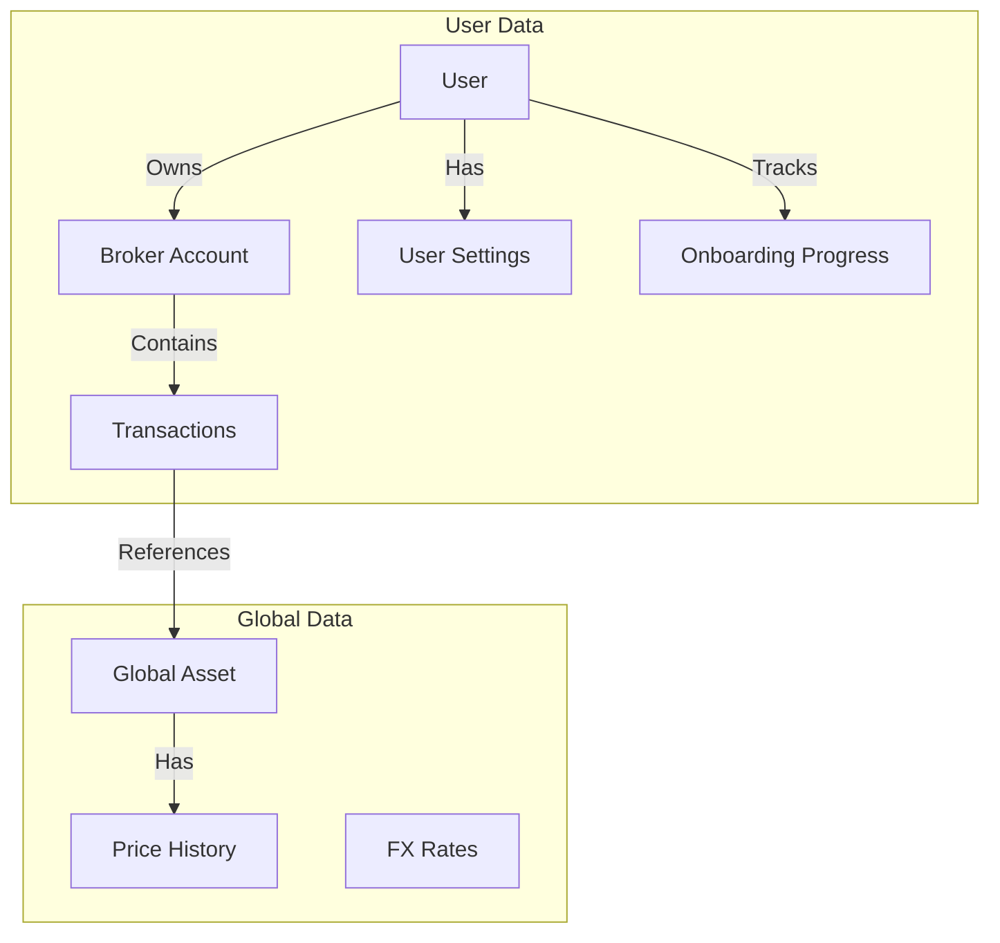

# 🗄️ Database Schema

The LibreFolio database is designed using SQLAlchemy with SQLModel. The schema is stored in a single SQLite file (`app.db`).

> 💡 **Tip**: To explore the live database schema interactively (including all constraints and indexes), we recommend using a tool like **DBeaver** or **DB Browser for SQLite**
> connected to your local `backend/data/prod/sqlite/app.db` file (`backend/data/test/sqlite/app.db` in test mode; `LIBREFOLIO_DATA_DIR` moves the production data directory).

## 🔄 Logical Data Flow

This diagram illustrates how data flows from the User down to the financial records.



## 📂 Subsystems

The database is organized into four logical subsystems. Each has its own detailed page:

- 👤 **[Users & Access](users_access.md)** — Authentication, user settings, onboarding progress, broker sharing (RBAC), and the plugin settings
- 🏦 **[Brokers & Transactions](brokers_transactions.md)** — The core financial data structure
- 📊 **[Assets & Pricing](assets_pricing.md)** — Global financial instruments and provider assignments
- 💱 **[FX Rates & Routes](fx_rates.md)** — Currency exchange rates and routing configuration

## 🏛️ Design Philosophy

1. 📐 **Normalization**: Assets are global; Transactions are broker-specific.
2. ✅ **Strict Constraints**:
    - `CHECK` constraints ensure logical consistency.
    - Foreign Keys are enforced (`PRAGMA foreign_keys=ON`).
3. 📦 **JSON for Flexibility**: Used for `classification_params` and `provider_params` to allow schema-less extension.

## 🔢 Decimal Columns {: #decimal-columns }

SQLite keeps the value of a `NUMERIC` column as a double (`REAL`; `INTEGER` for a whole
value) and ignores the declared precision: the model's column type decides how the value
is read back (`backend/app/db/models.py`; C-97, issue #43).

| Columns | Type | Decimal places | Digits before the point |
|---------|------|----------------|-------------------------|
| `transactions.quantity` | `RealDecimal(22, 10)` | 10 | 15 |
| `price_history`: `open`, `high`, `low`, `close`, `adjusted_close`; `transactions.cost_basis_override`, a per-unit price | `RealDecimal(24, 12)` | 12 | 12 |
| `transactions.amount`, `asset_events.value` | `RealDecimal(18, 6)` | 6 | 15 for the amount, 12 for the event value |
| `fx_rates.rate` | `Numeric(24, 10)` | 10 | 14 |
| `price_history.volume` | `Numeric(24, 0)` | 0 | 24 |

- **Read.** `Numeric` reads through `'%.<scale>f'`: at scale 6, `0.12345678` reads
  `0.123457` (a quantity, before C-97), and a wider scale shows the double's noise
  (`65000.123456` at scale 12 reads `65000.123456000001`), as does scale 6 from about 11
  digits before the point (`123456789012.345` reads `123456789012.345001`,
  `-99999999999999.9` reads `-99999999999999.906250`: an amount, before W-B60). `RealDecimal`
  (`backend/app/db/real_decimal.py`) writes the same double and reads back the shortest
  decimal that represents it (its `repr`), at most 15 significant digits
  (`REAL_SIGNIFICANT_DIGITS`), rounded to the scale when it has more decimals and padded to
  6 decimals (`READ_MIN_SCALE`) when it has fewer: `10` reads `10.000000`, as with
  `Numeric(18, 6)`. `RealDecimal`'s read never raises (W-B58; before, it raised on a
  stored ±inf and on any value from 1e54 up): one row that cannot be read would take down
  every listing that loads it, for every user. A stored double that is not finite (±inf,
  written before the size limits or by hand), or a stored value that is no number at all,
  reads `None`, logged once per process: the row loads, and can be deleted. A finite
  double of any size reads back exactly, even past its column's digits before the point:
  a release 1.2 database never enforced them, and reading such a quantity as `None` would
  erase a position. Writing a value a double cannot hold, such as `Decimal("1E+400")`,
  raises `ValueError` (*not finite as a double*) in `process_bind_param()`, whoever writes
  it: no ±inf reaches a `RealDecimal` column any more. Amounts and event values have been
  `RealDecimal(18, 6)` since W-B60, with the same declaration and DDL (`NUMERIC(18, 6)`, no
  migration): they read back as written, always with 6 decimals as before (`-100` reads
  `-100.000000`), and these guards cover them. An amount that release 1.2 stored with more
  than 15 significant digits (10 or more digits before the point, plus decimals; since the
  C-97 input limits, no new amount has more than 15) now reads rounded at the 15th: at most
  0.000005 from what 1.2 read with 10 digits before the point, about ten times more for
  each further one. The `Numeric` columns have neither guard: `price_history.volume` and
  `fx_rates.rate` store a value past a double's range as ±inf without an error, and read a
  stored ±inf back as `Decimal('Infinity')`, not `None`. The FX writers no longer send such a
  rate, and the conversions skip one already stored (X-R38, below).
- **Input limits.** A value sent in — a transaction's quantity, cash amount or per-unit
  cost basis (manual, or the one a promotion resolves), a manual price or event value —
  over its column's decimal places, over 15 significant digits, or over its column's
  digits before the decimal point, is refused, never rounded (`decimal_limit_issue()` in
  `backend/app/db/precision.py`; trailing zeros do not count). It checks them in that
  order and answers the first one failed, with its maximum: `decimalPlacesExceeded`,
  `significantDigitsExceeded` or `integerDigitsExceeded`, the last also for a value that
  is not finite. The digits before the point are `max_integer_digits()`'s: 15 for
  `transactions.quantity` and `transactions.amount`, as many as a REAL gives back
  (decision N63: a thousand billion VND or IDR is a real amount, and release 1.2, which
  never enforced the declarations on SQLite, may already hold one), otherwise what the
  column declares, precision − scale. It counts the value's own digits, never through a
  decimal context, so nothing rounds, overflows or underflows: `1E+60`, one digit and no
  decimals, is refused for its size, and `1E+1000000` and `1E-2000000` are refused, never
  a 500 or a zero. A manual volume is checked for its size only
  (`integer_digits_issue()`): its decimals pass, and read back rounded. See
  [Decimal limits](../../backend/transactions/service.md#decimal-limits),
  [Asset Architecture](../../backend/assets/architecture.md) for prices and
  [Asset Events](../../backend/assets/events.md) (`EVENT_TOO_MANY_DIGITS`). A provider's
  prices are truncated instead: `truncate_priceHistory()` keeps 12 decimal places, then 15
  significant digits, both rounded down; a provider's event value likewise keeps 6 decimal
  places, then 15 significant digits (`storable_value()`, W-B68), so it reads back as written.
  A provider's value that no truncation makes fit
  is skipped, never written: `storable_value()` answers `None` for a value that is not
  finite or past its column's digits before the point, and `storable_price()` also for a
  non-zero close that truncates to 0; a provider's event whose value is past 12 digits
  before the point, or not finite, is dropped too (`storable_value()`). A BRIM
  plugin rounds a value it computes, never one it reads from the file, with
  `round_computed_value()` (see
  [Decimal places](../patterns/brim_plugin_guide.md#decimal-places)).
- **Exponent bound.** Above the columns' limits, an input is also bounded by its exponent,
  at the boundary (R13-SEC7-3): `check_decimal_exponent()` (`backend/app/schemas/common.py`)
  refuses a value whose exponent, `Decimal.adjusted()`, is outside ±100
  (`MAX_DECIMAL_EXPONENT`), a zero included (`0E-999999999`). Every `Currency` amount goes
  through it (`Currency.validate_amount()`), and so does the `quantity` of
  `POST /transactions/transfers/promote`: a 422 where a request schema reads the value; a
  `value_error` issue on its field (`cash.amount`, no `params`) where the transaction
  batch's lenient parse does, and that batch is not committed. No column comes near ±100
  (24 digits before the decimal point at most, 12 after), so below the bound the limits
  above still decide (`integerDigitsExceeded`, W-B58). The bound only keeps a finite value
  such as `1E+999999999`, which pydantic accepts, from a fixed-point expansion (a billion
  digits on the event loop) or a decimal context's arithmetic.
- **Exchange rates.** `fx_rates.rate` keeps 10 decimal places and 14 digits before the point
  (X-R38, the FX side of W-B58). `storable_fx_rate()` gives a rate as the column keeps it
  (`truncate_fx_rate()`, rounded down), or `None` when it is not finite, has more than 14 digits
  before the point, or is 0 once truncated (below `1E-10`): a rate is never 0, since its inverse
  and the conversions divide by it. It also refuses a rate whose double, once truncated, reaches
  `1E+14` (X-R50): `99999999999999.995` has 14 digits before the point, but SQLite would store it
  as `1E+14`, which the reads skip. It counts the digits as `decimal_limit_issue()` does, so
  `1E+1000000` and `1E-2000000` are refused, never an overflow or a zero; decimals are never
  refused. A manual rate (`POST /api/v1/fx/currencies/rate`) is checked as it will be stored, its
  pair in alphabetical order and the rate inverted when needed, and refused naming its pair, date
  and the limits; a provider's rate is skipped, with one warning per pair; the conversions read
  only the rates from `1E-10` up to below `1E+14` (`usable_fx_rate_bounds()`), so an infinite, 0
  or 20-digit rate an older release stored is a missing rate. See
  [FX Configuration & Routing](../../backend/fx/configuration.md#chain-dates-writes-and-counters)
  and [FX Architecture](../../backend/fx/architecture.md#convert-bulk-window).
- **Never `SUM` in SQL.** A `SUM` adds the stored doubles, not the decimals. Sum the values
  read back in Python, with `financial_math` (`position_quantities()`, `native_balances()`),
  as the [balance queries](../../backend/transactions/service.md#balance-queries) do.
- **Older databases.** `001_initial` declares `NUMERIC(22, 10)` and `NUMERIC(24, 12)`; a
  database created before keeps `NUMERIC(18, 6)`, on purpose: SQLite ignores the
  declaration, so both read the same. The release 1.3 migration's docstring gives the
  reasoning.

## 🧬 Migrations {: #migrations }

Schema changes ship as Alembic revisions in `backend/alembic/versions/` (workflow:
[Database Migrations](../patterns/alembic.md)). At startup, the `database` step of the
[lifespan](../overview.md#server-startup) runs `ensure_database_exists()`
(`backend/app/services/platform/database_bootstrap.py`), which builds a missing, empty or table-less
database from scratch, and runs `alembic upgrade head` when the revision stored in `alembic_version`
is not the head of the scripts. The head comes from `alembic_head_revision()`
(`backend/app/services/platform/readiness.py`), the reader
[`GET /system/ready`](../security.md#system-info-and-readiness) uses too.

The chain is linear:

| File | Revision id | Revises | Change |
|------|-------------|---------|--------|
| `001_initial.py` | `001_initial` | — | Squashed baseline: the 12 original tables with their indexes and constraints |
| `002_identifier_other_json_list.py` | `002_identifier_other_json_list` | `001_initial` | Data only: `assets.identifier_other` becomes a JSON list |
| `003_scheduler_timezone.py` | `5b1333fa6b07` | `002_identifier_other_json_list` | Data only: the stored scheduler sync times move from UTC to `scheduler_timezone` wall-clock time |
| `004_release_1_2_0_schema.py` | `004_release_1_2_0_schema` | `5b1333fa6b07` | `assets.is_benchmark` and the two onboarding progress tables |
| `005_accounts_invites.py` | `005_accounts_invites` | `004_release_1_2_0_schema` | `users.session_version`, `users.email_verified_at` and `users.last_seen_version`, and the [`account_tokens`](users_access.md#account-token) table of single-use account links |
| `006_registration_mode.py` | `006_registration_mode` | `005_accounts_invites` | Data only: the global setting `enable_registration` becomes [`registration_mode`](users_access.md#global-setting) — `open` when the old value read as true (`true`, `1`, `yes`, `on`, any case), `disabled` otherwise; the downgrade writes `true` for `open`, `false` for `invite` and `disabled` |
| `007_plugin_settings.py` | `007_plugin_settings` | `006_registration_mode` | The [`plugin_system_settings`](users_access.md#plugin-system-setting) and [`plugin_user_settings`](users_access.md#plugin-user-setting) tables of the plugin settings, created empty; the downgrade drops them, with their values and secrets |
| `008_registration_invite_default.py` | `008_registration_invite_default` | `007_plugin_settings` | Data only: where [`registration_mode`](users_access.md#global-setting) is missing and `users` holds at least one account, the row is written `open`, the earlier default, so an upgraded install keeps its registration while a new one seeds the new default, `invite`; an existing row is never touched, a database without accounts gets nothing, and the downgrade does nothing |
| `009_email_unique_ignoring_case.py` | `009_email_unique_ignoring_case` | `008_registration_invite_default` | The unique index `ux_users_email_lower` on `lower(email)`: an [email address](users_access.md#user) belongs to one account whatever its A–Z case (letters outside ASCII compare as written). If two accounts already share an address apart from case, this revision stops before writing anything, naming them by id and username, never by address, with the remedy `./dev.py user set-email`; no account is changed or merged, the revisions before it stay applied (on SQLite Alembic commits each one on its own), and the next start resumes here. The downgrade drops the index |

!!! warning "The revision id is the contract, not the filename"

    v1.1.0 shipped the scheduler migration as `5b1333fa6b07_scheduler_times_use_configured_timezone.py`.
    The file was later renamed `003_scheduler_timezone.py` so that the files sort in order, but its
    `revision` is still `5b1333fa6b07`: released databases store that id in `alembic_version`, and
    changing it would orphan them. Chain a new migration from the head's revision id
    (`down_revision`), never from a filename, and keep the graph linear — two revisions with the same
    `down_revision` create two heads, and `alembic upgrade head` refuses to choose between them.

### 🩹 Post-migration fixes {: #post-migration-fixes }

Some repairs cannot be Alembic revisions. Rebuilding a table that others reference with
`ON DELETE CASCADE` is one: the Alembic process imports `backend.app.db.session`, whose engine
listener turns foreign keys on, and dropping the old table would then empty the tables that point
at it. These repairs live in `backend/app/db/post_migration/` as ordered `PostMigrationFix`
subclasses (`FIXES`: a new fix is appended, never inserted before an older one). Right after
the `database` step, the `post-migration-fixes` step of the lifespan runs
`run_post_migration_fixes_at_startup()` (`backend/app/services/platform/database_bootstrap.py`) in a
worker thread; it never lets an error stop the startup. `run_post_migration_fixes()` works on a
direct `sqlite3` connection:

1. It holds an exclusive `fcntl.flock` on `<db file>.post-migration.lock`, beside the database,
   from the integrity check to the cleanup, dry runs included: the workers of a multi-worker server
   and the offline script take turns, and the later runs find nothing to do. The lock file is never
   deleted. It is opened with `O_NOFOLLOW` and, when missing, created `0600`: a symbolic link in its
   place raises `OSError` before the database is opened, and nothing behind the link is created or
   locked. At startup that is logged as the WARNING *Post-migration fixes could not run; starting
   normally* (`error`) and the server starts without the fixes; the offline script does not catch
   it and ends with the traceback, exit code `1`. On a non-POSIX system the runs are not serialised.
2. It touches nothing unless `PRAGMA integrity_check` answers `ok`.
3. Every fix `detect()`s its anomaly without writing: nothing found, nothing written or logged.
4. It checkpoints the WAL (`wal_checkpoint(TRUNCATE)`) and copies the database with SQLite's
   backup API to `<db file>.pre-<fix ids>-<UTC %Y%m%dT%H%M%SZ>.bak`. No copy, no fix.
5. Each pending fix runs `prepare()` outside the transaction (filesystem work to undo on failure),
   then, with `foreign_keys = OFF` (SQLite switches it only outside a transaction),
   `BEGIN IMMEDIATE`, `apply()`, `verify()` and the common checks — no `PRAGMA foreign_key_check`
   row that was not there just before the fix, the row count of every table unchanged but for the
   changes the fix declares (`row_count_changes()`, `{table: delta}`, checked exactly) — before
   `COMMIT`. Any problem rolls back. `finish()` runs after either outcome, and a failed fix stops
   the ones after it. A broken reference the database already held is not the fix's to judge: it
   stays, and the run logs those it found once, as the WARNING *Foreign key violations already in
   the database, left as they are* (`count`, and up to 20 of the rows `foreign_key_check` gives).
6. All applied: the backup is deleted and *Post-migration fixes applied and verified* is logged.
   Otherwise the backup is kept and *Post-migration fix failed: the database was left as it was*
   gives its path and the errors. Both lines carry `seconds`.

`python -m backend.app.db.post_migration [--db PATH] [--data-dir PATH] [--dry-run]`
(`__main__.py`) runs the same function with the server stopped, which it does not check, then,
as at startup, the step for the [lone giving legs](#lone-transfer-legs). Each fix reports
`clean`, `would_apply` (dry run), `applied` or `failed` (`PostMigrationReport`); the exit code
is `1` when a fix, the integrity check or that step failed. Run that way, it also logs what the
server logs at startup — the warnings, each fix's own lines and the step's, the closing line with
`seconds` — on the console only (`configure_logging(LOG_LEVEL, enable_file_logging=False)`, as
JSON on stdout between its summary lines), so it writes no log file in the data directory;
`main()` called from code configures nothing.

The first fix, `autoincrement` (`autoincrement.py`), gives `AUTOINCREMENT` to the id of the tables
whose ids leave the backend (`AUTOINCREMENT_TABLES`: `users`, `brokers`, `assets`, `transactions`,
`fx_conversion_routes`, `asset_events`). Without it SQLite gives a new row `max(id) + 1`, so a row
created after the newest one was deleted inherits its id, and whatever outside the database still
points at it: a saved URL, a benchmark in `localStorage`, a `broker_<id>` report folder. New
databases get it from `001_initial.py`; the fix converts existing ones, once.

- Each table is rebuilt from its current `CREATE TABLE` text with that single change, so the
  columns added by later migrations stay: renamed aside under `legacy_alter_table = ON` (the
  foreign keys of the other tables keep naming it), recreated, rows copied as they are, old table
  dropped, indexes recreated. Any other shape of the id column stops the fix before anything is
  touched.
- Its own checks: the stored DDL and indexes match the plan, and `sqlite_sequence` is not behind
  `max(id)`.
- When `brokers` is converted and the database lies inside the data directory, the
  `broker_reports/<status>/broker_<n>` folders whose broker no longer exists are first renamed to
  `.quarantine-autoincrement-<UTC>-broker_<n>` (out of the listing's `broker_*` glob), deleted
  once the fix is verified, renamed back if it fails: the first broker created afterwards may
  reuse `<n>` once, and must not inherit them.

The second fix, `orphan_pair_halves` (`orphan_pair_halves.py`), converts the half of a pair whose
partner is gone. Until 1.3, deleting a broker left the other half of each pair it had with another
broker as a `TRANSFER`, `CASH_TRANSFER` or `FX_CONVERSION` without its partner: its link cleared
(`related_transaction_id` NULL) or, when foreign keys were off, naming a row that no longer exists.
The FIFO lots refuse such a `TRANSFER` (`TRANSFER_PAIR_MISSING`), and the Dashboard counts it as
capital at its market value on its date. Since 1.3, `delete_by_broker()` converts that half as it
deletes the broker ([Broker Deletion](../../backend/transactions/service.md#broker-deletion)); this
fix converts, once, the halves already in a database.

- `detect()` writes nothing. It selects the rows of the three paired types whose link is NULL or
  names a missing row, and the rows of any other type whose link names a missing row. A row whose
  partner exists is never selected.
- It converts a half as a split of the pair leaves it (`STANDALONE_TYPES`, the values of
  `TransactionService.SPLIT_TYPE_MAP`). A received `TRANSFER` (positive quantity) becomes an
  `ADJUSTMENT` with its quantity, asset, cost basis and its currency. When no cost basis was
  recorded it stays without one, since the sender is gone: `MISSING_COST_BASIS` until the user
  enters it (the 1.3 deletion writes the sender's Auto cost instead). A `CASH_TRANSFER` or
  `FX_CONVERSION` becomes a `WITHDRAWAL` when its amount is negative, a `DEPOSIT` otherwise, without
  asset. The link goes, `updated_at` moves to now, every other column stays.
- It leaves the giving leg of a `TRANSFER` (negative quantity) to the step after the fixes:
  counted, not changed, since it becomes an `ADJUSTMENT` only with the Auto cost of its broker,
  which a `sqlite3` connection cannot compute (see [Lone giving legs](#lone-transfer-legs)). It
  also leaves a row whose quantity or amount sign cannot be read, and the rows of other types (an
  `ADJUSTMENT` can carry a link). Each of these keeps its type, and loses its link only when that
  link names a missing row, so that the run's `foreign_key_check` can pass.
- Its own checks, on top of the common ones: no convertible half left, and each row it changed has
  its expected type and no link.
- Its detection logs whenever it finds such a row, dry runs included, even with nothing to change: a
  WARNING with `count` (every row found), `conversions` (the ids per `TYPE->TYPE`),
  `without_cost_basis`, `unlinked_only`, `left_giving_transfer_legs` and `left_unreadable_sign`.
  It comes back at every start while a giving leg, or a row of unreadable sign, remains — a giving
  leg remains only when the step after the fixes cannot give it a cost; with nothing left to
  change, the outcome is `clean`. After the commit, `finish()` logs one INFO line
  per row changed — *Transaction without its pair converted* or *… unlinked* — with
  `transaction_id`, `broker_id`, `date`, `from_type`, `to_type`, `quantity`, `amount`, `currency`,
  `asset_id`, `cost_basis`, `cost_basis_currency`, `missing_cost_basis` and `former_partner_id`
  (the missing row the link named, `null` when the link was already cleared). The offline script
  prints them too, on the console.

`./dev.py test db post-migration-orphan-pairs`
(`backend/test_scripts/test_db/test_post_migration_orphan_pairs.py`) pins this contract.

The fix `event_types` (`event_types.py`) repairs the asset events stored with a type the app does
not know. Until 1.3 an event type was saved as it came — a CSV written by hand could store `dividend`
or `dividendo` — while the column is the `AssetEventType` enum: every later read of that asset's
events failed (`LookupError`, a 500) and none of them was shown. Since 1.3 `FAAssetEventPoint`
trims and upper-cases the type on the way in and refuses one that is still unknown (422); this fix
repairs the rows already stored, once (decision 23 of release 1.3).

- `detect()` writes nothing. It selects the events whose `type` is not exactly one of the enum's
  values.
- A type that becomes valid once trimmed and upper-cased (Python's `str.strip().upper()`, the
  schema's own rule) is corrected in place: the event keeps its id, and its transactions stay
  linked.
- Any other event is deleted, a provider's included (they are not shown already). Its transactions
  are unlinked first — `asset_event_id` NULL, `updated_at` now — and stay, without their event.
- It declares its deletions (`row_count_changes()` → `{"asset_events": -n}`), so the framework checks
  that exactly those rows went; its own `verify()` wants no unknown type left, each correction in
  place, each deleted event gone and named by no transaction.
- Logs: the detection WARNING (dry runs included) with `count`, `corrections` (ids per
  `stored->CORRECTED`), `deletions` (ids per stored type) and `unlinked_transactions`; after the
  commit, one INFO line per corrected event (*Asset event type corrected*), per unlinked transaction
  (*Transaction unlinked from an asset event of unknown type*) and per deleted event (*Asset event of
  unknown type deleted*, with its date, value, currency, `is_auto` and the transactions unlinked).

`./dev.py test db post-migration-event-types`
(`backend/test_scripts/test_db/test_post_migration_event_types.py`) pins this contract and the
declared row counts.

The admin side (log lines, the offline run) is in [Command-Line Tools](../../../admin/cli_tools.md).

#### 📤 Lone giving legs, after the fixes {: #lone-transfer-legs }

Until 1.3, deleting a broker also left the giving leg of each `TRANSFER` it had received units
through as a `TRANSFER` without its partner. Since 1.3 the deletion turns such a leg into an
`ADJUSTMENT` taking its units out at the Auto cost of its own broker, at which the FIFO lots hand
them over (decision 47 of release 1.3, see
[Broker Deletion](../../backend/transactions/service.md#broker-deletion)). The legs already in a
database get the same from `backend/app/services/transactions/lone_transfer_legs.py`, not from a
fix: the Auto cost is the async average cost (`compute_wac_iterative()`, with its conversions and
splits), which the `sqlite3` connection of the fixes cannot compute. So this step runs right after
them, in two places:

- **At startup**, as the `lone-transfer-legs` step of the lifespan, right after
  `post-migration-fixes`. `convert_lone_giving_legs_at_startup()` does not read the fixes' report:
  it opens its own session on the configured engine and first looks for one lone giving leg. With
  none, it returns at once and checks nothing, so the common case costs one query. Otherwise the
  database must pass `PRAGMA quick_check` first: any answer but `ok` leaves every row as it is, with
  the WARNING *Lone transfer legs left as they are: the database failed its quick check*. Then it
  converts and commits. It never stops the startup: a failure is logged as the WARNING *Lone
  transfer legs could not be converted; starting normally*, every row stays as it was, and the
  next start tries again.
- **In `python -m backend.app.db.post_migration`**, after the fixes, only when their integrity
  check passed and no fix failed: `run_lone_giving_legs(db_path, dry_run=...)`, on the same file
  through an engine of its own.

So neither path touches a damaged database, as the fixes never do. One difference remains: after
a fix that failed on a database that passes the check, the startup step still runs, and the
offline script does not.

Both call `convert_lone_giving_legs(session, *, dry_run=False)`:

- **Selection.** A `TRANSFER` with a negative quantity is lone when its link is NULL or names a row
  that no longer exists: the fix clears such a link first, and a dry run, which applies no fix,
  still sees the leg. SQLite reads the sign (`quantity < 0` in the query), so a row whose quantity
  it cannot read as a number is never selected. A lone receiving leg (the fix's) and a linked
  `TRANSFER` are never touched.
- **Costs first.** Every leg's cost is computed before any row changes, by
  `TransactionService._handover_cost()`: the leg's own broker, up to its date, without the leg.
- **Conversion.** A leg with a cost becomes an `ADJUSTMENT` (`make_standalone()`: the same
  quantity, asset, date, description and tags, no link, a new `updated_at`), and
  `_write_auto_cost()` writes `cost_basis_override` and `cost_basis_currency`. A leg whose cost
  needs a missing conversion, or whose cost cannot be computed (the computation raises), stays a
  `TRANSFER` without its partner, every column as it was: an `ADJUSTMENT` taking units out without
  a cost would read them as destroyed. One such error is `UnreadablePoolError` (W-B69): since
  W-B58 a stored value that is no number reads `None` instead of raising (see
  [Decimal Columns](#decimal-columns)), so the average would skip such a row or count its cost at
  zero; `_auto_cost()` raises instead when a row of the leg's broker pool cannot be read, with
  the number of such rows and no id (see
  [Unreadable pool](../../backend/transactions/wac.md#unreadable-pool)). The other legs are
  converted all the same, and the next run tries the ones left again.
- **Transaction.** The function commits nothing: its caller commits, or rolls back after a dry run,
  which changes nothing. Outside a dry run it first calls `begin_writes(session, Transaction)`,
  which takes the write lock: of several workers starting together, the first converts and the
  next find nothing to convert.
- **Answer and logs.** It returns one `LoneLeg` per lone giving leg found, converted or not (`id`,
  `broker_id`, `date`, `quantity`, `asset_id`, `cost`, `cost_currency`, and `reason` when the
  computation raised). Each leg gets a log line with `transaction_id`, `broker_id`, `date`,
  `quantity` and `asset_id`: INFO *Lone transfer leg converted at its Auto cost* (on a dry run,
  *Lone transfer leg would become an ADJUSTMENT at its Auto cost*), with `cost_basis` and
  `cost_basis_currency`; or WARNING *Lone transfer leg left as it is: its Auto cost needs a missing
  conversion*, or *… its Auto cost could not be computed*, with `error`.

After the fixes' lines, the offline script prints one line per lone giving leg
(`LoneLeg.describe()`), *became* instead of *would become* on a real run:

```text
Lone transfer leg <id> (broker <id>, <date>, quantity <quantity>, asset <id>): would become an ADJUSTMENT at <cost> <currency> per unit
Lone transfer leg <id> (broker <id>, <date>, quantity <quantity>, asset <id>): stays a TRANSFER without its partner, no Auto cost (missing conversion)
Lone transfer leg <id> (broker <id>, <date>, quantity <quantity>, asset <id>): stays a TRANSFER without its partner, its cost could not be computed: <error>
```

When the step itself raises, the script prints `Error: lone transfer legs: <error>` and exits with
`1`; a leg whose cost could not be computed is no such failure.

`./dev.py test services lone-transfer-legs`
(`backend/test_scripts/test_services/test_lone_transfer_legs.py`) pins this contract.

### 📏 `asset_type` and `transactions.type` lengths {: #enum-column-length }

`assets.asset_type` and `transactions.type` are plain `VARCHAR` columns with no `CHECK`
constraint: the allowed values live in the Python enums (`AssetType` and `TransactionType` in
`backend/app/db/models.py`), so adding a value is a code change, not a migration. Since 22/09/2026,
`001_initial` declares both columns `VARCHAR(32)`. They were `VARCHAR(14)`, shorter than
`ETF_REAL_ESTATE` (15 characters).

Databases created before that change keep the `VARCHAR(14)` declaration, on purpose: no migration
rebuilds `assets` and `transactions` for it. SQLite does not enforce a declared length, so both
declarations accept the same values. A schema built from the migrations on an engine that enforces
lengths gets `VARCHAR(32)`.

## 📂 Data Directory on Disk {: #data-directory }

`get_data_dir()` (`backend/app/config/__init__.py`) picks the root: in test mode `LIBREFOLIO_TEST_DATA_DIR`
(default `backend/data/test`), otherwise `LIBREFOLIO_DATA_DIR` (default `backend/data/prod`); a
relative path resolves from the project root. At every startup `ensure_data_dirs()` creates
`sqlite/`, `custom-uploads/`, `broker_reports/{uploaded,parsed,failed}/` and `logs/` and, outside
test mode, writes the `.librefolio-production-data` marker: `validate_test_data_dir()` refuses a
test root that overlaps a production root, lies inside a marked one or aliases one of its paths.
The admin view of the same layout is [Filesystem Structure](../../../admin/filesystem.md).

| Path | Written by (under `backend/app/`) | Content |
|------|-----------------------------------|---------|
| `sqlite/app.db` (+ `-wal`, `-shm`) | the engines of `db/session.py` | The database; every connection sets `journal_mode=WAL` and `foreign_keys=ON` |
| `sqlite/app.db.post-migration.lock` | `db/post_migration/` | Empty lock of the [post-migration fixes](#post-migration-fixes), created `0600` and opened with `O_NOFOLLOW`, never deleted |
| `sqlite/app.db.pre-<fix ids>-<UTC>.bak` | `db/post_migration/` | Backup kept after a failed fix |
| `custom-uploads/<uuid>.<ext>` + `<uuid>.json` | `services/files/static_uploads.py` | Uploaded file and its sidecar: `id`, `original_name`, `extension`, `mime_type`, `size_bytes`, `uploaded_at`, `uploaded_by_user_id`, `description` and `scope`, absent from older sidecars and from the seeded avatars' ([Uploaded Files: Common and Personal](../security.md#upload-scope)); the sidecar is written to a temporary file, then renamed ([File Upload](../../frontend/components/core-ui/file-upload.md)) |
| `custom-uploads/.avatars_seeded` | `seed_default_avatars()` in `services/files/static_uploads.py` | Marker: the PNGs of `backend/staticResources/Avatars/` were copied, uploader `0` (system); without it the next start copies them again |
| `broker_reports/` | `services/brim/brim_provider.py` | Reports and sidecars by status and broker, plus `.locks/` ([File Lifecycle](../../backend/brim/architecture.md#file-lifecycle)) |
| `logs/librefolio.log` | `logging_config.py` | structlog `JSONRenderer` lines; `TimedRotatingFileHandler` (`when="W0"`, `utc=True`, `backupCount=52`) whose rotator gzips each archive to `librefolio.log.<date>.gz` |
| `scheduler_state.json` | `services/platform/scheduler/state.py` | Last run of the `current_price` and `history_sync` jobs, with the count of items a provider's pause deferred (`last_items_deferred`) and their `retry_at`, and the failures in a row (`consecutive_failures`) and `next_attempt_at`, the end of the wait after them ([Provider Pauses and Failures](../../backend/scheduler.md#pauses-and-failures)); written then renamed; a missing or corrupt file means a fresh state |
| `.scheduler.lock` | `services/platform/scheduler/run_lock.py` | Empty lock that serialises the scheduler's runs across the worker processes ([Several Workers](../../backend/scheduler.md#cross-process-lock)): an exclusive `flock`, the file created `0600` by the first run that takes it and opened with `O_NOFOLLOW`, never deleted. Safe to leave in place; never delete it while LibreFolio runs. Not used where Python has no `fcntl` |
| `secrets/instance.key` | `services/platform/instance_key.py` | The [instance key](../security.md#instance-key), only when neither `LIBREFOLIO_INSTANCE_KEY` nor `LIBREFOLIO_INSTANCE_KEY_FILE` is set. Created by the first `derive_key()` call, not by `ensure_data_dirs()`: `secrets.token_urlsafe(32)` and a newline (43 characters, 44 bytes), folder `0700`, file `0600`. Published with a hard link so that the first key wins, then never rewritten; a file that goes missing is generated again, see the [known limitation](../security.md#instance-key). `validate_test_data_dir()` keeps a test root from aliasing it |
| `scenario_catalog/{historical,hypothetical}/` | the administrator | Optional host scenarios ([Scenario Catalogue](../../backend/risk/architecture.md#scenario-catalog)) |
