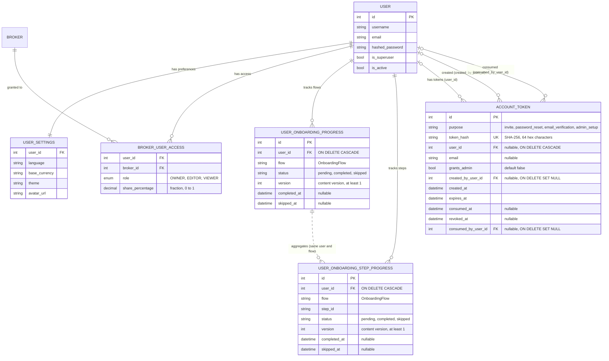

# 👤 Users & Access Control

Manages authentication, user preferences, onboarding progress, single-use account tokens, and the sharing of brokers between users.

## 📐 ER Diagram

## 📋 Tables

### 👤 `USER`

The core identity table. Each user has a unique `username` and `email`. The `hashed_password` is stored using `bcrypt`. The first account registered through `POST /api/v1/auth/register` becomes a superuser (`is_superuser = true`); from the command line, `./dev.py user create` makes a superuser unless given `--role user` (see [Superusers and the User CLI](../access_control.md#superusers)).

Migration `005_accounts_invites` added three columns:

- 🔄 **`session_version`** (`INTEGER NOT NULL DEFAULT 0`): the session generation of the account. Each session
  cookie carries the version it was issued at (the JWT's `sv` claim), and `get_current_user()` refuses, on every
  request, a cookie whose version is not the account's. `user_service.end_sessions()` raises it by one on a password
  change or reset, a deactivation or a demotion, ending every older session of the account. See
  [Session Revocation](../security.md#session-revocation).
- ✅ **`email_verified_at`** (`DATETIME`, nullable): when the email address was verified. The accounts that
  existed before the migration stay `NULL` — not verified, which is true — with no backfill: how they are
  treated once email verification is required is decided in the logic, not in the data (coordinator decision,
  15/10/2026).
- 📰 **`last_seen_version`** (`VARCHAR(40)`, nullable): the release whose changelog the user last saw.

No application code sets `email_verified_at` or `last_seen_version`: every account holds `NULL` in both. The
migration adds the three columns with plain `ALTER TABLE users ADD COLUMN`, never with a
batch: a batch rebuilds `users` — copy, drop the original, rename — and with `foreign_keys=ON` dropping the
original fires the `ON DELETE` actions of every table that references it (the same trap as in
[Post-migration fixes](index.md#post-migration-fixes)). Its downgrade removes them with `DROP COLUMN`, which
rewrites the table in place and fires no foreign-key action.

### ⚙️ `USER_SETTINGS`

One-to-one with `USER`. Stores user-specific preferences: display language, base currency (`base_currency`), theme (`light`, `dark` or `auto`), and avatar URL. When a setting is not defined here, the system falls back to the corresponding `GLOBAL_SETTING`.

### 🌍 `GLOBAL_SETTING`

System-wide configuration managed by the admin. Includes settings like `session_ttl_hours`, `max_file_upload_mb`, and default values for user preferences.

### 🔑 `BROKER_USER_ACCESS`

The pivot table for the Many-to-Many relationship between Users and Brokers. It stores:

- 🛡️ **`role`**: One of `OWNER`, `EDITOR`, or `VIEWER` — see [Access Control (RBAC)](../access_control.md) for the full permission matrix.
- 📊 **`share_percentage`**: The ownership fraction, `NUMERIC(7, 6)` from 0 to 1 (`CHECK` constraint), used for aggregated portfolio calculations (e.g., `0.5` for a joint account). The API exchanges the fraction as-is; the frontend shows it as a percentage.

### 🧭 `USER_ONBOARDING_PROGRESS`

Table `user_onboarding_progress`: one row per user and guided onboarding flow, `UNIQUE (user_id, flow)`
(`uq_user_onboarding_progress_user_flow`). `user_id` references `users.id` with `ON DELETE CASCADE`.

- 🧭 **`flow`** (`VARCHAR(50)`): an `OnboardingFlow` value — `welcome`, `intro_tour`,
  `transactions_page_guide`, `transaction_create_guide`, `transaction_bulk_guide`, `import_guide`,
  `broker_page_guide`, `broker_guide`, `broker_detail_guide`, `fx_page_guide`, `fx_guide`,
  `fx_detail_guide`, `asset_page_guide`, `asset_guide`, `asset_detail_guide`.
- 🚦 **`status`** (`VARCHAR(20)`): an `OnboardingStatus` value — `pending`, `completed` or `skipped` —
  enforced by `CHECK` (`ck_user_onboarding_progress_status`). `completed_at` and `skipped_at` record
  the last terminal transition: the service sets one and clears the other.
- 🔢 **`version`**: the content version the status refers to, `CHECK (version >= 1)`
  (`ck_user_onboarding_progress_version`). The current version of every flow is
  `ONBOARDING_FLOW_VERSIONS` in `backend/app/services/accounts/onboarding_service.py`. A row behind it is
  reported with `update_available` (optional replay); a complete or skip request must send the
  current version as `expected_version`, or it gets `409` `onboarding_version_mismatch`.

Rows are created lazily: reading a user's progress (`GET /api/v1/settings/onboarding`), or any
transition, first inserts the missing flow and step rows as `pending` (`INSERT … ON CONFLICT DO NOTHING`)
and never rewrites an existing row.

### 🪜 `USER_ONBOARDING_STEP_PROGRESS`

Table `user_onboarding_step_progress`: per-step progress of the step-managed flows, those listed in
`ONBOARDING_FLOW_STEPS` — `transaction_bulk_guide` (`transaction.bulk.*` steps) and `import_guide`
(`import.*`, one step per import wizard step plus `import.bulk`). Same columns as the flow table plus
`step_id` (`VARCHAR(100)`), with `UNIQUE (user_id, flow, step_id)`
(`uq_user_onboarding_step_progress_user_flow_step`), the same `status` and `version` checks and the
same cascading foreign key to `users`.

There is no foreign key between the two onboarding tables: a step row belongs to its flow row through
`(user_id, flow)`. For a step-managed flow, the flow row is an aggregate that the service recomputes on
every step transition: `pending` until every registered step is `completed` or `skipped` at the current
version, then `skipped` if all of them were skipped, `completed` otherwise.

!!! note "Existing accounts are grandfathered"

    Migration `004_release_1_2_0_schema` seeds every user that already exists when it runs: `welcome` as
    `completed` (their settings are already configured), the fourteen other flows as `skipped`, and
    `skipped` rows for the steps the migration lists for `transaction_bulk_guide` and `import_guide`.
    `skipped` suppresses the automatic trigger like `completed`, but keeps "never shown this" distinct
    from "went through it", so a flow can still be offered later.

    Users created after the migration get no seeded rows: their `pending` rows appear on the first read
    of their progress. The same lazy insert adds any row the migration did not seed — such as the
    `import.gapFix` step, which is not in the migration's list — for every user.

### 🎟️ `ACCOUNT_TOKEN` {: #account-token }

Table `account_tokens`, created by migration `005_accounts_invites`: one row per single-use account link — an
invitation, a password-reset link, an email verification or the setup link of the initial administrator. The row
holds the SHA-256 of the token, never the token itself. How tokens are issued, checked, spent and revoked is in
[Single-use Account Tokens](../security.md#account-tokens).

- 🎯 **`purpose`** (`VARCHAR(32)`): an `AccountTokenPurpose` value — `invite`, `password_reset`,
  `email_verification` or `admin_setup` — enforced by `CHECK` (`ck_account_tokens_purpose`). A token is looked up
  by hash *and* purpose, so a token of one purpose is never accepted for another.
- 🔐 **`token_hash`** (`VARCHAR(64)`): the SHA-256 of the token, 64 lowercase hex characters, `UNIQUE`
  (`uq_account_tokens_token_hash`). Its unique index serves the lookups.
- 👤 **`user_id`** (nullable): the account the token acts on — password reset, email verification, admin setup.
  `NULL` for an invitation: its account does not exist yet.
- ✉️ **`email`** (nullable): an address stored with the token; an invitation, which has no account yet, may carry
  one.
- 🛡️ **`grants_admin`** (`BOOLEAN NOT NULL`, default false): whether the invitation grants the administrator
  role. Only an invitation may set it: `issue_token()` refuses it for the other purposes.
- ⏳ **`created_at`** and **`expires_at`** (`NOT NULL`), **`consumed_at`** and **`revoked_at`** (nullable): a token
  is valid while it is neither consumed nor revoked and `expires_at` has not been reached. Ending a token sets
  `consumed_at` or `revoked_at`; the row stays.
- 🧾 **`created_by_user_id`** and **`consumed_by_user_id`** (nullable): who issued the token and who spent it.

The three foreign keys reference `users.id`:

| Column | `ON DELETE` | Why |
|--------|-------------|-----|
| `user_id` | `CASCADE` | The token acts on that account: when the account is deleted, its tokens go with it |
| `created_by_user_id` | `SET NULL` | It only records who issued the token: deleting that account keeps the token as it is and forgets the name |
| `consumed_by_user_id` | `SET NULL` | It only records who spent the token, likewise |

Two indexes: `ix_account_tokens_purpose_expires_at` on `(purpose, expires_at)`, and `ix_account_tokens_user_id`
on `user_id`, used by the revocation of an account's tokens and by the cascade when the account is deleted. The
model declares the indexes and constraints in `__table_args__`, under the same names as the migration.

The id is a plain `INTEGER PRIMARY KEY`, without `AUTOINCREMENT`. Decision D1 gives `AUTOINCREMENT` to six
tables, those whose ids leave the backend (`AUTOINCREMENT_TABLES`, see
[Post-migration fixes](index.md#post-migration-fixes)), and `test_autoincrement_schema.py` keeps that census.
The service never deletes a token — consuming or revoking one sets a timestamp — so token ids are not handed out
twice. The one exception is the cascade from a deleted account: if its tokens include the newest ones, the next
tokens issued get their ids again.

`./dev.py test db migration-005` (`backend/test_scripts/test_db/test_migration_005_accounts.py`) checks the table
and the three `users` columns on a new database and on an upgraded 1.2 install, the downgrade (which cascades
into no other table), an upgrade interrupted half way, and that `SQLModel.metadata.create_all` builds the same
`users` and `account_tokens` tables as the migration.

## 🔗 Related Documentation

- 👥 [Users & Roles (Architecture)](../users_and_brokers.md) — Authentication flow, session management, user roles
- 🔐 [Access Control (RBAC)](../access_control.md) — Permission matrix for Owner/Editor/Viewer
- ⚙️ [Settings System](../settings.md) — Global vs user settings, fallback logic
- 🎟️ [Single-use Account Tokens](../security.md#account-tokens) — How the tokens of `account_tokens` are issued, checked, spent and revoked
- 🚪 [From login to the first guide](../../frontend/onboarding.md#layout-gate) — How the app loads onboarding progress, sends the user to Welcome while it is due, and completes or skips it
- 🧑‍🏫 [The contextual import guide](../../frontend/components/features/import-wizard.md#import-guide-wiring) — The step-managed `import_guide` flow in the Import Wizard
