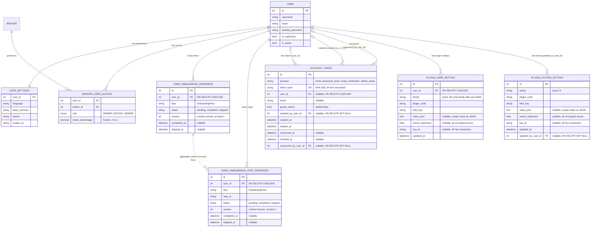

# 👤 Users & Access Control

Manages authentication, user preferences, onboarding progress, single-use account tokens, the sharing of brokers between users, and the stored values of the plugin settings.

## 📐 ER Diagram

## 📋 Tables

### 👤 `USER` {: #user }

The core identity table. Each user has a unique `username`, compared exactly, and a unique `email`, compared regardless of A–Z case (migration `009_email_unique_ignoring_case`, below). Since lot A-21a a new username holds no `@`, since lot A-46 it has 3 to 50 characters whatever the way it is written, `./dev.py user create` included, and a new email address cannot be another account's username, A–Z case aside (`user_service.address_is_a_username()`, a comparison of `lower(username)` that no index serves: an instance has few accounts). All three are checks of the service, not constraints of the table (SQLite does not enforce the `VARCHAR(50)` of the column): the usernames written before keep their `@` or their length, with no migration (see [Which Account an Identifier Names](../security.md#sign-in-identifier)). The `hashed_password` is stored using `bcrypt`. The first account registered through `POST /api/v1/auth/register` becomes a superuser (`is_superuser = true`), whatever the registration mode: registration accepts it while `users` is empty, an inactive account counting as a row (`first_account_open()`); a later one gets the role of its invitation (`grants_admin`), or a regular account without one. From the command line, `./dev.py user create` makes a superuser unless given `--role user` (see [Superusers and the User CLI](../access_control.md#superusers) and [Registration, Invitations and the Admin API](../access_control.md#registration)). With `LIBREFOLIO_ADMIN_EMAIL`, the startup creates the first row itself: a superuser with `is_active` false, whose `hashed_password` is the hash of a random secret nobody knows, until its setup link is spent ([The Initial Administrator](../access_control.md#initial-admin)).

Migration `005_accounts_invites` added three columns:

- 🔄 **`session_version`** (`INTEGER NOT NULL DEFAULT 0`): the session generation of the account. Each session
  cookie carries the version it was issued at (the JWT's `sv` claim), and `get_current_user()` refuses, on every
  request, a cookie whose version is not the account's. `user_service.end_sessions()` raises it by one on a password
  change or reset (a reset link included), an email change, a deactivation or a demotion (from the CLI or the
  administrator API), when an administrator signs the account out everywhere, and when the initial administrator
  spends its setup link, ending every older session of the
  account. See [Session Revocation](../security.md#session-revocation). The first start after a
  [restore](../security.md#backup-restore) gives every account the restore time in milliseconds instead (or one more
  than the largest version either database held, when the clock is behind it): a time, not a counter, which a later
  `end_sessions()` still raises by one.
- ✅ **`email_verified_at`** (`DATETIME`, nullable): when the email address was verified, set by `confirm_email()`
  when an account opens its verification link ([Email Verification](../../backend/email.md#verification)). It is a
  record, not a gate: nothing reads it to let an account in. The accounts that existed before the migration stay
  `NULL` — not verified, which is true — with no backfill, and so do the first account, the accounts created from
  the command line or while the option was off, and an account an administrator activated by hand: the wait is
  decided in the logic (an inactive account holding an unspent verification token), not in this column (coordinator
  decision, 15/10/2026).
  An email change sets it back to `NULL`, in the commit of the new address (`user_service.update_profile()`): the
  verification was of the old address ([Changing the Email](../security.md#email-change)).
- 📰 **`last_seen_version`** (`VARCHAR(40)`, nullable): the release whose changelog the user last saw.

Only `confirm_email()` gives `email_verified_at` a date; nothing sets `last_seen_version`, which every account holds
`NULL`. The
migration adds the three columns with plain `ALTER TABLE users ADD COLUMN`, never with a
batch: a batch rebuilds `users` — copy, drop the original, rename — and with `foreign_keys=ON` dropping the
original fires the `ON DELETE` actions of every table that references it (the same trap as in
[Post-migration fixes](index.md#post-migration-fixes)). Its downgrade removes them with `DROP COLUMN`, which
rewrites the table in place and fires no foreign-key action.

Migration `009_email_unique_ignoring_case` makes the email unique regardless of case (developer decision P18):
`alice@example.com` and `Alice@Example.com` are one address, which only one account can hold. Beside `ix_users_email`,
unique on the address as written, it creates `ux_users_email_lower`, a unique index on `lower(email)`; the model
declares it after the `User` class (`backend/app/db/models.py`), so `create_all` builds it too. SQLite's built-in
`lower()` folds A–Z and nothing else, so letters outside ASCII compare as written: `Émile@example.com` and
`émile@example.com` are two different addresses, a documented limit. `user_service.email_fold()` is the same fold in
Python, and `same_email()` compares two addresses with it. `get_user_by_email()` and the email half of
`get_user_by_username_or_email()` — tried first, and only for an identifier holding `@` (lot A-21a) — compare
`lower(email)`, so sign-in, «forgot password» and the duplicate checks of
`create_user()` and `update_profile()` find an address whatever its case; the username half stays exact. The stored
email keeps the form last written: its owner changing its case alone is no email change
([Changing the Email](../security.md#email-change)).

Before writing anything, the upgrade groups the accounts by that fold. If two accounts share an address apart from
case, it stops with a `RuntimeError` that names them as `#id 'username'`, never by address (workstream E's rule: no
address in a log), and gives the remedy: `./dev.py user set-email <username> <address>` on all but one account of each
group (what the administrator does: [Command-Line Tools](../../../admin/cli_tools.md), «Two Accounts with the Same
Email Address»). No account is changed, and accounts are never merged. Otherwise it creates the index. On SQLite
Alembic commits each revision on its own (no transactional DDL), so a stop leaves the revisions before 009 applied: an
install upgraded from an earlier release stays at `008_registration_invite_default`, where `set-email` works (the 1.3
model needs nothing 009 adds), and the next start resumes at 009. The upgrade checks before it acts, so it can
run again; the downgrade drops the index. `./dev.py test db migration-009`
(`backend/test_scripts/test_db/test_migration_009_email_case.py`) covers it on temporary databases, the `set-email`
remedy included, and `./dev.py test services email-case` (`backend/test_scripts/test_services/test_email_case.py`)
the fold, the index and the lookups.

### ⚙️ `USER_SETTINGS`

One-to-one with `USER`. Stores user-specific preferences: display language, base currency (`base_currency`), theme (`light`, `dark` or `auto`), and avatar URL. When a setting is not defined here, the system falls back to the corresponding `GLOBAL_SETTING`.

### 🌍 `GLOBAL_SETTING` {: #global-setting }

System-wide configuration managed by the admin. Includes settings like `session_ttl_hours`, `max_file_upload_mb`, `registration_mode` (who may create an account), and default values for user preferences. The startup seeding creates only the rows that are missing, each with its default from `GLOBAL_SETTINGS_DEFAULTS`: for `registration_mode`, `invite` since decision 36. The startup step that creates the [initial administrator](../access_control.md#initial-admin) writes `registration_mode` = `invite` too, in the same transaction, with `updated_by_user_id` `NULL`.

Migration `006_registration_mode` changes data only: the row `enable_registration` (`bool`) becomes
`registration_mode` (`value_type` `str`). The new value is `open` when the old one, lower-cased, was `true`, `1`,
`yes` or `on` — what the settings service read as true — and `disabled` otherwise, so an odd value stays closed; the
`updated_at` and `updated_by_user_id` of the row are kept. A database without the old row has nothing to convert: if
it already holds accounts, `008_registration_invite_default` writes `open`; otherwise the startup seeding creates
`registration_mode` with its default, `invite`. The downgrade writes `true` for `open`, and
`false` for `invite` and `disabled`, since the old setting had no middle ground. Each direction checks before it acts,
so an interrupted run can be repeated. `./dev.py test db migration-006`
(`backend/test_scripts/test_db/test_migration_006_registration.py`) covers both directions, the metadata and the
idempotence, on temporary databases.

Migration `008_registration_invite_default` changes data only too: an install upgraded with accounts keeps the
registration it had. Releases before the `invite` default read a missing row as open, so where `registration_mode`
is missing and `users` holds at least one row, active or not, it inserts `registration_mode` = `open`, the earlier
default made explicit: `value_type` `str`, the registry's description (a copy frozen in the migration), `updated_at`
the time of the upgrade, `updated_by_user_id` `NULL`. The migration runs at the `database` step of the startup, before
the seeding of the `global-settings` step could write the new default. A row that is there is never touched, whatever
its value, and a database without accounts gets nothing: it is a new install, and the seeding gives it `invite`. The
upgrade checks before it acts, so it can run again; the downgrade does nothing, since an `open` row is what the
earlier default meant (006's downgrade turns it into `enable_registration` = `true`). `./dev.py test db migration-008`
(`backend/test_scripts/test_db/test_migration_008_registration_default.py`) covers it on temporary databases, a
1.1 install taken to the head included.

### 🏢 `PLUGIN_SYSTEM_SETTING` {: #plugin-system-setting }

Table `plugin_system_settings`, created by migration `007_plugin_settings`: one row per plugin setting of the whole
instance (a `system` field), written by an administrator. What the plugins declare, and how the values are resolved,
encrypted and delivered to a call, is in [Plugin Settings](../patterns/plugin_settings.md).

- 🏷️ **`family`** (`VARCHAR(16)`), **`plugin_code`** and **`field_key`** (`VARCHAR(64)`): the field, `UNIQUE (family,
  plugin_code, field_key)` (`uq_plugin_system_settings_field`). `family` is `asset` or `fx`.
- 📝 **`value_json`** (`TEXT`, nullable): a plain value, as JSON.
- 🔐 **`secret_ciphertext`** (`BLOB`, nullable): a secret, encrypted with AES-256-GCM under a key derived from the
  [instance key](../security.md#instance-key) and bound to its row.
- 🗝️ **`key_id`** (`VARCHAR(32)`, nullable): the id of the key that encrypted the secret, 32 hex characters. A changed
  instance key shows as another id, without decrypting anything.
- ⏱️ **`updated_at`** (`DATETIME NOT NULL`): when the value last changed.
- 🧾 **`updated_by_user_id`** (nullable): the administrator who wrote it.

Two `CHECK` constraints keep each row consistent:

| Constraint | Expression | Meaning |
|------------|------------|---------|
| `ck_plugin_system_settings_one_value` | `(value_json IS NULL) <> (secret_ciphertext IS NULL)` | Exactly one of the plain value and the ciphertext |
| `ck_plugin_system_settings_key_id` | `(secret_ciphertext IS NULL) = (key_id IS NULL)` | A `key_id` if and only if there is a ciphertext |

`updated_by_user_id` references `users.id` with `ON DELETE SET NULL`: deleting that administrator keeps the value and
forgets who wrote it. A value given by an environment variable is never stored here: a variable that is set wins over
the row. Clearing a field deletes its row. Rows of fields that no plugin declares any more stay, ignored.

### 🙋 `PLUGIN_USER_SETTING` {: #plugin-user-setting }

Table `plugin_user_settings`, created by the same migration: one row per user and plugin setting of that user (a
`user` field), written by that user only. No endpoint shows these rows to anyone else, an administrator included. The
same columns as `plugin_system_settings`, without `updated_by_user_id`, plus:

- 👤 **`user_id`** (`NOT NULL`): the owner. It references `users.id` with `ON DELETE CASCADE`: the rows go with the
  account. It is part of the row the encryption binds a secret to, so a ciphertext copied to another user's row does
  not decrypt.

`UNIQUE (user_id, family, plugin_code, field_key)` (`uq_plugin_user_settings_field`), and the same two checks:
`ck_plugin_user_settings_one_value` and `ck_plugin_user_settings_key_id`.

Two tables rather than one with a nullable `user_id`: in SQLite NULLs never collide in a `UNIQUE` constraint, so one
table would need two partial unique indexes, which nothing else in the schema uses. The unique constraints are the
only indexes: their leading columns serve the reads of one plugin's rows and, in `plugin_user_settings`, of one user's
rows and the cascade. The ids are plain `INTEGER PRIMARY KEY`, without `AUTOINCREMENT`: no row id leaves the backend.

Migration `007_plugin_settings` creates both tables empty: no setting existed before. The downgrade drops them, and
the values and secrets in them are lost. Each direction checks before it acts, so a run that stopped half way can be
run again.

### 🔑 `BROKER_USER_ACCESS`

The pivot table for the Many-to-Many relationship between Users and Brokers. It stores:

- 🛡️ **`role`**: One of `OWNER`, `EDITOR`, or `VIEWER` — see [Access Control (RBAC)](../access_control.md) for the full permission matrix.
- 📊 **`share_percentage`**: The ownership fraction, `NUMERIC(7, 6)` from 0 to 1 (`CHECK` constraint), used for aggregated portfolio calculations (e.g., `0.5` for a joint account). The API exchanges the fraction as-is; the frontend shows it as a percentage.

### 🧭 `USER_ONBOARDING_PROGRESS`

Table `user_onboarding_progress`: one row per user and guided onboarding flow, `UNIQUE (user_id, flow)`
(`uq_user_onboarding_progress_user_flow`). `user_id` references `users.id` with `ON DELETE CASCADE`.

- 🧭 **`flow`** (`VARCHAR(50)`): an `OnboardingFlow` value — `welcome`, `intro_tour`,
  `transactions_page_guide`, `transaction_create_guide`, `transaction_bulk_guide`, `import_guide`,
  `broker_page_guide`, `broker_guide`, `broker_detail_guide`, `fx_page_guide`, `fx_guide`,
  `fx_detail_guide`, `asset_page_guide`, `asset_guide`, `asset_detail_guide`.
- 🚦 **`status`** (`VARCHAR(20)`): an `OnboardingStatus` value — `pending`, `completed` or `skipped` —
  enforced by `CHECK` (`ck_user_onboarding_progress_status`). `completed_at` and `skipped_at` record
  the last terminal transition: the service sets one and clears the other.
- 🔢 **`version`**: the content version the status refers to, `CHECK (version >= 1)`
  (`ck_user_onboarding_progress_version`). The current version of every flow is
  `ONBOARDING_FLOW_VERSIONS` in `backend/app/services/accounts/onboarding_service.py`. A row behind it is
  reported with `update_available` (optional replay); a complete or skip request must send the
  current version as `expected_version`, or it gets `409` `onboarding_version_mismatch`.

Rows are created lazily: reading a user's progress (`GET /api/v1/settings/onboarding`), or any
transition, first inserts the missing flow and step rows as `pending` (`INSERT … ON CONFLICT DO NOTHING`)
and never rewrites an existing row.

### 🪜 `USER_ONBOARDING_STEP_PROGRESS`

Table `user_onboarding_step_progress`: per-step progress of the step-managed flows, those listed in
`ONBOARDING_FLOW_STEPS` — `transaction_bulk_guide` (`transaction.bulk.*` steps) and `import_guide`
(`import.*`, one step per import wizard step plus `import.bulk`). Same columns as the flow table plus
`step_id` (`VARCHAR(100)`), with `UNIQUE (user_id, flow, step_id)`
(`uq_user_onboarding_step_progress_user_flow_step`), the same `status` and `version` checks and the
same cascading foreign key to `users`.

There is no foreign key between the two onboarding tables: a step row belongs to its flow row through
`(user_id, flow)`. For a step-managed flow, the flow row is an aggregate that the service recomputes on
every step transition: `pending` until every registered step is `completed` or `skipped` at the current
version, then `skipped` if all of them were skipped, `completed` otherwise.

!!! note "Existing accounts are grandfathered"

    Migration `004_release_1_2_0_schema` seeds every user that already exists when it runs: `welcome` as
    `completed` (their settings are already configured), the fourteen other flows as `skipped`, and
    `skipped` rows for the steps the migration lists for `transaction_bulk_guide` and `import_guide`.
    `skipped` suppresses the automatic trigger like `completed`, but keeps "never shown this" distinct
    from "went through it", so a flow can still be offered later.

    Users created after the migration get no seeded rows: their `pending` rows appear on the first read
    of their progress. The same lazy insert adds any row the migration did not seed — such as the
    `import.gapFix` step, which is not in the migration's list — for every user.

### 🎟️ `ACCOUNT_TOKEN` {: #account-token }

Table `account_tokens`, created by migration `005_accounts_invites`: one row per single-use account link — an
invitation, a password-reset link, an email verification or the setup link of the initial administrator. The row
holds the SHA-256 of the token, never the token itself. How tokens are issued, checked, spent and revoked is in
[Single-use Account Tokens](../security.md#account-tokens).

- 🎯 **`purpose`** (`VARCHAR(32)`): an `AccountTokenPurpose` value — `invite`, `password_reset`,
  `email_verification` or `admin_setup` — enforced by `CHECK` (`ck_account_tokens_purpose`). A token is looked up
  by hash *and* purpose, so a token of one purpose is never accepted for another.
- 🔐 **`token_hash`** (`VARCHAR(64)`): the SHA-256 of the token, 64 lowercase hex characters, `UNIQUE`
  (`uq_account_tokens_token_hash`). Its unique index serves the lookups.
- 👤 **`user_id`** (nullable): the account the token acts on — password reset, email verification, admin setup.
  `NULL` for an invitation: its account does not exist yet.
- ✉️ **`email`** (nullable): an address stored with the token; an invitation, which has no account yet, may carry
  one.
- 🛡️ **`grants_admin`** (`BOOLEAN NOT NULL`, default false): whether the invitation grants the administrator
  role. Only an invitation may set it: `issue_token()` refuses it for the other purposes.
- ⏳ **`created_at`** and **`expires_at`** (`NOT NULL`), **`consumed_at`** and **`revoked_at`** (nullable): a token
  is valid while it is neither consumed nor revoked and `expires_at` has not been reached. Ending a token sets
  `consumed_at` or `revoked_at`, or both when a setup link is retired
  ([Revocation](../security.md#account-token-revocation)); the row stays.
- 🧾 **`created_by_user_id`** and **`consumed_by_user_id`** (nullable): who issued the token and who spent it.

The three foreign keys reference `users.id`:

| Column | `ON DELETE` | Why |
|--------|-------------|-----|
| `user_id` | `CASCADE` | The token acts on that account: when the account is deleted, its tokens go with it |
| `created_by_user_id` | `SET NULL` | It only records who issued the token: deleting that account keeps the token as it is and forgets the name |
| `consumed_by_user_id` | `SET NULL` | It only records who spent the token, likewise |

Three purposes are in use, with the rules of
[Registration, Invitations and the Admin API](../access_control.md#registration) and of
[The Initial Administrator](../access_control.md#initial-admin). This is how they use the table:

| | `invite` | `password_reset` | `admin_setup` |
|---|---|---|---|
| `user_id` | `NULL` | The account whose password the link resets | The administrator waiting for its setup |
| `email` | What the administrator wrote, if anything: a note, never compared with the address of the new account | `NULL` | `NULL` |
| `grants_admin` | Whether the account it opens is an administrator | false | false |
| `created_by_user_id` | The administrator who created it; `NULL` from the command line | The same | `NULL`: the startup or the command line issues it |
| Issuing | While live, it takes a place of the user limit (`user_usage()` counts the live invitations) | First revokes the account's live reset links | By the startup that creates the administrator, with the token of `LIBREFOLIO_ADMIN_BOOTSTRAP_TOKEN` or a generated one; a new value of that variable and `./dev.py user setup-link` first revoke the earlier setup links, then read «waiting» again under the write lock that revocation took: an account set up in the meantime gets no new link (lot A-42) |
| `consumed_at`, `consumed_by_user_id` | Set by the registration that creates the account, to that account, in the same transaction | Set by `POST /api/v1/auth/password-reset`; `consumed_by_user_id` stays `NULL`, as the account is `user_id` | Set by `POST /api/v1/auth/setup`, `consumed_by_user_id` to the account, in the commit that activates it. `consumed_at` alone, `consumed_by_user_id` staying `NULL`, on every setup link not yet consumed when the account's setup links are retired: the account set up another way; a link presented for it while it is already active, or once another of its setup links was consumed (lot A-42), the one presented included; the deactivation of an account that does not wait for its setup (lot A-43). Never by the cancellation of the waiting administrator's link: its links stay unconsumed, so it still waits |
| `revoked_at` | Set by `DELETE /api/v1/users/invites/{invite_id}` | Set on the account's other live reset links when a new link is issued, or when one is spent | Set on the earlier setup links, expired ones included, when a new one is issued; on the other ones when one is spent; on those neither consumed nor revoked, expired ones included, when the account's address really changes, and when the administrator waiting for its setup is deactivated, the cancellation of its link (lot A-43; `PATCH /api/v1/users/{user_id}` with `is_active: false`, refused for a protected account, or `./dev.py user deactivate`); on every one not consumed, unless already set, when the setup links are retired |

Two indexes: `ix_account_tokens_purpose_expires_at` on `(purpose, expires_at)`, and `ix_account_tokens_user_id`
on `user_id`, used by the revocation of an account's tokens and by the cascade when the account is deleted. The
model declares the indexes and constraints in `__table_args__`, under the same names as the migration.

The id is a plain `INTEGER PRIMARY KEY`, without `AUTOINCREMENT`. Decision D1 gives `AUTOINCREMENT` to six
tables, those whose ids leave the backend (`AUTOINCREMENT_TABLES`, see
[Post-migration fixes](index.md#post-migration-fixes)), and `test_autoincrement_schema.py` keeps that census.
The service never deletes a token — consuming or revoking one sets a timestamp — so token ids are not handed out
twice. The one exception is the cascade from a deleted account: if its tokens include the newest ones, the next
tokens issued get their ids again.

`./dev.py test db migration-005` (`backend/test_scripts/test_db/test_migration_005_accounts.py`) checks the table
and the three `users` columns on a new database and on an upgraded 1.2 install, the downgrade (which cascades
into no other table), an upgrade interrupted half way, and that `SQLModel.metadata.create_all` builds the same
`users` and `account_tokens` tables as the migration.

## 🔗 Related Documentation

- 👥 [Users & Roles (Architecture)](../users_and_brokers.md) — Authentication flow, session management, user roles
- 🔐 [Access Control (RBAC)](../access_control.md) — Permission matrix for Owner/Editor/Viewer
- ⚙️ [Settings System](../settings.md) — Global vs user settings, fallback logic
- 🧩 [Plugin Settings](../patterns/plugin_settings.md) — What the plugins declare, and how the values of `plugin_system_settings` and `plugin_user_settings` are resolved, encrypted and delivered
- 🎟️ [Single-use Account Tokens](../security.md#account-tokens) — How the tokens of `account_tokens` are issued, checked, spent and revoked
- ✉️ [Registration, Invitations and the Admin API](../access_control.md#registration) — Who may register, the user limit, invitations and reset links
- 🚪 [From login to the first guide](../../frontend/onboarding.md#layout-gate) — How the app loads onboarding progress, sends the user to Welcome while it is due, and completes or skips it
- 🧑‍🏫 [The contextual import guide](../../frontend/components/features/import-wizard.md#import-guide-wiring) — The step-managed `import_guide` flow in the Import Wizard
