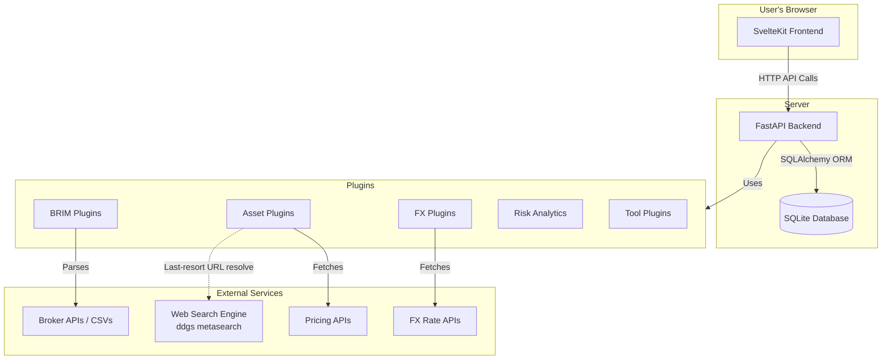
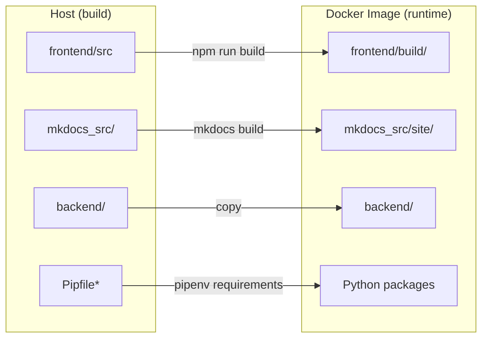

# 🏗️ System Architecture Overview

LibreFolio is designed as a modern web application with a clear separation between the backend API and the frontend user interface.

## 🗺️ High-Level Diagram

The architecture can be visualized as three main components:

### 🧱 Components

1. 🖥️ **Frontend (SvelteKit)**: A single-page application (SPA) that runs in the user's browser. It communicates with the backend via a RESTful API to fetch and display data.

2. ⚙️ **Backend (FastAPI)**: A Python-based API server that handles all business logic, including:
    - 🔐 User authentication and authorization.
    - 🗃️ Database operations (CRUD).
    - 📥 Data import from brokers (BRIM).
    - 📈 Fetching asset prices and FX rates from external sources.

3. 🗄️ **Database (SQLite)**: A single-file database that stores all user data, including transactions, assets, user settings, and cached data.

4. 🔌 **Provider Plugins**: A system of pluggable modules that abstract the interaction with external data sources. This makes it easy to add support for new brokers, pricing APIs, or FX rate providers without modifying the core application logic. The same registry mechanism also discovers plugins that call no external service: the [risk analytics](../backend/risk/architecture.md) and the [Tools](patterns/tool_plugins.md).

## 🔑 Key Subsystems

For detailed architectural documentation of specific subsystems, see:

- 🗃️ **[Database Schema](database/index.md)**: Data models and relationships.
- 👤 **[Users & Brokers](users_and_brokers.md)**: Authentication and multi-user access control.
- 🔐 **[Access Control (RBAC)](access_control.md)**: Role-based broker access (Owner/Editor/Viewer).
- ⚙️ **[Settings System](settings.md)**: User preferences and global settings.
- 📥 **[BRIM Architecture](../backend/brim/architecture.md)**: Broker Report Import Manager.
- 📈 **[Asset Pricing](../backend/assets/architecture.md)**: Asset data fetching and metadata.
    - 🔎 See also: **[Asset Search & Link-Finder](../backend/assets/search_link_finder.md)** for the three-layer interactive search (on-site → `ddgs` web link-finder → `resolve_url`); best-effort, last-resort, and **never** used on automated price fetches.
- 💱 **[FX Architecture](../backend/fx/architecture.md)**: Foreign Exchange system.
    - 🔀 See also: **[FX Configuration & Routing](../backend/fx/configuration.md)** for multi-provider setup.
- 🧮 **[Financial Math Layer](../backend/financial_math.md)**: `backend/app/services/financial_math/`, the one home of financial calculations — package map, layer rules, guards.
- 📉 **[Risk Engine](../backend/risk/architecture.md)**: Bulk risk analytics over a portfolio, a broker, an asset or a selection of assets — plugin catalogue, eligibility verdicts, and simulation and optimization in spawned worker pools.
- 🧰 **[Tool Plugins](patterns/tool_plugins.md)**: Atomic, typed calculations behind a versioned catalogue (first tool: the PAC allocator), each computed in a spawned process the executor owns.
- 🧭 **[Onboarding Guides](../frontend/onboarding.md)**: Welcome setup, intro tour and contextual guides, with versioned per-user progress kept by the backend.
- 📁 **File Upload System**: Custom uploads stored with a JSON metadata sidecar, and the default avatars seeded at startup (`backend/app/services/files/static_uploads.py`); image previews go through an in-memory cache (`PreviewCache` in `backend/app/api/v1/uploads.py`: 50 MB by default, `PREVIEW_CACHE_MAX_MB`, entries expire after 1 hour). Broker report files belong to [BRIM](../backend/brim/architecture.md). Where all these files live: [Data Directory on Disk](database/index.md#data-directory).

## 🔄 Request Flow Example: Displaying Portfolio

1. User logs in and navigates to the dashboard.
2. The **Frontend** makes an API request to `GET /api/v1/portfolio`.
3. The **Backend** receives the request, authenticates the user, and queries the **Database** for the user's transactions.
4. For each asset, the backend may need to fetch the latest price. It calls the appropriate **Asset Provider Plugin** (e.g., Yahoo Finance).
5. If currency conversion is needed, the backend calls the **FX Provider Plugin** to get the latest exchange rate.
6. The backend processes the data, calculates portfolio metrics, and returns a JSON response to the frontend.
7. The **Frontend** receives the JSON data and renders the portfolio dashboard.

## 🚀 Server Startup {: #server-startup }

`backend/app/main.py` sets up the test mode and the logging, then builds the app: `FastAPI(..., lifespan=lifespan)`, `install_middleware(app)`, `install_validation_error_handler(app)` (`backend/app/api/validation_errors.py`: a `422` that never sends the request's input back, see [Validation Errors Without the Input](security.md#validation-errors)), `install_response_validation_handler(app)` (`backend/app/api/response_validation.py`: a response that breaks its model is logged without its content, see [Request Logs](security.md#request-logs)), `install_server_error_handler(app)` (`backend/app/api/server_errors.py`: a `5xx` answers with the request id and the type of its failure, and its cause reaches the log once, see [Error Answers](security.md#error-answers)), the API v1 router under `API_V1_PREFIX`, and `install_static_site(app)` (`backend/app/services/platform/static_site.py`). The latter registers the documentation (`/mkdocs`), `/`, the `/_app` chunks when the frontend build has them and, last, the SPA catch-all `GET /{path:path}`: a GET route added after it would never be reached. The catch-all serves the file of `frontend/build/` that the path names, once its `..` segments are resolved (`/assets/../favicon.png` is served); a path that would leave the build (`confined_path()`), or whose resolved location inside the build has a name starting with `.` (`_hidden_in_build()`: the build's markers `.build-debug`, `.build-version` and `.tool-contract-inputs`, the emoji font's `.cache_manifest.json`), gets the SPA fallback instead, `200.html`, else `index.html` (tests: `./dev.py test utils static-route-confinement`). The `/_app` mount and `/mkdocs/{path}` refuse a path with a name starting with `.` too (`/mkdocs/{path}` through `_hidden_below()`, which `_hidden_in_build()` uses; the mount checks the names of the path Starlette hands it; same tests), each with its own 404: the mount answers as for a missing file, once Starlette has resolved the `..` segments (`/_app/immutable/../.DS_Store` names the build's `_app/.DS_Store`), and `/mkdocs/{path}` answers the documentation's 404, as for a path leaving `mkdocs_src/site/`. `backend.app.main:app` stays uvicorn's entry point.

**Browser caching.** The static site gives each kind of file its own `Cache-Control` (`static_site.py`; tests: `./dev.py test services static-cache-policy`):

- **Revalidated**, `no-cache, must-revalidate` (`REVALIDATE_HTML`): every HTML document, of the web app's build (`index.html`, the SPA fallback `200.html`, `offline.html`) or of `/mkdocs`, and every file of `/_app` outside `/_app/immutable/` (today `env.js` and `version.json`), whose name does not change with its content. The browser checks with the server before it reuses its copy, so it picks up a new build at its next load.
- **Kept for a year**, `public, max-age=31536000, immutable` (`IMMUTABLE_CACHE_CONTROL`): the chunks under `/_app/immutable/`, whose names change with their content.
- **No `Cache-Control`**: any other file of the build or of the documentation (icons, fonts, the manifest, the documentation's style sheets, scripts and images); the browser may keep it by heuristic freshness, from its `Last-Modified`.
- **Private**, `private, max-age=3600`, outside the static site: the image previews of uploads (`GET /api/v1/uploads/file/{id}?img_preview=WxH`), which the browser may reuse for an hour and a shared cache must not store; see [Uploaded Files: Common and Personal](security.md#upload-scope).

In the static site, only the `/_app` mount (`ImmutableStaticFiles`, a `StaticFiles`) answers `304 Not Modified` when the browser's copy is current, and its `304` keeps the file's `Cache-Control`. The other files come from a route's `FileResponse`, which answers no `304`, so an HTML document is sent whole each time. All these responses also carry the [security headers](security.md#response-headers), and `install_static_site()` first calls `register_served_types()`, so that every file served goes out with its right MIME type, which `nosniff` requires.

The lifespan (`lifespan()` in `backend/app/services/platform/app_lifespan.py`) prepares everything before the first request by running `STARTUP_STEPS`, in this order:

1. `shutdown-watchdog`: installs the shutdown watchdog (`install_shutdown_watchdog()`, in `shutdown_budget.py`), only where uvicorn serves from the main thread with its own signal handlers and the budget is not 0. The first SIGTERM or SIGINT arms it: when the budget runs out, it logs `Shutdown budget exhausted: ending the process`, ends the child processes and exits with status 1, whatever still holds the server.
2. `announce`: logs `Starting LibreFolio` with the version, the database path and the test mode.
3. `configuration-checks`: runs the [configuration checks](security.md#configuration-checks) (`log_configuration_audit()`, in a thread): a configured secret that cannot be used stops the server, every other finding is logged.
4. `signal-plugins`: checks the signal-plugin runtime (`validate_signal_runtime()`) and discovers the signal plugins.
5. `tool-catalog`: loads the [Tool](patterns/tool_plugins.md) catalogue (`ToolPluginRegistry.get_snapshot()`, in a thread).
6. `pending-restore`: applies a [restore](security.md#backup-restore) confirmed for the next start (`apply_pending_restore()`, in `backend/app/services/platform/instance_backup/apply.py`, in a thread), before any step reads the data: it swaps the folders with the checked copy ([The Swap](security.md#backup-restore-swap)), leaves the restore waiting with its reason, or undoes a swap a start that was killed left half done.
7. `data-directories`: creates the [data directories](database/index.md#data-directory) (`ensure_data_dirs()`).
8. `serving-lock`: takes the shared serving lock on the data directory (`hold_serving_lock()`, in a thread), held until the process exits: from here on no restore swaps or undoes the data under this process.
9. `risk-scenarios`: loads the [risk](../backend/risk/architecture.md) scenario catalogue (`initialize_risk_scenario_catalog()`).
10. `default-avatars`: seeds the default avatars (`seed_default_avatars()`).
11. `database`: creates or [migrates](database/index.md#migrations) the database (`ensure_database_exists()` in `database_bootstrap.py`); a failed `alembic upgrade head` stops the server (`sys.exit(1)`).
12. `post-migration-fixes`: runs the [post-migration fixes](database/index.md#post-migration-fixes) in a thread; they never stop the startup.
13. `lone-transfer-legs`: turns the [lone giving legs](database/index.md#lone-transfer-legs) of `TRANSFER`s that older broker deletions left into `ADJUSTMENT`s taking the units out, without a value (decision 47, N78-1; `convert_lone_giving_legs_at_startup()`). With something to convert, it first runs `PRAGMA quick_check` and leaves a damaged database as it is; it never stops the startup.
14. `global-settings`: seeds the missing [global settings](settings.md) (`_initialize_global_settings()`).
15. `admin-bootstrap`: applies the variables of the [initial administrator](access_control.md#initial-admin) (`startup_admin_bootstrap()`, in `backend/app/services/accounts/bootstrap_admin_service.py`): on an instance without accounts it creates the administrator, inactive, with its setup link; a generated link goes out by email in a background task, so the step never waits for the mail server.
16. `restore-commit`: completes a restore this start applied (`finish_pending_restore()`, in a thread): every session ends, the backup's one-time links are revoked, and the restore is recorded as committed. A step before it that raises rolls the restore back at the next start; one after it no longer does (decision N57).
17. `backup-leftovers`: removes what runs of the backup killed outright left in clear (`sweep_backup_leftovers()`, in `backend/app/services/platform/instance_backup/leftovers.py`, in a thread; decision N66): the checks a stopped server left running and the decrypted archives in the copies, the folders of a `dev.py backup inspect` older than an hour, the work files of the backups that died with their process, and the backups past their hour ([What a Run Killed Outright Leaves](security.md#backup-leftovers)). It never touches what a running process holds, nor anything through a link. It never raises, since after `restore-commit` a step that raises would stop every start: a part that fails is logged as an error, and the others still run.
18. `plugin-secrets-check`: runs the [plugin secrets check](security.md#plugin-secrets-check) (`log_plugin_secrets_check()`): stored system secrets of the plugin settings that the instance key cannot read are one error in the log, with their count; it never stops the startup.
19. `stored-currencies`: once the repairs are done and the restore is settled, starts the audit of the stored currency codes in the background, in a worker thread, and goes on at once (`log_stored_currency_audit()` in `backend/app/services/platform/stored_currencies.py`): its scans take about 0.6 s at a million price rows. Read-only, on a connection with `trusted_schema` off, it logs one warning when the database holds currency codes that are not ISO 4217 codes (admin guide, [Command-Line Tools](../../admin/cli_tools.md), «Currency Codes That Are Not ISO Codes»), names or numbers an earlier version saved as written. It reports on the data, so it starts after `restore-commit` (decision N57); it never stops the startup.
20. `provider-prewarm`: starts the provider cache pre-warm in the background (`_prewarm_provider_caches()`).
21. `market-holidays`: starts building the market-holiday table in the background, in its own process (`start_market_holiday_prewarm()`).
22. `brim-parse-pool`: with the [warm-up](../backend/brim/architecture.md#parse-pool-warm-up) on (`brim_prewarm_enabled()` in `backend/app/config/brim.py`, from `LIBREFOLIO_BRIM_PREWARM`: off by default, on in test mode), starts the BRIM parse pool's forkserver in the background, in a worker thread (`prewarm()` in `backend/app/services/brim/brim_parse_pool.py`), preloaded with the BRIM module and its plugins: the first parse after a start then forks a ready worker. Off, the step does nothing; a value it cannot use is logged as a warning and starts nothing either. It never stops the startup: a failed warm-up is logged, and the first parse starts the forkserver, as with the warm-up off.
23. `scheduler`: starts the [scheduler](../backend/scheduler.md) task (`scheduler_loop()`).
24. `idle-monitor`: only with `LIBREFOLIO_IDLE_SUSPEND_MODE=fly`, registers the busy checks `tools` and `backup` on the activity record and starts the idle monitor task (`start_idle_monitor()`, in `sleep_wake/idle_monitor.py`), which asks Fly.io to suspend the machine when nothing is busy and no user's request has come for `LIBREFOLIO_IDLE_SUSPEND_MINUTES` ([Idle Suspension](../../admin/sleep_wake.md#idle-suspend)).

On shutdown, the lifespan's `finally` runs `FINALLY_STEPS`: `tool-executor` stops the Tool executor, also when serving ended with an error. Then, only after a normal end, it logs `Shutting down LibreFolio` and runs `SHUTDOWN_STEPS`: `idle-monitor` (sets the idle monitor's stop event and awaits its task, when it runs), `scheduler` (sets the scheduler's stop event and awaits its task), `providers` (the asset, FX and BRIM providers), `brim-parse-pool`, `quant-pools`, `market-holidays` (ends any holiday build at once), `caches` (closes the TTL caches) and `child-processes` (terminates the child processes still alive, such as parse, risk and Tool workers, so that none outlives the server; only where the watchdog is installed).

### 🧩 Steps and Middleware: the Contract {: #lifecycle-contract }

`backend/app/services/platform/lifecycle.py` runs the steps; it imports nothing of the app.

- **Adding a step** takes one line at its place in `STARTUP_STEPS`, `SHUTDOWN_STEPS` or `FINALLY_STEPS`: `Step("my-step", lambda: my_function())`. `run` returns `None` or an awaitable (a coroutine, a `Task`), which the runner awaits; a blocking startup call goes through `asyncio.to_thread()`, as `post-migration-fixes` does. The lambda finds `my_function` in `app_lifespan` when the step runs, so a test replaces it with `monkeypatch.setattr(app_lifespan, "my_function", ...)`.
- **Startup** (`run_startup_steps()`): each step runs to its end, in order. An exception stops the startup, and no shutdown step runs.
- **Shutdown order** is declared, not derived: `SHUTDOWN_STEPS` is not the reverse of `STARTUP_STEPS`, and a step that must also run after a serving error belongs in `FINALLY_STEPS`.
- **Shutdown** (`run_shutdown_steps(steps, deadline)`): a step that raises is logged as an error (`Shutdown step failed`) and the next step runs anyway. `deadline` is an instant on `time.monotonic()`: the lifespan's `finally` gets it once from `shutdown_deadline()` (`backend/app/services/platform/shutdown_budget.py`) and gives it to both `FINALLY_STEPS` and `SHUTDOWN_STEPS`. After a SIGTERM or a SIGINT in a process where the shutdown watchdog is installed, it is the watchdog's deadline (the signal plus the budget) less `CLEANUP_MARGIN_SECONDS` (0.75 s), kept for the last step. Without a signal, or without a watchdog, it is the current time plus the budget less uvicorn's drain share (`shutdown_drain_seconds()`: 3/8 of the budget, at least 1 s), worked out at each call. The budget is `LIBREFOLIO_SHUTDOWN_TIMEOUT_SECONDS`, 8 s by default: 0 means no limit, and then `shutdown_deadline()` returns `None` and no step is ever cut; a value that cannot be used is logged once and the 8 s apply (see *Stopping the Server* in [Configuration](../../admin/configuration.md)). Under a deadline, each step gets the time left, never less than `MIN_STEP_SECONDS` (0.2 s), so the short steps still run after an overrun; a step past its time is cut (the coroutine or task it awaits is cancelled) and logged as a warning (`Shutdown step cut by the deadline`). The runner returns one `StepOutcome` per step.
- **`blocking=True`** marks a synchronous call that may block (`brim-parse-pool`): under a deadline `run()` is called in a worker thread, so the deadline holds; the thread cannot be stopped, and the sequence moves on without it. What `run()` returns is awaited as for any step. Without a deadline, and at startup, the flag changes nothing. A synchronous step without it runs on the event loop, where a deadline cannot cut it.
- **`current_step()`** names the step in progress, `startup:<name>` or `shutdown:<name>`, and is `None` between steps and while the app serves: a watchdog thread can read it to name a step that hangs.
- **Adding a middleware** takes one `MiddlewareEntry(name, cls, options)` at its place in `MIDDLEWARE_STACK` (`backend/app/services/platform/middleware.py`). The first entry is the outermost, the first to see a request and the last to see its response: `activity` (`ActivityMiddleware`, `backend/app/services/platform/sleep_wake/activity.py`: the user's presence and the requests in flight; outermost, so that it sees every request first and counts the compression of a response as in flight, while the probes are not counted, and the scheduled wake-up, `/system/wake-sync` (`WAKE_PATHS`), is counted as in flight but never as the user's presence, as are the hosting panel's routes under `/backup/panel/` and `/panel/` (`PANEL_PATH_PREFIXES`, lot H-61)), then `request_id` (`RequestIdMiddleware`, `backend/app/services/platform/request_id.py`: an id for every request, in every log line of the request and in the `X-Request-Id` of its response, the `500` of an exception nobody handled included; see [Request Logs](security.md#request-logs)), then `security_headers` (`SecurityHeadersMiddleware`, `backend/app/services/platform/security_headers.py`: `X-Content-Type-Options: nosniff` and `Referrer-Policy` on every response, plus frame protection and, on the web app's pages, a report-only Content-Security-Policy when `LIBREFOLIO_FRAME_PROTECTION` and `LIBREFOLIO_CSP_REPORT_ONLY` are on, as in the managed profile, each unless the route set its own; see [Response Headers](security.md#response-headers)), then `gzip`, then `cors`. `activity` also adds to every `/api/` answer but a probe's the response headers that a feature registers on the activity record (`register_response_header()`), unless the route set that header itself: today the scheduler's `X-LibreFolio-Price-Refresh`, present while prices catch up (see [Catch-up Progress](../backend/scheduler.md#price-refresh-header)). `install_middleware(app)` adds the entries from the last, because Starlette puts each middleware outside the ones added before it.

## 🐳 Docker Image {: #docker-image }

The production image is **runtime-only**: the frontend (SvelteKit) and the documentation (MkDocs) are built on the host and copied in, so the image carries neither Node.js nor the documentation toolchain. `./dev.py docker build` prepares those builds first (see [Developer Workflow → Docker Integration](../dev_workflow.md#docker-integration)); the release workflow builds and tags the published images (see [Release & CI/CD Pipeline](../docs/release-pipeline.md#docker-images-and-tags)).

- **Build stages** (`Dockerfile`): `docs-full` and `docs-light` take the pre-built `mkdocs_src/site/`, and `docs-light` deletes the gallery images before they reach the final image (the `DOCS_VARIANT` build argument picks one). `frontend` runs `scripts/docker/check_frontend_build.sh`, which refuses a debug, coverage-instrumented or sourcemapped `frontend/build/`. `pybuilder` installs `requirements.txt` with the compiler toolchain, and only the installed packages reach the final `python:3.13-slim` stage, which adds `gosu`, `sqlite3`, `tzdata` and `tzdata-legacy`. `zoneinfo` reads the system's time zone database (the PyPI `tzdata` package is not a dependency), and Debian keeps old names such as `Asia/Calcutta` and `US/Eastern` in `tzdata-legacy`: without it, a [scheduler](../backend/scheduler.md#configuration-integration) time zone saved under such a name would fall back to UTC.
- **Contents**: `backend/`, `scripts/`, `dev.py`, the checked frontend build, the documentation site, `VERSION` (the git version frozen at build time, since the image has no `.git/`) and `.env.example` copied as `/app/.env`. `.dockerignore` keeps out, among others, `backend/data/`, `backend/test_scripts/`, the documentation sources and the developer journal. `dev.py` registers a command group only when the directories it needs exist, so in the image `test`, `i18n`, `mkdocs translate` and `mkdocs translate-validate` stay listed but answer *not available in this installation* and exit with `2` (see [Test Mode in the Container](../dev_workflow.md#docker-test-mode)).
- **Startup**: `entrypoint.sh` starts as root, creates the data directory and hands it to the numeric `LIBREFOLIO_UID:LIBREFOLIO_GID` (the `UID`/`GID` build arguments, default `1000:1000`), then `exec gosu` replaces itself with the command. The default command is `uvicorn backend.app.main:app --host 0.0.0.0 --port 6040`: one worker, PID 1 of the container, always on port `6040`, the only port the image `EXPOSE`s. `PORT` only changes the host side of the Compose port mapping: both Compose files set `PORT=6040` in `environment:`, so the `dev.py` commands run in the container read the port the server listens on. The image's `HEALTHCHECK` probes `/api/v1/system/health` on `6040` too. `./dev.py docker exec` runs its command through `gosu` with the same numeric ids, so what it creates in the data directory belongs to the server's user.
- **Database**: the container runs the same [startup sequence](#server-startup) as any server, so pending migrations and the post-migration fixes are applied before the first request: a container never needs a manual `db upgrade`.

---

## 🧰 Tech Stack

### ⚙️ Backend

- 🚀 **[FastAPI](https://fastapi.tiangolo.com/)**: A high-performance web framework for building APIs with Python (LibreFolio requires Python 3.13), based on standard Python type hints. It provides automatic interactive documentation (Swagger UI and ReDoc).
- 🗃️ **[SQLAlchemy](https://www.sqlalchemy.org/)**: The SQL toolkit and Object-Relational Mapper (ORM) used for all database interactions. LibreFolio uses SQLAlchemy's **asyncio support** for non-blocking database queries.
- 📋 **[Pydantic](https://docs.pydantic.dev/)**: A data validation and settings management library. Used extensively for defining data schemas, validating API requests, and managing application settings.
- 🔄 **[Alembic](https://alembic.sqlalchemy.org/)**: A lightweight database migration tool for SQLAlchemy. See [Database Migrations](patterns/alembic.md).
- 🗄️ **[SQLite](https://www.sqlite.org/)**: The default database engine. Simple, serverless, and perfect for a self-hosted application. Configured in WAL (Write-Ahead Logging) mode for better concurrency.

### 🎨 Frontend

- 🖥️ **[SvelteKit](https://kit.svelte.dev/)**: A web application framework for building fast, modern user interfaces with server-side rendering, routing, and great developer experience.
- 📝 **[TypeScript](https://www.typescriptlang.org/)**: A statically typed superset of JavaScript that adds type safety to the frontend codebase.
- 🎨 **[TailwindCSS](https://tailwindcss.com/)**: A utility-first CSS framework for rapidly building custom designs.
- ⚡ **[Vite](https://vitejs.dev/)**: The build tool and development server. Provides extremely fast Hot Module Replacement (HMR).

### 🧪 Testing

- 🐍 **[Pytest](https://docs.pytest.org/)**: The framework used for writing and running backend tests.
- 🎭 **[Playwright](https://playwright.dev/)**: A framework for end-to-end testing of the web application.
- 📊 **[Coverage.py](https://coverage.readthedocs.io/)**: A tool for measuring code coverage of Python programs.
