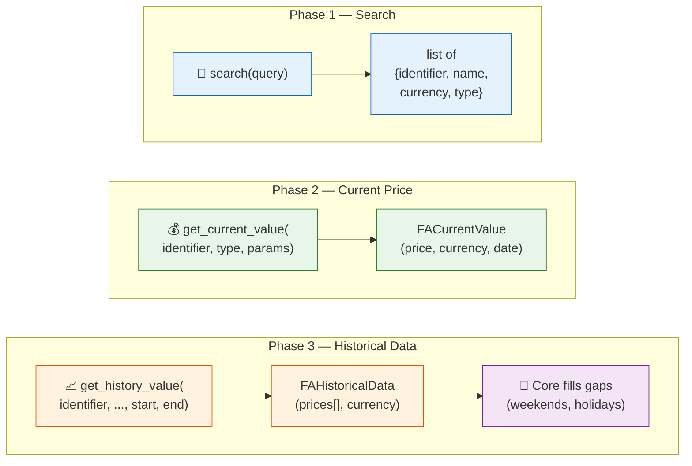

# 📈 Asset Plugin Guide

How to create a new **Asset Source Provider** to fetch prices from a new data source.

**Base class**: `AssetSourceProvider` (defined in
`backend/app/services/assets/base.py`)
**Plugin folder**: `backend/app/services/asset_source_providers/<name>/` — the code in `plugin.py`, beside an `__init__.py` holding only its docstring (see [Plugin Folder and Translations](#plugin-folder))
**Registry**: `AssetProviderRegistry`

!!! info "Import from the defining module"

    Import `AssetSourceProvider` and `AssetSourceError` from `backend.app.services.assets.base`;
    the thread runner and shared caches live in `backend.app.services.assets.core`. No facade
    re-exports them: the `backend/app/services/assets/` package `__init__.py` holds only a
    docstring.

---

## 🤖 Tip: Let an LLM scaffold the provider

Paste this entire page into an LLM with the data source's API documentation and use this prompt:

!!! tip "Suggested prompt"

    ```
    Here is the LibreFolio Asset Source Provider specification: [paste this page]

    I want to add a provider for [DATA_SOURCE_NAME]. Their API works like this:
    [brief description, or paste their API docs]

    Write a complete Python AssetSourceProvider implementation. Follow all conventions:
    @register_provider, FACurrentValue, FAHistoricalData, FAPricePoint, direct calls to
    synchronous provider clients (never an internal asyncio.to_thread), test_cases, and
    test_search_query if applicable. An API key or any other secret is a plugin setting
    (settings_fields, read with self.settings in the operations, never in __init__), never a
    provider_params field, and never in get_asset_url(), in cooldown_scope() or in a request
    whose host comes from the identifier or the provider_params. LibreFolio's service layer
    supplies thread isolation. On "too many requests" (HTTP 429), raise AssetRateLimitedError
    (raise_if_rate_limited as the first line of the except) and never retry or sleep: the core
    pauses the provider.
    ```

    After scaffolding, implement `get_current_value()` and `get_history_value()`, add test
    cases, then save it as `asset_source_providers/<name>/plugin.py`, beside an `__init__.py`
    holding only a docstring, and restart.

---

## 🔄 Flow

The system calls provider methods in three distinct phases:



**Phase 1** is optional but **strongly recommended** — enables users to discover and link assets without knowing the exact identifier. See [Asset Search](#asset-search) below.

**Phase 2** fetches the latest price for the dashboard or manual refresh.

**Phase 3** fetches historical OHLCV data. The plugin returns only actual trading days — core fills gaps (weekends, holidays) with last known value.

**Plugin responsibility**: Fetch raw price data from external source. Return only actual data points (trading days).
**Core responsibility**: Gap filling (weekends/holidays → `backward_filled=True`), caching, database storage, currency conversion.

## 🧵 Provider Execution Boundary

Provider contracts are asynchronous, but the service layer treats provider implementations as an
isolation boundary. Every provider I/O operation is invoked through the canonical
`assets.core._run_provider_in_thread()` helper. The helper starts a dedicated worker
thread, creates a new event loop in that thread, runs the provider coroutine to completion, and
enforces the caller's timeout. Service code reaches it through `assets.core.call_provider()`, the
one boundary of every provider call, on an instance from `configured_provider()`: the boundary first
checks the provider's [settings](#settings) and whether it is paused after «too many requests»
([Too Many Requests](#too-many-requests)), then keeps its secrets masked while the call runs, and
hides an error's texts whole when the call carries a personal secret ([Secrets](#secrets)).

Consequently, a provider that wraps a synchronous SDK or HTTP client should call that client
**directly** inside its `async def` method:

```python
async def get_current_value(self, identifier, identifier_type, provider_params):
    raw = self._sync_client.fetch(identifier)  # Direct blocking call in provider thread
    return FACurrentValue(...)
```

Do **not** add `asyncio.to_thread()` or `run_in_executor()` inside the provider. Nesting another
thread boundary obscures timeout/error behavior and is unnecessary: the manager operations,
metadata refresh, current/history refresh, search, and URL resolution already route provider I/O
through `_run_provider_in_thread()`. Async-native provider clients also work because their
coroutines run on the dedicated thread's event loop.

This rule applies to provider I/O only. Ordinary endpoints and service functions still must not
perform blocking I/O directly on the application's main event loop.

---

## 📋 ABC Methods

### ✅ Required (Abstract)

| Method | Signature | Description |
|--------|-----------|-------------|
| `provider_code` | `@property → str` | Unique identifier (e.g., `"yfinance"`) |
| `provider_name` | `@property → str` | Display name (e.g., `"Yahoo Finance"`) |
| `test_cases` | `@property → list[dict]` | Test cases for automated testing (`identifier`, `identifier_type`, `provider_params`) |
| `test_search_query` | `@property → str \| None` | Search query for automated tests. `None` if search not supported. |
| `get_current_value(identifier, type, params)` | `async → FACurrentValue` | Fetch latest price. Returns `value`, `currency`, `as_of_date`, `source`. When the quote carries a timestamp, `as_of_date` is its date in the exchange's timezone, not in UTC. |
| `get_history_value(identifier, type, params, start, end)` | `async → FAHistoricalData` | Fetch historical OHLCV data for date range. Return raw data only — no gap filling. Date each point and event on its session's day in the exchange's timezone, not on the UTC date of a midnight timestamp: the refresh stores the dates as given ([Dates on the Exchange's Own Day](../../backend/assets/architecture.md#exchange-timezone)). Build each point as the source gives it: `FAPricePoint` checks no sign, and the refresh discards a day with a close of 0 or less, or a negative open, high, low or volume, and names it in its result ([Discarded Days](../../backend/assets/architecture.md#discarded-provider-days), N92). |
| `validate_params(params)` | `→ None` | Validate provider-specific `provider_params`. Raise `AssetSourceError` if invalid. Use `pass` if no params needed. |

### 💪 Strongly Recommended (Override)

!!! tip "Implementing `search()` is strongly recommended"

    Without search, users must know the exact asset identifier (ticker, ISIN, URL) upfront. With search, they can type a name like "Apple" and pick from results.

| Method | Default | Description |
|--------|---------|-------------|
| `search(query)` | Raises `NOT_SUPPORTED` | Search for assets by name, ticker, or ISIN. Returns `[{identifier, identifier_type, display_name, currency, type}]`. |

### 🔧 Optional (Override)

| Method | Default | Description |
|--------|---------|-------------|
| `get_icon` | `None` | Provider icon URL for the UI |
| `supports_history` | `True` | Set `False` for providers that only support current prices (e.g., web scrapers) |
| `params_schema` | `[]` | List of field definitions for `provider_params`. Used by frontend to generate dynamic forms. Each field has a `key`, a `type` (`string`, `number`, `currency`, `select` with `options` / `option_labels`, or `ui_component` for a custom editor), `required` (shown with a red `*`), and optionally `default`, `placeholder`, a short `label` (the caption) and a `description` (the tooltip). The caption is the translation `assets.providerParams.<code>.label.<key>`, else `label`, else the raw `key` — declare a `label` so users do not see internal names; the tooltip is `assets.providerParams.<code>.description.<key>`, else `description`. Both translations live in the provider's own fragment: see [Plugin Folder and Translations](#plugin-folder). The parameters belong to one asset and are stored in clear with it: never a secret there, see [Settings](#settings). |
| `get_asset_url(identifier, type, params)` | `None` | Generate URL to the provider's page for this asset (e.g., Yahoo Finance quote page). Shown to the user: never a secret in it, see [Secrets](#secrets) |
| `resolvable_url_domains` | `[]` | Domains this provider can turn a page URL back into a search-item for (opt-in). See [Asset Search & Link-Finder](../../backend/assets/search_link_finder.md). |
| `resolve_url(url)` | `None` | Inverse of `get_asset_url`: open a provider page URL → return one search-item dict, a list of dicts, or `None`. Enables the last-resort external search stack. |
| `accepted_identifier_types` | `[TICKER, ISIN]` | Input types accepted by this provider (shown in frontend dropdown) |
| `fetch_asset_metadata(identifier, type, params)` | `None` | Fetch asset metadata (type, sector, identifiers) from the provider |
| `cooldown_scope(identifier, type, params)` | `None` | The part of the provider a pause after «too many requests» covers, such as a site's host; `None` pauses the whole provider. Called before every call, so no I/O, and never a secret in the result: see [Too Many Requests](#too-many-requests) |
| `provider_help_url` | `None` | URL to the provider's documentation page (served by the running instance) |
| `settings_fields` | `()` | The values the provider needs from the instance or from each user: an API key, a region, a preference. Read with `self.settings` in the operations, never in `__init__`: see [Settings](#settings) |
| `test_only` | `False` | `True` for a provider that exists for the tests: hidden from the provider list and from the settings catalogue and, outside test mode, not served at all ([Test-Only Plugins](plugin_settings.md#test-only)) |
| `tier` | `FAProviderTier.COMMUNITY` | Where the provider stands in the asset search: `PREMIUM` for a source the instance vouches for, such as licensed data; when at least one premium provider is available, its results come first. A class attribute; a valid string (`"premium"`) is accepted. See [Search Order](#search-order) |
| `search_priority` | `100` | The provider's place in the search inside its tier, lower first: a whole number of at least 0. A class attribute; a wrong value stops the import |
| `shutdown()` | no-op | Called at app teardown to clean up resources (close sessions, stop threads). Override if your provider holds persistent connections. |
| `generate_static_url(path)` | — | Helper to build `/api/v1/uploads/plugin/asset/{path}` |

---

## 🔎 Asset Search

The `search(query)` method allows users to **discover assets** by name, ticker, or ISIN across several providers simultaneously.

### ⚙️ How It Works

1. User types a query in the UI (e.g., "Apple", "MSCI World", "IE00B4L5Y983")
2. Frontend calls the streaming endpoint `GET /api/v1/assets/provider/search/stream?q=Apple&providers=…` with the providers selected in the dialog; the batch `GET /api/v1/assets/provider/search` only as a fallback when the stream is unavailable
3. Backend queries **the requested providers in parallel** via `AssetSearchService.search_stream()` (batch: `AssetSearchService.search()`, `asyncio.gather`); without `providers` (a direct API call), every registered provider but the test-only ones (`_default_search_codes()`)
4. Providers that don't implement search (default raises `NOT_SUPPORTED`) are silently skipped
5. Results are aggregated and returned to the user, provider by provider, in the [search order](#search-order)

### 🥇 Search Order {: #search-order }

`services/assets/provider_policy.py` decides the order, from what each provider declares and what the instance
overrides:

- **The tier** (`tier`): premium providers come first, but only when at least one is available. No shipped provider is
  premium today, so without one the order stays what it was.
- **The priority** (`search_priority`): inside a tier, lower first; ties keep the registry's order.
- **The instance's overrides**, read at every call (`config/plugins.py`): `LIBREFOLIO_ASSET_PROVIDERS_PREMIUM` makes
  exactly the listed providers premium; `LIBREFOLIO_ASSET_PROVIDERS_ORDER` puts the listed providers first, in its
  order. A code that no provider has is ignored and logged once.

`GET /assets/provider` shows each provider's effective `tier` and `priority`. The non-streaming search
(`GET /assets/provider/search`) returns the results in this order; the streaming one sends them as they arrive, and
the frontend orders them the same way as they land (`frontend/src/lib/components/assets/assetSearchSections.ts`,
from the `tier` and `priority` of that list): premium first, then lower priority, with a stable sort, so with every
provider at its defaults the list keeps the order of arrival. Only when a premium provider took part in the search
does the dropdown split it into a **Premium** section and a closed community section; otherwise it is one list.

### 🔌 Provider Support

| Provider | `search()` | `test_search_query` | `get_asset_url` | Notes |
|----------|-----------|---------------------|:---:|-------|
| **Yahoo Finance** | ✅ | `"Apple"` | ✅ | Full ticker search with the core query cache (15 min TTL) |
| **JustETF** | ✅ | `"iShares Core S&P 500"` | ✅ | ISIN-based search across cached ETF list; a row per currency, or only the user's `preferred_currency` ([Shipped Plugins](plugin_settings.md#shipped-plugins)) |
| **CSS Scraper** | ❌ | `None` | ✅ | No search — URL must be provided manually |
| **Scheduled Investment** | ❌ | `None` | — | Synthetic provider, no external search |
| **Borsa Italiana** | ✅ | `"ENEL"` | ✅ | Full search on borsaitaliana.it; funds price by `provider_params.codice_fondo`; search and `resolve_url` emit IT + EN rows, or only the user's `preferred_language` |

!!! info "`supports_search` detection"

    The `list_providers` endpoint checks `instance.test_search_query is not None` (a local property) to determine search support. This avoids cold-start HTTP calls.

### 🧵 Last-resort external fallback (optional)

A provider can go beyond its own on-site search. When `search()` returns **0** results, the
orchestration can fall back to an external engine (`web_link_finder`, `ddgs` by default) to find
candidate **provider-domain** URLs and then resolve them back into search-items. To opt in, a
provider sets `resolvable_url_domains` and implements `resolve_url(url)` (see the
[Optional overrides](#optional-override) list). The caller may also pass **`hints`** (extra
identifiers/names, e.g. from a broker report) to narrow the external query and post-filter the
results by known identifier.

`resolve_url` is an alternate entry point into **interactive search**, not into pricing. It may
return:

- one search-item dict;
- a list of search-item dicts when one page maps to several canonical choices;
- `None` when the URL is not recognised.

The search layer flattens lists and de-duplicates by `(identifier, language)`. Borsa Italiana uses
this to return the **IT + EN** canonical set for a fund or scheda page, or only the row of the user's
preferred language.

This whole stack — the `web_link_finder` module, the two-stage "stringone", and the identifier
post-filter — is documented on its own page:

- 🔎 **[Asset Search & Link-Finder](../../backend/assets/search_link_finder.md)** — the generic
  three-layer resolution (on-site → link-finder → `resolve_url`), config, and invariants.

!!! warning "Never on price fetches"

    The external stack is interactive-only. Once an asset exists it must be priced by its stored
    identifier / `provider_params`, never by re-searching. For Borsa Italiana funds, the stored
    `provider_params.codice_fondo` is the price key; the ISIN is descriptive/identity data, not the
    NAV lookup key.

### 🧾 Alternative identifiers

`Asset.identifier_other` is a JSON list (`list[str]`) of soft or technical identifiers. Use it for
alternate broker labels and provider-specific codes that do not deserve a first-class identifier
column. Provider metadata patches should return a list, not a scalar; for example, Borsa Italiana
fund metadata stores the internal fund code as `identifier_other=["2FADB…"]` while pricing uses
`provider_params.codice_fondo`.

### 🌐 API Endpoints

**Standard search** (returns all results at once):

```
GET /api/v1/assets/provider/search?q=Apple&providers=yfinance,justetf
```

**Streaming search** (Server-Sent Events — results arrive as providers respond):

```
GET /api/v1/assets/provider/search/stream?q=Apple&providers=yfinance,justetf
```

**Query parameters** (both endpoints):

- `q` (required): Search query, min 1 character
- `providers` (optional): Comma-separated provider codes. Default: all providers with search support.

**Response** (standard):

```json
{
  "query": "Apple",
  "total_results": 5,
  "results": [
    {
      "identifier": "AAPL",
      "display_name": "Apple Inc.",
      "provider_code": "yfinance",
      "currency": "USD",
      "asset_type": "stock",
      "provider_url": "https://finance.yahoo.com/quote/AAPL"
    }
  ],
  "providers_queried": ["yfinance", "justetf"],
  "providers_with_errors": [],
  "providers_not_configured": []
}
```

- Searches are executed **in parallel** — one slow provider won't block others
- Provider-specific errors are logged but don't fail the entire request
- Errors are reported in `providers_with_errors` for debugging
- A provider that is not configured, a required setting without a value, is not called: the
  standard search lists it in `providers_with_errors` and in `providers_not_configured`, and the
  stream's `provider_error` event carries `error_code: "NOT_CONFIGURED"`; the search box then offers
  **Configure** for it ([NOT_CONFIGURED](plugin_settings.md#not-configured))
- A provider paused after «too many requests» is not called: the standard search lists it in
  `providers_with_errors`, and the stream's `provider_error` event adds `error_code: "RATE_LIMITED"`
  and `retry_after` (see [Too Many Requests](#too-many-requests))
- The stream's `provider_error` carries an `error_code` for every `AssetSourceError`, the
  provider's own codes included (`SEARCH_ERROR`, for example); an error of any other type has none
- `provider_url` is generated by the provider's `get_asset_url()` method (if implemented)

### 🧪 Probe Endpoint

After a provider is configured, use the **probe** endpoint to dry-run test it:

```
POST /api/v1/assets/provider/probe
```

This runs selectable operations (`current_price`, `history`, `metadata`) without persisting anything. See [Asset Architecture](../../backend/assets/architecture.md#provider-probe) for details.

---

## 💻 Implementation Example

```python
# backend/app/services/asset_source_providers/my_provider/plugin.py

from datetime import date
from decimal import Decimal
from backend.app.db import IdentifierType
from backend.app.db.models import ProviderInputType
from backend.app.services.assets.base import AssetSourceError, AssetSourceProvider
from backend.app.services.assets.registry import AssetProviderRegistry
from backend.app.services.provider_registry import register_provider
from backend.app.schemas.prices import FACurrentValue, FAHistoricalData, FAPricePoint

@register_provider(AssetProviderRegistry)
class MyProvider(AssetSourceProvider):

    @property
    def provider_code(self) -> str:
        return "my_provider"

    @property
    def provider_name(self) -> str:
        return "My Data Provider"

    @property
    def test_cases(self) -> list[dict]:
        return [
            {"identifier": "AAPL", "identifier_type": IdentifierType.TICKER, "provider_params": None}
        ]

    @property
    def test_search_query(self) -> str | None:
        return "Apple"  # Return None if search not supported

    @property
    def params_schema(self) -> list[dict]:
        """Optional: define fields for frontend dynamic form."""
        # Per-asset parameters, stored in clear with the asset: never a secret here.
        # An API key is a plugin setting (settings_fields): see Settings below.
        return [
            {"key": "exchange", "type": "string", "required": False, "label": "Exchange", "description": "Exchange to price the asset on"},
        ]

    def get_asset_url(self, identifier, identifier_type, provider_params=None) -> str | None:
        """Optional: URL to the provider's page for this asset."""
        return f"https://myprovider.com/asset/{identifier}"

    async def get_current_value(
        self, identifier: str, identifier_type: IdentifierType, provider_params: dict
    ) -> FACurrentValue:
        # A synchronous client call stays direct; the service runs this coroutine
        # in the dedicated provider thread.
        price = self._sync_client.fetch_price(identifier)
        return FACurrentValue(
            value=Decimal(str(price)),
            currency="USD",
            as_of_date=date.today(),
            source=self.provider_name,
        )

    async def get_history_value(
        self, identifier: str, identifier_type: IdentifierType,
        provider_params: dict | None, start_date: date, end_date: date
    ) -> FAHistoricalData:
        # Return ONLY actual trading days; do not add an internal to_thread call.
        raw_data = self._sync_client.fetch_history(identifier, start_date, end_date)
        prices = [
            FAPricePoint(date=d, close=Decimal(str(p)), open=None, high=None, low=None, volume=None, currency="USD")
            for d, p in raw_data
        ]
        return FAHistoricalData(prices=prices, currency="USD", source=self.provider_name)

    def validate_params(self, params: dict | None) -> None:
        # No params required — accept anything
        pass
```

### 🗂️ Plugin Folder and Translations {: #plugin-folder }

A provider is a folder of `asset_source_providers/`:

```text
backend/app/services/asset_source_providers/
├── static/            ← the family's icons, served under /api/v1/uploads/plugin/asset/… (generate_static_url)
└── my_provider/
    ├── __init__.py    ← its docstring and nothing else
    ├── plugin.py      ← the code above
    └── i18n/          ← optional: en.json, it.json, fr.json, es.json
```

Restart the app: `AssetProviderRegistry` loads `plugin.py` as
`backend.app.services.asset_source_providers.my_provider.plugin`. Import and patch the provider's
names from that module: the package re-exports nothing. A helper only this provider uses sits
beside `plugin.py` as `_*.py`. Discovery, the layout and the gate that keeps it
(`./dev.py test utils gate-plugin-layout`) are in [Plugin Folder Layout](registry_pattern.md#plugin-layout).

**Translations.** A provider has two spaces, both keyed by the code `provider_code` returns, which
need not be the folder's name — the `yahoo_finance/` folder registers `yfinance`:

- `assets.providerParams.<provider_code>`: the captions and tooltips of its `params_schema` fields,
  `label.<key>` and `description.<key>`;
- `pluginSettings.asset.<provider_code>`: the texts of its [settings](#settings), `label.<field>`,
  `description.<field>` and `option.<field>.<value>`, the keys its `settings_fields` declare
  ([Labels and Translations](plugin_settings.md#translations)).

Borsa Italiana's fragment (`borsa_italiana/i18n/`) holds both; justETF's (`justetf/i18n/`) holds its
setting's texts only. Add the keys in the four languages, naming the folder with `--into`:

```bash
./dev.py i18n add "assets.providerParams.my_provider.label.exchange" --en "Exchange" --it "Borsa" --fr "Place de cotation" --es "Bolsa" --into asset_source_providers/my_provider
./dev.py i18n add "assets.providerParams.my_provider.description.exchange" --en "Exchange to price the asset on" --it "…" --fr "…" --es "…" --into asset_source_providers/my_provider
./dev.py i18n where "assets.providerParams.my_provider.label.exchange"   # the file that holds the key
```

Without `--into`, `add` refuses a new provider's first key, because the keys under
`assets.providerParams` and `pluginSettings.asset` belong to plugins only; it also refuses every new
key of a provider whose keys lie under both branches, as Borsa Italiana's do.
`./dev.py test utils gate-plugin-i18n-ownership` then keeps every key under the provider's spaces in
its fragment ([A Plugin's Translations](registry_pattern.md#plugin-translations)).

---

## 🎛️ Settings {: #settings }

A provider that needs an API key, a region or a user's preference declares it in `settings_fields`.
The core resolves the values (environment variable, saved value, default), decrypts the secret ones
and binds them to a new instance before each use; the provider reads them in its operations with
`self.settings.get("key")` and `self.settings.secret("key")`:

```python
from backend.app.services.plugin_settings.fields import PluginSettingField, SettingScope, SettingType


class MyProvider(AssetSourceProvider):
    settings_fields = (
        PluginSettingField(key="api_key", type=SettingType.STRING, scope=SettingScope.SYSTEM, secret=True, required=True, label="API key"),
    )

    async def get_current_value(self, identifier, identifier_type, provider_params=None) -> FACurrentValue:
        api_key = self.settings.secret("api_key")  # never in __init__
        ...
```

- **Never read settings in `__init__`.** The core binds them after the instance is created, so
  `__init__` sees only the declared defaults and no secret. The same holds for the members the core
  may call on an instance it did not configure: properties, `params_schema`, `get_asset_url()`,
  `validate_params()`.
- **Scopes.** A `system` field holds one value for the instance, saved by an administrator or set by
  `LIBREFOLIO_PLUGIN_ASSET_<CODE>_<FIELD>`; a secret one may also keep, in `env`, the variable the
  provider read its key from before it declared settings. A `user` field holds each user's own value,
  which reaches only `search()`, `resolve_url()` and the probe: prices, history and metadata get the
  instance's values only. Either kind can be secret.
- **A secret is a setting, never a provider parameter**: `provider_params` are stored in clear with
  the asset, shared by its users and returned by the asset API.
- **A required field without a value** makes `call_provider()` answer `NOT_CONFIGURED` before any
  I/O. Never return a secret, log it, or put it in a URL you log or in an exception message: masking
  is only a safety net.
- **Texts.** Declare `label_key` and `description_key` on each field, and `label_key` on the options
  that need a translation, under `pluginSettings.asset.<provider_code>`; the texts go in your
  fragment ([Translations](#plugin-folder)). The English `label` stays the fallback.
- **Where users set them.** **Settings › Plugins** lists every provider that declares a field the
  user may see, and the asset dialog shows **Configure** next to the provider; while the provider is
  not configured, the asset dialog shows **To configure** and a search offers **Configure** on a row
  of its own ([The Interface](plugin_settings.md#interface)).

### 🔐 Secrets Stay Out of the Caller's Reach {: #secrets }

Any signed-in user can probe a provider with an identifier and parameters of their choosing
(`POST /api/v1/assets/provider/probe`, **Test Configuration**), on an instance that carries the
instance's secrets. So:

- **Never put a secret in `get_asset_url()`**: the URL is shown to the user, as the **Provider URL**
  of the asset dialog. As a last line of defence, the probe withholds a URL that shows one of the
  provider's secrets (`core.public_asset_url()`): it answers `provider_url: null`, and the log has a
  warning naming the provider, `Provider asset URL withheld: it shows a secret`.
- **Never put a secret in `cooldown_scope()`**: the core asks it before the call, outside the
  masking, and the scope keys the pause registry and appears in its log lines.
- **Never send a secret in a request whose host comes from the `identifier` or the
  `provider_params`**: the caller would choose the host, and receive the secret. No masking reaches a
  request that has left. Send it only to the hosts your provider knows.

**A caller's own secret hides the call's errors whole.** When a call carries a `user` secret, a
value its caller chose (`self.settings.carries_user_secrets`), `call_provider()` turns every text of
the error that shows a secret, the caller's or the instance's, into `***` entirely, instead of
masking each occurrence in place: masked in place, the text would tell whether a chosen value occurs
next to an instance secret, and so read it a guess at a time. The error's type and `error_code` stay,
and so does every `details` item that shows no secret: put what explains a failure there. The log
lines keep the precise masking, and so does a call that carries only instance secrets. In both
cases, every occurrence of a secret is found at once, and occurrences that overlap or touch become a
single `***` ([Secrets](plugin_settings.md#secrets)).

The full contract (types, environment variables, secrets, caching, the API and the security model)
is in [Plugin Settings](plugin_settings.md).

---

## 🚦 Too Many Requests {: #too-many-requests }

When a source refuses for too many requests (an HTTP 429, or a library's own error for it), the core
pauses the provider: `call_provider()` stops calling it for a while and answers every caller at once
with `AssetRateLimitedError` (`error_code="RATE_LIMITED"`, `retry_after` in seconds), without a
thread or any I/O. By default the pause starts at 60 s and doubles at each refusal in a row, up to
1 h, plus up to 10 % of jitter; a `Retry-After` the source sent is honoured, up to 24 h. A cached
value is still served meanwhile. What each caller returns during a pause is in
[Asset Architecture → Provider Pauses](../../backend/assets/architecture.md#provider-pauses).

The plugin's part is only to report the refusal:

- **Raise `AssetRateLimitedError`** (`backend/app/services/assets/base.py`), with the source's
  `Retry-After` in seconds as `retry_after` when it sent one. It is an `AssetSourceError`, so an
  `except AssetSourceError: raise` clause lets it through.
- **Never retry or `sleep` in your thread** after a refusal. A retry is one more request to a source
  that has just refused, and a `sleep` holds the provider's thread: the core decides how long to
  wait. Other transient errors (a timeout, a reset connection) may still be retried.
- **Never swallow a refusal** in a handler that otherwise returns `[]` or `None`, such as a
  best-effort `search()` or `fetch_asset_metadata()`: the refusal would read as "no result", and the
  provider would never be paused. Yahoo Finance's search and metadata, justETF's metadata, and
  Borsa Italiana's metadata and `resolve_url` had to be fixed for this; the two Borsa Italiana
  enrichments that still swallow one, on purpose, are listed on
  [its page](../../backend/assets/provider_borsa_italiana.md#error-handling).

### 🧰 Helpers

| Helper (`assets/base.py`) | Use |
|---|---|
| `rate_limited_from_response(response, provider_name, scope=None)` | An `httpx` or `requests` response: an `AssetRateLimitedError` when it is an HTTP 429, with its `Retry-After`; else `None` |
| `rate_limited_from_exception(error, provider_name, scope=None)` | A caught exception: an `AssetRateLimitedError` when it is one already, when its `response` is an HTTP 429 (`requests.HTTPError`, `httpx.HTTPStatusError`, with the `Retry-After`), or when its message says, in any case, «status 429», «status code 429», «HTTP 429», «HTTP Error 429» (urllib) or the reason phrase «Too Many Requests» (requests' «429 Client Error: Too Many Requests», httpx's «Client error '429 Too Many Requests'»), as libraries without an error class of their own do; else `None`. In a message, 429 counts only as a whole number, and a colon may precede it («status: 429») |
| `raise_if_rate_limited(error, provider_name, scope=None)` | The first line of an `except`: raises the refusal (`from error`) and lets every other error go on to the plugin's own handling |

A library with an error class of its own is translated in the plugin, as Yahoo Finance does with
yfinance's `YFRateLimitError` and Borsa Italiana with the library's `RateLimitRaggiunto`:
`raise AssetRateLimitedError("…") from error`. Mind what the library does before it raises: Borsa
Italiana's library retries a 429 by itself and sleeps in the provider's thread, a known gap
([Borsa Italiana Provider](../../backend/assets/provider_borsa_italiana.md#error-handling)).

### 🎯 Narrowing a pause: `cooldown_scope()`

A refusal pauses the whole provider. A provider that reaches many independent sites overrides
`cooldown_scope(identifier, identifier_type, provider_params)` and returns the part of itself a pause
should cover. The CSS Scraper returns the host of the page URL (lowercase, without the port), so a
site that refuses pauses itself and not the other sites.

- The callers that have an identifier (live price, refresh, metadata refresh, probe) ask the hook
  before every call: it must do no I/O. A hook that raises is logged, and the pause then covers the
  whole provider.
- The scope never holds a secret: it is computed outside the masking, keys the pause registry and
  appears in its log lines ([Secrets](#secrets)).
- Search and `resolve_url` have no identifier, so no scope: they check and record the provider-wide
  pause. That is a key of its own: a site's pause does not hold up a search, nor does a refused
  search pause the sites.
- An error raised with `scope=` should carry the hook's value: the core checks a pause under the
  hook's scope, and records a refusal under the error's scope (the hook's when the error has none).

### 💡 Example

```python
from backend.app.services.assets.base import AssetSourceError, raise_if_rate_limited


class MyProvider(AssetSourceProvider):
    async def get_current_value(self, identifier, identifier_type, provider_params):
        try:
            raw = self._sync_client.fetch(identifier)  # raises requests.HTTPError on a 4xx/5xx
        except Exception as error:
            raise_if_rate_limited(error, self.provider_name)  # a 429 leaves as RATE_LIMITED: no retry, no sleep
            raise AssetSourceError(f"Quote failed for {identifier}: {error}", "FETCH_ERROR") from error
        ...

    async def fetch_asset_metadata(self, identifier, identifier_type, provider_params=None):
        try:
            info = self._sync_client.fetch_info(identifier)
        except Exception as error:
            raise_if_rate_limited(error, self.provider_name)  # a refusal is not "no metadata"
            return None
        ...
```

### 🧪 Testing a refusal

The test-only `mockprov` refuses for too many requests on demand:

- an asset whose `provider_params` hold `mock_rate_limited` — a number of seconds, sent as the
  `Retry-After`, or `true` for none — is refused by `get_current_value()`, `get_history_value()` and
  `fetch_asset_metadata()`;
- the search query `lf-rate-limited` is refused, with a `Retry-After` of 30 s.

The pause that follows is real and holds for the whole process. Use these modes in in-process tests
only, where the test replaces `PROVIDER_COOLDOWNS` (`backend/app/services/platform/provider_cooldown.py`)
with a fresh `Cooldowns`, so no pause outlives it; never on a lane's shared test backend, where the
pause would outlive the test.

---

## 🔗 Related Documentation

- 🏗️ [Asset Architecture](../../backend/assets/architecture.md) — Provider interface, caching, refresh logic
- 🔌 [Asset Providers](../../backend/assets/system_providers.md) — All providers (Yahoo Finance, JustETF, CSS Scraper, Scheduled Investment)
- 📦 [Providers Overview](../../backend/assets/system_providers.md) — Summary table of all providers
- 🔄 [Registry Pattern Overview](registry_pattern.md) — How the plugin system works
- 🎛️ [Plugin Settings](plugin_settings.md) — Declared settings, secrets and the provider call boundary
