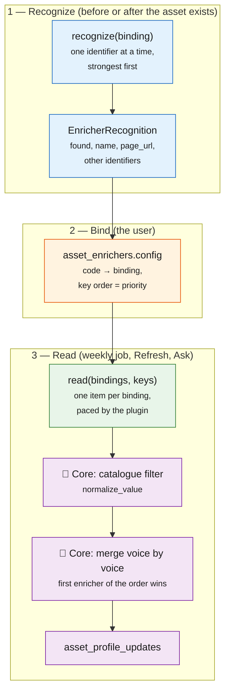
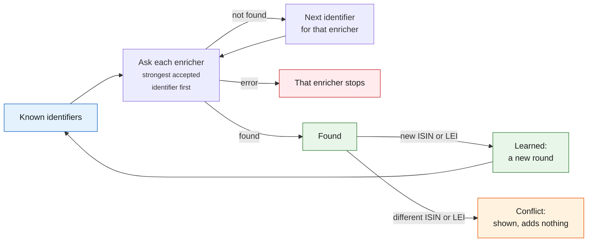

# 🪪 Enricher Plugin Guide

How to create a new **enricher**: a plugin that reads an asset's descriptive **profile** (costs, countries, sectors,
coupons, legal form, issuer…) from one outside source.

**Base class**: `EnricherPlugin` (in `backend/app/services/enrichers/base.py`)
**Plugin folder**: `backend/app/services/enricher_providers/<name>/` — the code in `plugin.py`, beside an `__init__.py`
holding only its docstring (see [Plugin Folder and Translations](#plugin-folder))
**Registry**: `EnricherRegistry` (in `backend/app/services/enrichers/registry.py`)

An enricher is a family of its own, separate from the price providers of the
[Asset Plugin Guide](asset_plugin_guide.md). A price provider answers «what is it worth today»; an enricher answers
«what is it»: the TER of a fund, the coupon of a bond, the sector of a share. The two may read the same site (justETF,
Yahoo Finance and Borsa Italiana exist in both families), but they are separate plugins that share no code.

!!! info "Import from the defining module"

    The package `backend/app/services/enrichers/` re-exports nothing: its `__init__.py` holds only a docstring.
    Import `EnricherPlugin`, `EnricherBinding`, `EnricherReadItem` and the other names from
    `backend.app.services.enrichers.base`, and `EnricherRegistry` from
    `backend.app.services.enrichers.registry`.

---

## 🤖 Tip: Let an LLM scaffold the enricher

Paste this entire page into an LLM, together with the source's documentation or a sample page, and use this prompt:

!!! tip "Suggested prompt"

    ```
    Here is the LibreFolio Enricher Plugin specification: [paste this page]

    I want to add an enricher for [SOURCE_NAME]. It knows these assets: [ETFs / bonds / shares…],
    by this identifier: [ISIN / ticker / an internal code]. A page looks like this:
    [paste a sample response or describe the fields]

    Write a complete Python EnricherPlugin. Follow all conventions: @register_provider(EnricherRegistry),
    class attributes code, name, terms, accepted_identifier_types, voices (catalogue keys only, per asset
    type) and default_priority (EVERY AssetType, None written out for a type not covered); plain blocking
    methods recognize, read, page_url and test_cases (search when the source has one). read yields one
    EnricherReadItem per binding with its index; numbers as decimal strings, never floats; percentages as
    fractions; a voice the source does not give is absent, never None. «Not found» is an outcome, not an
    exception. A 429 is an ERROR item with error_code RATE_LIMITED and retry_after, and every binding
    after it is refused the same way without a call. The call queue and the pause between calls live
    inside the plugin, at module level, so two reads running at once are paced together. No import from
    another plugin.
    ```

    After scaffolding, save it as `enricher_providers/<name>/plugin.py`, beside an `__init__.py` holding only a
    docstring, restart, and check it with `./dev.py test services enricher-contracts` and
    `./dev.py test external enrichers`.

---

## 🔄 Flow

The core asks an enricher three things, at three moments:



**Recognize** answers whether the source knows one binding, and how it names it. It is light and writes nothing; the
core uses it in the «Recognize» cascade («Riconosci» in the code) and in the enrichers window's **Test the binding**
([What the Core Does](#core)).

**Bind** is the user's: the bindings of an asset are a JSON object stored in `asset_enrichers.config`, enricher code →
binding, and the order of its keys is the priority (`backend/app/services/enrichers/bindings.py`).

**Read** gives the voices. The plugin reads a list of bindings and yields one outcome per binding as it goes; the core
filters every value through the profile catalogue, merges the enrichers voice by voice and stores the result.

**Plugin responsibility**: reach the source, translate its fields into catalogue voices (codes, ISO countries, decimal
strings), pace its own calls, and say for each binding whether it was read, not found, or failed.
**Core responsibility**: when to read, the 30-minute read cache, the call limits, the catalogue check, the merge and
the order, storage, the weekly schedule and its retry after a refusal.

---

## 📜 The Four Mandatory Rules {: #rules }

These four rules are the contract of the family (plan 68). A plugin that breaks one is not accepted.

1. **The site is read inside the plugin.** The plugin reaches its source through its own library or HTTP client,
   called from `recognize`, `read` and `search`. No site, client or endpoint is declared for the core to call or to
   pace: the core only calls the plugin's methods. The URLs a plugin does expose (`page_url`, `icon`, `help_url`) are
   shown to the user, never fetched by the core.
2. **No imports between plugins.** An enricher never imports another plugin, of its own family or of another one —
   not even the price provider of the same site. `./dev.py test utils gate-plugin-layout` rejects such an import.
3. **Only generic helpers are shared.** A plugin may import the core and the generic helpers of the project, such as
   `normalize_country_to_iso3` (`backend/app/utils/asset/geo.py`), `validate_sector` and `normalize_sector`
   (`backend/app/utils/asset/sector.py`), `rate_limited_from_exception` and `rate_limited_from_response` (`backend/app/services/assets/base.py`), or a
   calculation of `backend/app/services/financial_math/` (Borsa Italiana's `annual_coupon_rate`). A helper only this
   plugin uses sits beside `plugin.py` as `_*.py`.
4. **The call queue and the pause between calls live inside `read`.** The core never paces an enricher: it hands a
   list of bindings to `read` and takes the items as they come. The plugin waits between two calls to its source, and
   its queue must also cover **two requests arriving together** — for example a user's «Refresh» while the weekly
   read is running, each in its own worker thread.

!!! warning "Where the queue must live"

    The registry builds a **new instance for every call** (`get_plugin_instance()` in
    `backend/app/services/platform/provider_registry.py`), so a lock or a «last call» time kept on `self` is never
    shared between two reads. Keep the queue at module level: a `Pacer`, see the [example](#example). Such a lock covers one process: with several workers, each process paces its
    own calls.

    Use the core's `Pacer` (`backend/app/utils/runtime/pacing.py`): one instance at module level, with the interval
    this plugin picks, and `_PACER.wait()` right before each call to the site — in `recognize`, `read` and `search`
    alike. It counts with `SlidingWindowLimiter` and sleeps in the worker thread, never on the event loop. justETF
    (1 s), Yahoo Finance (0.5 s) and Borsa Italiana (1 s) all do so (plan 68, C5); Borsa Italiana's library also paces
    the requests inside one session.

---

## 🧵 Execution Boundary

Every method of an enricher is a **plain blocking call** (`def`, never `async def`). The core runs each one away from
the event loop, in a worker thread:

| Method | Run by |
|---|---|
| `recognize` | `asyncio.to_thread` in the cascade (`backend/app/services/enrichers/recognize.py`) and in `POST /assets/enrichers/{code}/test` |
| `read` | `asyncio.to_thread` in `read_bindings()` (`backend/app/services/enrichers/refresh.py`), one thread per enricher, all enrichers at once |
| `search` | `asyncio.to_thread` in `GET /assets/enrichers/{code}/search` |

So call your library or HTTP client directly, and wait on your module's `Pacer` before each call: you are already in
a worker thread, so the wait never blocks the event loop. Never add `asyncio.to_thread()` inside the plugin.

---

## 📋 The Contract

### 🏷️ Class Attributes

| Attribute | Required | Description |
|---|---|---|
| `code` | ✅ | The enricher's code, a lowercase identifier (`justetf`, `borsa_italiana`). The key of its bindings in `asset_enrichers.config` |
| `name` | ✅ | Display name (`"justETF"`) |
| `terms` | ✅ | An `EnricherTerms`, the class of the source's terms of use, shown to the user (never a legal opinion): `OPEN` (open or official data), `PRICE_SOURCE` (a source already read for prices), `SELF_HOSTED` (personal use only, never on a hosted service), `PERSONAL_FILE` (a public file for personal use, off until the user turns it on) |
| `accepted_identifier_types` | ✅ | A non-empty tuple of upper-case identifier types the source reads by: `("ISIN",)`, `("TICKER",)`, `("ISIN", "BI_FUND_CODE")` |
| `voices` | ✅ | Per `AssetType`, the `frozenset` of profile voices it can fill: [catalogue](#voices) keys only. A type it does not cover is absent |
| `default_priority` | ✅ | A degree for **every** `AssetType`, a whole number ≥ 0, lower first; `None` written out for a type it does not cover. The default order of an asset's enrichers follows it |
| `icon` | — | Icon URL (the shipped enrichers use the site's favicon) |
| `help_url` | — | A page that explains the source |
| `calls_external_service` | — | `True` by default: each binding read is counted against the instance's call limits ([Call Limits](plugin_settings.md#call-limits)). `False` only for an enricher that computes its answers with no network, such as the test double |
| `settings_fields` | — | The values the enricher needs from the instance (an API key): see [Settings](#settings). None of the shipped enrichers declares any |
| `test_only` | — | `True` for a plugin that exists for the tests (`mockenrich`). Outside test mode the registry does not serve it: no catalogue, route, cascade or read reaches it (`_withheld()` in `backend/app/services/platform/provider_registry.py`). In test mode it is served and listed like any other, which is how the API tests drive the core ([Test-Only Plugins](plugin_settings.md#test-only) describes the rule for the other families) |

`covers(asset_type)` (inherited) is `True` when `default_priority` gives the type a degree: the cascade and the
default order ask only the enrichers that cover the asset's type.

### ✅ Abstract Methods

| Method | Signature | Description |
|---|---|---|
| `recognize(binding)` | `→ EnricherRecognition` | Whether the source knows the binding: `found`, the `name` it gives, the `page_url`, and the other `identifiers` it knows (type → value). Light, writes nothing |
| `read(bindings, keys=None)` | `→ Iterator[EnricherReadItem]` | Read each binding, yielding one item per binding as it goes ([Reading](#reading)). `keys` are the voices asked, `None` for all |
| `page_url(binding)` | `→ str \| None` | The address of the page the user opens to check the source by eye |
| `test_cases` | `@property → list[dict]` | The cases of the external suite: `{"binding": {"identifier_type", "identifier", …params}, "asset_type": "<AssetType value>"}` ([Tests](#tests)) |

### 🔧 Optional Overrides

| Method | Default | Description |
|---|---|---|
| `search(query)` | raises `NotImplementedError` | The assets the source finds for a word, as `EnricherSearchResult` (`name`, `binding`, `asset_type`, `page_url`, and `market` when the source names the listing's market). `supports_search` turns `True` by itself when you override it. It feeds «Search online» at the top of the enrichers' window, where each result is a binding the user adds with «+»: return bindings `recognize` and `read` take as they are. A refusal for too many requests raises `EnricherRateLimited` (with the source's `retry_after`), never an empty list |
| `params_schema` | `[]` | A property: the extra parameters of a binding, which the enrichers window draws as a form ([Binding Parameters](#params)) |
| `shutdown()` | no-op | Release what the plugin holds, at the server's shutdown |

### 🔗 The Binding

An `EnricherBinding` is how one enricher names one asset: the object stored under its code in `asset_enrichers.config`.

| Field | Meaning |
|---|---|
| `identifier_type` | One of the plugin's `accepted_identifier_types` |
| `identifier` | The value |
| `params` | The rest of the object, free keys that only this plugin reads (Borsa Italiana's `language`, `mic`, `platform`, `codice_fondo`) |

The core reads every key of the stored object except `identifier_type` and `identifier` into `params`, and the API
accepts extra keys on a binding (`FAEnricherBinding` in `backend/app/schemas/assets/enrichers.py` allows them).
Declare those keys in `params_schema` so the user can set them.

### 🛂 What Registration Checks {: #registration }

`EnricherRegistry` refuses a class whose declarations break the contract with `EnricherDeclarationError`
(`_declaration_problems()` in `backend/app/services/enrichers/registry.py`). Discovery records the refusal as a failure
of that plugin (`GET /system/plugin-diagnostics`), and the other enrichers load.

| Declaration | Refused when |
|---|---|
| `code` | Not a lowercase identifier (`[a-z][a-z0-9_]*`) |
| `name` | Empty |
| `terms` | Not an `EnricherTerms` |
| `accepted_identifier_types` | Not a non-empty tuple of upper-case types (`[A-Z][A-Z0-9_]*`) |
| `default_priority` | Not a mapping; an `AssetType` missing; a key that is not an `AssetType`; a degree that is not a whole number ≥ 0 (a `bool` included) or `None` |
| `voices` | Not a mapping; a key that is not an `AssetType`; voices for a type whose degree is `None`; a value that is not a set; a key the [catalogue](#voices) does not list |

`default_priority` must name every type, so a new `AssetType` makes every enricher that forgets it fail to load. Build
it with a comprehension over `AssetType`, as the shipped plugins do.

---

## 📖 Reading {: #reading }

`read(bindings, keys)` is the heart of an enricher. It receives a list of bindings and yields one `EnricherReadItem`
per binding, **as it goes**: the core hands each item on as soon as it arrives.

| Field | Meaning |
|---|---|
| `index` | The binding's place in the list received. Items may come in any order, but each index once: an index out of the list, or a second answer for the same one, is ignored and logged |
| `status` | `EnricherReadStatus`: `OK`, `NOT_FOUND` or `ERROR` |
| `values` | Catalogue key → raw value. A voice the source does not give is **absent**, never `None` |
| `source_date` | The day the source says its data are of, when it says one |
| `source_dates` | The day of a voice that has one of its own (a fund's countries and sectors are «as of» their holdings date); a voice not in it takes `source_date` |
| `error_code`, `error_message` | Why an `ERROR`: `RATE_LIMITED` for a refusal, else the plugin's own code (`SOURCE_ERROR` in the shipped plugins). The message is short: the exception's type name, never a secret |
| `retry_after` | For a refusal, the wait in seconds when the source said it |

Rules for the outcomes:

- **«Not found» is an outcome, not an exception.** A source that does not know the identifier (an empty page, a
  «no such instrument» error of the library) yields `NOT_FOUND`. So does a binding of an identifier type the plugin
  cannot read.
- **One binding's failure is that binding's outcome.** Catch the error around each call and yield an `ERROR` item, then
  go on with the next binding. `read` should never raise: the external suite fails a plugin whose `read` raises. If it
  does, the core logs it and answers every binding the plugin had not answered yet with `ERROR` `NO_ANSWER`, as it does
  for a binding the plugin never yields.
- **A refusal for too many requests** (an HTTP 429) is an `ERROR` item with `error_code=RATE_LIMITED` (the constant
  `RATE_LIMITED` of `enrichers/base.py`) and `retry_after` when known. After it, **every remaining binding** comes back
  the same way, with no further call to the source. The core reads them later ([Too Many Requests](#too-many-requests)).
- **`keys` is a hint.** A plugin that reads everything from one page may ignore it; one for which a voice costs another
  call uses it to skip that call (Yahoo Finance reads a fund's sectors only when `sector` is asked). A voice given but
  not asked still passes the catalogue and the read cache; «Ask» (`POST /assets/profile/ask`) keeps only the voices
  asked in its answer.
- **Give only the voices you declare** for the asset type: the external suite fails on an undeclared voice, and the
  enrichers window and the weekly retry read the declaration.

### 🧮 Values: the Profile Catalogue {: #voices }

Every value passes `normalize_value(key, value)` (`backend/app/services/assets/profile/catalogue.py`) before anything
else. A value it refuses, an unknown voice, or a `None` is dropped and logged, and the plugin's other voices go on.
The catalogue lists every voice with its **shape** (`ProfileShape` in `backend/app/schemas/assets/profile.py`):

| Shape | Give | Example |
|---|---|---|
| `number` | A decimal as a `str`, `int` or `Decimal` — **never a `float`** | `"1.78"` |
| `percentage` | A **fraction**, as a decimal string | `"0.0022"` for 0.22 % |
| `amount` | `{"amount": <decimal>, "currency": <ISO 4217>}`, exactly those keys | `{"amount": "55173000000", "currency": "EUR"}` |
| `date` | ISO `YYYY-MM-DD` or a `date` (not a `datetime`) | `"2028-10-10"` |
| `text` | A non-empty string, as the source gives it, in its language | |
| `choice` | One of the voice's codes, translated by the plugin from the source's text | `"physical_sampling"` |
| `country` | ISO 3166 alpha-3 (translate names with `normalize_country_to_iso3`) | `"IRL"` |
| `currency` | ISO 4217 | `"USD"` |
| `map` | Key → weight as a fraction; countries (alpha-3) or standard sectors; the weights must sum to 1 | `{"JPN": "0.0604", "USA": "0.9396"}` |
| `table` | Rows `{"from", "to", "rate"}`, not overlapping | |

A float is refused on purpose: it carries a binary approximation, and two readings of the same fact must give the same
stored form. A source text the plugin cannot translate into a choice code leaves the voice out, with one log line; it
is never guessed.

Each voice also declares a **topic** (`ProfileTopic`: costs, structure, manager, countries, sectors, coupons, maturity,
yield, duration, size, legal form, issuer, description). The enrichers window shows what an enricher fills by the
topics of the voices it declares for the asset's type, not by the voices' names.

!!! warning "A fund's management fee is not its TER"

    `ter` is the total expense ratio, a key figure. A source that gives only the management fee (a part of the TER)
    writes it as `management_fee`, never as `ter` — Borsa Italiana's fund page does exactly this.

---

## ⚙️ What the Core Does {: #core }

### 🔎 The «Recognize» Cascade

`recognize_cascade()` (`backend/app/services/enrichers/recognize.py`) asks every enricher that covers the asset's type at
once, with one identifier it accepts at a time, the strongest first:



- The strong identifier types are `STRONG_IDENTIFIER_TYPES` (`ISIN`, `LEI`). A strong identifier your `recognize`
  returns in `identifiers` and that is not known yet starts a new round on the enrichers not found yet; one that
  differs from the known one of the same type makes your answer a **conflict**. A weak one (a ticker) is only shown.
- So return in `identifiers` only what the source states reliably. Yahoo Finance returns no ISIN at all, because the
  one it gives for a ticker is wrong for several shares; Borsa Italiana returns the ISIN of a fund it reads by its
  internal code, which lets the cascade go on to justETF.
- **Any exception** from `recognize` (a site down, a refusal) gives an `error` answer, logged, and stops that enricher:
  it gets no further call for the next identifiers. The shipped plugins raise `AssetRateLimitedError` there for a
  refusal. A clean «not found» is `EnricherRecognition(found=False)`.
- The recognize route (`_recognize_events()` in `backend/app/api/v1/assets/enrichers.py`) hands the cascade only
  served and configured enrichers: one with a required setting left empty is left out, with no error.

### 📥 Reads: Weekly, Refresh, Ask

`read_bindings()` (`backend/app/services/enrichers/refresh.py`) groups the bindings by enricher and runs the enrichers
at once, one worker thread each. Three callers use it:

| Caller | What it does |
|---|---|
| `run_profile_read` (`backend/app/services/platform/scheduler/jobs.py`) | The weekly read of every active asset with bindings (by default Saturday at 03:00), saved |
| «Refresh» (`POST /assets/profile/refresh`, «Aggiorna» in the code) and the read after a save that set the enrichers (`refresh_in_background`) | The same read for the assets named, saved |
| «Ask» (`POST /assets/profile/ask`, «Chiedi» in the code) | Read and merged, nothing written; works before the asset exists |

Around your `read`, the core:

- **Skips an enricher that is not served or not configured.** Not installed, test-only outside test mode, turned off
  by `LIBREFOLIO_ENRICHERS_ENABLED`, or a required setting empty: the weekly read and «Refresh» leave its binding and
  state as they are and do not read it, so its voices go to the next enricher of the asset's order. Each result counts
  the enrichers it did read (`enrichers_read`): the weekly job skips in silence, «Refresh» tells the user when that
  count is zero («no active enricher: nothing was read»).
- **Caches each read for 30 minutes** (named cache `enricher_read`, `READ_CACHE_TTL`), keyed by enricher and the whole
  binding, parameters included. Only `OK` and `NOT_FOUND` are kept, never an error or a refusal. A read of some voices
  never answers a later request for more.
- **Counts each binding** it is about to read against the instance's call limits, when `calls_external_service` is
  true; a full window refuses that binding and the rest as `RATE_LIMITED` before your `read` is called.
- **Merges voice by voice**: for each voice, the first enricher of the asset's order whose read gave it wins. An
  enricher that failed leaves the voice to the next one; the others' values are kept beside it.
- **Records what each read confirmed.** The saved reads write each enricher's `state` in `asset_enrichers`: `read_at`,
  `status`, `error_code`, `retry_after`, `voices` (how many it gave) and `confirmed`, voice → the moment of the last
  read that gave it. `confirmed` is merged, never replaced: a failed read, or a read of fewer voices, keeps the
  confirmations it did not renew. A voice held for the [second round](#too-many-requests) is confirmed too: the source
  gave it, and the retry does not read that source again.

The default order of an asset's enrichers (`default_order()` in `bindings.py`) is by `default_priority` (lower first),
then the enricher with the same code as the asset's price provider, then the order in which «Recognize» answered
«found», then by code. The user may reorder it; the saved order wins.

### 🚦 Too Many Requests {: #too-many-requests }

The weekly job handles a refusal in two rounds:

1. **First round.** A binding refused with `RATE_LIMITED` is deferred. The voices that enricher declares for the
   asset's type are **held** where it comes before the enricher that answered them, so a lower source never overwrites
   them in the meantime. The job sets its `retry_at` to now plus the shortest `retry_after` the refusals gave, or 15
   minutes (`PROFILE_READ_DEFAULT_RETRY_SECONDS`) when none gave one.
2. **The retry.** It continues the round: bindings read since the round started are not read again (their values come
   from the read cache), nothing is held any more, and no further retry is set — one retry at most.

«Refresh» and «Ask» do not retry: the refused binding's outcome says `RATE_LIMITED`, with `retry_after`.

### 🕰️ «Now» Not Up to Date {: #stale }

A read that gives the same value writes no row, so a row says when a value changed, not when a source last confirmed
it. For the voices the catalogue marks `volatile` (fund size, market cap, gross and net yield, modified duration, accrued
interest), «now» is **stale** when its last confirmation is more than 30 days old (`STALE_AFTER_DAYS`,
`backend/app/services/assets/profile/freshness.py`). The last confirmation is the `confirmed` moment of the source that
wrote «now», as a day in the scheduler's time zone and never before the row's `read_on`; a value written by hand, or a
source that never gave the voice, counts from the row's `read_on`. Nothing is written for it:

- `POST /assets/profile/query` puts `confirmed_on` and `stale` on a volatile voice's last step when that step holds
  «now» (it reaches the day of the «now» row, whatever day the range ends on); the «Profile» tab writes «Confirmed on
  …, not up to date» under a stale value.
- The rates scenario of the Risk tab gets `duration_confirmed_on` and `duration_stale` beside the duration it used, when
  the analysis day is held by «now».
- AI Export's `asset.profile` adds a `freshness` row for each volatile voice whose last step in the window holds «now»,
  fresh or stale.

So a source that goes silent shows up within a month, while one that gives the same figure every week keeps it fresh.

### 🧾 Latest Changes and «Dimentica» {: #changes }

`POST /assets/profile/query` with `changes` adds one page of changes (twenty, newest first in (`read_on`, `id`) order):
`changes: {}` is the «Latest changes» panel of the «Profile» tab — a volatile voice only with the rows written by hand
and the source row that replaces one —, `changes: {"key": k}` every row of one voice («History of the data»). Each change
(`FAProfileChange`) carries:

- the row: `value`, `source`, `read_on`, `source_date`, and for a value written by hand its author, `user_id`,
  `user_name` (the username, never the email) and `user_avatar_url`;
- the voice's row before it, from the whole history: `previous` (the value), `previous_source`, `previous_user_id`,
  `previous_user_name`, `previous_read_on`, `previous_source_date` — all null for the voice's first row.

The frontend writes «What changed» from them (`frontend/src/lib/features/assets/profile/profileChanges.ts`): first
value, written by hand, corrected by hand, back to a source after a hand correction, new data date of a breakdown, up,
down, changed, left empty. «Dimentica» (`DELETE /assets/profile`) sends back the `as_of` of the read that showed the
rows: a row written after it is refused whole (409 `PROFILE_UPDATES_NEWER`), so a page never forgets what it has not
shown. The panel (`ProfileChangesPanel.svelte`) and the table it shares with the history window
(`ProfileChangesTable.svelte`) ask before forgetting, then read the tab again.

«History of the data» (`ProfileHistoryModal.svelte`) opens from a key figure card's clock, a detail row, or the same
clock (`ProfileHistoryClock.svelte`) beside the titles of the countries, the sectors and the description. For a voice
whose value is a number it draws the voice from its first day (`start: "min"`), a point where each step starts in its
source's colour (`profileHistory.ts`, `ProfileHistoryChart.svelte`); under it, the same table with every row of that
voice (`changes: {"key": k}`), without the voice column.

«Refresh» («Aggiorna», `profileRefresh.ts`) sits beside «Edit data» when the asset has bindings: it calls
`POST /assets/profile/refresh` for that asset, never the prices, and its hint says the latest `read_at` of the enrichers
still bound (`assetLastRead`). Every outcome is a toast and the event `asset.profile.refreshed`, because what a refresh
writes is often invisible; with `enrichers_read` at zero the toast says nothing was read, never «nothing changed». Without bindings the tab shows «No enricher configured», whose «Configure» opens the asset
window with `enrichersOnOpen`: the enrichers' window on top, for that opening only.

---

## 🌐 API Routes {: #api }

`backend/app/api/v1/assets/enrichers.py`, under `/api/v1/assets`:

| Route | What it does | Reaches the plugin through |
|---|---|---|
| `GET /enrichers` | The catalogue: every served enricher with what it declares, `configured` and `missing_settings`, and the default order per asset type | Class attributes only, no call |
| `POST /enrichers/recognize` | The cascade as Server-Sent Events: `enricher_result`, `identifier_learned`, then `done` (`found_order`, `default_order`, `identifiers`) | `recognize` |
| `GET /enrichers/search?q=…&codes=…&asset_type=…` | «Search online» (ENR-3): one text on several enrichers at once, as Server-Sent Events, one `enricher_results` per enricher (`status`: `ok`, `identifier_only`, `rate_limited`, `not_configured`, `off`, `not_covering`, `error`) then `done`; one probe for the whole search | `search`; for an enricher without one, `recognize` when the text has the form of an identifier it accepts (an ISIN or a LEI, check digits included), else `identifier_only` |
| `GET /enrichers/{code}/search?q=…` | One enricher's search; 400 for an enricher that does not search; 429 `RATE_LIMITED` with `Retry-After` when the source refused (`EnricherRateLimited`) | `search` |
| `POST /enrichers/{code}/test` | `recognize` one binding; writes nothing | `recognize` |

- `{code}/search` and `{code}/test` answer **404** when the enricher is not served (not installed, test-only outside test
  mode, turned off by `LIBREFOLIO_ENRICHERS_ENABLED`), and **422** with `error_code: "NOT_CONFIGURED"` when a required
  setting is empty (`not_configured_error()` in `backend/app/api/plugin_errors.py`).
- `recognize` skips an enricher that is not configured, with no error.
- `recognize`, `search` (one enricher or several: one count per search), `test` and `POST /assets/profile/ask` count on
  the per-user probe limit (`enforce_probe_limit()`): past it, 429 `PROBE_RATE_LIMITED` before any call. «Refresh» is
  not counted.
- In `GET /enrichers/search`, a source's refusal is `rate_limited` with the same wait as the 429 of
  `{code}/search` (`refusal_wait()` in `backend/app/services/enrichers/search.py`); any other failure is `error` with
  the code `SOURCE_ERROR`, its cause in the server log; a client that closes the stream stops the waiting.
- The bindings are written and read with the asset (`POST`/`PATCH /assets`, field `enrichers`; `GET /assets`).

---

## 💻 Implementation Example {: #example }

A minimal enricher for a fictional fund site, read by ISIN, with one pace shared by every read of the process:

```python
# backend/app/services/enricher_providers/my_source/plugin.py

from __future__ import annotations

from collections.abc import Iterable, Iterator
from decimal import Decimal, InvalidOperation

import httpx

from backend.app.db.models import AssetType
from backend.app.logging_config import get_logger
from backend.app.services.assets.base import rate_limited_from_exception, rate_limited_from_response
from backend.app.services.enrichers.base import (
    RATE_LIMITED,
    EnricherBinding,
    EnricherPlugin,
    EnricherReadItem,
    EnricherReadStatus,
    EnricherRecognition,
    EnricherTerms,
)
from backend.app.services.enrichers.registry import EnricherRegistry
from backend.app.services.platform.provider_registry import register_provider
from backend.app.utils.runtime.pacing import Pacer

logger = get_logger(__name__)

SOURCE_NAME = "My Source"
SOURCE_ERROR = "SOURCE_ERROR"
_URL = "https://example.invalid/api/funds/{isin}"
_COVERED = frozenset({AssetType.ETF, AssetType.FUND})
_VOICES = frozenset({"ter", "fund_provider", "distribution_policy"})
_DISTRIBUTION = {"acc": "accumulating", "dist": "distributing"}

#: Rule 4: one pace for every call of this process, whatever read it comes from. Module level: the registry builds a
#: new instance for every call, so a pacer on self would never be shared.
_PACER = Pacer(1.0)


def _get(isin: str) -> httpx.Response:
    """One call to the source, at least a second after the previous one (from any read)."""
    _PACER.wait()
    return httpx.get(_URL.format(isin=isin), timeout=30.0)


def _fraction(percent: object) -> str | None:
    """«0.22» (a percentage, as text) → «0.0022»; None for anything that is not a number."""
    try:
        return format(Decimal(str(percent)) / 100, "f") if percent is not None else None
    except InvalidOperation:  # parsing probe: a text that is no number gives no voice
        return None


def _voices(data: dict) -> dict:
    """The source's fields as catalogue voices; a field it lacks or that does not translate is left out."""
    voices = {
        "ter": _fraction(data.get("ter")),  # a fraction as a decimal string, never a float
        "fund_provider": (data.get("issuer") or "").strip() or None,
        "distribution_policy": _DISTRIBUTION.get(str(data.get("use_of_income", "")).lower()),  # a choice code
    }
    return {key: value for key, value in voices.items() if value is not None}  # absent, never None


@register_provider(EnricherRegistry)
class MySourceEnricher(EnricherPlugin):
    """The profile of a fund from My Source."""

    code = "my_source"
    name = "My Source"
    terms = EnricherTerms.OPEN
    accepted_identifier_types = ("ISIN",)
    voices = {asset_type: _VOICES for asset_type in _COVERED}
    default_priority = {asset_type: 30 if asset_type in _COVERED else None for asset_type in AssetType}

    def page_url(self, binding: EnricherBinding) -> str | None:
        return f"https://example.invalid/funds/{binding.identifier}"

    @property
    def test_cases(self) -> list[dict]:
        return [{"binding": {"identifier_type": "ISIN", "identifier": "IE00B4L5Y983"}, "asset_type": AssetType.ETF.value}]

    def recognize(self, binding: EnricherBinding) -> EnricherRecognition:
        if binding.identifier_type != "ISIN":
            return EnricherRecognition(found=False)
        response = _get(binding.identifier)
        refused = rate_limited_from_response(response, SOURCE_NAME)  # an HTTP 429, with its Retry-After
        if refused is not None:
            raise refused  # any exception: an «error» answer, and the cascade stops asking this enricher
        if response.status_code == 404:
            return EnricherRecognition(found=False)
        response.raise_for_status()
        data = response.json()
        return EnricherRecognition(found=True, name=data.get("name"), page_url=self.page_url(binding))

    def read(self, bindings: list[EnricherBinding], keys: Iterable[str] | None = None) -> Iterator[EnricherReadItem]:
        refused: float | None | bool = False  # after a refusal, every remaining binding is refused with no call
        for index, binding in enumerate(bindings):
            if binding.identifier_type != "ISIN":
                yield EnricherReadItem(index=index, status=EnricherReadStatus.NOT_FOUND)
                continue
            if refused is not False:
                yield EnricherReadItem(index=index, status=EnricherReadStatus.ERROR, error_code=RATE_LIMITED, retry_after=refused)
                continue
            try:
                response = _get(binding.identifier)
                if response.status_code == 404:
                    yield EnricherReadItem(index=index, status=EnricherReadStatus.NOT_FOUND)  # an outcome, not an exception
                    continue
                response.raise_for_status()
                values = _voices(response.json())
            except Exception as error:  # noqa: BLE001 — isolation boundary: one fund's failure is that fund's outcome
                limited = rate_limited_from_exception(error, SOURCE_NAME)
                if limited is not None:
                    refused = limited.retry_after
                    yield EnricherReadItem(index=index, status=EnricherReadStatus.ERROR, error_code=RATE_LIMITED, retry_after=refused)
                else:
                    logger.warning("My Source read failed", isin=binding.identifier, exc_info=error)
                    yield EnricherReadItem(index=index, status=EnricherReadStatus.ERROR, error_code=SOURCE_ERROR, error_message=type(error).__name__)
                continue
            yield EnricherReadItem(index=index, status=EnricherReadStatus.OK, values=values)
```

The real plugins are the best reference:

| Plugin | Covers | Shows |
|---|---|---|
| `backend/app/services/enricher_providers/justetf/plugin.py` | ETFs and ETCs, by ISIN | A library call per page; `source_dates` for countries and sectors (the holdings date); a search over the site's full list; a sector table of the source's own words |
| `backend/app/services/enricher_providers/yahoo_finance/plugin.py` (code `yfinance`) | Shares first, funds second, by ticker | `keys` used to skip a call; no ISIN returned by `recognize`; a search with `yf.Search`, each result bound by the symbol with the market's suffix (`SWDA.MI`) |
| `backend/app/services/enricher_providers/borsa_italiana/plugin.py` | Bonds, funds, Milan shares, by ISIN or internal fund code | `params_schema` with `x-i18n-key` labels; the binding's `language`; one library session per read; `management_fee`, not `ter`; `annual_coupon_rate` from `financial_math` |
| `backend/app/services/enricher_providers/esma/plugin.py` | Every instrument a European market trades, by ISIN, after the sources of each type | Our library `esma-registers` (ESMA's FIRDS register, one call per ISIN); the CFI code read as `legal_form`, a bond's `coupon_type` and `issuer_type`, a fund's `distribution_policy`; the LEI handed to the cascade; a register's «fixed rate» written as `coupon_rate` only when the CFI says fixed |
| `backend/app/services/enricher_providers/mockenrich/plugin.py` | Test only | Fixed answers for every outcome (`MOCK_NOT_FOUND`, `MOCK_ERROR`, `MOCK_RATE_LIMITED`), no network |

---

## 🗂️ Plugin Folder and Translations {: #plugin-folder }

An enricher is a folder of `enricher_providers/`. Restart the app: `EnricherRegistry` loads its `plugin.py` as
`backend.app.services.enricher_providers.<name>.plugin`. Import and patch the plugin's names from that module: the
package re-exports nothing. Discovery, the layout and its gate are in
[Plugin Folder Layout](registry_pattern.md#plugin-layout).

```text
enricher_providers/
└── my_source/
    ├── __init__.py     ← its docstring and nothing else
    ├── plugin.py       ← the code above
    └── i18n/           ← only when it has texts to translate
        ├── en.json
        ├── it.json
        ├── fr.json
        └── es.json
```

### 🧾 Binding Parameters {: #params }

`params_schema` lists the extra keys of a binding, as a price provider's `params_schema` does. The enrichers window
(`frontend/src/lib/features/assets/enrichers/EnricherParamsForm.svelte`) draws one field per entry from `key`, `type`
(`select` with `options` draws a choice; any other type a text field), `default` (the selected option, or the text
field's placeholder), `label` and `x-i18n-key`. `required` is accepted but not marked on the form today. A field left
empty is not sent.

The caption is the translation of `x-i18n-key`, else `label`, else the raw `key`. The translations live in the plugin's
own `i18n/` folder, one file per language; Borsa Italiana's `language`, `mic`, `platform` and `codice_fondo` are under
`enrichers.borsa_italiana.params.<key>` in `backend/app/services/enricher_providers/borsa_italiana/i18n/`. Add keys with
`./dev.py i18n add … --into enricher_providers/<folder>` ([Labels and Translations](plugin_settings.md#translations)).

---

## 🎛️ Settings {: #settings }

An enricher that needs an API key or another value declares it in `settings_fields`, as the other families do
([Plugin Settings](plugin_settings.md)). The enricher family takes the **instance's** values only, no personal ones: the
weekly read serves every user ([Scopes and Families](plugin_settings.md#scopes)). Read them with `self.settings` inside
the methods, never in `__init__`.

Before any call the core binds the values and checks the required ones (`configured_enricher()` and `usable_codes()` in
`backend/app/services/enrichers/usable.py`, through `plugins_readiness()`). An enricher with a required setting left
empty is `configured: false` in `GET /assets/enrichers`, refused with `NOT_CONFIGURED` by `{code}/search` and
`{code}/test`, left out of the cascade by the recognize route, skipped by the weekly read and by «Refresh», and answered
with an `ERROR` outcome whose `error_code` is `NOT_CONFIGURED` by «Ask».

---

## 🔌 Turning Enrichers Off

`LIBREFOLIO_ENRICHERS_ENABLED` (`enrichers_enabled()` in `backend/app/config/plugins.py`) lists the enrichers active on
the instance, by code, separated by commas. Unset or blank, every enricher is active; set, only the listed ones exist for
the instance — catalogue, recognize, reads and settings. An asset bound to one left out keeps its binding, which the
reads skip. The variable is read at every call, with no restart. A new plugin therefore stays off on an instance that
sets the variable until the administrator lists it.

---

## 🧪 Tests {: #tests }

| Command | What it covers |
|---|---|
| `./dev.py test services enricher-contracts` | What the registry refuses at registration, every discovered enricher's declarations, the test enricher |
| `./dev.py test services enricher-recognize` | The «Recognize» cascade |
| `./dev.py test services enricher-bindings` | The bindings: `config` kept in the order given, `state` written apart |
| `./dev.py test services enricher-refresh` | Read, cache, merge and save; unanswered bindings, `RATE_LIMITED`; the `confirmed` map |
| `./dev.py test services asset-profile-freshness` | «Now» not up to date: the confirmation, the 30 days, the voices that never age |
| `./dev.py test services scheduler-profile-read` | The weekly job: its round, the held voices, the one retry |
| `./dev.py test services enricher-justetf`, `enricher-borsa-italiana`, `enricher-yahoo`, `enricher-esma` | Each shipped plugin against recorded pages (fixtures under `backend/test_scripts/test_services/fixtures/`), no network |
| `./dev.py test services enricher-enabled` | `LIBREFOLIO_ENRICHERS_ENABLED` |
| `./dev.py test services enricher-call-limits` | The call limits at the read boundary |
| `./dev.py test api assets-enrichers` | The routes, driven by `mockenrich` |
| `./dev.py test external enrichers` | Every real enricher against its real source (network) |

The external suite (`backend/test_scripts/test_external/test_enrichers.py`) runs every served, non-test-only enricher.
For each of its `test_cases` it checks that `recognize` finds the binding with a name, and that `read([binding])` yields
exactly one `OK` item whose values are a non-empty subset of `voices[asset_type]`, every one passing the catalogue (an
ETF must give `ter`, `fund_provider` and `distribution_policy` among the voices it declares). It also reads the
«not found» cases listed for the plugin in `NOT_FOUND_CASES`, and runs one search for «MSCI World» when the plugin
searches. A refusal for too many requests fails the test with a message saying so.

For a new plugin:

- declare at least one `test_case` per covered asset type you can name, on a stable instrument;
- add a well-formed identifier the source does not know to `NOT_FOUND_CASES`;
- test the translation of the source's fields without network, from a recorded page, in a `test_enricher_<name>.py`
  under `backend/test_scripts/test_services/`, registered in `scripts/test_runner/_backend_services.py`.

---

## 🔗 Related Documentation

- [Registry Pattern Overview](registry_pattern.md) — How the plugin system works
- [Plugin Settings](plugin_settings.md) — Declared settings, `NOT_CONFIGURED`, call limits, test-only plugins
- [Asset Plugin Guide](asset_plugin_guide.md) — The price providers, the other family that reads the same sites
- [Market Data Scheduler](../../backend/scheduler.md) — The job loop the weekly profile read runs in
