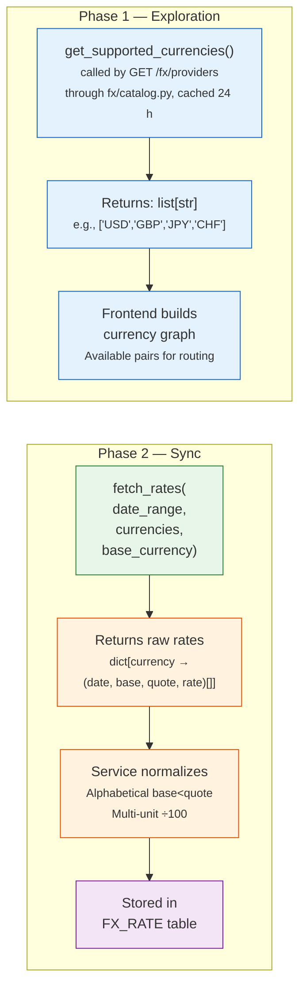

# 💱 FX Plugin Guide

How to create a new **FX Rate Provider** to fetch exchange rates from a new central bank or data source.

**Base class**: `FXRateProvider` (in `backend/app/services/fx/base.py`)
**Plugin folder**: `backend/app/services/fx_providers/<name>/` — the code in `plugin.py`, beside an `__init__.py` holding only its docstring (see [Plugin Folder](#plugin-folder))
**Registry**: `FXProviderRegistry`

---

## 🤖 Tip: Let an LLM scaffold the provider

Paste this entire page into an LLM with the central bank or API documentation and use this prompt:

!!! tip "Suggested prompt"

    ```
    Here is the LibreFolio FX Rate Provider specification: [paste this page]

    I want to add an FX provider for [SOURCE_NAME] (e.g., a central bank or FX data API).
    Their API works like this: [brief description or paste API docs / sample response]
    Base currency: [e.g., EUR]
    Supported currencies: [e.g., USD, GBP, JPY, CHF]

    Write a complete Python FXRateProvider implementation. Follow all conventions:
    @register_provider, correct fetch_rates return type, multi_unit_currencies if needed,
    description_i18n, warning_i18n if applicable. Use asyncio.to_thread for sync HTTP calls.
    On "too many requests" (HTTP 429), raise FXRateLimitedError (raise_if_fx_rate_limited as
    the first line of the except) and never retry or sleep; one refused currency refuses the
    whole call (raise_longest_refusal after a gather).
    ```

    After scaffolding, test with a manual sync from the FX settings page. Save it as
    `fx_providers/<name>/plugin.py`, beside an `__init__.py` holding only a docstring, and
    restart — it will appear automatically as a selectable provider.

---

## 🔄 Flow

The system calls provider methods in two distinct phases:



**Phase 1** happens when a user adds a new currency pair — the system queries providers to discover which currencies they support. That query is `GET /fx/providers`, which reaches `get_supported_currencies()` only through `backend/app/services/fx/catalog.py`: each provider's list is cached for 24 hours (named cache `fx_provider_currencies`, see [Cache Registry](../settings_cache.md)); if the call raises or takes longer than 5 seconds, the endpoint answers with the last list that provider returned in this process (empty before its first success) and tries again 5 minutes later. A provider may therefore fetch its list over the network, but must not rely on being called on every request.

**Phase 2** happens during sync — the system requests actual rate data for specific date ranges.

**Plugin responsibility**: Fetch raw rates from the provider's API. Apply multi-unit adjustment (e.g., JPY ÷ 100). Return data in the provider's native format (no inversion, no alphabetical ordering). Skip only what it cannot read: BOE, FED, SNB and ECB catch `ArithmeticError` where they read each line, point or observation, so a value that is no number (`"abc"`, `"1.2.3"`, a JSON `null` at ECB) skips its date alone, logged at debug (X-R50; ECB since X-R52, where a structural problem, a missing index or key, still loses the currency: *Unexpected ECB response format*); before, `decimal.InvalidOperation`, which is no `ValueError`, got past their handlers: BOE, FED and ECB lost that currency's answer, every date of it, and SNB, whose `_parse_json()` runs outside the `try` of `fetch_rates()`, the whole fetch.
**Core responsibility**: Normalize for storage (alphabetical `base < quote`), skip duplicates, handle fallback chains.

---

## 📋 ABC Methods

### ✅ Required (Abstract)

| Method | Signature | Description |
|--------|-----------|-------------|
| `code` | `@property → str` | Provider code (e.g., `"ECB"`, `"FED"`) |
| `provider_code` | `@property → str` | The key the registry stores the provider under, and the `<CODE>` of its settings' variables: return `self.code`, as every shipped provider does. Not abstract, but a provider without it is not registered |
| `name` | `@property → str` | Display name (e.g., `"European Central Bank"`) |
| `base_currency` | `@property → str` | Primary base currency (e.g., `"EUR"` for ECB) |
| `get_supported_currencies()` | `async → list[str]` | List of available quote currencies (static, or fetched over the network). Reached only through a 24 h cache with a 5 s timeout — see Phase 1 in [Flow](#flow) |
| `fetch_rates(date_range, currencies, base_currency)` | `async → dict[str, list[tuple]]` | Fetch rates for date range. Returns `{currency: [(date, base, quote, rate), ...]}` |

### 🔧 Optional (Override)

| Method | Default | Description |
|--------|---------|-------------|
| `icon` | `None` | Provider icon URL |
| `base_currencies` | `[base_currency]` | List of supported bases (single-base for now) |
| `description` | Auto-generated | Provider description |
| `description_i18n` | `{"en": description}` | Multilingual descriptions |
| `warning_i18n` | `{}` | Data-quality warnings shown in UI (⚠️ triangle on routes) |
| `docs_url` | Generic providers list | URL to documentation page |
| `test_currencies` | `["USD","EUR","GBP","JPY","CHF"]` | Currencies that must be available for tests |
| `multi_unit_currencies` | `set()` | Currencies quoted per 100 units (e.g., JPY, SEK). Plugin must normalize ÷100. |
| `generate_static_url(path)` | — | Helper to build `/api/v1/uploads/plugin/fx/{path}` |
| `settings_fields` | `()` | The values the provider needs from the instance: an API key, an account. Read with `self.settings` in `fetch_rates()` and `get_supported_currencies()`, never in `__init__`: see [Settings](#settings) |
| `test_only` | `False` | `True` for a provider that exists for the tests: hidden from `GET /fx/providers` and from the settings catalogue and, outside test mode, not served at all ([Test-Only Plugins](plugin_settings.md#test-only)) |

---

## 💻 Implementation Example

```python
# backend/app/services/fx_providers/my_central_bank/plugin.py

from datetime import date
from decimal import Decimal
from backend.app.services.fx.base import FXRateProvider
from backend.app.services.fx.registry import FXProviderRegistry
from backend.app.services.provider_registry import register_provider

@register_provider(FXProviderRegistry)
class MyCentralBankProvider(FXRateProvider):

    @property
    def code(self) -> str:
        return "MCB"

    @property
    def provider_code(self) -> str:
        return self.code  # the registry's key

    @property
    def name(self) -> str:
        return "My Central Bank"

    @property
    def base_currency(self) -> str:
        return "MYC"  # This bank quotes all rates as 1 MYC = X foreign

    @property
    def icon(self) -> str:
        return self.generate_static_url("mcb/logo.svg")

    @property
    def multi_unit_currencies(self) -> set[str]:
        return {"JPY"}  # JPY quoted per 100 units by this bank

    async def get_supported_currencies(self) -> list[str]:
        # Return list of currencies this provider can fetch — static here, but an API call is fine:
        # GET /fx/providers reaches it through services/fx/catalog.py (24 h cache, 5 s timeout).
        return ["USD", "EUR", "GBP", "JPY", "CHF"]

    async def fetch_rates(
        self,
        date_range: tuple[date, date],
        currencies: list[str],
        base_currency: str | None = None,
    ) -> dict[str, list[tuple[date, str, str, Decimal]]]:
        # Fetch from your API
        start, end = date_range
        result = {}
        for cur in currencies:
            raw_data = await self._call_api(cur, start, end)
            rates = []
            for row in raw_data:
                rate = Decimal(str(row["rate"]))
                # Multi-unit adjustment (plugin responsibility)
                if cur in self.multi_unit_currencies:
                    rate = rate / 100
                rates.append((row["date"], self.base_currency, cur, rate))
            result[cur] = rates
        return result
```

### 🗂️ Plugin Folder {: #plugin-folder }

A provider is a folder of `fx_providers/`. Restart the app: `FXProviderRegistry` loads its
`plugin.py` as `backend.app.services.fx_providers.my_central_bank.plugin`. Import and patch the
provider's names from that module — `from backend.app.services.fx_providers.manual.plugin import MANUAL_PRIORITY`,
`patch("backend.app.services.fx_providers.ecb.plugin.httpx")`: the package
re-exports nothing, so a patch aimed at it fails. A helper only this provider uses sits beside
`plugin.py` as `_*.py`. Discovery, the layout and the gate that keeps it
(`./dev.py test utils gate-plugin-layout`) are in [Plugin Folder Layout](registry_pattern.md#plugin-layout).

An FX provider's own texts travel with it through the API, in every language it declares
(`description_i18n`, `warning_i18n`): they are not catalogue keys. Its only catalogue keys are the
texts of its [settings](#settings), under `pluginSettings.fx.<CODE>`, `<CODE>` being the code as the
registry has it, case included (`pluginSettings.fx.ECB`). They live in an `i18n/` folder beside
`plugin.py`, added with `./dev.py i18n add … --into fx_providers/<folder>`
([Labels and Translations](plugin_settings.md#translations)). No shipped FX provider declares
settings, so none has an `i18n/` folder today.

### 🖼️ Static Assets (Icons)

Place provider icons in the family's `backend/app/services/fx_providers/static/mcb/`, not in the
provider's folder:

```
fx_providers/
├── static/
│   └── mcb/
│       └── logo.svg    ← served at /api/v1/uploads/plugin/fx/mcb/logo.svg
└── my_central_bank/
    ├── __init__.py     ← its docstring and nothing else
    └── plugin.py       ← the code above
```

---

## 🎛️ Settings {: #settings }

An FX provider that needs an API key or another value declares it in `settings_fields`. The core
resolves the values (environment variable, saved value, default), decrypts the secret ones and binds
them to a new instance before each use; the provider reads them in `fetch_rates()` and
`get_supported_currencies()` with `self.settings.get("key")` and `self.settings.secret("key")`.

- **Never read settings in `__init__`.** The core binds them after the instance is created, so
  `__init__` sees only the declared defaults and no secret.
- **System fields only.** A sync serves every user, so an FX provider receives the instance's values
  only, and a `user` field is refused at registration. A field may be secret.
- **Who sets them.** An administrator saves them, or the environment sets them with
  `LIBREFOLIO_PLUGIN_FX_<CODE>_<FIELD>`, `<CODE>` being derived from `provider_code`; a set variable
  locks the field. A secret field may also keep, in `env`, the variable the provider read its key
  from before it declared settings.
- **The boundary.** The service calls a provider through `call_fx_provider()`
  (`backend/app/services/fx/runtime.py`), on an instance from `configured_fx_provider()`: a required
  field without a value raises `FXNotConfiguredError` before any I/O, a provider paused after «too
  many requests» raises `FXRateLimitedError` before any I/O ([Too Many Requests](#too-many-requests)),
  and the secrets are masked in the log lines and errors of the call, every occurrence found at once
  and overlapping ones masked as one `***`. With no `user` fields, an FX call never hides its errors
  whole as an asset call with a personal secret does
  ([Secrets](plugin_settings.md#user-secret-errors)). Never return a secret, log it, or put it in a
  URL you log or in an exception message: masking is only a safety net.
- **Texts and screen.** Declare `label_key` and `description_key` on each field, and `label_key` on
  the options that need a translation, under `pluginSettings.fx.<CODE>` ([Plugin Folder](#plugin-folder)).
  The provider then appears in **Settings › Plugins**, under **Exchange rates**, where an
  administrator sets its fields and every other user reads them; **Configure** exists only for price
  providers.

The full contract is in [Plugin Settings](plugin_settings.md).

---

## 🚦 Too Many Requests {: #too-many-requests }

When a source refuses for too many requests, the core pauses the provider: `call_fx_provider()` stops
calling it for a while and raises `FXRateLimitedError` (`error_code = "RATE_LIMITED"`, `retry_after`
in seconds) to every caller at once, without any I/O. By default the pause starts at 60 s and
doubles at each refusal in a row, up to 1 h, plus up to 10 % of jitter; a `Retry-After` the source
sent is honoured, up to 24 h. The sync counts a paused provider as a failed leg and tries the pair's
next route ([Paused Providers](../../backend/fx/configuration.md#paused-providers)); the currency
catalogue answers with the provider's last known list.

The plugin's part is only to report the refusal:

- **Raise `FXRateLimitedError`** (`backend/app/services/fx/base.py`), with the source's `Retry-After`
  in seconds as `retry_after` when it sent one. It is an `FXServiceError`.
- **Never retry or sleep** (`asyncio.sleep`) after a refusal: the core decides how long to wait.
- **One refused currency refuses the whole call.** Do not skip the refused currency and return the
  others, as you would after another error: the provider is paused either way, and the sync fetches
  the pair from its next route. After an `asyncio.gather(..., return_exceptions=True)`, call
  `raise_longest_refusal()` on the outcomes (BOE, FED); in a serial loop, re-raise
  `FXRateLimitedError` at once (ECB).
- An FX pause always covers the whole provider: unlike asset providers, there is no scope hook.

| Helper (`fx/base.py`) | Use |
|---|---|
| `fx_rate_limited_from_response(response, provider_code)` | An `httpx` response: an `FXRateLimitedError` when it is an HTTP 429, with its `Retry-After`; else `None` |
| `raise_if_fx_rate_limited(error, provider_code)` | The first line of an `except httpx.HTTPError`: raises the refusal (`from error`) when the error carries an HTTP 429 response, and lets every other error go on to the plugin's own handling |
| `raise_longest_refusal(outcomes)` | After `asyncio.gather(..., return_exceptions=True)`: raises the refusal with the longest `Retry-After` among the outcomes, if there is one (`longest_refusal()` returns it instead) |

```python
import asyncio

import httpx

from backend.app.services.fx.base import FXServiceError, raise_if_fx_rate_limited, raise_longest_refusal


class MyCentralBankProvider(FXRateProvider):
    async def fetch_rates(self, date_range, currencies, base_currency=None):
        async def _fetch_one(currency: str):
            try:
                async with httpx.AsyncClient(timeout=30.0) as client:
                    response = await client.get(self.API_URL, params={"currency": currency})
                    response.raise_for_status()
                    return currency, self._parse(response.text, currency)
            except httpx.HTTPError as e:
                raise_if_fx_rate_limited(e, self.provider_code)  # a 429 leaves as RATE_LIMITED: no retry, no sleep
                raise FXServiceError(f"MCB API error for {currency}: {e}") from e

        outcomes = await asyncio.gather(*(_fetch_one(c) for c in currencies), return_exceptions=True)
        raise_longest_refusal(outcomes)  # one refused currency refuses the whole call
        # Any other error skips its currency only.
        return {c: ([] if isinstance(o, BaseException) else o[1]) for c, o in zip(currencies, outcomes)}
```

**Testing a refusal.** The test-only `MOCKFX` provider refuses every call, `fetch_rates()` and
`get_supported_currencies()`, while its class attribute `rate_limited` is true, with
`rate_limited_retry_after` as the `Retry-After` (`None` for none). Set them with
`monkeypatch.setattr` on `MockFXProvider` (`backend/app/services/fx_providers/mockfx/plugin.py`),
in in-process tests only: the pause that follows is real and holds for the whole process, so never
use it on a lane's shared test backend.

---

## 🔗 Related Documentation

- [FX Architecture](../../backend/fx/architecture.md) — Multi-provider design, sync process
- [FX Configuration & Routing](../../backend/fx/configuration.md) — Chain routing algorithm, fallback
- [FX Providers](../../backend/fx/providers/index.md) — ECB, FED, BOE, SNB technical details
- [Registry Pattern Overview](registry_pattern.md) — How the plugin system works
- [Plugin Settings](plugin_settings.md) — Declared settings, secrets and the provider call boundary

