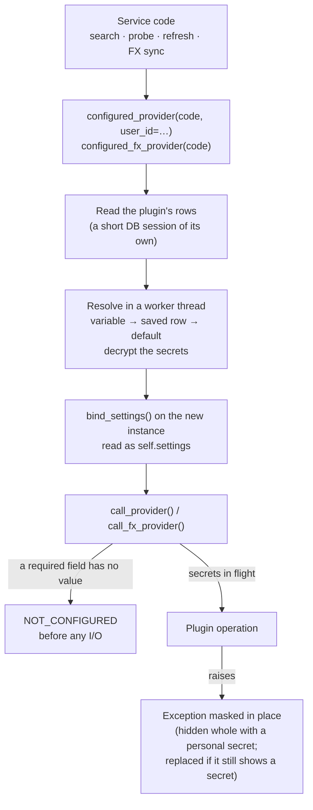
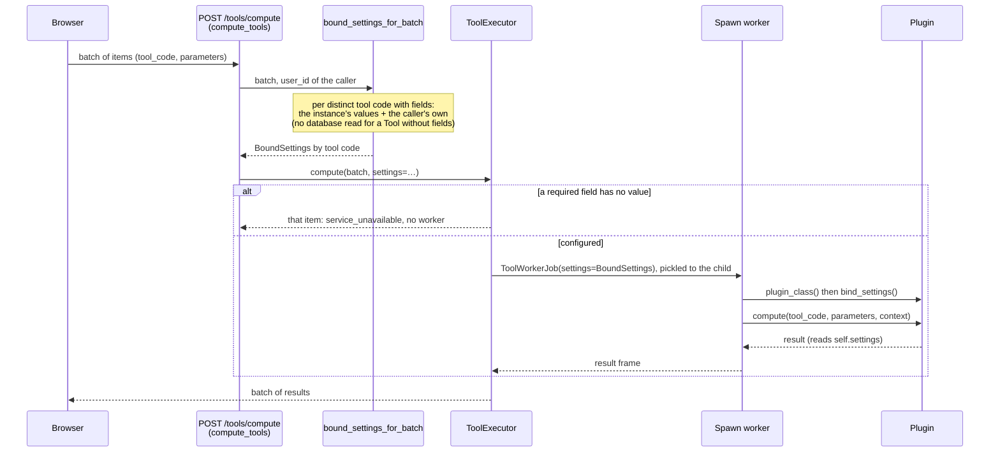

# 🎛️ Plugin Settings

How a plugin declares the values it needs (an API key, a region, a user's preference) and how the
core resolves them, stores them, protects the secret ones and hands them to the plugin.

- **Declaration**: `PluginSettingField` in `backend/app/services/plugin_settings/fields.py`
- **Plugin side**: `PluginSettingsMixin` (`settings_fields`, `test_only`, `self.settings`) and
  `BoundSettings`, in `backend/app/services/plugin_settings/contract.py`
- **Families**: asset providers (`AssetSourceProvider`), FX providers (`FXRateProvider`) and the
  broker-import plugins (`BRIMProvider`, `brim`: prepared, no plugin declares a field yet:
  [BRIM settings](../../backend/brim/architecture.md#brim-settings)) and the Tool plugins (`ToolPlugin`,
  `tool`: prepared, no shipped Tool declares a field yet: [A Field in a Tool Plugin](#tool-field))
- **API**: `GET /api/v1/settings/plugins` and `PATCH /api/v1/settings/plugins/bulk`
- **Interface**: the **Plugins** tab of Settings, and **Configure** in the asset dialog and in the
  asset search, in `frontend/src/lib/features/plugin-settings/` ([The Interface](#interface))
- **Shipped plugins with settings**: justETF (`preferred_currency`) and Borsa Italiana
  (`preferred_language`), a personal search preference each ([Shipped Plugins](#shipped-plugins))
- **Reference plugin**: `backend/app/services/asset_source_providers/mockprov/plugin.py`, test-only,
  with one field of every kind

!!! info "Where the values are written"

    Users and administrators write the values in **Settings › Plugins**, or for one price provider
    with **Configure** ([The Interface](#interface)); scripts and tests use the [API](#api). An
    [environment variable](#environment) sets a `system` field instead, and locks it. What the user
    sees is described in the user manual: [Plugin Settings](../../../user/settings/plugins.md).

---

## 🗺️ Source Map

Paths are relative to `backend/`.

| Source | Responsibility |
|--------|----------------|
| `app/services/plugin_settings/fields.py` | `PluginSettingField` and `SettingOption`, the rules of each family (`FAMILY_RULES`), the checks of a declaration and of a value, the variables of a field (`env_name()`, `env_variables()`) and their single owner (`claim_env_variables()`) |
| `app/services/plugin_settings/contract.py` | `PluginSettingsMixin`, inherited by the family bases, and `BoundSettings`, the values bound to one instance |
| `app/services/plugin_settings/resolver.py` | The value each field takes (variable, saved row, default), its problems, the fields that leave a plugin not configured (`missing_field_keys()`, one rule for a call and for the catalogue), and the fingerprint of the cache keys |
| `app/services/plugin_settings/runtime.py` | `configure_instance()`: reads the plugin's rows and binds the values to a new instance; `bound_settings_for()`: the values of a plugin that cannot be bound where it is created, as the `BoundSettings` to hand over (`None` when it declares no field) |
| `app/services/plugin_settings/crypto.py` | The encryption of the secret values, and `plugin_secrets_key_status()` |
| `app/services/plugin_settings/service.py` | The catalogue (`configured` and the plugin's icon included) and the all-or-nothing writes behind the API |
| `app/api/v1/plugin_settings.py`, `app/schemas/plugin_settings.py` | The two endpoints and their schemas |
| `app/services/assets/core.py` | `configured_provider()`, `call_provider()` (the boundary of every asset provider call), `public_asset_url()` (an asset URL withheld when it shows a secret), `settings_cache_part()`, `settings_cache_part_for()` |
| `app/services/assets/search.py` | Search for a user: `providers_not_configured`, and the stream's `provider_error` with its `error_code` ([NOT_CONFIGURED](#not-configured)) |
| `app/services/fx/runtime.py` | `configured_fx_provider()`, `call_fx_provider()` (the boundary of every FX provider call), `settings_cache_part()` |
| `app/services/brim/brim_parse_pool.py`, `app/services/brim/brim_provider.py` | The BRIM parse: `parse_file_offloaded()` resolves the values in the parent, `parse_file()` binds them in the worker and holds the secrets in flight ([BRIM](#brim-parse)) |
| `app/services/tools/settings.py`, `app/services/tools/worker.py` | The Tool compute: `bound_settings_for_batch()` resolves the values in the parent, one set per tool code; `ToolWorkerJob.settings` carries them and the worker binds them ([Tools](#tool-field)) |
| `app/utils/runtime/secret_masking.py` | The masking of the secrets in flight, in log lines and in exceptions, each text either masked in place or, with `whole`, hidden entirely; and the check that an error still shows one |
| `app/config/plugins.py` | `plugin_setting_env()` and `plugin_setting_env_origin()`: the environment variables of the fields |
| `app/db/models.py`, `alembic/versions/005_release_1_3_0_schema.py` (step 4) | The tables `plugin_system_settings` and `plugin_user_settings` |

The interface is in `frontend/src/lib/features/plugin-settings/` ([The Interface](#interface)), its
texts in the `pluginSettings` subsystem of the catalogue and, for each plugin's fields, in the
plugin's own `i18n/` fragment ([Labels and Translations](#translations)).

---

## 🔄 How a Call Gets Its Settings



1. Service code asks for a configured instance: `configured_provider(code, user_id=…)` for an asset
   provider, `configured_fx_provider(code)` for an FX provider. The registry creates a new instance.
   A plugin that declares no field is returned as it is: no database read, no key.
2. `configure_instance()` reads the plugin's rows in a short session of its own, never the caller's
   (a search calls every provider at once), then resolves the values in a worker thread, because
   that reads the environment, secret files and the instance key. A database error does not stop
   the call: the plugin gets the variables and the defaults, and a warning is logged.
3. The values are bound to the instance (`bind_settings()`); the plugin reads them as
   `self.settings`.
4. The call goes through the family's boundary, `call_provider(provider, fn, timeout=…)` or
   `call_fx_provider(provider, fn)`, where `fn` returns the plugin's coroutine, for example
   `lambda: provider.search(query)`. A required field without a value refuses the call
   ([`NOT_CONFIGURED`](#not-configured)), and so does a pause after «too many requests»
   (`RATE_LIMITED`, [Provider Pauses](../../backend/assets/architecture.md#provider-pauses));
   otherwise the operation runs with the plugin's secrets in flight, masked in the log lines and in
   the exception it raises, whose texts are hidden whole when the call carries a personal secret
   ([Secrets](#secrets)).

Every use gets a new instance and values resolved again: nothing is kept between uses, so one user's
values never reach another user's call. A use is one search, one probe, the refresh of one asset,
one FX sync; the operations of a use share its instance (a search and its `resolve_url()` calls,
the operations of a probe).

A new call site follows the same path: an instance from `configured_provider()` or
`configured_fx_provider()`, called through `call_provider()` or `call_fx_provider()`. An instance
taken straight from the registry has no settings bound. `call_provider()` also accepts a `scope`
argument, the part of the provider a pause after «too many requests» covers
(`core.cooldown_scope_for()`).

### 📥 The BRIM Parse {: #brim-parse }

The broker-import family (`brim`) cannot follow this path as it is: a parse runs in a worker process
that re-creates the plugin from its code, so no instance bound by the caller reaches it. The parent
resolves the values instead, and only for a plugin that declares fields:

1. `parse_file_offloaded(file_id, plugin_code, broker_id, *, user_id=None)`
   (`app/services/brim/brim_parse_pool.py`) asks `bound_settings_for(BRIMProviderRegistry,
   plugin_code, user_id=…)` (`runtime.py`; the family comes from `registry.settings_family()`) for the instance's values and the personal ones of `user_id`: the
   route passes the user who imports. A plugin without fields gets `None`: no database read, and the
   worker is called with the three arguments it always had.
2. The picklable `BoundSettings` travels as the fourth argument of `parse_file()`
   (`app/services/brim/brim_provider.py`). The worker binds it on the plugin before the parse and
   holds the secrets in flight for its length, masked in every log line and in the exception; the
   parent masks the exception too, hiding its texts whole when a personal secret is bound
   ([Secrets](#secrets)).
3. The plugin reads `self.settings` inside `parse()`, never in `__init__`.

**Only the parse delivers settings.** No shipped BRIM plugin declares a field yet, and the other places that
create a plugin (the detection of the plugin, `api/v1/brokers.py` for the preview and the report sets,
`brim_report_sets.get_set_plugin`, `brim_gap_fix`) see the defaults and no secret: a value a plugin needs there
must not depend on a setting. The details are in
[BRIM settings](../../backend/brim/architecture.md#brim-settings). How a BRIM plugin declares a field, and when a
parse is stale because a setting changed: [A field in a BRIM plugin](../../backend/brim/architecture.md#brim-field-contract).

### 🧰 A Field in a Tool Plugin {: #tool-field }

The Tool family (`tool`) is prepared like the BRIM one: `ToolPlugin` inherits `PluginSettingsMixin`, so a
Tool plugin can declare `settings_fields` exactly like an asset, FX or BRIM plugin, but **no shipped Tool
declares a field yet**, so nothing changes for users today. The tests use private registries
(`backend/test_scripts/test_services/_tool_settings_fixtures.py`), never a folder under
`tool_plugins/`. What a Tool is, and what it must not do, is in [Tool plugins](tool_plugins.md); this
section is what the settings add to it.

#### The rules of the family

`FAMILY_RULES["tool"] = FamilyRules(user_scope=True, secrets=False)` (`fields.py`):

| | Allowed | Why |
|---|:---:|-----|
| Personal (`user`) field | ✅ | A Tool is computed on behalf of the user who asks, so the values of that user reach it |
| Instance (`system`) field | ✅ | An administrator, or an [environment variable](#environment), sets it for everybody |
| Secret field | ❌ | A Tool calls no external source, so it has nothing to keep secret: a declaration with a secret field is refused (`SettingsDeclarationError`) |

The other rules of a declaration are those of every family ([Declaring Fields](#declaring-fields)).

#### Declaring a field

The worked example is a Tool that rounds with a personal `select` field (the rounding Tool of the test
fixtures, `_tool_settings_fixtures.py`, whose test `test_tool_settings_contract.py` runs this very shape):

```python
# backend/app/services/tool_plugins/my_tool/plugin.py
from backend.app.services.plugin_settings.fields import PluginSettingField, SettingOption, SettingScope, SettingType
from backend.app.services.tools.base import ToolExecutionContext, ToolPlugin

class MyRoundingTool(ToolPlugin):
    contract_version = "1.0.0"
    implementation_version = "1.0.0"
    settings_fields = (
        PluginSettingField(
            key="rounding",
            type=SettingType.SELECT,
            scope=SettingScope.USER,  # each user rounds the way they like
            label="Rounding of a tie",
            description="How 2.5 is rounded: to the even neighbour (2) or away from zero (3).",
            default="half_even",      # the behaviour before the field existed
            options=(SettingOption("half_even", "Half even"), SettingOption("half_up", "Half up")),
        ),
    )
    services = (...)  # the ToolService values, as for any Tool

    def compute(self, tool_code: str, parameters: BaseModel, context: ToolExecutionContext) -> BaseModel:
        mode = ROUND_HALF_UP if self.settings.get("rounding") == "half_up" else ROUND_HALF_EVEN
        ...
```

1. **The default is the old behaviour.** A field added to a Tool that already computes must not change
   what it gives: an instance nobody configured and a user who chose nothing see exactly what the Tool
   did before. Give a required `user` field a default as well ([Scopes and Families](#scopes)).
2. **Read it inside `compute()`**, as `self.settings.get("rounding")`, never in `__init__`: the worker
   creates the plugin first and binds the values right after ([Never read settings in `__init__`](#reading-values)).
   `compute()` still touches no database, request or provider; its settings arrive with the job.
3. **Texts.** The field's `label`, `description` and options are the English the interface shows.
   The i18n ownership gate does not read the keys of a Tool field, and the space of a Tool's fragment is
   exactly its two `name_i18n_key` and `description_i18n_key` keys
   ([The Ownership Gate](registry_pattern.md#plugin-i18n-gate)), so a Tool field has no translated texts
   yet: settle where they live with the first real field.

#### Keyed by tool code

The settings of a Tool are keyed by its **tool code** (`ToolService.tool_code`), not by the plugin: a
plugin that bundles several services gets one independent set of values, and one set of
[environment variables](#environment), per service.

- The stored rows and the catalogue use the tool code as `plugin_code`:
  `LIBREFOLIO_PLUGIN_TOOL_<TOOL_CODE>_<FIELD>` for a `system` field.
- `GET /api/v1/settings/plugins` lists a Tool by its tool code, with the `ToolService.name` as its
  name, and no icon: the family is in `FAMILIES_WITHOUT_ICON` (`plugin_settings/service.py`), so the
  neutral puzzle piece shows. The Plugins tab groups the Tools under **Tools** (wrench icon, after
  **Broker imports**), only when a Tool declares fields.
- `configure_instance(instance, family, *, user_id=None, plugin_code=None)` takes the tool code as
  `plugin_code`, because a Tool has no `provider_code` attribute to read it from.

#### How a compute gets its values



1. `compute_tools` (`app/api/v1/tools.py`) calls `bound_settings_for_batch(batch, user_id=current_user.id)`
   (`app/services/tools/settings.py`) in the parent. For each **distinct** tool code of the batch whose
   plugin declares fields, it asks `bound_settings_for(ToolPluginRegistry, tool_code, user_id=…)` for the
   instance's values and the personal ones of the user who asks. A Tool without fields, or a code the
   registry does not know, is left out: no database read and no key. The values are resolved again for
   every batch and kept nowhere, so one user's values never reach another's compute.
2. The route hands the mapping to `ToolExecutor.compute(…, settings=…)`, which gives each item the
   values of its own tool code, and the job carries them as `ToolWorkerJob.settings` (picklable, like
   the BRIM parse's).
3. In the spawn child, `_execute` (`app/services/tools/worker.py`) creates the plugin with its
   zero-argument constructor and binds the settings **right after**, before `compute`. A job without
   settings (`None`, a Tool without fields) binds nothing and the plugin reads its defaults.

**A required field without a value.** `BoundSettings.missing` lists the required fields that have no
usable value, and any field whose variable is set but invalid. When it is not empty,
`ToolExecutor._run_item` ends that item with the error `service_unavailable`, **not retryable**, before
any worker starts; the other items of the batch run. It is the Tool's counterpart of
[`NOT_CONFIGURED`](#not-configured), and the catalogue shows the Tool as not configured the same way.

**An invalid declaration.** The Tool registry builds its own definitions, so the checks of the shared
`register()` do not run for it. `build_tool_definition()` (`app/services/tools/registry.py`) validates
the declaration with family `tool` and claims the environment variables for each tool code
([One owner per variable](#one-owner-per-variable)). A refusal quarantines that service with the
discovery reason `invalid_settings` (`ToolDiscoveryReason` in `app/schemas/tools.py`), as
`invalid_schema` or `invalid_operation_policy` do: its siblings stay available, and the catalogue
and the diagnostics report it as unavailable. A `test_only` Tool is left out of the snapshot outside
test mode ([Test-Only Plugins](#test-only)).

The tests to copy are in [Tests](#tests): `tool-settings-contract` (the declaration, the registry, the
worker, the executor and the route), `tool-settings-runtime` (the values on a private database, the
catalogue and the writes) and `tool-settings-lifecycle` (real spawn workers).

---

## 🧾 Declaring Fields {: #declaring-fields }

A plugin lists its fields in `settings_fields`, a class attribute holding a tuple:

```python
# backend/app/services/asset_source_providers/my_provider/plugin.py
from backend.app.services.assets.base import AssetSourceProvider
from backend.app.services.assets.registry import AssetProviderRegistry
from backend.app.services.plugin_settings.fields import PluginSettingField, SettingOption, SettingScope, SettingType
from backend.app.services.provider_registry import register_provider


@register_provider(AssetProviderRegistry)
class MyProvider(AssetSourceProvider):
    settings_fields = (
        PluginSettingField(
            key="api_key",
            type=SettingType.STRING,
            scope=SettingScope.SYSTEM,
            secret=True,
            required=True,
            label="API key",
            description="The key of the instance's My Data Provider subscription.",
        ),
        PluginSettingField(
            key="region",
            type=SettingType.SELECT,
            scope=SettingScope.SYSTEM,
            label="Region",
            default="eu",
            options=(SettingOption("eu", "Europe"), SettingOption("us", "United States")),
        ),
        PluginSettingField(
            key="results_limit",
            type=SettingType.INTEGER,
            scope=SettingScope.USER,
            label="Search results",
            default=10,
            minimum=1,
            maximum=50,
        ),
    )

    async def search(self, query: str) -> list[dict]:
        api_key = self.settings.secret("api_key")  # required: always set when the core calls this
        region = self.settings.get("region")  # "eu" unless the instance chose "us"
        limit = self.settings.get("results_limit")  # the caller's own value, or 10
        rows = self._search_api(query, region=region, api_key=api_key)
        return rows[:limit]

    # provider_code, provider_name, get_current_value(), …: see the Asset Plugin Guide
```

| Attribute | Default | Meaning |
|-----------|---------|---------|
| `key` | — | Lowercase letters, digits and `_`, a letter first, at most 64 characters, not ending in `_file`; unique in the plugin |
| `type` | — | `SettingType`: `STRING`, `NUMBER`, `INTEGER`, `BOOLEAN` or `SELECT`: see [Types and Validation](#types) |
| `scope` | — | `SettingScope.SYSTEM` (one value for the instance) or `SettingScope.USER` (each user's own): see [Scopes and Families](#scopes) |
| `label` | — | English label, required: the fallback when the interface has no translation |
| `description` | `""` | English help text |
| `label_key`, `description_key` | `None` | The i18n keys of the label and of the description, `pluginSettings.<family>.<code>.label.<key>` and `.description.<key>`, returned by the API so that a client never builds a key: see [Labels and Translations](#translations) |
| `secret` | `False` | Write-only, encrypted at rest, never returned: see [Secrets](#secrets) |
| `required` | `False` | The plugin cannot work without a value: the core refuses the call with [`NOT_CONFIGURED`](#not-configured) |
| `default` | `None` | The value when nothing else sets the field; a secret has none |
| `options` | `()` | The choices of a `select`: `SettingOption(value, label, label_key=None)`, the key being `pluginSettings.<family>.<code>.option.<key>.<value>` |
| `min_length`, `max_length` | `None` | The bounds of a `string` |
| `minimum`, `maximum` | `None` | The bounds of a `number` or an `integer` |
| `env` | `None` | For a secret `system` field only: the older variable name a provider read the value from, accepted after the derived one. See [Environment Variables and Locking](#environment) |

The declaration is static and checked once, when the plugin registers (`validate_declaration()`);
then, right before storing the plugin, the registry reserves its environment variables
(`claim_env_variables()`, see [One owner per variable](#one-owner-per-variable)). An invalid
declaration, or a variable another plugin already reads, raises `SettingsDeclarationError`: the
plugin's module fails to import and the plugin is not registered, like any import failure. The error
is logged and listed by `GET /api/v1/system/plugin-diagnostics`
([Registry Pattern](registry_pattern.md#registry-specializations)).

### 🌐 Labels and Translations {: #translations }

`label`, `description` and an option's `label` are English: the text the interface shows when it has
no translation, for example for a plugin mounted at runtime, whose fragment is not merged
([A Plugin's Translations](registry_pattern.md#plugin-translations)). To translate them, the plugin
declares their keys, never built by the interface, and holds the texts in its own `i18n/` fragment,
under the branch of its settings:

| Key | Declared as |
|-----|-------------|
| `pluginSettings.<family>.<code>.label.<key>` | the field's `label_key` |
| `pluginSettings.<family>.<code>.description.<key>` | the field's `description_key` |
| `pluginSettings.<family>.<code>.option.<key>.<value>` | an option's `label_key` |

`<family>` is `asset`, `fx` or `brim`, and `<code>` the code as the registry has it: the `provider_code` of
an asset provider (`justetf`, `borsa_italiana`), the FX code with its case (`pluginSettings.fx.ECB`).
The `tool` family has no such branch yet ([A Field in a Tool Plugin](#tool-field)).
justETF's field, for example:

```python
# backend/app/services/asset_source_providers/justetf/plugin.py (excerpt)
settings_fields = (
    PluginSettingField(
        key="preferred_currency",
        type=SettingType.SELECT,
        scope=SettingScope.USER,
        label="Preferred currency",
        description="Search shows each fund only in this currency. …",
        default="all",
        options=(
            SettingOption("all", "All currencies", label_key="pluginSettings.asset.justetf.option.preferred_currency.all"),
            *(SettingOption(currency, f"{_CURRENCY_FLAGS[currency]} {currency}") for currency in _SUPPORTED_CURRENCIES),
        ),
        label_key="pluginSettings.asset.justetf.label.preferred_currency",
        description_key="pluginSettings.asset.justetf.description.preferred_currency",
    ),
)
```

Its currency options declare no key: `🇪🇺 EUR` reads the same in every language. Add the texts in the
four languages, naming the plugin's folder:

```bash
./dev.py i18n add "pluginSettings.asset.my_provider.label.region" --en "Region" --it "Regione" --fr "Région" --es "Región" --into asset_source_providers/my_provider
```

Always pass `--into`. Without it, `add` refuses the first key of a new asset plugin, because the keys
under `pluginSettings.asset` belong to plugins, and refuses any key of a plugin whose keys lie under
two branches, as Borsa Italiana's do (`assets.providerParams.borsa_italiana` and
`pluginSettings.asset.borsa_italiana`); an FX plugin's first key would land in the `pluginSettings`
subsystem instead of the fragment. `./dev.py test utils gate-plugin-i18n-ownership` reads the
declared keys (each field's `label_key` and `description_key`, each option's `label_key`) and fails
when one is not in the plugin's fragment, or when a fragment key lies outside the plugin's branches
([The Ownership Gate](registry_pattern.md#plugin-i18n-gate)).

---

## 👥 Scopes and Families {: #scopes }

| Scope | Value | Written by | Seen by |
|-------|-------|------------|---------|
| `system` | One for the whole instance | An administrator, or an [environment variable](#environment) | Every signed-in user, read-only: a plain value in full, a secret only as set or unset |
| `user` | One per user | That user only | That user only: no endpoint shows it to anyone else, an administrator included |

Every signed-in user can read a plain `system` value: anything confidential is `secret=True`.

What a family may declare (`FAMILY_RULES` in `fields.py`):

| Family | `user` fields | Secrets | Why |
|--------|:-------------:|:-------:|-----|
| `asset` | ✅ | ✅ | Search and the probe of a configuration are made for a user |
| `fx` | ❌ | ✅ | A sync serves every user: an FX provider receives the instance's values only |
| `brim` | ✅ | ✅ | A parse runs for the user who imports: a personal value reaches it, and so does the instance's. Prepared: no shipped plugin declares a field yet |
| `tool` | ✅ | ❌ | A Tool is computed on behalf of the user who asks, so a personal value reaches it; it calls no external source, so there is nothing to keep secret. Prepared: no shipped Tool declares a field yet ([A Field in a Tool Plugin](#tool-field)) |

No other family supports settings: the signal and risk registries refuse a plugin that declares them.

**What a call receives.** The instance's values always; the user's values only when the call is made
for a user. Prices, history and metadata are shared by every user of an asset, and scheduled jobs run
for nobody in particular, so they never depend on one user's values:

| Call | `system` fields | `user` fields |
|------|-----------------|---------------|
| Asset `search()` and `resolve_url()` (`GET /api/v1/assets/provider/search`, `/search/stream`) | The instance's values | The caller's values |
| Asset probe (`POST /api/v1/assets/provider/probe`): current value, history, metadata | The instance's values | The caller's values |
| Asset current value, history, metadata and their refreshes, scheduled jobs included | The instance's values | Their defaults |
| FX `fetch_rates()` and `get_supported_currencies()` | The instance's values | — (none declared) |
| BRIM `parse()` (`POST /api/v1/brokers/import/files/{file_id}/parse`), only for a plugin that declares a field | The instance's values | The values of the user who imports |
| Tool `compute()` (`POST /api/v1/tools/compute`), only for a Tool that declares a field | The instance's values | The values of the user who asks |

So give a required `user` field a default. Without one, every call made for nobody, prices and
scheduled jobs included, finds the field empty and answers [`NOT_CONFIGURED`](#not-configured), while
the catalogue of a user who saved a value says `configured: true`: the catalogue judges the caller's
own values.

---

## 🔢 Types and Validation {: #types }

| `type` | Value written (JSON) | Value from a variable | Bounds |
|--------|----------------------|-----------------------|--------|
| `string` | Text without control characters, from `min_length` to `max_length` characters: 1 to 4096 by default, 8 to 4096 for a secret | Taken as written for a secret; stripped otherwise | `min_length`, `max_length` |
| `number` | A finite number, not a boolean; an integer value only within ±9 007 199 254 740 991 (`MAX_SAFE_INTEGER`, 2^53 − 1) | `float()` of the stripped text | `minimum`, `maximum` |
| `integer` | A whole number (`5`, not `5.0`), only within ±9 007 199 254 740 991 (`MAX_SAFE_INTEGER`, 2^53 − 1) | `int()` of the stripped text | `minimum`, `maximum` |
| `boolean` | `true` or `false` | `1`, `true`, `yes`, `on` or `0`, `false`, `no`, `off`, in any case | — |
| `select` | Text, one of the option values | The stripped text, one of the option values | `options` |

A value is checked by `validate_value()` when it is written and by `parse_env_value()` when it comes
from a variable. The message says why it is refused (`too short: at least 8 characters`,
`not one of the options`) and never contains the value, so a secret never travels back in a 422 or
reaches a log. An integer is accepted only within ±`MAX_SAFE_INTEGER`: up to it a double, and so the
JavaScript number the settings page edits, holds every integer exactly; past it the message is
`too large: at most 9007199254740991 in absolute value`, checked before the bounds. A saved value
that the field refuses later, because the plugin narrowed a bound or dropped an option, counts as
unset: the field takes its default and reports the problem `invalid_stored`.

At registration, `validate_declaration()` checks that:

- `settings_fields` is a tuple of `PluginSettingField`, with unique keys;
- each `key` has the form above and does not end in `_file`, the suffix of the variables that name a
  file; `type` and `scope` are `SettingType` and `SettingScope` values, and `label` is not blank;
- a `user` field and a secret appear only where the family allows them;
- a secret is a `string`, has no `default`, and accepts at least 8 characters: `min_length` may raise
  that minimum, never lower it;
- `env` is set only on a secret `system` field: `LIBREFOLIO_` followed by uppercase letters, digits
  and `_`, neither starting with `LIBREFOLIO_PLUGIN_` (the prefix of the derived names) nor ending in
  `_FILE`; no two fields declare the same one;
- lengths are set only on a `string`, with `1 <= min_length <= max_length <= 4096`; bounds only on a
  `number` or an `integer`, finite, an integer bound within `MAX_SAFE_INTEGER`, `minimum <= maximum`;
- a `select` has options with distinct, non-empty values and non-blank English labels, and no other
  type has options;
- a `default` passes the same checks as a written value.

---

## 🌍 Environment Variables and Locking {: #environment }

A `system` field can be set by the environment; a `user` field cannot, since a variable is one value
for the whole instance. `env_name(family, plugin_code, field_key)` gives the derived name:
`LIBREFOLIO_PLUGIN_<FAMILY>_<CODE>_<FIELD>`, where `<CODE>` is the plugin's `provider_code` (a Tool's
tool code) and each part is put in uppercase with every character other than a letter or a digit turned into `_`.

```bash
# The api_key field of the asset provider my_provider
LIBREFOLIO_PLUGIN_ASSET_MY_PROVIDER_API_KEY=…
# or the path of a file holding it, such as a Docker secret
LIBREFOLIO_PLUGIN_ASSET_MY_PROVIDER_API_KEY_FILE=/run/secrets/my_provider_api_key
```

- **Alias.** A secret `system` field may also declare a name of its own in `env`, read after the
  derived one: the variable a provider read its API key from before it declared settings, so that
  existing installs keep working. The test-only `mockprov` gives its `api_key` the alias
  `LIBREFOLIO_MOCKPROV_API_KEY`. A plain field has no alias: every signed-in user sees its value, and
  through an alias it could show a variable that is not its own. An alias never starts with
  `LIBREFOLIO_PLUGIN_`, the prefix of the derived names. Nor may it name a variable LibreFolio reads
  for itself, such as `LIBREFOLIO_INSTANCE_KEY`: the plugin would receive that value as its own
  secret. Registration cannot see this; the guard test `./dev.py test services plugin-settings-guards`
  checks the plugins in the repository.
- **`_FILE`.** Every variable, secret or not, is read by `plugin_setting_env()` with `env_secret()`:
  `NAME`, otherwise the content of the file `NAME_FILE` names, with the rules of
  [Secrets from Files](../security.md#secrets-from-files) (blank counts as unset, `NAME` wins).
  The first variable set among `DERIVED`, `DERIVED_FILE`, `ALIAS`, `ALIAS_FILE` gives the value.
- **Process environment only**, never `.env` directly: `./dev.py` and Docker Compose put the values
  of `.env` there.
- **Documented.** A plugin shipped with LibreFolio (not `test_only`) lists every variable of its
  `system` fields, the derived name and the alias, as a commented line in the «Plugins» section of
  `.env.example`: the same guard test fails otherwise.

Field by field, the value comes from the first source that has one: the variable, then the saved row
(the instance's for a `system` field, the user's for a `user` field), then the declared default.

**One owner per variable.** Every variable, derived or alias, belongs to exactly one field of one
plugin, so two plugins never share a value through the environment. Right before storing a plugin,
the registry reserves its variables with `claim_env_variables()`, and a plugin whose variable another
plugin already reads is refused, like an invalid declaration. Derived names can meet: the field `baz`
of the asset provider `foo_bar` and the field `bar_baz` of the asset provider `foo` both give
`LIBREFOLIO_PLUGIN_ASSET_FOO_BAR_BAZ`, so the second of the two to register is refused.
{: #one-owner-per-variable }

**A set variable wins and locks the field, even when its value is invalid.** In the catalogue the
field has `source: env`, `locked: true` and `editable: false`; administrators also see the variable
in `env_variable`. A write or a clear is refused with `LOCKED_BY_ENV`, and the message names the
variable, never its value. `plugin_setting_env_origin()` tells the write path that a variable is set
without reading its file.

**An invalid variable makes the plugin not configured.** A value the field refuses, or a `_FILE` that
cannot give its content, leaves the field without a value, with the problem `invalid_env`: the core
never falls back to the saved row or to the default. The field joins `settings.missing` even when it
is optional, so every call to the plugin is refused with [`NOT_CONFIGURED`](#not-configured) until
the variable is fixed. The log warns once per process for each such variable,
`Plugin setting variable invalid: the plugin is not configured until it is fixed`, with the
variable, the plugin, the field and the reason (`too short: at least 8 characters`, or the `_FILE`
error, which names the path), never the value.

**Managed profile.** With `LIBREFOLIO_PROFILE=managed`, a field a variable sets is left out of the
catalogue (a plugin left without fields is not listed at all), and a write to it is refused with
`UNKNOWN_FIELD`, as if it did not exist: the hosting provider sets it, the instance's administrators
and users never see it ([Hosting for Others](../../../admin/hosting_providers.md#managed-profile)).

---

## 📖 Reading Values in the Plugin {: #reading-values }

`self.settings` is a `BoundSettings`:

| Member | Returns |
|--------|---------|
| `get(key, default=None)` | The value of the plain field `key`, or `default` when it has none |
| `secret(key)` | The value of the secret field `key`, or `None` when it has none |
| `missing` | The fields that leave the plugin not configured: required ones without a usable value, and any field whose variable is set but invalid |
| `fingerprint` | The identity of these values in the cache keys: see [Caching](#caching) |
| `carries_user_secrets` | Whether a `user` secret with a value is bound: a value the caller chose. The core then hides the call's error texts whole ([Secrets](#user-secret-errors)) |

`get()` on a secret, `secret()` on a plain field, and either on a key the plugin does not declare
raise `KeyError`: a typo fails loudly. The `repr` of a `BoundSettings` names the secret fields set,
never their values.

- **Never read settings in `__init__`.** The registry creates the instance first and the core binds
  the values afterwards, never through the constructor. In `__init__`, and on any instance the core
  did not configure, `self.settings` holds only the declared defaults and no secret: a value read
  there is silently wrong. The registry also creates instances for its own needs (registration, the
  provider lists), which get no settings at all.
- **Read them in the operations the core calls through the boundary**: asset `search()`,
  `resolve_url()`, `get_current_value()`, `get_history_value()` and `fetch_asset_metadata()`; FX
  `fetch_rates()` and `get_supported_currencies()`; BRIM `parse()`; Tool `compute()`. Other members (properties, `params_schema`,
  `get_asset_url()`, `validate_params()`) may run on an instance the core did not configure, with the
  defaults and no secret.
- **Expect `None` for an optional field**: from `get()` when the field has no value and no default,
  from `secret()` when an optional secret is unset or unreadable. In an operation called through the
  boundary, a required field always has a value, and no field has an invalid variable: the boundary
  refuses those calls.
- **Keep the values on the instance, for one use.** Never copy one into a module-level or
  class-level object that outlives the instance, such as a shared HTTP client or a cache: the next
  use may be another user's.
- **A setting is not a provider parameter.** `provider_params` (described by `params_schema`) belong
  to one asset: they are stored in clear with it, shared by its users and returned by the asset API.
  An API key, or anything secret, goes in `settings_fields`, never in `provider_params`.

The test-only `mockprov` shows what a call receives: a search for `lf-settings-echo` returns one item
whose display name lists the plain values and, for each secret, only `set` or `unset`.

---

## 🔐 Secrets {: #secrets }

A secret is a `string` field with `secret=True` and no `default`. It accepts at least 8 characters;
`min_length` may raise that minimum, never lower it. Masking replaces a secret wherever its text
appears: a short one would hide ordinary text and, in a call that echoes what a user sent (the probe
of a configuration), would let that user test guesses of it.

**Write-only.**

- No read schema has a field for a secret's value: the catalogue gives only `is_set`, `source`,
  `locked` and `problem`, and leaves `value` and `default` empty.
- A write sends it in `secret_value` (a `SecretStr`, `format: password`), and no response or
  validation message repeats it. The router drops the `input` that FastAPI echoes in a 422
  (`NoInputEchoRoute`, `backend/app/api/no_echo.py`, shared with the backup routes that receive a
  password), so even a malformed request does not send the secret back.
- The log records who wrote which fields, never a value.

**At rest** (`crypto.py`):

- AES-256-GCM, with a subkey derived from the [instance key](../security.md#instance-key):
  `derive_key("plugins.settings.v1", 32)`. The stored blob is a format byte, a random 96-bit nonce,
  then the ciphertext and its 16-byte tag.
- The associated data binds the ciphertext to its row (family, plugin, field, scope and user id):
  copied to another row, or to another user's, it does not decrypt.
- Each row records `key_id`, the first 16 bytes of an HMAC-SHA256 of a fixed label under the subkey,
  in hex: it names the key that encrypted the row without revealing it.
- The catalogue judges a secret by its `key_id`, without decrypting it. Only a call decrypts, in the
  worker thread that resolves the values; the plaintext is never cached.
- A write that has a secret to encrypt answers `503` when the instance key cannot be used.

**A changed instance key.** If the instance key changes (a lost `instance.key` replaced by a new one,
another `LIBREFOLIO_INSTANCE_KEY`), the stored secrets can no longer be decrypted. They stay, reported
with the problem `unreadable`: set, but to be entered again; never deleted, never a wrong value. A
call gets no value for the field, so a required one makes the plugin
[not configured](#not-configured), and the first failure logs one warning per process and field:
`Plugin setting unreadable: it must be entered again`. `plugin_secrets_key_status(session)` counts
by `key_id`, without decrypting, the stored secrets of each scope that the current key did not
encrypt, or all of them when the key cannot be used; without stored secrets it reads no key, so it
never creates the key file. At every start, the step `plugin-secrets-check` (workstream H) calls it
and logs an error when stored `system` secrets are unreadable, with their count alone: the `user`
secrets are left to their users ([Plugin Secrets Check](../security.md#plugin-secrets-check)).

**An unusable instance key.** A configured key (`LIBREFOLIO_INSTANCE_KEY`,
`LIBREFOLIO_INSTANCE_KEY_FILE`) that cannot be used stops the server at startup. A generated key file
gone bad (damaged, unreadable, out of reach) does not: the server starts, with the error of the
startup check in the log, and every derivation from the key fails. The plugin settings carry on
without the stored secrets:

- the catalogue reports every stored secret as `unreadable`, with no error;
- calls run without them, and a required one makes the plugin [not configured](#not-configured);
- secrets from environment variables still reach the calls;
- a write that has a secret to encrypt answers `503`;
- the log has one error per process, the first time a stored secret is needed: `Plugin secrets unreadable: the instance key cannot be used (see the configuration checks)`.

Nothing is rewritten: once the key file is fixed or restored, the stored secrets decrypt again. A new
key leaves them `unreadable`: they must be entered again.

**Rules for plugin authors.**

- Never return a secret in a result: return values are not masked, and results are cached, stored
  and sent to clients.
- Never log a secret, never put it in a URL you log, never put it in an exception message.
- Never put a secret in `get_asset_url()` or in `cooldown_scope()`, and never send one in a request
  whose host comes from the `identifier` or the `provider_params`. Any signed-in user can probe a
  provider with any identifier and any parameters (`POST /api/v1/assets/provider/probe`), on an
  instance that carries the instance's secrets: a host taken from them is the caller's to choose,
  and the secret would travel there. An asset URL is shown to the user (the **Provider URL** of the
  asset dialog comes from the probe), and a pause scope is computed before the call, outside the
  masking, then keys the pause registry and appears in its log lines.

For the asset URL the core also checks, as a last line of defence: the probe passes the plugin's URL
through `core.public_asset_url()`, which withholds a URL that shows one of the provider's secrets.
The probe then answers `provider_url: null`, and the log has a warning naming the provider,
`Provider asset URL withheld: it shows a secret`. The URL is hidden whole, never masked: a masked URL
would tell the caller where a value they chose occurs. The other paths that compute an asset URL
(search results, the assignments read) call `get_asset_url()` on an instance the core did not
configure, which holds no secret.

**Masking, the safety net.** Masking catches mistakes; it is not a feature to rely on. During a call
through the boundary, the plugin's secrets are in flight (`secrets_in_flight()`, a `ContextVar`):

- every line logged in that context, the provider's thread included (`asyncio.to_thread` copies the
  context), is masked: by the structlog processor `mask_event_dict` and, for the libraries that log
  through the standard `logging` module, by the `SecretMaskingFilter` of the console and file
  handlers;
- the exception the call raises is masked in place, along its `__cause__` and `__context__` chain and
  through the members of an exception group: its arguments, its attributes (`message` and `details`,
  and those of a plugin's own exception class), its notes, and an `OSError`'s text and file names.
  Its type and traceback stay, so the callers' `except` clauses behave as before;
- a value is judged by the text it shows: strings are masked, dicts, lists, tuples and sets are
  copied with their keys and items masked, and any other value whose `str()` or `repr()` shows a
  secret (a URL object, bytes, an exception kept in `details`) becomes its masked text;
- a secret, and its URL-encoded forms, become `***`. `mask_text()` finds every occurrence of every
  form in the original text at once, then turns each run of occurrences that overlap or touch into a
  single `***`: no part of a secret survives beside another one that overlaps it.

**A secret the caller chose.** A `user` secret holds whatever its user typed. When a call carries one
(`settings.carries_user_secrets`), `call_provider()` hides whole every text of the exception that
shows any secret, the caller's or the instance's: each argument, attribute, note or `details` item
that shows one becomes `***` entirely, along the cause and context chain
(`mask_exception(..., whole=True)`). The exception's type and its `error_code` stay, so the callers
and the localized messages still work. Masked in place, the text would tell whether the value the
caller chose occurs in it, and where: next to an instance secret, guess after guess, that is enough
to read the instance secret. Hidden whole, a wrong guess and the right one raise the same error. The
log lines keep the precise masking, and so does every call that carries only instance secrets, as an
FX call always does: an FX provider has no `user` fields.
{: #user-secret-errors }

An error that still shows a secret after masking, because its own `__str__` builds the text from
state that masking cannot reach, is replaced at the boundary: by an `AssetSourceError` with
`error_code="PROVIDER_ERROR"` for an asset provider, by an `FXServiceError` for an FX provider. Its
message is `Provider <code> failed: <type>: <masked text>` (`<type>: ***` when the call carries a
`user` secret), and it is raised with no link to the original error. The asset one also carries that
description, `<type>: …`, in `details["detail"]`: the probe returns it in `error_details.detail`, and
**Test Configuration** shows it through `providerErrors.PROVIDER_ERROR`, *The provider failed:
{detail}*, so the cause (a 401 on a wrong key, say) stays visible. A refusal for too many requests is
replaced the same way by an `AssetRateLimitedError` or an `FXRateLimitedError`,
`Provider <code> refused for too many requests: …`, which keeps its `retry_after`.

Masking does not reach threads a library starts by itself (they do not inherit the `ContextVar`),
nor return values, nor a secret transformed in another way: in base64 in a Basic `Authorization`
header, hashed, or cut.

---

## 🚫 NOT_CONFIGURED {: #not-configured }

`missing_field_keys(states)` in `resolver.py` is the one rule of «not configured»: a required field
without a usable value (never set, an unreadable secret), and any field, required or optional, whose
variable is set but invalid ([Environment Variables and Locking](#environment)). A secret resolved
without decrypting it, as the catalogue resolves it, is usable when it is set and readable by the
current key. The same rule serves both sides:

- **A call**: `build_bound_settings()` puts the result in `settings.missing`. While the list is not
  empty, the boundary refuses the call before the plugin runs, so before any network access.
- **The catalogue**: `configured` is `not missing_field_keys(states)`, judged on every field of the
  plugin, the ones the managed profile hides included: a yes or a no, which names none of them. The
  interface shows it as the badge **Configured** or **To configure** ([The Interface](#interface)).

What the refusal looks like:

- **Asset providers**: `call_provider()` raises `AssetSourceError` with `error_code="NOT_CONFIGURED"`
  and the missing keys in `details["missing"]`; the message is
  `Provider <code> is not configured: <keys> missing`.
    - Search: the standard endpoint lists the provider in `providers_with_errors` and in
      `providers_not_configured`, and the stream sends `provider_error` with
      `error_code: "NOT_CONFIGURED"`. Both log it at info level with the missing keys
      (`Search skipped: provider not configured`, `Search stream: provider not configured`), not as a
      warning. The search box shows the provider a row of its own, with **Configure**.
    - Probe: every operation answers `NOT_CONFIGURED`, with the keys in `error_details.missing`.
      **Test Configuration** counts it as a failure (❌, *This provider must be configured before
      use*, `providerErrors.NOT_CONFIGURED`), never as a soft ⚠️.
- **FX providers**: `call_fx_provider()` raises `FXNotConfiguredError`, an `FXServiceError` that
  carries `provider_code` and `missing`, with the same message.

A field with a default is missing only when its variable is set but invalid.

!!! note "One divergence, by design: a blob the key id vouches for"

    The catalogue never decrypts: it trusts a stored secret whose `key_id` is the current key's. A
    blob that still does not decrypt under that key, damaged or copied from another row, counts as
    set in the catalogue (`configured: true`), while a call finds it unreadable and answers
    `NOT_CONFIGURED`. The API never writes such a row;
    `test_the_catalogue_cannot_see_a_blob_its_key_id_vouches_for_but_a_call_cannot_decrypt` pins the
    behaviour (`./dev.py test services plugin-settings-runtime`).

---

## 🗃️ Caching {: #caching }

`BoundSettings.fingerprint` identifies the values a call received: the first 32 hex characters of a
SHA-256 of the plain values or, when secrets are bound, of an HMAC-SHA256 under a subkey of its own
(`plugins.settings.fingerprint.v1`), so that a cache key never lets anyone test a guess of a secret.
It is empty for a plugin that declares no field. When the instance key cannot be used, only secrets
from variables reach a call, and the fingerprint is a SHA-256 of the plain values and of the names of
those secrets, never of their values.

The core adds it to the key of each cache of provider results, through `settings_cache_part(provider)`
(`assets/core.py`, `fx/runtime.py`): the search queries (`search_queries`), the current values and
histories (`asset_current_fetch`, `asset_history_fetch`), the metadata (`asset_metadata_fetch`), the
FX fetches (`fx_provider_responses`) and the FX supported currencies (`fx_provider_currencies`, keyed
by the code alone for a provider without fields). Different settings never share these entries; two
users with the same values do.

- Code that deletes entries by key rebuilds the settings part with `settings_cache_part_for(code)`, as
  a call would compute it now (for the asset history and current values, through
  `drop_asset_cache_entries()` in `assets/core.py`). An entry stored under other settings has another
  key: no lookup reaches it, and it expires with its TTL.
- The FX catalogue's fallback, the last list a provider returned, served for a few minutes when the
  provider fails, is kept by provider code, not by settings.
- The fingerprint covers the core's caches only. A cache the plugin keeps itself must not mix results
  computed under different settings, and must never hold a secret.

---

## 🧪 Test-Only Plugins {: #test-only }

`test_only = True`, a class attribute (`False` by default), marks a plugin that exists for the tests.
Today `mockprov`, `MOCKFX` and `MOCKFX_FAIL` are test-only. `MANUAL`, the sentinel of the
hand-entered FX rates, is not: it stays hidden from the FX list by its code.

- **Never listed.** In every mode, the plugin is left out of the provider lists
  (`GET /api/v1/assets/provider`, `GET /api/v1/fx/providers`), of the providers a search asks when the
  request names none, and of the settings catalogue read without a `plugin_code` filter.
- **Outside test mode, not served at all.** With `LIBREFOLIO_TEST_MODE` off, as on every production or
  self-hosted instance, its registry does not know it: `get_plugin()` returns `None`, and so do
  `get_plugin_instance()` and `get_provider_instance()`; `list_plugin_codes()` and `list_providers()`
  leave it out. Naming it reaches nothing:
    - an assignment (`POST /api/v1/assets/provider`) or a probe (`POST /api/v1/assets/provider/probe`)
      is refused as an unknown code is, a 422 «Unknown provider code»;
    - a search that names it skips it, as it skips a code no registry knows;
    - the refresh of an asset already assigned to it finds no provider («Provider not found») and
      deletes nothing: the assignment and the stored prices stay;
    - the settings catalogue has no entry for it, even filtered on its code, and a write naming it is
      refused with `UNKNOWN_FIELD`;
    - a conversion route naming `MOCKFX` or `MOCKFX_FAIL` is refused («Unknown provider(s)»), and a
      route that already uses one gets no rate from it, as from an unknown provider.
- **In test mode, reachable by name.** The test server (`./dev.py server --test`) and every test run
  set `LIBREFOLIO_TEST_MODE=1`. There, code that names the plugin reaches it, the catalogue lists it
  when the `plugin_code` filter names it, and a write, which always names its plugin, can set its
  fields.

The rule lives in the registry base, `AbstractPluginRegistry._withheld()` in
`backend/app/services/provider_registry.py`, which reads `is_test_mode()` at each lookup. A class that
does not set the flag (every real provider, every plugin of the other families) is never affected.
`./dev.py test services test-only-providers` covers the registries, the family runtimes and the
validation of an assignment and of a probe, in both modes.

**Asset, FX and Tool plugins (X-R44c, X5-4b).** The flag is for these three families. `BRIMProvider` inherits
`PluginSettingsMixin` too, and with it the attribute, but a flagged BRIM plugin would still be served
in production by methods of its registry that never ask `_withheld()`: BRIM's `auto_detect_plugin()`,
`get_compatible_plugins()` and `list_plugin_info()`, like signal and risk `list_definitions()`. A guard in the same suite reads every
`services/*/registry.py` in test mode, a new family too, and fails on such a plugin, naming registry,
code, class and methods: make them ask `_withheld()`, then add the registry to `TEST_ONLY_FAMILIES`.
The Tool registry is in `TEST_ONLY_FAMILIES` too: it serves only its snapshot, and `ToolPluginRegistry`
builds that snapshot without the withheld classes (`_withheld()`, once, in the mode then set), so
`get_snapshot()`, `get_definition()` and `get_plugin_instance()` never serve a `test_only` Tool outside
test mode.
The test plugin of the BRIM family therefore lives in a test module, never under `brim_providers/`
([BRIM settings](../../backend/brim/architecture.md#brim-settings)).

---

## 🔎 Shipped Plugins with Settings {: #shipped-plugins }

Two plugins shipped with LibreFolio declare a field, a personal `select` each, read in `search()`
only. Neither is required and both default to `all`, so both plugins are always configured; prices,
history and metadata never see the field ([Scopes and Families](#scopes)).

| Plugin | Field | Options | What `search()` does with it |
|--------|-------|---------|------------------------------|
| justETF (`justetf`) | `preferred_currency` | `all`, then `EUR`, `USD`, `CHF`, `GBP`, built from `_SUPPORTED_CURRENCIES` and `_CURRENCY_FLAGS` | Emits each fund's row in that currency only, instead of one per currency. 👑 still marks the fund's own currency, so it shows only when the two are the same |
| Borsa Italiana (`borsa_italiana`) | `preferred_language` | `all`, `it`, `en` | Emits each instrument's row in that language only (`_emitted_languages()`), in `search()` and in the rows `resolve_url()` returns. The site is searched in Italian whatever the preference, the first language of `_languages_in_order()`, never once per language |

Every instrument has a row in every currency or language, so a preference never drops an
instrument. justETF filters after its cached ETF list, and the core's search cache keys carry the
settings' fingerprint ([Caching](#caching)), so two users with different preferences never share a
cached answer. The texts are in the plugins' fragments, under `pluginSettings.asset.justetf` (a
fragment of its own, new with this field) and `pluginSettings.asset.borsa_italiana`. What the user
sees: [Search Preferences](../../../user/settings/plugins.md#search-preferences).

---

## 🌐 API {: #api }

| Endpoint | Caller | What it does |
|----------|--------|--------------|
| `GET /api/v1/settings/plugins` | Any signed-in user | Every plugin that declares settings, with `configured` (see [NOT_CONFIGURED](#not-configured)), its `icon_url` (the icon its family's provider list publishes: the `get_icon` property of a price provider, `icon` of an exchange-rate provider, `icon_url` of an import plugin; null without one) and each field as the caller sees it: its declaration (type, scope, labels and i18n keys, bounds, options, default) and its state (`value` for a plain field, `is_set`, `source`: `env`, `db`, `default` or `none`, `locked`, `editable`, `problem`, `updated_at`; `env_variable` for administrators). Filters: `family`, `plugin_code`. |
| `PATCH /api/v1/settings/plugins/bulk` | Any signed-in user; `system` fields need an administrator | Writes 1 to 100 items, all or nothing. Each item names `family`, `plugin_code`, `field_key` and `scope`, and gives exactly one of `value` (a plain field), `secret_value` (a secret field) and `clear: true` (deletes the saved value, so the default applies again). |

A write checks every item before writing anything, then writes them all in one transaction:

- `200`: every item written; `results` and `success_count`.
- `422`: at least one item refused and nothing written; `detail.results` lists every item with its
  outcome and, when refused, an `error_code` and a `message` without the value:
    - `UNKNOWN_FIELD`: no such plugin or field in that scope, a field hidden by the managed profile
      included;
    - `FORBIDDEN_SCOPE`: a `system` field written by a user who is not an administrator;
    - `LOCKED_BY_ENV`: a field a variable sets;
    - `INVALID_VALUE`: a value the field refuses, a secret in `value` or a plain value in
      `secret_value`, not exactly one of the three, or the same field twice.
- `409`: another write changed the same fields at the same time; nothing written.
- `503`: a secret cannot be encrypted, because the instance key cannot be used.

The rules live in `backend/app/services/plugin_settings/service.py`.

---

## 🖥️ The Interface {: #interface }

The interface reads and writes through the [API](#api) only. What the user sees is in the user
manual, [Plugin Settings](../../../user/settings/plugins.md); the code is in
`frontend/src/lib/features/plugin-settings/`:

| Source | Role |
|--------|------|
| `pluginSettingsApi.ts` | Thin wrappers over the generated client: `fetchPluginSettings(filter)`, `fetchPluginEntry(family, code)`, and `savePluginSettings(items)`, which never throws and answers `saved`, `refused` (422, each item with its `error_code`), `conflict` (409), `keyUnavailable` (503) or `failed`. `fieldOf()` and `entryOf()` narrow the answer to what the components trust: a secret never carries a `value` or a `default` |
| `pluginSettingsForm.ts` | The rules, without the DOM: the groups by family, with their titles and icons (`FAMILY_TITLE_KEYS`, `FAMILY_ICONS`), the texts with their English fallback, the read-only reasons, the state of a secret, the unsaved edits (`draftOf()`), the checks before the server's (`draftProblems()`, lengths counted in code points as `len()` counts them), the write items (`writeItems()`) and the refusals by field |
| `PluginSettingsForm.svelte` | One plugin's form: its icon (`icon_url`, or a neutral `Puzzle` when it has none or the image does not load) and name, a control per field type, saved all or nothing |
| `PluginSettingsTab.svelte` | The **Plugins** tab of Settings |
| `PluginSettingsModal.svelte` | **Configure**: the same form for one plugin, in a dialog |

- **The tab.** The `plugins` entry of `SETTINGS_TABS` (label `pluginSettings.tab.label`, icon
  `Puzzle`, order 25, visible to everyone; `?tab=plugins` opens it: see
  [Tab registry](../../frontend/components/features/settings.md#tab-registry)). It reads the whole
  catalogue once, unfiltered, so a test-only plugin is never listed, and groups it under **Prices**
  (`asset`), **Exchange rates** (`fx`), **Broker imports** (`brim`) then **Tools** (`tool`), leaving out
  a family without entries, which is every one of them for `brim` and `tool` until a plugin declares a
  field. Each title follows
  its family's icon from `FAMILY_ICONS` (`ChartColumn`, `Coins`, `Briefcase`, `Wrench`: the first two are the
  icons the families have on the documentation's home), so a new family adds one row there. Each plugin is a
  `PluginSettingsForm`, saved on its own; an empty catalogue and a failed read have their own message.
  Its book icon (`DocsLink`) opens the user page.
- **The form.** A control per type: a text or number input, a `SimpleSelect`, a checkbox, and a
  `PasswordInput` for a secret. A field the caller cannot change (`editable: false`) is read-only,
  with its reason: `locked`, *Set by the server*, the variable named for administrators
  (`env_variable`); or `adminOnly`, a `system` field for a user who is not an administrator.
  The problems the catalogue reports get a note each (`invalid_env`, `invalid_stored`,
  `unreadable`), and a field whose saved value is in force (`source: db`) offers **Use the default**,
  a `clear` item. **Save** sends the plugin's edits in one `PATCH`, then reads the plugin again with
  `fetchPluginEntry()` and hands the fresh entry to its parent; a refusal marks each refused field
  with its `error_code`. A save that succeeds raises no toast, only the app event
  `pluginSettings.saved`; a refusal or a failure raises one. The events name fields, never a value.
- **Secrets are never kept in the page.** The input is `autocomplete="new-password"`; what was typed
  is sent once, as `secret_value`, and dropped after the save whatever its outcome. A saved secret
  shows *Set on* with its `updated_at`, then **Replace** or **Clear**.
- **Configure** is `PluginSettingsModal`, on `ModalBase`, at layer 80 by default: above the asset
  dialog (50) and its prompts (70). Every opening reads the plugin afresh with
  `fetchPluginEntry(family, code)`, which names the plugin, so a test-only plugin is listed there too,
  in test mode ([Test-Only Plugins](#test-only)).
  Two components open it, for asset providers:
    - `ProviderAssignmentSection.svelte` reads `fetchPluginEntry('asset', code)` whenever the chosen
      provider changes, with no module-level cache: a cache would outlive a logout and show the next
      user the personal values of the previous one. With an entry, row 1 shows **Configure** next to
      the help link (unless the panel is read-only), and the badge **To configure** while
      `configured` is false; a save replaces the entry, so the badge follows.
    - `AssetSearchAutocomplete.svelte` collects the providers that could not search: from the
      stream's `provider_error` events with `error_code: "NOT_CONFIGURED"`, or from
      `providers_not_configured` when it falls back to the standard endpoint. Each gets a row at the
      top of the results, *{provider} must be configured before it can search*
      (`assets.search.notConfigured`), with **Configure**; a save starts the search again. When a
      result's `display_name` contains 👑, a legend closes the list (`assets.search.crownLegend`).
- **Texts.** The interface's own are in the `pluginSettings` subsystem of the catalogue
  (`frontend/src/lib/i18n/pluginSettings/`), the two search texts in `assets.search`, and the probe's
  `providerErrors.NOT_CONFIGURED` and `providerErrors.PROVIDER_ERROR` in the `assets` subsystem. A
  field's texts come from its declaration: `fieldLabel()`, `fieldDescription()` and `optionLabel()`
  translate the declared key, and fall back to the English text ([Labels and Translations](#translations)).
- **Colours** are roles only (`bg-lf-*`, `text-lf-*`, `border-lf-*`), each class a whole literal.

---

## 🛡️ Security Model and Risks {: #security-model }

The plugin settings code has been through a security review. What the encryption protects, and what
it does not:

| Scenario | Secrets protected | Why |
|----------|:-----------------:|-----|
| A copy of the database alone: a dump, a replica, the file sent for support | ✅ | The key is not in the database |
| SQL access to the tables, or an export of them | ✅ | Only ciphertexts |
| A ciphertext copied to another row, or to another user's | ✅ | The associated data binds it to its row |
| The API, the log, error messages | ✅ | Write-only, no echo, messages without values; masking as the last line of defence |
| The whole data directory, or any copy holding both `sqlite/app.db` and `secrets/instance.key` | ❌ | The ciphertexts and the key travel together |
| Two instances that share one instance key | ❌ | Same subkeys: a ciphertext copied to the same row of the other instance decrypts there |
| The running process: remote code execution, a memory dump, a malicious plugin | ❌ | A secret is in clear in memory during a call; a plugin runs in the process and can read the database and the key |
| An operator with a shell on the host, the container or the volume | ❌ | The declared trust boundary: whoever runs the instance can read everything |

What the code does about it:

- Secrets are write-only, and no message, response or log line contains a value.
- Secrets of at least 8 characters, so that masking neither hides ordinary text nor lets a user test
  short guesses through a call that echoes their input.
- A user's values are never shown to anyone else, administrators included.
- Every environment variable belongs to one field of one plugin, and only a secret field may have an
  alias: no plugin receives a value through another plugin's variable, and no plain field can show a
  variable that is not its own.
- Encryption under a subkey of its own, bound to the row; a `key_id` on every row, so a changed key
  shows as `unreadable`, never as a wrong value.
- Values resolved again for every use on a new instance, never cached in clear.
- Masking by value in log lines and exceptions while a call runs, overlapping occurrences masked as
  one, and an error that would still show a secret replaced at the boundary.
- When a call carries a secret its caller chose (a `user` secret), every error text that shows a
  secret is hidden whole, so that no guess of a value placed next to an instance secret can be
  tested against the masking.
- The probe withholds an asset URL that shows a secret (`core.public_asset_url()`).
- Cache keys with fingerprints, HMAC-keyed when secrets are bound.
- AI Export never reads the plugin settings: no module under `services/ai_export/` may import them or
  name their tables, and a guard test keeps it so.
- In the managed profile, the fields set by the hosting provider's variables are invisible.

Residual risks:

- **The key next to the database.** The generated key lives in `secrets/instance.key`, in the same
  data directory as the database. Protect the directory and its copies; better, give the key from a
  secret store with `LIBREFOLIO_INSTANCE_KEY_FILE` or `LIBREFOLIO_INSTANCE_KEY`, so that it is never
  written there ([Configuration](../../../admin/configuration.md), section «Plugin Settings»).
- **HKDF has no work factor.** The subkeys are only as strong as the instance key, which must be
  random, never a passphrase; the generated one is 32 random bytes. With a random key, the `key_id`,
  which lets whoever holds the database test a candidate key just as the GCM tag already does, gives
  nothing away.
- **Masking has limits**: threads a library starts, return values, transformed values
  ([Secrets](#secrets)). Never put a secret in a result, in a URL you log, or in a message.
- **A secret sent where the caller points.** A plugin that sends a secret in a request whose host
  comes from the `identifier` or the `provider_params` hands it to whoever probes with a host of
  their own: the secret leaves over the network, where no masking reaches. Only the plugin can avoid
  it ([Rules for plugin authors](#secrets)).
- **Plugins are trusted code.** Each one receives only its own settings, but it runs in the LibreFolio
  process.

---

## ✅ Tests {: #tests }

All six run without a server or the lane's database (`isolation="pure"`):

| Selector | Covers |
|----------|--------|
| `./dev.py test services plugin-settings-contract` | Declarations per family, refusal at registration, values per type, derived variable names, `BoundSettings` |
| `./dev.py test services plugin-settings-crypto` | The encrypted blob, the associated data, `key_id`, re-encryption on a copy, the key status |
| `./dev.py test services plugin-settings-runtime` | Resolution and locking, fingerprints, `configure_instance()`, `NOT_CONFIGURED` and masking at both boundaries; `missing_field_keys()`, the same for a call and for the catalogue; `PROVIDER_ERROR` and its `details["detail"]`; a secret the caller chose, the errors hidden whole so that a wrong guess and the right one raise the same error; `public_asset_url()`, in the probe too; the search's `providers_not_configured` and the stream's `provider_error` event |
| `./dev.py test services plugin-settings-service` | The catalogue, `configured` and each plugin's icon included (an icon that cannot be read, or an empty one, is null; a name that cannot be read falls back to the code), and the all-or-nothing writes |
| `./dev.py test services secret-masking` | Masking in exceptions and log lines, across threads and tasks; overlapping or touching occurrences masked as one, against the overlap attack of the security review; `whole` |
| `./dev.py test services plugin-settings-guards` | Shipped variables documented in `.env.example`, one owner per variable, no alias on a variable LibreFolio reads, AI Export kept away from the settings |

The other units that touch the plugin settings:

| Selector | Covers |
|----------|--------|
| `./dev.py test api plugin-settings` | The two endpoints on the lane's server: roles, write-only secrets, the 422 with every item and no input echo, user isolation, delivery to `mockprov`, CASCADE and SET NULL; justETF and Borsa Italiana in the full catalogue, each entry with its plugin's icon. It runs alone: it writes `mockprov`'s instance-wide fields |
| `./dev.py test db migration-005` | Migration `005_release_1_3_0_schema`, on temporary databases: among its steps, the two tables with their CHECKs, one value per field, `CASCADE` and `SET NULL`, created empty on a 1.2 install, and the downgrade that drops them |
| `./dev.py test utils gate-plugin-i18n-ownership` | The settings' keys in each plugin's fragment ([Labels and Translations](#translations)) |
| `./dev.py test services provider-errors` | Among the provider error paths, justETF's `preferred_currency` declaration and the rows its search keeps |
| `./dev.py test services borsa-italiana-search` | Borsa Italiana's `preferred_language` on a fund and on a share, the site searched in Italian whatever the preference |
| `./dev.py test services brim-parse-settings` | The BRIM parse hook ([The BRIM Parse](#brim-parse)): no field, called as before; fields, `BoundSettings` resolved in the parent and bound in the worker; errors and logs masked; the route passes the user; the pickle round trip. It uses the test plugin `_brim_settings_lab.py` |
| `./dev.py test services tool-settings-contract` | The Tool family ([A Field in a Tool Plugin](#tool-field)): `FAMILY_RULES["tool"]` (personal yes, secret refused), `ToolPlugin` inherits the mixin, the declaration checked when the definition is built (`invalid_settings`, siblings untouched, variables per tool code, `test_only` withheld outside test mode), the default is the old behaviour, `ToolWorkerJob.settings` pickles and the worker binds it before `compute`, an unconfigured Tool is `service_unavailable` with no worker, `compute_tools` resolves the batch for the caller. Pure; it runs the worked example above with the fixtures `_tool_settings_fixtures.py` |
| `./dev.py test services tool-settings-runtime` | The Tool values on a private database: `configure_instance(plugin_code=…)`, `bound_settings_for_batch()` (instance and user values, per tool code, one read per code, none for a Tool without fields), the catalogue by tool code, and the writes of a Tool (scopes, bounds, variable lock, all or nothing). Pure |
| `./dev.py test services tool-settings-lifecycle` | Real spawn workers: the plugin sees the value the parent delivered, the defaults when none, the values of its own tool code, never another caller's; an unconfigured Tool starts no worker while its sibling runs. It starts processes, so it is exclusive like `tools-lifecycle` |
| `./dev.py test services plugin-secrets-check` | The startup check of the stored secrets ([Plugin Secrets Check](../security.md#plugin-secrets-check)): `ok` without an unreadable `system` secret, otherwise an `error` that counts them alone; nothing logged and no key file generated without a stored secret; a check that cannot run is a warning, never an exception |
| `./dev.py test front-utility core-unit` | `pluginSettingsForm.test.ts` (the rules without the DOM, `FAMILY_ICONS` included) and `pluginSettingsApi.test.ts` (the narrowing of the answers, `icon_url` included, and every outcome of a save through the real client, only the transport faked) |
| `./dev.py test front-utility component-unit` | `PluginSettingsForm.component.test.ts` (PSF-01…30, the plugin's icon and its fallback in PSF-26…30), `PluginSettingsTab.test.ts` (PST-01…09, the families' icons in PST-07…09) and `PluginSettingsModal.test.ts` (PSM-01…09); **Configure**, the badge, the search's row and the 👑 legend in `ProviderAssignmentSection.test.ts` and `AssetSearchAutocomplete.test.ts` |
| `./dev.py test front-utility plugin-settings` | End to end, on desktop (`frontend/e2e/settings/plugin-settings.spec.ts`): the tab as a member and as an administrator, **Configure** on `mockprov` from an asset's edit dialog, the search's row and the 👑 legend on a simulated stream ([Front-Utility Tests](../../test-walkthrough/front-utility.md#plugin-settings)) |

---

## 🔗 Related

- 🧩 [Registry Pattern Overview](registry_pattern.md) — Discovery and registration, where the
  declaration is checked
- 📈 [Asset Plugin Guide](asset_plugin_guide.md#settings) — Settings in an asset provider
- 🧰 [Tool plugins](tool_plugins.md#settings) — A Tool's settings and the rule of `compute()`
- 💱 [FX Plugin Guide](fx_plugin_guide.md#settings) — Settings in an FX provider
- 🔐 [Security → Instance Key](../security.md#instance-key) — Where the key comes from and how keys
  are derived
- ⚙️ [Settings System](../settings.md) — User and global settings, a separate system
- 🛠️ [Configuration](../../../admin/configuration.md), section «Plugin Settings» — What the
  administrator sees and does
- 👤 [Plugin Settings](../../../user/settings/plugins.md), in the user manual — The **Plugins** tab
  and **Configure**, as the user sees them
- ⚙️ [Settings Components](../../frontend/components/features/settings.md#tab-registry) — The tab
  registry the **Plugins** tab is an entry of
