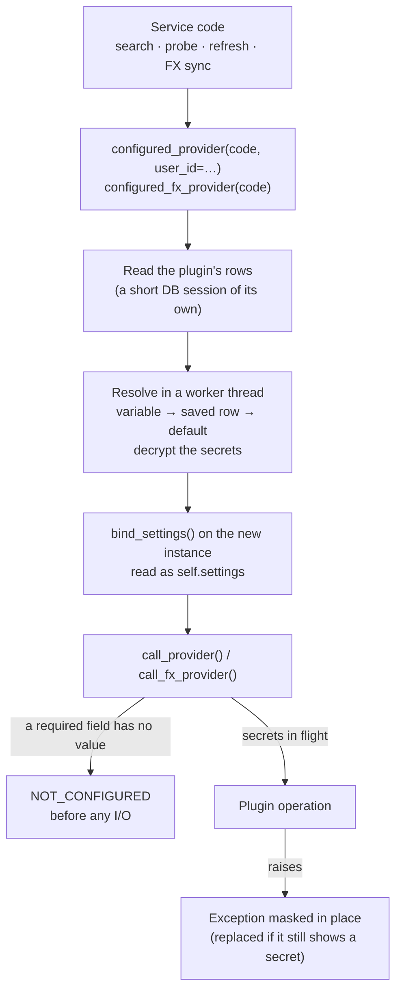

# 🎛️ Plugin Settings

How a plugin declares the values it needs (an API key, a region, a user's preference) and how the
core resolves them, stores them, protects the secret ones and hands them to the plugin.

- **Declaration**: `PluginSettingField` in `backend/app/services/plugin_settings/fields.py`
- **Plugin side**: `PluginSettingsMixin` (`settings_fields`, `test_only`, `self.settings`) and
  `BoundSettings`, in `backend/app/services/plugin_settings/contract.py`
- **Families**: asset providers (`AssetSourceProvider`) and FX providers (`FXRateProvider`)
- **API**: `GET /api/v1/settings/plugins` and `PATCH /api/v1/settings/plugins/bulk`
- **Reference plugin**: `backend/app/services/asset_source_providers/mockprov/plugin.py`, test-only,
  with one field of every kind

!!! info "Backend only"

    No screen edits plugin settings yet: values are written through the [API](#api) or set by
    [environment variables](#environment). No plugin shipped with LibreFolio declares settings
    today, apart from the test-only `mockprov` and `MOCKFX`.

---

## 🗺️ Source Map

Paths are relative to `backend/`.

| Source | Responsibility |
|--------|----------------|
| `app/services/plugin_settings/fields.py` | `PluginSettingField` and `SettingOption`, the rules of each family (`FAMILY_RULES`), the checks of a declaration and of a value, the variables of a field (`env_name()`, `env_variables()`) and their single owner (`claim_env_variables()`) |
| `app/services/plugin_settings/contract.py` | `PluginSettingsMixin`, inherited by the family bases, and `BoundSettings`, the values bound to one instance |
| `app/services/plugin_settings/resolver.py` | The value each field takes (variable, saved row, default), its problems, and the fingerprint of the cache keys |
| `app/services/plugin_settings/runtime.py` | `configure_instance()`: reads the plugin's rows and binds the values to a new instance |
| `app/services/plugin_settings/crypto.py` | The encryption of the secret values, and `plugin_secrets_key_status()` |
| `app/services/plugin_settings/service.py` | The catalogue and the all-or-nothing writes behind the API |
| `app/api/v1/plugin_settings.py`, `app/schemas/plugin_settings.py` | The two endpoints and their schemas |
| `app/services/assets/core.py` | `configured_provider()`, `call_provider()` (the boundary of every asset provider call), `settings_cache_part()`, `settings_cache_part_for()` |
| `app/services/fx/runtime.py` | `configured_fx_provider()`, `call_fx_provider()` (the boundary of every FX provider call), `settings_cache_part()` |
| `app/utils/runtime/secret_masking.py` | The masking of the secrets in flight, in log lines and in exceptions, and the check that an error still shows one |
| `app/config/plugins.py` | `plugin_setting_env()` and `plugin_setting_env_origin()`: the environment variables of the fields |
| `app/db/models.py`, `alembic/versions/007_plugin_settings.py` | The tables `plugin_system_settings` and `plugin_user_settings` |

---

## 🔄 How a Call Gets Its Settings



1. Service code asks for a configured instance: `configured_provider(code, user_id=…)` for an asset
   provider, `configured_fx_provider(code)` for an FX provider. The registry creates a new instance.
   A plugin that declares no field is returned as it is: no database read, no key.
2. `configure_instance()` reads the plugin's rows in a short session of its own, never the caller's
   (a search calls every provider at once), then resolves the values in a worker thread, because
   that reads the environment, secret files and the instance key. A database error does not stop
   the call: the plugin gets the variables and the defaults, and a warning is logged.
3. The values are bound to the instance (`bind_settings()`); the plugin reads them as
   `self.settings`.
4. The call goes through the family's boundary, `call_provider(provider, fn, timeout=…)` or
   `call_fx_provider(provider, fn)`, where `fn` returns the plugin's coroutine, for example
   `lambda: provider.search(query)`. A required field without a value refuses the call
   ([`NOT_CONFIGURED`](#not-configured)), and so does a pause after «too many requests»
   (`RATE_LIMITED`, [Provider Pauses](../../backend/assets/architecture.md#provider-pauses));
   otherwise the operation runs with the plugin's secrets in flight, masked in the log lines and in
   the exception it raises ([Secrets](#secrets)).

Every use gets a new instance and values resolved again: nothing is kept between uses, so one user's
values never reach another user's call. A use is one search, one probe, the refresh of one asset,
one FX sync; the operations of a use share its instance (a search and its `resolve_url()` calls,
the operations of a probe).

A new call site follows the same path: an instance from `configured_provider()` or
`configured_fx_provider()`, called through `call_provider()` or `call_fx_provider()`. An instance
taken straight from the registry has no settings bound. `call_provider()` also accepts a `scope`
argument, the part of the provider a pause after «too many requests» covers
(`core.cooldown_scope_for()`).

---

## 🧾 Declaring Fields {: #declaring-fields }

A plugin lists its fields in `settings_fields`, a class attribute holding a tuple:

```python
# backend/app/services/asset_source_providers/my_provider/plugin.py
from backend.app.services.assets.base import AssetSourceProvider
from backend.app.services.assets.registry import AssetProviderRegistry
from backend.app.services.plugin_settings.fields import PluginSettingField, SettingOption, SettingScope, SettingType
from backend.app.services.provider_registry import register_provider


@register_provider(AssetProviderRegistry)
class MyProvider(AssetSourceProvider):
    settings_fields = (
        PluginSettingField(
            key="api_key",
            type=SettingType.STRING,
            scope=SettingScope.SYSTEM,
            secret=True,
            required=True,
            label="API key",
            description="The key of the instance's My Data Provider subscription.",
        ),
        PluginSettingField(
            key="region",
            type=SettingType.SELECT,
            scope=SettingScope.SYSTEM,
            label="Region",
            default="eu",
            options=(SettingOption("eu", "Europe"), SettingOption("us", "United States")),
        ),
        PluginSettingField(
            key="results_limit",
            type=SettingType.INTEGER,
            scope=SettingScope.USER,
            label="Search results",
            default=10,
            minimum=1,
            maximum=50,
        ),
    )

    async def search(self, query: str) -> list[dict]:
        api_key = self.settings.secret("api_key")  # required: always set when the core calls this
        region = self.settings.get("region")  # "eu" unless the instance chose "us"
        limit = self.settings.get("results_limit")  # the caller's own value, or 10
        rows = self._search_api(query, region=region, api_key=api_key)
        return rows[:limit]

    # provider_code, provider_name, get_current_value(), …: see the Asset Plugin Guide
```

| Attribute | Default | Meaning |
|-----------|---------|---------|
| `key` | — | Lowercase letters, digits and `_`, a letter first, at most 64 characters, not ending in `_file`; unique in the plugin |
| `type` | — | `SettingType`: `STRING`, `NUMBER`, `INTEGER`, `BOOLEAN` or `SELECT`: see [Types and Validation](#types) |
| `scope` | — | `SettingScope.SYSTEM` (one value for the instance) or `SettingScope.USER` (each user's own): see [Scopes and Families](#scopes) |
| `label` | — | English label, required: the fallback when the interface has no translation |
| `description` | `""` | English help text |
| `label_key`, `description_key` | `None` | The i18n keys of the label and of the description, returned by the API, so that a client never builds a key |
| `secret` | `False` | Write-only, encrypted at rest, never returned: see [Secrets](#secrets) |
| `required` | `False` | The plugin cannot work without a value: the core refuses the call with [`NOT_CONFIGURED`](#not-configured) |
| `default` | `None` | The value when nothing else sets the field; a secret has none |
| `options` | `()` | The choices of a `select`: `SettingOption(value, label, label_key=None)` |
| `min_length`, `max_length` | `None` | The bounds of a `string` |
| `minimum`, `maximum` | `None` | The bounds of a `number` or an `integer` |
| `env` | `None` | For a secret `system` field only: the older variable name a provider read the value from, accepted after the derived one. See [Environment Variables and Locking](#environment) |

The declaration is static and checked once, when the plugin registers (`validate_declaration()`);
then, right before storing the plugin, the registry reserves its environment variables
(`claim_env_variables()`, see [One owner per variable](#one-owner-per-variable)). An invalid
declaration, or a variable another plugin already reads, raises `SettingsDeclarationError`: the
plugin's module fails to import and the plugin is not registered, like any import failure. The error
is logged and listed by `GET /api/v1/system/plugin-diagnostics`
([Registry Pattern](registry_pattern.md#registry-specializations)).

---

## 👥 Scopes and Families {: #scopes }

| Scope | Value | Written by | Seen by |
|-------|-------|------------|---------|
| `system` | One for the whole instance | An administrator, or an [environment variable](#environment) | Every signed-in user, read-only: a plain value in full, a secret only as set or unset |
| `user` | One per user | That user only | That user only: no endpoint shows it to anyone else, an administrator included |

Every signed-in user can read a plain `system` value: anything confidential is `secret=True`.

What a family may declare (`FAMILY_RULES` in `fields.py`):

| Family | `user` fields | Secrets | Why |
|--------|:-------------:|:-------:|-----|
| `asset` | ✅ | ✅ | Search and the probe of a configuration are made for a user |
| `fx` | ❌ | ✅ | A sync serves every user: an FX provider receives the instance's values only |

No other family supports settings yet: the BRIM, signal and risk registries refuse a plugin that
declares them.

**What a call receives.** The instance's values always; the user's values only when the call is made
for a user. Prices, history and metadata are shared by every user of an asset, and scheduled jobs run
for nobody in particular, so they never depend on one user's values:

| Call | `system` fields | `user` fields |
|------|-----------------|---------------|
| Asset `search()` and `resolve_url()` (`GET /api/v1/assets/provider/search`, `/search/stream`) | The instance's values | The caller's values |
| Asset probe (`POST /api/v1/assets/provider/probe`): current value, history, metadata | The instance's values | The caller's values |
| Asset current value, history, metadata and their refreshes, scheduled jobs included | The instance's values | Their defaults |
| FX `fetch_rates()` and `get_supported_currencies()` | The instance's values | — (none declared) |

---

## 🔢 Types and Validation {: #types }

| `type` | Value written (JSON) | Value from a variable | Bounds |
|--------|----------------------|-----------------------|--------|
| `string` | Text without control characters, from `min_length` to `max_length` characters: 1 to 4096 by default, 8 to 4096 for a secret | Taken as written for a secret; stripped otherwise | `min_length`, `max_length` |
| `number` | A finite number, not a boolean | `float()` of the stripped text | `minimum`, `maximum` |
| `integer` | A whole number (`5`, not `5.0`) | `int()` of the stripped text | `minimum`, `maximum` |
| `boolean` | `true` or `false` | `1`, `true`, `yes`, `on` or `0`, `false`, `no`, `off`, in any case | — |
| `select` | Text, one of the option values | The stripped text, one of the option values | `options` |

A value is checked by `validate_value()` when it is written and by `parse_env_value()` when it comes
from a variable. The message says why it is refused (`too short: at least 8 characters`,
`not one of the options`) and never contains the value, so a secret never travels back in a 422 or
reaches a log. A saved value that the field refuses later, because the plugin narrowed a bound or
dropped an option, counts as unset: the field takes its default and reports the problem
`invalid_stored`.

At registration, `validate_declaration()` checks that:

- `settings_fields` is a tuple of `PluginSettingField`, with unique keys;
- each `key` has the form above and does not end in `_file`, the suffix of the variables that name a
  file; `type` and `scope` are `SettingType` and `SettingScope` values, and `label` is not blank;
- a `user` field and a secret appear only where the family allows them;
- a secret is a `string`, has no `default`, and accepts at least 8 characters: `min_length` may raise
  that minimum, never lower it;
- `env` is set only on a secret `system` field: `LIBREFOLIO_` followed by uppercase letters, digits
  and `_`, neither starting with `LIBREFOLIO_PLUGIN_` (the prefix of the derived names) nor ending in
  `_FILE`; no two fields declare the same one;
- lengths are set only on a `string`, with `1 <= min_length <= max_length <= 4096`; bounds only on a
  `number` or an `integer`, finite, `minimum <= maximum`;
- a `select` has options with distinct, non-empty values and non-blank English labels, and no other
  type has options;
- a `default` passes the same checks as a written value.

---

## 🌍 Environment Variables and Locking {: #environment }

A `system` field can be set by the environment; a `user` field cannot, since a variable is one value
for the whole instance. `env_name(family, plugin_code, field_key)` gives the derived name:
`LIBREFOLIO_PLUGIN_<FAMILY>_<CODE>_<FIELD>`, where `<CODE>` is the plugin's `provider_code` and each
part is put in uppercase with every character other than a letter or a digit turned into `_`.

```bash
# The api_key field of the asset provider my_provider
LIBREFOLIO_PLUGIN_ASSET_MY_PROVIDER_API_KEY=…
# or the path of a file holding it, such as a Docker secret
LIBREFOLIO_PLUGIN_ASSET_MY_PROVIDER_API_KEY_FILE=/run/secrets/my_provider_api_key
```

- **Alias.** A secret `system` field may also declare a name of its own in `env`, read after the
  derived one: the variable a provider read its API key from before it declared settings, so that
  existing installs keep working. The test-only `mockprov` gives its `api_key` the alias
  `LIBREFOLIO_MOCKPROV_API_KEY`. A plain field has no alias: every signed-in user sees its value, and
  through an alias it could show a variable that is not its own. An alias never starts with
  `LIBREFOLIO_PLUGIN_`, the prefix of the derived names. Nor may it name a variable LibreFolio reads
  for itself, such as `LIBREFOLIO_INSTANCE_KEY`: the plugin would receive that value as its own
  secret. Registration cannot see this; the guard test `./dev.py test services plugin-settings-guards`
  checks the plugins in the repository.
- **`_FILE`.** Every variable, secret or not, is read by `plugin_setting_env()` with `env_secret()`:
  `NAME`, otherwise the content of the file `NAME_FILE` names, with the rules of
  [Secrets from Files](../security.md#secrets-from-files) (blank counts as unset, `NAME` wins).
  The first variable set among `DERIVED`, `DERIVED_FILE`, `ALIAS`, `ALIAS_FILE` gives the value.
- **Process environment only**, never `.env` directly: `./dev.py` and Docker Compose put the values
  of `.env` there.
- **Documented.** A plugin shipped with LibreFolio (not `test_only`) lists every variable of its
  `system` fields, the derived name and the alias, as a commented line in the «Plugins» section of
  `.env.example`: the same guard test fails otherwise.

Field by field, the value comes from the first source that has one: the variable, then the saved row
(the instance's for a `system` field, the user's for a `user` field), then the declared default.

**One owner per variable.** Every variable, derived or alias, belongs to exactly one field of one
plugin, so two plugins never share a value through the environment. Right before storing a plugin,
the registry reserves its variables with `claim_env_variables()`, and a plugin whose variable another
plugin already reads is refused, like an invalid declaration. Derived names can meet: the field `baz`
of the asset provider `foo_bar` and the field `bar_baz` of the asset provider `foo` both give
`LIBREFOLIO_PLUGIN_ASSET_FOO_BAR_BAZ`, so the second of the two to register is refused.
{: #one-owner-per-variable }

**A set variable wins and locks the field, even when its value is invalid.** In the catalogue the
field has `source: env`, `locked: true` and `editable: false`; administrators also see the variable
in `env_variable`. A write or a clear is refused with `LOCKED_BY_ENV`, and the message names the
variable, never its value. `plugin_setting_env_origin()` tells the write path that a variable is set
without reading its file.

**An invalid variable makes the plugin not configured.** A value the field refuses, or a `_FILE` that
cannot give its content, leaves the field without a value, with the problem `invalid_env`: the core
never falls back to the saved row or to the default. The field joins `settings.missing` even when it
is optional, so every call to the plugin is refused with [`NOT_CONFIGURED`](#not-configured) until
the variable is fixed. The log warns once per process for each such variable,
`Plugin setting variable invalid: the plugin is not configured until it is fixed`, with the
variable, the plugin, the field and the reason (`too short: at least 8 characters`, or the `_FILE`
error, which names the path), never the value.

**Managed profile.** With `LIBREFOLIO_PROFILE=managed`, a field a variable sets is left out of the
catalogue (a plugin left without fields is not listed at all), and a write to it is refused with
`UNKNOWN_FIELD`, as if it did not exist: the hosting provider sets it, the instance's administrators
and users never see it ([Hosting for Others](../../../admin/hosting_providers.md#managed-profile)).

---

## 📖 Reading Values in the Plugin {: #reading-values }

`self.settings` is a `BoundSettings`:

| Member | Returns |
|--------|---------|
| `get(key, default=None)` | The value of the plain field `key`, or `default` when it has none |
| `secret(key)` | The value of the secret field `key`, or `None` when it has none |
| `missing` | The fields that leave the plugin not configured: required ones without a usable value, and any field whose variable is set but invalid |
| `fingerprint` | The identity of these values in the cache keys: see [Caching](#caching) |

`get()` on a secret, `secret()` on a plain field, and either on a key the plugin does not declare
raise `KeyError`: a typo fails loudly. The `repr` of a `BoundSettings` names the secret fields set,
never their values.

- **Never read settings in `__init__`.** The registry creates the instance first and the core binds
  the values afterwards, never through the constructor. In `__init__`, and on any instance the core
  did not configure, `self.settings` holds only the declared defaults and no secret: a value read
  there is silently wrong. The registry also creates instances for its own needs (registration, the
  provider lists), which get no settings at all.
- **Read them in the operations the core calls through the boundary**: asset `search()`,
  `resolve_url()`, `get_current_value()`, `get_history_value()` and `fetch_asset_metadata()`; FX
  `fetch_rates()` and `get_supported_currencies()`. Other members (properties, `params_schema`,
  `get_asset_url()`, `validate_params()`) may run on an instance the core did not configure, with the
  defaults and no secret.
- **Expect `None` for an optional field**: from `get()` when the field has no value and no default,
  from `secret()` when an optional secret is unset or unreadable. In an operation called through the
  boundary, a required field always has a value, and no field has an invalid variable: the boundary
  refuses those calls.
- **Keep the values on the instance, for one use.** Never copy one into a module-level or
  class-level object that outlives the instance, such as a shared HTTP client or a cache: the next
  use may be another user's.
- **A setting is not a provider parameter.** `provider_params` (described by `params_schema`) belong
  to one asset: they are stored in clear with it, shared by its users and returned by the asset API.
  An API key, or anything secret, goes in `settings_fields`, never in `provider_params`.

The test-only `mockprov` shows what a call receives: a search for `lf-settings-echo` returns one item
whose display name lists the plain values and, for each secret, only `set` or `unset`.

---

## 🔐 Secrets {: #secrets }

A secret is a `string` field with `secret=True` and no `default`. It accepts at least 8 characters;
`min_length` may raise that minimum, never lower it. Masking replaces a secret wherever its text
appears: a short one would hide ordinary text and, in a call that echoes what a user sent (the probe
of a configuration), would let that user test guesses of it.

**Write-only.**

- No read schema has a field for a secret's value: the catalogue gives only `is_set`, `source`,
  `locked` and `problem`, and leaves `value` and `default` empty.
- A write sends it in `secret_value` (a `SecretStr`, `format: password`), and no response or
  validation message repeats it. The router drops the `input` that FastAPI echoes in a 422
  (`_NoInputEchoRoute`), so even a malformed request does not send the secret back.
- The log records who wrote which fields, never a value.

**At rest** (`crypto.py`):

- AES-256-GCM, with a subkey derived from the [instance key](../security.md#instance-key):
  `derive_key("plugins.settings.v1", 32)`. The stored blob is a format byte, a random 96-bit nonce,
  then the ciphertext and its 16-byte tag.
- The associated data binds the ciphertext to its row (family, plugin, field, scope and user id):
  copied to another row, or to another user's, it does not decrypt.
- Each row records `key_id`, the first 16 bytes of an HMAC-SHA256 of a fixed label under the subkey,
  in hex: it names the key that encrypted the row without revealing it.
- The catalogue judges a secret by its `key_id`, without decrypting it. Only a call decrypts, in the
  worker thread that resolves the values; the plaintext is never cached.
- A write that has a secret to encrypt answers `503` when the instance key cannot be used.

**A changed instance key.** If the instance key changes (a lost `instance.key` replaced by a new one,
another `LIBREFOLIO_INSTANCE_KEY`), the stored secrets can no longer be decrypted. They stay, reported
with the problem `unreadable`: set, but to be entered again; never deleted, never a wrong value. A
call gets no value for the field, so a required one makes the plugin
[not configured](#not-configured), and the first failure logs one warning per process and field:
`Plugin setting unreadable: it must be entered again`. `plugin_secrets_key_status(session)` counts
by `key_id`, without decrypting, the stored secrets of each scope that the current key did not
encrypt, or all of them when the key cannot be used; without stored secrets it reads no key, so it
never creates the key file. No startup check calls it yet.

**An unusable instance key.** A configured key (`LIBREFOLIO_INSTANCE_KEY`,
`LIBREFOLIO_INSTANCE_KEY_FILE`) that cannot be used stops the server at startup. A generated key file
gone bad (damaged, unreadable, out of reach) does not: the server starts, with the error of the
startup check in the log, and every derivation from the key fails. The plugin settings carry on
without the stored secrets:

- the catalogue reports every stored secret as `unreadable`, with no error;
- calls run without them, and a required one makes the plugin [not configured](#not-configured);
- secrets from environment variables still reach the calls;
- a write that has a secret to encrypt answers `503`;
- the log has one error per process, the first time a stored secret is needed: `Plugin secrets unreadable: the instance key cannot be used (see the configuration checks)`.

Nothing is rewritten: once the key file is fixed or restored, the stored secrets decrypt again. A new
key leaves them `unreadable`: they must be entered again.

**Rules for plugin authors.**

- Never return a secret in a result: return values are not masked, and results are cached, stored
  and sent to clients.
- Never log a secret, never put it in a URL you log, never put it in an exception message.

**Masking, the safety net.** Masking catches mistakes; it is not a feature to rely on. During a call
through the boundary, the plugin's secrets are in flight (`secrets_in_flight()`, a `ContextVar`):

- every line logged in that context, the provider's thread included (`asyncio.to_thread` copies the
  context), is masked: by the structlog processor `mask_event_dict` and, for the libraries that log
  through the standard `logging` module, by the `SecretMaskingFilter` of the console and file
  handlers;
- the exception the call raises is masked in place, along its `__cause__` and `__context__` chain and
  through the members of an exception group: its arguments, its attributes (`message` and `details`,
  and those of a plugin's own exception class), its notes, and an `OSError`'s text and file names.
  Its type and traceback stay, so the callers' `except` clauses behave as before;
- a value is judged by the text it shows: strings are masked, dicts, lists, tuples and sets are
  copied with their keys and items masked, and any other value whose `str()` or `repr()` shows a
  secret (a URL object, bytes, an exception kept in `details`) becomes its masked text;
- a secret, and its URL-encoded forms, become `***`.

An error that still shows a secret after masking, because its own `__str__` builds the text from
state that masking cannot reach, is replaced at the boundary: by an `AssetSourceError` with
`error_code="PROVIDER_ERROR"` for an asset provider, by an `FXServiceError` for an FX provider. Its
message is `Provider <code> failed: <type>: <masked text>`, and it is raised with no link to the
original error. A refusal for too many requests is replaced the same way by an
`AssetRateLimitedError` or an `FXRateLimitedError`, `Provider <code> refused for too many requests: …`,
which keeps its `retry_after`.

Masking does not reach threads a library starts by itself (they do not inherit the `ContextVar`),
nor return values, nor a secret transformed in another way: in base64 in a Basic `Authorization`
header, hashed, or cut.

---

## 🚫 NOT_CONFIGURED {: #not-configured }

A required field without a usable value (never set, an unreadable secret) is listed in
`settings.missing`, and so is any field, required or optional, whose variable is set but invalid
([Environment Variables and Locking](#environment)). While the list is not empty, the boundary
refuses the call before the plugin runs, so before any network access:

- **Asset providers**: `call_provider()` raises `AssetSourceError` with `error_code="NOT_CONFIGURED"`
  and the missing keys in `details["missing"]`; the message is
  `Provider <code> is not configured: <keys> missing`. A search skips the provider and lists it in
  `providers_with_errors`; every operation of a probe answers `NOT_CONFIGURED`, with the keys in
  `error_details.missing`.
- **FX providers**: `call_fx_provider()` raises `FXNotConfiguredError`, an `FXServiceError` that
  carries `provider_code` and `missing`, with the same message.

A field with a default is missing only when its variable is set but invalid.

---

## 🗃️ Caching {: #caching }

`BoundSettings.fingerprint` identifies the values a call received: the first 32 hex characters of a
SHA-256 of the plain values or, when secrets are bound, of an HMAC-SHA256 under a subkey of its own
(`plugins.settings.fingerprint.v1`), so that a cache key never lets anyone test a guess of a secret.
It is empty for a plugin that declares no field. When the instance key cannot be used, only secrets
from variables reach a call, and the fingerprint is a SHA-256 of the plain values and of the names of
those secrets, never of their values.

The core adds it to the key of each cache of provider results, through `settings_cache_part(provider)`
(`assets/core.py`, `fx/runtime.py`): the search queries (`search_queries`), the current values and
histories (`asset_current_fetch`, `asset_history_fetch`), the metadata (`asset_metadata_fetch`), the
FX fetches (`fx_provider_responses`) and the FX supported currencies (`fx_provider_currencies`, keyed
by the code alone for a provider without fields). Different settings never share these entries; two
users with the same values do.

- Code that deletes entries by key rebuilds the settings part with `settings_cache_part_for(code)`, as
  a call would compute it now. An entry stored under other settings has another key: no lookup reaches
  it, and it expires with its TTL.
- The FX catalogue's fallback, the last list a provider returned, served for a few minutes when the
  provider fails, is kept by provider code, not by settings.
- The fingerprint covers the core's caches only. A cache the plugin keeps itself must not mix results
  computed under different settings, and must never hold a secret.

---

## 🧪 Test-Only Plugins {: #test-only }

`test_only = True`, a class attribute (`False` by default), marks a plugin that exists for the tests.
It hides the plugin from the provider lists (`GET /api/v1/assets/provider`, `GET /api/v1/fx/providers`)
and from the settings catalogue, which lists it only when the `plugin_code` filter names it. The plugin
stays registered: code that names it still reaches it, and a write, which always names its plugin, can
set its fields. Today `mockprov`, `MOCKFX` and `MOCKFX_FAIL` are test-only; `MANUAL`, the sentinel of
the hand-entered FX rates, stays hidden from the FX list by its code.

---

## 🌐 API {: #api }

| Endpoint | Caller | What it does |
|----------|--------|--------------|
| `GET /api/v1/settings/plugins` | Any signed-in user | Every plugin that declares settings, with each field as the caller sees it: its declaration (type, scope, labels and i18n keys, bounds, options, default) and its state (`value` for a plain field, `is_set`, `source`: `env`, `db`, `default` or `none`, `locked`, `editable`, `problem`, `updated_at`; `env_variable` for administrators). Filters: `family`, `plugin_code`. |
| `PATCH /api/v1/settings/plugins/bulk` | Any signed-in user; `system` fields need an administrator | Writes 1 to 100 items, all or nothing. Each item names `family`, `plugin_code`, `field_key` and `scope`, and gives exactly one of `value` (a plain field), `secret_value` (a secret field) and `clear: true` (deletes the saved value, so the default applies again). |

A write checks every item before writing anything, then writes them all in one transaction:

- `200`: every item written; `results` and `success_count`.
- `422`: at least one item refused and nothing written; `detail.results` lists every item with its
  outcome and, when refused, an `error_code` and a `message` without the value:
    - `UNKNOWN_FIELD`: no such plugin or field in that scope, a field hidden by the managed profile
      included;
    - `FORBIDDEN_SCOPE`: a `system` field written by a user who is not an administrator;
    - `LOCKED_BY_ENV`: a field a variable sets;
    - `INVALID_VALUE`: a value the field refuses, a secret in `value` or a plain value in
      `secret_value`, not exactly one of the three, or the same field twice.
- `409`: another write changed the same fields at the same time; nothing written.
- `503`: a secret cannot be encrypted, because the instance key cannot be used.

The rules live in `backend/app/services/plugin_settings/service.py`.

---

## 🛡️ Security Model and Risks {: #security-model }

The plugin settings code has been through a security review. What the encryption protects, and what
it does not:

| Scenario | Secrets protected | Why |
|----------|:-----------------:|-----|
| A copy of the database alone: a dump, a replica, the file sent for support | ✅ | The key is not in the database |
| SQL access to the tables, or an export of them | ✅ | Only ciphertexts |
| A ciphertext copied to another row, or to another user's | ✅ | The associated data binds it to its row |
| The API, the log, error messages | ✅ | Write-only, no echo, messages without values; masking as the last line of defence |
| The whole data directory, or any copy holding both `sqlite/app.db` and `secrets/instance.key` | ❌ | The ciphertexts and the key travel together |
| Two instances that share one instance key | ❌ | Same subkeys: a ciphertext copied to the same row of the other instance decrypts there |
| The running process: remote code execution, a memory dump, a malicious plugin | ❌ | A secret is in clear in memory during a call; a plugin runs in the process and can read the database and the key |
| An operator with a shell on the host, the container or the volume | ❌ | The declared trust boundary: whoever runs the instance can read everything |

What the code does about it:

- Secrets are write-only, and no message, response or log line contains a value.
- Secrets of at least 8 characters, so that masking neither hides ordinary text nor lets a user test
  short guesses through a call that echoes their input.
- A user's values are never shown to anyone else, administrators included.
- Every environment variable belongs to one field of one plugin, and only a secret field may have an
  alias: no plugin receives a value through another plugin's variable, and no plain field can show a
  variable that is not its own.
- Encryption under a subkey of its own, bound to the row; a `key_id` on every row, so a changed key
  shows as `unreadable`, never as a wrong value.
- Values resolved again for every use on a new instance, never cached in clear.
- Masking by value in log lines and exceptions while a call runs, and an error that would still show
  a secret replaced at the boundary.
- Cache keys with fingerprints, HMAC-keyed when secrets are bound.
- AI Export never reads the plugin settings: no module under `services/ai_export/` may import them or
  name their tables, and a guard test keeps it so.
- In the managed profile, the fields set by the hosting provider's variables are invisible.

Residual risks:

- **The key next to the database.** The generated key lives in `secrets/instance.key`, in the same
  data directory as the database. Protect the directory and its copies; better, give the key from a
  secret store with `LIBREFOLIO_INSTANCE_KEY_FILE` or `LIBREFOLIO_INSTANCE_KEY`, so that it is never
  written there ([Configuration](../../../admin/configuration.md), section «Plugin Settings»).
- **HKDF has no work factor.** The subkeys are only as strong as the instance key, which must be
  random, never a passphrase; the generated one is 32 random bytes. With a random key, the `key_id`,
  which lets whoever holds the database test a candidate key just as the GCM tag already does, gives
  nothing away.
- **Masking has limits**: threads a library starts, return values, transformed values
  ([Secrets](#secrets)). Never put a secret in a result, in a URL you log, or in a message.
- **Plugins are trusted code.** Each one receives only its own settings, but it runs in the LibreFolio
  process.

---

## ✅ Tests {: #tests }

All six run without a server or the lane's database (`isolation="pure"`):

| Selector | Covers |
|----------|--------|
| `./dev.py test services plugin-settings-contract` | Declarations per family, refusal at registration, values per type, derived variable names, `BoundSettings` |
| `./dev.py test services plugin-settings-crypto` | The encrypted blob, the associated data, `key_id`, re-encryption on a copy, the key status |
| `./dev.py test services plugin-settings-runtime` | Resolution and locking, fingerprints, `configure_instance()`, `NOT_CONFIGURED` and masking at both boundaries |
| `./dev.py test services plugin-settings-service` | The catalogue and the all-or-nothing writes |
| `./dev.py test services secret-masking` | Masking in exceptions and log lines, across threads and tasks |
| `./dev.py test services plugin-settings-guards` | Shipped variables documented in `.env.example`, one owner per variable, no alias on a variable LibreFolio reads, AI Export kept away from the settings |

---

## 🔗 Related

- 🧩 [Registry Pattern Overview](registry_pattern.md) — Discovery and registration, where the
  declaration is checked
- 📈 [Asset Plugin Guide](asset_plugin_guide.md#settings) — Settings in an asset provider
- 💱 [FX Plugin Guide](fx_plugin_guide.md#settings) — Settings in an FX provider
- 🔐 [Security → Instance Key](../security.md#instance-key) — Where the key comes from and how keys
  are derived
- ⚙️ [Settings System](../settings.md) — User and global settings, a separate system
- 🛠️ [Configuration](../../../admin/configuration.md), section «Plugin Settings» — What the
  administrator sees and does
