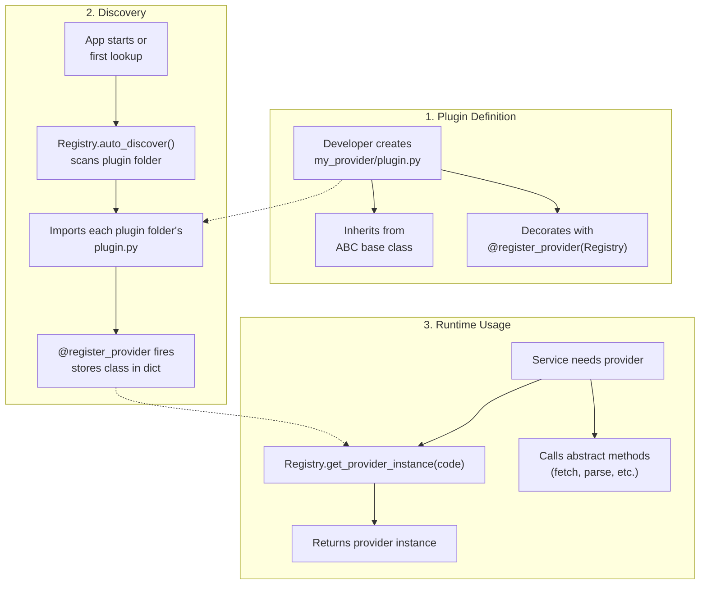

# 🧩 Registry Pattern and Plugin System

LibreFolio uses a **Registry Pattern** to create a flexible and extensible plugin system. This allows new functionality—such as support for new brokers, asset pricing sources, FX providers, technical signals, risk analytics, or Tools—to be added without modifying the core application code.

## ⚙️ How it Works

The system is based on three key components:

1. **Abstract Base Class (ABC)**: A template class that defines the interface a plugin must implement (e.g., `AssetSourceProvider`, `BRIMProvider`, `FXRateProvider`, `SignalPlugin`, `RiskAnalytic`, `ToolPlugin`).
2. **Plugin Registry**: A central class that discovers and stores all available plugins (e.g., `AssetProviderRegistry`, `SignalPluginRegistry`, `ToolPluginRegistry`).
3. **Registration Decorator**: `@register_provider` for provider systems or `@register_plugin` for non-provider plugin systems.

Each family keeps its registry in its own runtime package:

- `AssetProviderRegistry` in `backend/app/services/assets/registry.py`
- `FXProviderRegistry` in `backend/app/services/fx/registry.py`
- `BRIMProviderRegistry` in `backend/app/services/brim/registry.py`
- `SignalPluginRegistry` in `backend/app/services/signals/registry.py`
- `RiskAnalyticRegistry` in `backend/app/services/risk/registry.py`
- `ToolPluginRegistry` in `backend/app/services/tools/registry.py`

`backend/app/services/provider_registry.py` keeps what they share: the base classes `AbstractPluginRegistry` and `AbstractProviderRegistry`, the folder-per-plugin discovery (`PLUGIN_MODULE_NAME`), the registry errors, and both decorators.

### 🗺️ High-Level Flow



### 🔍 Discovery Process

1. **Scan**: On first access, `auto_discover()` scans the registry's family folder (e.g., `backend/app/services/fx_providers/`) in name order: a folder's name, a module's stem.
2. **Import**: A plugin is a folder `<name>/` holding `__init__.py` and `plugin.py` (see [Plugin Folder Layout](#plugin-layout)). `_load_plugin_folder()` loads the package first, as `backend.app.services.<family>.<name>` with the folder as its search path, so that the plugin's imports of its own helpers resolve, relative ones included; then `plugin.py`, as `backend.app.services.<family>.<name>.plugin` (`PLUGIN_MODULE_NAME`). A single module `<name>.py` still loads, as `backend.app.services.<family>.<name>`, but only test fixtures and test registries use that form. Skipped, in either form: names starting with `_` (the family's shared helpers) and the stems a registry ignores (`base` for the signal and risk registries). A folder holding neither `__init__.py` nor `plugin.py` is data (`static/`, `sample_reports/`) and is skipped too, as are modules already in `sys.modules`.
3. **Register**: The decorator fires on import and calls `Registry.register(class)`, which reads the registry's code attribute and stores the class under that code. The `@register_provider` registries read `provider_code` into `_providers[code]`; the `@register_plugin` registries read their own attribute (`signal_code`, `analytic_code`) into `_plugins[code]`. The Tool registry is the exception: it stages a claim and publishes later (see [Registry Specializations](#registry-specializations)).
4. **Lazy**: Discovery happens once, on the first lookup (`get_plugin()`, `get_provider_instance()`, `list_providers()`, …). Subsequent calls use the cached dictionary. The signal and Tool registries are discovered at startup instead.
5. **Failures**: A module that fails to import is logged, recorded, and left out; `get_discovery_errors()` returns the recorded failures. A folder holding only one of `__init__.py` and `plugin.py` is a failure too, and so is a name present both as `x.py` and as `x/`: the module sorts first and loads, and the folder is the failure, whatever order the file system lists them in. What happens next depends on the registry: see [Registry Specializations](#registry-specializations).
6. **Thread-safe**: Registry methods also run on worker threads (`asyncio.to_thread`, e.g. two broker reports uploaded in parallel), so the first discovery can be requested by two threads at once. Each registry gets its own re-entrant lock (`threading.RLock`, created in `__init_subclass__`) and `auto_discover()` is double-checked: if `_discovery_done` is already true it returns at once, otherwise it takes the lock, checks again and imports every module while holding it, setting `_discovery_done` only after the last module has run — so a caller arriving mid-discovery waits, then sees the whole catalogue. Without the lock, that caller would skip the modules another thread has put in `sys.modules` but not yet executed and walk a half-filled catalogue: an upload right after a restart could fail with `RuntimeError: dictionary changed size during iteration` (an HTTP 500) or store an incomplete list of compatible plugins. The lock is re-entrant, so a plugin module that calls back into its own registry while it is being imported does not deadlock, and the methods that walk the catalogue (`list_providers`, `shutdown_all_providers`, and the BRIM registry's `auto_detect_plugin`, `get_compatible_plugins`, `list_plugin_info`) iterate a copy, so a later `register()` on another thread cannot break them (covered by `./dev.py test services provider-registry-misc`). `ToolPluginRegistry` wraps this discovery in a lock of its own and refuses re-entry: a Tool module that looks the registry up while it is being imported gets a `RuntimeError` instead of a partial snapshot.

## 🗂️ Plugin Folder Layout {: #plugin-layout }

Every first-party plugin of the six families — `brim_providers`, `asset_source_providers`, `fx_providers`, `risk_plugins`, `signal_plugins` and `tool_plugins`, all under `backend/app/services/` — is a folder of its family:

```text
backend/app/services/<family>/
├── __init__.py        ← the family's docstring
├── _<helper>.py       ← a helper shared by the family's plugins (e.g. brim_providers/_brim_io.py)
├── static/            ← the family's icons (BRIM, FX and asset families)
└── <name>/            ← one plugin
    ├── __init__.py    ← the plugin's docstring, and nothing else
    ├── plugin.py      ← the code: discovery loads it as backend.app.services.<family>.<name>.plugin
    ├── _<private>.py  ← optional: a helper only this plugin uses
    └── i18n/          ← optional: the plugin's translations (en.json, it.json, fr.json, es.json)
```

- **`plugin.py`** holds the plugin class, its registration decorator and whatever else the plugin needs.
- **`__init__.py`** holds the plugin's docstring and re-exports nothing, e.g. `"""FX provider ``ecb``: the code is in ``plugin.py``, which the registry loads; this package re-exports nothing."""`.
- **Helpers.** A helper private to one plugin sits beside its `plugin.py` as `_*.py`. A helper shared by several plugins stays at the family root, as `_*.py` too: `brim_providers/_brim_io.py`, `_brim_output.py` and `_scalable.py`. A contract lives in its family's runtime package, not beside the plugins: the signal contract is `services/signals/base.py`, so a family root keeps only `__init__.py` and its `_*.py` helpers.
- **Data stays with the family**: the icons in the family's `static/`, served under `/api/v1/uploads/plugin/<brim|fx|asset>/…` by `serve_plugin_static` (`backend/app/api/v1/uploads.py`), and the BRIM sample exports in `brim_providers/sample_reports/`.
- **Translations** live in the plugin's `i18n/` fragment: see [A Plugin's Translations](#plugin-translations).

### 📥 Importing and Patching a Plugin {: #plugin-imports }

Import a plugin's names from its `plugin` module, and patch them there:

```python
from backend.app.services.brim_providers.broker_directa.plugin import DirectaBrokerProvider
from backend.app.services.fx_providers.snb import plugin as snb_mod  # the module, e.g. for monkeypatch.setattr(snb_mod, "httpx", fake)

with patch("backend.app.services.fx_providers.ecb.plugin.httpx") as fake_httpx:
    ...
```

The package re-exports nothing, so `from backend.app.services.fx_providers.ecb import ECBProvider` fails at import time, and a patch aimed at the package (`"backend.app.services.fx_providers.ecb.httpx"`) fails as well, instead of patching a copy the code never reads: a forgotten patch target turns the test red.

`./dev.py test utils gate-plugin-layout` keeps the six families in this form: no plugin left as a single module, every plugin folder with both `__init__.py` and `plugin.py`, every plugin `__init__.py` a docstring and nothing else. Over `backend/app`, `backend/test_scripts`, `scripts` and `dev.py`, it also rejects any import or string (a `patch()` target, a logger name, a `__module__`) that reaches a plugin's package instead of its `plugin` module or one of its `_*` helpers.

## 🌐 A Plugin's Translations {: #plugin-translations }

The catalogue the frontend loads, `frontend/src/lib/i18n/<lang>.json`, is generated from its sources (see [Internationalization](../../frontend/i18n.md)). One kind of source is a plugin's fragment, `backend/app/services/<family>/<plugin>/i18n/<lang>.json` in English, Italian, French and Spanish: nested JSON with absolute keys, English mandatory, for example `{"brimPlugins": {"broker_directa": {"name": "Directa SIM", "description": "…"}}}`. A plugin owns exactly the keys its fragment holds; any other key belongs to the subsystem with the longest declared prefix, otherwise to `base`.

Each plugin has a **space**, read from the metadata its registry publishes:

| Family | The plugin's space | What its fragment holds |
|---|---|---|
| BRIM | `brimPlugins.<code>`, the code being the folder's name | `name` and `description` |
| Asset | `assets.providerParams.<provider_code>` and `pluginSettings.asset.<provider_code>` | `label.<param>` and `description.<param>` of its `params_schema`; the texts of its [settings](plugin_settings.md#translations), `label.<field>`, `description.<field>` and `option.<field>.<value>` |
| Signal | the parent of its `display_name_key` (`signals.rsi` for `signals.rsi.name`) | its name, description, output labels, reference levels and regions |
| Risk | the parent of its `name_i18n_key` (`risk.analytics.historicalKpi`) | `name` and `description` (`correlation` also has `help`) |
| Tool | exactly its `name_i18n_key` and `description_i18n_key` | those two keys (`tools.pacAllocator.name`, `.description`) |
| FX | `pluginSettings.fx.<code>`, the code as the registry has it (`pluginSettings.fx.ECB`) | the texts of its settings, as for an asset plugin; no shipped FX provider has any |

A key several plugins share belongs to none of them: `signals.reference.zero` (seven signal plugins) and `signals.tooltips.riskWindow` (the window tooltip of the `rolling_volatility`, `rolling_sharpe` and `rolling_beta` signals) stay in the `charts` subsystem, and the `risk.warnings.*` vocabulary in the `risk` subsystem.

### ➕ Adding a Plugin's Keys {: #adding-plugin-keys }

Write the keys with `dev.py i18n`, which edits the sources in the four languages and regenerates the catalogue:

```bash
./dev.py i18n add risk.analytics.myAnalytic.name --en "My analytic" --it "…" --fr "…" --es "…" --into risk_plugins/my_analytic
./dev.py i18n where risk.analytics.myAnalytic.name   # backend/app/services/risk_plugins/my_analytic/i18n/en.json (exists)
```

`--into` names the plugin's folder, `<family>/<plugin>`, which must already hold its `plugin.py`, and creates the fragment with the first key. `where` names the file that holds a key, or the one `add` would write it to. Without `--into`, `add` routes a new key by its deepest existing branch:

- under the branch a plugin's keys share (`brimPlugins.broker_directa`, `signals.rsi`), to that plugin: a new field of an existing plugin;
- under a branch that only plugins share — `brimPlugins.<new>`, `risk.analytics.<new>`, `assets.providerParams.<new>`, `pluginSettings.asset.<new>` — nowhere: it refuses and asks for `--into <family>/<plugin>`. It refuses every new key of a plugin whose keys share no branch, too: Borsa Italiana's lie under `assets.providerParams.borsa_italiana` and `pluginSettings.asset.borsa_italiana`;
- otherwise to the subsystem with the longest declared prefix, else to `base`.

The last rule is why the first key of a **new signal or Tool** needs `--into`: without it, `signals.<new>.name` lands in the `charts` subsystem and `tools.<new>.name` in `tools`, and the ownership gate below fails. The same holds for the first settings key of an FX provider, which would land in the `pluginSettings` subsystem. Passing `--into` for every key of a plugin is never wrong. `where` shows the target before anything is written, and `./dev.py i18n move <prefix> --into <family>/<plugin>` moves keys that landed in the wrong source.

### 🛡️ The Ownership Gate {: #plugin-i18n-gate }

`./dev.py test utils gate-plugin-i18n-ownership` reads the real registries and the catalogue's sources. A space is **exclusive** when exactly one plugin has it.

- **R1**: every key in a fragment lies in its plugin's space.
- **R2**: every key a plugin declares in its exclusive space lives in its fragment. The declared keys are `display_name_key`, `description_key`, `name_i18n_key`, `description_i18n_key`, the `label_key` and `description_key` of the outputs, reference levels and value regions, the parameters' `x-i18n-key` and `x-tooltip-key`, the BRIM `name` and `description`, and, for an asset or FX plugin, its `settings_fields`: each field's `label_key` and `description_key` and each option's `label_key`, read from the declaration dumped to plain data (a `default` is a value, never a key).
- **R3**: no fragment key lies in another plugin's space, or is declared by another plugin.
- **R4**: every catalogue key under an exclusive space lives in that plugin's fragment (Tools aside: R2 already holds their two keys).

The gate also requires every BRIM plugin's code to be its folder's name. The catalogue's own rules — one owner per key, every key in the folder its prefix names, the four languages complete — are checked by `./dev.py test utils gate-i18n-catalog`.

!!! warning "A plugin mounted at runtime has no translations"

    The fragments are merged when the frontend is built. A plugin mounted into a running container with a docker-compose volume has its code loaded but not its translations, so the UI shows its untranslated fallback — for a BRIM plugin, the English `provider_name` and `description` the backend sends. A runtime merge is on the post-1.2 backlog (U-B1).

## 🧱 Core Components

### 🧬 `AbstractPluginRegistry`

The base class of every registry. Each subclass gets its own storage, discovery state, and lock (`__init_subclass__`). Provides:

| Method | Description |
|--------|-------------|
| `register(cls, plugin_class)` | Validate a class and store it under its code |
| `get_plugin(cls, code)` | Get the registered class by code (triggers auto-discovery if needed) |
| `get_plugin_instance(cls, code, **kwargs)` | Returns an **instantiated** plugin; retries without arguments when the keyword construction raises `TypeError` |
| `list_plugin_codes(cls)` | All registered codes, in registration order |
| `auto_discover(cls)` | Scan plugin folder and import all modules, once |
| `get_discovery_errors(cls)` | Import failures recorded by the discovery |

Outside test mode (`is_test_mode()` false, read at each call), a class whose `test_only` is `True` is withheld (`_withheld()`): `get_plugin()` returns `None`, so `get_plugin_instance()` and `get_provider_instance()` return `None` too, and `list_plugin_codes()` and `AbstractProviderRegistry.list_providers()` leave it out — see [Test-Only Plugins](plugin_settings.md#test-only).

A subclass specializes it through class-method hooks: `_get_plugin_folder()` (a folder under `backend/app/services/`), `_get_plugin_code_attr()` (default `plugin_code`), `_normalize_lookup_code()`, `_validate_plugin_class()`, `_ignored_module_stems()`, `_reject_duplicate_codes()`, `_fail_on_discovery_errors()`, and `settings_family()` (`asset` or `fx` for the registries whose plugins may declare settings, `None` otherwise).

### 📋 `AbstractProviderRegistry`

The specialization shared by the three provider registries (asset, FX, BRIM). It stores classes in `_providers` and reads `provider_code` from an instance when the class can be built without arguments, from the class attribute otherwise. Provides:

| Method | Description |
|--------|-------------|
| `register(cls, provider_class)` | Store a provider class, keyed by its `provider_code` |
| `get_plugin(cls, code)` | Get provider class by code (triggers auto-discovery if needed) |
| `get_provider_instance(cls, code)` | Returns an **instantiated** provider object |
| `list_providers(cls)` | List all registered providers with `code` and `name` |
| `auto_discover(cls)` | Scan plugin folder and import all modules |
| `shutdown_all_providers(cls)` | Call `shutdown()` on every registered provider instance (graceful teardown) |

### 🛑 Provider Lifecycle — Shutdown

Each ABC base class (`AssetSourceProvider`, `FXRateProvider`, `BRIMProvider`) declares a no-op `shutdown()` method. Providers that hold persistent resources (e.g., background threads, WebSocket connections) override it to release them.

At application shutdown, the `providers` step of the lifespan (`SHUTDOWN_STEPS` in `backend/app/services/platform/app_lifespan.py`) calls:

```python
AssetProviderRegistry.shutdown_all_providers()
FXProviderRegistry.shutdown_all_providers()
BRIMProviderRegistry.shutdown_all_providers()
```

`shutdown_all_providers()` iterates every registered provider, instantiates its class without arguments, and calls `shutdown()`; an error is logged as a warning and does not stop the other providers. No `hasattr` check is needed because the method is defined in the ABC.

**Example**: The JustETF provider overrides `shutdown()` to stop its live-quote WebSocket daemon threads via `shutdown_live_feeds()`.

### 🏷️ Registry Specializations

| Registry | Plugin Folder | Base Class | Purpose |
|----------|--------------|------------|---------|
| `BRIMProviderRegistry` | `brim_providers/` | `BRIMProvider` | Parse broker CSV/Excel files |
| `AssetProviderRegistry` | `asset_source_providers/` | `AssetSourceProvider` | Fetch asset prices |
| `FXProviderRegistry` | `fx_providers/` | `FXRateProvider` | Fetch exchange rates |
| `SignalPluginRegistry` | `signal_plugins/` | `SignalPlugin` | Compute schema-driven technical signals |
| `RiskAnalyticRegistry` | `risk_plugins/` | `RiskAnalytic` (`backend/app/services/risk/base.py`) | Compute multi-asset risk analytics |
| `ToolPluginRegistry` | `tool_plugins/` | `ToolPlugin` (`backend/app/services/tools/base.py`) | Publish atomic, versioned Tool calculations |

The registries share the folder scan but differ in when they discover, how they key a class, and how they react to a broken module:

| Registry | Code attribute (lookup) | Discovery runs | Import failure | Duplicate code |
|----------|-------------------------|----------------|----------------|----------------|
| Asset, FX, BRIM | `provider_code` (exact) | First lookup. At startup, the background cache pre-warm walks the asset registry | Logged and recorded; the other modules stay registered | The class imported last replaces the earlier one |
| `SignalPluginRegistry` | `signal_code` (trimmed, upper-cased) | Startup, in the `signal-plugins` step of the lifespan (`app_lifespan.py`) | Every later lookup raises `PluginDiscoveryError`, so the application does not start | `DuplicatePluginCodeError`, which fails that module's import |
| `RiskAnalyticRegistry` | `analytic_code` (trimmed, lower-cased) | First risk catalogue request or analytic run | Every later lookup raises `PluginDiscoveryError` | `DuplicatePluginCodeError`, which fails that module's import |
| `ToolPluginRegistry` | `services`: one definition per `ToolService.tool_code` | Startup, off the event loop (`asyncio.to_thread(ToolPluginRegistry.get_snapshot)`) | The module's claims are quarantined as `import_failed`; healthy services stay available | Every claimant is quarantined as `duplicate_code` |

The signal and risk registries are strict in one more way: `register()` accepts only subclasses of their base class and calls its `validate_definition()`, so an invalid declaration fails at import. The Tool registry does not store classes as they register. It stages claims, expands each packaged class into its services, validates every service definition, and publishes one read-only, code-sorted snapshot; registration is closed afterwards. See [Tool plugins](tool_plugins.md#discovery-and-version-lifecycle).

The shared `register()` also checks a plugin's settings declaration (`settings_fields`, see [Plugin Settings](plugin_settings.md)) against its family's rules, which only the asset and FX registries define, and reserves the environment variables of its fields for that plugin alone: an invalid declaration, a variable another plugin already reads, or any declaration in the BRIM, signal or risk registries raises `SettingsDeclarationError`, so the module's import fails and the plugin is not registered.

`GET /api/v1/system/plugin-diagnostics` lists the import failures of the asset, FX, BRIM, and signal registries. Quarantined Tool services appear in `GET /api/v1/tools/diagnostics` instead.

### 🎯 `@register_provider` Decorator

```python
@register_provider(AssetProviderRegistry)
class MyProvider(AssetSourceProvider):
    ...
```

The decorator is a factory that calls `registry_class.register(provider_class)` at import time.

Technical signals, risk analytics, and Tools use the equivalent non-provider decorator:

```python
@register_plugin(SignalPluginRegistry)
class MySignal(SignalPlugin):
    ...


@register_plugin(RiskAnalyticRegistry)
class MyAnalytic(RiskAnalytic):
    ...


@register_plugin(ToolPluginRegistry)  # ToolPluginRegistry: backend.app.services.tools.registry
class MyTool(ToolPlugin):
    ...
```

---

## 📖 Plugin Development Guides

Each subsystem has its own detailed guide with ABC method tables, flow diagrams, and implementation examples:

| Subsystem | Guide | Base Class | What It Does |
|-----------|-------|------------|-------------|
| **BRIM** | [BRIM Plugin Guide](brim_plugin_guide.md) | `BRIMProvider` | Parse broker export files (CSV, Excel) into transactions |
| **Assets** | [Asset Plugin Guide](asset_plugin_guide.md) | `AssetSourceProvider` | Fetch current and historical asset prices |
| **FX** | [FX Plugin Guide](fx_plugin_guide.md) | `FXRateProvider` | Fetch exchange rates from central banks |
| **Signals** | [Signal Plugin Guide](signal_plugin_guide.md) | `SignalPlugin` | Compute backend technical indicators and expose schema-driven UI metadata |
| **Risk** | [Adding a Risk Analytic](../../backend/risk/architecture.md#adding-an-analytic) | `RiskAnalytic` (`backend/app/services/risk/base.py`) | Compute multi-asset risk analytics over prepared return series |
| **Tools** | [Tool Plugin Guide](tool_plugins.md) | `ToolPlugin` | Publish atomic, versioned calculations with generated codecs and compiled renderers |

---

## 📚 Subsystem Documentation

Each plugin subsystem also has architecture docs, provider lists, and configuration pages:

### 📥 BRIM (Broker Report Import Manager)

- [Architecture](../../backend/brim/architecture.md) — Pipeline design, parsing flow
- [Generic CSV Provider](../../backend/brim/generic_csv.md) — User-configurable CSV mapper
- [Providers List](../../backend/brim/providers_list.md) — All supported brokers (Directa, Degiro, IBKR, etc.)

### 📈 Assets (Pricing & Metadata)

- [Architecture](../../backend/assets/architecture.md) — Provider interface, caching, refresh logic
- [System Providers](../../backend/assets/system_providers.md) — Built-in providers (Scheduled Investment, Manual)
- [Providers List](../../backend/assets/system_providers.md) — All available providers (Yahoo Finance, etc.)

### 💱 FX (Foreign Exchange)

- [Architecture](../../backend/fx/architecture.md) — Multi-provider design, sync process
- [Configuration & Routing](../../backend/fx/configuration.md) — Chain routing algorithm, priority fallback
- [Providers](../../backend/fx/providers/index.md) — ECB, FED, BOE, SNB technical details

### 📊 Technical Signals

- [Signal Plugin Guide](signal_plugin_guide.md) — Runtime architecture, contracts, implementation example, and validation gates
- [Technical Analysis](../../../financial-theory/technical-analysis/index.md) — Financial and mathematical documentation for built-in indicators

### 🛡️ Risk Analytics

- [Risk Engine](../../backend/risk/architecture.md) — Scope resolution, plugin contract, eligibility, simulation workers, and API
- [Risk Metrics](../../../financial-theory/technical-analysis/risk-metrics/index.md) — Financial and mathematical documentation for the risk measures

### 🧰 Tools

- [Tool Plugin Guide](tool_plugins.md) — Contracts, transactional discovery, isolated execution, budgets, and frontend renderers
- [Tools user guide](../../../user/tools/index.md) — What the Tools hub offers to users
