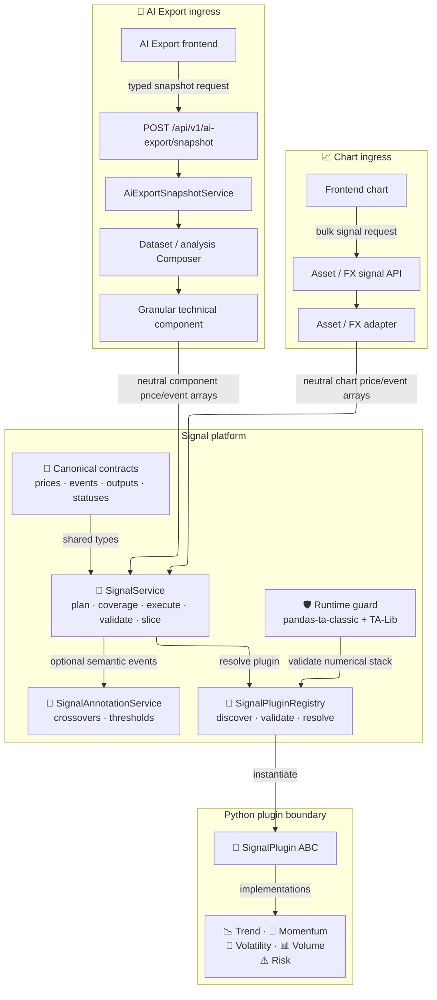
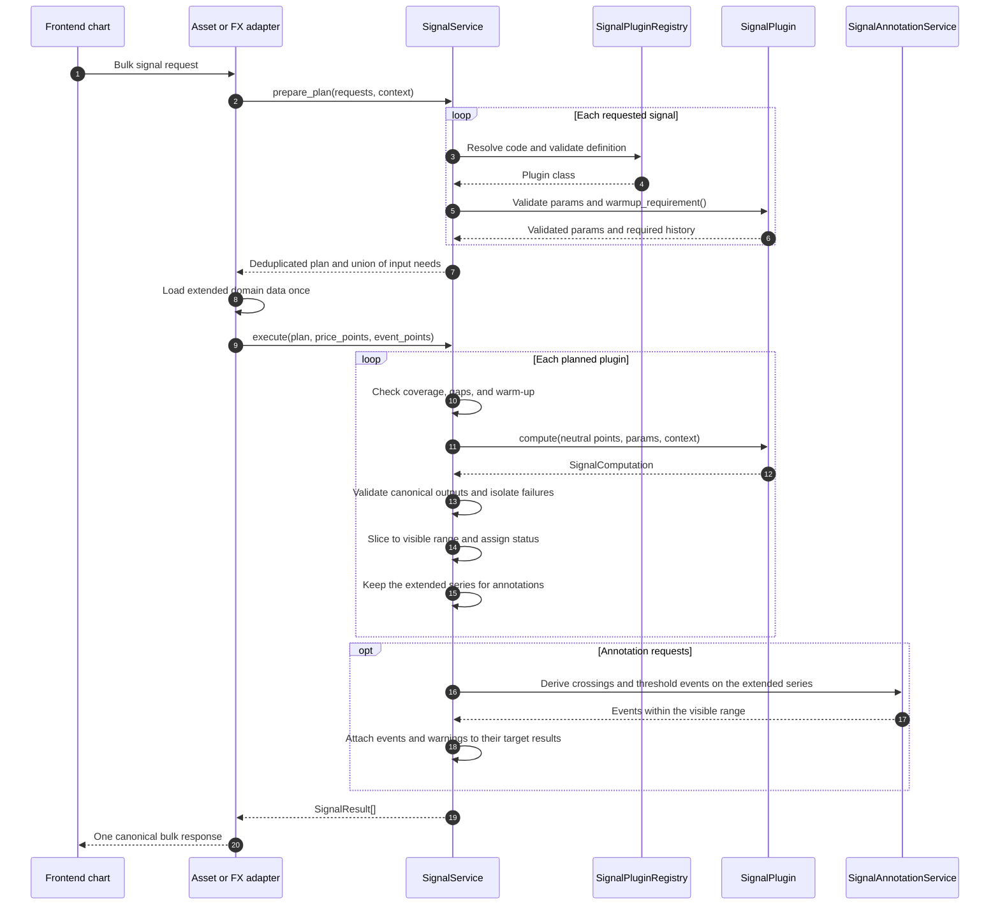
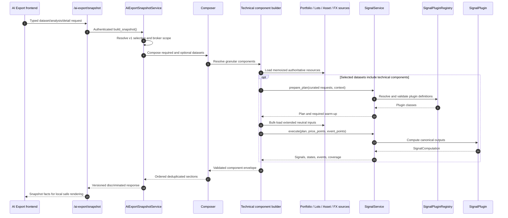

# 📊 Signal Plugin Guide

How to add a backend technical indicator to LibreFolio's schema-driven signal system.

**Base class**: `SignalPlugin`  
**Registry**: `SignalPluginRegistry`  
**Orchestrator**: `SignalService`

**Plugin folder**: `backend/app/services/signal_plugins/<name>/` — `plugin.py`, a docstring-only `__init__.py`, and its `i18n/` fragment.

---

## 🏗️ Architecture

Signal plugins own indicator-specific behavior. Shared infrastructure owns data loading,
coverage policy, error isolation, annotations, and API serialization.



| Component | Responsibility |
|---|---|
| `signals/runtime.py` | Verify the locked `pandas-ta-classic` + TA-Lib stack at startup and reject silent fallback. |
| `signals/base.py` | Define the plugin contract and build static catalog metadata. |
| `signals/registry.py` | `SignalPluginRegistry`: validate definitions and reject duplicate codes. |
| `provider_registry.py` | Discover plugin folders (shared by every plugin registry). |
| `signals/service.py` | `SignalService`, the façade: plan a batch through `prepare_plan()`, run it in one worker thread (`asyncio.to_thread`) through `execute()`, or do both with `compute()`. |
| `signals/planning.py` | `prepare_signal_plan`: validate the batch and its annotation requests (`SignalRequestValidationError`), resolve plugins, validate their parameters, deduplicate identical computations, size the history and inputs to load (`SignalExecutionPlan`), and record preflight failures before any price is read. |
| `signals/execution.py` | `execute_signal_plan`: per planned computation, derive a prepared-series plugin's input, risk metadata, and data-quality warnings from the `SignalPreparedSeriesBundle`, check coverage and availability, select the quote days, call the plugin, slice its visible output, and isolate failures so that one never aborts the batch. |
| `signals/validation.py` | Normalize a plugin's output (`NaN` becomes a missing value, infinity an error), check its series count and metadata against `output_specs` and its dates against the input, rewrite an availability as unavailable or partial, and build a failure's details. |
| `signals/annotations.py` | Derive line crossovers and threshold crossings from extended canonical data, and attach them, with their warnings, to the target results (`attach_annotations`). |
| `signals/series.py` | Provide the pure helpers that planning and execution use: the calendar days loaded per warm-up session (`SESSION_WARMUP_DAY_MULTIPLIER`), quote-day selection (`is_quote_day()`), field and date coverage (`SignalInputCoverage`), the input segment the data policy allows, event filtering, the availability decision and its warnings, and the check and slice of the visible output. |
| `signals/risk_adapters.py` | Provide the helpers the prepared-series risk plugins share: read the prepared returns and the annualization factor from the execution context, compute rolling volatility, Sharpe, and beta with vectorised pandas passes (the loop versions stay as the reference that `test_risk_metrics_oracle.py` checks them against), warn about mathematically undefined windows (`undefined_metric_window`), and build a line or area output from its `SignalOutputSpec`. |
| Chart Asset/FX adapters | Load chart-domain data, perform currency conversion, and map it into neutral points. |
| AI Export runtime/components | Compose selected datasets, share request-scoped resources, and call the same `SignalService` for curated technical components. |

!!! important "Plugins do not load data"

    A signal plugin must not access the database, call providers, or know whether it was
    invoked from an Asset or FX endpoint. It receives neutral price/event arrays and
    returns canonical output.

The AI Export browser code never calculates indicators and never sends chart-computed
technical values. It calls `/ai-export/snapshot`; backend component builders own data
loading and invoke the shared signal platform. Dataset and analysis composition does
not change plugin math.

---

## 🔄 Request Lifecycle

Chart requests and AI Export components have separate adapters. They converge only at
`SignalService`.

Results live only as long as their request: `SignalService` keeps no cache and writes no
table. The chart pages hold them in a page-local `SignalResultState`, which a reload or a new
page discards, and an AI Export snapshot carries them only in the text it copies.

### 📈 Chart Asset/FX Lifecycle



### 🧠 AI Export Component Lifecycle



### 1. 🧭 Planning

`SignalService.prepare_plan()`:

- resolves each `signal_code` through `SignalPluginRegistry`;
- validates parameters with the plugin-owned Pydantic model;
- deduplicates identical code/parameter combinations while preserving instance IDs;
- asks every plugin for its parameter-aware warm-up requirement;
- aggregates the maximum warm-up, kept apart by what the plugin counts: sessions for a
  quote-day plugin (`max_session_total_points`), calendar days otherwise
  (`max_calendar_total_points`); prepared-series plugins keep their own maximum;
- aggregates the union of required price fields/events;
- records per-instance preflight failures without aborting the remaining batch.

A preflight failure stays with its instance, but an incoherent batch stops entirely.
`prepare_signal_plan` then raises `SignalRequestValidationError`, and no instance gets a
plan or a result. The incoherent cases are:

- duplicate `instance_id` values, or duplicate annotation request keys;
- an annotation whose target (`attach_to_instance_id`) or source instance is not a
  requested signal instance;
- a `band` source naming a series that its plugin does not declare, or that is not a band;
- a scalar `signal` source naming a band series.

The chart endpoints answer it with HTTP 422, the message as `detail`:
`POST /api/v1/signals/preview` (`api/v1/signals.py`), the Asset price query
`POST /api/v1/assets/prices/query` (`api/v1/assets/prices.py`), and the FX endpoint
`POST /api/v1/fx/currencies/convert` (`api/v1/fx/currencies.py`). An Asset or FX request
then returns no prices either.

The chart Asset/FX adapter or AI Export domain assembler uses the plan to load one
extended input range. For the plain price input, the warm-up in calendar days is
`SignalExecutionPlan.max_history_days_before_visible`: the larger of the session
warm-up times `SESSION_WARMUP_DAY_MULTIPLIER` and the calendar warm-up. The multiplier
is 2 (`signals/series.py`): a year holds about 252 sessions in 365 days, and
long holiday windows lower that further. The Asset price query, the FX endpoint, and
the AI Export FX loader all size their load with it.

A warm-up can also be unbounded. A plugin whose result depends on the whole past returns
`SignalWarmupRequirement(full_history=True)`, and the plan sets `requires_full_history`:
the Asset price query (`price_query.py`) then extends the point-derived warm-up back to
the start of the available history, but not before `EARLIEST_RANGE_START` (1900-01-01),
never shortening it (a warm-up that starts earlier keeps its start, and a price stored
before the load start can only seed the fill), and still slices to the visible range after
the computation. Underwater drawdown (`RISK_DRAWDOWN`) does so through its `full_history`
parameter, on by default (the card's **Full history** checkbox); off, only the visible
range and a minimal warm-up are loaded, so the running peak is the window's own. AI Export
ignores that setting: its drawdown context (`ai_export/components/drawdown_context.py`)
always starts from the beginning of the history.

### 2. 🧮 Execution

The complete batch runs inside one `asyncio.to_thread(...)` call. Plugins execute
sequentially, so synchronous numerical libraries never block FastAPI's event loop.

For each plugin, the service:

1. measures field and date coverage on the calendar input;
2. applies the declared gap policy;
3. keeps only the quote days of the selected points when the plugin
   [computes on quote days](#sessions-or-calendar-days) and does not use the prepared
   series;
4. verifies minimum history and warm-up, counted on the points the plugin receives
   (sessions for a quote-day plugin);
5. calls `plugin.compute(...)`;
6. validates series shape, finite values, declared output keys, axes, units, and
   output dates against the dates the plugin received;
7. slices the extended result to the requested visible range;
8. isolates failures to that signal instance.

Coverage (`SignalInputCoverage`) is measured before step 3 and stays calendar-based,
so the UI coverage thresholds in [Status and Data Policy](#status-and-data-policy)
keep their meaning. A quote-day plugin's output is dated on sessions; the chart aligns
it by date and bridges the days without a point. A point the plugin returns **without a
value** is different: a warm-up, an undefined window, a missing reference price. The
chart renderer (`frontend/src/lib/charts/signals/backendRenderer.ts`) breaks a line or
area output there, drawing each stretch between two such points as its own series, so no
segment crosses a day on which nothing was measured. Bars simply skip those points.

### 3. 🎯 Annotations

Execution slices each signal's result right after validating it (step 7 above).
`execute_signal_plan` keeps the unsliced series of each `ok` or `partial` instance aside, in
`extended_series_by_instance`.

Optional annotation requests run once every planned signal has executed.
`attach_annotations` hands those extended series and the loaded prices to
`SignalAnnotationService.compute()`. Crossings are detected across the warm-up too, so a
crossover on the first visible date is still found. Only the events dated inside the
requested visible range are kept.

`attach_annotations` adds those events to their target results, merged with any
annotations the plugin itself returned, and sorted by date. Problems become
`annotation_unavailable` warnings on the target result:

- a request whose source has no usable series, such as an `unavailable` or `failed`
  instance, gets `Annotation '<key>' is unavailable`, and the others still run;
- events whose target status is not `ok` or `partial` are dropped, and the warning
  `Annotation '<key>' could not be attached` gives that status as its reason;
- if the whole annotation computation raises, every request gets the
  `Annotation '<key>' is unavailable` warning on its target, and the signal results are kept.

Supported primitives:

- line/line crossover;
- price/line crossover;
- threshold crossing;
- observed-only filtering;
- event sampling and limits.

Annotations are generic infrastructure, not plugin-specific trading advice.

---

## 📋 Plugin Contract

Every concrete plugin must declare:

| Member | Purpose |
|---|---|
| `signal_code` | Stable uppercase identifier used by APIs and saved settings. |
| `implementation_version` | Version of the plugin's numerical behavior. |
| `category` | Trend, momentum, volatility, volume, or risk. |
| `display_name_key` | Frontend i18n key for the human-readable name. Its parent (`signals.rsi` for `signals.rsi.name`) is the plugin's translation space, held by its `i18n/` fragment (see [Folder and Translations](#folder-and-translations)). |
| `description_key` | Frontend i18n key for the short selector description. |
| `semantic_id` / `semantic_description` | Canonical identity and neutral, non-prescriptive meaning exposed to AI consumers (`describe_for_ai()`). |
| `icon` | Emoji displayed by the signal selector. |
| `docs_path` | MkDocs path opened by the UI information button. |
| `params_model` | Pydantic model with `extra="forbid"` and JSON Schema UI metadata. |
| `input_requirements` | Required OHLCV fields, events, coverage, and data policy. |
| `computes_on_quote_days` | Inherited `True`: the plugin computes on sessions. Set `False` only for calendar spans (see below). |
| `output_specs` | Declared line/area/bar/band components with semantic ids, an explicit `aggregation_profile`, descriptions, styles, units, axes, levels, and regions. |
| `compatible_domains` | `ASSET`, `FX`, or both. |
| `annotation_capabilities` | Supported generic annotation primitives. |
| `ai_export_temporal_rules` | Plugin-owned fixed or parameter-matched AI Export temporal classes. |
| `warmup_requirement()` | Parameter-aware minimum and stabilization history. |
| `compute()` | Numerical implementation returning `SignalComputation`. |

The base class converts this declaration into `SignalCatalogDefinition`. Therefore the
frontend receives names, descriptions, parameter controls, required data, output shapes,
and documentation links without a signal-specific UI implementation.

`catalog_visible` (inherited `True`) decides whether the plugin appears in that catalog:
`SignalPluginRegistry.list_definitions()` skips a plugin that sets it to `False`, so no
selector offers it, while a request naming its code still runs. None of the 22 registered
plugins sets it today. `calendar_rolling_return` (`ASSET_CALENDAR_ROLLING_RETURN`) is in the
catalog like the others, as the **Rolling Return** of the Risk group, and the asset chart also
requests it by its code for its **Rolling Return** mode (see
[Chart internals](../../frontend/components/charts.md#asset-detail-prices-and-rolling-return)).
The Asset catalog, `GET /api/v1/assets/prices/signals`, lists the 22 plugins whose
`compatible_domains` include `ASSET`, which is all of them; the FX catalog,
`GET /api/v1/fx/currencies/signals`, lists the 9 close-only ones that also declare `FX`: EMA,
SMA, KAMA, MACD, PPO, ROC, RSI, Stochastic RSI and Bollinger Bands.
`test_signal_plugin_matrix.py` pins both sets.

### 📅 Sessions or Calendar Days

`computes_on_quote_days` decides what a plugin's periods count. When it is `True` (the
inherited default), `SignalService` hands the plugin only the **quote days** of its
input, the sessions, so a period of N means N sessions, as the standard definitions
count them: SMA 200 is 200 sessions, not 200 calendar days.

A quote day is a point whose **price** was quoted on its own date: `backward_fill_info`
is `None` or `days_back == 0` (`is_quote_day()` in `signals/series.py`). The
exchange rate does not decide it: a quote converted with a rate carried from an earlier
day is still a session of the instrument. On the Asset path, a stored weekend or
market-holiday row that exactly repeats the previous close is marked as carried before
the signals run (`mark_market_closed_carries`, with the holiday table from
`market_calendar.ensure_market_holidays()`), so a stored carry is not a session either.

Set `computes_on_quote_days = False` only when:

- the windows are calendar spans by definition, as in `calendar_rolling_return`: its
  input keeps every calendar point, and its window is declared in days;
- the plugin uses the prepared series (`input_requirements.uses_prepared_asset_series`),
  as the four prepared-series risk signals do (drawdown and rolling beta, Sharpe,
  volatility): that series is already on the quote calendar, and the service never
  filters it.

AI Export technical components follow the same rule; see
[Calculation Range, Exported Range, and Warm-up](ai_export_sampling.md#calculation-range-exported-range-and-warm-up).

### 🎨 Plugin-owned presentation

Every output component can declare a canonical `style`:

```python
SignalOutputSpec(
    key="plus_di",
    label_key="signals.adx.plusDi",
    description_key="signals.adx.plusDiDescription",
    kind=SignalSeriesKind.LINE,
    unit=SignalUnit.INDEX,
    axis=adx_axis,
    style=SignalOutputStyle(
        color_role=SignalColorRole.POSITIVE,
        line_pattern=SignalLinePattern.SOLID,
    ),
)
```

Supported color roles are semantic (`primary`, `secondary`, `positive`, `negative`,
`neutral`, `accent`), not hard-coded hex colors. The frontend combines those roles with
the user-selected base color and uses the same metadata for both chart rendering and the
component legend inside the configuration card.

The card exposes one independent style editor per output component and per value region.
Overrides are stored in `SignalConfig.componentStyles` and
`SignalConfig.partitionStyles`; they affect every chart surface without changing signal
parameters or triggering a backend recomputation. The legacy top-level `style` remains a
backward-compatible default for old saved configurations and frontend-local signals.

When value regions cover an output's complete numeric domain, the redundant parent
component editor is hidden automatically: RSI, CCI, and MFI show only their editable zones.
For mixed outputs, only the partitioned component is hidden; Stochastic RSI therefore keeps
the `%D` component editor while `%K` is represented by its complete zone set.

Line components can customize color, pattern, width, and endpoint markers. Bands customize
their middle line and fill color. Histograms keep signed green/red bars until the user
chooses a component color, after which the selected single color is used.

Value regions can declare their own `line_style`. The frontend applies those threshold
rules to returned points and derives contiguous visual slices at render time. For example,
RSI renders its neutral range as dashed while overbought and oversold segments remain
solid, without an RSI-specific frontend switch.

Multi-output indicators follow their financial definition:

- ADX uses three lines: ADX for strength, `+DI` for positive direction, and `-DI` for
  negative direction;
- MACD and PPO use two lines plus a histogram because the histogram is itself a defined
  output: line minus signal;
- Stochastic RSI uses `%K` plus the smoothed `%D` signal line.

---

## 🧱 Status and Data Policy

Each result has an explicit status:

| Status | Meaning |
|---|---|
| `ok` | Complete required input, complete warm-up, and valid visible output. |
| `partial` | Usable output with an explicit warning, such as incomplete stabilization. |
| `unavailable` | Required fields/history are insufficient, so calculation cannot start safely. |
| `failed` | Parameters, computation, output, or contract validation failed. |

The default policy is `STRICT_CONTIGUOUS`: missing required fields or date gaps are never
silently compacted. If a plugin can safely operate on one complete segment, it may declare
`ALLOW_PARTIAL_CONTIGUOUS`. The service prefers the newest segment that satisfies the
plugin's minimum history; otherwise it uses the longest sufficient segment. Output remains
partial and never jumps across the gap.

Coverage metadata includes both the total missing-point ratio and
`max_consecutive_missing_points`. The UI keeps the backend `partial` status visible, and the
chart card turns each result into one icon: `getSignalProblemSeverity()`
(`lib/charts/signals/signalProblem.ts`) grades a problem, and `getSignalIssue()`
(`ChartSignalsSection.svelte`) adds the card's own checks.

| Icon | When |
|---|---|
| Spinner | A request is in flight; no problem from the previous answer is shown meanwhile |
| Red ⚠ (error) | `unavailable`, `failed`, or no result for the instance; no point loaded; an Asset comparison whose currency conversion failed |
| Amber ⚠ (warning) | An incomplete warm-up missing at least 5% of the requested points, or of unknown size; partial coverage or a data gap with coverage at most 95%, a missing streak longer than seven cadence points, or either unknown; any other `partial` problem; data that starts after the range start |
| Grey ℹ (notice) | An incomplete warm-up or a coverage gap below those thresholds |

An error or a warning also tints the card red or amber; a notice leaves it plain.

!!! warning "A long history is not automatically complete"

    An asset can contain decades of closing prices while still lacking `high`, `low`, or
    `volume` on one required date. OHLC/volume plugins will report the exact coverage
    problem instead of computing over silently altered input.

### 🚦 Enforced Status Matrix

A plugin never sets the status itself. `compute()` returns a `SignalComputation`, or raises
`SignalUnavailableError` (`backend/app/services/signals/base.py`) with an
*unavailable* `reason_code`, such as `undefined_metric` or `insufficient_history`, when the
result is mathematically undefined. The service then assigns the status of a computed result —
`partial` when the warm-up is incomplete, partial coverage was used, or the availability
reason is `partial_undefined_metric`; `ok` otherwise — and builds a `SignalResult`. Its
`validate_status_matrix` validator (`backend/app/schemas/signals.py`) rejects every
combination outside this matrix:

| Status | Required | Forbidden |
|---|---|---|
| `ok` | `availability` and `warmup`; non-empty `series`; `can_compute=true` with a complete warm-up; no `reason_code` and no partial coverage; no missing value in any visible point | `error` |
| `partial` | `availability` and `warmup`; non-empty `series`; `can_compute=true`; at least one warning; an incomplete warm-up, partial coverage, or the `partial_undefined_metric` reason | `error` |
| `unavailable` | `availability` and `warmup`, with `can_compute=false`: the reason travels in `availability.reason_code` | `series`, `annotations`, `error` |
| `failed` | a structured `error` | `series`, `annotations` |

A `failed` result is further constrained by its error code:

- **pre-compute failure** (`unknown_signal`, `invalid_params`, `planning_error`): no
  `availability` and no `warmup`;
- **runtime failure** (`compute_error`, `invalid_output`, `contract_violation`):
  `availability` and `warmup` present, with `can_compute=true`.

Three rules apply whatever the status:

- when `availability` and `warmup` are both present, `availability.required_points` must
  equal the warm-up total (`warmup.requirement.total_points`), and
  `availability.warmup_complete` must equal `warmup.complete`;
- `risk_metadata` and `data_quality` are either both present or both absent;
- all series share identical dates and cardinality, with unique `key` and `semantic_id`
  values.

What this means for a plugin:

- Individual empty visible points (`None`) are accepted when the result is `partial`
  (incomplete warm-up or partial coverage) or when the plugin flags the window with an
  `undefined_metric_window` warning, which makes it `partial`. In a result that would
  otherwise be `ok`, they fail the instance with `invalid_output`.
- A visible series with no value at all yields `unavailable` when the warm-up is
  incomplete or the window is flagged as `undefined_metric_window`; otherwise the instance
  fails with `invalid_output`.
- Raise `SignalUnavailableError` with an unavailable reason only. A partial reason such as
  `incomplete_warmup` does not form a valid unavailable state, and the instance fails with
  `planning_error`.
- A result the matrix rejects never reaches the client as `ok` or `partial`: the service
  replaces it with a runtime `failed` result (`invalid_output`) for that instance only.

---

## 💻 Complete Example

The example below adds an Asset-only Typical Price line:

$$
TP_t = \frac{H_t + L_t + C_t}{3}
$$

```python
# backend/app/services/signal_plugins/typical_price/plugin.py
from collections.abc import Sequence

from pydantic import BaseModel, ConfigDict

from backend.app.schemas.signals import (
    SignalAggregationProfile,
    SignalAxisRole,
    SignalAxisSpec,
    SignalCategory,
    SignalComputation,
    SignalDomain,
    SignalEventPoint,
    SignalExecutionContext,
    SignalInputRequirements,
    SignalLineSeries,
    SignalOutputSpec,
    SignalPriceField,
    SignalPricePoint,
    SignalSeriesKind,
    SignalUnit,
    SignalValuePoint,
    SignalViewTransform,
    SignalWarmupRequirement,
)
from backend.app.services.provider_registry import register_plugin
from backend.app.services.signals.base import SignalPlugin
from backend.app.services.signals.registry import SignalPluginRegistry


class TypicalPriceParams(BaseModel):
    model_config = ConfigDict(extra="forbid")


@register_plugin(SignalPluginRegistry)
class TypicalPriceSignalPlugin(SignalPlugin):
    signal_code = "TYPICAL_PRICE"
    implementation_version = "1.0.0"
    category = SignalCategory.TREND
    display_name_key = "signals.typicalPrice.name"
    description_key = "signals.typicalPrice.description"
    semantic_id = "typical_price"
    semantic_description = "Averages the high, low, and close of each session."
    icon = "⚖️"
    docs_path = (
        "financial-theory/technical-analysis/indicators/typical-price/"
    )
    params_model = TypicalPriceParams
    input_requirements = SignalInputRequirements(
        price_fields=[
            SignalPriceField.HIGH,
            SignalPriceField.LOW,
            SignalPriceField.CLOSE,
        ]
    )
    output_specs = (
        SignalOutputSpec(
            key="typical_price",
            label_key="signals.typicalPrice.output",
            semantic_id="typical_price.value",
            semantic_description="Mean of the high, low, and close prices.",
            kind=SignalSeriesKind.LINE,
            aggregation_profile=SignalAggregationProfile.LAST_WITH_RANGE,
            unit=SignalUnit.PRICE,
            axis=SignalAxisSpec(
                key="price",
                role=SignalAxisRole.PRICE,
            ),
            view_transform=SignalViewTransform.BASE_PERCENTAGE,
        ),
    )
    compatible_domains = (SignalDomain.ASSET,)
    annotation_capabilities = ("line_crossover",)
    # computes_on_quote_days is inherited (True): compute() receives sessions only.

    @classmethod
    def warmup_requirement(
        cls,
        params: TypicalPriceParams,
        context: SignalExecutionContext,
    ) -> SignalWarmupRequirement:
        return SignalWarmupRequirement(
            minimum_points=1,
            stabilization_points=0,
            total_points=1,
        )

    def compute(
        self,
        price_points: Sequence[SignalPricePoint],
        event_points: Sequence[SignalEventPoint],
        params: TypicalPriceParams,
        context: SignalExecutionContext,
    ) -> SignalComputation:
        spec = self.output_specs[0]
        points = []
        for point in price_points:
            if point.high is None or point.low is None or point.close is None:
                raise ValueError("Typical Price requires high, low and close")
            points.append(
                SignalValuePoint(
                    date=point.date,
                    value=(
                        float(point.high)
                        + float(point.low)
                        + float(point.close)
                    )
                    / 3,
                )
            )

        return SignalComputation(
            series=[
                SignalLineSeries(
                    key=spec.key,
                    label_key=spec.label_key,
                    semantic_id=spec.semantic_id,
                    semantic_description=spec.semantic_description,
                    unit=spec.unit,
                    axis=spec.axis.model_copy(deep=True),
                    view_transform=spec.view_transform,
                    points=points,
                )
            ]
        )
```

### 🗂️ Folder and Translations {: #folder-and-translations }

No central registration list is required. The plugin is a folder of `signal_plugins/`, and
discovery loads its `plugin.py` as `backend.app.services.signal_plugins.typical_price.plugin`,
which triggers `@register_plugin(SignalPluginRegistry)`:

```text
backend/app/services/signal_plugins/
├── base.py            ← the SignalPlugin contract, shared by every plugin (the registry ignores `base`)
└── typical_price/
    ├── __init__.py    ← its docstring and nothing else
    ├── plugin.py      ← the code above
    └── i18n/          ← en.json, it.json, fr.json, es.json
```

Import and patch the plugin's names from `backend.app.services.signal_plugins.typical_price.plugin`:
the package re-exports nothing. A helper only this plugin uses sits beside `plugin.py` as `_*.py`.
[Plugin Folder Layout](registry_pattern.md#plugin-layout) has the discovery rules and the gate that
keeps them, `./dev.py test utils gate-plugin-layout`.

The plugin's translation space is the parent of its `display_name_key`, here
`signals.typicalPrice`, and its fragment holds every key under it — the name, the description,
the output labels, and any reference level or region:

```json
{"signals": {"typicalPrice": {"name": "Typical Price", "description": "Average of high, low and close", "output": "Typical price"}}}
```

The space need not match the folder's name: the `drawdown` plugin's is `signals.riskDrawdown`.
Add the keys in the four languages and name the folder with `--into`: without it, the first key of
a new plugin lands in the `charts` subsystem, which owns the `signals` prefix.

```bash
./dev.py i18n add "signals.typicalPrice.name" --en "Typical Price" --it "…" --fr "…" --es "…" --into signal_plugins/typical_price
./dev.py i18n add "signals.typicalPrice.description" --en "Average of high, low and close" --it "…" --fr "…" --es "…" --into signal_plugins/typical_price
./dev.py i18n add "signals.typicalPrice.output" --en "Typical price" --it "…" --fr "…" --es "…" --into signal_plugins/typical_price
./dev.py i18n where "signals.typicalPrice.output"   # backend/app/services/signal_plugins/typical_price/i18n/en.json (exists)
```

Keys outside the plugin's space stay in the `charts` subsystem, where `add` puts them by itself:
the parameter captions and tooltips named by `x-i18n-key` and `x-tooltip-key`
(`chartSettings.params.*`, `chartSettings.tooltips.*`), the units (`signals.units.*`), and the
keys several plugins share — `signals.reference.zero`, and `signals.tooltips.riskWindow`, the
window tooltip of Rolling Volatility, Sharpe and Beta. A tooltip inside the plugin's space belongs
to its fragment like any other key: `calendar_rolling_return` keeps
`signals.riskRollingReturn.windowTooltip` there. `./dev.py test utils gate-plugin-i18n-ownership`
keeps every key the plugin declares in its space — `display_name_key`, `description_key`, and the
`label_key` and `description_key` of its outputs, reference levels and regions — in its fragment
([A Plugin's Translations](registry_pattern.md#plugin-translations)).

---

## 🎛️ Parameter Metadata

Parameters are ordinary Pydantic fields. JSON Schema extensions control the generic
frontend form. The SMA period (`signal_plugins/sma/plugin.py`):

```python
period: int = Field(
    20,
    ge=2,
    le=500,
    json_schema_extra={
        "x-i18n-key": "chartSettings.params.period",
        "x-control-order": 1,
        "x-suffix": "sessions",
        "x-step": 1,
        "x-tooltip-key": "chartSettings.tooltips.sessionPeriod",
    },
)
```

`x-suffix` names the unit shown next to the input. A period counted in sessions
declares `"x-suffix": "sessions"` and the shared tooltip
`chartSettings.tooltips.sessionPeriod`, unless the period needs its own explanation
(EMA, MACD/PPO, and Stochastic RSI keep dedicated tooltip keys). A window over the
prepared return series counts its return observations, one per quote day with a return, and
declares `"x-suffix": "observations"` with the shared tooltip `signals.tooltips.riskWindow`:
the `window` of Rolling Volatility, Sharpe and Beta. A calendar window declares
`"x-suffix": "days"`: the `window_days` of `calendar_rolling_return`, with its own tooltip
`signals.riskRollingReturn.windowTooltip`.
`SignalParamControl.svelte` renders the suffix through the i18n key
`signals.units.<suffix>` and falls back to the raw value when the key is missing: a
symbol such as `%` or `σ` needs no key, while a word unit needs `signals.units.<suffix>`
in the four languages. The units are shared by every plugin, so they live in the `charts`
subsystem, where `./dev.py i18n add` writes them without `--into`.

Prefer schema metadata over frontend conditionals. New parameter shapes should be added
to the shared JSON Schema mapper only when they are reusable across plugins.

For composite indicators, `x-affects-outputs` lists the output keys changed by a
parameter. The generic card resolves those keys to localized component labels. Stochastic
RSI, for example, declares that its main period affects `%K` and the derived `%D`
(`"x-affects-outputs": ["k", "d"]`), while `dPeriod` affects `%D` only and threshold
parameters affect the `%K` zones.

---

## ⏱️ AI Export Temporal Contract

An indicator included in AI Export declares semantic speed through
`ai_export_temporal_rules`. Plugin owns classification; central AI Export policy owns
Compact/Standard/Full parameters, formula, and bucket construction.

Use one fixed rule when all supported parameter sets represent one time horizon:

```python
ai_export_temporal_rules = (
    SignalAiExportTemporalRule(
        temporal_class=SignalTemporalClass.MEDIUM_FAST,
    ),
)
```

Use exact parameter rules when one plugin represents materially different horizons.
Current EMA and SMA instances do this:

```python
ai_export_temporal_rules = (
    SignalAiExportTemporalRule(
        temporal_class=SignalTemporalClass.MEDIUM,
        parameter_match={"period": 20},
    ),
    SignalAiExportTemporalRule(
        temporal_class=SignalTemporalClass.SLOW,
        parameter_match={"period": 50},
    ),
    SignalAiExportTemporalRule(
        temporal_class=SignalTemporalClass.VERY_SLOW,
        parameter_match={"period": 200},
    ),
)
```

`resolve_ai_export_temporal_class()` validates parameters, compares normalized JSON
values exactly, and requires exactly one matching rule. Unknown or ambiguous matches
raise; no official plugin uses a default or signal-code fallback.

Temporal class changes exported numeric history density only. It does not change
calculation input, warm-up, output validation, latest values, period summaries, states,
or annotation detection. Multi-output indicators use one shared grid for every output.
See [AI Export Technical Sampling](ai_export_sampling.md) for formula, matrix, mappings,
event selection, and tests.

---

## ✅ Adding a Plugin

1. Create a folder `signal_plugins/<name>/` holding the code in `plugin.py` and an
   `__init__.py` with the plugin's docstring and nothing else
   ([Folder and Translations](#folder-and-translations)).
2. Define a strict Pydantic parameter model.
3. Declare required price fields/events and compatible domains.
4. Decide what the periods count: sessions (keep the inherited
   `computes_on_quote_days = True`, declare `"x-suffix": "sessions"`), the return
   observations of the prepared series (`uses_prepared_asset_series`,
   `computes_on_quote_days = False`, `"x-suffix": "observations"`), or a calendar
   span (`computes_on_quote_days = False`, `"x-suffix": "days"`).
5. Declare every canonical output in `output_specs`.
6. If AI Export will curate the plugin, declare fixed or parameter-matched
   `ai_export_temporal_rules`; never add a signal-code branch to AI Export.
7. Implement parameter-aware `warmup_requirement()` in the units the plugin receives
   (sessions for a quote-day plugin); the plan converts them to calendar days.
8. Implement and normalize `compute()`.
9. Validate semantic input/output and provide AI descriptions and annotations.
10. Add the plugin's UI keys in the four languages to its fragment,
    `signal_plugins/<name>/i18n/`, with
    `./dev.py i18n add <key> --en … --it … --fr … --es … --into signal_plugins/<name>`.
11. Add the English financial-theory page referenced by `docs_path`.
12. Add focused numerical/parity tests, temporal-rule resolution tests, and shared-grid
    tests for multi-output indicators.
13. Update the registry pins in `test_signal_plugin_matrix.py` (code sets,
    `EXPECTED_IMPLEMENTATION_VERSIONS`, `EXPECTED_PARAM_UNITS`), curated AI Export
    bundle expectations when applicable, and the initial class mapping documentation.
14. Verify the selected detail/class matrix row and sampling/event manifests.
15. Run the catalog, plugin, service, API, frontend, and documentation gates.

Useful commands:

```bash
./dev.py test services signal-plugin-matrix
./dev.py test services signal-service
./dev.py test api signal-catalogs
./dev.py test utils gate-plugin-layout
./dev.py test utils gate-plugin-i18n-ownership
./dev.py i18n check
./dev.py api sync
./dev.py front check
./dev.py mkdocs build
./dev.py mkdocs check-links
```

---

## 🛡️ Design Rules

- Keep formulas and third-party library selection inside the plugin.
- Keep DB access, provider calls, currency conversion, and HTTP outside the plugin.
- Never compact missing dates or fields silently; dropping the carried days from a
  quote-day plugin's input is the declared contract, not compaction.
- Count a period over trading activity in sessions (inherited
  `computes_on_quote_days = True`); a window over the prepared return series counts return
  observations and declares them; a window that is a calendar span by definition sets
  `computes_on_quote_days = False` and declares days.
- Return canonical line, area, bar, or band series only.
- Use finite numeric output; `NaN` may represent warm-up gaps, infinity may not.
- Declare every output key exactly once in `output_specs`.
- Keep plugin construction argument-free and computation deterministic.
- Do not duplicate technical calculations in the frontend.
- Keep AI Export temporal classification in the plugin; keep sampling parameters and
  formula in the central temporal policy.
- Require exactly one temporal-rule match for every curated instance; no silent fallback.
- Increment `implementation_version` when numerical behavior changes. Changing what a
  plugin computes on changes its values: moving to quote days redefines its periods, so
  it is a major bump; refining the input preparation or the reported provenance (a
  stored weekend or holiday repeat now reported as carried) is a minor one.

---

## 🔗 Related Documentation

- [Registry Pattern Overview](registry_pattern.md)
- [Asset Plugin Guide](asset_plugin_guide.md)
- [FX Plugin Guide](fx_plugin_guide.md)
- [AI Export Overview](ai_export_snapshot.md)
- [AI Export Composition & Prompt](ai_export_composition.md)
- [AI Export Technical Sampling](ai_export_sampling.md)
- [Technical Analysis](../../../financial-theory/technical-analysis/index.md)
