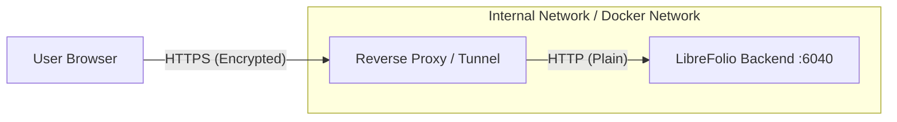

# 🔒 Security Architecture

This document outlines the security model, authentication system, and deployment recommendations for LibreFolio.

## 🎯 Threat Model and Scope

LibreFolio is a **self-hosted** application. The primary security assumption is that the **host system is secure**.

### ✅ In Scope

- **🔐 Authentication**: Stateless JWT-based authentication via HTTP-only session cookies with configurable expiration, and [session revocation](#session-revocation) per account.
- **🛡️ Data Segregation**: Strict isolation between users via Role-Based Access Control (RBAC).
- **✏️ Input Validation**: Preventing injection attacks via strict Pydantic schemas.
- **🧼 Output Escaping**: User- and provider-supplied text is escaped or sanitized before the browser can render it as HTML.
- **📁 File Upload Security**: MIME type validation, executable blocking, size limits.
- **🚫 Endpoint Protection**: **All** data and file endpoints require a valid session cookie — including uploaded files and plugin assets.

### ⚠️ Out of Scope

- **💻 Host System Compromise**: If an attacker gains shell access to the server, the database file is accessible. Encryption at rest is currently not implemented.
- **🔗 SSL/TLS Termination**: The application server (Uvicorn) speaks HTTP. HTTPS is the responsibility of the deployment environment (Reverse Proxy).

## 🔑 Authentication — JWT Cookies

LibreFolio uses **stateless JWT (JSON Web Token)** authentication stored in **HTTP-only session cookies**.

### 🔄 How Login Works

1. User sends credentials to `POST /api/v1/auth/login`
2. Server validates credentials and sets an **HTTP-only cookie** containing the JWT, whose payload is `sub` (the user
   id), `sv` (the account's session version, see [Session Revocation](#session-revocation)), `iat` and `exp`
3. The browser **automatically includes** this cookie on all subsequent requests
4. `` tags, `fetch()` calls, and page navigations all send the cookie seamlessly

!!! success "Why cookies over Bearer headers?"

    HTTP-only cookies are **automatically sent** by the browser for all same-origin requests — including ``, `<link href>`, and AJAX calls. This means uploaded files and plugin assets are served securely without any special frontend handling.

### 🗝️ JWT Secret

Tokens are signed with HS256 and one key per process, `_JWT_SECRET` in
`backend/app/services/accounts/auth_service.py`, resolved once when that module is imported:

- `configured_jwt_secret()` (`backend/app/config/platform.py`) returns `env_secret("JWT_SECRET")`: the
  `JWT_SECRET` variable when it is not blank, otherwise the content of the file named by
  `JWT_SECRET_FILE` ([Secrets from Files](#secrets-from-files)), otherwise `None`. An empty or blank
  `JWT_SECRET` counts as not set: a stray space is never used as a key. Neither
  variable is a field of the Pydantic `Settings`: both are read from the process environment only.
- With `None`, the process falls back to its own `secrets.token_urlsafe(64)`, so every start makes a
  new key and signs every user out. This default is deliberate: keeping sessions across restarts is
  opt-in.
- A `JWT_SECRET_FILE` that cannot give its secret raises `SecretFileError` during that import.
  `main.py` imports the API router, which imports `auth_service.py`, so the server does not start.

!!! warning "⚙️ Multi-worker support"

    Uvicorn starts its workers with `spawn` on every platform (`uvicorn/_subprocess.py`): each worker
    re-imports all modules and resolves the key on its own. With nothing shared, each worker would
    make its own key, and a token signed by one would fail on the others. Before launching Uvicorn,
    `_ensure_shared_jwt_secret()` in `dev.py` makes sure that every worker finds the same key:

    1. a non-blank `JWT_SECRET` is kept as it is, and wins over `JWT_SECRET_FILE`;
    2. otherwise, with a non-blank `JWT_SECRET_FILE`, nothing is generated and nothing is removed:
       every worker reads the same file, and a blank `JWT_SECRET` beside it is harmless, since the
       server ignores it;
    3. otherwise a fresh `secrets.token_urlsafe(64)` goes into `JWT_SECRET`, shared by every worker of
       that run.

- `dev.py` loads `.env` into the environment first; values already set in the shell win.
- The Docker image starts a single uvicorn worker (`CMD` in the `Dockerfile`) and receives `.env`
  through the `env_file:` of Compose: without `JWT_SECRET` or `JWT_SECRET_FILE`, every container start
  invalidates all sessions.
- The administrator's side is
  [Keep Users Signed In After a Restart](../../admin/index.md#session-persistence).

### ⏰ Token Expiration

- Configurable via [Global Settings](../../admin/settings.md): `session_ttl_hours` (default: 24 hours)
- Read each time a session cookie is issued — at login, and when a password change re-issues it — it sets both the
  token's `exp` and the cookie's `max_age` (24 hours when the setting cannot be read): a new value applies to the
  cookies issued after it
- After expiration, the user must log in again
- There is no token refresh mechanism — a new login is required. The only cookie issued without a login is the one a
  password change sends back to the device that made it ([Session Revocation](#session-revocation))

### 🚪 Logout

- Frontend calls `POST /auth/logout` which clears the session cookie
- **No server-side blacklist** — logout leaves the session version alone: a copy of the token remains technically
  valid until it expires, or until the account's sessions are ended ([Session Revocation](#session-revocation))
- This is acceptable for a self-hosted application with short TTL: a user who fears a copied cookie changes the
  password, which ends every other session of the account

### 🔁 Session Revocation {: #session-revocation }

Each account has a session generation, `users.session_version` (`0` on a new account), and each session cookie carries
the generation it was issued at, the `sv` claim. Raising the account's version ends every session issued before it, on
every device, at its next request. There is still no session store: the check compares one integer column of the user
row that `get_current_user()` already loads on every request.

`user_service.end_sessions(user)` (`backend/app/services/accounts/user_service.py`) raises the version by one and does
not commit: the caller commits it with the change that asks for it. Four changes call it:

| Change | Entry point | Sessions ended |
|--------|-------------|----------------|
| Password change | `POST /api/v1/auth/change-password` (`PasswordChangeModal`, Profile tab) | Every other session of the account: the same response sets a new cookie at the new version, so the device that made the change stays signed in |
| Password reset | `./dev.py user reset` → `user_service.reset_password()` | All of them |
| Deactivation | `./dev.py user deactivate` → `user_service.set_user_active(…, False)` | All of them: a later `user activate` does not bring them back |
| Demotion | `./dev.py user demote` → `user_service.set_user_admin(…, False)` | All of them |

Activation, promotion, logout and every refused operation leave the version alone: a wrong current password, or a new
password equal to it, on `change-password`; an unknown user; the last active administrator; *already an admin* or
*not an admin*.

- **The token.** `create_jwt_token(user_id, ttl_hours, session_version)`
  (`backend/app/services/accounts/auth_service.py`) writes `sub` (the user id, as a string), `sv`, `iat` and `exp`.
  `decode_jwt_token()` returns `SessionClaims(user_id, session_version)`, or `None` for a token that is expired or
  badly signed, that has no numeric `sub`, or whose `sv` is not an integer — a boolean included: `true` is not
  version 1.
- **Cookies issued before session versions.** A token without `sv` is session version `0`, the starting value of every
  account: the upgrade signs nobody out, and the first raise of an account's version ends those cookies like any other.
- **The check.** `get_current_user()` (`backend/app/api/v1/auth.py`) keeps its checks of the account (*User not
  found*, *User account is disabled*), then refuses a token whose version differs from the account's, behind or
  ahead, with `401` *Session expired or invalid*: the answer to an invalid token, so nothing tells the holder why.
  While an account is deactivated, its cookies get *User account is disabled* first.
- **The re-issued cookie.** Login and password change set the cookie through one helper, `_issue_session_cookie()`:
  a JWT at the account's current version, lasting `session_ttl_hours` (24 hours when the setting cannot be read),
  with the same name and attributes as the login cookie, so the browser replaces the old cookie instead of keeping
  both.

!!! note "A request in flight during a password change"

    A request the same device sent with its old cookie, and that reaches the server after the change is committed,
    gets `401`. The frontend's 401 interceptor (`frontend/src/lib/api/zodios-client.ts`) sends it to the login page,
    where the new cookie signs it straight back in. The race is benign, and the code does not try to close it.

Tests: `./dev.py test services session-version` (`backend/test_scripts/test_services/test_session_version.py`: the
token, the check, the four callers and the refusals, in-process) and `./dev.py test api session-revocation`
(`backend/test_scripts/test_api/test_session_revocation_api.py`: the password change over HTTP, with two devices and a
second account).

### 💻 Using curl

```bash
# Login and save cookie
curl -s -c cookies.txt -X POST http://localhost:6040/api/v1/auth/login \
  -H "Content-Type: application/json" \
  -d '{"username": "admin", "password": "yourpassword"}'

# Use cookie for authenticated requests
curl -b cookies.txt http://localhost:6040/api/v1/auth/me

# List brokers
curl -b cookies.txt http://localhost:6040/api/v1/brokers

# Sync FX rates
curl -b cookies.txt -X POST \
  -H "Content-Type: application/json" \
  http://localhost:6040/api/v1/fx/currencies/sync
```

## 🔐 Secrets and the Instance Key

### 📄 Secrets from Files {: #secrets-from-files }

Every secret of LibreFolio, `JWT_SECRET`, `LIBREFOLIO_INSTANCE_KEY`,
`LIBREFOLIO_WEB_LINK_FINDER_API_KEY` and `LIBREFOLIO_SMTP_PASSWORD` today, is read by `env_secret(name)` in
`backend/app/config/__init__.py`:

1. `NAME`, when not blank, is the secret as written, spaces included;
2. otherwise `NAME_FILE`, when not blank, is the path of a file that holds it, as Docker and Kubernetes
   mount their secrets (`/run/secrets/…`). `~` is expanded, and a relative path starts from the
   project root. The secret is the file's text without a leading UTF-8 byte order mark, which some
   Windows editors add, and without its trailing line breaks (`decode("utf-8-sig").rstrip("\r\n")`):
   any other space counts;
3. otherwise there is no secret: `None`.

Blank means empty or whitespace only: a value that `str.strip()` empties counts as not set, so a stray
space is never used as a key.

`read_secret_file()` raises `SecretFileError` when the file is missing, cannot be read, is larger than
64 KiB (`SECRET_FILE_MAX_BYTES`), is not UTF-8 text or is empty or blank (`… is empty or blank`). The
message names the variable and the path, never the content. Like every variable outside the
`Settings` class, both forms come from the process environment only, never from `.env` directly:
`./dev.py` and the `env_file:` of Compose put `.env` there. For messages, `env_secret_origin(name)`
names the source without reading the file: `NAME`, `NAME_FILE (<path>)` or `None`
(`configured_jwt_secret_origin()` and `configured_instance_key_origin()` in `platform.py`).

The caller decides what a `SecretFileError` means. A broken `JWT_SECRET_FILE` or
`LIBREFOLIO_INSTANCE_KEY_FILE` stops the start ([JWT Secret](#jwt-secret),
[Configuration Checks](#configuration-checks)). A broken `LIBREFOLIO_WEB_LINK_FINDER_API_KEY_FILE`
does not: `web_link_finder_api_key()` in `backend/app/config/plugins.py` reads it only when a search
builds the `apikey` engine, and `_build_engine()` in `backend/app/services/assets/web_link_finder.py`
then logs `web_link_finder: <error>; disabling` and returns no engine, so that search finds no links.
Nor does a broken `LIBREFOLIO_SMTP_PASSWORD_FILE`: email is optional, so `email_config_state()` turns
it off instead, with the problem `SMTP_PASSWORD_UNREADABLE`, which is logged and, from a later lot,
shown to administrators ([Email Service](../backend/email.md#config-state)).

When `NAME` and `NAME_FILE` are both set, neither blank, `NAME` wins. `secrets_set_twice()` lists those
names for the [configuration checks](#configuration-checks). It covers `JWT_SECRET` and every
`LIBREFOLIO_*` variable, so a new secret named `LIBREFOLIO_*` and read with `env_secret()` needs no list
to update.

Test lanes never inherit the secrets that make the instance trust a session or decrypt its data.
`configure_test_runtime()` in `scripts/cli_base.py`, which every test entry point goes through
(`dev.py test`, and `dev.py server --test`, which the `webServer` of Playwright also runs), removes
`JWT_SECRET`, `JWT_SECRET_FILE`, `LIBREFOLIO_INSTANCE_KEY` and `LIBREFOLIO_INSTANCE_KEY_FILE`
(`INSTANCE_TRUST_SECRETS` in `backend/app/config/__init__.py`) from its environment, whether they
come from the shell or from `.env`. A test lane therefore signs sessions with a key made for its run and derives keys from an
instance key generated in its own data directory.

### 🧬 Instance Key {: #instance-key }

One secret per installation, from which LibreFolio derives its encryption keys
(`backend/app/services/platform/instance_key.py`). Consumers never read the key itself: each one asks
for a key derived for its own purpose. The key comes from the first of these sources that is set:

1. `LIBREFOLIO_INSTANCE_KEY`, then `LIBREFOLIO_INSTANCE_KEY_FILE`: `configured_instance_key()` in
   `backend/app/config/platform.py`, which returns `env_secret("LIBREFOLIO_INSTANCE_KEY")`;
2. `<data directory>/secrets/instance.key` (`instance_key_path()`), generated on first use.

A key is a text of at least 32 characters (`INSTANCE_KEY_MIN_LENGTH`), and its UTF-8 bytes are the
input of the derivation. The length is the only check: a key set by the administrator must be random,
such as `secrets.token_urlsafe(32)`, not a passphrase, because the derived keys are only as strong as
it is.

| Function | Contract |
|----------|----------|
| `derive_key(purpose: str, length: int = 32) -> bytes` | HKDF-SHA256 (RFC 5869, `hkdf_sha256()` on the standard-library `hmac` and `hashlib`) over the key's UTF-8 bytes, with a fixed salt (`_DERIVATION_SALT`) and `info = purpose.encode("ascii") + b"\x00" + length.to_bytes(2, "big")`. The length is part of the derivation: the same purpose at two lengths gives two unrelated keys, never a key and its prefix. The same purpose and length get the same bytes while the instance key stays the same; two purposes never get the same key. `length` goes from 1 to 8160 bytes. `purpose` and `length` are validated first: an invalid one raises `ValueError` before the key is read or generated. Otherwise, without a configured key, the first call generates the key file. Raises `InstanceKeyError` when the key cannot be used. |
| `instance_key_status() -> InstanceKeyStatus` | The state, without creating the key file and without raising: `source` (`configured`; `generated` when something is at the key file's path, a link that leads nowhere included, or when its folder cannot be searched; `not_created`), `problem` (why the key cannot be used, `None` when it can), `path`, and `loose_modes`, the octal modes of the folder and the file when group or others have any access to the generated key (always empty on Windows). |
| `instance_key_path() -> Path` | `get_data_dir() / "secrets" / "instance.key"`: the test data directory in test mode. |

`purpose` names the use and its version, such as `plugins.settings.v1`: lowercase letters, digits and
`. _ : -`, starting with a letter or a digit, at most 128 characters.

The generated file (`_create_key_file()`):

- **Content**: `secrets.token_urlsafe(32)` and a newline, that is 32 random bytes in base64url: 43
  characters, 44 bytes on disk.
- **Permissions**: the `secrets/` folder is created with mode `0700`; the file is `0600`, as
  `mkstemp()` creates it (or the `O_EXCL` fallback below).
- **One key wins**: the key is written to a temporary file (`mkstemp()`) in the same folder, flushed
  and `fsync`ed, then published with `os.link()`, which fails when `instance.key` already exists. Of
  several workers starting together, the first key published stays, and readers never see half a key.
  On a filesystem without hard links, an exclusive create (`O_CREAT | O_EXCL`) still lets only one key
  in; there the file appears before its content, so a reader that finds it unusable retries for up to
  half a second (`_read_generated_key()`: 10 reads, 50 ms apart). The temporary file is always
  removed, and the folder is `fsync`ed where the platform allows it.
- **Never replaced**: `_key_file_present()` looks at the path with `lstat()`, so anything there, a
  link that leads nowhere included, counts as the key file. A key file that is empty or blank, too
  short or unreadable raises `InstanceKeyError`, which asks to restore it from a backup: a new key
  could not read what the old one encrypted. A `secrets/` folder that cannot be searched (another
  owner, mode `0000`) raises `InstanceKeyError` too
  (`<path>: the instance key cannot be reached (Permission denied)`): the key may be there, so it is
  neither generated again nor reported as missing. So does a key file that cannot be created.
- **Created on use only**: `ensure_data_dirs()` does not create `secrets/`, and `instance_key_status()`
  only reads, so the file appears with the first `derive_key()` call.
- **Test isolation**: `validate_test_data_dir()` treats `secrets/` and `secrets/instance.key` as
  managed paths: a test lane may not alias the production ones.

**Known limitation**: a key file lost after its first use looks like a first use, so a new key is
generated; consumers that store ciphertexts must keep a key check to detect a changed key (planned
with the first consumers).

Tests: `./dev.py test services config-secrets` (`env_secret()`) and
`./dev.py test services config-instance-key`. What the administrator sees and does is in
[Configuration](../../admin/configuration.md), section «The Instance Key».

## 🩺 Configuration Checks {: #configuration-checks }

`backend/app/services/platform/config_audit.py` checks the settings that leave an instance weaker than
it should be. Each check is a function that returns a `ConfigCheck`:

| Field | Content |
|-------|---------|
| `check_id` | Stable id, such as `platform.jwt_secret` |
| `severity` | `ok`, `info`, `warning` or `error` |
| `i18n_key` | Key of its message, `instance.checks.*`, written whole in `config_audit.py` so the i18n usage scan (`scripts/i18n_usage.py`) sees it. The 13 messages are in the `instance` i18n subsystem; no page shows them yet, as the checks only reach the log |
| `detail` | The parameters of that message |
| `summary` | The English sentence written to the log |

A check changes nothing, never raises and never puts a secret value in its result.
`run_config_checks()` evaluates the functions of `CONFIG_CHECKS`, in this order:

| `check_id` | Not `ok` when | Severity |
|------------|---------------|----------|
| `platform.jwt_secret` | Neither `JWT_SECRET` nor `JWT_SECRET_FILE` is set, blank counting as not set: one key per start, the default | `info` |
| `platform.jwt_secret` | The secret is shorter than 32 characters (`JWT_SECRET_MIN_LENGTH`); the summary names its origin (`configured_jwt_secret_origin()`): `The session signing key from JWT_SECRET is … characters long: …`, or `from JWT_SECRET_FILE (<path>)` | `warning`; `error` with `LIBREFOLIO_PROFILE=managed`, where `log_configuration_audit()` stops the startup first |
| `platform.jwt_secret` | `JWT_SECRET_FILE` cannot give its secret | `error` |
| `platform.secrets_set_twice` | A secret is set both as `NAME` and as `NAME_FILE`, neither blank (`secrets_set_twice()`) | `warning` |
| `platform.instance_key` | `instance_key_status()` reports a `problem`: the key cannot be used, including a generated key file out of reach (`cannot be reached (Permission denied)`) | `error` |
| `platform.instance_key` | The folder or the file of the generated key gives group or others any access: the folder should be `0700`, the file `0600` | `warning` |
| `platform.session_cookie` | `SESSION_COOKIE_SECURE=never` | `warning` |
| `platform.log_level` | `LOG_LEVEL`, after the `LIBREFOLIO_LOG_LEVEL` override, is `DEBUG` or `TRACE` | `info` |

At startup, the lifespan of `backend/app/main.py` runs `log_configuration_audit()` in a thread
(`asyncio.to_thread`), right after the `Starting LibreFolio` line:

1. `configured_jwt_secret()`: an unreadable `JWT_SECRET_FILE` raises `SecretFileError`. In practice
   the import of `auth_service.py` has already failed on it. With `LIBREFOLIO_PROFILE=managed`, a
   configured secret shorter than `JWT_SECRET_MIN_LENGTH` raises `WeakSecretError`; in the
   self-hosted profile it stays the `warning` of the table above.
2. `instance_blocked()` and `instance_deletion_date()` (`backend/app/config/platform.py`): a value
   they cannot read raises `ValueError`. On a blocked instance, a warning
   `Instance blocked by its hosting provider (LIBREFOLIO_BLOCKED): …`, with `deletion_date`, goes to
   the log: see [Instance Block](#instance-block).
3. `instance_key_status()`: a configured key (`source == "configured"`) with a problem raises
   `InstanceKeyError`. The administrator chose that source, so the server does not start without it.
4. Every check that is not `ok` is logged at its severity, with the `summary` as the event and `check`
   and `detail` as fields. A generated key file gone bad or out of reach is logged as an error, and the
   start goes on.

Tests: `./dev.py test services config-audit`. What the administrator sees and does is in
[Configuration](../../admin/configuration.md), section «Startup Checks».

## 🛡️ Endpoint Protection

All endpoints that access or modify user data require a valid session cookie (`Depends(get_current_user)` in FastAPI).

### 🌐 Public Endpoints (no auth required)

| Endpoint | Method | Purpose |
|----------|--------|---------|
| `/auth/login` | POST | User login |
| `/auth/logout` | POST | Clear session cookie |
| `/auth/register` | POST | New user registration |
| `/system/health` | GET | Health check: the server answers |
| `/system/info` | GET | System information, the app version only without a valid session (`SystemInfoPublicResponse`) and everything with one (`SystemInfoResponse`): see [System information and readiness](#system-info-and-readiness) |
| `/system/instance` | GET | Public instance configuration, needed before sign-in: see [Public instance configuration](settings.md#public-instance-configuration) |
| `/system/ready` | GET | Readiness for health checks and orchestrators (`200` when the database answers and its schema is at the head revision of the migrations, `503` otherwise): see [System information and readiness](#system-info-and-readiness) |
| `/settings/global`, `/settings/global/{key}` | GET | Global settings, read only: changing them needs an administrator |
| `/utilities/*` | GET | Reference data (countries, currencies, sectors) |
| `/ai-export/catalog` | GET | Static AI Export catalogue (no user data) |

On an instance blocked by its hosting provider, the public endpoints outside its short list answer
`401`: see [Instance Block](#instance-block).

### 🩺 System Information and Readiness {: #system-info-and-readiness }

**`GET /system/info`** (`backend/app/api/v1/system/info.py`) runs the checks of `get_current_user` through its
`signed_in_user` dependency, where a `401` means anonymous instead of an error. Without a valid session cookie (none,
an expired or invalid token, an unknown or disabled account), the answer is the app version only,
`{"app_version": "..."}` (`SystemInfoPublicResponse`). With one, it is the full `SystemInfoResponse`: app, Python and
OS versions, platform, deployment mode, backend and frontend dependency versions. The OpenAPI `200` response is the
`anyOf` of the two schemas, the full one first.

**`GET /system/ready`** (`backend/app/api/v1/system/ready.py`) tells whether the instance can serve requests, for
Docker health checks, Uptime Kuma, orchestrators and hosting panels. `check_readiness()`
(`backend/app/services/platform/readiness.py`) runs two checks, and the body (`ReadinessResponse`,
`backend/app/schemas/system.py`) carries one code for each:

| Check | Codes |
|-------|-------|
| `database` | `ok`: the database answers a query; `unreachable`: it does not |
| `migrations` | `ok`: the database's revision, in `alembic_version`, is the head revision of the migration scripts; `mismatch`: it is another revision; `unknown`: a revision cannot be read (no `alembic_version` table or not exactly one row in it, several heads or no scripts), and whenever `database` is `unreachable` |

`status` is `ready`, with `200`, only when both checks are `ok`; otherwise it is `not_ready`, with `503` and the same
shape:

```json
{"status": "ready", "checks": {"database": "ok", "migrations": "ok"}}
```

- **Codes only.** The body never carries an error message, a path or a revision id. The details go to the server
  log, once per change of state: `Instance not ready` (warning, with both codes and the problem) or `Instance ready`
  (info). A monitor that asks every few seconds adds no log line while the state holds.
- **The head revision is read once per process**, from the migration scripts of `backend/alembic.ini`. A failed read
  is not cached: the next check tries again.
- **`/system/health` is a different question**: it answers `{"status": "ok"}` as soon as the server answers, without
  touching the database. The image's `HEALTHCHECK` and both Compose files call it.

### 🔒 Private Endpoints (auth required)

All other endpoints — including Auth (profile, password), Settings (including onboarding progress), System diagnostics (`/system/plugin-diagnostics`), the block page (`/system/block`, see [Instance Block](#instance-block)), Brokers, BRIM (files and plugins), Transactions, **Uploads** (CRUD + file serving + plugin assets), FX, Assets, Risk, Tools, Backup, and Users — require a valid session cookie.

!!! info "📁 Files are protected too"

    Uploaded files (`/uploads/file/{id}`) and plugin assets (`/uploads/plugin/{type}/{path}`) **require authentication**. Since auth uses HTTP-only cookies, the browser includes the session automatically for `` tags — no special handling needed.

For a complete endpoint reference, see the [API Overview](../api/overview.md).

### 🚧 Instance Block {: #instance-block }

A hosting provider blocks an instance with `LIBREFOLIO_BLOCKED`; the administrator's side is
[Hosting for Others](../../admin/hosting_providers.md#instance-block). `backend/app/config/platform.py`
reads both variables from the process environment, never through `Settings`, and they work in every
profile:

- `instance_blocked()`: `1`, `true`, `yes` and `on` block, `0`, `false`, `no` and `off` do not, in any
  case; unset or blank is not blocked; any other value raises `ValueError`.
- `instance_deletion_date()`: `LIBREFOLIO_DELETION_DATE`, an optional ISO date shown on the block
  page; any other value raises `ValueError`.

`log_configuration_audit()` reads both at startup, so a value they cannot read stops the server (see
[Configuration Checks](#configuration-checks)).

**The guard.** `refuse_when_blocked` (`backend/app/api/v1/instance_block.py`) is a dependency of the
`/api/v1` router, `APIRouter(dependencies=[Depends(refuse_when_blocked)])` in
`backend/app/api/v1/router.py`, so it covers every API route (`APIRoute`) under it, today's and
tomorrow's. FastAPI gives no router dependency to a plain `Route`, a `WebSocketRoute` or a `Mount`, so
none of them belongs under `/api/v1`. FastAPI hands
a dependency the endpoint function of the matched route (`request.scope["endpoint"]`), not its full
path, so the allow-list `ALLOWED_WHEN_BLOCKED` is a `frozenset` of endpoint functions:

| Endpoints | Functions | For |
|-----------|-----------|-----|
| `POST /auth/login`, `POST /auth/logout`, `GET /auth/me` | `auth.login`, `auth.logout`, `auth.get_me` | Signing in and out, and who is signed in |
| `DELETE /auth/users/me` | `auth.delete_own_account` | Deleting one's own account; the block page has no button for it yet |
| `GET /system/block`, `GET /system/instance` | `block.get_instance_block`, `instance.get_instance_config` | The block page |
| `GET /system/health`, `GET /system/ready`, `GET /system/info` | `health.health_check`, `ready.get_readiness`, `info.get_system_info` | Probes and version |
| `GET /system/test-lane-health` | `health.test_lane_health` | The test runner's probe, `404` outside test mode |

**The refusal.** On a blocked instance, an endpoint outside the list first runs `get_current_user()`
with the request's own database session (FastAPI caches the dependency), then refuses:

- **without a valid session**: the `401` of `get_current_user()`;
- **with a valid session**: `423 Locked`, with the code `INSTANCE_BLOCKED_CODE`:

    ```json
    {"detail": {"code": "instance_blocked", "message": "This instance is blocked by its hosting provider"}}
    ```

**What a caller without a session can tell.** Only signed-in users get the `423`. A caller without a
valid session gets these answers:

| Routes | Not blocked | Blocked |
|--------|-------------|---------|
| Protected routes outside the list | `401` | The same `401` |
| Public routes outside the list: `POST /auth/register`, `GET /utilities/*`, `GET /settings/global`, `GET /settings/global/{key}`, `GET /ai-export/catalog` | Their usual answer | `401` |
| The routes of the list | Their usual answer | The same answer |

- The protected routes and the routes of the list do not reveal the block: `/system/instance`,
  `/system/info` and `/system/ready` answer as on any other instance.
- The public routes outside the list answer `401` only while the instance is blocked. From them, a
  caller without a session can tell that the instance is blocked, and nothing more: they return no
  data.

On an instance that is not blocked, the guard returns at once and leaves the session unused. On a
blocked one it runs before the route's own dependencies and before the body is validated: a signed-in
caller of a refused route gets the `423` even with an invalid body, never a `422`.

**`GET /system/block`** (`backend/app/api/v1/system/block.py`) is for signed-in users only, and allowed
on a blocked instance. It returns `InstanceBlockResponse` (`backend/app/schemas/system.py`): `blocked`,
and `deletion_date`, `null` without a date. A workstream that owns part of the block page adds one
field there and fills it in `block.py` with one call to its service.

**Changing the list.** The list is short on purpose. The full backup for the administrator and the
scheduled wake-up join it, one line each, when their routes exist; any other addition goes through the
developer first. `./dev.py test api instance-block` (`backend/test_scripts/test_api/test_instance_block.py`)
pins the list by name and by route, checks that every API route under `/api/v1` resolves
`refuse_when_blocked` first, and that the only other routes under `/api/v1` are FastAPI's
documentation, so an addition, or a route the guard does not reach, shows in review.

**Outside the guard.** Routes outside the `/api/v1` router, such as the built web app, `/mkdocs` and
FastAPI's own documentation (`/api/v1/docs`, `/api/v1/redoc`, `/api/v1/openapi.json`), are not
covered: the browser still loads the app, which turns the first `423` into the block page (see
[Instance block](../frontend/state/app-state.md#instance-block)). The scheduler does not go through
HTTP, so its jobs keep running.

## 🎟️ Single-use Account Tokens {: #account-tokens }

Invitations, password-reset links, email verification and the setup link of the initial administrator all hand
someone a secret inside a URL. `backend/app/services/accounts/token_service.py` is the building block of these
single-use links in the accounts domain: it issues, checks, spends and revokes their tokens, with the same
guarantees for all four. No API endpoint calls it today, and the web interface has no page at the paths of its
links.

### 🎲 Generation and Storage

- `issue_token()` draws a new token on every call with `secrets.token_urlsafe(32)`: 32 random bytes (256 bits),
  written as 43 URL-safe characters.
- The plaintext is returned once, in `IssuedToken.token`, beside the new row (`IssuedToken.record`). The database
  keeps only `hash_token(token)` — the SHA-256 of the UTF-8 token, 64 lowercase hex characters — in
  `account_tokens.token_hash`, which is unique. A link cannot be rebuilt from the database: a lost one is replaced
  by a new token, never recovered.
- A fast hash is enough: unlike a password, 256 random bits are out of reach of guessing, so no slow salted hash
  is needed. Being deterministic, the hash is also the lookup key: `inspect_token()` and `consume_token()` hash
  the token they receive and search `token_hash`.

### 🎯 Purposes, Lifetimes and Links

Each token serves one `AccountTokenPurpose`, stored in `purpose`. Every lookup matches the hash **and** the
purpose: a token presented for another purpose is `unknown`, exactly like a token never issued — a reset link is
never an invitation.

| Purpose | Default lifetime (`DEFAULT_TTL`) | `user_id` | `grants_admin` | Link (`token_path()`) |
|---------|----------------------------------|-----------|----------------|-----------------------|
| `invite` | 7 days | Refused: the account does not exist yet | Allowed | `/invite?token=…` |
| `password_reset` | 30 minutes | Required | Refused | `/reset-password?token=…` |
| `email_verification` | 24 hours | Required | Refused | `/verify-email?token=…` |
| `admin_setup` | 72 hours | Required | Refused | `/setup?token=…` |

`expires_at` is `created_at` plus the lifetime; a `ttl` argument replaces the default. `issue_token()` raises
`ValueError` on a refused or missing `user_id`, on a refused `grants_admin` and on a lifetime that is not
positive, before writing anything. `token_path(purpose, token)` returns the link as a path with its query string.

### 🚦 Checking and Spending a Token

`inspect_token(session, token, purpose)` returns a `TokenInspection` — a `TokenStatus` and the row — and writes
nothing. The status is `unknown` (with no row), `revoked`, `consumed`, `expired` or `valid`, checked in that
order: a revoked token that has also expired reports `revoked`. A token expires at `expires_at` exactly; it is
valid until the microsecond before.

`consume_token(session, token, purpose, consumed_by_user_id=…)` spends a token with one conditional `UPDATE`,
which amounts to:

```sql
UPDATE account_tokens
SET consumed_at = :now, consumed_by_user_id = :consumer
WHERE token_hash = :hash AND purpose = :purpose
  AND consumed_at IS NULL AND revoked_at IS NULL
  AND expires_at > :now
```

When the statement changes exactly one row, `consume_token()` returns that row, read again from the database;
otherwise it returns `None` and nothing changed — `inspect_token()` tells why. The check and the write are one
statement, with no gap between them: of two requests racing for the same link, only the one whose `UPDATE`
changes the row gets it.

### 🚫 Revocation

`revoke_tokens(session, token_id=…)` revokes one token, `revoke_tokens(session, user_id=…)` the tokens of one
account, optionally of one `purpose`. It sets `revoked_at` on the matching tokens that are neither consumed nor
revoked — expired ones included — and returns how many; consumed and revoked tokens keep their timestamps.
Without a `token_id` or a `user_id` it raises `ValueError` rather than revoke every token. An invitation has no
`user_id`: it is revoked by its id.

### 🧾 Transactions and Logs

- The service never commits. `issue_token()` flushes, so the new row has its id; `consume_token()` and
  `revoke_tokens()` run their `UPDATE` in the session's transaction. The caller commits: spending an invitation
  and creating the account it opens share one transaction, and fail together. A rollback undoes an issue, a
  consumption or a revocation.
- The plaintext token is never logged, and neither is its hash. The events *Account token issued*, *Account
  token consumed* and *Account tokens revoked* carry the token id, the purpose and the user ids.

`./dev.py test services account-tokens` (`backend/test_scripts/test_services/test_account_tokens.py`) pins this
contract, including two sessions consuming one token at once and a search of the logs and of every database
column for the plaintext. The table — columns, constraints, foreign-key actions — is described in
[`ACCOUNT_TOKEN`](database/users_access.md#account-token).

## 🧼 Output Escaping

User- and provider-supplied text — asset, broker, and file names, notes, currency codes, icon
URLs — is rendered as text in tables, chart tooltips, notifications, and validation messages.
It never reaches `{@html}`, `innerHTML`, or a hand-built HTML string unescaped.

Svelte already escapes a plain `{expression}`. The risk lies wherever the frontend renders a
string as markup, and each of those places has one rule:

| Where markup is rendered | Rule | Helper |
|--------------------------|------|--------|
| Hand-built HTML strings: `html` table cells (rendered by `DataTable` with `{@html}`), ECharts tooltip formatters, validation-message parameters | Escape every user or provider value at the point where it is interpolated | `escapeHtml` (`frontend/src/lib/utils/core/escapeHtml.ts`) |
| `{@html}` sinks fed from many places: toasts (`ToastContainer.svelte`), `Tooltip.svelte`, the transaction modals and result banner | Sanitize the whole string at the sink. DOMPurify keeps the markup those strings are made of and drops event-handler attributes, `<script>`, and `javascript:` URLs | `sanitizeHtml` (`frontend/src/lib/utils/core/sanitizeHtml.ts`) |
| PAC planner explanations shown as tooltip HTML | Escape the text first, then add only the line breaks and bullet lists the helper itself produces | `tipHtml` (`frontend/src/lib/features/tools/pac-allocator/planner/shared/tipHtml.ts`) |

`escapeHtml` escapes `&`, `<`, `>`, `"`, and `'`, so its output is safe both as text and inside
a single- or double-quoted attribute. The `escapeHtml` exported by `$lib/utils/inlineMath`
deliberately leaves the apostrophe alone because its output feeds KaTeX, where `f'(x)` is prime
notation: do not use it for attribute values.

Two source gates keep the rule in force; both run in `./dev.py test front-utility core-unit`:

- `frontend/src/htmlInterpolation.gate.test.ts` parses every non-test `.svelte` and `.ts` file
  under `frontend/src` and fails when a user or provider text field reaches an HTML template
  without passing through `escapeHtml(…)`. Local escapers such as `esc(…)` are not accepted,
  because they leave `"` unescaped.
- `frontend/src/htmlSink.gate.test.ts` requires every `{@html X}` in a non-test `.svelte` file
  to be a `sanitizeHtml(…)` call or an entry of its reviewed list, which records a reason for
  each sink. An entry that no longer matches a sink fails the gate.

Neither gate sees a raw `innerHTML` assignment that involves no template: do not write one.
`./dev.py test front-asset asset-name-xss` (`frontend/e2e/assets/asset-name-xss.spec.ts`)
creates an asset whose name and icon URL carry markup, through the API, and checks in a real
browser that the table and card views of `/assets` show it as text and run nothing.

!!! warning "Fixed in 1.2: a stored XSS present since v1.1.0"

    In v1.1.0 the Name column of the Assets table interpolated the asset name raw into an
    `html` cell, which `DataTable` renders with `{@html}`. The backend stores any string as an
    asset name and assets are global, so a name containing markup ran as script in the browser
    of every user who opened the asset list — the administrator included. The same flaw sat in
    other `html` cells, chart tooltips, toasts, and validation messages. The 1.2 fix escapes
    user text where it enters an HTML string, sanitizes the sinks that receive mixed markup,
    and adds the two gates above.

## 🐳 Container Image Check

The automatic update check runs only for superusers, after login
(`frontend/src/routes/(app)/+layout.svelte`). Its release lookup is cached in `localStorage`
(`librefolio-update-check`) for one hour (`CHECK_INTERVAL_MS`), and **Skip this version** is
stored in the same entry. A manual **Check for updates** in the changelog modal bypasses both the
cache and the dismissal, and reports errors.

The update check reports a new release only once its Docker image can be pulled from GHCR.
GHCR's anonymous token handshake is not available to browsers through CORS, so the frontend
calls `GET /api/v1/system/container-image-status?tag=X.Y.Z` (authenticated) and the backend
performs it (`backend/app/services/platform/container_registry.py`):

1. Accept only a stable `X.Y.Z` tag; both the route's query pattern and the service check it.
2. Send an anonymous `HEAD` for the tag's manifest on `ghcr.io/librefolio/librefolio`. Any
   answer other than `401` is final: success is `published`, `404` is `pending`, anything
   else is an `error`.
3. On `401`, parse the `WWW-Authenticate` Bearer challenge strictly (quoted parameters only,
   no duplicate keys). It is trusted only when `realm` is exactly `https://ghcr.io/token` —
   HTTPS, default port, no credentials, query, or fragment — `service` is `ghcr.io`, and
   `scope` is `repository:librefolio/librefolio:pull`.
4. Request an anonymous pull token from that realm; accept it only if it has bearer-token
   syntax (when both `token` and `access_token` are present, they must match).
5. Repeat the `HEAD` with that token in the `Authorization` header.

Every deviation fails closed with an `error` status (`image-auth-request-failed` for the
challenge and token steps, `image-request-failed` for the manifest requests). An untrusted
challenge is never followed, so the token request can only go to `https://ghcr.io/token`. The
HTTP client uses a 5 s timeout and does not follow redirects. The frontend keeps the gate
fail-closed as well (`frontend/src/lib/features/update-check/updateCheck.ts`): an error is
never shown as "up to date".

## 🌐 HTTPS & Deployment Architecture

**LibreFolio does not handle HTTPS directly.**

In a modern containerized environment, SSL/TLS termination is the responsibility of a **Reverse Proxy** or a **Tunneling Service**.

### 🔀 The "Termination Proxy" Pattern



1. **The Client** connects securely to the Proxy (e.g., Nginx, Caddy, Traefik, Tailscale).
2. **The Proxy** handles the certificate handshake (Let's Encrypt) and decryption.
3. **The Proxy** forwards the request to LibreFolio over a private, internal network (Docker bridge).
4. **LibreFolio** processes the request and assumes the connection is secure.

### ❓ Why this approach?

- **📜 Certificate Management**: Proxies like Caddy or Traefik handle automatic certificate renewal.
- **⚡ Performance**: Offloads encryption overhead from the application.
- **🧹 Simplicity**: Python code doesn't need to know about certificates or keys.

### ⚙️ Configuration

To ensure the application behaves correctly behind a proxy (e.g., generating correct redirect URLs), you must ensure the proxy sets the standard headers:

- `X-Forwarded-For`
- `X-Forwarded-Proto` (the scheme the browser used: `$scheme` in Nginx). LibreFolio reads it to mark the session cookie `Secure`.

## 🐛 Reporting a Vulnerability

If you discover a security vulnerability, please report it by opening a **GitHub Issue** on the project repository.

Please provide a detailed description of the vulnerability, including:

- The steps to reproduce it.
- The potential impact.
- Any suggested mitigation.
