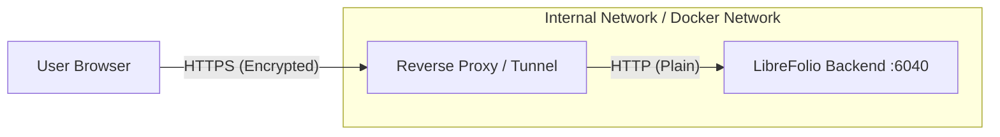

# 🔒 Security Architecture

This document outlines the security model, authentication system, and deployment recommendations for LibreFolio.

## 🎯 Threat Model and Scope

LibreFolio is a **self-hosted** application. The primary security assumption is that the **host system is secure**.

### ✅ In Scope

- **🔐 Authentication**: Stateless JWT-based authentication via HTTP-only session cookies with configurable expiration, and [session revocation](#session-revocation) per account.
- **🛡️ Data Segregation**: Strict isolation between users via Role-Based Access Control (RBAC).
- **✏️ Input Validation**: Preventing injection attacks via strict Pydantic schemas.
- **🧼 Output Escaping**: User- and provider-supplied text is escaped or sanitized before the browser can render it as HTML.
- **📁 File Upload Security**: MIME type validation, executable blocking, size limits, and a [scope](#upload-scope) per file: common, or personal to its uploader and the administrators.
- **🚫 Endpoint Protection**: **All** data and file endpoints require a valid session cookie — including uploaded files and plugin assets.

### ⚠️ Out of Scope

- **💻 Host System Compromise**: If an attacker gains shell access to the server, the database file is accessible. Encryption at rest is currently not implemented.
- **🔗 SSL/TLS Termination**: The application server (Uvicorn) speaks HTTP. HTTPS is the responsibility of the deployment environment (Reverse Proxy).

## 🔑 Authentication — JWT Cookies

LibreFolio uses **stateless JWT (JSON Web Token)** authentication stored in **HTTP-only session cookies**.

### 🔄 How Login Works

1. User sends credentials to `POST /api/v1/auth/login`
2. Server validates credentials and sets an **HTTP-only cookie** containing the JWT, whose payload is `sub` (the user
   id), `sv` (the account's session version, see [Session Revocation](#session-revocation)), `iat` and `exp`
3. The browser **automatically includes** this cookie on all subsequent requests
4. `` tags, `fetch()` calls, and page navigations all send the cookie seamlessly

!!! success "Why cookies over Bearer headers?"

    HTTP-only cookies are **automatically sent** by the browser for all same-origin requests — including ``, `<link href>`, and AJAX calls. This means uploaded files and plugin assets are served securely without any special frontend handling.

### 🗝️ JWT Secret

Tokens are signed with HS256 and one key per process, `_JWT_SECRET` in
`backend/app/services/accounts/auth_service.py`, resolved once when that module is imported:

- `configured_jwt_secret()` (`backend/app/config/platform.py`) returns `env_secret("JWT_SECRET")`: the
  `JWT_SECRET` variable when it is not blank, otherwise the content of the file named by
  `JWT_SECRET_FILE` ([Secrets from Files](#secrets-from-files)), otherwise `None`. An empty or blank
  `JWT_SECRET` counts as not set: a stray space is never used as a key. Neither
  variable is a field of the Pydantic `Settings`: both are read from the process environment only.
- With `None`, the process falls back to its own `secrets.token_urlsafe(64)`, so every start makes a
  new key and signs every user out. This default is deliberate: keeping sessions across restarts is
  opt-in.
- A `JWT_SECRET_FILE` that cannot give its secret raises `SecretFileError` during that import.
  `main.py` imports the API router, which imports `auth_service.py`, so the server does not start.

!!! warning "⚙️ Multi-worker support"

    Uvicorn starts its workers with `spawn` on every platform (`uvicorn/_subprocess.py`): each worker
    re-imports all modules and resolves the key on its own. With nothing shared, each worker would
    make its own key, and a token signed by one would fail on the others. Before launching Uvicorn,
    `_ensure_shared_jwt_secret()` in `dev.py` makes sure that every worker finds the same key:

    1. a non-blank `JWT_SECRET` is kept as it is, and wins over `JWT_SECRET_FILE`;
    2. otherwise, with a non-blank `JWT_SECRET_FILE`, nothing is generated and nothing is removed:
       every worker reads the same file, and a blank `JWT_SECRET` beside it is harmless, since the
       server ignores it;
    3. otherwise a fresh `secrets.token_urlsafe(64)` goes into `JWT_SECRET`, shared by every worker of
       that run.

- `dev.py` loads `.env` into the environment first; values already set in the shell win.
- The Docker image starts a single uvicorn worker (`CMD` in the `Dockerfile`) and receives `.env`
  through the `env_file:` of Compose: without `JWT_SECRET` or `JWT_SECRET_FILE`, every container start
  invalidates all sessions.
- The administrator's side is
  [Keep Users Signed In After a Restart](../../admin/index.md#session-persistence).

### ⏰ Token Expiration

- Configurable via [Global Settings](../../admin/settings.md): `session_ttl_hours` (default: 24 hours)
- Read each time a session cookie is issued — at login, and when a password or email change re-issues it — it sets
  both the token's `exp` and the cookie's `max_age` (24 hours when the setting cannot be read): a new value applies to
  the cookies issued after it
- After expiration, the user must log in again
- There is no token refresh mechanism — a new login is required. The only cookies issued without a login are the ones
  a password change or an email change sends back to the device that made it
  ([Session Revocation](#session-revocation))

### 🚪 Logout

- Frontend calls `POST /auth/logout` which clears the session cookie
- **No server-side blacklist** — logout leaves the session version alone: a copy of the token remains technically
  valid until it expires, or until the account's sessions are ended ([Session Revocation](#session-revocation))
- This is acceptable for a self-hosted application with short TTL: a user who fears a copied cookie changes the
  password, which ends every other session of the account

### 🔁 Session Revocation {: #session-revocation }

Each account has a session generation, `users.session_version` (`0` on a new account), and each session cookie carries
the generation it was issued at, the `sv` claim. Raising the account's version ends every session issued before it, on
every device, at its next request. There is still no session store: the check compares one integer column of the user
row that `get_current_user()` already loads on every request.

`user_service.end_sessions(user)` (`backend/app/services/accounts/user_service.py`) raises the version by one and does
not commit: the caller commits it with the change that asks for it. Six changes call it:

| Change | Entry point | Sessions ended |
|--------|-------------|----------------|
| Password change | `POST /api/v1/auth/change-password` (`PasswordChangeModal`, Profile tab) | Every other session of the account: the same response sets a new cookie at the new version, so the device that made the change stays signed in |
| Email change | `PUT /api/v1/auth/profile` with a new `email` and the right `current_password` (Profile tab) → `user_service.update_profile()`: see [Changing the Email](#email-change) | Every other session of the account, as for a password change: the same response sets a new cookie |
| Password reset | `./dev.py user reset` → `user_service.reset_password()`; a [reset link](access_control.md#reset-links) spent by `POST /api/v1/auth/password-reset` → `user_service.complete_password_reset()` | All of them |
| Deactivation | `./dev.py user deactivate` → `user_service.set_user_active(…, False)`; `PATCH /api/v1/users/{user_id}` with `is_active: false` → `user_service.update_user_status()` | All of them: a later activation does not bring them back |
| Demotion | `./dev.py user demote` → `user_service.set_user_admin(…, False)`; `PATCH /api/v1/users/{user_id}` with `is_superuser: false` → `user_service.update_user_status()` | All of them |
| Sign-out by an administrator | `POST /api/v1/users/{user_id}/sessions/revoke` | All of them |

Activation, promotion, logout and every refused operation leave the version alone: a new password that misses a
[password rule](#password-rules), wherever it is chosen; a wrong current password, or a new password equal to it, on
`change-password`; a missing or wrong current password, or an address or a username already
taken, on `PUT /auth/profile`; an unknown user; the last active administrator; *already an admin* or *not an admin*; a
reset link that is not valid. So do issuing a reset link, which ends nothing until it is spent, a `PATCH` whose values
equal the current ones, and a profile change that changes no email (a new username, or the stored email sent again).

- **The token.** `create_jwt_token(user_id, ttl_hours, session_version)`
  (`backend/app/services/accounts/auth_service.py`) writes `sub` (the user id, as a string), `sv`, `iat` and `exp`.
  `decode_jwt_token()` returns `SessionClaims(user_id, session_version)`, or `None` for a token that is expired or
  badly signed, that has no numeric `sub`, or whose `sv` is not an integer — a boolean included: `true` is not
  version 1.
- **Cookies issued before session versions.** A token without `sv` is session version `0`, the starting value of every
  account: the upgrade signs nobody out, and the first raise of an account's version ends those cookies like any other.
- **The check.** `get_current_user()` (`backend/app/api/v1/auth.py`) keeps its checks of the account (*User not
  found*, *User account is disabled*), then refuses a token whose version differs from the account's, behind or
  ahead, with `401` *Session expired or invalid*: the answer to an invalid token, so nothing tells the holder why.
  While an account is deactivated, its cookies get *User account is disabled* first.
- **The re-issued cookie.** Login, password change and email change set the cookie through one helper,
  `_issue_session_cookie()`: a JWT at the account's current version, lasting `session_ttl_hours` (24 hours when the
  setting cannot be read), with the same name and attributes as the login cookie, so the browser replaces the old
  cookie instead of keeping both.

!!! note "A request in flight during a password or email change"

    A request the same device sent with its old cookie, and that reaches the server after the change is committed,
    gets `401`. The frontend's 401 interceptor (`frontend/src/lib/api/zodios-client.ts`) sends it to the login page,
    where the new cookie signs it straight back in. The race is benign, and the code does not try to close it.

Tests: `./dev.py test services session-version` (`backend/test_scripts/test_services/test_session_version.py`: the
token, the check, the command-line callers and the refusals, in-process), `./dev.py test api session-revocation`
(`backend/test_scripts/test_api/test_session_revocation_api.py`: the password change over HTTP, with two devices and a
second account), and, for the administrator API and the reset links, `./dev.py test api users-admin` and
`./dev.py test api registration`. The email change has its own tests: see [Changing the Email](#email-change).

### ✉️ Changing the Email {: #email-change }

An account's email is a way into it: a password-reset link sent to that address lets whoever reads it choose the
password. `PUT /api/v1/auth/profile` used to change the email on the session cookie alone, so with the self-service
«forgot password» ([held](../backend/email.md#flow-forgot) until lot E4) a moment inside someone else's session — an
XSS, a stolen cookie, a computer left unlocked — would become a permanent takeover: change the email, ask for a reset,
choose the password (security review of lot E3, rated medium). Since lot A6e (release 1.3), an email change asks for
the current password and ends the account's other sessions. No other route changes an account's email.

- **What counts as an email change.** An `email` in the body that differs from the stored one, compared exactly, as
  `user_service.update_profile()` compares it. A username-only change, or the stored email sent again, needs no
  password, as before, and a `current_password` sent beside it is not checked.
- **The body.** `UpdateProfileRequest` (`backend/app/schemas/auth.py`) has an optional `current_password` of at least
  one character: an empty string is refused with `422`.
- **Checked first.** The route (`update_profile()` in `backend/app/api/v1/auth.py`) checks the password before
  anything else, uniqueness included, so whoever lacks it cannot probe which addresses are registered. bcrypt runs in
  a worker thread (`asyncio.to_thread(verify_password, …)`), as for the password change.
- **The sessions.** `user_service.update_profile()` calls `end_sessions()` and sets `users.email_verified_at` back to
  `NULL` (the new address is not verified, and no flow of release 1.3 verifies a changed one), in the commit of the
  new address. The route then sets a new session cookie through `_issue_session_cookie()`, as `change-password` does:
  the device that made the change carries on, and every other session gets `401` at its next request. A
  username-only change ends no session, nor does a refused one.

| Answer | `detail` | When |
|--------|----------|------|
| `400` | `{"error_code": "CURRENT_PASSWORD_REQUIRED", "message": …}` | An email change without `current_password`, left out or `null` |
| `400` | `{"error_code": "CURRENT_PASSWORD_INVALID", "message": …}` | A wrong `current_password`. Nothing is written, and the warning *Email change refused: wrong current password* goes to the log with `user_id` |
| `400` | *Email already registered* or *Username already taken*, plain strings as before | The password was right, or not needed, but the address or the name belongs to another account. Nothing is written |
| `422` | Validation errors | An empty `current_password`, an invalid `email`, a `username` outside 3–50 characters |
| `200` | — | The change is committed. After an email change, the answer sets the new `session` cookie, and the log has *Email changed, other sessions ended* (`user_id`) |

Not covered yet: the notice to the previous address is lot E4's (workstream E), and the route counts no wrong
passwords: limiting the guesses here is planned with the login attempt limit (lot A8).

The [Profile tab](../frontend/components/features/settings.md#profiletab) asks for the password in the email row; the
user's side is [Profile](../../user/settings/profile.md), section «Changing Your Email».

Tests: `./dev.py test api profile` (`backend/test_scripts/test_api/test_profile_api.py`, PROF-010 to PROF-016: the
refusals, the taken address not revealed without the password, the sessions with two devices, the username-only and
same-email guards), `./dev.py test services user-profile` (`backend/test_scripts/test_services/test_user_profile.py`,
`TestUpdateProfileEmailVerification`: `email_verified_at`), and for the tab
`./dev.py test front-utility component-unit` (`tabs/ProfileTab.test.ts`) and `./dev.py test front-utility settings`
(`frontend/e2e/settings.spec.ts`, its «A6e» block).

### 🔏 Password Rules {: #password-rules }

The rules a new password must meet are written once, in `backend/app/services/accounts/password_policy.py` (decision
37, lot A6c, release 1.3), and every way of choosing a password applies them. Before, they were written twice and
disagreed: `validate_password()` in `scripts/user_cli.py` used Python's `str.isupper()`, `str.islower()`,
`str.isdigit()` and a fixed list of ASCII symbols, `PasswordStrength.svelte` ASCII regular expressions and another
list, and the API asked only for 8 characters (`min_length=8` in the request schemas).

- **The rules.** `PASSWORD_RULES`, in this order: `min_length` (value `MIN_LENGTH`, 8), `uppercase`, `lowercase`,
  `digit`, `special`. `failed_rules(password)` returns the codes of the rules a password misses, in that order; an
  empty list means it meets them all.
- **Unicode classes.** Each class is a Unicode general category (`unicodedata.category()`): an uppercase letter is
  `Lu`, a lowercase one `Ll`, a digit `Nd`; a symbol, for `special`, is any character that is neither a letter
  (`L*`), nor a number (`N*`), nor whitespace. The length counts characters, that is code points. So `É` is an
  uppercase letter and `é` a lowercase one, `٣` (Arabic-Indic three) a digit, `€` and `_` symbols; a space is not a
  symbol, and `²` is a number (`No`) but not a digit, so it meets neither `digit` nor `special`.
- **Stored passwords stay valid.** The login never checks the rules: they apply only when a new password is chosen,
  so an account whose password predates them keeps signing in with it.

Each entry point checks the new password first, as soon as the request body is valid (and, for `change-password`, the
session):

| Entry point | Checked before |
|-------------|----------------|
| `POST /api/v1/auth/register` | The registration mode, the invitation, the user limit, and whether the username or the email is taken; for the first account of an empty instance too. A refused registration spends no invitation |
| `POST /api/v1/auth/change-password` | The current password, and the rule that the new one must differ from it |
| `POST /api/v1/auth/password-reset` ([reset links](access_control.md#reset-links)) | The link's token: with a weak password the link is not even read, so a valid link stays valid |
| `./dev.py user create`, `./dev.py user reset` | Anything in the database, the username included: `validate_password()` in `scripts/user_cli.py` is a thin wrapper over `failed_rules()` |

- **The refusal.** The three routes call `_refuse_weak_password()` (`backend/app/api/v1/auth.py`), which answers `400`
  with `{"error_code": "PASSWORD_TOO_WEAK", "message": "The password does not meet the password rules", "rules": […]}`
  in `detail`, `rules` being the codes missed, in the rules' order. Nothing is written: a refused change or reset
  leaves the password, the session version and the sessions as they were. The command line prints
  `❌ Password does not meet security requirements:`, then one line per rule missed that starts with its code
  (`_RULE_MESSAGES`), such as `min_length: the password must be at least 8 characters long`, and exits with `1`.
- **The schemas.** `AuthRegisterRequest.password`, `ChangePasswordRequest.new_password` and
  `PasswordResetRequest.new_password` (`backend/app/schemas/auth.py`) only require a non-empty string
  (`min_length=1`): an empty password is still a `422` of the request validation, not `PASSWORD_TOO_WEAK`. The
  length is the policy's rule.
- **Published to the app.** `password_rules_public()` is the list `GET /api/v1/system/instance` publishes as
  `accounts.password_rules`, `[{code, value}]` (`PasswordRuleRead`), `value` being `null` for every rule but
  `min_length` ([Public instance configuration](settings.md#public-instance-configuration)). The app draws and checks
  that list under every new-password field, with the same classes (`\p{Lu}`, `\p{Ll}`, `\p{Nd}`, a symbol
  `[^\p{L}\p{N}\s]`, the length in code points) in `frontend/src/lib/features/auth/passwordRules.ts`
  ([PasswordStrength](../frontend/components/features/auth.md#passwordstrength)), so a rule changed here reaches the
  interface without a change of its own. A code the app does not know is not checked there: the server decides.

Tests: `./dev.py test services password-policy` (`backend/test_scripts/test_services/test_password_policy.py`,
POLICY-000 to POLICY-006: the published list, the order of `failed_rules()`, the Unicode classes, the length in code
points); `./dev.py test api auth` (`test_api/test_auth_api.py`, REG-004, CHPWD-005 and PWD-001 to PWD-008: registration
and password change, the new password checked before the current one, a login that never checks);
`./dev.py test api registration` (`test_api/test_registration_api.py`, RESET-004, RESET-006, RESET-007 and RULES-001 to
RULES-003: the reset link and the invitation left unspent, the order of the checks, the first account, the `accounts`
block); `./dev.py test utils dev-cli-image` (`test_utilities/test_dev_cli_image.py`, IMG-031 to IMG-031d:
`validate_password()`, then `user create` and `user reset` on a copy of the image's files). The app's half:
`./dev.py test front-utility core-unit` (`passwordRules.test.ts`) and `./dev.py test front-utility component-unit`
(`PasswordStrength.test.ts`).

### 💻 Using curl

```bash
# Login and save cookie
curl -s -c cookies.txt -X POST http://localhost:6040/api/v1/auth/login \
  -H "Content-Type: application/json" \
  -d '{"username": "admin", "password": "yourpassword"}'

# Use cookie for authenticated requests
curl -b cookies.txt http://localhost:6040/api/v1/auth/me

# List brokers
curl -b cookies.txt http://localhost:6040/api/v1/brokers

# Sync FX rates
curl -b cookies.txt -X POST \
  -H "Content-Type: application/json" \
  http://localhost:6040/api/v1/fx/currencies/sync
```

## 🔐 Secrets and the Instance Key

### 📄 Secrets from Files {: #secrets-from-files }

Every secret of LibreFolio is read by `env_secret(name)` in `backend/app/config/__init__.py`: today
`JWT_SECRET`, `LIBREFOLIO_INSTANCE_KEY`, `LIBREFOLIO_WEB_LINK_FINDER_API_KEY`,
`LIBREFOLIO_SMTP_PASSWORD`, `LIBREFOLIO_BACKUP_DOWNLOAD_TOKEN`, `LIBREFOLIO_WAKE_TOKEN`, and every
variable of the plugin settings, secret or not (`plugin_setting_env()` in
`backend/app/config/plugins.py`: the derived `LIBREFOLIO_PLUGIN_*` names and the aliases of secret
fields, see [Plugin Settings](patterns/plugin_settings.md#environment)). In this order:

1. `NAME`, when not blank, is the secret as written, spaces included;
2. otherwise `NAME_FILE`, when not blank, is the path of a file that holds it, as Docker and Kubernetes
   mount their secrets (`/run/secrets/…`). `~` is expanded, and a relative path starts from the
   project root. The secret is the file's text without a leading UTF-8 byte order mark, which some
   Windows editors add, and without its trailing line breaks (`decode("utf-8-sig").rstrip("\r\n")`):
   any other space counts;
3. otherwise there is no secret: `None`.

Blank means empty or whitespace only: a value that `str.strip()` empties counts as not set, so a stray
space is never used as a key.

`read_secret_file()` raises `SecretFileError` when the file is missing, cannot be read, is larger than
64 KiB (`SECRET_FILE_MAX_BYTES`), is not UTF-8 text or is empty or blank (`… is empty or blank`). The
message names the variable and the path, never the content. Like every variable outside the
`Settings` class, both forms come from the process environment only, never from `.env` directly:
`./dev.py` and the `env_file:` of Compose put `.env` there. For messages, `env_secret_origin(name)`
names the source without reading the file: `NAME`, `NAME_FILE (<path>)` or `None`
(`configured_jwt_secret_origin()` and `configured_instance_key_origin()` in `platform.py`).

The caller decides what a `SecretFileError` means. A broken `JWT_SECRET_FILE` or
`LIBREFOLIO_INSTANCE_KEY_FILE` stops the start ([JWT Secret](#jwt-secret),
[Configuration Checks](#configuration-checks)). A broken `LIBREFOLIO_WEB_LINK_FINDER_API_KEY_FILE`
does not: `web_link_finder_api_key()` in `backend/app/config/plugins.py` reads it only when a search
builds the `apikey` engine, and `_build_engine()` in `backend/app/services/assets/web_link_finder.py`
then logs `web_link_finder: <error>; disabling` and returns no engine, so that search finds no links.
Nor does a broken `LIBREFOLIO_SMTP_PASSWORD_FILE`: email is optional, so `email_config_state()` turns
it off instead, with the problem `SMTP_PASSWORD_UNREADABLE`, which is logged at startup and shown to
administrators in Settings › Email ([Email Service](../backend/email.md#config-state)).
Nor does an unusable `LIBREFOLIO_BACKUP_DOWNLOAD_TOKEN`: `backup_download_token()` in
`backend/app/config/backup.py` reads it only when the hosting panel calls one of its routes, never at
startup, so the server starts anyway. Besides the `SecretFileError` of a broken `_FILE`, it raises
`BackupConfigError` for a token with anything but visible ASCII characters, spaces included
(`BACKUP_DOWNLOAD_TOKEN_NOT_VISIBLE_ASCII`), or shorter than 32 characters
(`BACKUP_DOWNLOAD_TOKEN_TOO_SHORT`). `require_panel_token()` in `backend/app/api/v1/backup/panel.py` turns
either into `503` with the code `backup_panel_unavailable`, on every panel route, and logs one error line
per refused call, `The hosting panel's backup token cannot be used: its routes refuse every request`, whose
`error` names the variable, and the path of a file, never the token
([Hosting for Others](../../admin/hosting_providers.md#panel-backups)).
Nor does an unusable `LIBREFOLIO_WAKE_TOKEN`: `require_wake_token()` in
`backend/app/api/v1/system/wake.py` reads it at each call of `POST /system/wake-sync`, which then
answers `503` with the code `wake_unavailable`
([Scheduled Wake-up](../../admin/sleep_wake.md#wake-sync)). Nor does a `_FILE` of a plugin setting
that cannot give its value: the field gets the problem `invalid_env`, and the plugin is not configured
until the variable is fixed ([Plugin Settings](patterns/plugin_settings.md#environment)).

When `NAME` and `NAME_FILE` are both set, neither blank, `NAME` wins. `secrets_set_twice()` lists those
names for the [configuration checks](#configuration-checks). It covers `JWT_SECRET` and every
`LIBREFOLIO_*` variable, so a new secret named `LIBREFOLIO_*` and read with `env_secret()` needs no list
to update.

Test lanes never inherit the secrets that make the instance trust a session or decrypt its data.
`configure_test_runtime()` in `scripts/cli_base.py`, which every test entry point goes through
(`dev.py test`, and `dev.py server --test`, which the `webServer` of Playwright also runs), removes
`JWT_SECRET`, `JWT_SECRET_FILE`, `LIBREFOLIO_INSTANCE_KEY` and `LIBREFOLIO_INSTANCE_KEY_FILE`
(`INSTANCE_TRUST_SECRETS` in `backend/app/config/__init__.py`) from its environment, whether they
come from the shell or from `.env`. A test lane therefore signs sessions with a key made for its run and derives keys from an
instance key generated in its own data directory.

#### Test lanes and the instance's configuration {: #test-lanes-and-the-instances-configuration }

The same rule covers the rest of the instance's configuration: a test lane runs on the defaults, so a
setting of the developer's install (a mail server, the managed profile, an instance block, account
limits) can neither reach the tests nor change their outcome.

- `configure_test_runtime()` removes, whatever their origin (`.env`, loaded by `pipenv run` before
  `dev.py` starts, or the shell): every variable `.env.example` documents
  (`documented_instance_variables()`), every `LIBREFOLIO_*` name in the environment and the secrets
  above. Keys of `.env` that are not LibreFolio's (a proxy, `PYTHONPATH`) stay.
- It keeps only what `kept_in_a_test_lane()` keeps: `TEST_LANE_KEEPS` (the two ports, the production
  data directory it must stay away from, `HOST`, the log level, `LF_APP_VERSION` frozen by a release
  job for its gallery, and Playwright's `LIBREFOLIO_SERVER_WORKERS`) and every `LIBREFOLIO_TEST_*`
  name, the runner's and the tests' own (data directory, mode, the lane's readiness token, startup
  timeout).
- In test mode `Settings` does not read `.env` at all (`settings_customise_sources`), so a setting
  removed from the environment does not come back from the file.
- A new variable is covered without a list to update: it is named `LIBREFOLIO_*` or documented in
  `.env.example` (a test requires it). A test that needs a setting sets it in its own process, after
  any helper that configures the lane (`setup_test_database()` and its siblings call
  `configure_test_runtime()`, which would remove it again).

### 🧬 Instance Key {: #instance-key }

One secret per installation, from which LibreFolio derives its encryption keys
(`backend/app/services/platform/instance_key.py`). Consumers never read the key itself: each one asks
for a key derived for its own purpose. The key comes from the first of these sources that is set:

1. `LIBREFOLIO_INSTANCE_KEY`, then `LIBREFOLIO_INSTANCE_KEY_FILE`: `configured_instance_key()` in
   `backend/app/config/platform.py`, which returns `env_secret("LIBREFOLIO_INSTANCE_KEY")`;
2. `<data directory>/secrets/instance.key` (`instance_key_path()`), generated on first use.

A key is a text of at least 32 characters (`INSTANCE_KEY_MIN_LENGTH`), and its UTF-8 bytes are the
input of the derivation. The length is the only check: a key set by the administrator must be random,
such as `secrets.token_urlsafe(32)`, not a passphrase, because the derived keys are only as strong as
it is.

| Function | Contract |
|----------|----------|
| `derive_key(purpose: str, length: int = 32) -> bytes` | HKDF-SHA256 (RFC 5869, `hkdf_sha256()` on the standard-library `hmac` and `hashlib`) over the key's UTF-8 bytes, with a fixed salt (`_DERIVATION_SALT`) and `info = purpose.encode("ascii") + b"\x00" + length.to_bytes(2, "big")`. The length is part of the derivation: the same purpose at two lengths gives two unrelated keys, never a key and its prefix. The same purpose and length get the same bytes while the instance key stays the same; two purposes never get the same key. `length` goes from 1 to 8160 bytes. `purpose` and `length` are validated first: an invalid one raises `ValueError` before the key is read or generated. Otherwise, without a configured key, the first call generates the key file. Raises `InstanceKeyError` when the key cannot be used. |
| `derive_key_from(key: str, purpose: str, length: int = 32) -> bytes` | The key that `derive_key(purpose, length)` gives on an instance whose instance key is `key`: the same HKDF-SHA256, salt and `info`. It reads neither the environment nor the data directory and never creates the key file. Checked in this order: `purpose` and `length` (`ValueError`, the rules of `derive_key()`), then the type of `key` (`TypeError` for anything but a `str`), then its length (`InstanceKeyError` under `INSTANCE_KEY_MIN_LENGTH`, 32 characters). No message holds the key. |
| `instance_key_status() -> InstanceKeyStatus` | The state, without creating the key file and without raising: `source` (`configured`; `generated` when something is at the key file's path, a link that leads nowhere included, or when its folder cannot be searched; `not_created`), `problem` (why the key cannot be used, `None` when it can), `path`, and `loose_modes`, the octal modes of the folder and the file when group or others have any access to the generated key (always empty on Windows). |
| `instance_key_path() -> Path` | `get_data_dir() / "secrets" / "instance.key"`: the test data directory in test mode. |

`purpose` names the use and its version, such as `plugins.settings.v1`: lowercase letters, digits and
`. _ : -`, starting with a letter or a digit, at most 128 characters.

`derive_key()` and `derive_key_from()` validate and derive through the same private helpers
(`_check_purpose_and_length()`, then `_derive()`), so the two cannot drift. `derive_key_from()` is for
a key that is not this instance's. Its intended caller is the restore of workstream B, which will
re-encrypt the plugin secrets that a backup's instance encrypted with its own key. The archive leaves
that key out, so it comes from where the administrator kept it: a copy of the old
`secrets/instance.key`, read with `read_secret_file(path, label)` (`backend/app/config/__init__.py`:
the file's text without a leading byte order mark and its trailing line breaks) as this module reads
its own, or the old value of `LIBREFOLIO_INSTANCE_KEY`. The restore derives the old subkey with
`derive_key_from(old_key, "plugins.settings.v1", 32)` and gives it, with this instance's subkey, to
`rekey_plugin_secrets(conn, old_subkey, new_subkey)` in
`backend/app/services/plugin_settings/crypto.py`. No code calls `derive_key_from()` yet.

The generated file (`_create_key_file()`):

- **Content**: `secrets.token_urlsafe(32)` and a newline, that is 32 random bytes in base64url: 43
  characters, 44 bytes on disk.
- **Permissions**: the `secrets/` folder is created with mode `0700`; the file is `0600`, as
  `mkstemp()` creates it (or the `O_EXCL` fallback below).
- **One key wins**: the key is written to a temporary file (`mkstemp()`) in the same folder, flushed
  and `fsync`ed, then published with `os.link()`, which fails when `instance.key` already exists. Of
  several workers starting together, the first key published stays, and readers never see half a key.
  On a filesystem without hard links, an exclusive create (`O_CREAT | O_EXCL`) still lets only one key
  in; there the file appears before its content, so a reader that finds it unusable retries for up to
  half a second (`_read_generated_key()`: 10 reads, 50 ms apart). The temporary file is always
  removed, and the folder is `fsync`ed where the platform allows it.
- **Never replaced**: `_key_file_present()` looks at the path with `lstat()`, so anything there, a
  link that leads nowhere included, counts as the key file. A key file that is empty or blank, too
  short or unreadable raises `InstanceKeyError`, which asks to restore it from a backup: a new key
  could not read what the old one encrypted. A `secrets/` folder that cannot be searched (another
  owner, mode `0000`) raises `InstanceKeyError` too
  (`<path>: the instance key cannot be reached (Permission denied)`): the key may be there, so it is
  neither generated again nor reported as missing. So does a key file that cannot be created.
- **Created on use only**: `ensure_data_dirs()` does not create `secrets/`, and `instance_key_status()`
  only reads, so the file appears with the first `derive_key()` call.
- **Test isolation**: `validate_test_data_dir()` treats `secrets/` and `secrets/instance.key` as
  managed paths: a test lane may not alias the production ones.

**A lost key file** still looks like a first use: a new key is generated, and nothing the old one
encrypted can be read with it. The plugin settings, whose secrets are the only data stored encrypted
under the instance key today, make the change visible: each row records the `key_id` of the key that
encrypted it, and from the first start after the change the startup step `plugin-secrets-check` logs
an error that counts the stored system secrets the current key cannot read, if there are any
([Plugin Secrets Check](#plugin-secrets-check)). The administrator puts back `secrets/instance.key`
from their copy of the data directory (the archive of the instance backup leaves the key out), or
enters the secrets again. The order matters: saving a secret rewrites its row's `secret_ciphertext`
and `key_id` under the current key (`_apply()` in `backend/app/services/plugin_settings/service.py`),
so an old key brought back afterwards reads again the rows never entered again, but not the ones
entered under the new key; the old key therefore goes back first (LibreFolio stopped, the copy in
place of the generated file), before anyone enters a secret again, and the secrets are entered again
only when no copy exists.

Tests: `./dev.py test services config-secrets` (`env_secret()`) and
`./dev.py test services config-instance-key`, whose section (g) pins `derive_key_from()` to three
known answers computed with `derive_key()` before the two shared their helpers. What the
administrator sees and does is in [Configuration](../../admin/configuration.md), section «The
Instance Key».

## 🩺 Configuration Checks {: #configuration-checks }

`backend/app/services/platform/config_audit.py` checks the settings that leave an instance weaker than
it should be. Each check is a function that returns a `ConfigCheck`:

| Field | Content |
|-------|---------|
| `check_id` | Stable id, such as `platform.jwt_secret` |
| `severity` | `ok`, `info`, `warning` or `error` |
| `i18n_key` | Key of its message, `instance.checks.*`, written whole in the module of the check (`config_audit.py`, `plugin_secrets_check.py`) so the i18n usage scan (`scripts/i18n_usage.py`) sees it. The 15 messages, the two of the [plugin secrets check](#plugin-secrets-check) included, are in the `instance` i18n subsystem; no page shows them yet, as the checks only reach the log |
| `detail` | The parameters of that message |
| `summary` | The English sentence written to the log |

A check changes nothing, never raises and never puts a secret value in its result.
`run_config_checks()` evaluates the functions of `CONFIG_CHECKS`, in this order:

| `check_id` | Not `ok` when | Severity |
|------------|---------------|----------|
| `platform.jwt_secret` | Neither `JWT_SECRET` nor `JWT_SECRET_FILE` is set, blank counting as not set: one key per start, the default | `info` |
| `platform.jwt_secret` | The secret is shorter than 32 characters (`JWT_SECRET_MIN_LENGTH`); the summary names its origin (`configured_jwt_secret_origin()`): `The session signing key from JWT_SECRET is … characters long: …`, or `from JWT_SECRET_FILE (<path>)` | `warning`; `error` with `LIBREFOLIO_PROFILE=managed`, where `log_configuration_audit()` stops the startup first |
| `platform.jwt_secret` | `JWT_SECRET_FILE` cannot give its secret | `error` |
| `platform.secrets_set_twice` | A secret is set both as `NAME` and as `NAME_FILE`, neither blank (`secrets_set_twice()`) | `warning` |
| `platform.instance_key` | `instance_key_status()` reports a `problem`: the key cannot be used, including a generated key file out of reach (`cannot be reached (Permission denied)`) | `error` |
| `platform.instance_key` | The folder or the file of the generated key gives group or others any access: the folder should be `0700`, the file `0600` | `warning` |
| `platform.session_cookie` | `SESSION_COOKIE_SECURE=never` | `warning` |
| `platform.log_level` | `LOG_LEVEL`, after the `LIBREFOLIO_LOG_LEVEL` override, is `DEBUG` or `TRACE` | `info` |

At startup, the `configuration-checks` step of the lifespan (`STARTUP_STEPS` in
`backend/app/services/platform/app_lifespan.py`) runs `log_configuration_audit()` in a thread
(`asyncio.to_thread`), right after the `Starting LibreFolio` line:

1. `configured_jwt_secret()`: an unreadable `JWT_SECRET_FILE` raises `SecretFileError`. In practice
   the import of `auth_service.py` has already failed on it. With `LIBREFOLIO_PROFILE=managed`, a
   configured secret shorter than `JWT_SECRET_MIN_LENGTH` raises `WeakSecretError`; in the
   self-hosted profile it stays the `warning` of the table above.
2. `instance_blocked()` and `instance_deletion_date()` (`backend/app/config/platform.py`): a value
   they cannot read raises `ValueError`. On a blocked instance, a warning
   `Instance blocked by its hosting provider (LIBREFOLIO_BLOCKED): …`, with `deletion_date`, goes to
   the log: see [Instance Block](#instance-block).
3. `instance_key_status()`: a configured key (`source == "configured"`) with a problem raises
   `InstanceKeyError`. The administrator chose that source, so the server does not start without it.
4. Every check that is not `ok` is logged at its severity, with the `summary` as the event and `check`
   and `detail` as fields. A generated key file gone bad or out of reach is logged as an error, and the
   start goes on.

Tests: `./dev.py test services config-audit`. What the administrator sees and does is in
[Configuration](../../admin/configuration.md), section «Startup Checks».

### 🧩 Plugin Secrets Check {: #plugin-secrets-check }

`backend/app/services/platform/plugin_secrets_check.py` finds the secrets of the
[plugin settings](patterns/plugin_settings.md#secrets) that the instance key can no longer read: a
lost `secrets/instance.key` generated again, data restored without its `secrets/`, another
`LIBREFOLIO_INSTANCE_KEY`. It needs the database, and `CONFIG_CHECKS` run before the `database` step,
so it cannot be one of them. `check_plugin_secrets(session) -> ConfigCheck` returns the `ConfigCheck`
of `config_audit.py` all the same, so that the «Security» tab of the admin settings, which does not
exist yet, can show it with the others. Unlike the functions of `CONFIG_CHECKS`, it can raise, on a
database error for one: the startup step below catches it.

It asks `plugin_secrets_key_status(session)` (`backend/app/services/plugin_settings/crypto.py`),
which counts by `key_id`, without decrypting, the stored secrets of each scope that the current key
did not encrypt, or all of them when the key cannot be used. While no secret is stored it reads no key
at all, so a fresh install never generates the key file at this step. With secrets stored, it derives
the subkey with `derive_key()`, which generates a missing key file as any first use does: after a lost
key file, every stored secret counts against the new key.

| `check_id` | Not `ok` when | Severity |
|------------|---------------|----------|
| `platform.plugin_secrets` | At least one stored `system` secret cannot be read: `i18n_key` `instance.checks.pluginSecrets.unreadable` (an ICU plural on `count`), `detail` `{"count": <system count>}`, summary `Stored plugin secrets that the instance key cannot read: <N>. Enter them again in the plugin settings, or restore the instance key they were saved with` | `error` |

Otherwise the check is `ok` (`instance.checks.pluginSecrets.ok`, no `detail`). Only the `system`
count reaches the result and the log, by the rule of the plugin settings: a user's secrets are that
user's, who sees them `unreadable` in their own settings and enters them again. So when only user
secrets are unreadable, the check is `ok`.

The startup step `plugin-secrets-check` (`STARTUP_STEPS`, right after `global-settings`) runs
`log_plugin_secrets_check()`: it opens an `AsyncSession` on `get_async_engine()`, logs a result that
is not `ok` at its severity, as `log_configuration_audit()` does (the `summary` as the event, `check`
and `detail` as fields), and logs nothing when it is `ok`. It never raises: when the check fails, it
logs the warning `Plugin secrets check could not run`, whose `error` field holds the class name of the
exception, never its message, and the start goes on. A row keeps its `key_id` until its secret is
saved again (a clear deletes the row), so the error comes back at every start until the secrets are
entered again or the old key is restored.

Tests: `./dev.py test services plugin-secrets-check`
(`backend/test_scripts/test_services/test_plugin_secrets_check.py`), and the step's place in
`./dev.py test services app-lifecycle`. What the administrator sees and does is in
[Configuration](../../admin/configuration.md), section «Startup Checks».

## 🛡️ Endpoint Protection

All endpoints that access or modify user data require a valid session cookie (`Depends(get_current_user)` in FastAPI), except the hosting panel's backup routes (`/backup/panel/jobs…`), which authenticate with the panel token instead: see [Hosting for Others](../../admin/hosting_providers.md#panel-backups).

### 🌐 Public Endpoints (no auth required)

| Endpoint | Method | Purpose |
|----------|--------|---------|
| `/auth/login` | POST | User login |
| `/auth/logout` | POST | Clear session cookie |
| `/auth/register` | POST | New user registration, under the [password rules](#password-rules), the [registration mode](access_control.md#registration-modes) and the [user limit](access_control.md#user-limit) |
| `/auth/tokens/inspect` | POST | The status of an invitation or password-reset link, for whoever holds its token: see [Links in use](#account-token-links) |
| `/auth/password-reset` | POST | Spend a password-reset link: a new password, under the [password rules](#password-rules), and every session of the account ended |
| `/auth/address-probe` | GET | Whether this instance issued a nonce: `{match}` and nothing else, readable from any origin; see [Address Probe](#address-probe) |
| `/system/health` | GET | Health check: the server answers |
| `/system/info` | GET | System information, the app version only without a valid session (`SystemInfoPublicResponse`) and everything with one (`SystemInfoResponse`): see [System information and readiness](#system-info-and-readiness) |
| `/system/instance` | GET | Public instance configuration, needed before sign-in: see [Public instance configuration](settings.md#public-instance-configuration), and [The First-Account Flag](#first-account-open) for the one fact about the users it tells |
| `/system/ready` | GET | Readiness for health checks and orchestrators (`200` when the database answers and its schema is at the head revision of the migrations, `503` otherwise): see [System information and readiness](#system-info-and-readiness) |
| `/utilities/*` | GET | Reference data (countries, currencies, sectors) |
| `/ai-export/catalog` | GET | Static AI Export catalogue (no user data) |

On an instance blocked by its hosting provider, the public endpoints outside its short list answer
`401`: see [Instance Block](#instance-block).

### 🆕 The First-Account Flag {: #first-account-open }

`GET /system/instance` tells anyone one fact about the users: `accounts.first_account_open`, true
while the `users` table is empty, an inactive account counted (`first_account_open(session)` in
`backend/app/services/accounts/registration_service.py`). The login page needs it: the first account
of an empty instance can be created in any [registration mode](access_control.md#registration-modes)
and becomes the administrator, so the page offers **Register here** while the flag is true, even on
an instance that registers by invitation, the default of a new install. Publishing it is accepted
(coordinator decision, 15/10/2026):

- **It tells nothing a registration attempt would not.** An empty instance takes the first
  `POST /auth/register` it gets, whatever the mode: anyone can learn that it is empty by trying.
- **The window is short.** The flag turns false with the first registration, normally minutes after
  the install; the administrator manual asks to register before exposing the instance
  ([Global Settings](../../admin/settings.md), section «Who Can Sign Up»).
- **A managed instance will not show it.** With lot A7 (F02, not delivered yet), the first account of
  a managed instance will be the administrator created from the environment, so the flag will be
  false from the start. Until then a managed instance starts empty, like any other.

### 🩺 System Information and Readiness {: #system-info-and-readiness }

**`GET /system/info`** (`backend/app/api/v1/system/info.py`) runs the checks of `get_current_user` through its
`signed_in_user` dependency, where a `401` means anonymous instead of an error. Without a valid session cookie (none,
an expired or invalid token, an unknown or disabled account), the answer is the app version only,
`{"app_version": "..."}` (`SystemInfoPublicResponse`). With one, it is the full `SystemInfoResponse`: app, Python and
OS versions, platform, deployment mode, backend and frontend dependency versions. The OpenAPI `200` response is the
`anyOf` of the two schemas, the full one first.

**`GET /system/ready`** (`backend/app/api/v1/system/ready.py`) tells whether the instance can serve requests, for
Docker health checks, Uptime Kuma, orchestrators and hosting panels. `check_readiness()`
(`backend/app/services/platform/readiness.py`) runs two checks, and the body (`ReadinessResponse`,
`backend/app/schemas/system.py`) carries one code for each:

| Check | Codes |
|-------|-------|
| `database` | `ok`: the database answers a query; `unreachable`: it does not |
| `migrations` | `ok`: the database's revision, in `alembic_version`, is the head revision of the migration scripts; `mismatch`: it is another revision; `unknown`: a revision cannot be read (no `alembic_version` table or not exactly one row in it, several heads or no scripts), and whenever `database` is `unreachable` |

`status` is `ready`, with `200`, only when both checks are `ok`; otherwise it is `not_ready`, with `503` and the same
shape:

```json
{"status": "ready", "checks": {"database": "ok", "migrations": "ok"}}
```

- **Codes only.** The body never carries an error message, a path or a revision id. The details go to the server
  log, once per change of state: `Instance not ready` (warning, with both codes and the problem) or `Instance ready`
  (info). A monitor that asks every few seconds adds no log line while the state holds.
- **The head revision is read once per process**, from the migration scripts of `backend/alembic.ini`. A failed read
  is not cached: the next check tries again.
- **`/system/health` is a different question**: it answers `{"status": "ok"}` as soon as the server answers, without
  touching the database. The image's `HEALTHCHECK` and both Compose files call it.

### 🔒 Private Endpoints (auth required)

All other endpoints — including Auth (profile, password), Settings (user settings, onboarding progress, and the global settings: any signed-in user reads them through `GET /settings/global` and `GET /settings/global/{key}`, only an administrator writes them; the login page needs none of them, it reads `/system/instance`), System diagnostics (`/system/plugin-diagnostics`), the block page (`/system/block`, see [Instance Block](#instance-block)), the catch-up of the prices (`/system/price-refresh`, see [Catch-up Progress](../backend/scheduler.md#price-refresh)), Brokers, BRIM (files and plugins), Transactions, **Uploads** (CRUD + file serving + plugin assets), FX, Assets, Risk, Tools, Backup, and Users — require a valid session cookie. Two kinds of route take a token of their own instead of a session cookie, sent as `Authorization: Bearer`: the hosting panel's backup routes (`/backup/panel/*`, `LIBREFOLIO_BACKUP_DOWNLOAD_TOKEN`) and the [scheduled wake-up](../../admin/sleep_wake.md#wake-sync) (`/system/wake-sync`, `LIBREFOLIO_WAKE_TOKEN`). The panel's token is compared in constant time by `require_panel_token` (`backend/app/api/v1/backup/panel.py`): a missing or wrong token answers `401`, and while no token is set the panel's routes answer `404`, as a path that does not exist: see [Hosting for Others](../../admin/hosting_providers.md#panel-backups). The account administration routes of `/users` (every route but `/users/search`) also require an administrator (`require_admin`): see [Administrator API](access_control.md#admin-user-api).

!!! info "📁 Files are protected too"

    Uploaded files (`/uploads/file/{id}`) and plugin assets (`/uploads/plugin/{type}/{path}`) **require authentication**. Since auth uses HTTP-only cookies, the browser includes the session automatically for `` tags — no special handling needed. A personal file needs more than a session: see [Uploaded Files: Common and Personal](#upload-scope).

For a complete endpoint reference, see the [API Overview](../api/overview.md).

### 📁 Uploaded Files: Common and Personal {: #upload-scope }

Each uploaded static file (`<data directory>/custom-uploads/<uuid>.<ext>`, with its JSON sidecar `<uuid>.json`, see
[Data Directory on Disk](database/index.md#data-directory)) has a scope, `UploadScope`
(`backend/app/schemas/uploads.py`): `common`, seen by every signed-in user (icons, logos, asset photos, avatars), or
`personal`, seen only by its uploader and the administrators (`is_superuser`). The rule lives in
`backend/app/services/files/static_uploads.py`, the routes in `backend/app/api/v1/uploads.py`:

- **The scope.** The sidecar stores it. A sidecar written before scopes existed, or by the seeding of the default
  avatars, has none, and `effective_scope()` applies the inheritance rule at every read, with no migration: the
  application's own files (uploader id `0`, `SYSTEM_USER_ID`: the seeded default avatars) are common, `image/*` is
  common, anything else is personal. `POST /uploads` takes an optional multipart field `scope`, `common` or
  `personal`; without it, the same rule decides, and the result is stored.
- **Seeing a file** (`can_view_upload()`). `GET /uploads` lists the common files and the user's own personal ones,
  every file for an administrator; `my_files_only=true` keeps only one's own files, of both scopes. `GET /uploads/{id}`,
  `GET /uploads/{id}/preview` and `GET /uploads/file/{id}` (download, `img_preview` thumbnail, text window) answer a
  personal file of someone else with the `404` *File not found* of a file that does not exist, so its existence is not
  revealed. The check runs first, before the thumbnail cache and before any type check.
- **Changing a file** (`can_manage_upload()`). `DELETE /uploads/{id}` and `PATCH /uploads/{id}` with
  `{"scope": "common"}` or `{"scope": "personal"}` (`UploadUpdateRequest`) belong to the uploader and the
  administrators. Another user gets `403` on a common file, and the same `404` on a personal one. Every
  `UploadFileInfo` carries `scope` and `can_delete`: whether the requesting user may delete the file and change its
  scope.
- **Private thumbnails.** `img_preview` answers carry `Cache-Control: private, max-age=3600`, never `public`: they are
  signed-in content, which the browser may keep and a shared cache in front of the instance must not.
- **Several workers** (`dev.py server --workers N`). Each worker caches a sidecar for up to an hour (`upload_metadata`),
  but checks the sidecar's stamp (inode, mtime, size) at every read, and `_save_metadata()` replaces a sidecar
  atomically (a temporary file in the same folder, then `os.replace`). A scope changed through one worker holds at
  once in the others, and no reader sees half a file.

The broker report files of [BRIM](../backend/brim/architecture.md) answer differently, and deliberately so: their
routes (`/brokers/import/files/…`) give `403` to a user without access to the file's broker.

Tests: `./dev.py test services static-uploads`, `./dev.py test api uploads` and `./dev.py test api uploads-serve-file`.

### 🚧 Instance Block {: #instance-block }

A hosting provider blocks an instance with `LIBREFOLIO_BLOCKED`; the administrator's side is
[Hosting for Others](../../admin/hosting_providers.md#instance-block). `backend/app/config/platform.py`
reads both variables from the process environment, never through `Settings`, and they work in every
profile:

- `instance_blocked()`: `1`, `true`, `yes` and `on` block, `0`, `false`, `no` and `off` do not, in any
  case; unset or blank is not blocked; any other value raises `ValueError`.
- `instance_deletion_date()`: `LIBREFOLIO_DELETION_DATE`, an optional ISO date shown on the block
  page; any other value raises `ValueError`.

`log_configuration_audit()` reads both at startup, so a value they cannot read stops the server (see
[Configuration Checks](#configuration-checks)).

**The guard.** `refuse_when_blocked` (`backend/app/api/v1/instance_block.py`) is a dependency of the
`/api/v1` router, `APIRouter(dependencies=[Depends(refuse_when_blocked)])` in
`backend/app/api/v1/router.py`, so it covers every API route (`APIRoute`) under it, today's and
tomorrow's. FastAPI gives no router dependency to a plain `Route`, a `WebSocketRoute` or a `Mount`, so
none of them belongs under `/api/v1`. FastAPI hands
a dependency the endpoint function of the matched route (`request.scope["endpoint"]`), not its full
path, so the allow-list `ALLOWED_WHEN_BLOCKED` is a `frozenset` of endpoint functions:

| Endpoints | Functions | For |
|-----------|-----------|-----|
| `POST /auth/login`, `POST /auth/logout`, `GET /auth/me` | `auth.login`, `auth.logout`, `auth.get_me` | Signing in and out, and who is signed in |
| `POST /auth/tokens/inspect`, `POST /auth/password-reset` | `auth.inspect_link_token`, `auth.reset_password_with_link` | A link already sent: reading it, and setting a new password with a reset link; without them, someone who lost the password could never reach the block page, the account deletion or the backup |
| `DELETE /auth/users/me`, `GET /auth/users/me/deletion-preview` | `auth.delete_own_account`, `auth.preview_own_account_deletion` | Deleting one's own account, and seeing first what it would delete; the block page has no button for it yet |
| `POST /backup/instance`, `GET /backup/instance/jobs/{job_id}`, `GET /backup/instance/jobs/{job_id}/file`, `DELETE /backup/instance/jobs/{job_id}` | `backup_instance.start_instance_backup`, `backup_instance.get_instance_backup_job`, `backup_instance.download_instance_backup`, `backup_instance.delete_instance_backup_job` | The full backup, for an administrator: start, poll, download, delete. On a blocked instance the data can still be taken away, from the backup card of the block page (`backup_available` of `GET /system/block`, below) |
| `POST /backup/panel/jobs`, `GET /backup/panel/jobs/{job_id}`, `GET /backup/panel/jobs/{job_id}/file`, `DELETE /backup/panel/jobs/{job_id}` | `backup_panel.start_panel_backup`, `backup_panel.get_panel_backup_job`, `backup_panel.download_panel_backup`, `backup_panel.delete_panel_backup_job` | The same, for the hosting panel, with its token (`require_panel_token`) instead of a session: the provider hands the data back |
| `GET /system/block`, `GET /system/instance` | `block.get_instance_block`, `instance.get_instance_config` | The block page |
| `GET /system/health`, `GET /system/ready`, `GET /system/info` | `health.health_check`, `ready.get_readiness`, `info.get_system_info` | Probes and version |
| `GET /system/test-lane-health` | `health.test_lane_health` | The test runner's probe, `404` outside test mode |
| `POST /system/wake-sync` | `wake.wake_sync` | The [scheduled wake-up](../../admin/sleep_wake.md#wake-sync), with its own token instead of a session: on a blocked instance it runs no job and answers `200` with `status: "blocked"` (decision D-W3) |

**The refusal.** On a blocked instance, an endpoint outside the list first runs `get_current_user()`
with the request's own database session (FastAPI caches the dependency), then refuses:

- **without a valid session**: the `401` of `get_current_user()`;
- **with a valid session**: `423 Locked`, with the code `INSTANCE_BLOCKED_CODE`:

    ```json
    {"detail": {"code": "instance_blocked", "message": "This instance is blocked by its hosting provider"}}
    ```

**What a caller without a session can tell.** Only signed-in users get the `423`. A caller without a
valid session gets these answers:

| Routes | Not blocked | Blocked |
|--------|-------------|---------|
| Protected routes outside the list | `401` | The same `401` |
| Public routes outside the list: `POST /auth/register`, `GET /auth/address-probe`, `GET /utilities/*`, `GET /ai-export/catalog` | Their usual answer | `401` |
| The routes of the list | Their usual answer | The same answer |

- The protected routes and the routes of the list do not reveal the block: `/system/instance`,
  `/system/info` and `/system/ready` answer as on any other instance. Only the scheduled wake-up
  tells, and only to the holder of its token: `status: "blocked"`.
- The public routes outside the list answer `401` only while the instance is blocked. From them, a
  caller without a session can tell that the instance is blocked, and nothing more: they return no
  data.

On an instance that is not blocked, the guard returns at once and leaves the session unused. On a
blocked one it runs before the route's own dependencies and before the body is validated: a signed-in
caller of a refused route gets the `423` even with an invalid body, never a `422`.

**`GET /system/block`** (`backend/app/api/v1/system/block.py`) is for signed-in users only, and allowed
on a blocked instance. It returns `InstanceBlockResponse` (`backend/app/schemas/system.py`): `blocked`;
`deletion_date`, `null` without a date; `billing_url`, where the subscription is managed
(`LIBREFOLIO_BILLING_URL`, from `registration_service.billing_link()`), for administrators only: it is
`null` for the other users, and when the variable is unset or not an `http(s)` address (`billing_link()`
logs the latter once per process); and `backup_available`, whether this user may still download a full
backup of the instance: the user's `is_superuser`, so `true` for administrators only (decision 12). The
block page (`frontend/src/lib/features/instance/components/InstanceBlockedPage.svelte`) checks again
that `billing_url` is an `http(s)` address, then shows an administrator a **Manage subscription** link
to it, opened in a new tab (`rel="noopener noreferrer"`). When `backup_available` is `true`, and only
then, it shows the backup card of **Settings › Backup** under the block message: the card's four
`backup_instance` routes are on the list above, and nothing else on the server changes for it (see
[Instance block](../frontend/state/app-state.md#instance-block)). A workstream that owns part of the
block page adds one field there and fills it in `block.py` with one call to its service.

**Changing the list.** The list is short on purpose. The two link endpoints joined it for someone who
lost the password (see the table above): they read a link already sent or spend a reset link, and
create no account. Registration (`POST /auth/register`) stays out: it is still one of the public routes
that answer `401` on a blocked instance, so an invitation link can be read there but not accepted. The
full backup is on the list too, for the administrator (`backup_instance`: start, poll, download and
delete; decision 12) and for the hosting panel (`backup_panel`: the same four, with the panel's token
instead of a session), and so is the scheduled wake-up (`wake.wake_sync`), with its own token instead
of a session: on a blocked instance it runs no job and answers `blocked` (decision D-W3). Any other
addition goes through the developer first. `./dev.py test api instance-block` (`backend/test_scripts/test_api/test_instance_block.py`)
pins the list by name and by route, checks that every API route under `/api/v1` resolves
`refuse_when_blocked` first, and that the only other routes under `/api/v1` are FastAPI's
documentation, so an addition, or a route the guard does not reach, shows in review.

**Outside the guard.** Routes outside the `/api/v1` router, such as the built web app, `/mkdocs` and
FastAPI's own documentation (`/api/v1/docs`, `/api/v1/redoc`, `/api/v1/openapi.json`), are not
covered: the browser still loads the app, which turns the first `423` into the block page (see
[Instance block](../frontend/state/app-state.md#instance-block)). The scheduler does not go through
HTTP, so the guard does not reach it: `run_due_jobs()` checks `instance_blocked()` itself and runs no
job on a blocked instance ([Scheduler](../backend/scheduler.md#run-checks)).

## 🎟️ Single-use Account Tokens {: #account-tokens }

Invitations, password-reset links, email verification and the setup link of the initial administrator all hand
someone a secret inside a URL. `backend/app/services/accounts/token_service.py` is the building block of these
single-use links in the accounts domain: it issues, checks, spends and revokes their tokens, with the same
guarantees for all four. Invitations, password-reset links and email verification use it today
([Links in use](#account-token-links)); the setup link has no caller yet.

### 🎲 Generation and Storage

- `issue_token()` draws a new token on every call with `secrets.token_urlsafe(32)`: 32 random bytes (256 bits),
  written as 43 URL-safe characters.
- The plaintext is returned once, in `IssuedToken.token`, beside the new row (`IssuedToken.record`). The database
  keeps only `hash_token(token)` — the SHA-256 of the UTF-8 token, 64 lowercase hex characters — in
  `account_tokens.token_hash`, which is unique. A link cannot be rebuilt from the database: a lost one is replaced
  by a new token, never recovered.
- A fast hash is enough: unlike a password, 256 random bits are out of reach of guessing, so no slow salted hash
  is needed. Being deterministic, the hash is also the lookup key: `inspect_token()` and `consume_token()` hash
  the token they receive and search `token_hash`.

### 🎯 Purposes, Lifetimes and Links

Each token serves one `AccountTokenPurpose`, stored in `purpose`. Every lookup matches the hash **and** the
purpose: a token presented for another purpose is `unknown`, exactly like a token never issued — a reset link is
never an invitation.

| Purpose | Default lifetime (`DEFAULT_TTL`) | `user_id` | `grants_admin` | Link (`token_path()`) |
|---------|----------------------------------|-----------|----------------|-----------------------|
| `invite` | 7 days | Refused: the account does not exist yet | Allowed | `/invite#token=…` |
| `password_reset` | 30 minutes | Required | Refused | `/reset-password#token=…` |
| `email_verification` | 24 hours | Required | Refused | `/verify-email#token=…` |
| `admin_setup` | 72 hours | Required | Refused | `/setup#token=…` |

`expires_at` is `created_at` plus the lifetime; a `ttl` argument replaces the default. `issue_token()` raises
`ValueError` on a refused or missing `user_id`, on a refused `grants_admin` and on a lifetime that is not
positive, before writing anything. `token_path(purpose, token)` returns the link as a path with the token in the
fragment, never in the query string: see [Links in Use](#account-token-links) for why.

### 🚦 Checking and Spending a Token

`inspect_token(session, token, purpose)` returns a `TokenInspection` — a `TokenStatus` and the row — and writes
nothing. The status is `unknown` (with no row), `revoked`, `consumed`, `expired` or `valid`, checked in that
order: a revoked token that has also expired reports `revoked`. A token expires at `expires_at` exactly; it is
valid until the microsecond before.

`consume_token(session, token, purpose, consumed_by_user_id=…)` spends a token with one conditional `UPDATE`,
which amounts to:

```sql
UPDATE account_tokens
SET consumed_at = :now, consumed_by_user_id = :consumer
WHERE token_hash = :hash AND purpose = :purpose
  AND consumed_at IS NULL AND revoked_at IS NULL
  AND expires_at > :now
```

When the statement changes exactly one row, `consume_token()` returns that row, read again from the database;
otherwise it returns `None` and nothing changed — `inspect_token()` tells why. The check and the write are one
statement, with no gap between them: of two requests racing for the same link, only the one whose `UPDATE`
changes the row gets it.

### 🚫 Revocation

`revoke_tokens(session, token_id=…)` revokes one token, `revoke_tokens(session, user_id=…)` the tokens of one
account, optionally of one `purpose`. It sets `revoked_at` on the matching tokens that are neither consumed nor
revoked — expired ones included — and returns how many; consumed and revoked tokens keep their timestamps.
Without a `token_id` or a `user_id` it raises `ValueError` rather than revoke every token. An invitation has no
`user_id`: it is revoked by its id.

### 🧾 Transactions and Logs

- The service never commits. `issue_token()` flushes, so the new row has its id; `consume_token()` and
  `revoke_tokens()` run their `UPDATE` in the session's transaction. The caller commits: spending an invitation
  and creating the account it opens share one transaction, and fail together. A rollback undoes an issue, a
  consumption or a revocation.
- The plaintext token is never logged, and neither is its hash. The events *Account token issued*, *Account
  token consumed* and *Account tokens revoked* carry the token id, the purpose and the user ids.

`./dev.py test services account-tokens` (`backend/test_scripts/test_services/test_account_tokens.py`) pins this
contract, including two sessions consuming one token at once and a search of the logs and of every database
column for the plaintext. The table — columns, constraints, foreign-key actions — is described in
[`ACCOUNT_TOKEN`](database/users_access.md#account-token).

### 🔗 Links in Use: Invitations, Password Resets, Email Verification {: #account-token-links }

Three purposes have callers: invitations, password-reset links and email verification. The rules of the first two —
who may register, the user limit, what each endpoint answers — are in
[Registration, Invitations and the Admin API](access_control.md#registration); those of email verification in
[Email Verification](../backend/email.md#verification). What protects their tokens:

- **Only an administrator, or a shell on the server, issues a link.** `POST /api/v1/users/invites` and
  `POST /api/v1/users/{user_id}/password-reset-link` require an administrator; `./dev.py user invite` and
  `./dev.py user reset-link` run on the server. The token is in that response, or printed by that command,
  once. A lost link is replaced with a new one.
- **Only the newest reset link of an account works.** Issuing one revokes the account's live reset links, and
  spending one revokes any other.
- **A verification link is never shown, only emailed, and only to the account's own address.** Registration
  issues a token without an address (the «hold»), whose text never leaves the server; the link itself goes by
  email, built from `LIBREFOLIO_PUBLIC_URL`, and «send the link again» asks for the account's password first.
  Each new link revokes the account's others, and spending one activates the account in the same commit.
  `confirm_email()` refuses a token without an address, and revokes one emailed to an address the account no
  longer has.
- **Spending is atomic with its effect.** An invitation is consumed in the transaction that creates its account;
  a reset link in the commit that sets the new password, raises the session version and revokes the other links.
  If the account cannot be created, the invitation stays unspent.
- **Inspecting tells a guesser nothing.** `POST /api/v1/auth/tokens/inspect` is public and writes nothing. Only a
  valid token gets details: the expiry, plus the role and email of an invitation or the username of a reset link.
  Any other token gets its status alone, and a token presented for the other purpose is `unknown`.
- **Anonymous answers say nothing about the users but whether there is one.** The `409` `USER_LIMIT_REACHED` of
  `POST /auth/register` carries no count and no billing link; only the administrator's routes add `limit`, `used`
  and `billing_url`. About accounts, `GET /system/instance` publishes only the registration mode, whether a variable
  locks it, whether the instance has no account yet ([The First-Account Flag](#first-account-open)), and the
  [password rules](#password-rules), the same on every instance.
- **The token rides in the fragment, never in the query string.** `token_path()` builds `/invite#token=…`,
  `/reset-password#token=…` and `/verify-email#token=…`. A browser never sends the fragment to the server, so the
  token is not in the request for the page: it stays out of the server's access log and out of the logs of every
  proxy on the way. A browser never puts the fragment in a `Referer` either. A token in the query string would be
  in all those logs. The page reads it with JavaScript (`location.hash`); a `token` in the query string is not read
  at all.
- **The link pages hide and keep the token.** `/invite`, `/reset-password` and `/verify-email` read the token when
  they mount, then put the bare path in the address bar (`replaceState`), so the token stays out of the history and
  of a bookmark; they keep it in memory only. They also listen to `hashchange`: a link pasted into a tab already on
  the page changes only the fragment and loads nothing, so the page reads the new token there. All three declare
  `<meta name="referrer" content="no-referrer">`: a link followed from them sends no `Referer` at all. Their
  components are in [Authentication Components](../frontend/components/features/auth.md#link-pages), except those
  of `/verify-email`, which spends its token at once, without inspecting it first:
  [In the Frontend](../backend/email.md#verification-frontend).

## 📡 Address Probe {: #address-probe }

Developer decision D-A3 has the Invite dialog prefill the server's address and let the administrator edit
it. When the address is edited, the browser checks that *this* instance answers there, not merely
something. `backend/app/services/accounts/address_probe.py` does it with a signed nonce and two routes:

1. the browser asks its own instance for a nonce: `POST /api/v1/users/address-probe`, administrators only
   (`require_admin`), `200` `{nonce, expires_at}` (`AddressProbeIssued`), a new nonce at every call;
2. it sends the nonce, without credentials, to `GET <address>/api/v1/auth/address-probe?nonce=…`, which is
   public and answers `200` `{"match": true}` only when the instance there issued the nonce,
   `{"match": false}` otherwise (`AddressProbeResult`), and nothing else.

**In the app.** `LinkShare`, the panel of the Users tab's invitation and password-reset dialogs, runs the check
through `checkAddress()` (`frontend/src/lib/features/settings/users/addressProbe.ts`), and only for an address the
administrator changed, 500 ms after the last keystroke. The nonce comes through the Zodios client; the check is a bare
`fetch`, a CORS simple request (see [the warning below](#address-probe-cors)), abandoned after 8 s. A readable
`{"match": true}` or `{"match": false}` reads *match* or *mismatch*; anything else reads *unverifiable*, never *no*.
No verdict stops the administrator from copying the link. Component side:
[LinkShare](../frontend/components/features/settings.md#linkshare).

### 🎯 Why a Signed Nonce {: #address-probe-threat-model }

A stable instance id readable from any origin would have been simpler, and was set aside: any page visited
by someone on the instance's network could read it from a LibreFolio on the LAN, and recognise the same
instance at two addresses, a fingerprint. With the nonce, the public answer is one bit about a value only an
administrator of this instance can obtain:

- issuing needs an administrator's session, and its answer carries no `Access-Control-Allow-Origin`: no
  other origin can read a nonce;
- the check answers `match` and nothing else: no id, no version, no configuration;
- any page can still tell that *a* LibreFolio answers at an address, since the check answers
  `{"match": false}` to anyone, but not *which* one.

Unlike an [account token](#account-token-links), the nonce rides in the query string, so it reaches the
request log: the [request-log filter](#request-logs) masks credential-like parameters, and `nonce` is not one.
There it is worth the same bit, for at most two minutes.

### 🧾 The Nonce {: #address-probe-nonce }

`issue_probe_nonce()` returns the nonce and `expires_at`:

```text
base64url( rand16 ‖ expiry_be8 ‖ HMAC-SHA256(derive_key("accounts.address-probe.v1"), rand16 ‖ expiry_be8) )
```

| Part | Bytes | Content |
|------|-------|---------|
| `rand16` | 16 | `secrets.token_bytes(16)` |
| `expiry_be8` | 8 | The expiry in Unix seconds, big-endian: the second of the issue plus 120 (`PROBE_TTL_SECONDS`) |
| MAC | 32 | HMAC-SHA256 of the first 24 bytes, under the key `derive_key()` gives the purpose `accounts.address-probe.v1` (`PROBE_PURPOSE`): see [Instance Key](#instance-key) |

The 56 bytes are written in base64url without padding: 75 characters. Nothing is stored: the nonce carries
everything its check needs, so any worker verifies a nonce any worker issued, and a check consumes nothing:
a nonce matches as often as it is asked until it expires. *This instance* means *this instance key*: a copy
running with the same key, such as a restored backup, matches too. Without a configured key, issuing a
nonce, or checking a well-formed one, can be the first use that generates the key file.

### 🔍 Verification {: #address-probe-verification }

`verify_probe_nonce(nonce)` is `True` only for a nonce this instance issued that has not expired, `False`
for anything else, and never raises:

1. **Shape**: a text over 256 characters (`MAX_NONCE_LENGTH`) is refused at once; otherwise it must be
   exactly 75 characters of the base64url alphabet (`A–Z`, `a–z`, `0–9`, `-`, `_`). The alphabet is
   checked before decoding because Python's base64 decoder is lenient: it skips the characters outside its
   alphabet, and its URL-safe variant also reads `+` and `/`.
2. **One spelling per nonce**: the text must decode to 56 bytes that encode back to the very same text.
   The last character carries two bits the decoder ignores, so four texts would otherwise pass for one
   nonce.
3. **The MAC** is recomputed and compared with `hmac.compare_digest`, the only judge of the signature.
4. **The expiry** is read only once the MAC holds: the nonce matches up to `expires_at`, included.

An instance key that cannot be used makes every check `False`, with one warning per process (*Address
probe: the instance key cannot be used, every probe answers no match*); the
[configuration checks](#configuration-checks) give the reason at startup. Issuing has no such fallback:
`POST /users/address-probe` then fails with `500`.

`GET /auth/address-probe` reads `nonce` from the query string, `""` when it is absent, with no length
constraint, so no value gets a `422`: an empty, malformed, oversized, non-canonical, forged, expired or
foreign nonce is `200` `{"match": false}`. A session cookie, valid or not, changes nothing.

### 🌐 One Route Readable from Any Origin {: #address-probe-cors }

The check is cross-origin by nature: the page runs at the address the administrator is using, the check
goes to the edited one. `answer_address_probe()` (`backend/app/api/v1/auth.py`) sets two headers on every
answer, `true` or `false`:

- `Access-Control-Allow-Origin: *`, once: no other route of the backend sets this header;
- `Cache-Control: no-store`.

The global `CORSMiddleware` (the `cors` entry of `MIDDLEWARE_STACK`, `backend/app/services/platform/middleware.py`:
`allow_credentials=True`, no allowed origin) leaves that header in place on a simple `GET` and only adds
`Access-Control-Allow-Credentials: true`, which the browser ignores for a request without credentials. Every other
route answers a request from another origin without `Access-Control-Allow-Origin`.

!!! warning "The check must be a CORS simple request"

    `GET`, no custom header, no `Content-Type: application/json`, and `credentials: 'omit'`: a bare
    `fetch`, not the Zodios client, whose Axios instance sends cookies (`withCredentials: true`); the
    browser does not let a request with credentials read an answer with `Access-Control-Allow-Origin: *`.
    Anything else makes the browser send an `OPTIONS` preflight first, which the middleware refuses with
    `400 Disallowed CORS origin` (`CORSMiddleware.preflight_response()` in Starlette).

**Limits.** Only a readable `200` `{"match": …}` is an answer: `false` means that a LibreFolio answers
there but did not issue the nonce, or that the nonce has expired. Anything else must be read as «cannot
verify», not as «no»; among the cases:

- a network error: nothing answers, the connection is refused, DNS or TLS fails;
- an HTTPS page checking an `http://` address: mixed content, which the browser blocks;
- a page on a public origin checking a LAN address, which Chrome guards: a Private Network Access
  preflight is refused by the middleware like any other, and Local Network Access, its successor, lets the
  request through only once the user grants a permission;
- anything at that address but a LibreFolio with this route, an earlier version included: no readable
  `{match}`;
- a [blocked instance](#instance-block): the check is a public route outside `ALLOWED_WHEN_BLOCKED`, so,
  without a session as it always is, it gets the guard's `401`, which carries no
  `Access-Control-Allow-Origin`. There, issuing a nonce answers `423`, like every route outside the list
  for a signed-in caller.

**Key changes and threads.** A change of the instance key invalidates the nonces issued before it:
harmless, for a value that lives two minutes. `derive_key()` reads the instance key at every call, from a
file unless `LIBREFOLIO_INSTANCE_KEY` holds it, so both routes are plain `def` functions, which FastAPI
runs in a worker thread, off the event loop.

Tests: `./dev.py test services address-probe`
(`backend/test_scripts/test_services/test_address_probe.py`: the layout under the derived key, the expiry,
every altered, malformed, oversized, non-canonical or foreign nonce refused, `hmac.compare_digest`, never
raises) and `./dev.py test api address-probe` (`backend/test_scripts/test_api/test_address_probe_api.py`:
`401`, `403` and `200` for the nonce; the exact `{match}` with both headers; a `GET` from another origin
through the `CORSMiddleware` of the lane's server; cookies ignored; another instance, in process). No test
sends a preflight: its refusal is the middleware's.

## 🧼 Output Escaping

User- and provider-supplied text — asset, broker, and file names, notes, currency codes, icon
URLs — is rendered as text in tables, chart tooltips, notifications, and validation messages.
It never reaches `{@html}`, `innerHTML`, or a hand-built HTML string unescaped.

Svelte already escapes a plain `{expression}`. The risk lies wherever the frontend renders a
string as markup, and each of those places has one rule:

| Where markup is rendered | Rule | Helper |
|--------------------------|------|--------|
| Hand-built HTML strings: `html` table cells (rendered by `DataTable` with `{@html}`), ECharts tooltip formatters, validation-message parameters | Escape every user or provider value at the point where it is interpolated | `escapeHtml` (`frontend/src/lib/utils/core/escapeHtml.ts`) |
| `{@html}` sinks fed from many places: toasts (`ToastContainer.svelte`), `Tooltip.svelte`, the transaction modals and result banner | Sanitize the whole string at the sink. DOMPurify keeps the markup those strings are made of and drops event-handler attributes, `<script>`, and `javascript:` URLs | `sanitizeHtml` (`frontend/src/lib/utils/core/sanitizeHtml.ts`) |
| PAC planner explanations shown as tooltip HTML | Escape the text first, then add only the line breaks and bullet lists the helper itself produces | `tipHtml` (`frontend/src/lib/features/tools/pac-allocator/planner/shared/tipHtml.ts`) |

`escapeHtml` escapes `&`, `<`, `>`, `"`, and `'`, so its output is safe both as text and inside
a single- or double-quoted attribute. The `escapeHtml` exported by `$lib/utils/inlineMath`
deliberately leaves the apostrophe alone because its output feeds KaTeX, where `f'(x)` is prime
notation: do not use it for attribute values.

Three source gates keep the rule in force; the first two run in
`./dev.py test front-utility core-unit`, the third in
`./dev.py test front-portfolio chart-safety-unit`:

- `frontend/src/htmlInterpolation.gate.test.ts` parses every non-test `.svelte` and `.ts` file
  under `frontend/src` and fails when a user or provider text field reaches an HTML template
  without passing through `escapeHtml(…)`. Local escapers such as `esc(…)` are not accepted,
  because they leave `"` unescaped.
- `frontend/src/htmlSink.gate.test.ts` requires every `{@html X}` in a non-test `.svelte` file
  to be a `sanitizeHtml(…)` call or an entry of its reviewed list, which records a reason for
  each sink. An entry that no longer matches a sink fails the gate.
- `frontend/src/lib/utils/core/escapeHtml.single.test.ts` fails when a non-test `.svelte` or `.ts`
  file under `frontend/src` holds an HTML escaper of its own (`&` mapped to `&amp;`) outside
  `escapeHtml.ts`. One file is exempt: `inlineMath.ts`, the KaTeX variant above. An exempt file
  that no longer holds a copy fails the gate (see
  [Tooltip HTML](../frontend/components/charts.md#chart-tooltip-escaping)).

No gate sees a raw `innerHTML` assignment that involves no template: do not write one.
`./dev.py test front-asset asset-name-xss` (`frontend/e2e/assets/asset-name-xss.spec.ts`)
creates an asset whose name and icon URL carry markup, through the API, and checks in a real
browser that the table and card views of `/assets` show it as text and run nothing.

!!! warning "Fixed in 1.2: a stored XSS present since v1.1.0"

    In v1.1.0 the Name column of the Assets table interpolated the asset name raw into an
    `html` cell, which `DataTable` renders with `{@html}`. The backend stores any string as an
    asset name and assets are global, so a name containing markup ran as script in the browser
    of every user who opened the asset list — the administrator included. The same flaw sat in
    other `html` cells, chart tooltips, toasts, and validation messages. The 1.2 fix escapes
    user text where it enters an HTML string, sanitizes the sinks that receive mixed markup,
    and adds the first two gates above.

## 🐳 Container Image Check

The automatic update check runs only for superusers, after login
(`frontend/src/routes/(app)/+layout.svelte`). Its release lookup is cached in `localStorage`
(`librefolio-update-check`) for one hour (`CHECK_INTERVAL_MS`), and **Skip this version** is
stored in the same entry. A manual **Check for updates** in the changelog modal bypasses both the
cache and the dismissal, and reports errors.

The update check reports a new release only once its Docker image can be pulled from GHCR.
GHCR's anonymous token handshake is not available to browsers through CORS, so the frontend
calls `GET /api/v1/system/container-image-status?tag=X.Y.Z` (authenticated) and the backend
performs it (`backend/app/services/platform/container_registry.py`):

1. Accept only a stable `X.Y.Z` tag; both the route's query pattern and the service check it.
2. Send an anonymous `HEAD` for the tag's manifest on `ghcr.io/librefolio/librefolio`. Any
   answer other than `401` is final: success is `published`, `404` is `pending`, anything
   else is an `error`.
3. On `401`, parse the `WWW-Authenticate` Bearer challenge strictly (quoted parameters only,
   no duplicate keys). It is trusted only when `realm` is exactly `https://ghcr.io/token` —
   HTTPS, default port, no credentials, query, or fragment — `service` is `ghcr.io`, and
   `scope` is `repository:librefolio/librefolio:pull`.
4. Request an anonymous pull token from that realm; accept it only if it has bearer-token
   syntax (when both `token` and `access_token` are present, they must match).
5. Repeat the `HEAD` with that token in the `Authorization` header.

Every deviation fails closed with an `error` status (`image-auth-request-failed` for the
challenge and token steps, `image-request-failed` for the manifest requests). An untrusted
challenge is never followed, so the token request can only go to `https://ghcr.io/token`. The
HTTP client uses a 5 s timeout and does not follow redirects. The frontend keeps the gate
fail-closed as well (`frontend/src/lib/features/update-check/updateCheck.ts`): an error is
never shown as "up to date".

## 📜 Request Logs {: #request-logs }

uvicorn writes one line per request, with its path and query string: HTTP requests on the `uvicorn.access` logger,
WebSocket handshakes on `uvicorn.error`. A credential in a query string would reach that line in clear, so
`configure_logging()` (`backend/app/logging_config.py`) adds a filter to both loggers. It replaces with `***` the value
of every credential-like query parameter: one named exactly `code`, or whose name holds `token`, `secret`, `password`,
`passwd`, `api_key`/`apikey`/`api-key` or `signature`, in any case, judged on the name percent-decoded as the app reads
it. The filter masks every string argument of the record where it stands, so the line keeps its shape, and the log
stays on everywhere. A value is not decoded: a URL encoded inside another parameter's value is not read.

The links the app writes carry their tokens in the URL fragment, which the browser never sends, and the app's
redirects (`?redirect=`, `?returnTo=`) carry a path and query, never a fragment: the filter covers a token typed by
hand into a query string. `mask_query_credentials()` holds the rule. One mode is outside it: uvicorn's own
`--log-level trace`, which LibreFolio never passes, logs every ASGI message on `uvicorn.asgi`, headers included. It is
a debugging mode, not meant for a server with real users.

## 🏷️ Response Headers {: #response-headers }

`SecurityHeadersMiddleware` (`backend/app/services/platform/security_headers.py`), the `security_headers` entry of
`MIDDLEWARE_STACK` (see [Steps and Middleware: the Contract](overview.md#lifecycle-contract)), adds the security headers
of decision D5. Two of them, `ALWAYS_HEADERS`, go on every HTTP response of the app: API answers, the web app, the
documentation and the files, compressed or not, errors included. Two switches add more, off on a self-hosted install and
on in the managed profile: see [Frame Protection and the Report-Only Policy](#managed-headers).

| Header | Value | Effect |
|--------|-------|--------|
| `X-Content-Type-Options` | `nosniff` | The browser uses the type the server sends and never guesses another, so no file, an upload included, is sniffed into a script or a page |
| `Referrer-Policy` | `strict-origin-when-cross-origin` | Another site learns at most the origin of a page, never its path or query |

- **A header the route set is kept.** The middleware adds a header only when the response has none of that name, in
  any case: a route's `Referrer-Policy: no-referrer` stays, and the `nosniff` that the text preview of an upload
  (`backend/app/api/v1/uploads.py`) and the download of a broker report (`backend/app/api/v1/brokers.py`) set
  themselves is not repeated. Names are compared whole, never by prefix: `content-security-policy` is a prefix of
  `content-security-policy-report-only`, so a prefix check would let a route's report-only policy suppress the enforced
  one, or the reverse. A route that sets its own `X-Frame-Options`, `Content-Security-Policy` or
  `Content-Security-Policy-Report-Only` keeps it alone, and the middleware still adds the others. WebSocket and
  lifespan scopes pass untouched.
- **The 500 of an exception.** Starlette answers an unhandled exception from `ServerErrorMiddleware`, which it puts
  outside every middleware of the stack, so its 500 would go out without the headers. When a request raises before
  its response has started, the middleware sends the 500 itself (`Internal Server Error`, plain text) with the headers
  of every response, then re-raises the exception: `ServerErrorMiddleware` finds the response started and sends
  nothing, and the server still logs the error.
- **A type for every file served.** With `nosniff`, a script or a style sheet sent with a type that is not its own is
  refused, so every file the app serves must carry its right type. `FileResponse` (the `/_app` mount, the SPA
  catch-all, `/mkdocs`) and the plugin-asset route (`/uploads/plugin/…`) take it from `mimetypes`, with
  `application/octet-stream` for a name it does not know. `mimetypes` reads Python's own table, which has no type
  for the fonts or `.map`, then the system's `mime.types` files, which a slim image such as the runtime
  `python:3.13-slim` does not have. `register_served_types()`, which `install_static_site()` calls, adds
  `SERVED_TYPES` (JavaScript, CSS, JSON and source maps, the web manifest, WebAssembly, SVG, the fonts) to
  `mimetypes` for the whole process, so these extensions get the same type on every machine.

### 🖼️ Frame Protection and the Report-Only Policy {: #managed-headers }

The part of decision D5 meant for the [managed profile](../../admin/hosting_providers.md#managed-profile): two `bool`
switches of `Settings`, `False` in the code and `True` in `PROFILE_DEFAULTS["managed"]` (see
[Settings System](settings.md)). Each can be set on its own, in either profile, and a value set in the environment or in
`.env` wins over the profile.

| Switch | Header | Value | Sent on |
|--------|--------|-------|---------|
| `LIBREFOLIO_FRAME_PROTECTION` | `X-Frame-Options` | `SAMEORIGIN` | Every HTTP response |
| `LIBREFOLIO_FRAME_PROTECTION` | `Content-Security-Policy` | `frame-ancestors 'self'`, that directive only | Every HTTP response |
| `LIBREFOLIO_CSP_REPORT_ONLY` | `Content-Security-Policy-Report-Only` | `CSP_REPORT_ONLY_POLICY`, below | The HTML pages of the web app |

- **Frame protection** (`FRAME_HEADERS`) is enforced: only the app's own pages may frame it, so a hosting panel or a
  dashboard on another origin that shows the app in a frame is refused by the browser. Its two headers go where
  `ALWAYS_HEADERS` go: API answers, the web app, the documentation, the files, the CORS preflights (the `cors` entry is
  inside this one) and the middleware's own 500.
- **The report-only policy blocks nothing**: the browser lists each violation in its developer console. There is no
  report endpoint: the policy has no `report-uri` or `report-to`, and no `Report-To` or `Reporting-Endpoints` header
  is sent.
- **Where the report-only policy goes.** `_is_web_app_page()` decides at `http.response.start`, from the response's
  `Content-Type` and `scope["path"]`: the type must start with `text/html`, and the path must be outside `/mkdocs`
  (bare or `/mkdocs/…`) and `/api` (bare or `/api/…`). The middleware is outside GZip, so a compressed page still says
  `text/html`. The policy thus reaches `/`, the client-side routes the SPA catch-all answers and the HTML files of the
  build (`200.html`, `offline.html`). Left out on purpose: the documentation, a separate site that this policy does not
  describe; Swagger UI and ReDoc (`/api/v1/docs`, `/api/v1/redoc`), which load their scripts from a CDN, so a
  `default-src 'self'` report there would be pure noise; the HTML 404 that the catch-all answers for an unknown API
  path; and every response that is not HTML: JavaScript, JSON, text files, and the CORS preflights and the 500, which
  are plain text.
- **Read once.** `SecurityHeadersMiddleware.__init__` reads both switches from `get_settings()`, so they are read when
  the middleware is built, never per request. Starlette builds the middleware stack lazily, at the app's first ASGI
  call: for the real app, the lifespan startup. Changing a switch takes a restart, and the tests build a fresh app for
  each configuration.

`CSP_REPORT_ONLY_POLICY`, directive by directive:

| Directive | Sources | Why |
|-----------|---------|-----|
| `default-src` | `'self'` | Every fetch directive the policy does not name falls back to the app's own origin |
| `script-src` | `'self' 'wasm-unsafe-eval'` | Script files from the app's origin, no inline script; WebAssembly may compile, for the PDF viewer (its PDFium engine) |
| `style-src` | `'self' 'unsafe-inline'` | The app's inline styles are allowed |
| `img-src` | `'self' data: blob: https:` | Images from any HTTPS address: asset and broker icons are set by URL |
| `font-src` | `'self' data:` | Fonts from the app's origin, or inlined as `data:` URLs |
| `connect-src` | `'self'` | `fetch`, XHR and WebSockets reach the app's origin only |
| `worker-src` | `'self' blob:` | Workers, the service worker included, from the app's origin or a `blob:` URL |
| `frame-src` | `'self' blob:` | The app's frames show its own pages or a `blob:` URL |
| `object-src` | `'none'` | No `<object>` or `<embed>` content |
| `base-uri` | `'self'` | A `<base>` element cannot send the page's relative URLs to another origin |
| `form-action` | `'self'` | Forms submit to the app's origin only |
| `frame-ancestors` | `'self'` | Only the app's own pages may frame the page, as with frame protection |

Today a page of the web app reports at least its inline scripts: the one of `frontend/src/app.html`, which applies the
theme before the first paint and registers the service worker, and the start script SvelteKit writes into the page
(`frontend/svelte.config.js` has no `csp` option, so SvelteKit adds no hash or nonce to it);
`frontend/static/offline.html`, the page the service worker shows when the server cannot be reached, has one too. These
reports are expected until the scripts move to files or get hashes: the report-only phase is there to list what an
enforced policy would block.

Tests: `./dev.py test services security-headers` (`backend/test_scripts/test_services/test_security_headers.py`:
`nosniff` and `Referrer-Policy` exactly once on every kind of response, a route's own kept, the 500 with its exception
still re-raised), `./dev.py test services managed-headers` (`backend/test_scripts/test_services/test_managed_headers.py`,
on fresh apps holding the stack's `security_headers`, `gzip` and `cors` and a fake static site: frame protection once
on every response when on and on none when off, `false` over `managed` included; the report-only policy on the web
app's HTML only, compressed too, never on the documentation, the API's JSON or HTML, a JavaScript chunk, a text file, a
CORS preflight or a 500; the policy read directive by directive, each directive once, with no report endpoint; a
route's own header kept alone and the others added; the switches read when the middleware is built, never per request)
and `./dev.py test utils nosniff-content-types` (`backend/test_scripts/test_utilities/test_nosniff_content_types.py`:
the type of every extension of `frontend/build/` and `mkdocs_src/site/`, also in an interpreter that read no system
`mime.types` file). The switches' values per profile are tested with the profile defaults,
`./dev.py test services profile-defaults` (see [Settings System](settings.md)).

## 🌐 HTTPS & Deployment Architecture

**LibreFolio does not handle HTTPS directly.**

In a modern containerized environment, SSL/TLS termination is the responsibility of a **Reverse Proxy** or a **Tunneling Service**.

### 🔀 The "Termination Proxy" Pattern



1. **The Client** connects securely to the Proxy (e.g., Nginx, Caddy, Traefik, Tailscale).
2. **The Proxy** handles the certificate handshake (Let's Encrypt) and decryption.
3. **The Proxy** forwards the request to LibreFolio over a private, internal network (Docker bridge).
4. **LibreFolio** processes the request and assumes the connection is secure.

### ❓ Why this approach?

- **📜 Certificate Management**: Proxies like Caddy or Traefik handle automatic certificate renewal.
- **⚡ Performance**: Offloads encryption overhead from the application.
- **🧹 Simplicity**: Python code doesn't need to know about certificates or keys.

### ⚙️ Configuration

To ensure the application behaves correctly behind a proxy (e.g., generating correct redirect URLs), you must ensure the proxy sets the standard headers:

- `X-Forwarded-For`: uvicorn takes the client's address from it for the proxies `FORWARDED_ALLOW_IPS` lists, and the
  connection indicator reads its last value (see [The Client's Address](#client-address)).
- `X-Forwarded-Proto` (the scheme the browser used: `$scheme` in Nginx). LibreFolio reads it to mark the session cookie `Secure`.

### 🧭 The Client's Address {: #client-address }

A limit per client, such as the per-address limits of the email feature, must count each visitor on its own. Behind a
reverse proxy the TCP peer is the proxy, so `request.client.host` is the proxy's address for every visitor, unless
uvicorn rewrote it: its `ProxyHeadersMiddleware` takes the client from `X-Forwarded-For` only when the peer is listed in
`FORWARDED_ALLOW_IPS` (`127.0.0.1` when unset; the Docker image starts uvicorn with its defaults, see `Dockerfile`).
Decision P17 adds the other way, for a proxy that passes the address in a header of its own:
`LIBREFOLIO_CLIENT_IP_HEADER`, a `Settings` field in `backend/app/config/__init__.py`, empty by default and set by no
profile, names that header: `Fly-Client-IP` on Fly.io, `X-Real-IP` from Nginx's
`proxy_set_header X-Real-IP $remote_addr;`. `backend/app/services/platform/client_address.py` reads it:

| Function | Returns |
|----------|---------|
| `client_address(request)` | The header's address when the request carries the header once, holding one IP address (an IPv4-mapped IPv6 one as IPv4); otherwise the connection's, `request.client.host`, and `None` without one (a test client) |
| `client_rate_key(address)` | The key of a limit per client: an IPv4 address whole, an IPv6 one by its /64, which one subscriber usually holds whole; anything else as written, and `None` without an address |
| `mask_client_address(address)` | The form an address may take in a log: an IPv4 address by its /24, an IPv6 one by its /48, since an IP address is personal data |

- **Validated at startup.** The field's validator strips the value (empty: unset), then wants the name of one HTTP
  header, an RFC 9110 `token`, and refuses `X-Forwarded-For` and `Forwarded` in any case: lists whose first value the
  client chooses, which uvicorn handles with `FORWARDED_ALLOW_IPS`. A refused value fails `Settings()`, which
  `backend/app/main.py` builds at import, so the server does not start.
- **Read once per process.** `_configured_header()` (`functools.cache`) reads the field, lowercased, at the first call,
  never per request: a change takes a restart. `reset_client_address_cache()` clears it and re-arms the warning, for
  the tests.
- **A malformed header** (repeated, a list, a port, a zone, any other text, empty) falls back to the connection's
  address and logs one warning per process, `Client address header unusable: using the connection's address`, with
  `header`, `lines` and `length`, never the value. A missing header falls back silently.
- **Safety.** `client_address()` believes the header whoever sends it, so the variable is safe only when every request
  crosses that proxy: a client that reaches the app directly (a published port, another path) can choose its address,
  to get around a limit or to spend another client's.
- **Callers.** A limit per client takes its address from `client_address(request)` and its key from
  `client_rate_key()`, and a log holds only the `mask_client_address()` form. The three per-address email limits read
  their address with `client_address()`: «forgot password» and «send the link again» in `backend/app/api/v1/email.py`,
  the registration email in `backend/app/api/v1/auth.py`. Their key is still `address_key()` of
  `backend/app/services/email/flows.py`, the same rule as `client_rate_key()`, until the email feature switches to the
  platform's in its own lot.
- **Not the indicator.** `GET /system/connection` (`backend/app/api/v1/system/connection.py`) keeps
  `client_address(forwarded_for, peer)` of `backend/app/utils/runtime/network.py`, a different function that classifies
  the last `X-Forwarded-For` value: advisory only, it gates nothing.

For administrators: «The Visitor's Address» in
[Checking Connection Security](../../admin/connection_checks.md#reverse-proxy).

Tests: `./dev.py test services client-address` (`backend/test_scripts/test_services/test_client_address.py`).

## 🐛 Reporting a Vulnerability

If you discover a security vulnerability, please report it by opening a **GitHub Issue** on the project repository.

Please provide a detailed description of the vulnerability, including:

- The steps to reproduce it.
- The potential impact.
- Any suggested mitigation.
