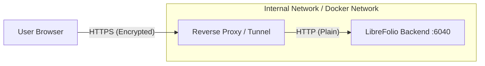

# 🔒 Security Architecture

This document outlines the security model, authentication system, and deployment recommendations for LibreFolio.

## 🎯 Threat Model and Scope

LibreFolio is a **self-hosted** application. The primary security assumption is that the **host system is secure**.

### ✅ In Scope

- **🔐 Authentication**: Stateless JWT-based authentication via HTTP-only session cookies with configurable expiration, [session revocation](#session-revocation) per account, and a [limit on failed sign-ins](#login-limit).
- **🛡️ Data Segregation**: Strict isolation between users via Role-Based Access Control (RBAC).
- **✏️ Input Validation**: Preventing injection attacks via strict Pydantic schemas; a request that fails them gets a `422` that never sends its input back ([Validation Errors Without the Input](#validation-errors)).
- **🧼 Output Escaping**: User- and provider-supplied text is escaped or sanitized before the browser can render it as HTML.
- **📁 File Upload Security**: MIME type validation, executable blocking, size limits, and a [scope](#upload-scope) per file: common, or personal to its uploader and the administrators.
- **🚫 Endpoint Protection**: **All** data and file endpoints require a valid session cookie — including uploaded files and plugin assets.

### ⚠️ Out of Scope

- **💻 Host System Compromise**: If an attacker gains shell access to the server, the database file is accessible. Encryption at rest is currently not implemented.
- **🔗 SSL/TLS Termination**: The application server (Uvicorn) speaks HTTP. HTTPS is the responsibility of the deployment environment (Reverse Proxy).

## 🔑 Authentication — JWT Cookies

LibreFolio uses **stateless JWT (JSON Web Token)** authentication stored in **HTTP-only session cookies**.

### 🔄 How Login Works

1. User sends credentials to `POST /api/v1/auth/login`
2. Server validates credentials and sets an **HTTP-only cookie** containing the JWT, whose payload is `sub` (the user
   id), `sv` (the account's session version, see [Session Revocation](#session-revocation)), `iat` and `exp`
3. The browser **automatically includes** this cookie on all subsequent requests
4. `` tags, `fetch()` calls, and page navigations all send the cookie seamlessly

Before the account is even looked up, the sign-in asks the [failed sign-in limit](#login-limit): past it, the answer is
`429` `TOO_MANY_ATTEMPTS`, and no password is checked.

A refused sign-in is logged without what was typed, because the field takes an email address too and no address goes
in a log (workstream E's rule, lot A-22): *Login failed: user not found* carries nothing about the identifier, *Login
failed: wrong password* and *Login failed: user inactive* carry the account's `user_id`. Tests: `./dev.py test api
auth`, `TestSignInLogsNoTypedIdentifier` (LOGIN-027 to LOGIN-033, in-process).

!!! success "Why cookies over Bearer headers?"

    HTTP-only cookies are **automatically sent** by the browser for all same-origin requests — including ``, `<link href>`, and AJAX calls. This means uploaded files and plugin assets are served securely without any special frontend handling.

### 🗝️ JWT Secret

Tokens are signed with HS256 and one key per process, `_JWT_SECRET` in
`backend/app/services/accounts/auth_service.py`, resolved once when that module is imported:

- `configured_jwt_secret()` (`backend/app/config/platform.py`) returns `env_secret("JWT_SECRET")`: the
  `JWT_SECRET` variable when it is not blank, otherwise the content of the file named by
  `JWT_SECRET_FILE` ([Secrets from Files](#secrets-from-files)), otherwise `None`. An empty or blank
  `JWT_SECRET` counts as not set: a stray space is never used as a key. Neither
  variable is a field of the Pydantic `Settings`: both are read from the process environment only.
- With `None`, the process falls back to its own `secrets.token_urlsafe(64)`, so every start makes a
  new key and signs every user out. This default is deliberate: keeping sessions across restarts is
  opt-in.
- A `JWT_SECRET_FILE` that cannot give its secret raises `SecretFileError` during that import.
  `main.py` imports the API router, which imports `auth_service.py`, so the server does not start.

!!! warning "⚙️ Multi-worker support"

    Uvicorn starts its workers with `spawn` on every platform (`uvicorn/_subprocess.py`): each worker
    re-imports all modules and resolves the key on its own. With nothing shared, each worker would
    make its own key, and a token signed by one would fail on the others. Before launching Uvicorn,
    `_ensure_shared_jwt_secret()` in `dev.py` makes sure that every worker finds the same key:

    1. a non-blank `JWT_SECRET` is kept as it is, and wins over `JWT_SECRET_FILE`;
    2. otherwise, with a non-blank `JWT_SECRET_FILE`, nothing is generated and nothing is removed:
       every worker reads the same file, and a blank `JWT_SECRET` beside it is harmless, since the
       server ignores it;
    3. otherwise a fresh `secrets.token_urlsafe(64)` goes into `JWT_SECRET`, shared by every worker of
       that run.

- `dev.py` loads `.env` into the environment first; values already set in the shell win.
- The Docker image starts a single uvicorn worker (`CMD` in the `Dockerfile`) and receives `.env`
  through the `env_file:` of Compose: without `JWT_SECRET` or `JWT_SECRET_FILE`, every container start
  invalidates all sessions.
- The administrator's side is
  [Keep Users Signed In After a Restart](../../admin/index.md#session-persistence).

### ⏰ Token Expiration

- Configurable via [Global Settings](../../admin/settings.md): `session_ttl_hours` (default: 24 hours)
- Read each time a session cookie is issued — at login, at the setup of the initial administrator, and when a password
  or email change re-issues it — it sets both the token's `exp` and the cookie's `max_age` (24 hours when the setting
  cannot be read): a new value applies to the cookies issued after it
- After expiration, the user must log in again
- There is no token refresh mechanism — a new login is required. The only cookies issued without a login are the ones
  a password change or an email change sends back to the device that made it
  ([Session Revocation](#session-revocation)), and the one that signs in the initial administrator once its setup link
  is spent ([The Initial Administrator](access_control.md#initial-admin))

### 🚪 Logout

- Frontend calls `POST /auth/logout` which clears the session cookie
- **No server-side blacklist** — logout leaves the session version alone: a copy of the token remains technically
  valid until it expires, or until the account's sessions are ended ([Session Revocation](#session-revocation))
- This is acceptable for a self-hosted application with short TTL: a user who fears a copied cookie changes the
  password, which ends every other session of the account

### 🔁 Session Revocation {: #session-revocation }

Each account has a session generation, `users.session_version` (`0` on a new account), and each session cookie carries
the generation it was issued at, the `sv` claim. Raising the account's version ends every session issued before it, on
every device, at its next request. There is still no session store: the check compares one integer column of the user
row that `get_current_user()` already loads on every request.

`await user_service.end_sessions(session, user)` (`backend/app/services/accounts/user_service.py`) raises the version
by one in SQL, in the caller's transaction, and does not commit: the caller commits it with the change that asks for
it. Seven changes call it:

| Change | Entry point | Sessions ended |
|--------|-------------|----------------|
| Password change | `POST /api/v1/auth/change-password` (`PasswordChangeModal`, Profile tab) | Every other session of the account: the same response sets a new cookie at the new version, so the device that made the change stays signed in |
| Email change | `PUT /api/v1/auth/profile` with a new `email` and the right `current_password` (Profile tab) → `user_service.update_profile()`: see [Changing the Email](#email-change); `./dev.py user set-email` → the same function | From the Profile tab, every other session of the account, as for a password change: the same response sets a new cookie; from the command line, all of them |
| Password reset | `./dev.py user reset` → `user_service.reset_password()`; a [reset link](access_control.md#reset-links) spent by `POST /api/v1/auth/password-reset` → `user_service.complete_password_reset()` | All of them |
| Deactivation | `./dev.py user deactivate` → `user_service.set_user_active(…, False)`; `PATCH /api/v1/users/{user_id}` with `is_active: false` → `user_service.update_user_status()` | All of them: a later activation does not bring them back |
| Demotion | `./dev.py user demote` → `user_service.set_user_admin(…, False)`; `PATCH /api/v1/users/{user_id}` with `is_superuser: false` → `user_service.update_user_status()` | All of them |
| Sign-out by an administrator | `POST /api/v1/users/{user_id}/sessions/revoke` | All of them |
| Setup of the initial administrator | A [setup link](access_control.md#initial-admin) spent by `POST /api/v1/auth/setup` → `bootstrap_admin_service.complete_admin_setup()` | All of them, though an account waiting for its setup has none: the same response sets a new cookie at the new version, which signs the administrator in |

**One increment in SQL** (lot A8a, backlog A-34, from workstream E's security review). `end_sessions()` used to add one
to the object's own copy (`user.session_version += 1`): two requests that loaded the same account before either
committed — the user changing the password, which re-issues the device's cookie at the new version, and an
administrator's «sign out everywhere» — both stored v+1, so the cookie re-issued between them survived the second. It
now runs one Core statement on the session's own connection (`await session.connection()`),
`UPDATE users SET session_version = session_version + 1 WHERE id = :id RETURNING session_version`, and sets the
returned value on the object with `set_committed_value()`: two such requests raise the version by two.

- **Core, not an ORM `update(User)`**, which would autoflush first. Nothing is flushed or refreshed: a field the caller
  already changed, such as a new hash, stays pending for the caller's commit, neither written early nor lost.
- **The version alone does not mark the object changed**: it is set as committed, since the statement already wrote it
  in the transaction. After the caller's commit the object still holds it (the request's session keeps its objects,
  `expire_on_commit=False`), so the cookie that `change-password` re-issues carries the new version.
- **The nine call sites** — six in `user_service`, the `change-password` route, `revoke_account_sessions()` in
  `backend/app/api/v1/users.py` and `complete_admin_setup()` in `bootstrap_admin_service.py` — await it with their own
  session. A call written in the old shape, `end_sessions(user)`, fails at once with a `TypeError`.

Activation, promotion, logout and every refused operation leave the version alone: a new password that misses a
[password rule](#password-rules), wherever it is chosen; a wrong current password, or a new password equal to it, on
`change-password`; a missing or wrong current password, or an address or a username already
taken, on `PUT /auth/profile`; an unknown user; the last active administrator; *already an admin* or *not an admin*; a
reset or setup link that is not valid. So do issuing a reset or setup link, which ends nothing until it is spent, a
`PATCH` whose values equal the current ones, and a profile change that changes no email (a new username, or the
stored email sent again, as written or in another A–Z case).

Since lot A-27, the password change, an email change and `./dev.py user reset` also revoke the account's live
[reset links](access_control.md#reset-links), whoever issued them, in the commit of the change, with
`token_service.revoke_tokens(…, purpose=AccountTokenPurpose.PASSWORD_RESET)` as issuing and spending a link already
did: no other purpose (invitations and email-verification links stay; the account's setup links follow their own rule
since lot A7b-2, retired by the new password and revoked by the new address: see
[Revocation](#account-token-revocation)), and nothing for a refused change, the same address in another A–Z case or a
username alone; what it revokes is logged as *Account tokens revoked* (`count`, `user_id`, `purpose`), with no
address. Otherwise whoever reads the mailbox — the old one, after an email change — could ask for a link through
«forgot password» before the change and spend it after, within its 30 minutes (security review of workstream E,
E6.9).

**A restore** sets the version of every account at once, without `end_sessions()`. The first start on a restored backup
([Restoring a Backup](#backup-restore)), in its step `restore-commit`, gives every account of the restored database the
same version, through `sqlite3`: `max(R, A + 1, B + 1)`, where `R` is the restore time in milliseconds, `A` the largest
version of the restored database and `B` the largest of the database of before (`.restore/previous/sqlite/app.db`,
opened read-only; `0` when it cannot be read or holds no account, as on a new installation). With a clock that is
right the value is `R`: a time, not a counter, which a later `end_sessions()` still raises by one. Why a time
(decision 40): `JWT_SECRET` is not in the backup and a restore does not change it, so where it is configured a cookie
issued before the restore keeps a valid signature. The restored database is another history, where an account's id
and version can be those of such a cookie, issued by the database of before or by one an earlier restore replaced;
the time is above every version a counter reaches in any of them. The `max` only matters when the clock is behind a
stored value. The value is recorded in the restore's state (`session_version`). Code: `_close_the_way_in()` in
`backend/app/services/platform/instance_backup/apply.py`.

- **The token.** `create_jwt_token(user_id, ttl_hours, session_version)`
  (`backend/app/services/accounts/auth_service.py`) writes `sub` (the user id, as a string), `sv`, `iat` and `exp`.
  `decode_jwt_token()` returns `SessionClaims(user_id, session_version)`, or `None` for a token that is expired or
  badly signed, that has no numeric `sub`, or whose `sv` is not an integer — a boolean included: `true` is not
  version 1.
- **Cookies issued before session versions.** A token without `sv` is session version `0`, the starting value of every
  account: the upgrade signs nobody out, and the first raise of an account's version ends those cookies like any other.
- **The check.** `get_current_user()` (`backend/app/api/v1/auth.py`) keeps its checks of the account (*User not
  found*, *User account is disabled*), then refuses a token whose version differs from the account's, behind or
  ahead, with `401` *Session expired or invalid*: the answer to an invalid token, so nothing tells the holder why.
  While an account is deactivated, its cookies get *User account is disabled* first.
- **The re-issued cookie.** Login, password change, email change and the setup of the initial administrator set the
  cookie through one helper, `_issue_session_cookie()`: a JWT at the account's current version, lasting
  `session_ttl_hours` (24 hours when the setting cannot be read), with the same name and attributes as the login
  cookie, so the browser replaces the old cookie instead of keeping both.

!!! note "A request in flight during a password or email change"

    A request the same device sent with its old cookie, and that reaches the server after the change is committed,
    gets `401`. The frontend's 401 interceptor (`frontend/src/lib/api/zodios-client.ts`) sends it to the login page
    (from any page but `/` and the anonymous pages of a link:
    [A 401 on a Link Page](../frontend/components/features/auth.md#link-page-401)),
    where the new cookie signs it straight back in. The race is benign, and the code does not try to close it.

Tests: `./dev.py test services session-version` (`backend/test_scripts/test_services/test_session_version.py`: the
token, the check, the command-line callers and the refusals, in-process; its contract 5, rewritten in lot A8a (A-34):
`end_sessions()` a coroutine function of `(session, user)`, its increment in the caller's transaction at once and
committed by the caller only (a fresh connection still reads the old version, a rollback leaves it there), a field set
before it left pending for the caller's commit, and two requests that loaded the account before either committed
raising the version by two, the cookie re-issued between them refused; its contract 7, the live reset links revoked
by `reset_password()` and by a real address change in `update_profile()`, the account's setup link retired by the
first and revoked by the second (lot A7b-2), every other link left as it was),
`./dev.py test api session-revocation` (`backend/test_scripts/test_api/test_session_revocation_api.py`: the password
change over HTTP, with two devices and a second account; REVOKE-003 to REVOKE-007, an administrator's reset link
revoked by a password or an address change, kept by the own address in other A–Z capitals and by a refused change),
and, for the administrator API and the reset links, `./dev.py test api users-admin` and
`./dev.py test api registration`. The email change has its own tests: see [Changing the Email](#email-change). The
restore's version: `./dev.py test services backup-apply` (the clock behind, a restore on top of another, then a
password change that adds one, through the helper of contract 5, `_end_sessions_of()`).

### ✉️ Changing the Email {: #email-change }

An account's email is a way into it: a password-reset link sent to that address lets whoever reads it choose the
password. `PUT /api/v1/auth/profile` used to change the email on the session cookie alone, so with the self-service
«forgot password» ([open](../backend/email.md#flow-forgot) since lot E4) a moment inside someone else's session — an
XSS, a stolen cookie, a computer left unlocked — would become a permanent takeover: change the email, ask for a reset,
choose the password (security review of lot E3, rated medium). Since lot A6e (release 1.3), an email change asks for
the current password and ends the account's other sessions. No other route changes an account's email; on the server,
`./dev.py user set-email` does, through the same `user_service.update_profile()` and without a password
([Command-Line Tools](../../admin/cli_tools.md), «Change the Email Address of an Account»).

- **What counts as an email change.** An `email` in the body that is another address than the stored one, compared
  regardless of A–Z case with `user_service.same_email()`, in the route and in `user_service.update_profile()` alike
  (developer decision P18, see [`USER`](database/users_access.md#user)). A username-only change, or the stored email
  sent again, needs no password, as before, and a `current_password` sent beside it is not checked. The stored email
  in another A–Z case is treated the same way (decision C5): it is the same address, so only its stored form changes —
  `email_verified_at` stays, no session ends, no cookie is set. Letters outside A–Z compare as written:
  `Émile@example.com` and `émile@example.com` are two different addresses, and changing one into the other is an
  email change.
- **The body.** `UpdateProfileRequest` (`backend/app/schemas/auth.py`) has an optional `current_password` of at least
  one character: an empty string is refused with `422`.
- **Checked first.** The route (`update_profile()` in `backend/app/api/v1/auth.py`) checks the password before
  anything else, uniqueness included, so whoever lacks it cannot probe which addresses are registered. Only the
  [failed sign-in limit](#login-limit) comes before, and past it refuses with `429` without checking the password.
  bcrypt runs in a worker thread (`asyncio.to_thread(verify_password, …)`), as for the password change.
- **The sessions.** `user_service.update_profile()` calls `end_sessions()`, revokes the account's live reset links
  ([Session Revocation](#session-revocation)) and sets `users.email_verified_at` back to `NULL` (the new address is
  not verified, and no flow of release 1.3 verifies a changed one), in the commit of the new address. The route then
  sets a new session cookie through `_issue_session_cookie()`, as `change-password` does: the device that made the
  change carries on, and every other session gets `401` at its next request. A username-only change ends no session,
  nor does a refused one.
- **The notice.** After a change of address, the route queues workstream E's `email_changed_work()` with the address
  read before the change: a notice to that address, after the answer, showing nothing of the new one (decision N62)
  ([An Email Address Changes](../backend/email.md#flow-email-changed)). It changes neither the answer nor the cookie;
  with email off, nothing is sent.
- **The log.** Neither the route nor `user_service.update_profile()` writes an address: *Profile updated* and *User
  profile updated* carry `user_id`, `username` and `email_changed`, true only when the address changed (lot A7c,
  workstream E's rule: no address in any log).

| Answer | `detail` | When |
|--------|----------|------|
| `400` | `{"error_code": "CURRENT_PASSWORD_REQUIRED", "message": …}` | An email change without `current_password`, left out or `null` |
| `429` | `{"error_code": "TOO_MANY_ATTEMPTS", "message": …}`, with `Retry-After` | An email change with a `current_password`, while the account's username or the request's address is past the [failed sign-in limit](#login-limit): the password is not checked, nothing is written |
| `400` | `{"error_code": "CURRENT_PASSWORD_INVALID", "message": …}` | A wrong `current_password`. Nothing is written, the failure counts toward the [failed sign-in limit](#login-limit) under the account's username, and the warning *Email change refused: wrong current password* goes to the log with `user_id` |
| `400` | *Email already registered* or *Username already taken*, plain strings as before | The password was right, or not needed, but the address belongs to another account, in any A–Z case, or the name does, compared exactly. Nothing is written |
| `422` | Validation errors | An empty `current_password`, an invalid `email`, a `username` outside 3–50 characters |
| `200` | — | The change is committed. After an email change, the answer sets the new `session` cookie, and the log has *Email changed, other sessions ended* (`user_id`) |

Since lot A8a, a wrong current password here counts toward the [failed sign-in limit](#login-limit), under the
account's username, as on the password change.

The [Profile tab](../frontend/components/features/settings.md#profiletab) asks for the password in the email row; the
user's side is [Profile](../../user/settings/profile.md), section «Changing Your Email».

Tests: `./dev.py test api profile` (`backend/test_scripts/test_api/test_profile_api.py`, PROF-010 to PROF-022: the
refusals, the taken address not revealed without the password, the sessions with two devices, the username-only and
same-email guards, the own address and another account's in another A–Z case, and no address in the log of the route,
in-process), `./dev.py test services user-profile`
(`backend/test_scripts/test_services/test_user_profile.py`, `TestUpdateProfileEmailVerification`: `email_verified_at`;
UPROF-001 and UPROF-002: no address in the service's log), `./dev.py test services email-case`
(`backend/test_scripts/test_services/test_email_case.py`: the A–Z rule on the service, the index and the lookups), and
for the tab
`./dev.py test front-utility component-unit` (`tabs/ProfileTab.test.ts`) and `./dev.py test front-utility settings`
(`frontend/e2e/settings.spec.ts`, its «A6e» block).

### 🔏 Password Rules {: #password-rules }

The rules a new password must meet are written once, in `backend/app/services/accounts/password_policy.py` (decision
37, lot A6c, release 1.3), and every way of choosing a password applies them. Before, they were written twice and
disagreed: `validate_password()` in `scripts/user_cli.py` used Python's `str.isupper()`, `str.islower()`,
`str.isdigit()` and a fixed list of ASCII symbols, `PasswordStrength.svelte` ASCII regular expressions and another
list, and the API asked only for 8 characters (`min_length=8` in the request schemas).

- **The rules.** `PASSWORD_RULES`, in this order: `min_length` (value `MIN_LENGTH`, 8), `uppercase`, `lowercase`,
  `digit`, `special`. `failed_rules(password)` returns the codes of the rules a password misses, in that order; an
  empty list means it meets them all.
- **Unicode classes.** Each class is a Unicode general category (`unicodedata.category()`): an uppercase letter is
  `Lu`, a lowercase one `Ll`, a digit `Nd`; a symbol, for `special`, is any character that is neither a letter
  (`L*`), nor a number (`N*`), nor whitespace. The length counts characters, that is code points. So `É` is an
  uppercase letter and `é` a lowercase one, `٣` (Arabic-Indic three) a digit, `€` and `_` symbols; a space is not a
  symbol, and `²` is a number (`No`) but not a digit, so it meets neither `digit` nor `special`.
- **Stored passwords stay valid.** The login never checks the rules: they apply only when a new password is chosen,
  so an account whose password predates them keeps signing in with it.

Each entry point checks the new password first, as soon as the request body is valid (and, for `change-password`, the
session and the [failed sign-in limit](#login-limit)):

| Entry point | Checked before |
|-------------|----------------|
| `POST /api/v1/auth/register` | The registration mode, the invitation, the user limit, and whether the username or the email is taken; for the first account of an empty instance too. A refused registration spends no invitation |
| `POST /api/v1/auth/change-password` | The current password, and the rule that the new one must differ from it |
| `POST /api/v1/auth/password-reset` ([reset links](access_control.md#reset-links)) | The link's token: with a weak password the link is not even read, so a valid link stays valid |
| `POST /api/v1/auth/setup` ([setup link](access_control.md#initial-admin) of the initial administrator) | The link's token, likewise |
| `./dev.py user create`, `./dev.py user reset` | Anything in the database, the username included: `validate_password()` in `scripts/user_cli.py` is a thin wrapper over `failed_rules()` |

- **The refusal.** The four routes call `_refuse_weak_password()` (`backend/app/api/v1/auth.py`), which answers `400`
  with `{"error_code": "PASSWORD_TOO_WEAK", "message": "The password does not meet the password rules", "rules": […]}`
  in `detail`, `rules` being the codes missed, in the rules' order. Nothing is written: a refused change or reset
  leaves the password, the session version and the sessions as they were. The command line prints
  `❌ Password does not meet security requirements:`, then one line per rule missed that starts with its code
  (`_RULE_MESSAGES`), such as `min_length: the password must be at least 8 characters long`, and exits with `1`.
- **The schemas.** `AuthRegisterRequest.password`, `ChangePasswordRequest.new_password`,
  `PasswordResetRequest.new_password` and `AdminSetupRequest.new_password` (`backend/app/schemas/auth.py`) only require
  a non-empty string (`min_length=1`): an empty password is still a `422` of the request validation, not
  `PASSWORD_TOO_WEAK`. The length is the policy's rule.
- **Published to the app.** `password_rules_public()` is the list `GET /api/v1/system/instance` publishes as
  `accounts.password_rules`, `[{code, value}]` (`PasswordRuleRead`), `value` being `null` for every rule but
  `min_length` ([Public instance configuration](settings.md#public-instance-configuration)). The app draws and checks
  that list under every new-password field, with the same classes (`\p{Lu}`, `\p{Ll}`, `\p{Nd}`, a symbol
  `[^\p{L}\p{N}\s]`, the length in code points) in `frontend/src/lib/features/auth/passwordRules.ts`
  ([PasswordStrength](../frontend/components/features/auth.md#passwordstrength)), so a rule changed here reaches the
  interface without a change of its own. A code the app does not know is not checked there: the server decides.
- **Other passwords, the same rules** (lot B4). `failed_rules(password, rules=…)` and
  `password_rules_public(rules=…)` take a list made from these rules instead of `PASSWORD_RULES`, which they read at
  each call when `rules` is `None`, the default, so a change here reaches every list made from them; without `rules`,
  both answer as before. `rules_with_minimum_length(n, rules=None)` gives those rules with a minimum length of at least
  `n` characters: raised, never lowered, the other rules and their order kept (`ValueError` for `n` below 1). The
  password of a [secure backup](#secure-backups) takes the accounts' rules with at least 12 characters
  (`archive_password_rules()`, `ARCHIVE_PASSWORD_MIN_LENGTH`, in
  `backend/app/services/platform/instance_backup/secure.py`, decision P12): `GET /backup/instance/options` publishes
  them in the same `[{code, value}]` shape (`InstanceBackupOptions`), and the Backup tab draws them with
  `PasswordStrength` through its `rules` prop, which replaces the instance configuration's list.

Tests: `./dev.py test services password-policy` (`backend/test_scripts/test_services/test_password_policy.py`,
POLICY-000 to POLICY-006: the published list, the order of `failed_rules()`, the Unicode classes, the length in code
points; B4-RULES-01 to B4-RULES-09: `rules=` and `rules_with_minimum_length()`); `./dev.py test api auth`
(`test_api/test_auth_api.py`, REG-004, CHPWD-005 and PWD-001 to PWD-008: registration
and password change, the new password checked before the current one, a login that never checks);
`./dev.py test api registration` (`test_api/test_registration_api.py`, RESET-004, RESET-006, RESET-007 and RULES-001 to
RULES-003: the reset link and the invitation left unspent, the order of the checks, the first account, the `accounts`
block); `./dev.py test api admin-setup` (`test_api/test_admin_setup_api.py`, SETUP-006, SETUP-007 and SETUP-011: the
setup link left unspent, the password read before the token); `./dev.py test utils dev-cli-image`
(`test_utilities/test_dev_cli_image.py`, IMG-031 to IMG-031d:
`validate_password()`, then `user create` and `user reset` on a copy of the image's files). The app's half:
`./dev.py test front-utility core-unit` (`passwordRules.test.ts`) and `./dev.py test front-utility component-unit`
(`PasswordStrength.test.ts`).

### 🚦 Failed Sign-in Limit {: #login-limit }

Since lot A8a (release 1.3, F15, decision D-A5), the sign-in counts its failures and stops checking passwords once
there are too many, so a password can no longer be guessed at the pace bcrypt allows. The module is
`backend/app/services/accounts/login_throttle.py`. It counts with workstream E's
[sliding-window limiter](../backend/email.md#rate-window) (`backend/app/utils/runtime/rate_window.py`), and keys the
address its callers pass with workstream H's `client_rate_key()` ([The Client's Address](#client-address)): at the
routes of `auth.py`, `rate_limit_address(request)`, `None` behind a local [proxy nobody trusts](#untrusted-proxy)
(decision N70), where only the identifier's limit applies.

| Limiter | Key | Limit |
|---------|-----|-------|
| `LOGIN_BY_IDENTIFIER` | `identifier_key(identifier)`: what was typed in the identifier field, stripped, with A–Z folded and nothing else (`user_service.email_fold()`, decision P18), whether an account matches it or not. `" Alice "`, `"ALICE"` and `"alice"` share one key; `"Émile"` and `"émile"` do not | 10 failures in 15 minutes (`WINDOW_SECONDS`) |
| `LOGIN_BY_ADDRESS` | `client_rate_key(address)`: an IPv4 address whole, an IPv6 one by its /64 | 50 failures in 15 minutes |

| Function | Contract |
|----------|----------|
| `refusal(identifier, address) -> RateDecision \| None` | `None` while both limits allow one more failure; otherwise the refusing decision (`allowed` false, `remaining` 0), the longer `retry_after` when both refuse. It only looks (`peek()`): no call counts. Without an address (`None`: `rate_limit_address()` gives it behind a [proxy nobody trusts](#untrusted-proxy), `client_address()` for a connection without one) only the identifier's limit applies |
| `record_failure(identifier, address)` | One failure in each limit (`hit()`), the address's only with an address |
| `record_success(identifier)` | Forgets the identifier's failures (`reset()`); the address keeps its own |
| `identifier_key(identifier)` | The identifier's key, as above |

The functions read the two limiters from the module when they run, so a test puts limiters of its own in their place
(`monkeypatch.setattr`). Four checks of a password call them: three routes of `backend/app/api/v1/auth.py`, with the
address `rate_limit_address(http_request)` gives, and workstream E's «send the link again» (`resend_verification()` in
`backend/app/services/email/verification.py`, for `POST /email/verification/resend`), with the same
`rate_limit_address(request)`, which its route in `backend/app/api/v1/email.py` reads (lot E-13).

| Route | Before the password is checked | A wrong password | The right password |
|-------|--------------------------------|------------------|--------------------|
| `POST /auth/login` | `_refuse_too_many_failures(request.username, address)`, before the account is looked up | `record_failure(request.username, address)`, then `401` *Invalid credentials*, an unknown identifier included | `record_success(request.username)`, once the cookie is set. The `403`s of an inactive account, `ACCOUNT_DISABLED` and `EMAIL_NOT_VERIFIED`, which only the right password gets, neither count nor reset |
| `POST /auth/change-password` | `_refuse_too_many_failures(current_user.username, address)`, before `_refuse_weak_password()` | `record_failure(current_user.username, address)`, then `400` *Current password is incorrect* | `record_success(current_user.username)` |
| `PUT /auth/profile`, when the email changes | `_refuse_too_many_failures(current_user.username, address)`, after the `400` `CURRENT_PASSWORD_REQUIRED` | `record_failure(current_user.username, address)`, then `400` `CURRENT_PASSWORD_INVALID` | `record_success(current_user.username)` |
| `POST /email/verification/resend` | `refusal(identifier, address)`, `identifier` being the body's `username` as typed, after E's per-address limit (`RESEND_BY_ADDRESS`) and before the account is looked up: `EmailRateLimitedError` with its wait | `record_failure(identifier, address)`, then `401` *Invalid credentials*, an unknown identifier included | `record_success(identifier)`, as soon as the password is checked, before the account's state is read: whatever follows resets, the `409` `EMAIL_VERIFICATION_NOT_NEEDED` of an active account and the `403` `ACCOUNT_DISABLED` included |

- **The refusal.** `_refuse_too_many_failures()` answers `429` with
  `{"error_code": "TOO_MANY_ATTEMPTS", "message": "Too many failed attempts: try again later"}` in `detail` and
  `Retry-After`, the wait of `refusal()` in whole seconds, rounded up, at least 1. No bcrypt runs and, at the sign-in,
  no account is looked up: the same answer, at the same cost, whether an account matches or not. It writes no log line
  of its own. The resend answers with its other limits' `429` instead, `EMAIL_RATE_LIMITED` with `retry_after` in
  `detail` and the same `Retry-After` header, so its page words it as it words them.
- **A refused attempt is not counted**: it never reaches `record_failure()`, so knocking does not push the unlock
  away, and `Retry-After` seconds later the right password signs in.
- **One account, two keys.** The identifier counts as typed: an account's username and its email are two keys, so
  alternating them gives about 20 guesses per account every 15 minutes, still under the address's 50.
- **The other checks of the current password** count under the account's **username**, the key of a sign-in typed
  with it, and under the address `rate_limit_address()` gives, as at the sign-in: 10 wrong current passwords also lock
  the sign-in by username, and failed sign-ins by username lock the password change and the email change. Deleting
  one's own account (`DELETE /auth/users/me`) asks for no password: nothing to limit.
- **Not limited, on purpose** (the coordinator's decision, backlog A-41): a wrong token of an invitation, reset or setup
  link (`tokens/inspect`, `password-reset`, `setup`, an `invite_token` at the registration). The tokens LibreFolio
  draws are 256 random bits ([Single-use Account Tokens](#account-tokens)), out of reach of guessing, and a limit per
  address would refuse every user behind one NAT. «Forgot password» checks no password and keeps workstream E's own
  limits ([A Forgotten Password](../backend/email.md#flow-forgot)).
- **«Send the link again» shares the sign-in's counts** (lot A8a; the coordinator's decision, reviewed by workstream
  E). It checks the sign-in's credentials without a session, so with only E's per-address limit it was a way to try
  passwords past the identifier's limit. It now counts under the sign-in's own two keys, the identifier as typed and
  the address, both ways: wrong passwords at the resend lock the sign-in, and failed sign-ins refuse the resend before
  its password is checked. Unlike the sign-in, whose `403`s neither count nor reset, the right password resets the
  identifier at once, as the password change and the email change do. E's own limits stay
  ([Sending the Link Again](../backend/email.md#verification-resend)); `RESEND_BY_ADDRESS` counts a request first,
  whatever happens next. Its address is the `rate_limit_address()` its route reads since lot E-13, as at the sign-in:
  behind a local [proxy nobody trusts](#untrusted-proxy) neither `RESEND_BY_ADDRESS` nor the sign-in's address count
  the request, and the resend and the sign-in share the identifier's count alone.
- **The switch.** `login_limit_enabled()` (`backend/app/config/accounts.py`) reads `LIBREFOLIO_LOGIN_LIMIT` at each
  call, through `login_limit_value()`: the value as set, stripped, or `None` when it is unset or blank. Unset, blank
  or `on` in any case, on; `off` in any case, off, and then `refusal()` answers `None` and `record_failure()` records
  nothing. Any other value, `1`, `true` and `yes` included, raises `ValueError` naming the variable and the stripped
  value: `LIBREFOLIO_LOGIN_LIMIT='maybe': expected on or off`. `log_configuration_audit()` calls it right after
  `admin_bootstrap_config()`, so such a value stops the start; while the limit is off, every start logs the warning
  of the check `accounts.login_limit` ([Configuration Checks](#configuration-checks)).
- **The test lanes run with it off**: their suites sign in wrongly on purpose, from one address, against shared
  accounts. `dev.py server --test` sets `LIBREFOLIO_LOGIN_LIMIT=off` in the environment of the lane's server, after
  `configure_test_runtime()` has dropped every `LIBREFOLIO_*` of `.env` and of the shell: the lane's server always
  runs with the limit off ([Test lanes and the instance's configuration](#test-lanes-and-the-instances-configuration)).
  `backend/test_scripts/conftest.py` sets it in every pytest process too, with `os.environ.setdefault()` (a value
  already in that process's environment wins), since the in-process apps of many test files share one process and
  its two limiters. The limit's own tests turn it on with `monkeypatch`, on limiters of their own.
- **Per process, in memory.** A restart forgets every count, and with N worker processes (`dev.py server --workers N`)
  each keeps its own, so the limits are N times these; the Docker image runs one worker. Each limiter holds at most
  10,000 keys (the limiter's `max_keys`): a new key beyond them evicts the key with the fewest failures still in the
  window, the least recently used among them ([The Sliding-Window Limiter](../backend/email.md#rate-window), lot
  E-14). So a spray of fresh identifiers, one failure each, never pushes out an identifier with more failures, locked
  or one short of the lock, and behind a [proxy nobody trusts](#untrusted-proxy) no limit per address slows such a
  spray. To push out an identifier with n failures, every other key must hold n failures too: about 90,000 failures
  within 15 minutes buy 9 more guesses. The eviction of decision N70 (the first key not full among the 32 least
  recently used) spared only locked identifiers: one stopped a failure short of the lock went for 10,000 fresh ones,
  as with plain least-recently-used eviction.
- **Behind a reverse proxy** the address must be the visitor's ([The Client's Address](#client-address)). Behind one
  that LibreFolio does not trust, every visitor has the proxy's address: counted together, 50 failures from anyone, at
  about one a second, would refuse every sign-in through it, the right password included (security review R13-SEC6).
  So the three routes of `auth.py` pass `rate_limit_address()` (decision N70): `None`, decided per request, for a
  request from a local peer that carries a forwarding header neither uvicorn nor `LIBREFOLIO_CLIENT_IP_HEADER` applied
  ([Behind a Proxy Nobody Trusts](#untrusted-proxy)), which is then counted and refused by its identifier alone.
  `None` is no key here: the limiter would count it like any other, so `refusal()` and `record_failure()` leave the
  address out rather than count every «no address» together. The warning logged once per process,
  `UNTRUSTED_PROXY_SUMMARY`, and the notes behind the check `platform.client_address` are workstream H's: both come
  from `forwarded_by_untrusted_proxy()`, which `rate_limit_address()` calls.
- **A public peer's forwarding headers change nothing**: a client on the internet cannot switch its own limit per
  address off by adding one. Behind a proxy on a public address that LibreFolio does not trust (a CDN left
  unconfigured), every visitor still shares its address and its 50 failures, until `FORWARDED_ALLOW_IPS` or
  `LIBREFOLIO_CLIENT_IP_HEADER` gives LibreFolio the visitor's.

The login page already turns any `429` of the sign-in into `auth.tooManyAttempts` (`loginErrorKey()` in
`frontend/src/lib/stores/app/auth.ts`, see [LoginCard](../frontend/components/features/auth.md)), and the
verification notice words the resend's `EMAIL_RATE_LIMITED` with the minutes to wait, as before
(`resendFailureMessage()`, [In the Frontend](../backend/email.md#verification-frontend)). The password-change modal and
the Profile tab have no text of their own for `TOO_MANY_ATTEMPTS` yet. The administrator's side is
[Configuration](../../admin/configuration.md), section «Failed Sign-ins».

Tests: `./dev.py test services login-throttle` (`backend/test_scripts/test_services/test_login_throttle.py`: the two
limits on an injected clock, the A–Z key, the IPv6 /64, no address and no shared count of «no address», a refusal not
counted, a success that forgets the identifier only, the longer wait, the switch off), `./dev.py test services accounts-checks`
(`test_services/test_accounts_checks.py`: `login_limit_enabled()` on, off and invalid, the check
`accounts.login_limit` in `CONFIG_CHECKS`, the startup audit stopping on an invalid value before it logs any check,
the import orders in fresh interpreters), `./dev.py test api login-throttle` (`test_api/test_login_throttle_api.py`:
pure, in-process apps on private SQLite files, the limit turned on with limiters of its own on a fake clock: the `429`
with an exact `Retry-After` before any bcrypt, the same for an unknown identifier, per address, the password change
and the email change under the account's username, the switch; «send the link again»: wrong resends lock the sign-in,
failed sign-ins refuse the resend before its password, the right password at the resend resets the identifier, a
wrong resend counts on the address; [`GET /security/checks`](#security-checks-endpoint); and, behind a local proxy
nobody trusts (N70, section 8, `TestUntrustedLocalProxy`, LT-API-20…25): from `lan`, `loopback` and CGNAT (`vpn`)
peers forwarding `X-Forwarded-For`, `Forwarded` or `X-Real-IP`, fifty failures lock nobody else out while the
identifier's lock holds; a public peer with the same headers, and a local peer without them, keep the lock per
address; at each of the three routes, a wrong password through the proxy counts on the identifier alone, and an
address its own failures locked refuses its direct requests but not those the proxy forwards),
`./dev.py test utils rate-window` (RWL-024: a locked identifier stays locked through 1,000 fresh ones, see
[The Sliding-Window Limiter](../backend/email.md#testing)), and
`./dev.py test api security-checks` (`test_api/test_security_checks_api.py`, on the lane's server, where
`accounts.login_limit` is a `warning` since the lane runs with the limit off).

### 💻 Using curl

```bash
# Login and save cookie
curl -s -c cookies.txt -X POST http://localhost:6040/api/v1/auth/login \
  -H "Content-Type: application/json" \
  -d '{"username": "admin", "password": "yourpassword"}'

# Use cookie for authenticated requests
curl -b cookies.txt http://localhost:6040/api/v1/auth/me

# List brokers
curl -b cookies.txt http://localhost:6040/api/v1/brokers

# Sync FX rates
curl -b cookies.txt -X POST \
  -H "Content-Type: application/json" \
  http://localhost:6040/api/v1/fx/currencies/sync
```

## 🔐 Secrets and the Instance Key

### 📄 Secrets from Files {: #secrets-from-files }

Every secret of LibreFolio is read by `env_secret(name)` in `backend/app/config/__init__.py`: today
`JWT_SECRET`, `LIBREFOLIO_INSTANCE_KEY`, `LIBREFOLIO_WEB_LINK_FINDER_API_KEY`,
`LIBREFOLIO_SMTP_PASSWORD`, `LIBREFOLIO_BACKUP_DOWNLOAD_TOKEN`, `LIBREFOLIO_WAKE_TOKEN`,
`LIBREFOLIO_ADMIN_BOOTSTRAP_TOKEN`, and every variable of the plugin settings, secret or not
(`plugin_setting_env()` in `backend/app/config/plugins.py`: the derived `LIBREFOLIO_PLUGIN_*` names and the aliases
of secret fields, see [Plugin Settings](patterns/plugin_settings.md#environment)). In this order:

1. `NAME`, when not blank, is the secret as written, spaces included;
2. otherwise `NAME_FILE`, when not blank, is the path of a file that holds it, as Docker and Kubernetes
   mount their secrets (`/run/secrets/…`). `~` is expanded, and a relative path starts from the
   project root. The secret is the file's text without a leading UTF-8 byte order mark, which some
   Windows editors add, and without its trailing line breaks (`decode("utf-8-sig").rstrip("\r\n")`):
   any other space counts;
3. otherwise there is no secret: `None`.

Blank means empty or whitespace only: a value that `str.strip()` empties counts as not set, so a stray
space is never used as a key.

`read_secret_file()` raises `SecretFileError` when the file is missing, cannot be read, is larger than
64 KiB (`SECRET_FILE_MAX_BYTES`), is not UTF-8 text or is empty or blank (`… is empty or blank`). The
message names the variable and the path, never the content. Like every variable outside the
`Settings` class, both forms come from the process environment only, never from `.env` directly:
`./dev.py` and the `env_file:` of Compose put `.env` there. For messages, `env_secret_origin(name)`
names the source without reading the file: `NAME`, `NAME_FILE (<path>)` or `None`
(`configured_jwt_secret_origin()` and `configured_instance_key_origin()` in `platform.py`).

The caller decides what a `SecretFileError` means. A broken `JWT_SECRET_FILE` or
`LIBREFOLIO_INSTANCE_KEY_FILE` stops the start ([JWT Secret](#jwt-secret),
[Configuration Checks](#configuration-checks)), and so does a broken
`LIBREFOLIO_ADMIN_BOOTSTRAP_TOKEN_FILE`: `admin_bootstrap_config()` reads it in the startup audit,
whatever the other variables of the [initial administrator](access_control.md#initial-admin). A
broken `LIBREFOLIO_WEB_LINK_FINDER_API_KEY_FILE`
does not: `web_link_finder_api_key()` in `backend/app/config/plugins.py` reads it only when a search
builds the `apikey` engine, and `_build_engine()` in `backend/app/services/assets/web_link_finder.py`
then logs `web_link_finder: <error>; disabling` and returns no engine, so that search finds no links.
Nor does a broken `LIBREFOLIO_SMTP_PASSWORD_FILE`: email is optional, so `email_config_state()` turns
it off instead, with the problem `SMTP_PASSWORD_UNREADABLE`, which is logged at startup and shown to
administrators in Settings › Email ([Email Service](../backend/email.md#config-state)).
Nor does an unusable `LIBREFOLIO_BACKUP_DOWNLOAD_TOKEN`: `backup_download_token()` in
`backend/app/config/backup.py` reads it for the startup checks (`check_panel_token()`, `backup.panel_token`: one error
line in the start log, never a stop; [Configuration Checks of the Backup](#backup-config-checks)) and at each call of
the hosting panel's routes, so the server starts anyway. Besides the `SecretFileError` of a broken `_FILE`, it raises
`BackupConfigError` for a token with anything but visible ASCII characters, spaces included
(`BACKUP_DOWNLOAD_TOKEN_NOT_VISIBLE_ASCII`), or shorter than 32 characters
(`BACKUP_DOWNLOAD_TOKEN_TOO_SHORT`). `require_panel_token()` in `backend/app/api/v1/backup/panel.py` turns
either into `503` with the code `backup_panel_unavailable`, on every panel route, and logs one error line
per refused call, `The hosting panel's backup token cannot be used: its routes refuse every request`, whose
`error` names the variable, and the path of a file, never the token
([Hosting for Others](../../admin/hosting_providers.md#panel-backups)).
Nor does an unusable `LIBREFOLIO_WAKE_TOKEN`: `require_wake_token()` in
`backend/app/api/v1/system/wake.py` reads it at each call of `POST /system/wake-sync`, which then
answers `503` with the code `wake_unavailable`
([Scheduled Wake-up](../../admin/sleep_wake.md#wake-sync)). Nor does a `_FILE` of a plugin setting
that cannot give its value: the field gets the problem `invalid_env`, and the plugin is not configured
until the variable is fixed ([Plugin Settings](patterns/plugin_settings.md#environment)).

When `NAME` and `NAME_FILE` are both set, neither blank, `NAME` wins. `secrets_set_twice()` lists those
names for the [configuration checks](#configuration-checks). It covers `JWT_SECRET` and every
`LIBREFOLIO_*` variable, so a new secret named `LIBREFOLIO_*` and read with `env_secret()` needs no list
to update.

Test lanes never inherit the secrets that make the instance trust a session or decrypt its data.
`configure_test_runtime()` in `scripts/cli_base.py`, which every test entry point goes through
(`dev.py test`, and `dev.py server --test`, which the `webServer` of Playwright also runs), removes
`JWT_SECRET`, `JWT_SECRET_FILE`, `LIBREFOLIO_INSTANCE_KEY` and `LIBREFOLIO_INSTANCE_KEY_FILE`
(`INSTANCE_TRUST_SECRETS` in `backend/app/config/__init__.py`) from its environment, whether they
come from the shell or from `.env`. A test lane therefore signs sessions with a key made for its run and derives keys from an
instance key generated in its own data directory.

#### Test lanes and the instance's configuration {: #test-lanes-and-the-instances-configuration }

The same rule covers the rest of the instance's configuration: a test lane runs on the defaults, so a
setting of the developer's install (a mail server, the managed profile, an instance block, account
limits) can neither reach the tests nor change their outcome.

- `configure_test_runtime()` removes, whatever their origin (`.env`, loaded by `pipenv run` before
  `dev.py` starts, or the shell): every variable `.env.example` documents
  (`documented_instance_variables()`), every `LIBREFOLIO_*` name in the environment and the secrets
  above. Keys of `.env` that are not LibreFolio's (a proxy, `PYTHONPATH`) stay.
- It keeps only what `kept_in_a_test_lane()` keeps: `TEST_LANE_KEEPS` (the two ports, the production
  data directory it must stay away from, `HOST`, the log level, `LF_APP_VERSION` frozen by a release
  job for its gallery, and Playwright's `LIBREFOLIO_SERVER_WORKERS`) and every `LIBREFOLIO_TEST_*`
  name, the runner's and the tests' own (data directory, mode, the lane's readiness token, startup
  timeout).
- In test mode `Settings` does not read `.env` at all (`settings_customise_sources`), so a setting
  removed from the environment does not come back from the file.
- A new variable is covered without a list to update: it is named `LIBREFOLIO_*` or documented in
  `.env.example` (a test requires it). A test that needs a setting sets it in its own process, after
  any helper that configures the lane (`setup_test_database()` and its siblings call
  `configure_test_runtime()`, which would remove it again).
- One setting is the lanes' own, on purpose: the [failed sign-in limit](#login-limit) is off, since the
  suites sign in wrongly on purpose. `dev.py server --test` sets `LIBREFOLIO_LOGIN_LIMIT=off` for the
  lane's server after the cleanup, and `backend/test_scripts/conftest.py` sets it in every pytest
  process that does not have it already.

### 🧬 Instance Key {: #instance-key }

One secret per installation, from which LibreFolio derives its encryption keys
(`backend/app/services/platform/instance_key.py`). Consumers never read the key itself: each one asks
for a key derived for its own purpose. The key comes from the first of these sources that is set:

1. `LIBREFOLIO_INSTANCE_KEY`, then `LIBREFOLIO_INSTANCE_KEY_FILE`: `configured_instance_key()` in
   `backend/app/config/platform.py`, which returns `env_secret("LIBREFOLIO_INSTANCE_KEY")`;
2. `<data directory>/secrets/instance.key` (`instance_key_path()`), generated on first use.

A key is a text of at least 32 characters (`INSTANCE_KEY_MIN_LENGTH`), and its UTF-8 bytes are the
input of the derivation. The length is the only check: a key set by the administrator must be random,
such as `secrets.token_urlsafe(32)`, not a passphrase, because the derived keys are only as strong as
it is.

| Function | Contract |
|----------|----------|
| `derive_key(purpose: str, length: int = 32) -> bytes` | HKDF-SHA256 (RFC 5869, `hkdf_sha256()` on the standard-library `hmac` and `hashlib`) over the key's UTF-8 bytes, with a fixed salt (`_DERIVATION_SALT`) and `info = purpose.encode("ascii") + b"\x00" + length.to_bytes(2, "big")`. The length is part of the derivation: the same purpose at two lengths gives two unrelated keys, never a key and its prefix. The same purpose and length get the same bytes while the instance key stays the same; two purposes never get the same key. `length` goes from 1 to 8160 bytes. `purpose` and `length` are validated first: an invalid one raises `ValueError` before the key is read or generated. Otherwise, without a configured key, the first call generates the key file. Raises `InstanceKeyError` when the key cannot be used. |
| `derive_key_from(key: str, purpose: str, length: int = 32) -> bytes` | The key that `derive_key(purpose, length)` gives on an instance whose instance key is `key`: the same HKDF-SHA256, salt and `info`. It reads neither the environment nor the data directory and never creates the key file. Checked in this order: `purpose` and `length` (`ValueError`, the rules of `derive_key()`), then the type of `key` (`TypeError` for anything but a `str`), then its length (`InstanceKeyError` under `INSTANCE_KEY_MIN_LENGTH`, 32 characters). No message holds the key. |
| `instance_key_status() -> InstanceKeyStatus` | The state, without creating the key file and without raising: `source` (`configured`; `generated` when something is at the key file's path, a link that leads nowhere included, or when its folder cannot be searched; `not_created`), `problem` (why the key cannot be used, `None` when it can), `path`, and `loose_modes`, the octal modes of the folder and the file when group or others have any access to the generated key (always empty on Windows). |
| `instance_key_path() -> Path` | `get_data_dir() / "secrets" / "instance.key"`: the test data directory in test mode. |

`purpose` names the use and its version, such as `plugins.settings.v1`: lowercase letters, digits and
`. _ : -`, starting with a letter or a digit, at most 128 characters.

`derive_key()` and `derive_key_from()` validate and derive through the same private helpers
(`_check_purpose_and_length()`, then `_derive()`), so the two cannot drift. `derive_key_from()` is for
a key that is not this instance's. Its caller is the check of a restore (lot B4, `_plugin_secrets()`
in `backend/app/services/platform/instance_backup/staging.py`), which re-encrypts the plugin secrets
that a backup's instance encrypted with its own key. A clear archive leaves that key out; a
password-protected one carries it when LibreFolio generated it (decision 39), as the entry
`secrets/instance.key`, read into memory and never unpacked ([Secure Backups](#secure-backups)). The
check derives the archive's subkey with `derive_key_from(archive_key, SUBKEY_PURPOSE, SUBKEY_LENGTH)`
(`plugins.settings.v1`, 32 bytes) and gives it, with this instance's subkey (`settings_subkey()`), to
`rekey_plugin_secrets(conn, old_subkey, new_subkey)` in
`backend/app/services/plugin_settings/crypto.py`, on a connection to the copy's database. It derives
this instance's subkey only when the copy holds secrets, so the check of an archive without any never
generates the key file. Without the archive's key, or with one `derive_key_from()` refuses, it only
counts the secrets this instance cannot read (`count_unreadable_secrets()`). No path gives the restore
a key the administrator kept, such as a copy of the old `secrets/instance.key`: that is backlog item
B-18 (`restore --instance-key-file`).

The generated file (`_create_key_file()`):

- **Content**: `secrets.token_urlsafe(32)` and a newline, that is 32 random bytes in base64url: 43
  characters, 44 bytes on disk.
- **Permissions**: the `secrets/` folder is created with mode `0700`; the file is `0600`, as
  `mkstemp()` creates it (or the `O_EXCL` fallback below).
- **One key wins**: the key is written to a temporary file (`mkstemp()`) in the same folder, flushed
  and `fsync`ed, then published with `os.link()`, which fails when `instance.key` already exists. Of
  several workers starting together, the first key published stays, and readers never see half a key.
  On a filesystem without hard links, an exclusive create (`O_CREAT | O_EXCL`) still lets only one key
  in; there the file appears before its content, so a reader that finds it unusable retries for up to
  half a second (`_read_generated_key()`: 10 reads, 50 ms apart). The temporary file is always
  removed, and the folder is `fsync`ed where the platform allows it.
- **Never replaced**: `_key_file_present()` looks at the path with `lstat()`, so anything there, a
  link that leads nowhere included, counts as the key file. A key file that is empty or blank, too
  short or unreadable raises `InstanceKeyError`, which asks to restore it from a backup: a new key
  could not read what the old one encrypted. A `secrets/` folder that cannot be searched (another
  owner, mode `0000`) raises `InstanceKeyError` too
  (`<path>: the instance key cannot be reached (Permission denied)`): the key may be there, so it is
  neither generated again nor reported as missing. So does a key file that cannot be created.
- **Created on use only**: `ensure_data_dirs()` does not create `secrets/`, and `instance_key_status()`
  only reads, so the file appears with the first `derive_key()` call.
- **Test isolation**: `validate_test_data_dir()` treats `secrets/` and `secrets/instance.key` as
  managed paths: a test lane may not alias the production ones.

**A lost key file** still looks like a first use: a new key is generated, and nothing the old one
encrypted can be read with it. The plugin settings, whose secrets are the only data stored encrypted
under the instance key today, make the change visible: each row records the `key_id` of the key that
encrypted it, and from the first start after the change the startup step `plugin-secrets-check` logs
an error that counts the stored system secrets the current key cannot read, if there are any
([Plugin Secrets Check](#plugin-secrets-check)). The administrator puts back `secrets/instance.key`
from their copy of the data directory (a clear archive of the instance backup leaves the key out; a
password-protected one carries the generated key, and its restore re-encrypts the secrets with this
instance's: [Secure Backups](#secure-backups)), or enters the secrets again. The order matters:
saving a secret rewrites its row's `secret_ciphertext`
and `key_id` under the current key (`_apply()` in `backend/app/services/plugin_settings/service.py`),
so an old key brought back afterwards reads again the rows never entered again, but not the ones
entered under the new key; the old key therefore goes back first (LibreFolio stopped, the copy in
place of the generated file), before anyone enters a secret again, and the secrets are entered again
only when no copy exists.

Tests: `./dev.py test services config-secrets` (`env_secret()`) and
`./dev.py test services config-instance-key`, whose section (g) pins `derive_key_from()` to three
known answers computed with `derive_key()` before the two shared their helpers. What the
administrator sees and does is in [Configuration](../../admin/configuration.md), section «The
Instance Key».

### 🔐 Secure Backups (`.lfbk`) {: #secure-backups }

A secure backup (lot B4: decisions 38 and 39, P12) is the zip of a clear backup encrypted with a password its maker
chooses, in an envelope of LibreFolio's own, `.lfbk`, made of standard pieces of `cryptography`: scrypt and
AES-256-GCM. Decision 38 ruled out a password-protected zip, which only some tools open (7-Zip, Keka) and whose key
derivation is weak. Without a password the backup is the plain zip, as before, and the hosting panel's routes never
encrypt (`backend/app/api/v1/backup/panel.py` passes no password). The format is
`backend/app/services/platform/instance_backup/envelope.py`; what the administrator sees is
[Secure Backups](../../admin/backup_restore.md#secure).

**The header**: 52 bytes, big-endian (`struct` format `>4sBBBBB16s16sI7s`), the associated data of every chunk.

| Bytes | Field | Written | Accepted when read |
|-------|-------|---------|--------------------|
| 0–3 | Magic | `LFBK` (`MAGIC`) | Only `LFBK`, and 52 bytes at least: otherwise `envelope_damaged` |
| 4 | Format version | `1` (`FORMAT_VERSION`) | `1`: otherwise `envelope_unsupported` |
| 5 | KDF id | `1`, scrypt (`KDF_SCRYPT`) | `1`: otherwise `envelope_unsupported` |
| 6 | log2(n) | `15` (`LOG2_N`) | 14 to 16 |
| 7 | r | `8` (`R`) | 1 to 8 |
| 8 | p | `1` (`P`) | 1 to 2 |
| 9–24 | Salt | 16 random bytes | Any |
| 25–40 | Check value | Bytes 32–47 of the derivation | Compared in constant time |
| 41–44 | Chunk size (u32) | `1 << 20`, 1 MiB (`CHUNK_SIZE`) | 64 KiB to 16 MiB |
| 45–51 | Nonce prefix | 7 random bytes | Any |

- **Bounds before any derivation.** `EnvelopeHeader.from_bytes()`, behind `read_header()` and `unlock()`, checks the
  header before scrypt runs: a cost or a chunk size outside the bounds is `envelope_unsupported`. A hostile or newer
  header so never makes a reader spend more than 64 MiB (128 · r · 2^log2(n), twice what is written) or work for
  minutes: one that asks `log2(n) = 30` is refused in milliseconds. `encrypt_file()` checks the header it writes
  against the same bounds.
- **The key.** `Scrypt(salt, length=48, n=2**log2_n, r, p)` of `cryptography`, on
  `unicodedata.normalize("NFC", password).encode("utf-8")`: a password typed with a composed or a decomposed accent
  gives one key (NFC, not NFKC). Bytes 0–31 are the AES-256 key, bytes 32–47 the check value, kept in the header and
  compared with `hmac.compare_digest()`: a wrong password is told at once, before any chunk is read
  (`wrong_password`). The written cost takes 32 MiB and about a tenth of a second, once per backup and once per check
  (P12: a small machine's memory). By design, a changed salt, cost or check value reads as `wrong_password` too.
- **The chunks** (STREAM). The archive is cut into chunks of `chunk_size` bytes, at least one; the last one holds the
  rest, empty only for an empty file, and a size that is a multiple of the chunk size ends on a full chunk. Each
  chunk is sealed with `AESGCM(key).encrypt(nonce, chunk, header)`, the chunk and its 16-byte tag, written in order
  after the header. The 12-byte nonce is the prefix (7 bytes), the chunk's counter (u32, big-endian, from 0) and a
  flag, `0x01` on the last chunk and `0x00` on the others. Every tampering makes a tag fail, `envelope_damaged`: a
  changed byte or tag; two chunks swapped; a chunk dropped, repeated or appended after the last; a file cut at or
  inside a chunk (the chunk now last was not sealed as last, or is shorter than a tag); a chunk size or a nonce prefix
  changed in the header. `decrypt_file()` also compares the first 52 bytes of the file with the header `unlock()`
  read, so a file replaced in between is refused before its first chunk.
- **The files.** `encrypt_file()` and `decrypt_file()` stream with constant memory and write through `<name>.part` in
  the output's folder (`_NewFile`): created exclusively (`O_CREAT | O_EXCL | O_NOFOLLOW`), mode `0600`, fsynced,
  renamed onto the final name, the folder fsynced. An output that already exists is `FileExistsError`, and nothing
  is written; on any failure the `.part` is removed and the output does not exist. The salt and the prefix come from
  `secrets.token_bytes()`, so two encryptions of one archive differ; the `salt`, `nonce_prefix` and `log2_n` keywords
  of `encrypt_file()` are for tests. `encrypt_file()` returns the envelope's size and SHA-256 (`EncryptedFile`).
- **The codes.** `EnvelopeError.code` is `wrong_password`, `envelope_damaged` or `envelope_unsupported`; the messages
  hold no path and no secret.

**The start** (`job_views.start_job()`, for `POST /backup/instance` and the hosting panel's `POST /backup/panel/jobs`
alike). `jobs.start_backup()` creates the job's folder and its first state before the thread runs: a full disk or quota
there (`jobs.out_of_space()`) answers `507` `backup_no_space`, `Not enough free space to start the backup`, logged as a
warning, `Instance backup could not start: not enough free space` (lot B-30). Another backup running stays `409`
`backup_busy`, and any other failure `500` `backup_folder_unusable` or `backup_failed`.

**The creation** (`jobs._run()`). With a password, `build_archive()` writes the zip as for a clear backup, in the
job's folder `backups/.jobs/<id>/` (`0700`, the zip `0600`), with the instance key entry when there is one to carry
(below). `_encrypt()` then checks the free space for the envelope (the zip's size plus 64 MiB, or `backup_no_space`),
reports the phase `encrypting` (`done_bytes` of `total_bytes`: the zip's bytes) and writes
`librefolio-backup-<UTC>.lfbk` beside it. The job records `encrypted: true` and the envelope's name, size and SHA-256
(`InstanceBackupJob`); `_remove_work_files()` removes the clear zip with the other work files, on success as on
failure. A run killed outright (a power cut, `kill -9`) removes nothing: the next read of its job, or the next start,
ends it and removes them ([What a Run Killed Outright Leaves](#backup-leftovers)).

**The password's life.**

- **In the API.** `InstanceBackupRequest.password` (`POST /backup/instance`) and `RestoreStageRequest.password`
  (`POST /backup/restore/stage`) are `SecretStr | None`, `max_length=1024`, in models with `extra="forbid"`; no body,
  `{}` or `{"password": null}` is a clear backup, as before. Both routers use `NoInputEchoRoute`
  (`backend/app/api/no_echo.py`, moved out of the plugin settings router, which imports it): a 422 keeps `type`,
  `loc`, `msg` and `ctx`, and drops `input`, which for a missing field is the whole body, the password beside it
  included.
- **At the creation.** `POST /backup/instance` checks `archive_password_problems()` first: a password that misses a
  rule answers `400` with `{"code": "password_too_weak", "message": …, "rules": […]}` in `detail`, `rules` being the
  codes missed in the rules' order, and no job starts. `GET /backup/instance/options` (administrators; allowed on a
  [blocked instance](#instance-block)) gives those rules ([Password Rules](#password-rules)). The password then goes
  to the job's thread as an argument (`start_backup(password=…)`, `run_backup(password=…)` for the command line),
  never into `state.json`, the log or an exception message.
- **At the restore.** `restore_jobs.start_check()` takes the lock of the checks, then, for an upload that
  `is_envelope()`, synchronously: `read_header()` first, so an envelope that cannot be opened asks for no password;
  then `PasswordRequiredError` without a password, or the `EnvelopeError` of `unlock()`. In those cases the lock is
  released, no check state is written and the upload is kept: a second `POST` with the right password needs no new
  upload. The route answers `400` `password_required`, `400` `wrong_password`, `400` `envelope_damaged` (a header cut
  short) or `409` `envelope_unsupported`. Otherwise the thread receives the `EnvelopeKey`, never the
  password: it holds the header and an `AESGCM` object, and its `repr()` shows the version and the cost, never the
  key. A zip ignores a password. `PUT /backup/restore/upload` answers `kind`: `envelope` when the stored file starts
  with `LFBK`, `zip` otherwise.
- **In the command line.** `scripts/backup_cli.py` reads it from `--password-file` (`read_secret_file()`: the file's
  text without a leading byte order mark and its trailing line breaks, a blank file refused), from `--password-stdin`
  (one line, when the standard input is not a terminal) or with `getpass` at a terminal (twice for `create`), never
  from an argument. At a terminal, `--password-stdin` takes the `getpass` path too (`_password()`, B-25): a line read
  there would show the password as it is typed, and for `create` it would not be asked twice. The subparsers of
  `create`, `inspect`, `restore` and `decrypt` set `allow_abbrev=False`, so `--password` is refused instead of being
  taken for one of the two options.
- **In the app.** The Backup tab empties its password fields as soon as a password is submitted
  (`BackupDownloadCard.svelte`, `RestoreCard.svelte`). The two fields of a new secure backup are
  `autocomplete="new-password"`, so that a password manager does not fill in the account's password;
  the restore card's field stays `autocomplete="off"`, as `current-password` would offer the account's. For another
  try after a wrong password, `restoreFlow.svelte.ts` keeps the file and the id of its upload (state `password`),
  never the password.

**The key entry**, `secrets/instance.key` (`INSTANCE_KEY_ENTRY` in `paths.py`):

- **Written** only by a backup with a password, and only when `exportable_instance_key()` (`secure.py`) gives the key:
  `instance_key_status()` reports the source `generated` without a `problem`, and the key `read_secret_file()` reads
  from the file fits an archive (`_fits_an_archive()`): at least `INSTANCE_KEY_MIN_LENGTH` characters, and at most
  `INSTANCE_KEY_MAX_BYTES` (4096) bytes in UTF-8, as every restore reads no more (`read_instance_key()`; B-26). A
  configured key (`LIBREFOLIO_INSTANCE_KEY`, its `_FILE`), no key yet, or a generated key that cannot be used gives no
  entry. The last one adds the job's warning `instance_key_unusable` (`generated_key_unusable()`): H's status names a
  problem, the file cannot be read, or the key is longer than that bound, which H's own check, a minimum length, lets
  through. The backup completes. Neither function creates the key file, and neither raises.
- **Announced** by the manifest, outside `manifest.files`:
  `instance_key: {included: true, sha256: <hex of the entry>}` (`ManifestInstanceKey`, whose validator wants `sha256`
  exactly when `included`). The entry holds the key's text, UTF-8.
- **Read** in any archive whose manifest announces it: a decrypted envelope, or the plain zip that `backup decrypt`
  writes out of one. Refusing it in a zip would refuse LibreFolio's own output; the rule that matters is the writing.
  Present without the announcement: `unexpected_entry`; announced and missing: `missing_entry`; another SHA-256, more
  than 4096 bytes (`INSTANCE_KEY_MAX_BYTES`) or not UTF-8: `checksum_mismatch`; a folder or a link: `not_a_file`;
  encrypted: `encrypted_entry`; another compression: `unsupported_entry` (`_check_key_entry()`,
  `_archive_instance_key()` in `staging.py`). `check_archive()`, behind `backup inspect`, expects it the same way.
- **Never unpacked.** The check reads it into memory (`read_instance_key()` in `archive.py`) before the unpacking,
  `secrets/` is never part of the copy, and the swap never touches the live `secrets/`
  ([The Swap](#backup-restore-swap)).

**The check of an envelope** (`staging.py`). `_decrypt()` comes first, in the phase `decrypting` (`done_bytes` of
`total_bytes`, over the envelope): free space for the envelope's size plus 64 MiB (`no_space`), then `decrypt_file()`
into `.restore/stage/<id>/archive.zip` (`STAGE_DECRYPTED_ARCHIVE`, `0600` in the stage's `0700` folder), through
`archive.zip.part`. The checks of a zip follow on that archive, which is removed once unpacked; a check killed outright
leaves it, or its `.part`, until the next start ([What a Run Killed Outright Leaves](#backup-leftovers)). A chunk that
fails ends the check `failed` with `envelope_damaged`, and nothing of the stage is left; `stage_archive(…, key=None)`
on an envelope is `password_required`. `RestoreErrorCode` gains only these two codes: `wrong_password` and
`envelope_unsupported` are synchronous answers of `POST /backup/restore/stage`, never the end of a check.

On the command line, `inspect` decrypts into a folder `mkdtemp(prefix=".decrypt-")` of `backups/` (made private by
`ensure_private_dir()`) and removes it at the end. A killed `inspect` leaves its folder: before it makes its own,
`inspect` removes the `.decrypt-*` folders older than an hour (`remove_stale_decrypt_folders()` in `leftovers.py`; a
younger one may be another `inspect`'s, still running), and every start applies the same rule. `restore` decrypts
through `stage_archive()`. `decrypt FILE -o OUT` writes `OUT` through `_NewFile`, and refuses, before it asks the
password, an `OUT` that exists and a `FILE` that is not an envelope (`not_an_envelope`). Once `OUT` is written, it
reads the manifest of the zip, and when the key is announced it adds
`🔑 It also holds the instance key: with it, every saved provider key can be read.` (`_carries_instance_key()`, B-24;
a manifest it cannot read adds nothing, and the command still exits with `0`).

**The secrets of the copy** (`_plugin_secrets()`, after the upgrade and the post-migration fixes, with X's functions
on a `sqlite3` connection to the copy's database):

1. `count_unreadable_secrets()` with a random subkey counts every stored secret: with none, nothing more happens, and
   this instance's key is neither read nor generated.
2. `settings_subkey()` gives this instance's subkey; on `InstanceKeyError`, every secret counts as unreadable, and
   the check goes on.
3. With the archive's key, once `derive_key_from()` accepts it (`_archive_subkey()`):
   `rekey_plugin_secrets(conn, old_subkey, new_subkey)`, committed. A row under the old key is decrypted with its own
   context and encrypted again with a fresh nonce, a row already under this instance's key is left alone, and any
   other stays as it is, counted unreadable. The rows rewritten decrypt with this instance's subkey, and their
   `key_id` is its own.
4. Without it: `count_unreadable_secrets(conn, settings_subkey())`.

The report (`StagingReport`, `RestoreStageReport`) carries `encrypted`, `secrets_rekeyed` and `secrets_unreadable`
`{system, user}` (`RestoreSecretCounts`) beside `instance_key_included`; a backup without the plugin settings tables
gives zeros. The command line prints them, and the report window of the Backup tab shows
`restore-report-secrets-rekeyed` and `restore-report-secrets-unreadable`, with `data-count`, when they are not zero.

| Source | What it holds |
|--------|---------------|
| `backend/app/services/platform/instance_backup/envelope.py` | The format: the header, the key, the chunks; `is_envelope()`, `read_header()`, `unlock()`, `encrypt_file()`, `decrypt_file()` |
| `backend/app/services/platform/instance_backup/secure.py` | The password's rules (`archive_password_rules()`, `archive_password_problems()`) and the key a backup may carry (`exportable_instance_key()`, `generated_key_unusable()`) |
| `backend/app/services/platform/instance_backup/jobs.py` | The creation: the key, the phase `encrypting`, the clear zip removed |
| `backend/app/services/platform/instance_backup/archive.py`, `manifest.py`, `paths.py` | The key entry written, checked and read (`read_instance_key()`, `check_archive()`); `ManifestInstanceKey`; `INSTANCE_KEY_ENTRY`, `STAGE_DECRYPTED_ARCHIVE` |
| `backend/app/services/platform/instance_backup/staging.py` | The check of an envelope (`_decrypt()`), the key entry, the secrets of the copy (`_plugin_secrets()`) |
| `backend/app/services/platform/instance_backup/restore_jobs.py` | The password tried in the request, the upload kept, `kind` |
| `backend/app/services/platform/instance_backup/leftovers.py` | What a run killed outright leaves in clear, removed at every start ([below](#backup-leftovers)) |
| `backend/app/api/v1/backup/instance.py`, `backend/app/api/v1/backup/restore.py`, `backend/app/schemas/backup.py` | The routes and their models |
| `backend/app/api/no_echo.py` | `NoInputEchoRoute` |
| `scripts/backup_cli.py` | `create --encrypt`, `--password-file`, `--password-stdin`, `decrypt` |
| `frontend/src/lib/features/backup/` | `BackupDownloadCard.svelte` (the choice, the password typed twice), `RestoreCard.svelte` and `restoreFlow.svelte.ts` (the state `password`), `RestoreReportModal.svelte`, `backupApi.ts` (`isEnvelopeFile()`) |

Tests: `./dev.py test services backup-envelope` (`backend/test_scripts/test_services/test_backup_envelope.py`: the
header at its offsets, known answers built with `cryptography`, the bounds refused before any derivation, every
tampering, NFC, no overwrite, `0600`), `./dev.py test services backup-secure-rules` (`test_backup_secure_rules.py`: the
password's rules, the key a backup may carry), `./dev.py test services backup-secure` (`test_backup_secure.py`: the
creation, the check of an envelope, the key entry, the secrets re-encrypted or counted),
`./dev.py test api backup-secure` (`test_api/test_backup_secure_api.py`), `./dev.py test api no-echo-route`
(`test_api/test_no_echo_route.py`) and `./dev.py test utils backup-cli-secure`
(`test_utilities/test_backup_cli_secure.py`). The app's half: `./dev.py test front-utility core-unit`
(`backupApi.test.ts`, `backupJob.test.ts`, `restoreFlow.test.ts`, `restoreI18n.test.ts`) and
`./dev.py test front-utility component-unit` (`BackupDownloadCard.test.ts`, `RestoreCard.test.ts`,
`RestoreReportModal.test.ts`, `PasswordStrength.test.ts`).

#### What a Run Killed Outright Leaves {: #backup-leftovers }

A run killed outright (a power cut, `kill -9`, a container stopped past its grace period) runs no clean-up, and three
runs of the backup keep clear data on disk while they work (lot B4b, B-23, after E's review R13-SEC4):

- the check of a secure backup decrypts it into its copy, `.restore/stage/<id>/archive.zip` (written through
  `archive.zip.part`), until it is unpacked: the backup's data, and the instance key when the backup carries it;
- `dev.py backup inspect` decrypts one into a folder `backups/.decrypt-<random>/`;
- a backup writes the database's copy and the zip into its job folder, `backups/.jobs/<id>/`: a secure one keeps the
  clear zip there until it is encrypted, then writes the envelope through `.lfbk.part`.

The startup step `backup-leftovers`, right after `restore-commit` (decision N66; see the
[startup steps](overview.md)), removes them at every start: `sweep_backup_leftovers()` in
`backend/app/services/platform/instance_backup/leftovers.py`, in a thread. Three parts, in this order:

1. **`restore`.** `restore_jobs.prune()`, as at the start of a check: while no check runs, a check still recorded as
   `running` is ended `failed`, `restore_interrupted`, its copy and its upload removed, and `prune()` returns how many
   it ended; what is older than `STAGE_LIFETIME` (24 hours) goes as before. Then
   `restore_jobs.remove_stray_decrypted_archives()`: while `.restore/` and `.restore/stage/` are plain folders and the
   lock of the checks (`.restore/stage/.stage.lock`) is free, it removes `archive.zip` and `archive.zip.part` from
   every copy (a plain folder with a job-id name, the copy of a restore waiting for the next start included), each only
   when it is a regular file (`lstat`): a link or a folder of that name stays. A check removes the decrypted archive
   once unpacked, or the whole copy on any error, always under that lock: with the lock free, one still there is what a
   killed run left. The rest of the copy stays, its `data/` and its report: `prune()` removes it at its age.
2. **`decrypt_folders`.** `remove_stale_decrypt_folders()`, on `backups/`, removes with their content the entries named
   `.decrypt-*` (`DECRYPT_FOLDER_PREFIX`) that are folders themselves (`lstat`, never followed) and were last modified
   more than `DECRYPT_FOLDER_LIFETIME` (one hour) before: a younger one may be an `inspect` still running, and a link or
   a file of that name stays. `inspect` applies the same function before it makes its own folder: one rule, one home.
3. **`jobs`.** `jobs.end_interrupted_jobs()`: while no run holds the run lock (`backups/.jobs/.lock`), every job
   folder (a plain folder with a job-id name) whose state reads `running` gets the end `get_job()` gives a run that
   died with its process (`_end_interrupted()`): `failed`, `backup_interrupted`, `finished_at` now, its state written,
   then everything in the folder but `state.json` removed. A state that cannot be read is left to the expiry. Then
   `jobs.remove_expired_jobs()`, as at the start of every backup, removes the jobs that ended more than `JOB_RETENTION`
   (one hour) ago, and a folder whose state cannot be read once it is that old: an interrupted job's state stays for
   that hour, like any finished job's. Both act only while `backups/` and `backups/.jobs/` are plain folders: with
   `backups` a link, `.jobs` in its target would look plain.

A read of a job, through `get_job()` (the Backup tab and the hosting panel following their jobs, the downloads), ends
a dead run the same way, its work files included, without waiting for a restart.

- **Nothing a running process holds**: the run lock of the backups (a `dev.py backup create` running while the server
  starts keeps its job), the lock of the checks (a check of the command line or of the app), an `inspect` younger than
  an hour. **Nothing through a link**: a folder is acted on only when `lstat` finds a folder itself (`is_plain_dir()`),
  and an entry that is a link is never followed.
- **Never raises.** After `restore-commit`, a step that raises stops the start, and a cause that stays would stop every
  start ([Steps and Middleware: the Contract](overview.md#lifecycle-contract)). Each part runs in its own `try`: one
  that raises is logged as an error, `A cleanup of backup leftovers failed`, with `part` (`restore`,
  `decrypt_folders` or `jobs`) and `error`, the exception's type name only, no path and no message; the next parts
  still run.
- **The log.** When something was ended or removed, one INFO line, `Backup leftovers removed at startup`, with
  `checks_interrupted`, `decrypted_archives`, `decrypt_folders`, `jobs_interrupted` and `jobs_expired`, in this order.
  A clean data directory, or one without `.restore/` and `backups/`, logs nothing.

Tests: `./dev.py test services backup-leftovers` (`backend/test_scripts/test_services/test_backup_leftovers.py`: each
part on its own, the locks held, the links, a part that raises, a clean data directory, the step), and the order
`restore-commit` before `backup-leftovers` in `./dev.py test services backup-apply` (`test_backup_apply.py`, section
(j)).

#### Configuration Checks of the Backup {: #backup-config-checks }

`backend/app/services/platform/instance_backup/checks.py` (lot B-9) gives two checks in the shape of H's `ConfigCheck`
([Configuration Checks](#configuration-checks)), under the same rules: they change nothing, never raise, and never put
the token or a file's content in a result. With them, an unusable token or upload limit shows in the start log, not only
at the hosting panel's first call or at the first restore upload.

| `check_id` | State | `i18n_key` | `detail` | Severity |
|------------|-------|------------|----------|----------|
| `backup.panel_token` (reads `backup_download_token()`) | Neither `LIBREFOLIO_BACKUP_DOWNLOAD_TOKEN` nor its `_FILE` is set, the default: the panel's routes answer `404` | `backup.checks.panelToken.off` | — | `ok`: a default start logs nothing new, as email off is `ok` too |
| `backup.panel_token` | A usable token | `backup.checks.panelToken.ok` | — | `ok` |
| `backup.panel_token` | `BackupConfigError` `BACKUP_DOWNLOAD_TOKEN_NOT_VISIBLE_ASCII`: a space, a tab or a character outside visible ASCII | `backup.checks.panelToken.notVisibleAscii` | — | `error` |
| `backup.panel_token` | `BackupConfigError` `BACKUP_DOWNLOAD_TOKEN_TOO_SHORT` | `backup.checks.panelToken.tooShort` | `{"minimum": 32}` | `error` |
| `backup.panel_token` | `SecretFileError`: the `_FILE` cannot give the token | `backup.checks.panelToken.unreadable` | `{"reason": …}`, the error's text: the variable and the path, never the content | `error` |
| `backup.upload_limit` (reads `backup_max_upload_mb()`) | A limit, the managed profile's 500 included | `backup.checks.uploadLimit.limited` | `{"limit_mb": n}` | `ok` |
| `backup.upload_limit` | No limit: `0`, or unset in the self-hosted profile | `backup.checks.uploadLimit.unlimited` | — | `ok` |
| `backup.upload_limit` | `BackupConfigError` `BACKUP_MAX_UPLOAD_MB_INVALID`: not a whole number | `backup.checks.uploadLimit.invalid` | — | `error` |
| `backup.upload_limit` | `ProfileDefaultError`: the entry of `ENVIRONMENT_PROFILE_DEFAULTS`, asked only while the variable is unset, is missing or of the wrong type (H-27, H-37; [Settings](settings.md)) | `backup.checks.uploadLimit.profileTable` | — | `error` |

- **In `CONFIG_CHECKS`.** `BACKUP_CONFIG_CHECKS = (check_panel_token, check_upload_limit)` is unpacked in
  `CONFIG_CHECKS` right after `check_log_level`, before workstream A's `ACCOUNTS_CONFIG_CHECKS` and E's
  `*EMAIL_CONFIG_CHECKS`, which still close the tuple. The startup audit logs the two
  error states as errors, each with its `summary`, a line naming its variable (quoted in «Startup Checks» of
  [Configuration](../../admin/configuration.md)), and the start goes on. The routes are unchanged: `503`, and their own
  error line at each call.
- **The import.** `config_audit` imports this module to build its tuple, so `checks.py` imports `ConfigCheck` only
  when a check runs, as E's `checks.py` does ([Email Service](../backend/email.md#configuration-checks)): either module
  can be imported first.
- **The messages.** `backup.checks.*`, in the `backup` i18n subsystem, written whole in the module for the i18n usage
  scan; no page shows them until the «Security» tab.

Tests: `./dev.py test services backup-checks` (`backend/test_scripts/test_services/test_backup_checks.py`), and
`./dev.py test services config-audit`.

## 🩺 Configuration Checks {: #configuration-checks }

`backend/app/services/platform/config_audit.py` checks the settings that leave an instance weaker than
it should be. Each check is a function that returns a `ConfigCheck`:

| Field | Content |
|-------|---------|
| `check_id` | Stable id, such as `platform.jwt_secret` |
| `severity` | `ok`, `info`, `warning` or `error` |
| `i18n_key` | Key of its message, written whole in the module of the check so the i18n usage scan (`scripts/i18n_usage.py`) sees it: `instance.checks.*` for the platform's (`config_audit.py`, `plugin_secrets_check.py`), whose 24 messages, the two of the [plugin secrets check](#plugin-secrets-check) included, are in the `instance` i18n subsystem; `auth.checks.*` for workstream A's (`services/accounts/checks.py`), whose three messages are in the `auth` subsystem; `backup.checks.*` for workstream B's (`services/platform/instance_backup/checks.py`), whose nine messages are in the `backup` subsystem ([Configuration Checks of the Backup](#backup-config-checks)); `email.checks.*` for workstream E's ([Email Service](../backend/email.md#configuration-checks)). No page shows the `instance`, `auth` and `backup` messages yet: the checks reach the log, and [`GET /security/checks`](#security-checks-endpoint) returns them for the «Security» tab of the admin settings, which does not exist yet |
| `detail` | The parameters of that message |
| `summary` | The English sentence written to the log |

A check changes nothing, never raises and never puts a secret value in its result. Each judges the
configuration, except `platform.client_address`, which reports what the running server has met since it
started: it is `ok` at startup, so the startup audit never logs it.
`run_config_checks()` evaluates the functions of `CONFIG_CHECKS`, in this order:

| `check_id` | Not `ok` when | Severity |
|------------|---------------|----------|
| `platform.jwt_secret` | Neither `JWT_SECRET` nor `JWT_SECRET_FILE` is set, blank counting as not set: one key per start, the default | `info` |
| `platform.jwt_secret` | The secret is shorter than 32 characters (`JWT_SECRET_MIN_LENGTH`); the summary names its origin (`configured_jwt_secret_origin()`): `The session signing key from JWT_SECRET is … characters long: …`, or `from JWT_SECRET_FILE (<path>)` | `warning`; `error` with `LIBREFOLIO_PROFILE=managed`, where `log_configuration_audit()` stops the startup first |
| `platform.jwt_secret` | `JWT_SECRET_FILE` cannot give its secret | `error` |
| `platform.secrets_set_twice` | A secret is set both as `NAME` and as `NAME_FILE`, neither blank (`secrets_set_twice()`) | `warning` |
| `platform.instance_key` | `instance_key_status()` reports a `problem`: the key cannot be used, including a generated key file out of reach (`cannot be reached (Permission denied)`) | `error` |
| `platform.instance_key` | The folder or the file of the generated key gives group or others any access: the folder should be `0700`, the file `0600` | `warning` |
| `platform.session_cookie` | `SESSION_COOKIE_SECURE=never` | `warning` |
| `platform.client_address` | Since the start, forwarding headers came from an untrusted local peer ([Behind a Proxy Nobody Trusts](#untrusted-proxy)): `instance.checks.clientAddress.untrustedProxy`, `detail` `{"headers": …}` with the names met, such as `"X-Forwarded-For, X-Real-IP"`, summary `UNTRUSTED_PROXY_SUMMARY` | `warning` |
| `platform.client_address` | Since the start, they came from untrusted public peers only: `instance.checks.clientAddress.publicForwarding`, the names met in `headers`, summary `PUBLIC_FORWARDING_SUMMARY` | `info` |
| `platform.frame_protection` | `LIBREFOLIO_FRAME_PROTECTION` is off with `LIBREFOLIO_PROFILE=managed`, whose entry in `PROFILE_DEFAULTS` turns it on ([Frame Protection and the Report-Only Policy](#managed-headers)): a value set in the environment or in `.env`, or the entry lost from the table. `instance.checks.frameProtection.offManaged`, summary `LIBREFOLIO_FRAME_PROTECTION is off in the managed profile: any site can show LibreFolio in a frame; the managed profile turns it on` | `warning` |
| `platform.csp_report_only` | `LIBREFOLIO_CSP_REPORT_ONLY` is off with `LIBREFOLIO_PROFILE=managed`, the same way: `instance.checks.cspReportOnly.offManaged`, summary `LIBREFOLIO_CSP_REPORT_ONLY is off in the managed profile: browsers list no Content-Security-Policy violation; the managed profile turns it on`. Only an `info`: the policy reports, and never blocks | `info` |
| `platform.log_level` | `LOG_LEVEL`, after the `LIBREFOLIO_LOG_LEVEL` override, is `DEBUG` or `TRACE` | `info` |
| `backup.panel_token` | `LIBREFOLIO_BACKUP_DOWNLOAD_TOKEN`, or its `_FILE`, is set but cannot be used: `backup.checks.panelToken.*`, see [Configuration Checks of the Backup](#backup-config-checks) | `error` |
| `backup.upload_limit` | `LIBREFOLIO_BACKUP_MAX_UPLOAD_MB`, or the profile's entry for it, cannot be used: `backup.checks.uploadLimit.*`, see [Configuration Checks of the Backup](#backup-config-checks) | `error` |
| `accounts.login_limit` | `LIBREFOLIO_LOGIN_LIMIT=off`, in any case: the [failed sign-in limit](#login-limit) is off. `auth.checks.loginLimit.off`, and one fixed summary however `off` is written: `LIBREFOLIO_LOGIN_LIMIT=off: failed sign-ins are not limited; turn it back on unless this is a test instance` | `warning` |
| `accounts.login_limit` | Any value other than `on` or `off`: `auth.checks.loginLimit.invalid`, `detail` `{"value": <the value, stripped>}`, as `login_limit_value()` reads it. `log_configuration_audit()` stops the start on such a value (below), so the error shows only for a value read after the start | `error` |

The two checks of the managed profile's security switches (lot H-39), `check_frame_protection()` and
`check_csp_report_only()`, read `get_settings()` and give no `detail`. Each is `ok` while its switch is on, in any
profile (`instance.checks.frameProtection.on`, `instance.checks.cspReportOnly.on`), and while it is off outside
`managed`, the self-hosted default (`instance.checks.frameProtection.offSelfHosted`,
`instance.checks.cspReportOnly.offSelfHosted`). The managed expectation is written in the check, never read from
`PROFILE_DEFAULTS`: read there, an entry lost from the table would change the expectation along with the value, and
nothing would show. No value is refused at run time: a provider may turn a switch off on purpose, frame protection for
a hosting panel that shows the app in a frame ([Hosting for Others](../../admin/hosting_providers.md#managed-profile)),
and the checks only show it, in the startup log and in [the checks on demand](#security-checks-endpoint).

Workstream A's check, `ok` as `auth.checks.loginLimit.ok` while the limit is on, is `check_login_limit()` in
`backend/app/services/accounts/checks.py`, in the tuple `ACCOUNTS_CONFIG_CHECKS`, which `config_audit.py` unpacks into
`CONFIG_CHECKS` right before workstream E's `EMAIL_CONFIG_CHECKS`: E's three checks, `email.smtp`,
`email.smtp_encryption` and `email.links`, stay last ([Email Service](../backend/email.md#configuration-checks)). It
reads the variable only through `backend/app/config/accounts.py`, `login_limit_enabled()` and `login_limit_value()`,
never from `os.environ`: the rule of the configuration package ([Settings System](settings.md)). Like E's module,
`checks.py` imports `ConfigCheck` inside the check, when it runs, and under `TYPE_CHECKING` for its annotation:
`config_audit` imports it to build its tuple, so either module can be imported first.

So `CONFIG_CHECKS` is the platform's checks, then workstream B's two
([Configuration Checks of the Backup](#backup-config-checks)), then A's, then E's three, which close it.

At startup, the `configuration-checks` step of the lifespan (`STARTUP_STEPS` in
`backend/app/services/platform/app_lifespan.py`) runs `log_configuration_audit()` in a thread
(`asyncio.to_thread`), right after the `Starting LibreFolio` line:

1. `configured_jwt_secret()`: an unreadable `JWT_SECRET_FILE` raises `SecretFileError`. In practice
   the import of `auth_service.py` has already failed on it. With `LIBREFOLIO_PROFILE=managed`, a
   configured secret shorter than `JWT_SECRET_MIN_LENGTH` raises `WeakSecretError`; in the
   self-hosted profile it stays the `warning` of the table above.
2. `instance_blocked()` and `instance_deletion_date()` (`backend/app/config/platform.py`): a value
   they cannot read raises `ValueError`. On a blocked instance, a warning
   `Instance blocked by its hosting provider (LIBREFOLIO_BLOCKED): …`, with `deletion_date`, goes to
   the log: see [Instance Block](#instance-block).
3. `admin_bootstrap_config()` (`backend/app/config/accounts.py`): an unusable `LIBREFOLIO_ADMIN_*`
   value raises `AdminBootstrapConfigError`, which names the variable and never the token, and an
   unreadable `LIBREFOLIO_ADMIN_BOOTSTRAP_TOKEN_FILE` raises `SecretFileError`, on an instance with
   accounts too: see [The Initial Administrator](access_control.md#initial-admin).
4. `login_limit_enabled()` (the same module): a `LIBREFOLIO_LOGIN_LIMIT` other than `on` or `off` raises
   `ValueError`, which names the variable and the value: see [Failed Sign-in Limit](#login-limit).
5. `instance_key_status()`: a configured key (`source == "configured"`) with a problem raises
   `InstanceKeyError`. The administrator chose that source, so the server does not start without it.
6. Every check that is not `ok` is logged at its severity, with the `summary` as the event and `check`
   and `detail` as fields. A generated key file gone bad or out of reach is logged as an error, and the
   start goes on.

Tests: `./dev.py test services config-audit` (the order of `CONFIG_CHECKS` included: the platform's checks, B's two,
A's, then E's three; and the two checks of the managed profile's switches in every state, a `PROFILE_DEFAULTS` entry
removed included); the stop on a `LIBREFOLIO_ADMIN_*` value is in `./dev.py test services admin-bootstrap`, the check
`accounts.login_limit` and the stop on a `LIBREFOLIO_LOGIN_LIMIT` value in `./dev.py test services accounts-checks`.
What the administrator sees and does is in [Configuration](../../admin/configuration.md), section «Startup Checks».

### 🧩 Plugin Secrets Check {: #plugin-secrets-check }

`backend/app/services/platform/plugin_secrets_check.py` finds the secrets of the
[plugin settings](patterns/plugin_settings.md#secrets) that the instance key can no longer read: a
lost `secrets/instance.key` generated again, data restored without its `secrets/`, another
`LIBREFOLIO_INSTANCE_KEY`. It needs the database, and `CONFIG_CHECKS` run before the `database` step,
so it cannot be one of them. `check_plugin_secrets(session) -> ConfigCheck` returns the `ConfigCheck`
of `config_audit.py` all the same, so that the «Security» tab of the admin settings, which does not
exist yet, can show it with the others; [`GET /security/checks`](#security-checks-endpoint) already
returns it after them. Unlike the functions of `CONFIG_CHECKS`, it can raise, on a
database error for one: the startup step below catches it.

It asks `plugin_secrets_key_status(session)` (`backend/app/services/plugin_settings/crypto.py`),
which counts by `key_id`, without decrypting, the stored secrets of each scope that the current key
did not encrypt, or all of them when the key cannot be used. While no secret is stored it reads no key
at all, so a fresh install never generates the key file at this step. With secrets stored, it derives
the subkey with `derive_key()`, which generates a missing key file as any first use does: after a lost
key file, every stored secret counts against the new key.

| `check_id` | Not `ok` when | Severity |
|------------|---------------|----------|
| `platform.plugin_secrets` | At least one stored `system` secret cannot be read: `i18n_key` `instance.checks.pluginSecrets.unreadable` (an ICU plural on `count`), `detail` `{"count": <system count>}`, summary `Stored plugin secrets that the instance key cannot read: <N>. Enter them again in the plugin settings, or restore the instance key they were saved with` | `error` |

Otherwise the check is `ok` (`instance.checks.pluginSecrets.ok`, no `detail`). Only the `system`
count reaches the result and the log, by the rule of the plugin settings: a user's secrets are that
user's, who sees them `unreadable` in their own settings and enters them again. So when only user
secrets are unreadable, the check is `ok`.

The startup step `plugin-secrets-check` (`STARTUP_STEPS`, after `global-settings`, `admin-bootstrap` and `restore-commit`) runs
`log_plugin_secrets_check()`: it opens an `AsyncSession` on `get_async_engine()`, logs a result that
is not `ok` at its severity, as `log_configuration_audit()` does (the `summary` as the event, `check`
and `detail` as fields), and logs nothing when it is `ok`. It never raises: when the check fails, it
logs the warning `Plugin secrets check could not run`, whose `error` field holds the class name of the
exception, never its message, and the start goes on. A row keeps its `key_id` until its secret is
saved again (a clear deletes the row), so the error comes back at every start until the secrets are
entered again or the old key is restored.

Tests: `./dev.py test services plugin-secrets-check`
(`backend/test_scripts/test_services/test_plugin_secrets_check.py`), and the step's place in
`./dev.py test services app-lifecycle`. What the administrator sees and does is in
[Configuration](../../admin/configuration.md), section «Startup Checks».

### 📋 The Checks on Demand {: #security-checks-endpoint }

`GET /api/v1/security/checks` (`backend/app/api/v1/security.py`, a router with `prefix="/security"` and the tag
`Security`, included by one line of `api/v1/router.py`) evaluates the checks now, for administrators only
(`require_admin`: `401` without a session, `403` *Admin access required* for a member). It runs `run_config_checks()`
in a worker thread (`asyncio.to_thread`: some checks read files, such as the instance key), then
`check_plugin_secrets(session)` on the request's session, and answers every result in that order, the `ok` ones
included, so that a page can show what is not:

| Model (`backend/app/schemas/security.py`) | Fields |
|-------------------------------------------|--------|
| `SecurityChecksResponse` | `items`: a list of `SecurityCheckRead` |
| `SecurityCheckRead` | `check_id`; `severity`, `ok`, `info`, `warning` or `error`; `i18n_key`; `detail`, the parameters of the message |

An item never carries the English `summary`, which may name a host or a path (nor does
[`GET /email/status`](../backend/email.md#api-status)), and never a secret value. The «Security» tab of the admin
settings, which does not exist yet, is the page meant to read it. On a [blocked instance](#instance-block) the route is
not on the allow-list: an administrator gets `423`.

Tests: `./dev.py test api login-throttle` (in-process: `401` and `403`, every check once, as `run_config_checks()` and
`check_plugin_secrets()` evaluate them, `accounts.login_limit` `ok` with the limit on and a `warning` with `off`, no
secret value in the body, nor the SMTP server and user that a summary names) and `./dev.py test api security-checks`
(on the lane's server: `accounts.login_limit` a `warning`, since the lane runs with the limit off; `platform.jwt_secret`
and `platform.plugin_secrets` listed; a member `403`, no session `401`).

## 🛡️ Endpoint Protection

All endpoints that access or modify user data require a valid session cookie (`Depends(get_current_user)` in FastAPI), except the hosting panel's backup routes (`/backup/panel/jobs…`), which authenticate with the panel token instead: see [Hosting for Others](../../admin/hosting_providers.md#panel-backups).

### 🌐 Public Endpoints (no auth required)

| Endpoint | Method | Purpose |
|----------|--------|---------|
| `/auth/login` | POST | User login, under the [failed sign-in limit](#login-limit) |
| `/auth/logout` | POST | Clear session cookie |
| `/auth/register` | POST | New user registration, under the [password rules](#password-rules), the [registration mode](access_control.md#registration-modes) and the [user limit](access_control.md#user-limit) |
| `/auth/tokens/inspect` | POST | The status of an invitation, password-reset or setup link, for whoever holds its token: see [Links in use](#account-token-links) |
| `/auth/password-reset` | POST | Spend a password-reset link: a new password, under the [password rules](#password-rules), and every session of the account ended |
| `/auth/setup` | POST | Spend the setup link of the [initial administrator](access_control.md#initial-admin): its password, under the [password rules](#password-rules), the account activated and signed in |
| `/auth/address-probe` | GET | Whether this instance issued a nonce: `{match}` and nothing else, readable from any origin; see [Address Probe](#address-probe) |
| `/system/health` | GET | Health check: the server answers |
| `/system/info` | GET | System information, the app version only without a valid session (`SystemInfoPublicResponse`) and everything with one (`SystemInfoResponse`): see [System information and readiness](#system-info-and-readiness) |
| `/system/instance` | GET | Public instance configuration, needed before sign-in: see [Public instance configuration](settings.md#public-instance-configuration), and [The First-Account Flag](#first-account-open) for the one fact about the users it tells |
| `/system/ready` | GET | Readiness for health checks and orchestrators (`200` when the database answers and its schema is at the head revision of the migrations, `503` otherwise): see [System information and readiness](#system-info-and-readiness) |
| `/utilities/*` | GET | Reference data (countries, currencies, sectors) |
| `/ai-export/catalog` | GET | Static AI Export catalogue (no user data) |

On an instance blocked by its hosting provider, the public endpoints outside its short list answer
`401`: see [Instance Block](#instance-block).

### 🆕 The First-Account Flag {: #first-account-open }

`GET /system/instance` tells anyone one fact about the users: `accounts.first_account_open`, true
while the `users` table is empty, an inactive account counted (`first_account_open(session)` in
`backend/app/services/accounts/registration_service.py`). The login page needs it: the first account
of an empty instance can be created in any [registration mode](access_control.md#registration-modes)
and becomes the administrator, so the page offers **Register here** while the flag is true, even on
an instance that registers by invitation, the default of a new install. Publishing it is accepted
(coordinator decision, 15/10/2026):

- **It tells nothing a registration attempt would not.** An empty instance takes the first
  `POST /auth/register` it gets, whatever the mode: anyone can learn that it is empty by trying.
- **The window is short.** The flag turns false with the first registration, normally minutes after
  the install; the administrator manual asks to register before exposing the instance
  ([Global Settings](../../admin/settings.md), section «Who Can Sign Up»).
- **An instance with F02 never shows it.** With `LIBREFOLIO_ADMIN_EMAIL`
  ([The Initial Administrator](access_control.md#initial-admin)), the `admin-bootstrap` startup step
  creates the administrator, inactive, before the server answers its first request: the instance is
  never empty while it serves, so the flag is false from the start, and nobody can register as the
  first account. Without the variable, a managed instance starts empty, like any other.

### 📢 The Open-Registration Warning {: #open-registration-warning }

The web app warns an administrator who reaches an instance whose
[registration mode](access_control.md#registration-modes) is `open` through a host that is not local
(lot A7b): anyone who finds the instance can create an account. The warning is advice, and nothing
more:

- **It blocks nothing.** The registration rule stays the server's (`register_user()`). The warning is
  an [instance notice](../frontend/state/app-state.md#instance-notices), which the administrator can
  close until the next page load.
- **The browser decides, from the host of the page.** `isLocalHost(location.hostname)` classifies the
  name or address the administrator used: `localhost` and `*.localhost`, the loopback, private and
  carrier-grade NAT IPv4 ranges, `::1`, `fc00::/7` and `fe80::/10`, single-label names, and the names
  under `.local`, `.lan`, `.home.arpa` and `.internal` are local; `*.ts.net` is not, since Tailscale
  Funnel can publish those names. Nothing is sent to the server for it, and nothing tests whether the
  instance can really be reached from the internet: a local name can still be published by a proxy or
  a tunnel, a public one can sit behind a firewall.
- **It tells nothing new.** It reads the account's `is_superuser`, and the mode and whether
  `LIBREFOLIO_REGISTRATION` pins it, which `GET /system/instance` already publishes.

The list of local hosts and the watcher:
[Open-Registration Warning](../frontend/components/features/auth.md#open-registration-notice);
administrator side: «The Open-Registration Warning» in [Global Settings](../../admin/settings.md).

### 🩺 System Information and Readiness {: #system-info-and-readiness }

**`GET /system/info`** (`backend/app/api/v1/system/info.py`) runs the checks of `get_current_user` through its
`signed_in_user` dependency, where a `401` means anonymous instead of an error. Without a valid session cookie (none,
an expired or invalid token, an unknown or disabled account), the answer is the app version only,
`{"app_version": "..."}` (`SystemInfoPublicResponse`). With one, it is the full `SystemInfoResponse`: app, Python and
OS versions, platform, deployment mode, backend and frontend dependency versions. The OpenAPI `200` response is the
`anyOf` of the two schemas, the full one first.

**`GET /system/ready`** (`backend/app/api/v1/system/ready.py`) tells whether the instance can serve requests, for
Docker health checks, Uptime Kuma, orchestrators and hosting panels. `check_readiness()`
(`backend/app/services/platform/readiness.py`) runs two checks, and the body (`ReadinessResponse`,
`backend/app/schemas/system.py`) carries one code for each:

| Check | Codes |
|-------|-------|
| `database` | `ok`: the database answers a query; `unreachable`: it does not |
| `migrations` | `ok`: the database's revision, in `alembic_version`, is the head revision of the migration scripts; `mismatch`: it is another revision; `unknown`: a revision cannot be read (no `alembic_version` table or not exactly one row in it, several heads or no scripts), and whenever `database` is `unreachable` |

`status` is `ready`, with `200`, only when both checks are `ok`; otherwise it is `not_ready`, with `503` and the same
shape:

```json
{"status": "ready", "checks": {"database": "ok", "migrations": "ok"}}
```

- **Codes only.** The body never carries an error message, a path or a revision id. The details go to the server
  log, once per change of state: `Instance not ready` (warning, with both codes and the problem) or `Instance ready`
  (info). A monitor that asks every few seconds adds no log line while the state holds.
- **The head revision is read once per process**, from the migration scripts of `backend/alembic.ini`. A failed read
  is not cached: the next check tries again.
- **`/system/health` is a different question**: it answers `{"status": "ok"}` as soon as the server answers, without
  touching the database. The image's `HEALTHCHECK` and both Compose files call it.

### 🔒 Private Endpoints (auth required)

All other endpoints — including Auth (profile, password), Settings (user settings, onboarding progress, and the global settings: any signed-in user reads them through `GET /settings/global` and `GET /settings/global/{key}`, only an administrator writes them; the login page needs none of them, it reads `/system/instance`), System diagnostics (`/system/plugin-diagnostics`), the block page (`/system/block`, see [Instance Block](#instance-block)), the catch-up of the prices (`/system/price-refresh`, see [Catch-up Progress](../backend/scheduler.md#price-refresh)), Brokers, BRIM (files and plugins), Transactions, **Uploads** (CRUD + file serving + plugin assets), FX, Assets, Risk, Tools, Backup, and Users — require a valid session cookie. Two kinds of route take a token of their own instead of a session cookie, sent as `Authorization: Bearer`: the hosting panel's backup routes (`/backup/panel/*`, `LIBREFOLIO_BACKUP_DOWNLOAD_TOKEN`) and the [scheduled wake-up](../../admin/sleep_wake.md#wake-sync) (`/system/wake-sync`, `LIBREFOLIO_WAKE_TOKEN`). The panel's token is compared in constant time by `require_panel_token` (`backend/app/api/v1/backup/panel.py`): a missing or wrong token answers `401`, and while no token is set the panel's routes answer `404`, as a path that does not exist: see [Hosting for Others](../../admin/hosting_providers.md#panel-backups). The account administration routes of `/users` (every route but `/users/search`) also require an administrator (`require_admin`): see [Administrator API](access_control.md#admin-user-api). So does `GET /security/checks`, the configuration checks on demand: see [The Checks on Demand](#security-checks-endpoint).

!!! info "📁 Files are protected too"

    Uploaded files (`/uploads/file/{id}`) and plugin assets (`/uploads/plugin/{type}/{path}`) **require authentication**. Since auth uses HTTP-only cookies, the browser includes the session automatically for `` tags — no special handling needed. A personal file needs more than a session: see [Uploaded Files: Common and Personal](#upload-scope).

For a complete endpoint reference, see the [API Overview](../api/overview.md).

### 🔢 Numbers in Requests {: #request-numbers }

Every field typed `float` that a request fills, in the body or in a model nested in it, or as a query, path, header
or cookie parameter, refuses infinity and NaN in its schema (lot H-32). It is `Annotated[float, AllowInfNan(False)]`,
which pydantic names `FiniteFloat`, or it carries bounds that exclude both: an upper bound (`le`, `lt`) excludes
infinity and any bound excludes NaN, so `ge=0` alone still lets infinity through. Money is `Decimal`, which refuses
both by default; a finite value too large for its column is another matter: see
[Decimal Columns](database/index.md#decimal-columns).

- **Why.** Pydantic accepts `inf`, `-inf` and `nan` in a `float` by default (`allow_inf_nan=True`), and the request
  body is parsed with Python's `json`, which reads `1E+400` as infinity and accepts the `NaN` and `Infinity` tokens.
  A value the schema lets in can be saved and used, and reads back as `null`: FastAPI 0.141 serialises the answer of
  a route with a `response_model` through pydantic, which writes infinity and NaN as `null`. A route without a
  `response_model` that returns the value as it is fails with a `500` instead: Starlette's JSON renderer refuses them
  (`allow_nan=False`).
- **Field by field, not in the base model.** `allow_inf_nan=False` on `StrictModel` (`backend/app/schemas/common.py`)
  would reach further than the requests: the same base backs the response models and the internal payloads
  (AI Export, risk), where a computed NaN would become an exception inside a service. The rule is for requests only.
- **The guard.** `./dev.py test services request-float-inputs`
  (`backend/test_scripts/test_services/test_request_float_inputs.py`) walks every route of the app with
  `fastapi.routing.iter_route_contexts`, which also sees the routes of included routers, unlike a plain loop over
  `app.routes`. It judges each request float with a `TypeAdapter`: a float that accepts any of `inf`, `-inf`, `NaN`
  or `1E+400` fails it, named by route, model and field. Two barriers keep it from passing empty: a minimum number of
  routes walked, and at least one float found.
- **Today: six request floats.** Five are signal parameters of the annotation requests that
  `POST /assets/prices/query` and `POST /fx/currencies/convert` accept (`backend/app/schemas/signals.py`):
  `epsilon` and `relative_epsilon`, declared in `SignalAnnotationRequestBase`, of both `SignalLineCrossoverRequest`
  and `SignalThresholdCrossingRequest`, and `threshold` of the second, all `FiniteFloat` already. The sixth is the
  plain value of a plugin setting (`PluginSettingWriteItem.value`, `PATCH /settings/plugins/bulk`):
  `PluginSettingPlainValue` (`backend/app/schemas/plugin_settings.py`) now has `AllowInfNan(False)` on its `float`
  branch, as `validate_value()` (`backend/app/services/plugin_settings/fields.py`) already refused a non-finite
  number before saving: see [Types and Validation](patterns/plugin_settings.md#types).
- **Free-form JSON (lot H-34).** The H-32 rule is for `float` fields; a request can also carry free-form JSON, a
  position typed `Any`, `object` or pydantic's `JsonValue`, where any number may sit. The guard walks those positions
  too: it requires exactly the free-form positions it knows (`KNOWN_FREE_FORM`), and that each refuses a number that is
  not finite anywhere inside, at the top, in a list or in a nested mapping, without the number in the refusal's
  message. A new free-form position fails it until it is added there with its probe. Today there are five:
  `FAProviderAssignmentItem.provider_params` and `FAProviderProbeRequest.provider_params` (`POST /assets/provider` and
  `/assets/provider/probe`; their base is `FAProviderConfigBase`, in `backend/app/schemas/provider.py`),
  `RiskAnalyticRequest.parameters` (`POST /risk/query`, `backend/app/schemas/risk.py`), `SignalRequest.params`
  (`POST /assets/prices/query`, `/fx/currencies/convert` and `/signals/preview`; `backend/app/schemas/signals.py`) and
  `ToolComputeItem.parameters` (`POST /tools/compute`, `backend/app/schemas/tools.py`). The provider parameters hold
  `Any`, the other three `JsonValue`. The two provider requests and `RiskAnalyticRequest` now run `ensure_json_safe`
  (`backend/app/utils/json_utils.py`) in a `field_validator(mode="before")`, as `SignalRequest.params` already did:
  the answer is a `422` that names the path, such as `provider_params.deep[1]`, never the value
  ([Validation Errors Without the Input](#validation-errors)). Before H-34, a provider's parameter was saved as
  `Infinity` and read back as `null`. `ToolComputeItem` refuses through `allow_inf_nan=False` in the config of its
  base, `ToolTransportModel`, which `JsonValue` respects and `Any` does not; on top of that, the tools route's own JSON
  parser (`parse_json()` in `backend/app/services/tools/wire.py`) refuses the `NaN` and `Infinity` tokens, and a
  number too large for a double such as `1E+400`.
- **Not covered: a bare `dict` or `list`.** Without item types, the walk does not open it. `TXMixedBatch`
  (`POST /transactions/validate` and `/commit`, `backend/app/schemas/transactions/batch.py`) holds its rows so, as
  `List[dict]`, and the service validates them one by one afterwards, each with its own model: a `SafeDecimal` there
  refuses infinity and NaN.

### 📁 Uploaded Files: Common and Personal {: #upload-scope }

Each uploaded static file (`<data directory>/custom-uploads/<uuid>.<ext>`, with its JSON sidecar `<uuid>.json`, see
[Data Directory on Disk](database/index.md#data-directory)) has a scope, `UploadScope`
(`backend/app/schemas/uploads.py`): `common`, seen by every signed-in user (icons, logos, asset photos, avatars), or
`personal`, seen only by its uploader and the administrators (`is_superuser`). The rule lives in
`backend/app/services/files/static_uploads.py`, the routes in `backend/app/api/v1/uploads.py`:

- **The scope.** The sidecar stores it. A sidecar written before scopes existed, or by the seeding of the default
  avatars, has none, and `effective_scope()` applies the inheritance rule at every read, with no migration: the
  application's own files (uploader id `0`, `SYSTEM_USER_ID`: the seeded default avatars) are common, `image/*` is
  common, anything else is personal. `POST /uploads` takes an optional multipart field `scope`, `common` or
  `personal`; without it, the same rule decides, and the result is stored.
- **Seeing a file** (`can_view_upload()`). `GET /uploads` lists the common files and the user's own personal ones,
  every file for an administrator; `my_files_only=true` keeps only one's own files, of both scopes. `GET /uploads/{id}`,
  `GET /uploads/{id}/preview` and `GET /uploads/file/{id}` (download, `img_preview` thumbnail, text window) answer a
  personal file of someone else with the `404` *File not found* of a file that does not exist, so its existence is not
  revealed. The check runs first, before the thumbnail cache and before any type check.
- **Changing a file** (`can_manage_upload()`). `DELETE /uploads/{id}` and `PATCH /uploads/{id}` with
  `{"scope": "common"}` or `{"scope": "personal"}` (`UploadUpdateRequest`) belong to the uploader and the
  administrators. Another user gets `403` on a common file, and the same `404` on a personal one. Every
  `UploadFileInfo` carries `scope` and `can_delete`: whether the requesting user may delete the file and change its
  scope.
- **Private thumbnails.** `img_preview` answers carry `Cache-Control: private, max-age=3600`, never `public`: they are
  signed-in content, which the browser may keep and a shared cache in front of the instance must not.
- **Several workers** (`dev.py server --workers N`). Each worker caches a sidecar for up to an hour (`upload_metadata`),
  but checks the sidecar's stamp (inode, mtime, size) at every read, and `_save_metadata()` replaces a sidecar
  atomically (a temporary file in the same folder, then `os.replace`). A scope changed through one worker holds at
  once in the others, and no reader sees half a file.

The broker report files of [BRIM](../backend/brim/architecture.md) answer differently, and deliberately so: their
routes (`/brokers/import/files/…`) give `403` to a user without access to the file's broker.

Tests: `./dev.py test services static-uploads`, `./dev.py test api uploads` and `./dev.py test api uploads-serve-file`.

### 🚧 Instance Block {: #instance-block }

A hosting provider blocks an instance with `LIBREFOLIO_BLOCKED`; the administrator's side is
[Hosting for Others](../../admin/hosting_providers.md#instance-block). `backend/app/config/platform.py`
reads both variables from the process environment, never through `Settings`, and they work in every
profile:

- `instance_blocked()`: `1`, `true`, `yes` and `on` block, `0`, `false`, `no` and `off` do not, in any
  case; unset or blank is not blocked; any other value raises `ValueError`.
- `instance_deletion_date()`: `LIBREFOLIO_DELETION_DATE`, an optional ISO date shown on the block
  page; any other value raises `ValueError`.

`log_configuration_audit()` reads both at startup, so a value they cannot read stops the server (see
[Configuration Checks](#configuration-checks)).

**The guard.** `refuse_when_blocked` (`backend/app/api/v1/instance_block.py`) is a dependency of the
`/api/v1` router, `APIRouter(dependencies=[Depends(refuse_when_blocked)])` in
`backend/app/api/v1/router.py`, so it covers every API route (`APIRoute`) under it, today's and
tomorrow's. FastAPI gives no router dependency to a plain `Route`, a `WebSocketRoute` or a `Mount`, so
none of them belongs under `/api/v1`. FastAPI hands
a dependency the endpoint function of the matched route (`request.scope["endpoint"]`), not its full
path, so the allow-list `ALLOWED_WHEN_BLOCKED` is a `frozenset` of endpoint functions:

| Endpoints | Functions | For |
|-----------|-----------|-----|
| `POST /auth/login`, `POST /auth/logout`, `GET /auth/me` | `auth.login`, `auth.logout`, `auth.get_me` | Signing in and out, and who is signed in |
| `POST /auth/tokens/inspect`, `POST /auth/password-reset` | `auth.inspect_link_token`, `auth.reset_password_with_link` | A link already sent: reading it, and setting a new password with a reset link; without them, someone who lost the password could never reach the block page, the account deletion or the backup |
| `DELETE /auth/users/me`, `GET /auth/users/me/deletion-preview` | `auth.delete_own_account`, `auth.preview_own_account_deletion` | Deleting one's own account, and seeing first what it would delete; the block page has no button for it yet |
| `POST /backup/instance`, `GET /backup/instance/options`, `GET /backup/instance/jobs/{job_id}`, `GET /backup/instance/jobs/{job_id}/file`, `DELETE /backup/instance/jobs/{job_id}` | `backup_instance.start_instance_backup`, `backup_instance.get_instance_backup_options`, `backup_instance.get_instance_backup_job`, `backup_instance.download_instance_backup`, `backup_instance.delete_instance_backup_job` | The full backup, for an administrator: start, poll, download, delete. On a blocked instance the data can still be taken away, from the backup card of the block page (`backup_available` of `GET /system/block`, below). `GET /backup/instance/options` gives the rules of a secure backup's password ([Secure Backups](#secure-backups)), so that the card of a blocked instance can offer a secure backup too |
| `POST /backup/panel/jobs`, `GET /backup/panel/jobs/{job_id}`, `GET /backup/panel/jobs/{job_id}/file`, `DELETE /backup/panel/jobs/{job_id}` | `backup_panel.start_panel_backup`, `backup_panel.get_panel_backup_job`, `backup_panel.download_panel_backup`, `backup_panel.delete_panel_backup_job` | The same, for the hosting panel, with its token (`require_panel_token`) instead of a session: the provider hands the data back |
| `GET /backup/restore/outcome` | `backup_restore.get_restore_outcome` | The outcome of a restore, for the page that asked its restart, with the one-time ticket of that request instead of a session ([The Outcome Ticket](#backup-restore-outcome)): a restart that came back blocked reads `pending`, `waiting: "instance_blocked"`. It starts nothing |
| `GET /system/block`, `GET /system/instance` | `block.get_instance_block`, `instance.get_instance_config` | The block page |
| `GET /system/health`, `GET /system/ready`, `GET /system/info` | `health.health_check`, `ready.get_readiness`, `info.get_system_info` | Probes and version |
| `GET /system/test-lane-health` | `health.test_lane_health` | The test runner's probe, `404` outside test mode |
| `POST /system/wake-sync` | `wake.wake_sync` | The [scheduled wake-up](../../admin/sleep_wake.md#wake-sync), with its own token instead of a session: on a blocked instance it runs no job and answers `200` with `status: "blocked"` (decision D-W3) |

**The refusal.** On a blocked instance, an endpoint outside the list first runs `get_current_user()`
with the request's own database session (FastAPI caches the dependency), then refuses:

- **without a valid session**: the `401` of `get_current_user()`;
- **with a valid session**: `423 Locked`, with the code `INSTANCE_BLOCKED_CODE`:

    ```json
    {"detail": {"code": "instance_blocked", "message": "This instance is blocked by its hosting provider"}}
    ```

**What a caller without a session can tell.** Only signed-in users get the `423`. A caller without a
valid session gets these answers:

| Routes | Not blocked | Blocked |
|--------|-------------|---------|
| Protected routes outside the list | `401` | The same `401` |
| Public routes outside the list: `POST /auth/register`, `POST /auth/setup` (the [initial administrator](access_control.md#initial-admin): a blocked instance stays blocked until the subscription is paid, P16), `POST /email/verification/confirm` ([spends a verification link](../backend/email.md#api-verification-confirm)), `POST /email/verification/resend` ([sends the verification email again](../backend/email.md#api-verification-resend), with the sign-in's credentials instead of a session), `GET /auth/address-probe`, `GET /utilities/*`, `GET /ai-export/catalog` | Their usual answer | `401` |
| The routes of the list | Their usual answer | The same answer |

- The protected routes and the routes of the list do not reveal the block: `/system/instance`,
  `/system/info` and `/system/ready` answer as on any other instance. Only the scheduled wake-up and the
  outcome of a restore tell, and only to the holder of their token or ticket: `status: "blocked"`, and
  `waiting: "instance_blocked"`.
- The public routes outside the list answer `401` only while the instance is blocked. From them, a
  caller without a session can tell that the instance is blocked, and nothing more: they return no
  data.

On an instance that is not blocked, the guard returns at once and leaves the session unused. On a
blocked one it runs before the route's own dependencies and before the body is validated: a signed-in
caller of a refused route gets the `423` even with an invalid body, never a `422`.

**`GET /system/block`** (`backend/app/api/v1/system/block.py`) is for signed-in users only, and allowed
on a blocked instance. It returns `InstanceBlockResponse` (`backend/app/schemas/system.py`): `blocked`;
`deletion_date`, `null` without a date; `billing_url`, where the subscription is managed
(`LIBREFOLIO_BILLING_URL`, from `registration_service.billing_link()`), for administrators only: it is
`null` for the other users, and when the variable is unset or not an `http(s)` address (`billing_link()`
logs the latter once per process); and `backup_available`, whether this user may still download a full
backup of the instance: the user's `is_superuser`, so `true` for administrators only (decision 12). The
block page (`frontend/src/lib/features/instance/components/InstanceBlockedPage.svelte`) checks again
that `billing_url` is an `http(s)` address, then shows an administrator a **Manage subscription** link
to it, opened in a new tab (`rel="noopener noreferrer"`). When `backup_available` is `true`, and only
then, it shows the backup card of **Settings › Backup** under the block message: the card's four
`backup_instance` routes are on the list above, and nothing else on the server changes for it (see
[Instance block](../frontend/state/app-state.md#instance-block)). A workstream that owns part of the
block page adds one field there and fills it in `block.py` with one call to its service.

**Changing the list.** The list is short on purpose. The two link endpoints joined it for someone who
lost the password (see the table above): they read a link already sent or spend a reset link, and
create no account. Registration (`POST /auth/register`) stays out: it is still one of the public routes
that answer `401` on a blocked instance, so an invitation link can be read there but not accepted (the
`/invite` page then says that the instance is blocked, and so does `/setup` for the setup link: see
[Links in Use](#account-token-links)). The
full backup is on the list too, for the administrator (`backup_instance`: start, poll, download and
delete; decision 12) and for the hosting panel (`backup_panel`: the same four, with the panel's token
instead of a session), and so is the scheduled wake-up (`wake.wake_sync`), with its own token instead
of a session: on a blocked instance it runs no job and answers `blocked` (decision D-W3). The routes of a
restore stay out (`/backup/restore/…`: the upload, the check, the confirmation, the status, the cancellation and the
restart): the block lets the data leave, never come in, and nobody stops the server through the API. Nor is a restore
confirmed before the block applied while it lasts (developer decision P7): the startup step
reads `LIBREFOLIO_BLOCKED` and leaves it waiting (`instance_blocked`) until the first start after the unblock
([Restoring a Backup](#backup-restore)). The one route of a restore on the list is its outcome, read with the ticket of
the restart (`GET /backup/restore/outcome`, lot B5c): it starts nothing, changes nothing but its own ticket, and
returns three fields and no data. When the block takes effect at the restart that a page asked, that page reads `instance_blocked`
there, where its session may be gone (without `JWT_SECRET` every start ends them) and the status route answers `401`
or `423`. Any other
addition goes through the developer first. `./dev.py test api instance-block` (`backend/test_scripts/test_api/test_instance_block.py`)
pins the list by name and by route, checks that every API route under `/api/v1` resolves
`refuse_when_blocked` first, and that the only other routes under `/api/v1` are FastAPI's
documentation, so an addition, or a route the guard does not reach, shows in review.

**Outside the guard.** Routes outside the `/api/v1` router, such as the built web app, `/mkdocs` and
FastAPI's own documentation (`/api/v1/docs`, `/api/v1/redoc`, `/api/v1/openapi.json`), are not
covered: the browser still loads the app, which turns the first `423` into the block page (see
[Instance block](../frontend/state/app-state.md#instance-block)). The scheduler does not go through
HTTP, so the guard does not reach it: `run_due_jobs()` checks `instance_blocked()` itself and runs no
job on a blocked instance ([Scheduler](../backend/scheduler.md#run-checks)).

## 🎟️ Single-use Account Tokens {: #account-tokens }

Invitations, password-reset links, email verification and the setup link of the initial administrator all hand
someone a secret inside a URL. `backend/app/services/accounts/token_service.py` is the building block of these
single-use links in the accounts domain: it issues, checks, spends and revokes their tokens, with the same
guarantees for all four, and all four use it ([Links in use](#account-token-links)): invitations, password-reset
links, email verification ([Email Verification](../backend/email.md#verification)) and the setup link of the
[initial administrator](access_control.md#initial-admin).

### 🎲 Generation and Storage

- `issue_token()` draws a new token with `secrets.token_urlsafe(32)`: 32 random bytes (256 bits), written as 43
  URL-safe characters. One caller gives its own instead (`token=`): the initial administrator's setup link, with
  the value of `LIBREFOLIO_ADMIN_BOOTSTRAP_TOKEN`, whose format the configuration has checked (32 to 200 unreserved
  URL characters). A given token is stored like a drawn one, by its hash; an empty one is a `ValueError`.
- The plaintext is returned once, in `IssuedToken.token`, beside the new row (`IssuedToken.record`). The database
  keeps only `hash_token(token)` — the SHA-256 of the UTF-8 token, 64 lowercase hex characters — in
  `account_tokens.token_hash`, which is unique. A link cannot be rebuilt from the database: a lost one is replaced
  by a new token, never recovered.
- A fast hash is enough: unlike a password, 256 random bits are out of reach of guessing, so no slow salted hash
  is needed. Being deterministic, the hash is also the lookup key: `inspect_token()` and `consume_token()` hash
  the token they receive and search `token_hash`. A token given through `LIBREFOLIO_ADMIN_BOOTSTRAP_TOKEN` is as
  random as the hosting panel makes it: the configuration checks only its length and its characters, and the
  administrator manual makes it with `openssl rand -hex 32`, 256 bits.

### 🎯 Purposes, Lifetimes and Links

Each token serves one `AccountTokenPurpose`, stored in `purpose`. Every lookup matches the hash **and** the
purpose: a token presented for another purpose is `unknown`, exactly like a token never issued — a reset link is
never an invitation.

| Purpose | Default lifetime (`DEFAULT_TTL`) | `user_id` | `grants_admin` | Link (`token_path()`) |
|---------|----------------------------------|-----------|----------------|-----------------------|
| `invite` | 7 days | Refused: the account does not exist yet | Allowed | `/invite#token=…` |
| `password_reset` | 30 minutes | Required | Refused | `/reset-password#token=…` |
| `email_verification` | 24 hours | Required | Refused | `/verify-email#token=…` |
| `admin_setup` | 72 hours | Required | Refused | `/setup#token=…` |

`expires_at` is `created_at` plus the lifetime; a `ttl` argument replaces the default. `issue_token()` raises
`ValueError` on a refused or missing `user_id`, on a refused `grants_admin` and on a lifetime that is not
positive, before writing anything. `token_path(purpose, token)` returns the link as a path with the token in the
fragment, never in the query string: see [Links in Use](#account-token-links) for why.

### 🚦 Checking and Spending a Token

`inspect_token(session, token, purpose)` returns a `TokenInspection` — a `TokenStatus` and the row — and writes
nothing. The status is `unknown` (with no row), `revoked`, `consumed`, `expired` or `valid`, checked in that
order: a revoked token that has also expired reports `revoked`. A token expires at `expires_at` exactly; it is
valid until the microsecond before.

`consume_token(session, token, purpose, consumed_by_user_id=…)` spends a token with one conditional `UPDATE`,
which amounts to:

```sql
UPDATE account_tokens
SET consumed_at = :now, consumed_by_user_id = :consumer
WHERE token_hash = :hash AND purpose = :purpose
  AND consumed_at IS NULL AND revoked_at IS NULL
  AND expires_at > :now
```

When the statement changes exactly one row, `consume_token()` returns that row, read again from the database;
otherwise it returns `None` and nothing changed — `inspect_token()` tells why. The check and the write are one
statement, with no gap between them: of two requests racing for the same link, only the one whose `UPDATE`
changes the row gets it.

### 🚫 Revocation {: #account-token-revocation }

`revoke_tokens(session, token_id=…)` revokes one token, `revoke_tokens(session, user_id=…)` the tokens of one
account, optionally of one `purpose`. It sets `revoked_at` on the matching tokens that are neither consumed nor
revoked — expired ones included — and returns how many; consumed and revoked tokens keep their timestamps.
Without a `token_id` or a `user_id` it raises `ValueError` rather than revoke every token. An invitation has no
`user_id`: it is revoked by its id.

`retire_tokens(session, user_id=…, purpose=…)` (lot A7b-2) ends the tokens of one account and one purpose for good,
when what they were for was done another way. Every one not consumed — live, expired or already revoked — gets
`consumed_at`, and `revoked_at` unless it already had one, both at the same moment: an earlier revocation keeps its
moment, and `consumed_by_user_id` stays `NULL`, since nobody spent the link. It returns how many it retired; a second
call finds none. A retired token reads `revoked`, since `inspect_token()` checks the revocation first, and
`consume_token()` refuses it.

Only `admin_setup` tokens are retired today, and there the difference matters. The
[initial administrator](access_control.md#initial-admin) waits for its setup while it is inactive and none of its
setup links is consumed (`registration_service.pending_admin_filter()`): a revoked link leaves it waiting, for a new
link; a retired one ends the wait, so an account set up another way never waits for its setup again, not even once
deactivated. Every account that holds a setup link follows the same rules, waiting or not, in the transaction of the
change:

| Change | Entry point | Its setup links |
|--------|-------------|-----------------|
| An activation | `./dev.py user activate` → `user_service.set_user_active(…, True)`, the waiting administrator included; `PATCH /api/v1/users/{user_id}` with `is_active: true` → `user_service.update_user_status()`, which the waiting administrator never reaches (`409` `PENDING_SETUP` first) | Retired |
| A new password | `./dev.py user reset` → `user_service.reset_password()`; a [reset link](access_control.md#reset-links) spent → `user_service.complete_password_reset()`; `POST /api/v1/auth/change-password` | Retired |
| A setup link presented for an account already active | `POST /api/v1/auth/setup` → `bootstrap_admin_service.complete_admin_setup()`, which refuses it (`400` `TOKEN_INVALID`) | Every one retired, not only the one presented |
| A new address, not the same one in another A–Z case (decision P18) | `LIBREFOLIO_ADMIN_EMAIL` at a start (`bootstrap_admin_service._follow_variables()`); `user_service.update_profile()`, behind `./dev.py user set-email` and `PUT /api/v1/auth/profile` | Revoked, not retired: they went to the earlier address, and the account still waits, for a link that reaches the new one |
| The setup | A live setup link spent by `POST /api/v1/auth/setup` | That one consumed, the others revoked |
| A new setup link | `./dev.py user setup-link` (`issue_setup_link()`); a `LIBREFOLIO_ADMIN_BOOTSTRAP_TOKEN` never stored, at a start | The earlier ones revoked |

The retirements are logged as *Account tokens retired* (`count`, `user_id`, `purpose`); a refused setup adds the
WARNING *Setup link refused and retired: the account is already active* (`user_id`).

A restore revokes the live tokens of the whole restored database at once, at its first start
([Restoring a Backup](#backup-restore)): in the transaction that sets the session versions
([Session Revocation](#session-revocation)), every row of `account_tokens` that is neither consumed nor revoked,
whatever its purpose and expired or not, gets `revoked_at` = the restore time, written as SQLAlchemy writes it (UTC,
without offset). A link spent or revoked on the instance after the backup was taken is live again in the backup's
database: without this it would work a second time. The links issued after the backup are not in the restored
database at all. The count is logged, as `links_revoked` of *Restore committed: every session ended, the backup's
one-time links revoked*.

An account the backup held waiting for its email verification (inactive, with an unspent verification token:
`verification.awaiting_verification()`) loses its token with the others, the hold included, and so stops waiting. The
sign-in page's resend then answers `403` `ACCOUNT_DISABLED`, and nothing sends it a new link: an administrator activates
it (`PATCH /users/{user_id}`, `email_verified_at` stays `NULL`), or deletes it so that its owner signs up again. Such an
account never signed in, so it holds no data. Towards the administrator, the report of the check gives one notice only
(developer decision P11, `scripts/backup_cli.py`): the invitations and links sent before the restore will have expired,
and can be sent again.

### 🧾 Transactions and Logs

- The service never commits. `issue_token()` flushes, so the new row has its id; `consume_token()`,
  `revoke_tokens()` and `retire_tokens()` run their `UPDATE`s in the session's transaction. The caller commits:
  spending an invitation and creating the account it opens share one transaction, and fail together. A rollback
  undoes an issue, a consumption, a revocation or a retirement.
- The service never logs the plaintext token, nor its hash. The events *Account token issued*, *Account
  token consumed* and *Account tokens revoked* carry the token id, the purpose and the user ids; *Account tokens
  retired* carries the count, the purpose and the user id. One caller logs a link, by design: the setup link of the
  initial administrator, when the server generated its token, is written once in the log
  ([Links in Use](#account-token-links)).

`./dev.py test services account-tokens` (`backend/test_scripts/test_services/test_account_tokens.py`) pins this
contract, including two sessions consuming one token at once, a search of the logs and of every database
column for the plaintext, and `retire_tokens()` (its contract 9); a given token (`issue_token(token=)`) is pinned by
`./dev.py test services admin-bootstrap`
(TOKEN-001 to TOKEN-005). The table — columns, constraints, foreign-key actions — is described in
[`ACCOUNT_TOKEN`](database/users_access.md#account-token).

### 🔗 Links in Use: Invitations, Password Resets, Email Verification and the Setup Link {: #account-token-links }

All four purposes have callers: invitations, password-reset links, email verification and the setup link of the
initial administrator. The rules of invitations and reset links — who may register, the user limit, what each
endpoint answers — are in [Registration, Invitations and the Admin API](access_control.md#registration); those of
email verification in [Email Verification](../backend/email.md#verification); those of the setup link in
[The Initial Administrator](access_control.md#initial-admin). What protects their tokens:

- **Only an administrator, or whoever runs the server, issues a link it can see.** `POST /api/v1/users/invites`
  and `POST /api/v1/users/{user_id}/password-reset-link` require an administrator; `./dev.py user invite` and
  `./dev.py user reset-link` run on the server. The token is in that response, or printed by that command,
  once. A lost link is replaced with a new one. The setup link has no route that issues it: the startup issues it,
  from the variables the operator set on the server, and `./dev.py user setup-link` replaces it. «Forgot password»
  issues a reset link for an anonymous request, but only by email, to the account's own address, and within its
  limits: nobody sees that token but the mailbox ([A Forgotten Password](../backend/email.md#flow-forgot)).
- **Only the newest reset or setup link of an account works.** Issuing a reset link revokes the account's live
  reset links, and spending one revokes any other. Likewise, a setup link re-armed by a new
  `LIBREFOLIO_ADMIN_BOOTSTRAP_TOKEN`, or issued by `setup-link`, revokes the earlier ones, and the setup revokes
  any other. A password change, an email change and `./dev.py user reset` also revoke the account's live reset
  links (lot A-27, [Session Revocation](#session-revocation)).
- **A setup link works only while its account waits for it.** An activation or a new password, by any way but the
  link, retires the account's setup links in the same commit, and a new address revokes them: the table of
  [Revocation](#account-token-revocation) lists every case.
- **A verification link is never shown, only emailed, and only to the account's own address.** Registration
  issues a token without an address (the «hold»), whose text never leaves the server; the link itself goes by
  email, built from `LIBREFOLIO_PUBLIC_URL`, and «send the link again» asks for the account's password first.
  Each new link revokes the account's others, and spending one activates the account in the same commit.
  `confirm_email()` refuses a token without an address, and revokes one emailed to an address the account no
  longer has.
- **Spending is atomic with its effect.** An invitation is consumed in the transaction that creates its account;
  a reset link in the commit that sets the new password, raises the session version and revokes the other links;
  a setup link in the commit that sets the password, activates the account, raises the session version and revokes
  the other setup links. If the account cannot be created, the invitation stays unspent. A setup link presented
  for an account already active is refused, and every setup link of that account retired.
- **Inspecting tells a guesser nothing.** `POST /api/v1/auth/tokens/inspect` is public and writes nothing. Only a
  valid token gets details: the expiry, plus the role and email of an invitation or the username of a reset or
  setup link. Any other token gets its status alone, and a token presented for another purpose is `unknown`.
- **Anonymous answers say nothing about the users but whether there is one.** The `409` `USER_LIMIT_REACHED` of
  `POST /auth/register` carries no count and no billing link; only the administrator's routes add `limit`, `used`
  and `billing_url`. About accounts, `GET /system/instance` publishes only the registration mode, whether a variable
  locks it, whether the instance has no account yet ([The First-Account Flag](#first-account-open)), and the
  [password rules](#password-rules), the same on every instance.
- **The token rides in the fragment, never in the query string.** `token_path()` builds `/invite#token=…`,
  `/reset-password#token=…`, `/verify-email#token=…` and `/setup#token=…`. A browser never sends the fragment to
  the server, so the token is not in the request for the page: it stays out of the server's access log and out of
  the logs of every proxy on the way. A browser never puts the fragment in a `Referer` either. A token in the query
  string would be in all those logs. The page reads it with JavaScript (`location.hash`); a `token` in the query
  string is not read at all. A token given through `LIBREFOLIO_ADMIN_BOOTSTRAP_TOKEN` is made of the unreserved
  characters of a URL only, so the hosting panel builds the very same link itself, with nothing to encode.
- **The setup link is the one link written in the log, once, by design.** When the server generated its token,
  `deliver_setup_link()` writes the link at `WARNING` right after the creation, then emails it when email works:
  a scripted install without email still gets its link. Restarts never write it again, the link works once and for
  72 hours, and `./dev.py user setup-link` replaces it. Whoever reads that log before the link is spent can take
  the administrator account: keep the log private, or give the token through the variable. A token from
  `LIBREFOLIO_ADMIN_BOOTSTRAP_TOKEN` is stored only as its hash and never logged nor emailed, and no error holds it:
  `AdminBootstrapConfigError` names the variable only.
- **The link pages hide and keep the token.** `/invite`, `/reset-password`, `/verify-email` and `/setup` read the
  token when they mount, then put the bare path in the address bar (`replaceState`), so the token stays out of the
  history and of a bookmark; they keep it in memory only. They also listen to `hashchange`: a link pasted into a tab
  already on the page changes only the fragment and loads nothing, so the page reads the new token there. All four
  declare `<meta name="referrer" content="no-referrer">`: a link followed from them sends no `Referer` at all. Their
  components are in [Authentication Components](../frontend/components/features/auth.md#link-pages), except those
  of `/verify-email`, which spends its token at once, without inspecting it first:
  [In the Frontend](../backend/email.md#verification-frontend).
- **A `401` never takes a link page to the sign-in.** The API client's response interceptor sends a `401` to the
  sign-in page from any page but `/` and these four, matched on the exact path (a trailing slash allowed). Their
  calls are public: a `401` there is the [instance block](#instance-block) refusing an anonymous caller, and the
  sign-in would lose the token, already out of the address bar. The page answers it itself: `/setup` and `/invite`
  say that the instance is blocked. Details:
  [A 401 on a Link Page](../frontend/components/features/auth.md#link-page-401).

## 💾 Restoring a Backup {: #backup-restore }

A restore of the whole instance comes in two moves, and neither touches the live data. The check (lot B2) unpacks an
archive into `.restore/stage/<stage id>/`, brings the copy to this LibreFolio's revision and checks it. The
confirmation (lot B3) records the restore; the next start of the server applies it, before any startup step reads the
data. The code is in `backend/app/services/platform/instance_backup/`: `apply.py` (the state, the swap, the rollback,
the commit), `restart.py`, `outcome.py` (the ticket of the outcome), `restore_jobs.py` (the checks of the API) and
`paths.py`; the routes are in
`backend/app/api/v1/backup/restore.py`, the command line in `scripts/backup_cli.py`. The administrator's side is
«Restore an Archive» in [Command-Line Tools](../../admin/cli_tools.md).

The check also compares the ledger's control totals ([Ledger Control Totals](../backend/financial_math.md#ledger-totals))
that the backup recorded in its manifest with the copy's, once it is up to date (lot B-13, `instance_backup/totals.py`):
a difference is a warning (`control_totals_changed`), never a refusal, since a migration may correct data. The copy's
totals, like the snapshot's at the backup, come from J's `compute_control_totals()` on an engine of their own over an
immutable, read-only connection (`mode=ro&immutable=1`), because every engine of the process sets the journal mode when
it connects (`set_sqlite_pragma`, `db/session.py`), which a plain read-only connection to a rollback-journal file
refuses. The totals the manifest recorded go as they are to J's `ControlTotals.from_json()`, which reads an amount only
as plain decimal text, at most 60 digits on each side of the point, and refuses any other before reading it (J-27): an
exponent an archive recorded is never expanded, and the comparison is then `absent`. The rule has one home, J's:
`compare_totals()` does not repeat it (B-22). The copy's own totals go through the same reader: an amount J computes but
cannot read back (more than 60 digits, as an exact huge quantity of an old or hand-edited database gives) makes the
comparison `unreadable`, with the warning «The control totals of the copy cannot be read: they are not compared», never
a failed check (B-29).

### 🧱 Triggers, Views and Virtual Tables {: #backup-restore-foreign-objects }

The database of an uploaded archive brings its own schema, and a schema can hold SQL that runs by itself (lot B-28,
after E's security review of B3). A trigger fires when the check writes the copy: the post-migration fixes, the rekey
of the plugin secrets. A view that takes the name of an app table runs whenever that name is read. A recursive one
never ends: it would hold the lock of the checks until a restart, and keep a managed instance awake. After a restore,
they would run in the server. LibreFolio's migrations create none of them, only tables and their indexes: such an
object means that LibreFolio did not make the database, or that it was changed, so the check refuses it before
anything of it can run.

- **First, before anything else opens the copy.** `_refuse_foreign_objects()` (`staging.py`) runs in `_stage()` right
  after the unpacking, and after a secure backup's decrypted archive is removed: before `describe_database()` (the
  integrity check, the rows), the upgrade, the post-migration fixes, the rekey, the administrators and the totals. It
  opens the copy read only (`mode=ro`), turns `trusted_schema` off, and reads `SELECT sql FROM sqlite_master`, every
  row: it runs nothing of the archive, and writes nothing.
- **By the SQL text.** `_schema_object_kind()` reads each object from its SQL, since SQLite builds its schema from that
  text whatever the row's `type` says. It takes the first words, past spaces and SQL comments (`-- …`, `/* … */`),
  case-insensitive: `CREATE TABLE` is a table, `CREATE INDEX` or `CREATE UNIQUE INDEX` an index, and SQL `NULL` one of
  SQLite's own automatic indexes. Anything else is foreign: `CREATE TRIGGER` (`trigger`), `CREATE VIEW` (`view`),
  `CREATE VIRTUAL TABLE` (`virtual`), and any other text, `CREATE TEMP …` included (`other`). A comment between the
  keywords, as in `CREATE/**/TRIGGER`, hides nothing.
- **The refusal.** One foreign object or more: `StagingError` `database_foreign_objects`,
  `The backup's database holds triggers, views or other objects LibreFolio never creates: it cannot be restored`,
  and one warning in the log, `A backup's database holds schema objects LibreFolio never creates`, with `objects`
  (their count) and `kinds`: never a name nor any SQL, which are the archive's text. As for every refusal, the whole
  copy is removed. The code is in `RestoreErrorCode`; the restore card shows
  `backup.restore.errors.database_foreign_objects`, and the command line prints `❌ … (database_foreign_objects)`.
- **A schema SQLite refuses to read** is `database_damaged`: any `sqlite3.DatabaseError` of that read, such as a row
  whose SQL does not parse, or a row that disguises its object, a trigger whose row says `type = 'table'` (SQLite then
  refuses the whole schema, «malformed database schema», checked on 3.54.0).
- **`trusted_schema` off on every connection to the copy.** Every connection B opens on the copy runs
  `PRAGMA trusted_schema=OFF` before any other statement: this read, `describe_database()` (`snapshot.py`, which also
  describes the backup's own snapshot), `_plugin_secrets()` and `_administrators()` (`staging.py`), and the totals'
  `aiosqlite` connection (`totals.py`). The SQL the schema keeps in its tables and indexes (a `CHECK`, a `DEFAULT`, a
  generated column, an index's expression) may then call only the functions SQLite marks innocuous. The post-migration
  fixes keep their own connection, shared code that runs after the refusal, and the upgrade runs `alembic upgrade head`
  in a process of its own, stopped after an hour (`UPGRADE_TIMEOUT_SECONDS`).

Tests: `./dev.py test services backup-staging` (`backend/test_scripts/test_services/test_backup_staging.py`, section
(l): a trigger, a recursive view, an `fts5` virtual table and a comment between the keywords, each refused before
`describe_database()` runs, the log with the count and the kinds and no name; a disguised row and a row that does not
parse, `database_damaged`; the head database, tables and indexes only, a guard for the day a migration adds a trigger
or a view; `trusted_schema` off first on every connection of a whole check).

### 🔐 The Routes {: #backup-restore-routes }

Every route under `/backup/restore` requires an administrator (`require_admin`), but `GET /backup/restore/outcome`,
which takes the one-time ticket of a restart instead ([The Outcome Ticket](#backup-restore-outcome)); it is also the
only one in `ALLOWED_WHEN_BLOCKED` ([Instance Block](#instance-block)). An error answers `{"detail": {"code": …, "message": …}}`
(`backup_error`), never with a path of the server in it.

| Route | What it does |
|-------|--------------|
| `PUT /backup/restore/upload`, `POST /backup/restore/stage`, `GET /backup/restore/stage/{stage_id}` | The upload of an archive and its check on a copy (lot B2); the password of a secure backup comes with `POST /backup/restore/stage`, tried in the request ([Secure Backups](#secure-backups)). At its start (its folders, its first state), `POST /backup/restore/stage` answers `507` `no_space`, the check's own code, on a full disk or quota, logged as a warning, `A check of a backup archive could not start: not enough free space`, and `500` `stage_failed` on any other failure of the file system (permissions, a read-only disk, `EIO`), logged as an error, `A check of a backup archive could not start`, with the error's type and the system's reason; either way the upload stays, for another try (lot B-30) |
| `DELETE /backup/restore/stage/{stage_id}` | Drops an ended check and its copy; `409` `restore_pending` for the copy of a restore not finished yet |
| `POST /backup/restore/stage/{stage_id}/confirm` | Confirms the restore of a finished check: `202` `RestoreStatus`, with the administrator's username in `confirmed_by`. Refused with `404` `restore_stage_not_found`; `409` `restore_stage_running`, `restore_not_restorable`, `restore_stage_outdated` (LibreFolio was updated since the check) or `restore_already_pending`; `410` `restore_stage_expired`; `500` `restore_folder_unusable` |
| `GET /backup/restore/status` | `RestoreStatus`: its `state` is `none`, `pending`, `in_progress` (`applying`, `applied` or `rolling_back`), `committed` or `rolled_back`, with `reason`, and `waiting` (`backup_running`, `other_data_directory`, `server_running` or `instance_blocked`) on a restore a start left waiting |
| `DELETE /backup/restore/pending` | Drops the restore waiting (`204`) with its checked copy and its check record, as `backup pending --cancel` does (B-17): confirming that check again answers `404` `restore_stage_not_found`. `404` `restore_not_pending` |
| `POST /backup/restore/restart` | Stops the server so that it applies the restore waiting: see [The Restart](#backup-restore-restart). `202` `RestoreRestartAccepted`: the `RestoreStatus` and `outcome_ticket`, with `Cache-Control: no-store`. `409` `restore_not_pending`; `500` `restore_restart_failed` when the ticket cannot be written, or `restore_folder_unusable`: no restart then |
| `GET /backup/restore/outcome` | No session: the ticket of the restart in the `X-Restore-Ticket` header. `200` `RestoreOutcome`, `state` (`pending`, `in_progress`, `committed` or `rolled_back`), `reason` and `waiting` only, with `Cache-Control: no-store`, as often as asked until the ticket expires, a final outcome included; the same `404` `restore_outcome_not_found` for every ticket that does not give it. See [The Outcome Ticket](#backup-restore-outcome) |

A full disk or quota that a backup route meets before it answers is a `507` (lot B-30), recognised by
`jobs.out_of_space()`: `ENOSPC` or `EDQUOT` in the error or one of its causes, or SQLite's `SQLITE_FULL`. Its code is
`backup_no_space` for an upload and at the start of a backup, and `no_space` at the start of a check, the code of a
check that runs out of space. For the upload,
`UploadWriter` (`restore_jobs.py`) maps one met anywhere from the creation of its folder, `.restore/upload/`, to the end
of the file, its `fsync` and `close` included (a network file system or a quota may report it only there), to
`UploadNoSpaceError`, and takes its descriptor before closing it, so that `abort()` never closes it twice: nothing of
the upload is left.

Every `RestoreStatus` carries `upload_limit_mb`, the largest archive `PUT /backup/restore/upload` accepts at the time of
the answer, in megabytes: `0` for no limit, `null` when the limit cannot be read (the upload then answers `503`
`backup_upload_unavailable`, and an error naming the variable is logged). It cannot be read when
`LIBREFOLIO_BACKUP_MAX_UPLOAD_MB` is not a whole number (`BackupConfigError`), or when `ENVIRONMENT_PROFILE_DEFAULTS`
gives the active profile no value for it (any profile but `selfhosted`, H-37) or a value of the wrong type
(`ProfileDefaultError`, [Settings](settings.md); B-21): `_upload_limit()` and `_readable_limit_mb()` in `restore.py`
treat the two alike, so the status still answers `200`. The startup checks report it too (`backup.upload_limit`,
[Configuration Checks of the Backup](#backup-config-checks)).

On the server, `./dev.py backup restore ARCHIVE` confirms as `cli`, once the word `restore` is typed at a terminal or
with `--yes`, and `./dev.py backup pending [--cancel]` shows the restore, or drops it with its copy. The command prints
what it reads from an archive or from the restore's state (versions, revision, table and administrator names, who
confirmed, the data directory's path) through `_safe()` in `scripts/backup_cli.py`: every character that is not
printable, control characters and escape sequences included, becomes `?`, so an archive cannot drive the operator's
terminal.

### 📄 The Restore State {: #backup-restore-state }

One file holds the restore of a data directory, `.restore/restore.json` (`RestoreState`): `pending`, then `applying`,
`applied` and `committed`, or `rolling_back` and `rolled_back`; with the stage, who confirmed it and when, the date and
version of the backup, the journal of the swap, the boot that applied it, the reason of a rollback, why a start left it
waiting (`waiting`), and the session version given at the commit.

- **Written atomically.** A `.part` beside it, fsynced, then `os.replace` and an fsync of the folder: a reader, or the
  next start, finds the old state or the new one, never half of one. Mode `0600`.
- **Never through a link.** The file is opened with `O_NOFOLLOW`, and `.restore` must be a plain folder: a
  confirmation that finds a link or a file there is refused (`BackupPathError`, `500` `restore_folder_unusable`), and
  a startup step logs an error and ignores the restore. `.restore/` and the folders the restore makes in it are created
  `0700` (`paths.ensure_private_dir`).
- **Checked strictly.** A state is used only in the shape this LibreFolio writes: the journal may name only the four
  swapped folders, and the stage id must be 32 lowercase hexadecimal digits, so nothing read from a file of the data
  directory becomes a path outside the swap. Any other state is ignored, with an error logged.
- **One at a time.** While a restore is not finished (`pending`, `applying`, `applied`, `rolling_back`), another one is
  refused (`restore_already_pending`), and its checked copy is never dropped nor pruned, however old
  (`restore_jobs.remove_check`, `prune`).
- **The steps take turns** on an exclusive `flock` of `.restore/apply.lock`: the workers of one server run them one
  after the other. An ordinary start, with no restore, only finds that the state file does not exist: it creates no
  folder and no lock file.

### 🔄 The Swap, the Journal and the Rollback {: #backup-restore-swap }

The startup step `pending-restore` (`app_lifespan.STARTUP_STEPS`, after `tool-catalog`, before `data-directories` and
`database`) applies a `pending` restore:

1. It leaves it waiting, with `waiting` recorded, when the data directory's real path is not the one the restore was
   confirmed for (`other_data_directory`: a copy of the data directory), when the hosting provider blocks the instance
   (`instance_blocked`: `LIBREFOLIO_BLOCKED`, read at each start; a value that cannot be read counts as blocked), when
   another server process serves the data directory (`server_running`, see below), or when a backup holds its lock
   (`backup_running`), in this order. The undo of a swap and the commit still run on a blocked instance: the first
   repairs the data directory, and the block cannot change during one start. A restore can so wait as long as the
   block lasts: its copy keeps its disk space (an active restore's copy is never pruned; `backup pending --cancel`
   frees it), and if LibreFolio was updated meanwhile, the step `database` of the first start after the unblock
   migrates the restored database, checked at the revision of then, with the data of before still in
   `.restore/previous/` until the commit (a failure rolls back, `first_start_failed`).
2. It records it `rolled_back` without moving anything when the checked copy is gone or changed (`stage_missing`), or
   when one of the four folders of the data directory is a link or a file (`swap_failed`).
3. It writes the journal, fsynced, before the first move: `applying`, the boot, and for each folder of
   `SWAPPED_FOLDERS` (`sqlite`, `custom-uploads`, `broker_reports`, `scenario_catalog`) whether the live one and the
   copy's existed.
4. It moves, by renames inside the data directory: each live folder to `.restore/previous/`, then the copy's in its
   place, with the mode the live one had. Then `applied`.

`secrets/`, `logs/`, `scheduler_state.json`, `backups/` and anything else in the data directory are never touched.

The step `restore-commit` (after `global-settings`) completes a restore `applied` by this boot. In one transaction of
the restored database it ends every session ([Session Revocation](#session-revocation)) and revokes the live one-time
links ([Revocation](#account-token-revocation)); then it records `committed`, and removes `.restore/previous/`
(decision 41: the data of before only served to go back), the copy and its check state. What a finished restore,
`committed` or `rolled_back`, leaves behind, a later start removes too.

**The boot.** A start is known by the server's root process — `restart.server_pid()`: the parent that started this
process through `multiprocessing` while it is alive, uvicorn's master with `--workers N` or its reloader, otherwise
this process — and by that process's creation time, read with psutil once per process, so that a reused pid is never
taken for it and a clock step during a start does not make it another boot (`apply.current_boot()`, `boot_alive()`).
The workers of one server share the boot: the first swaps, the others find the restore applied by their own boot.

**Never under a running server.** The step `serving-lock`, right after `data-directories` and before any step reads
the data, gives every server process a shared `flock` on the data directory itself (`hold_serving_lock()`; no file is
created), which the system releases when the process exits, however it ends. `pending-restore` runs before it, and
before it moves anything it takes the same lock exclusively, without waiting, until its last move
(`_exclusive_serving_lock()`). It cannot get it while another process serves, and a process reaching `serving-lock`
meanwhile waits until the folders have moved, so nobody reads them half moved. The processes it finds serving are
others: a worker that uvicorn starts again beside its running siblings (after a crash, or with `SIGHUP` or `SIGTTIN`),
or a second server on the same data directory. A pending restore then waits (`server_running`), and a restore that a
dead start applied is not undone under such a process. Where `flock` cannot be used (no `fcntl`, a file system without
it), the lock finds nobody and a warning says so: the restore works as if there were no lock.

**The rollback** is driven by what the files say, in the reverse order of the journal, and can be cut and run again:
whatever stands in the data directory goes to `.restore/failed/`, and the folder in `.restore/previous/` comes back. A
start runs it when it finds:

- `applying` or `rolling_back`: a start died during the swap, or during a rollback (`swap_interrupted`, or the reason
  already recorded); only the rollback makes such a data directory whole again, so it runs whoever serves, with the
  lock held exclusively when it can be;
- `applied` by a boot that no longer runs, while no server process serves the data directory: the first start on the
  restored data died before `restore-commit`, on a migration that fails or a damaged file (`first_start_failed`);
- an `OSError` during its own moves: at once (`swap_failed`), and the start goes on with the data as it was.

**Fail closed.** `RestoreInUseError` (`restore_in_use`) stops the start rather than serve data whose restore is not
committed: in `pending-restore`, when the restore was `applied` by another boot that still runs, or by a dead one
while a server process serves the data directory; in `restore-commit`, when it was `applied` by another boot. A
rollback that fails raises `RestoreApplyError` (`restore_apply_failed`): the data directory is half restored, so the
start stops, the state stays `rolling_back`, and every later start tries again.

### 🔌 The Restart {: #backup-restore-restart }

A restore is applied at a start, never while the server serves. `POST /backup/restore/restart` answers `202` with the
restore waiting and the ticket of its outcome ([The Outcome Ticket](#backup-restore-outcome)); once the answer is sent,
a `BackgroundTask` calls `restart.request_restart()`, which logs a warning
and sends SIGTERM to the server's root process (`restart.server_pid()`, as for the boot): uvicorn's master stops its
workers, and the shutdown budget bounds the stop («Stopping the Server» in
[Configuration](../../admin/configuration.md)). The route answers `409` `restore_not_pending` unless a restore waits,
so an administrator stops the server only to apply one; on a blocked instance it is refused like the others. The
signal goes through `restart.send_signal`, `os.kill` by default, read at each call: the tests replace it and never
stop a real server. Since the signal goes to the root process, the next start is one of the whole server, which finds
no sibling holding the serving lock. uvicorn's `SIGHUP` is not one: it replaces the workers one at a time, each new one
started before the old one ends, so the restore keeps waiting (`server_running`).

Nothing in LibreFolio starts the server again: whatever supervises it does, after a stop that is not a failure.

| Supervisor | Starts it again | Does not |
|------------|-----------------|----------|
| Docker | `restart: unless-stopped` (both compose files of the repository) or `always` | `on-failure`, `no` |
| systemd | `Restart=always` | `Restart=on-failure` |
| Fly.io Machine | The `always` restart policy | `on-fail`, the default of `fly launch` and `fly deploy` |

In the Docker image, uvicorn is the container's first process and ends with status `0`, or `1` when the shutdown
budget runs out. A Fly.io Machine stopped under `on-fail` waits for the Fly Proxy to wake it on a request, when its
service lets it. Without a supervisor the server stays stopped until someone starts it, and the restore is applied
then.

### 🎫 The Outcome Ticket {: #backup-restore-outcome }

A restore ends every session, and without `JWT_SECRET` every start does too: once the server is back, the page that
asked the restart cannot tell from its session what became of the restore. So the restart request hands it a one-time
ticket (lot B5c, `instance_backup/outcome.py`), and `GET /backup/restore/outcome` tells the holder of that ticket, without
a session, the state of that restore and nothing else.

- **Issued** by `POST /backup/restore/restart`, before the stop is scheduled, under the restore's lock
  (`apply.prepare_restart`), so that two restart requests take turns and no cancel or confirmation comes in between:
  `secrets.token_urlsafe(32)`, 256 random bits, returned once in `outcome_ticket`. When it cannot be written, the route
  answers `500` and the server keeps running.
- **Kept as a hash.** Only its SHA-256 is stored, in `.restore/outcome-ticket.json` (`OutcomeTicket`), with the stage
  of its restore, `issued_at` and `expires_at`: `0600`, written atomically, never through a link, and read only in the
  shape this LibreFolio writes. `.restore` is never swapped, so the ticket outlives the restart, the swap, the commit and
  a rollback.
- **In a header.** The page sends it in `X-Restore-Ticket`, never in the URL, which the access log records
  ([Request Logs](#request-logs)): the route ignores the query string, and a `?ticket=…` typed by hand is written there
  as `***`. LibreFolio never logs it, and the page keeps it in memory only.
- **One restore, one hour.** It answers only for the restore of its stage, until one hour after the restart request
  (`OUTCOME_TICKET_TTL`), room for a first start that migrates a large database: as often as it is asked, a final
  outcome (`committed`, `rolled_back`) included (decision N53). Were a final answer read only once, losing it, to a
  connection reset while LibreFolio starts, would leave the retry a `404`, and the page would fall back on its session,
  which reads «restored» after a rollback without `JWT_SECRET`. One-time means one ticket per restart: a new restart
  request replaces it; a new confirmation and a cancel, from the API or the command line, remove it, and so does its
  holder presenting it expired.
- **One answer for every miss.** No ticket, a malformed one, an unknown one (never issued, replaced or removed), an
  expired one (then removed) or one of another restore: the same `404` `restore_outcome_not_found`. The hashes are
  compared in constant time (`hmac.compare_digest`), and a wrong ticket changes nothing: the route removes a ticket
  only when its own holder presents it expired.
- **Nothing more.** `RestoreOutcome` holds `state`, `reason` and `waiting`: no name, date, version or path.

When the route answers `404`, `401` or `423` (a ticket expired, replaced or removed, a server without the route, a
proxy in between), the page falls back on `GET /backup/restore/status` with its session, where a `401` means that the
session ended (`restoreOutcome()`, `frontend/src/lib/features/backup/backupApi.ts`).

Tests: `./dev.py test services backup-apply` (`backend/test_scripts/test_services/test_backup_apply.py`: the state,
the swap, every rollback, the commit, the sessions and the links), `./dev.py test services backup-outcome`
(`backend/test_scripts/test_services/test_backup_outcome.py`: the ticket), `./dev.py test api backup-restore-apply`
(the routes, the ticket, the signal recorded and never sent), `./dev.py test utils backup-cli-restore` (the command
line) and
`./dev.py test e2e backup-roundtrip` (a populated instance backed up, restored on an empty one, then started in a
fresh process).

## 📡 Address Probe {: #address-probe }

Developer decision D-A3 has the Invite dialog prefill the server's address and let the administrator edit
it. When the address is edited, the browser checks that *this* instance answers there, not merely
something. `backend/app/services/accounts/address_probe.py` does it with a signed nonce and two routes:

1. the browser asks its own instance for a nonce: `POST /api/v1/users/address-probe`, administrators only
   (`require_admin`), `200` `{nonce, expires_at}` (`AddressProbeIssued`), a new nonce at every call;
2. it sends the nonce, without credentials, to `GET <address>/api/v1/auth/address-probe?nonce=…`, which is
   public and answers `200` `{"match": true}` only when the instance there issued the nonce,
   `{"match": false}` otherwise (`AddressProbeResult`), and nothing else.

**In the app.** `LinkShare`, the panel of the Users tab's invitation and password-reset dialogs, runs the check
through `checkAddress()` (`frontend/src/lib/features/settings/users/addressProbe.ts`), and only for an address the
administrator changed, 500 ms after the last keystroke. The nonce comes through the Zodios client; the check is a bare
`fetch`, a CORS simple request (see [the warning below](#address-probe-cors)), abandoned after 8 s. A readable
`{"match": true}` or `{"match": false}` reads *match* or *mismatch*; anything else reads *unverifiable*, never *no*.
No verdict stops the administrator from copying the link. Component side:
[LinkShare](../frontend/components/features/settings.md#linkshare).

### 🎯 Why a Signed Nonce {: #address-probe-threat-model }

A stable instance id readable from any origin would have been simpler, and was set aside: any page visited
by someone on the instance's network could read it from a LibreFolio on the LAN, and recognise the same
instance at two addresses, a fingerprint. With the nonce, the public answer is one bit about a value only an
administrator of this instance can obtain:

- issuing needs an administrator's session, and its answer carries no `Access-Control-Allow-Origin`: no
  other origin can read a nonce;
- the check answers `match` and nothing else: no id, no version, no configuration;
- any page can still tell that *a* LibreFolio answers at an address, since the check answers
  `{"match": false}` to anyone, but not *which* one.

Unlike an [account token](#account-token-links), the nonce rides in the query string, so it reaches the
request log: the [request-log filter](#request-logs) masks credential-like parameters, and `nonce` is not one.
There it is worth the same bit, for at most two minutes.

### 🧾 The Nonce {: #address-probe-nonce }

`issue_probe_nonce()` returns the nonce and `expires_at`:

```text
base64url( rand16 ‖ expiry_be8 ‖ HMAC-SHA256(derive_key("accounts.address-probe.v1"), rand16 ‖ expiry_be8) )
```

| Part | Bytes | Content |
|------|-------|---------|
| `rand16` | 16 | `secrets.token_bytes(16)` |
| `expiry_be8` | 8 | The expiry in Unix seconds, big-endian: the second of the issue plus 120 (`PROBE_TTL_SECONDS`) |
| MAC | 32 | HMAC-SHA256 of the first 24 bytes, under the key `derive_key()` gives the purpose `accounts.address-probe.v1` (`PROBE_PURPOSE`): see [Instance Key](#instance-key) |

The 56 bytes are written in base64url without padding: 75 characters. Nothing is stored: the nonce carries
everything its check needs, so any worker verifies a nonce any worker issued, and a check consumes nothing:
a nonce matches as often as it is asked until it expires. *This instance* means *this instance key*: a copy
running with the same key, such as a restored backup, matches too. Without a configured key, issuing a
nonce, or checking a well-formed one, can be the first use that generates the key file.

### 🔍 Verification {: #address-probe-verification }

`verify_probe_nonce(nonce)` is `True` only for a nonce this instance issued that has not expired, `False`
for anything else, and never raises:

1. **Shape**: a text over 256 characters (`MAX_NONCE_LENGTH`) is refused at once; otherwise it must be
   exactly 75 characters of the base64url alphabet (`A–Z`, `a–z`, `0–9`, `-`, `_`). The alphabet is
   checked before decoding because Python's base64 decoder is lenient: it skips the characters outside its
   alphabet, and its URL-safe variant also reads `+` and `/`.
2. **One spelling per nonce**: the text must decode to 56 bytes that encode back to the very same text.
   The last character carries two bits the decoder ignores, so four texts would otherwise pass for one
   nonce.
3. **The MAC** is recomputed and compared with `hmac.compare_digest`, the only judge of the signature.
4. **The expiry** is read only once the MAC holds: the nonce matches up to `expires_at`, included.

An instance key that cannot be used makes every check `False`, with one warning per process (*Address
probe: the instance key cannot be used, every probe answers no match*); the
[configuration checks](#configuration-checks) give the reason at startup. Issuing has no such fallback:
`POST /users/address-probe` then fails with `500`.

`GET /auth/address-probe` reads `nonce` from the query string, `""` when it is absent, with no length
constraint, so no value gets a `422`: an empty, malformed, oversized, non-canonical, forged, expired or
foreign nonce is `200` `{"match": false}`. A session cookie, valid or not, changes nothing.

### 🌐 One Route Readable from Any Origin {: #address-probe-cors }

The check is cross-origin by nature: the page runs at the address the administrator is using, the check
goes to the edited one. `answer_address_probe()` (`backend/app/api/v1/auth.py`) sets two headers on every
answer, `true` or `false`:

- `Access-Control-Allow-Origin: *`, once: no other route of the backend sets this header;
- `Cache-Control: no-store`.

The global `CORSMiddleware` (the `cors` entry of `MIDDLEWARE_STACK`, `backend/app/services/platform/middleware.py`:
`allow_credentials=True`, no allowed origin) leaves that header in place on a simple `GET` and only adds
`Access-Control-Allow-Credentials: true`, which the browser ignores for a request without credentials. Every other
route answers a request from another origin without `Access-Control-Allow-Origin`.

!!! warning "The check must be a CORS simple request"

    `GET`, no custom header, no `Content-Type: application/json`, and `credentials: 'omit'`: a bare
    `fetch`, not the Zodios client, whose Axios instance sends cookies (`withCredentials: true`); the
    browser does not let a request with credentials read an answer with `Access-Control-Allow-Origin: *`.
    Anything else makes the browser send an `OPTIONS` preflight first, which the middleware refuses with
    `400 Disallowed CORS origin` (`CORSMiddleware.preflight_response()` in Starlette).

**Limits.** Only a readable `200` `{"match": …}` is an answer: `false` means that a LibreFolio answers
there but did not issue the nonce, or that the nonce has expired. Anything else must be read as «cannot
verify», not as «no»; among the cases:

- a network error: nothing answers, the connection is refused, DNS or TLS fails;
- an HTTPS page checking an `http://` address: mixed content, which the browser blocks;
- a page on a public origin checking a LAN address, which Chrome guards: a Private Network Access
  preflight is refused by the middleware like any other, and Local Network Access, its successor, lets the
  request through only once the user grants a permission;
- anything at that address but a LibreFolio with this route, an earlier version included: no readable
  `{match}`;
- a [blocked instance](#instance-block): the check is a public route outside `ALLOWED_WHEN_BLOCKED`, so,
  without a session as it always is, it gets the guard's `401`, which carries no
  `Access-Control-Allow-Origin`. There, issuing a nonce answers `423`, like every route outside the list
  for a signed-in caller.

**Key changes and threads.** A change of the instance key invalidates the nonces issued before it:
harmless, for a value that lives two minutes. `derive_key()` reads the instance key at every call, from a
file unless `LIBREFOLIO_INSTANCE_KEY` holds it, so both routes are plain `def` functions, which FastAPI
runs in a worker thread, off the event loop.

Tests: `./dev.py test services address-probe`
(`backend/test_scripts/test_services/test_address_probe.py`: the layout under the derived key, the expiry,
every altered, malformed, oversized, non-canonical or foreign nonce refused, `hmac.compare_digest`, never
raises) and `./dev.py test api address-probe` (`backend/test_scripts/test_api/test_address_probe_api.py`:
`401`, `403` and `200` for the nonce; the exact `{match}` with both headers; a `GET` from another origin
through the `CORSMiddleware` of the lane's server; cookies ignored; another instance, in process). No test
sends a preflight: its refusal is the middleware's.

## 🧼 Output Escaping

User- and provider-supplied text — asset, broker, and file names, notes, currency codes, icon
URLs — is rendered as text in tables, chart tooltips, notifications, and validation messages.
It never reaches `{@html}`, `innerHTML`, or a hand-built HTML string unescaped.

Svelte already escapes a plain `{expression}`. The risk lies wherever the frontend renders a
string as markup, and each of those places has one rule:

| Where markup is rendered | Rule | Helper |
|--------------------------|------|--------|
| Hand-built HTML strings: `html` table cells (rendered by `DataTable` with `{@html}`), ECharts tooltip formatters, validation-message parameters | Escape every user or provider value at the point where it is interpolated | `escapeHtml` (`frontend/src/lib/utils/core/escapeHtml.ts`) |
| `{@html}` sinks fed from many places: toasts (`ToastContainer.svelte`), `Tooltip.svelte`, the transaction modals and result banner | Sanitize the whole string at the sink. DOMPurify keeps the markup those strings are made of and drops event-handler attributes, `<script>`, and `javascript:` URLs | `sanitizeHtml` (`frontend/src/lib/utils/core/sanitizeHtml.ts`) |
| PAC planner explanations shown as tooltip HTML | Escape the text first, then add only the line breaks and bullet lists the helper itself produces | `tipHtml` (`frontend/src/lib/features/tools/pac-allocator/planner/shared/tipHtml.ts`) |

`escapeHtml` escapes `&`, `<`, `>`, `"`, and `'`, so its output is safe both as text and inside
a single- or double-quoted attribute. The `escapeHtml` exported by `$lib/utils/inlineMath`
deliberately leaves the apostrophe alone because its output feeds KaTeX, where `f'(x)` is prime
notation: do not use it for attribute values.

Three source gates keep the rule in force; the first two run in
`./dev.py test front-utility core-unit`, the third in
`./dev.py test front-portfolio chart-safety-unit`:

- `frontend/src/htmlInterpolation.gate.test.ts` parses every non-test `.svelte` and `.ts` file
  under `frontend/src` and fails when a user or provider text field reaches an HTML template
  without passing through `escapeHtml(…)`. Local escapers such as `esc(…)` are not accepted,
  because they leave `"` unescaped.
- `frontend/src/htmlSink.gate.test.ts` requires every `{@html X}` in a non-test `.svelte` file
  to be a `sanitizeHtml(…)` call or an entry of its reviewed list, which records a reason for
  each sink. An entry that no longer matches a sink fails the gate.
- `frontend/src/lib/utils/core/escapeHtml.single.test.ts` fails when a non-test `.svelte` or `.ts`
  file under `frontend/src` holds an HTML escaper of its own (`&` mapped to `&amp;`) outside
  `escapeHtml.ts`. One file is exempt: `inlineMath.ts`, the KaTeX variant above. An exempt file
  that no longer holds a copy fails the gate (see
  [Tooltip HTML](../frontend/components/charts.md#chart-tooltip-escaping)).

No gate sees a raw `innerHTML` assignment that involves no template: do not write one.
`./dev.py test front-asset asset-name-xss` (`frontend/e2e/assets/asset-name-xss.spec.ts`)
creates an asset whose name and icon URL carry markup, through the API, and checks in a real
browser that the table and card views of `/assets` show it as text and run nothing.

!!! warning "Fixed in 1.2: a stored XSS present since v1.1.0"

    In v1.1.0 the Name column of the Assets table interpolated the asset name raw into an
    `html` cell, which `DataTable` renders with `{@html}`. The backend stores any string as an
    asset name and assets are global, so a name containing markup ran as script in the browser
    of every user who opened the asset list — the administrator included. The same flaw sat in
    other `html` cells, chart tooltips, toasts, and validation messages. The 1.2 fix escapes
    user text where it enters an HTML string, sanitizes the sinks that receive mixed markup,
    and adds the first two gates above.

## 🐳 Container Image Check

The automatic update check runs only for superusers, after login
(`frontend/src/routes/(app)/+layout.svelte`). Its release lookup is cached in `localStorage`
(`librefolio-update-check`) for one hour (`CHECK_INTERVAL_MS`), and **Skip this version** is
stored in the same entry. A manual **Check for updates** in the changelog modal bypasses both the
cache and the dismissal, and reports errors.

The update check reports a new release only once its Docker image can be pulled from GHCR.
GHCR's anonymous token handshake is not available to browsers through CORS, so the frontend
calls `GET /api/v1/system/container-image-status?tag=X.Y.Z` (authenticated) and the backend
performs it (`backend/app/services/platform/container_registry.py`):

1. Accept only a stable `X.Y.Z` tag; both the route's query pattern and the service check it.
2. Send an anonymous `HEAD` for the tag's manifest on `ghcr.io/librefolio/librefolio`. Any
   answer other than `401` is final: success is `published`, `404` is `pending`, anything
   else is an `error`.
3. On `401`, parse the `WWW-Authenticate` Bearer challenge strictly (quoted parameters only,
   no duplicate keys). It is trusted only when `realm` is exactly `https://ghcr.io/token` —
   HTTPS, default port, no credentials, query, or fragment — `service` is `ghcr.io`, and
   `scope` is `repository:librefolio/librefolio:pull`.
4. Request an anonymous pull token from that realm; accept it only if it has bearer-token
   syntax (when both `token` and `access_token` are present, they must match).
5. Repeat the `HEAD` with that token in the `Authorization` header.

Every deviation fails closed with an `error` status (`image-auth-request-failed` for the
challenge and token steps, `image-request-failed` for the manifest requests). An untrusted
challenge is never followed, so the token request can only go to `https://ghcr.io/token`. The
HTTP client uses a 5 s timeout and does not follow redirects. The frontend keeps the gate
fail-closed as well (`frontend/src/lib/features/update-check/updateCheck.ts`): an error is
never shown as "up to date".

## 📜 Request Logs {: #request-logs }

uvicorn writes one line per request, with its path and query string: HTTP requests on the `uvicorn.access` logger,
WebSocket handshakes on `uvicorn.error`. A credential in a query string would reach that line in clear, so
`configure_logging()` (`backend/app/logging_config.py`) adds a filter to both loggers. It replaces with `***` the value
of every credential-like query parameter: one named exactly `code`, or whose name holds `token`, `ticket`, `secret`,
`password`, `passwd`, `api_key`/`apikey`/`api-key` or `signature`, in any case, judged on the name percent-decoded as
the app reads it. The filter masks every string argument of the record where it stands, so the line keeps its shape,
and the log stays on everywhere. A value is not decoded: a URL encoded inside another parameter's value is not read.

The links the app writes carry their tokens in the URL fragment, which the browser never sends, and the app's
redirects (`?redirect=`, `?returnTo=`) carry a path and query, never a fragment: the filter covers a token typed by
hand into a query string. `mask_query_credentials()` holds the rule. One mode is outside it: uvicorn's own
`--log-level trace`, which LibreFolio never passes, logs every ASGI message on `uvicorn.asgi`, headers included. It is
a debugging mode, not meant for a server with real users.

Nor does the log keep a response that breaks its model (lot H-33, from workstream E's security review R13-SEC4). When
an endpoint returns what its `response_model` refuses, FastAPI raises `ResponseValidationError`, for which it registers
no handler: the exception used to go on to uvicorn, which logged it on `uvicorn.error` (*Exception in ASGI application*)
with its traceback, whose message, `str(exc)`, lists every error with its `input`: the response itself, the data of the
user who asked. Now `install_response_validation_handler(app)` (`backend/app/api/response_validation.py`) handles it,
for every route, and logs one ERROR, *A response does not match its model*, with the method, the route (its path
template), the endpoint and, for each error, its `type` and `loc` only: never the `input`, never the `msg` (a validator
may build it from the value), never the traceback (its message is `str(exc)`). The answer does not change:
`500 Internal Server Error` in plain text, with the [security headers](#response-headers). It is now the handler's own
answer, which crosses the middleware stack like any other, and the exception stops there. Tests:
`./dev.py test services response-validation` (`backend/test_scripts/test_services/test_response_validation.py`).

## 🤐 Validation Errors Without the Input {: #validation-errors }

FastAPI answers a request that fails validation (`RequestValidationError`) with `422` and one error per problem, each
with the `input` that caused it: the value of a field that breaks its constraint and, for a missing field, the whole
object it is missing from, a password or a token of the body included. Since lot A7b-2 of release 1.3 (A-35), no
`422` of the app sends the request's input back.

- **Where.** `install_validation_error_handler(app)` (`backend/app/api/validation_errors.py`) registers a handler for
  `RequestValidationError`; `backend/app/main.py` calls it once, so it answers for every route.
- **The answer.** The handler builds a new `RequestValidationError` from the errors without their `input` and hands it
  to FastAPI's own `request_validation_exception_handler()`: the answer is FastAPI's, `422` with `{"detail": [...]}`,
  each error keeping `type`, `loc`, `msg` and, when the constraint has one, `ctx`. A client still knows which field is
  wrong and why; nothing of the request's body is kept.
- **What it leaves alone.** A `422` a route raises itself, an `HTTPException` with its own `detail` such as a coded
  refusal, is not a validation error and goes out as before. The OpenAPI schema does not change: FastAPI's
  `ValidationError` still declares `input`, optional, so the generated client stays as it is.
- **Why every route.** The login, the registration, the password change and reset, the setup link,
  `tokens/inspect`, the profile and the resend of an email verification take a password or a token in their body: a
  malformed request to any of them would get it back in the answer. The plugin-settings routes already kept the input
  out of their `422`, for their secrets (`_NoInputEchoRoute`, see [Plugin Settings](patterns/plugin_settings.md#secrets));
  the rule now holds for every route.
- **Non-finite numbers** (a follow-up of A-35, found by workstream X). Python's `json` reads `1E+400` and `-1E+400` as
  infinities and takes `NaN`, `Infinity` and `-Infinity`, which RFC 8259 does not have. A `Decimal` field refuses each
  with `finite_number`, and FastAPI's default `422` carried the value as `input` (`inf`), which Starlette's JSON
  renderer (`allow_nan=False`) cannot write: the answer was a `500`, on any route with a `Decimal` in its body. Without
  the `input`, the handler's answer is a readable `422`: one error, `finite_number`, whose `msg` does not hold the
  value, without `ctx`.
- **What it does not remove** (backlog A-38). The handler drops `input` only: `msg` and `ctx` stay as Pydantic wrote
  them. A validator that formats the value into its message (`raise ValueError(f"… {value}")`) puts part of it in
  `msg`, while the `ValueError` itself, in `ctx.error`, serializes to `{}`. None of the routes that take a credential
  does it today, and their tests look for the secret in the whole answer.

Tests: `./dev.py test api validation-errors` (`backend/test_scripts/test_api/test_validation_errors_api.py`): in
process, a small app with and without the handler — a password too short, a missing field, two errors at once, a query
parameter, a body that is not JSON, then a valid request and a route's own `422`, answered as before —; on the lane's
server, every route with a secret in its body, the secret field invalid and another field missing, the secret nowhere
in the answer; the shape a plain `422` keeps, and the OpenAPI schema. Its section 4, the non-finite numbers: in process,
`1E+400`, `-1E+400`, `NaN`, `Infinity` and `-Infinity` on a plain and on a constrained `Decimal`, a `500` without the
handler (the premise) and a `422` that a strict JSON parser reads with it, 20 cases; on the lane, `1E+400` and `NaN` as
the amount of `POST /api/v1/fx/currencies/convert`, a `Decimal`, refused before the route runs, signed in as an account
of the test's own.

A `422` never sends the request's input back; a `500` from a response that breaks its model never writes the response
to the log: see [Request Logs](#request-logs).

## 🏷️ Response Headers {: #response-headers }

`SecurityHeadersMiddleware` (`backend/app/services/platform/security_headers.py`), the `security_headers` entry of
`MIDDLEWARE_STACK` (see [Steps and Middleware: the Contract](overview.md#lifecycle-contract)), adds the security headers
of decision D5. Two of them, `ALWAYS_HEADERS`, go on every HTTP response of the app: API answers, the web app, the
documentation and the files, compressed or not, errors included. Two switches add more, off on a self-hosted install and
on in the managed profile: see [Frame Protection and the Report-Only Policy](#managed-headers).

| Header | Value | Effect |
|--------|-------|--------|
| `X-Content-Type-Options` | `nosniff` | The browser uses the type the server sends and never guesses another, so no file, an upload included, is sniffed into a script or a page |
| `Referrer-Policy` | `strict-origin-when-cross-origin` | Another site learns at most the origin of a page, never its path or query |

- **A header the route set is kept.** The middleware adds a header only when the response has none of that name, in
  any case: a route's `Referrer-Policy: no-referrer` stays, and the `nosniff` that the text preview of an upload
  (`backend/app/api/v1/uploads.py`) and the download of a broker report (`backend/app/api/v1/brokers.py`) set
  themselves is not repeated. Names are compared whole, never by prefix: `content-security-policy` is a prefix of
  `content-security-policy-report-only`, so a prefix check would let a route's report-only policy suppress the enforced
  one, or the reverse. A route that sets its own `X-Frame-Options`, `Content-Security-Policy` or
  `Content-Security-Policy-Report-Only` keeps it alone, and the middleware still adds the others. WebSocket and
  lifespan scopes pass untouched.
- **The 500 of an exception.** Starlette answers an unhandled exception from `ServerErrorMiddleware`, which it puts
  outside every middleware of the stack, so its 500 would go out without the headers. When a request raises before
  its response has started, the middleware sends the 500 itself (`Internal Server Error`, plain text) with the headers
  of every response, then re-raises the exception: `ServerErrorMiddleware` finds the response started and sends
  nothing, and the server still logs the error.
- **A type for every file served.** With `nosniff`, a script or a style sheet sent with a type that is not its own is
  refused, so every file the app serves must carry its right type. `FileResponse` (the `/_app` mount, the SPA
  catch-all, `/mkdocs`) and the plugin-asset route (`/uploads/plugin/…`) take it from `mimetypes`, with
  `application/octet-stream` for a name it does not know. `mimetypes` reads Python's own table, which has no type
  for the fonts or `.map`, then the system's `mime.types` files, which a slim image such as the runtime
  `python:3.13-slim` does not have. `register_served_types()`, which `install_static_site()` calls, adds
  `SERVED_TYPES` (JavaScript, CSS, JSON and source maps, the web manifest, WebAssembly, SVG, the fonts) to
  `mimetypes` for the whole process, so these extensions get the same type on every machine.

### 🖼️ Frame Protection and the Report-Only Policy {: #managed-headers }

The part of decision D5 meant for the [managed profile](../../admin/hosting_providers.md#managed-profile): two `bool`
switches of `Settings`, `False` in the code and `True` in `PROFILE_DEFAULTS["managed"]` (see
[Settings System](settings.md)). Each can be set on its own, in either profile, and a value set in the environment or in
`.env` wins over the profile. In the managed profile, a switch that is off shows in the
[configuration checks](#configuration-checks): `platform.frame_protection`, a `warning`, and `platform.csp_report_only`,
an `info` (H-39).

| Switch | Header | Value | Sent on |
|--------|--------|-------|---------|
| `LIBREFOLIO_FRAME_PROTECTION` | `X-Frame-Options` | `SAMEORIGIN` | Every HTTP response |
| `LIBREFOLIO_FRAME_PROTECTION` | `Content-Security-Policy` | `frame-ancestors 'self'`, that directive only | Every HTTP response |
| `LIBREFOLIO_CSP_REPORT_ONLY` | `Content-Security-Policy-Report-Only` | `CSP_REPORT_ONLY_POLICY`, below | The HTML pages of the web app |

- **Frame protection** (`FRAME_HEADERS`) is enforced: only the app's own pages may frame it, so a hosting panel or a
  dashboard on another origin that shows the app in a frame is refused by the browser. Its two headers go where
  `ALWAYS_HEADERS` go: API answers, the web app, the documentation, the files, the CORS preflights (the `cors` entry is
  inside this one) and the middleware's own 500.
- **The report-only policy blocks nothing**: the browser lists each violation in its developer console. There is no
  report endpoint: the policy has no `report-uri` or `report-to`, and no `Report-To` or `Reporting-Endpoints` header
  is sent.
- **Where the report-only policy goes.** `_is_web_app_page()` decides at `http.response.start`, from the response's
  `Content-Type` and `scope["path"]`: the type must start with `text/html`, and the path must be outside `/mkdocs`
  (bare or `/mkdocs/…`) and `/api` (bare or `/api/…`). The middleware is outside GZip, so a compressed page still says
  `text/html`. The policy thus reaches `/`, the client-side routes the SPA catch-all answers and the HTML files of the
  build (`200.html`, `offline.html`). Left out on purpose: the documentation, a separate site that this policy does not
  describe; Swagger UI and ReDoc (`/api/v1/docs`, `/api/v1/redoc`), which load their scripts from a CDN, so a
  `default-src 'self'` report there would be pure noise; the HTML 404 that the catch-all answers for an unknown API
  path; and every response that is not HTML: JavaScript, JSON, text files, and the CORS preflights and the 500, which
  are plain text.
- **Read once.** `SecurityHeadersMiddleware.__init__` reads both switches from `get_settings()`, so they are read when
  the middleware is built, never per request. Starlette builds the middleware stack lazily, at the app's first ASGI
  call: for the real app, the lifespan startup. Changing a switch takes a restart, and the tests build a fresh app for
  each configuration.

`CSP_REPORT_ONLY_POLICY`, directive by directive:

| Directive | Sources | Why |
|-----------|---------|-----|
| `default-src` | `'self'` | Every fetch directive the policy does not name falls back to the app's own origin |
| `script-src` | `'self' 'wasm-unsafe-eval'` | Script files from the app's origin, no inline script; WebAssembly may compile, for the PDF viewer (its PDFium engine) |
| `style-src` | `'self' 'unsafe-inline'` | The app's inline styles are allowed |
| `img-src` | `'self' data: blob: https:` | Images from any HTTPS address: asset and broker icons are set by URL |
| `font-src` | `'self' data:` | Fonts from the app's origin, or inlined as `data:` URLs |
| `connect-src` | `'self'` | `fetch`, XHR and WebSockets reach the app's origin only |
| `worker-src` | `'self' blob:` | Workers, the service worker included, from the app's origin or a `blob:` URL |
| `frame-src` | `'self' blob:` | The app's frames show its own pages or a `blob:` URL |
| `object-src` | `'none'` | No `<object>` or `<embed>` content |
| `base-uri` | `'self'` | A `<base>` element cannot send the page's relative URLs to another origin |
| `form-action` | `'self'` | Forms submit to the app's origin only |
| `frame-ancestors` | `'self'` | Only the app's own pages may frame the page, as with frame protection |

Today a page of the web app reports at least its inline scripts: the one of `frontend/src/app.html`, which applies the
theme before the first paint and registers the service worker, and the start script SvelteKit writes into the page
(`frontend/svelte.config.js` has no `csp` option, so SvelteKit adds no hash or nonce to it);
`frontend/static/offline.html`, the page the service worker shows when the server cannot be reached, has one too. These
reports are expected until the scripts move to files or get hashes: the report-only phase is there to list what an
enforced policy would block.

Tests: `./dev.py test services security-headers` (`backend/test_scripts/test_services/test_security_headers.py`:
`nosniff` and `Referrer-Policy` exactly once on every kind of response, a route's own kept, the 500 with its exception
still re-raised), `./dev.py test services managed-headers` (`backend/test_scripts/test_services/test_managed_headers.py`,
on fresh apps holding the stack's `security_headers`, `gzip` and `cors` and a fake static site: frame protection once
on every response when on and on none when off, `false` over `managed` included; the report-only policy on the web
app's HTML only, compressed too, never on the documentation, the API's JSON or HTML, a JavaScript chunk, a text file, a
CORS preflight or a 500; the policy read directive by directive, each directive once, with no report endpoint; a
route's own header kept alone and the others added; the switches read when the middleware is built, never per request)
and `./dev.py test utils nosniff-content-types` (`backend/test_scripts/test_utilities/test_nosniff_content_types.py`:
the type of every extension of `frontend/build/` and `mkdocs_src/site/`, also in an interpreter that read no system
`mime.types` file; no hidden file of either tree is sampled, since no route serves one,
see [Server Startup](overview.md#server-startup)). The switches' values per profile are tested with the profile defaults,
`./dev.py test services profile-defaults` (see [Settings System](settings.md)).

## 🌐 HTTPS & Deployment Architecture

**LibreFolio does not handle HTTPS directly.**

In a modern containerized environment, SSL/TLS termination is the responsibility of a **Reverse Proxy** or a **Tunneling Service**.

### 🔀 The "Termination Proxy" Pattern



1. **The Client** connects securely to the Proxy (e.g., Nginx, Caddy, Traefik, Tailscale).
2. **The Proxy** handles the certificate handshake (Let's Encrypt) and decryption.
3. **The Proxy** forwards the request to LibreFolio over a private, internal network (Docker bridge).
4. **LibreFolio** processes the request and assumes the connection is secure.

### ❓ Why this approach?

- **📜 Certificate Management**: Proxies like Caddy or Traefik handle automatic certificate renewal.
- **⚡ Performance**: Offloads encryption overhead from the application.
- **🧹 Simplicity**: Python code doesn't need to know about certificates or keys.

### ⚙️ Configuration

To ensure the application behaves correctly behind a proxy (e.g., generating correct redirect URLs), you must ensure the proxy sets the standard headers:

- `X-Forwarded-For`: uvicorn takes the client's address from it for the proxies `FORWARDED_ALLOW_IPS` lists, and the
  connection indicator reads its last value (see [The Client's Address](#client-address)).
- `X-Forwarded-Proto` (the scheme the browser used: `$scheme` in Nginx). LibreFolio reads it to mark the session cookie `Secure`.

### 🧭 The Client's Address {: #client-address }

A limit per client, such as the per-address limits of the email feature, must count each visitor on its own. Behind a
reverse proxy the TCP peer is the proxy, so `request.client.host` is the proxy's address for every visitor, unless
uvicorn rewrote it: its `ProxyHeadersMiddleware` takes the client from `X-Forwarded-For` only when the peer is listed in
`FORWARDED_ALLOW_IPS` (`127.0.0.1` when unset; the Docker image starts uvicorn with its defaults, see `Dockerfile`).
Decision P17 adds the other way, for a proxy that passes the address in a header of its own:
`LIBREFOLIO_CLIENT_IP_HEADER`, a `Settings` field in `backend/app/config/__init__.py`, empty by default and set by no
profile, names that header: `Fly-Client-IP` on Fly.io, `X-Real-IP` from Nginx's
`proxy_set_header X-Real-IP $remote_addr;`. `backend/app/services/platform/client_address.py` reads it:

| Function | Returns |
|----------|---------|
| `client_address(request)` | The header's address when the request carries the header once, holding one IP address (an IPv4-mapped IPv6 one as IPv4); otherwise the connection's, `request.client.host`, and `None` without one |
| `forwarded_by_untrusted_proxy(request)` | `True` when the request came through a local proxy from which neither uvicorn nor `LIBREFOLIO_CLIENT_IP_HEADER` got the client's address, so that its address is the proxy's: see [Behind a Proxy Nobody Trusts](#untrusted-proxy). A Request or a WebSocket alike (Starlette's `HTTPConnection`) |
| `rate_limit_address(request)` | The address a limit per address counts the request by: `client_address(request)`, called first so that its warning about an unusable header is never hidden, or `None` when `forwarded_by_untrusted_proxy(request)` is true |
| `client_rate_key(address)` | The key of a limit per client: an IPv4 address whole, an IPv6 one by its /64, which one subscriber usually holds whole; anything else as written, and `None` without an address |
| `untrusted_forwarding_seen(peer_class)` | The names of the forwarding headers noted since the process started from untrusted `"local"` or `"public"` peers, in the order `X-Forwarded-For`, `Forwarded`, `X-Real-IP`: what the check `platform.client_address` reports |

- **Validated at startup.** The field's validator strips the value (empty: unset), then wants the name of one HTTP
  header, an RFC 9110 `token`, and refuses `X-Forwarded-For` and `Forwarded` in any case: lists whose first value the
  client chooses, which uvicorn handles with `FORWARDED_ALLOW_IPS`. A refused value fails `Settings()`, which
  `backend/app/main.py` builds at import, so the server does not start.
- **Read once per process.** `_configured_header()` (`functools.cache`) reads the field, lowercased, at the first call,
  never per request: a change takes a restart. There is no reset function: a test itself clears that cache and
  `_warned`, the flag of the warning below (decision N58: no production function exists only for the tests).
- **A malformed header** (repeated, a list, a port, a zone, any other text, empty) falls back to the connection's
  address and logs one warning per process, `Client address header unusable: using the connection's address`, with
  `header`, `lines` and `length`, never the value. A missing header falls back silently.
- **Safety.** `client_address()` believes the header whoever sends it, so the variable is safe only when every request
  crosses that proxy: a client that reaches the app directly (a published port, another path) can choose its address,
  to get around a limit or to spend another client's.
- **Callers.** A limit per client takes its address from `rate_limit_address(request)`, `None` (no count per address)
  behind a [proxy nobody trusts](#untrusted-proxy), and its key from `client_rate_key()`. LibreFolio's own log records
  never hold a client's address (a refusal logs at most the account,
  never the address); uvicorn's access log, like any web server's, writes the connection's address on each request
  line (see [Request Logs](#request-logs)). The three per-address email limits read
  their address with `rate_limit_address()` too (lot E-13): «forgot password» and «send the link again» in
  `backend/app/api/v1/email.py`, the registration email in `backend/app/api/v1/auth.py`. The
  [failed sign-in limit](#login-limit) takes it in `backend/app/api/v1/auth.py`, for the sign-in, the password change
  and the email change; at «send the link again» it counts with the address `email.py` reads. Their key follows the rule
  of `client_rate_key()`.
- **Not the indicator.** `GET /system/connection` (`backend/app/api/v1/system/connection.py`) keeps
  `client_address(forwarded_for, peer)` of `backend/app/utils/runtime/network.py`, a different function that classifies
  the last `X-Forwarded-For` value: advisory only, it gates nothing.

#### Behind a Proxy Nobody Trusts {: #untrusted-proxy }

Lot H-36 (security review R13-SEC6, decision N70). The Docker image starts uvicorn with its defaults, so while
`FORWARDED_ALLOW_IPS` is unset uvicorn follows `X-Forwarded-For` from `127.0.0.1` only. A proxy in front of the
container connects from the Docker network, such as `172.18.0.2`: uvicorn does not trust it, every visitor has the
proxy's address, and a limit per address counts them all together. With workstream A's limit on failed sign-ins per
address, 50 wrong attempts from anyone would lock everyone out. Leaving such requests out of the limits per address is
the lesser harm: `forwarded_by_untrusted_proxy()` recognises them, and `rate_limit_address()` gives them no address.
`forwarded_by_untrusted_proxy()` decides in this order:

1. **No forwarding header** (`X-Forwarded-For`, `Forwarded` or `X-Real-IP`, present whatever its value): `False`.
2. **`LIBREFOLIO_CLIENT_IP_HEADER` gives the address**: it is set, and the request carries it once, holding one IP
   address: `False`. Set but absent or unusable, the decision goes on as if it were unset; the helper logs nothing
   about it, the warning stays `client_address()`'s.
3. **A peer `classify_ip()` cannot read**, `unknown` (no client, the test client's `testclient`, an unspecified or
   multicast address): `False`.
4. **uvicorn already followed `X-Forwarded-For`**: `False`. The app cannot read uvicorn's trust list
   (`--forwarded-allow-ips` is a flag of uvicorn's command line), so it infers it: uvicorn 0.52.4 rewrites
   `scope["client"]` only for a trusted peer, and the client it writes is then one of the header's addresses, port and
   brackets removed. "Followed" is thus: the peer equals, as an IP, one of the `X-Forwarded-For` values, both read by
   `parse_ip()` of `backend/app/utils/runtime/network.py` (brackets, a port after a single `:` and a zone stripped, an
   IPv4-mapped address read as IPv4; the private `_parse_ip()` before H-36). uvicorn reads neither `Forwarded` nor
   `X-Real-IP`: a local proxy that sends only those goes on to step 5 even when `FORWARDED_ALLOW_IPS` lists it, and
   rightly, since the client's address then reached neither uvicorn nor, past step 2, `LIBREFOLIO_CLIENT_IP_HEADER`.
5. **Otherwise**, `True` for a local peer, one that `classify_ip()` classes `loopback`, `lan` or `vpn`: 127.0.0.0/8,
   `::1`, 10.0.0.0/8, 172.16.0.0/12, 192.168.0.0/16, 169.254.0.0/16, 100.64.0.0/10 (CGNAT, Tailscale), `fc00::/7` and
   `fe80::/10`. `False` for a `public` peer.

- **Why only a local peer.** On an instance exposed directly, any client can add a forwarding header: "forwarding
  headers from an untrusted peer" alone would let an attacker switch the limit per address off. A client on the
  internet cannot make its connection come from a local address. A local client that sends such a header itself
  leaves only its own requests out of the limits per address, and the limits per account or per email address still
  count them. Where every visitor reaches LibreFolio from a local address (Docker Desktop's published ports, a
  LAN-only or VPN-only install, and, for IPv6 visitors, Docker Engine's `docker-proxy` when the container has no IPv6
  address, connecting from the network's gateway: see «Limits» in
  [Checking Connection Security](../../admin/connection_checks.md#limits)), any visitor can leave the limits per
  address this way, never those per account or per email address; behind Docker Desktop's published ports, which give
  every visitor the same address, the limits per address count every visitor together anyway.
- **One home for "local".** Step 5 is `classify_ip()`, which the connection indicator and workstream E's SMTP check
  (`backend/app/services/email/checks.py`) already use: no second list of ranges. Step 4 likewise makes `parse_ip()`
  public rather than copy uvicorn's parsing.
- **The notes.** Step 5 notes the names of the forwarding headers the request carried, never an address (N58), under
  `local` or `public` in the module's `_untrusted_forwarding`, one set per class, which `untrusted_forwarding_seen()`
  reads. The first note of each class in the process logs one record, with the names in `headers`, such as
  `X-Forwarded-For, X-Real-IP`: for `local` a warning, `UNTRUSTED_PROXY_SUMMARY`,
  `Requests come through a reverse proxy that LibreFolio does not trust: the limits per client address skip them. List the proxy in FORWARDED_ALLOW_IPS, or name the header it sets in LIBREFOLIO_CLIENT_IP_HEADER`;
  for `public` an `info`, `PUBLIC_FORWARDING_SUMMARY`,
  `Forwarding headers from a public address were ignored: if a proxy on a public address forwards the requests, list it in FORWARDED_ALLOW_IPS`.
  The helper's callers are the limits per address, through `rate_limit_address()`, so only the requests that reach one
  are noted. There is no reset function: a test empties the two sets in place, as it does `_warned` (N58).
- **The check.** `check_client_address()` in `config_audit.py`, `platform.client_address`, right after
  `platform.session_cookie` in `CONFIG_CHECKS`, reads the notes: `warning` (`instance.checks.clientAddress.untrustedProxy`)
  once a local peer was noted, `info` (`…publicForwarding`) when only public ones were, `ok` (`…ok`) otherwise, with
  the names in `detail` as `headers` and the two summaries above ([Configuration Checks](#configuration-checks)). It
  reports what the running server has met, so it is `ok` at startup: the startup audit never logs it, and the log line
  of the first note stands in for it. Like every check, it is evaluated again on demand by the administrators'
  security checks (workstream A).
- **Declined: the rightmost `X-Forwarded-For` value as the key behind a private peer.** Behind a private peer that does
  not append its own entry, a LAN client or a proxy that passes the client's header through, that value is the
  client's choice: rotating it gets around the limit, and writing someone else's address locks them out. Skipping
  leaves the limit per address out as well, but locks nobody else out. The real cure is configuring the trust, which
  the check asks for.

For administrators: «The Visitor's Address» in
[Checking Connection Security](../../admin/connection_checks.md#reverse-proxy).

Tests: `./dev.py test services client-address` (`backend/test_scripts/test_services/test_client_address.py`).

## 🐛 Reporting a Vulnerability

If you discover a security vulnerability, please report it by opening a **GitHub Issue** on the project repository.

Please provide a detailed description of the vulnerability, including:

- The steps to reproduce it.
- The potential impact.
- Any suggested mitigation.
