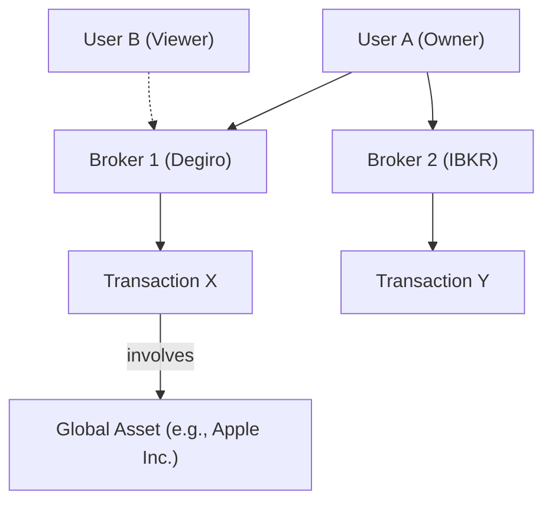

# 👥 Users, Authentication, and Brokers

This section explains the authentication model, user roles, and how data is segregated between users and brokers.

## 🔐 Authentication Model (Stateless JWT Cookie)

LibreFolio authenticates with a **signed JWT** kept in an HTTP-only cookie. The server keeps no
record of sessions, neither in memory nor in the database: its one piece of session state is a
version per account, `users.session_version`, raised by one to end all of the account's sessions at
once. A restore sets every account's version to the restore time in milliseconds instead: a time,
not a counter, which the next change still raises by one
([Session Revocation](security.md#session-revocation)).

### 🔄 How it Works

1. **Login**: The user sends their `username` (or e-mail) and `password` to the `/api/v1/auth/login` endpoint. An identifier holding `@` names the account with that email address, in any A–Z case, and only when no account has it, the account with exactly that username; one without `@` is a username only, compared exactly (`user_service.get_user_by_username_or_email()`, lot A-21a: see [Which Account an Identifier Names](security.md#sign-in-identifier)).
2. **Token Creation**:
    - The server verifies the credentials (using `bcrypt` hashing).
    - If valid, it signs a JWT with `JWT_SECRET` (HS256) carrying the user ID (`sub`), the account's session version (`sv`), the issue time (`iat`) and the expiry (`exp`): `create_jwt_token()` in `backend/app/services/accounts/auth_service.py`.
3. **Cookie Issuance**: The server responds with a `Set-Cookie` header for the `session` cookie, which holds the JWT; its `max_age` matches the token's lifetime.
    - **`HttpOnly`**: The cookie cannot be accessed by JavaScript (prevents XSS token theft).
    - **`SameSite=Lax`**: Provides protection against CSRF attacks.
    - **`Secure`**: decided by `session_cookie_secure()` in `backend/app/api/v1/auth.py` from `SESSION_COOKIE_SECURE`. `auto`, the default, sets it on HTTPS, seen directly or as the first `X-Forwarded-Proto` value of a reverse proxy; `always` and `never` force it. Login, password change, email change, logout and account deletion use the same rule. See [Configuration](../../admin/configuration.md).
4. **Authenticated Requests**: The browser automatically includes the session cookie in subsequent requests.
5. **Validation**: On every request, `get_current_user()` verifies the token's signature and expiry, then loads the user from the database: a missing or deactivated user gets `401` even with a valid token, and so does a token whose `sv` is not the account's current `session_version`.

### 💾 Session State, Restarts & TTL

- 🧠 **Stateless**: No session is stored server-side — the version check reads `users.session_version` from the user row every request loads anyway — so any uvicorn worker can validate any token, provided all workers share the same `JWT_SECRET`.
- 🔑 **Restarts**: Sessions survive a restart only if `JWT_SECRET`, or the file named by `JWT_SECRET_FILE`, holds a fixed value. Without it, every start generates a new random key, existing tokens no longer verify, and everyone is signed out. See [JWT Secret](security.md#jwt-secret) for how the key is resolved.
- ⏱️ **TTL (Time To Live)**: The session duration is configurable via the `session_ttl_hours` Global Setting (default: 24 hours), read whenever a session cookie is issued: at login, and when a password or email change re-issues it. There is no refresh: after expiry the user logs in again.
- 🚪 **Revocation**: Logout only deletes the cookie. A password change, an email change (which asks for the current password, see [Changing the Email](security.md#email-change)), a password reset (`./dev.py user reset`, or a reset link once spent), a deactivation or a demotion (from the CLI or the administrator API), or an administrator's sign-out of the account raises the account's `session_version`: every session issued before it gets `401` at its next request, and a later reactivation does not bring them back. The password change and the email change also send a new cookie to the device that made them, which stays signed in. Deleting the user cuts access at the next request; changing `JWT_SECRET` signs everyone out. See [Session Revocation](security.md#session-revocation).

## 👤 User Roles

There are two system-level user roles in LibreFolio:

1. 👤 **Normal User**:
    - 📝 Can manage their own profile and settings.
    - 🏦 Can create and manage their own brokers.
    - 🤝 Can be granted access to other users' brokers.

2. 👑 **Superuser (Admin)**:
    - ✅ Has all permissions of a normal user.
    - ⚙️ Can manage system-wide **Global Settings**, the registration mode included, unless `LIBREFOLIO_REGISTRATION` pins it.
    - 🔧 Can manage the other accounts through the administrator API under `/api/v1/users`: list them, activate or deactivate, promote or demote, delete a regular account ([Deleting an Account](#account-deletion)), create a password-reset link, sign an account out everywhere, restart its onboarding, and create, list or revoke invitations. The API never sets a password: the user chooses it through the reset link. See [Registration, Invitations and the Admin API](access_control.md#registration).
    - 🔍 Can access *any* broker and transaction in the system for support purposes.

Whoever has a shell on the server manages accounts with the user CLI (`./dev.py user …`), no account needed: it lists, creates, activates or deactivates, promotes or demotes accounts, sets a password directly (`user reset`), changes an account's email address (`user set-email`), creates invitations and password-reset links, gives the [initial administrator](access_control.md#initial-admin) a new setup link (`user setup-link`), and restarts a user's onboarding. It has no command to list or revoke invitations, to sign an account out without another change, or to delete an account. See [Command-Line Tools](../../admin/cli_tools.md).

## 🏗️ User-Broker Mapping and Data Segregation

Data in LibreFolio is segregated based on a clear ownership hierarchy, but allows for flexible sharing via the **Broker Access Control (RBAC)** system.



- 👑 **Ownership**: A **Broker** is created by a **User** (the Owner).
- 🤝 **Sharing**: The Owner can grant access to other users (e.g., User B) with specific roles (Viewer, Editor).
- 💰 **Transactions**: A **Transaction** belongs exclusively to one **Broker**.
- 🏷️ **Names**: Broker names are unique across the whole instance (`Broker.name` is a unique
  column), whoever owns them — see [Duplicate names](../frontend/components/features/brokers/forms.md#duplicate-broker-names).
- 🔍 **Discovery**: The brokers a user cannot access still appear by name on the Brokers page
  (`BrokerDiscoveryCard`, under *Other Existing Brokers*). Their sharing view is read-only:
  `GET /brokers/{id}/access` loads the broker with `as_user_id="all"` and answers any signed-in
  user, so the user can see whom to ask for access. This is by design (developer decision,
  2026-10-08): the users of one instance are not strangers, and seeing who has access lets them
  ask an Owner or choose whom to share with. The response carries each user's username, e-mail,
  role, share and avatar (`BrokerService.list_accesses()`); the frontend shows usernames and
  avatars, not e-mails.

### 🛡️ Broker Access Control (RBAC)

Access to brokers is granularly controlled via the `BrokerUserAccess` table.

> 🔗 **Deep Dive**: For a detailed explanation of roles (OWNER, EDITOR, VIEWER) and permissions, see the **[Access Control (RBAC)](access_control.md)** documentation.

### 🗑️ Deleting an Account {: #account-deletion }

An account is deleted by its holder, from the profile (`DELETE /api/v1/auth/users/me`, refused with `400`
`LAST_ADMIN` to the last active administrator: see [Superusers](access_control.md#superusers)), or by an administrator
(`DELETE /api/v1/users/{user_id}`, with its refusals in
[Deleting an Account](access_control.md#admin-account-deletion)). Both apply one rule, broker by broker: the
last-owner rule of `BrokerService.leave_broker()` (`backend/app/services/brokers/access.py`).

| The account's role on the broker | The deletion |
|----------------------------------|--------------|
| `OWNER`, the only one | Deletes the broker, with its transactions and its BRIM report files |
| `OWNER`, with another `OWNER` | Removes the account's access; the broker stays |
| `EDITOR` or `VIEWER` | Removes the account's access; the broker stays |

Another `OWNER` row counts whether or not its account is active: an inactive co-owner keeps the broker.

- **One helper for both routes.** `user_service.delete_account(session, user)` returns
  `AccountDeletionResult(deleted_broker_ids, files_removed)`. It calls `delete_user()`, which applies the rule
  to each broker of the account in order of id, deletes the account and commits once; on any failure it rolls
  back and re-raises, so nothing is deleted and the route answers `500` *Account deletion failed: nothing was
  deleted*. The report files live on disk, outside the transaction: `brim_provider.delete_files_for_brokers()`
  removes those of the deleted brokers after the commit, in a worker thread (`asyncio.to_thread`). A failure
  there is logged and leaves the deletion done: the request still succeeds.
- **The preview.** `user_service.preview_user_deletion(session, user_id)` computes, by the same rule and
  without writing anything, what `delete_user()` would take (`None` for an unknown user). The API returns it as
  `AccountDeletionPreviewRead`: to any signed-in user for their own account
  (`GET /api/v1/auth/users/me/deletion-preview`), and to an administrator for any account
  (`GET /api/v1/users/{user_id}/deletion-preview`).

    ```json
    {
      "user_id": 7,
      "username": "alice",
      "brokers_deleted": [{"id": 3, "name": "Degiro", "transactions": 42}],
      "brokers_left": [{"id": 5, "name": "IBKR", "role": "OWNER"}],
      "transfers_unpaired": 1
    }
    ```

    `brokers_deleted` and `brokers_left` are in order of broker id; `role` is the account's role on a broker
    that stays: `OWNER`, `EDITOR` or `VIEWER`.
- **`transfers_unpaired`** counts the transactions that stay but are linked by `related_transaction_id`, in
  either direction, to a transaction that goes: the halves of transfers left without their pair (backlog
  V-3). Each staying half counts once, whatever broker it is on. What becomes of a staying half is the rule
  of deleting a broker, `TransactionService.delete_by_broker()`: it loses its link, and becomes the
  standalone row a split of the pair leaves — a received `TRANSFER` an `ADJUSTMENT`, a `CASH_TRANSFER` or
  `FX_CONVERSION` a `DEPOSIT` or a `WITHDRAWAL` (backlog V-3, D-J4), and the giving leg of a `TRANSFER` an
  `ADJUSTMENT` without a value (decision 47, as N78-1 changed it on 21/10/2026). See [Broker Deletion](../backend/transactions/service.md#broker-deletion).
- **Sessions.** `get_current_user()` no longer finds a deleted account: its sessions get `401` at their next
  request.

Tests: `./dev.py test services account-deletion-preview`
(`backend/test_scripts/test_services/test_account_deletion_preview.py`: in seven scenarios, the preview names
exactly the brokers `delete_user()` then deletes; the counts; nothing written; the report files removed once,
after the commit, and never when nothing is deleted or the deletion fails), `./dev.py test api account-deletion`
(the own deletion and its preview, over HTTP) and `./dev.py test api users-admin` (the administrator's routes).

### 🌐 Global vs. User-Specific Data

- 👤 **User-Specific**: `User`, `UserSettings`.
- 🏦 **Broker-Specific**: `Broker`, `Transaction`, `BrokerUserAccess`.
- 🌍 **Global**: `Asset`, `PriceHistory`, `FxRate`, `GlobalSettings`.

**Assets** are global because the information about a financial instrument (like Apple stock) is the same for everyone. However, a user's *transactions* involving that asset are
private (scoped to their Broker).
