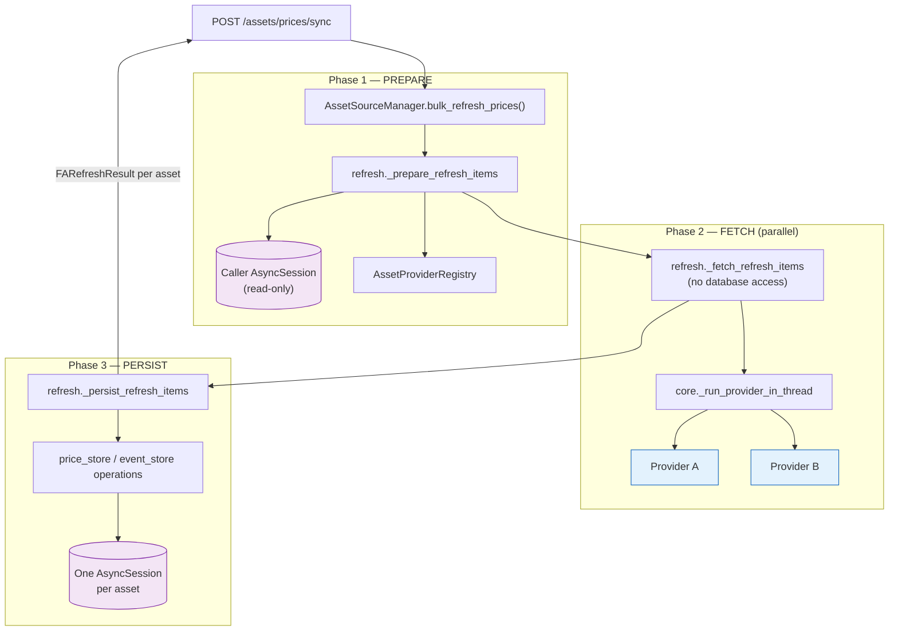
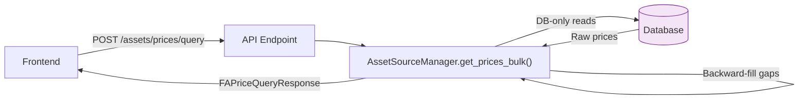

# 💰 Asset Pricing & Metadata Architecture

The Asset system in LibreFolio manages financial instruments (Stocks, ETFs, Bonds, Crypto, etc.), fetches their prices from external providers, and maintains their metadata.

## 📦 Package Layout and Imports

Asset pricing services live in `backend/app/services/assets/`. Each module owns one
responsibility:

| Module | Responsibility |
|--------|----------------|
| `base.py` | Provider contract: `AssetSourceProvider`, `AssetSourceError`, history start-date types, and the OHLC guard; `AssetRateLimitedError` and the helpers that recognise a refusal for too many requests (`rate_limited_from_response()`, `rate_limited_from_exception()`, `raise_if_rate_limited()`). |
| `core.py` | Shared infrastructure: the five cache singletons; `configured_provider()`, a new provider instance with its [plugin settings](../../architecture/patterns/plugin_settings.md) bound; `call_provider()`, the single boundary of every provider call, which refuses a provider that is not configured with `NOT_CONFIGURED`, refuses a paused one with `RATE_LIMITED` and pauses one that refuses ([Provider Pauses](#provider-pauses)), masks its secrets in the call's log lines and errors (hiding an error's texts whole when the call carries a personal secret), and runs the call in a thread of its own (`_run_provider_in_thread`); `public_asset_url()`, which withholds an asset URL that shows one of the provider's secrets; `cooldown_scope_for()`, the part of a provider a pause covers, from the plugin's `cooldown_scope()` hook; `settings_cache_part()` and `settings_cache_part_for()`, the part of a cache key that depends on the provider's settings; `asset_cache_key()`, the one key of the history and current caches (provider, identifier, input type, parameter hash, settings), and `drop_asset_cache_entries()`, which drops both entries of an assignment; provider-parameter hashing; error sanitization. |
| `registry.py` | `AssetProviderRegistry`, which discovers the pricing plugins in `backend/app/services/asset_source_providers/`. |
| `provider_management.py` | Provider assignment, removal and lookup; parametric-provider data invalidation, refused, nothing of the request written, while a `SPLIT` it would delete has linked incoming adjustments without a cost ([Parametric Provider Change](events.md#parametric-provider-change)); the removal, refused, nothing removed, while a transaction is linked to an event the removed assignment generated ([Provider Removal](events.md#provider-removal)); and the non-persisting provider probe. |
| `metadata.py` | Explicit provider metadata refresh, metadata caching, and application of returned patches through `AssetCRUDService`. |
| `price_store.py` | Price upserts/deletes, OHLC integrity checks, the digit limits of prices (a manual price or volume refused; a provider's truncated, and a provider's date with a value no column can keep skipped and reported), the [last storable date](#stored-date-bounds) of a stored price (a manual date after it refused, a provider's skipped and reported), the [currency](#price-currency-coherence) of a manual call's prices (refused before any write), and bounded write chunks. |
| `currency_change.py` | Currency-change market-data wipes: every price and event of the asset, with the transactions linked to those events unlinked; refused, nothing written, while a `SPLIT` of the asset has linked incoming adjustments without a cost ([Market-Data Wipe](events.md#market-data-wipe)). |
| `split_guard.py` | The `SPLIT`s among the events a wipe would delete that have linked incoming adjustments without a cost, named as the caller may see them (`splits_with_costless_adjustments()`, `adjustments_count()`): the refusal of the currency-change wipe and of the parametric provider change. |
| `event_links.py` | The transactions linked to asset events, as a refusal names them for its caller: `visible_transaction_ids()`, the ids on a broker the caller holds an access to, none without a caller (the rule `split_guard.py` imports), and `events_with_linked_transactions()`, the events among those given that transactions are linked to, each with the caller's view: the refusal of the provider removal. |
| `event_store.py` | Event upserts (rows updated in place: a provider refresh commits them in the same bounded chunks as prices, the manual upsert once for the whole request, all or nothing, after deleting the events its items list in `delete_ids`) and deletes scoped to one asset, plus the event queries and reads by id behind `/assets/events`. |
| `price_query.py` | DB-backed history/event queries, backward fill, FX and signal preparation, plus current-price lookup and today's OHLC write-back. |
| `period_changes.py` | The fixed-period changes of the Assets table, and on request the whole-range change of the Assets cards: each asset's price on the days the change needs, read in grouped queries and converted at each day's rate ([Fixed-Period Changes](#fixed-period-changes)). |
| `refresh.py` | Provider-driven price refresh and its explicit PREPARE/FETCH/PERSIST phases. |
| `crud.py` | Asset create, list, patch, delete, and merge operations. |
| `search.py` | Cross-provider batch search, SSE search, query caching, link-finder fallback, and URL resolution; for each provider that did not answer, the reason the client needs ([Interactive Search Stack](#interactive-search)). |
| `web_link_finder.py` | The last-resort web lookup of `search.py`: an external metasearch engine that turns a query into candidate provider-domain URLs (see [Asset Search & Link-Finder](search_link_finder.md)). |
| `manager.py` | The single `AssetSourceManager` class, composed from the provider, metadata, price-store, currency-change, event-store, query, and refresh operation mixins. |
| `market_calendar.py` | Market holidays and the rule that tells a stored carry from a quote, shared by risk and by the signal price query (see [Market Calendar](../risk/architecture.md#market-calendar)). |

These are behavioral boundaries, not only file boundaries: `refresh.py` orchestrates remote
acquisition, `price_store.py` and `event_store.py` own the reusable price and event persistence
primitives, and `price_query.py` owns database-backed reads plus the separate live-quote path.

`backend/app/services/assets/__init__.py` holds only a docstring: the package re-exports
nothing, and no compatibility facade exists.

!!! info "Import from the defining module"

    Import every name from the module that defines it: the provider base class and error from
    `backend.app.services.assets.base`; `AssetSourceManager` from
    `backend.app.services.assets.manager`; `AssetCRUDService` from
    `backend.app.services.assets.crud`; and `AssetSearchService` from
    `backend.app.services.assets.search`. The thread runner and all cache patch points live in
    `backend.app.services.assets.core`.

## 🧱 Core Components

### 1️⃣ `AssetSourceProvider` (Plugin Base Class)

Abstract base class for all asset pricing plugins, defined in
`backend/app/services/assets/base.py`. Each provider auto-registers via
`@register_provider(AssetProviderRegistry)`.

| Property / Method | Required | Default | Description |
|---|---|---|---|
| `provider_code` | ✅ | — | Unique identifier (e.g., `"yfinance"`) |
| `provider_name` | ✅ | — | Human-readable name |
| `test_cases` | ✅ | — | Test data for automated testing |
| `test_search_query` | ✅ | — | Search query for tests (`None` if search unsupported) |
| `get_current_value()` | ✅ | — | Fetch latest price → `FACurrentValue` |
| `get_history_value()` | ✅ | — | Fetch historical OHLCV → `FAHistoricalData` |
| `validate_params()` | ✅ | no-op | Validate provider-specific configuration |
| `params_schema` | — | `[]` | Schema for dynamic form generation in the frontend |
| `get_asset_url()` | — | `None` | URL to the provider's page for this asset |
| `resolvable_url_domains` | — | `[]` | Domains accepted by `resolve_url`; non-empty means `supports_url_resolution = True` |
| `resolve_url(url)` | — | `None` | Interactive-search hook: provider page URL → one search-item dict, list of dicts, or `None` |
| `accepted_identifier_types` | — | `[TICKER, ISIN]` | Input types accepted by this provider |
| `supports_history` | — | `True` | `False` for current-price-only providers |
| `search()` | — | raises `NOT_SUPPORTED` | Search for assets by name/ticker/ISIN |
| `fetch_asset_metadata()` | — | `None` | Fetch asset metadata (type, sector, identifiers) |
| `cooldown_scope()` | — | `None` | The part of the provider a pause after «too many requests» covers (the CSS Scraper: the page's host); `None` pauses the whole provider. See [Provider Pauses](#provider-pauses) |
| `provider_help_url` | — | `None` | URL to the provider's documentation page |

!!! info "`supports_search` heuristic"

    The `list_providers` endpoint determines search support via `instance.test_search_query is not None` — a local property check, not an HTTP call. This avoids cold-start latency on `GET /assets/provider`.

### 2️⃣ `AssetSourceManager`

The stable manager class in `assets/manager.py` composes the responsibility-specific
operation mixins:

- **Provider Assignment**: Link an asset to a provider (e.g., "AAPL" → "yfinance").
- **Price Sync**: 3-phase pipeline: PREPARE → FETCH → PERSIST (see [Data Flow](#data-flow-sync-pipeline) below).
- **Price Query**: DB-only bulk query with backward-fill via `POST /assets/prices/query`.
- **Current Price**: Bulk live-price endpoint via `POST /assets/prices/current`. Calls each asset's provider `get_current_value()` with DB fallback, and serves, caches and writes a quote only as the price columns keep it ([Current Quotes and Today's OHLC](#current-quotes-and-todays-ohlc)). Polled by the Assets list and the asset detail page for their [live prices](../../frontend/components/features/live-ticker.md#polling).
- **Event Sync**: Persist asset events from providers into the `asset_events` table, filtered by `provider_assignment_id` (manual events survive sync).
- **Probe**: Dry-run provider config testing via `probe_provider_config()`.

### 3️⃣ `AssetProviderRegistry`

Uses the [Registry Pattern](../../architecture/patterns/registry_pattern.md) for auto-discovery of provider plugins.

### 4️⃣ `AssetEvent` Table

Stores asset-level events produced by providers or created manually by users. Events are distinct from portfolio transactions:

- **Events** describe what happens to the **asset globally** (DIVIDEND, INTEREST, SPLIT, etc.)
- **Transactions** describe what happens in a **user's portfolio** (BUY, SELL)

**Dedup strategy**: Events with a `provider_assignment_id` (auto-generated) are replaced per
`(asset_id, date, type, provider_assignment_id)` key during sync. Events with
`provider_assignment_id = NULL` are user-created manual events and are **never** replaced by a
provider upsert.

See [Asset Events](events.md) for full details.

---

## 🔄 Data Flow: Sync Pipeline

When the user triggers a sync (or the scheduler does), `bulk_refresh_prices()` executes a 3-phase pipeline:

1. **PREPARE** uses the caller's `AsyncSession` for reads only. It resolves assets,
   assignments, provider instances, validated parameters, and `resume` dates into immutable
   prepared records. It performs no provider I/O and no writes.
2. **FETCH** receives no database session. It uses an `asyncio.Semaphore`, the core history and
   current caches, and `core._run_provider_in_thread()` for provider history/current calls.
   Price data and best-effort provider events remain in memory.
3. **PERSIST** creates a distinct `AsyncSession` for each asset. It compares fetched points with
   stored rows, then delegates price writes to `price_store.py` and event writes to
   `event_store.py`.

When the range reaches today, FETCH asks a provider's history only up to yesterday, then calls
`get_current_value()` and adds its value as the close of its `as_of_date` (today when the provider
gives none), replacing any history point of that date; PERSIST stores it with the rest. A provider
without history (`supports_history = False`, such as the CSS Scraper) therefore builds its series
one sync at a time, one point per day; outside syncs, the
[current-quote write-back](#current-quotes-and-todays-ohlc) stores the same day's point.

Before asking a provider's history from a dated start, FETCH reads the core history cache
(`core._asset_history_cache`): it asks from the first day the cached entry misses between the start
and `history_end`, the last day asked as a price (yesterday when the range reaches today), and skips
the call when the entry misses none. The walk that looks for the missing days covers at most
`RANGE_SPAN_LIMIT_DAYS` (100 years) before `history_end` (`range_span_floor()`, X-R55): an older start
counts as missing, so the provider is still asked from it, never for less than before.
{: #history-cache-walk }

Persistence intentionally does **not** claim one atomic transaction for the whole refresh.
`bulk_upsert_prices()` commits bounded chunks of
`PRICE_UPSERT_CHUNK_SIZE = 1000`; event upserts commit their own bounded chunks; and
`last_fetch_at` is committed separately afterwards. This keeps SQLite writer-lock windows bounded
and preserves truthful partial results when one step fails. Provider-generated events remain
scoped by `provider_assignment_id`, so manual events are not replaced.

`bulk_upsert_prices()` writes `open`, `high`, `low` and `close` through
`truncate_priceHistory()` (`backend/app/db/precision.py`): 12 decimal places, then 15
significant digits, both rounded down — what a `RealDecimal(24, 12)` column reads back (see
[Decimal Columns](../../architecture/database/index.md#decimal-columns)). That truncation is
for a provider's long floats. A value that is not finite, or has more digits before the
decimal point than its column (12 for a price, 24 for the volume), fits no truncation: a
provider's call drops every date holding one before any slice is written (W-B58: a value
that raised in the truncation of a later slice left the earlier ones committed). That is a
price `storable_price()` cannot keep (not finite, past 12 digits before the point, or a
non-zero close truncated to 0), or a volume past 24 digits (`_unstorable_provider_point()`;
the `-1` sentinel is no value). The call logs a warning, writes the other dates, and reports
the dropped ones in the asset's result message (*rejected N date(s) with a value no price
column can keep*, the first five dates with the field and value), which the sync adds to
the asset's errors as it does the OHLC rejections. The sync's change count, which runs
before this (`_count_actual_price_changes()` in `refresh.py`), and its fallback take only the
points that `_unstorable_provider_point()` accepts, dated no later than the
[last storable date](#stored-date-bounds) (`kept_items` in `_persist_refresh_item()`, W-B62;
the date check since X-R65): a date
skipped for either reason is neither counted in `inserted_count` / `updated_count` nor listed
in `changed_points`, from which the asset page's chart would draw a point the database never
got; `points_fetched` still counts it. Before W-B62, the count took every point: truncating the
fetched close of a date already stored raised from `1E+48` up, or on a close not finite, and its
fallback then announced every fetched point. The current value a refresh adds as today's
point, when the range reaches today, goes through the check of the
[live price](#current-quotes-and-todays-ohlc), `storable_current_value()`, in FETCH, before the
shared current-value cache: a value no price column can keep is neither cached nor added as a
point, so the sync neither counts nor announces it, but the result names it, as the upsert names
a date it skips (`unstorable_quote_reason()`, X-R51): *Current price 1E+60 not saved: a price
keeps at most 12 digits before the decimal point, and is never 0 once cut to 12 decimal places*,
the value cut as in the log. With other points the item is `partial`, that reason in its
`errors` after a currency-mismatch error, if any, and the first of them its `message`; with no
other point, as for a provider without history such as the CSS Scraper, the item is `failed`,
that reason its one error instead of *No price data available from provider*. The refusal is
still logged once. A kept value is cached as stored, so the live price then comes from
the cache already truncated. An open, high, low or
volume the F.4 merge keeps from the stored row, written by an older release past its
column's digits, is written as NULL (`_kept_price()`, `_kept_volume()`) instead of raising
mid-slices. A manual
call (`source_plugin_key="MANUAL"`, the default, used by `POST /assets/prices`) is checked
first instead: `_reject_prices_over_the_limit()` refuses the whole call when a price
exceeds any of its limits — 12 digits before the decimal point, 12 decimal places, 15
significant digits — or is not finite, or when a volume has more than 24 digits before the
point (only its size is limited: a fractional volume is accepted), before anything of it is
written — a `ValueError`, which the route answers with HTTP 400 naming the asset, the
maxima (the volume's included) and the dates. Two more checks follow, in this order and
still before any write: the [dates](#stored-date-bounds) (X-R65) and the
[currency](#price-currency-coherence) of the prices (X-R71).

`bulk_upsert_prices()` also keeps every date it stores no later than `latest_stored_date()`
(X-R65, night decision N83): `latest_range_end()`, tomorrow by the server's calendar, included.
There is no first date. X-R65 also kept stored dates from 1900-01-01 on; the developer lifted
that floor from every price and rate write, a provider's included, on 19/10 (N83's revision),
so a date before 1900, 0001-01-01 included, is stored like any other. The helper lives in
`backend/app/utils/date_range_limits.py`, with `DateOutOfRangeError` and
`date_out_of_range_detail()`, the builder of the 422 `detail`. The floor's reason was J's
SEC8-1b: a price stored at 0001-01-01 made a backward fill or a risk replay walk about 740,000
days per asset. The walks' own floors now carry that protection. `EARLIEST_RANGE_START`
(1900-01-01) is the first day of every replay (R13-SEC8) and of every full history: since Z-30
a full history reaches back no further, where an older row at most seeds the fill, and never
cuts a point-derived warm-up that starts earlier ([bulk request limits](#bulk-request-limits)).
A risk range starts no earlier than `range_span_floor()`, 100 years before its end
(`bounded_range()` in `backend/app/services/risk/scope.py`, R13-SEC8-1b).
{: #stored-date-bounds }

- **Manual call**: right after the digit check, `_reject_dates_out_of_range()` refuses the
  whole call when any date is after tomorrow, before the call reads or writes anything (a call
  that fails both gets the digits' 400). The `DateOutOfRangeError` becomes a 422
  `{"code": "date_out_of_range", "message", "params": {"max"}, "items", "count"}`
  (`message`: *Dates must lie on or before …: N do not*, or *1 does not*). `items`
  lists, in request order, each asset with such dates as `{"asset_id", "dates"}`, its first ten
  dates (at most ten assets); `count` is every date refused. An earlier date, 0001-01-01
  included, passes this check.
- **Provider call**: the dates after tomorrow are dropped before any slice is written, like the
  unstorable ones: the call logs a warning, *Provider prices skipped: date out of range*, writes
  the other dates, and reports the dropped ones in the asset's result message (*rejected N
  date(s) after …*, the first five dates), which the sync adds to the asset's errors. An older
  point, before 1900 included, is stored and counted.

The [FX rate writes](../fx/architecture.md#stored-rate-dates) keep to the same last date.
Transactions keep their own floor, 1900-01-01 since N74, with an end a year ahead
([Transaction dates](../transactions/service.md#transaction-dates), where the code is
`dateOutOfRange`). The web app's data editors tell these 422s in the interface language, naming
the dates refused and the last day a date may carry (*N dates are after …*,
`common.writeRefusal.dateOutOfRange`; `writeRefusalMessage()` in
`frontend/src/lib/api/writeRefusal.ts`, X-R46); before, they showed Axios's *Request failed with
status code 422*.

A manual call is all or nothing on the currency of its prices, as on its digits and dates
(X-R71). Its third check, `_reject_currency_mismatches()`, runs right after
`_reject_dates_out_of_range()`, before anything is written; a call that fails several checks
gets the refusal of the first, in the order digits (400), dates (422 `date_out_of_range`),
currency. It reads the currency of every asset the request names (`SELECT id, currency`, in
slices of 500 ids, nothing else on the session), then checks every item, in the request's
order: a point whose currency, when given, is not its asset's is at fault. The web app never
sends a per-point currency, so only an API client meets this check. The
`PriceCurrencyMismatchError` it raises (a plain `Exception`, like `DateOutOfRangeError`)
becomes a 422 `{"code": "price_currency_mismatch", "message", "items", "count"}` (`message`:
*Prices must be in their asset's currency: N are not*), built by
`price_currency_mismatch_detail()` in `price_store.py`. `items` lists, in request order, each
item at fault as `{"asset_id", "expected", "found", "dates"}` (at most ten items): `expected`
is the asset's currency, `found` the currencies given, first seen first, and `dates` at most
ten of the item's dates at fault, in request order; `count` is every date at fault. Nothing of
the request is written. A database error in the middle of a large upload still leaves the
slices already committed: that is the price of the slice commits, not a check. Before X-R71,
the check ran only inside the per-asset loop, once the earlier assets were written, each in
slices of 1,000 dates with a commit after each: a request whose third asset had a price in
another currency answered 400 with the first two already saved.
{: #price-currency-coherence }

- **Unknown asset**: an item whose asset does not exist is left to the loop, which answers it
  in its own result (*Asset N not found*, count 0) while the others are written, as before.
- **The loop's check stays**: under a provider's key it still raises its `ValueError` (a
  refresh writes one asset per call, and drops the points in another currency itself before);
  for a manual call it is a safety net, for an asset whose currency changed between the read
  and the write.

Every date an asset's write leaves out is named in that asset's result, `results[].rejected`
(X-R46; `FAPriceRejection` in `backend/app/schemas/prices.py`): one `{"date", "reason"}` per date,
in date order, and an empty list when none is (an unknown asset's result, *Asset N not found*,
names none). `count` counts only the dates written, and the
English `message` keeps its sentences unchanged: the sync still copies it into the item's `errors`
when it holds *rejected* (`_persist_refresh_item()` in `refresh.py`). A manual call meets only
`ohlc_inconsistent`: a date after tomorrow or a value over the limits refuses it whole instead.
{: #rejected-price-dates }

| `reason` | The date is left out because | Met by |
|---|---|---|
| `ohlc_inconsistent` | Its point carries two real bounds, a `low` and a `high` that are not the `-1` erase, and `low > high` or its close lies outside `[low, high]`, the values compared as sent; its stored row is kept | Manual and provider calls |
| `date_out_of_range` | It lies after tomorrow, the [last storable date](#stored-date-bounds) | Provider calls; a manual call is refused whole (422 `date_out_of_range`) |
| `value_not_storable` | It holds a value no price column can keep (`_unstorable_provider_point()`) | Provider calls; a manual call is refused whole (400) |

The integrity guard behind `ohlc_inconsistent` runs in the upsert loop and skips one date, never
the call. Only two real incoming bounds are held to the close: a bound sent as `-1` is erased (the
F.4 sentinel, written as NULL) and is no bound, so it is not checked (X-R46). A point without two
real bounds is never refused: when the merged `[low, high]` has both, it is widened to include the
new close, so that a close-only update (the justETF and scheduled-investment case) does not fail
on the bounds an older flat candle left; otherwise the row is written as sent, a single real bound
unchecked even on the wrong side of the close. The web app's asset data editor sends a row's Low
and High with its close, and `-1` for an erased cell: a close typed outside two real bounds comes
back as `ohlc_inconsistent`, while erasing High, Low or both saves the row with those bounds NULL.
Before X-R46, the guard took an erased bound for a bound of `-1`, so erasing High (with a Low) or
both left the date out. The editor counts `count` as saved and names the refused dates (up to
five, then a count) with their reasons in a warning (`rejectedMessage()` in
`frontend/src/lib/api/writeRefusal.ts`).

### 🕛 Dates on the Exchange's Own Day {: #exchange-timezone }

A provider dates each price point and event on its session's day at the exchange, not on the UTC
date of a timestamp ([Asset Plugin Guide](../../architecture/patterns/asset_plugin_guide.md)). The
refresh stores the dates as the provider gives them: no schema field or column holds an exchange
timezone.

The Yahoo plugin (`yahoo_finance/plugin.py`) keeps that rule since Z-33:

- **History**: yfinance stamps a daily bar, a dividend and a split at midnight in the exchange's
  timezone, so `_normalize_yahoo_date()` takes the index value's own date. Up to 1.2.1 the plugin
  converted it to UTC first, which gave the day before the session for every exchange east of UTC:
  Milan all year, London in summer time, Tokyo.
- **Current value**: `as_of_date` is `regularMarketTime` read in the timezone of
  `info["exchangeTimezoneName"]`, UTC when Yahoo gives none or the server does not know it, and
  the server's today without `regularMarketTime`.

**Rows saved by earlier versions stay as they are**, by decision (Z-33r): no migration or refresh
re-dates them. A sync writes the session days it fetches, each on its own day; after the update,
the scheduler's first [history sync](../scheduler.md#history-sync) fetches its window, the
**Lookback horizon** (14 days by default). So:

- **Prices**: in the range a sync fetches, each session day gets its own close; older rows of an
  exchange east of UTC stay a day early. A day without a session before a session, a Sunday or a
  holiday, keeps the next session's close: no fetch writes it again.
- **Events**: a dividend or a split a sync fetches again is stored twice, the old one a day early
  and the new one on its day, since the upsert keeps a stored event the provider no longer returns
  ([Dedup Strategy](events.md#dedup-strategy)). A split counts only through the `ADJUSTMENT` rows
  linked to it, so the new one changes no figure unless the user links it too.

The remedy, for a user who asks: delete both events, then sync their dates again; an event linked
to a transaction is deleted only once unlinked (`EVENT_IN_USE`). A clean price history takes the
[market-data wipe](events.md#market-data-wipe)
(`POST /api/v1/assets/{asset_id}/market-data/wipe`), then a sync of the whole history. The wipe
also deletes the asset's manual events and unlinks every transaction from its events, and is
refused (409, X-R48) while a split of the asset has linked incoming `ADJUSTMENT` rows without a
purchase cost.

**Unknown timezone** (Z-36). `_exchange_zone()`, private to the plugin, gives the name's
`ZoneInfo`, or None. On a server whose timezone database lacks the name (Windows outside Docker
without the PyPI `tzdata` package, a minimal container; the
[Docker image](../../architecture/overview.md#docker-image) installs one) the current value is
dated in UTC: the day before for the part of a session that falls before UTC midnight, such as
Sydney's or Auckland's. For an Area/Location name (`Europe/Rome`) the plugin then logs a warning
once per name and process, *Exchange timezone unknown to this server's timezone database: the
current value is dated in UTC*, with `timezone`; a fixed offset or a name without an area is not
logged. Adding `tzdata` to the dependencies is Z-36, a developer decision.

Tests: the `test_z33_*` of `test_yahoo_finance_errors.py` (each bar and event on its exchange day,
the current value in the exchange's timezone, the warning once per name and never for a name
without an area).

---

## 📊 Data Flow: Price Query

`POST /assets/prices/query` is the **primary read endpoint** for price data. It reads directly from the database (no provider calls) and applies backward-fill for gaps.

Each query item can request:

- `include_price: true` — price history with backward-fill
- `include_events: true` — asset events in the date range

`get_prices_bulk()` never invokes a provider. Provider acquisition belongs to
`refresh.py` through `POST /assets/prices/sync`; the query path remains DB-only while retaining
its warm-up, event, FX-conversion, signal-computation, and final response-slicing passes.

Each item's range has a ceiling (X-R55). Before any pass, `get_prices_bulk()` cuts it to end no later
than tomorrow by the server's calendar (`datetime_utils.latest_range_end()`, the helper
[R13-SEC7-1](../financial_math.md#portfolio-package) also uses), a day of margin for a user whose
today is already the server's tomorrow. The series, the comparison series, the signals and
the events see the cut range; an item that starts after it gets an empty result in its place (its
`asset_id`, no price, event, error or signal), and the other items are unaffected.
`POST /assets/prices/query`, the risk preparation and AI Export all read through this method, so a
range of theirs that reaches past tomorrow stops there. Before, the last price was carried forward to
the end, one point per day: about 2.9 million from a recent price to 9999-12-31, followed by a 500
(`OverflowError`). Without a seed price (none stored before the range), `_build_backward_filled_series()`
also starts its walk at the first stored price of the range instead of its start: the days before it
cost nothing, and the points emitted are the same. X-R55's own module, `backend/app/utils/date_range_limits.py`,
keeps the span limit: `RANGE_SPAN_LIMIT_DAYS` (36,525 days, 100 years) back from an end
(`range_span_floor()`), which bounds the [history-cache walk](#history-cache-walk) of a sync and the
[FX conversion ranges](../fx/architecture.md#convert-range-ceiling).
{: #price-query-range-ceiling }

A request also has two caps (Z-25, night decision N77). X-R55 gives each range a ceiling, but no
limit on how many ranges one request holds: 1,000 FX conversions of 100 years would build about
36.5 million daily conversions. The caps live in `backend/app/utils/date_range_limits.py` too, with
the builders of their 422 `detail`, `bulk_too_many_items_detail()` and
`bulk_too_many_days_detail()`; the modules that read them import them by name, where
`test_bulk_limits.py` lowers the budget. The
[conversion endpoint](../fx/architecture.md#convert-request-limits) has the same two caps.
{: #bulk-request-limits }

- **Items**: more than `MAX_BULK_ITEMS` (1,000) items get a 422
  `{"code": "bulk_too_many_items", "message", "max_items", "items"}` from the route, before any
  work: no database read. Exactly 1,000 pass.
- **Writes** (MF-SEC9a): `DELETE /assets/prices` takes at most `MAX_BULK_WRITE_ITEMS` (10,000) date ranges, all
  assets together, the same 422 with that `max_items`. Each asset's ranges, from every item that names it, are merged
  into disjoint day intervals (inclusive bounds, `end` defaulting to `start`), then counted with one
  `COUNT … GROUP BY asset_id` and deleted with one `DELETE` per chunk of `OR_TERMS_PER_QUERY` (500) intervals
  (`utils/sql_chunks.py`), in one transaction: one `DELETE` with an `OR` of every range failed from 1,000 ranges, and
  one `COUNT` per range made 10,000 queries at the cap. Each result's `deleted_count` is the rows its asset lost, a
  row counted once however many ranges cover it, an asset named by two items counted over both (MF-SEC9e: before,
  overlaps counted twice and such an asset reported its last item only); the counts add up to `total_deleted`. An
  empty request answers an empty result, no longer a 500. A failure of `POST`, `DELETE /assets/prices` or `POST /assets/prices/sync` answers
  500 with a fixed message, the error in the log.
- **Item-days**: once the prices and the seeds are read, before the events query and the fills,
  `get_prices_bulk()` sums the points each item's backward fill will emit. `_fill_span()` mirrors
  `_build_backward_filled_series()` without building anything: with a seed (a stored one, or a
  price of the map before the load start), one point per day of the load range; without one, one
  per day from the first stored price to the end; none when the fill emits nothing (no price, or a
  first price after the end). The comparison series of a signal that needs a prepared asset series
  (a rolling beta against another asset) count too; a comparison against the item's own asset is
  not counted twice. An item that starts after the ceiling counts zero. Over `MAX_BULK_ITEM_DAYS`
  (1,000,000) the method raises `BulkTooManyDaysError`, its `item_days` the request's exact total,
  and the route answers 422 `{"code": "bulk_too_many_days", "message", "max_item_days", "item_days"}`.

The count follows the fill, not the requested range. A full-history signal (`RISK_DRAWDOWN`) loads
from the earlier of `EARLIEST_RANGE_START` (1900-01-01) and the start of the item's point-derived
warm-up (Z-30): the full history can lengthen that warm-up, never shorten it, and adds nothing
before a range that starts before 1900. The fill emits from the first stored price, or from the
load start when a row dated before it (writes have no floor since N83) seeds the fill. So a full history over a
visible range of one day, today, still counts about 9,800 days for an asset priced since
2000-01-01, and about 46,300 with such a row (before Z-30 the load started at `date.min`; a row
stored at 0001-01-01 made it about 740,000).
The budget was 5,000,000 until R13-SEC9-2 lowered it: a point costs about 25.5 µs to fill,
about as much to serialize, and about 1.9 KB, so even a million is close to a minute of the event
loop and a few GB. The item cap is the route's, the budget `get_prices_bulk()`'s: the risk
preparation and AI Export call the method directly, once for their whole scope, and reach the
budget too, at about 100 assets from 2000-01-01 to today (nearly 9,800 days each) or about 550 over
five years. Since J-50 each turns `BulkTooManyDaysError` into a coded refusal: risk answers
`unavailable` · `resource_limit`, `metric` `price_item_days`, remedy `period_or_assets`
([Budgets](../risk/architecture.md#budgets)); AI Export, when a required component's prices pass
the budget, a 422 `selection_not_applicable` with `reason_code` `too_many_price_days`
([AI Export](../../architecture/patterns/ai_export_snapshot.md)).

The web app keeps its lists under both caps by sending them in batches (Z-27,
[Bulk requests in batches](../../frontend/state/registries.md#bulk-requests-in-batches)). The asset
list (`fetchPriceSeries()` in `frontend/src/routes/(app)/assets/+page.svelte`) builds one item per
asset whose prices for the range are not cached, or that has backend signals, and hands them to
`sendBulkBatches()` (`frontend/src/lib/api/bulkBatches.ts`): a single `POST /assets/prices/query`
when they fit, as before, otherwise consecutive batches under an estimate with a margin, sent one
after the other, a batch refused with `bulk_too_many_days` split again by the numbers of its
refusal. A batch that still fails stops the sending: the assets of the batches answered before it
get their prices, the others no new ones, and the error reaches only the browser console
(`console.error`); when one of those has backend signals, the signals section of the chart settings
window shows its generic *Technical signals could not be updated*. An explicit message is a
follow-up (workstream X, X-R58). Batching bounds each request, not the total: on «All» each card
still loads its asset's full daily history, and 300 assets without signals still fill about
2.9 million points (backlog Z-29, post-1.3).

With `target_currency`, the conversion pass converts every close not already in that currency
through one `convert_bulk()` call per result, scales open, high and low by the same factor, keeps
the native values in the `original_*` fields, and records the rate's date in
`backward_fill_info.fx_rate_date` / `fx_days_back`. A point whose rate cannot be resolved keeps its
native price and currency, and the result's `errors` lists the failures, deduplicated and capped at
ten plus one "… and N more" line. The query never registers an FX pair: the asset page reports
the pair through its `requiredFxPairs` banners, and its comparison loader drops those points (see
[Chart internals](../../frontend/components/charts.md#asset-detail-page-sync-and-comparison-sync)).

### 📅 Fixed-Period Changes {: #fixed-period-changes }

`POST /assets/prices/period-changes` returns the fixed-period changes of the Assets table: 1D, 1W, 1M, 3M, 6M, 1Y,
2Y, 3Y and 5Y (developer decision D-MF6 b). `get_period_changes_bulk()` in `period_changes.py` values the days. The
change itself is the house's `fixed_period_changes()`
([Financial Math Layer](../financial_math.md#fixed-period-changes)).

- **Request**: a list of `{asset_id, as_of, target_currency?, range_start?}`. `as_of` and `range_start` are on or
  after `EARLIEST_RANGE_START` (1 January 1900; up to 0005-12-30 the 5Y day fell before year 1, a 500), and
  `range_start` is on or before `as_of`: 422 otherwise, from the schema. The route then checks the request with
  `period_changes_request_refusal()` (`backend/app/schemas/common.py`), before any read (MF-P2b, finding R13-SEC8,
  aligned with Z-25):
    - more than `MAX_BULK_ITEMS` (1,000) items get the 422 `{"code": "bulk_too_many_items", "message", "max_items",
      "items"}` of `POST /assets/prices/query` ([bulk request limits](#bulk-request-limits)); exactly 1,000 pass;
    - more than `PERIOD_CHANGES_MAX_AS_OF_DAYS` (5) distinct `as_of` days, or as many distinct `range_start` days, get
      the 422 `{"code": "period_changes_too_many_days", "message", "field", "max_days", "days"}`, `field` naming the
      one over the limit (`as_of` checked first). Each `as_of` costs ten grouped queries below, each `range_start` one
      more, so the cost of a request follows its distinct days, not its length.
- **Response**: `items[]`, in request order, of `{asset_id, as_of, currency, periods[], range_change, errors[]}`. Each
  period is `{key, days, change_ratio}`, with `change_ratio = price(as_of) / price(as_of − days) − 1`: a fraction, null
  when either price is missing, the earlier one ≤ 0 or the one on `as_of` negative; a price of 0 on `as_of` (written
  down to nothing) gives −1, −100 %. `range_change` is null unless the item sends a `range_start` (below).
- **Price on a day**: the last stored price on or before it, the backward fill of `POST /assets/prices/query`, with
  no [ceiling](#price-query-range-ceiling) on `as_of`. One grouped query runs per valued day, for every asset of
  the request: a `MAX(date) … GROUP BY asset_id` subquery joined back to `PriceHistory`. No series is built per
  asset.
- **With `target_currency`**: each day's price is converted at that day's rate, the way the price query converts each
  day of its series. One `convert_bulk()` batch serves the whole request. A day without a rate is null, with an error.
- **Native**: `currency` is the anchor's currency, null when `as_of` has no price. A day priced in another currency
  is null, with an error.

An item may also send `range_start`, the first day of the range the page shows, for the whole-range Δ of the Assets
cards (X-R59, decision N80); its limits are in the **Request** bullet above.

- **`range_change`**: `{reference_date, change_abs, change_ratio}`, the house's `range_change()`
  ([Financial Math Layer](../financial_math.md#fixed-period-changes)). `change_abs = price(as_of) − reference price`,
  in the result's `currency`; `change_ratio = price(as_of) / reference price − 1`. Both are null when either price is
  missing, the reference ≤ 0 or the price on `as_of` negative; a price of 0 on `as_of` gives −reference and −1.
- **Reference**: the price on `range_start`, the last stored price on or before it (one more day in the grouped
  `MAX(date)` queries above), with `reference_date = range_start`. An asset with no price on or before `range_start`
  takes its first stored price inside the range, after `range_start` and up to `as_of`, with that price's date: one
  more grouped query per distinct `(range_start, as_of)` window, for those assets only, a `MIN(date) … GROUP BY
  asset_id` subquery joined back to `PriceHistory`. Either way it is the first point of the series
  `POST /assets/prices/query` returns for the range, whose walk starts at the first stored price when there is no seed
  ([X-R55](#price-query-range-ceiling)). With no price up to `as_of`, every field of `range_change` is null,
  `reference_date` included.
- **Valuing the reference**: as any other day. With `target_currency` it is converted at the rate of its
  `reference_date`, in the same `convert_bulk()` batch, and a missing rate leaves it null, with an error; native, a
  reference priced in another currency is null, with an error. The anchor is the price on `as_of`, as for the periods.

The change is on this endpoint, not on `POST /assets/prices/query`: the Assets page reads its series through a shared
cache (`getAssetPriceStore()`), so a change attached to a series response would not be the visible range's. When the
range ends today the asset detail page shows the live quote, which may not be stored, as its last value: the change to
that quote comes from `POST /assets/prices/current` with the same `range_start`
([Current Quotes and Today's OHLC](#current-quotes-range-change)). The Assets list sends it:
`fetchAssetPeriodChanges(ids, asOf, rangeStart)` (`frontend/src/lib/utils/periodChanges.ts`) gives each item the first
day of the range on screen, raised to 1 January 1900 by `rangeStartFor()` (`frontend/src/lib/utils/rangeChange.ts`),
none for a day the backend would refuse (after `as_of`, or not a calendar day), and reads `range_change` with
`assetRangeDelta()` for the cards' Δ. The browser no longer computes it: `computeDerivedPriceState()` returns no Δ. The
page keeps the cards' Δ with a `PeriodChangesLedger` of its own, which marks each request with the whole range rather
than its last day, so a failed request keeps only the values of the same range. The asset detail page sends it too, for
its price summary: `fetchSeriesRangeDelta()` (`frontend/src/lib/components/assets/detail/assetDetailRangeChange.ts`)
asks one item, `as_of` the range's end and `range_start` from `rangeStartFor()`, with `target_currency` only when the
chart is really converted (the display currency is not the asset's and the FX pair is configured: with the pair missing,
the summary shows native prices). The page asks it on load, when the asset, the range or the display currency changes,
and after a refresh (a sync ends with one). The summary shows that Δ when it shows no live price, and the live quote's
own beside a live price, never the series' (`summaryRangeDelta()`). The browser computes neither.

`errors` is deduplicated and capped at ten plus one "… and N more" line. The endpoint reads the stored history
directly, so a 5Y change exists whatever range the page has loaded.

The Assets list calls the endpoint through `fetchAssetPeriodChanges()` (`frontend/src/lib/utils/periodChanges.ts`):
one request for every asset of the list, native (no `target_currency`), with `as_of` the end of the selected range.
Besides its fixed 1D column, the table shows each period whose `days` fit in the range's whole calendar days
(`visiblePeriodColumns()`). Past 1,000 assets that request goes in batches (X-R64): the function hands the assets to
`sendBulkBatches(items, () => 0, send)` (`frontend/src/lib/api/bulkBatches.ts`, Z-27,
[Bulk requests in batches](../../frontend/state/registries.md#bulk-requests-in-batches)), which sends consecutive
batches of at most `BULK_MAX_ITEMS` (1,000) assets, in the order given, one request after the other. There is no day
estimate: the endpoint has the item cap, not the item-days budget of the [price query](#bulk-request-limits), and
every batch asks up to the same `as_of`. The answers merge as if one request had answered, the periods taken from the
first item that has any; up to 1,000 assets it is one request, as before. All or nothing: a batch that fails rejects
the whole call with its own error and nothing is sent after it, so the list never shows a partial answer.

Several of these requests can be in flight at once, a range change during a refresh for instance: the list keeps a
`PeriodChangesLedger` (`periodChanges.ts`, X-R60) that says which answer it keeps.

- Every request of the Assets list is full, for every asset, whatever starts it (the first load, a range change, a
  refresh, an asset's sync), and it replaces every request before it: an older answer that lands later is not kept.
- The page's `data-busy` (`data-testid="assets-page"`) stays true while the latest request is in flight; one it
  replaced no longer counts.
- A failed request keeps the Δ computed up to the same `as_of` (the end of the range) and drops the others. The
  `catch` of `loadPeriodChanges()` (`frontend/src/routes/(app)/assets/+page.svelte`) logs it to the browser console,
  unless a newer request has replaced it.
- The signals' retry and a chart-settings save reload only the prices and signals (`fetchPriceSeries()`; a save, only
  when it changes the backend signals), never the period changes: the Δ do not depend on the signals.

### 💹 Current Quotes and Today's OHLC

`get_current_prices_bulk()` is deliberately separate from the DB-only historical query. For each
asset, `_live_quote_item()` reads the core current-price cache, or calls an assigned provider
through `core.call_provider()`, and checks the quote; the asset falls back to the database when
the provider fails, is [paused](#provider-pauses) or is absent, or when its quote is refused.

The request is bounded like the other bulk requests (R13-SEC9-1): more than `MAX_BULK_ITEMS`
(1,000) ids get the 422 `bulk_too_many_items` of [bulk request limits](#bulk-request-limits)
before any read. A repeated id is fetched once — one provider call, one write-back of today's
row — and the answer still has one item per requested id, in request order. `_live_quote_item()`
reads the cache again once it holds the provider slot (the semaphore of five), so the requests
that waited for the same quote take the one the first of them cached, instead of each calling
the provider, which would end in a «too many requests» pause for every user. A failure past the
checks answers 500 with a generic message, the error in the log only (R13-SEC9-3).

That check, `storable_current_value()` in `price_store.py`, is the one check of a live quote: the
[refresh](#data-flow-sync-pipeline) applies it too, to the value it adds for today (X-R40, W-B62).
`storable_price()` decides, as for the history (W-B58):

- a quote the truncation (12 decimal places, then 15 significant digits, rounded down) leaves
  unchanged is served in its own form (`101.5` stays `101.5`); one it changes is served
  truncated, as the history and today's row keep it (`65432.1234567890999` →
  `65432.123456789`), from the provider call and from the cache alike. Only a quote that passed
  is cached, once its item is built, and a cached one is checked again on a hit (it costs
  nothing);
- a quote no price column can keep — not finite, more than 12 digits before the decimal point,
  or non-zero but 0 once truncated to 12 decimal places (`1E-13`) — is refused: never served,
  cached or written. The asset falls back exactly as after a provider failure, and the next poll
  asks the provider again. A value that is no number at all, from a plugin that skips the
  schema, is refused too: the check never raises. Before, the quote was served as the provider
  gave it, a finite `1E+50000000` included, which `SafeDecimal` writes out in full (about 50 MB
  per response), and from the cache for two minutes: W-B58 only kept it out of the database;
- a refusal is logged at warning level once per process for each asset, provider and value,
  *Live quote refused: no price column can keep it, the last stored price stands*, the value cut
  to about 40 characters (`_quote_text()`). `_report_unstorable_quote()` remembers what it
  logged in a `functools.lru_cache(maxsize=1024)`, bounded so that a provider answering a new
  absurd value at every poll cannot grow it. Before, only the write-back warned, at every poll
  of a quote dated today (the scheduler's, every 10 minutes by default; an open asset page's,
  every 30 seconds; the Assets list's, every 60), while the quote was still served and cached.

The fallback is the most recent `PriceHistory` row whose close reads a number
(`_last_readable_price()`: the latest row alone, then older ones 32 at a time,
`_FALLBACK_PAGE`), answered with `source: "db:last_known"`; with none, the item has
`value: null` and `error: "No price data available"`. A close the file holds as ±inf, or as no
number, reads `None` through `RealDecimal`
([Decimal Columns](../../architecture/database/index.md#decimal-columns)) and is passed over;
before, `Decimal(str(None))` raised, and the whole bulk call, every asset, answered 500.
The fallbacks are read once the live quotes are in (MF-SEC9c): `_last_readable_prices()` reads the latest row of
every asset without a quote in one grouped query, and looks up alone, one after the other, only an asset whose latest
close does not read. The quotes run in parallel and never touch the request's session: the fallbacks used to read it
from those parallel tasks, which one `AsyncSession` does not allow.

A successful provider quote dated today is written back to today's OHLC row:

- a missing row is created with `open = high = low = close = value` and `volume = None`;
- an existing row keeps its volume, widens `low`/`high`, fills `open` only when it is missing,
  and overwrites `close` with the latest quote;
- the value written is the quote as served, that is as `storable_price()` keeps it, truncated
  like the history (a quote of `65432.1234567890999` is stored `65432.123456789`); a refused
  quote never reaches the write-back, which no longer logs one;
- a `db:last_known` fallback is never written as if it were a fresh quote.

The write-back is best-effort: a commit failure is rolled back and logged without discarding the
current-price response.

With the optional query parameter `range_start` (`POST /assets/prices/current?range_start=…`), each result also
carries `range_change`, the `FARangeChange` of the [fixed-period changes](#fixed-period-changes) (X-R59, decision
N80): the change over the range the asset detail page shows, up to the current price. When that range ends today the
page shows the live quote as its last value, and a live quote may not be stored (the write-back above keeps only one
dated today), so the `range_change` of `POST /assets/prices/period-changes`, valued on stored prices, would not match
it. `live_range_changes()` (`services/assets/period_changes.py`) values it after the quotes are served:
{: #current-quotes-range-change }

- **Anchor**: the result's own price, live or `db:last_known`, in its `currency`.
- **Reference**: the rule of the fixed-period changes, with the price's day for `as_of`: the last stored price on or
  before `range_start`, with `reference_date = range_start`; otherwise the first stored price after `range_start` and
  up to the price's day, with its own date. Two grouped queries serve the whole request: a `MAX(date)` one on
  `range_start`, and, for the assets without a price there, a `MIN(date)` one up to the latest price day of the
  request.
- **Change**: the house's `range_change()`, so `change_abs = price − reference` and
  `change_ratio = price / reference − 1`, by the same rule: null when either is missing, the reference ≤ 0 or the
  price negative, −reference and −1 for a price of 0. A reference stored in another currency
  than the price is not converted: `reference_date` is set, both changes are null.
- **In another currency** (`&target_currency=`, Y's D1: the page's converted view): both ends are converted into it,
  in one `convert_bulk()` batch, the reference at its own `reference_date`'s rate and the price at today's (the UTC
  date, as the page converts the live quote); an end already in that currency is not converted. `change_abs` is then
  in `target_currency`, while the quote's `value` and `currency` stay its own. A missing rate on either end leaves
  `reference_date` set and both changes null, never a difference of two currencies. Without `range_start` the
  parameter changes nothing; an invalid code is the standard 422 of the parameter.
- **No change**: a result without a price, or whose price is dated before `range_start`, or with no stored price up to
  the price's day, gets a `range_change` with every field null. Without `range_start`, `range_change` is null.
- **A failure** while valuing the changes never costs the quotes: it is logged, and every `range_change` is left with
  every field null (unavailable, never a guess).

A `range_start` outside 1 January 1900 … tomorrow (`latest_range_end()`) is refused by the parameter itself
(the standard 422, `loc` `["query", "range_start"]`), before any provider call (R13-SEC9-4); one after the price's day
gives an empty `range_change`. The asset detail page sends it with its live poll (`AssetDetailLive`,
`frontend/src/lib/components/assets/detail/assetDetailLive.svelte.ts`): while the range ends today, each request asks
`range_start`, the range's first day raised to 1 January 1900 by `rangeStartFor()`, and `target_currency`, the display
currency, only when the summary converts the live price (the display currency is not the asset's and the FX pair is
configured). The answer's `range_change` becomes `rangeDelta`, the Δ the summary shows beside the live price: none
beside a price left native because its conversion failed (the change is in the display currency), and none from the
moment the asset, the range's start or the display currency changes until the next poll.

---

## 🧪 Provider Probe

`POST /assets/provider/probe` allows **dry-run testing** of a provider configuration without persisting anything.
Any user may start one, so each user gets at most 30 probes a minute (a `SlidingWindowLimiter` in
`api/v1/assets/providers.py`, counted in each process; MF-SI2): past it the route answers 429
`{"error_code": "PROBE_RATE_LIMITED", "retry_after", "message"}` with `Retry-After`, before the provider is called.
The web app says it in the user's language, with the local time the wait ends, rounded up to the minute
(`probeRateLimitMessage()` in `components/assets/resolveProviderError.ts`, X-R66): **Test Configuration** shows it as the
result row's detail and one-line summary, **Ask Provider** as its error toast; any other failure is shown as before.
`LIBREFOLIO_PROBE_RATE_LIMIT` (`probe_rate_limit()` in `config/plugins.py`) sets the number, read at each probe by
`probe_limiter()`, as the sign-in limit reads its variable: a change applies at the next probe, without a restart.
`PROBES_BY_LIMIT` holds one limiter per limit the setting has had, so a value it comes back to finds its counts. `0`
turns the limit off, with a warning in the log, and a value that is not a whole number up to 10 000 is logged as an
error and leaves 30; each is logged once per value, and once at startup, when the module is imported. `dev.py server --test` sets it to `0` for every lane: the E2E suites pick
search results as one user, two probes a pick.

Operations (selectable per request):

| Operation | What it tests |
|---|---|
| `current_price` | Fetches latest price → validates provider can reach the asset |
| `history` | Fetches the last 7 days of data → validates historical data availability |
| `metadata` | Fetches asset metadata → validates identifier resolution |

Each operation returns `success`, `execution_time_ms`, and operation-specific data. The response's
`provider_url` is the plugin's `get_asset_url()`, withheld (`null`) when it shows one of the
provider's secrets: `core.public_asset_url()` drops it and logs a warning naming the provider
([Plugin Settings](../../architecture/patterns/plugin_settings.md#secrets)). The frontend
runs `current_price` + `history` for the **Test Configuration** button in the provider assignment
section, and automatically after a search result is picked; it counts `NO_DATA`,
`NOT_IMPLEMENTED` and `RATE_LIMITED` as soft failures (a ⚠️ that still passes the test).
`resolveProviderError.ts` writes a failure in the user's language when `providerErrors.<CODE>`
exists, and keeps the backend's English message otherwise. Among the codes it knows:

- `NOT_CONFIGURED`, a required [plugin setting](../../architecture/patterns/plugin_settings.md#not-configured)
  without a value, stays a failure (❌): *This provider must be configured before use*
  (`providerErrors.NOT_CONFIGURED`). **Configure**, next to the provider select, opens the
  provider's settings.
- `PROVIDER_ERROR`, an error the boundary had to replace because it still showed a secret: *The
  provider failed: {detail}* (`providerErrors.PROVIDER_ERROR`), `{detail}` being the masked
  description the error carries in `error_details.detail` (`<type>: ***` when the call carried a
  personal secret).
- `RATE_LIMITED`: «Paused for too many requests until {time}», `{time}` being the end of the pause in
  local time, rounded up to the minute: the time alone when the pause ends today
  (`providerErrors.RATE_LIMITED`), the date and time when it ends another day
  (`providerErrors.RATE_LIMITED_DAY`, a key of its own because Italian, French and Spanish need a
  different article before a date). With no known wait it writes «Too many requests: try again
  later» (`providerErrors.RATE_LIMITED_NO_TIME`).

Each text, date included, must fit the 60 characters of the result's one-line summary:
`summarizeProbeError()` (`providerProbe.ts`) cuts a longer one. Both files are in
`frontend/src/lib/components/assets/`.

The asset modal's **Ask Provider**, and the comparison that follows a search selection, run
`metadata` alone and diff its `patch_data` against the form in the browser: nothing is written until
the asset is saved.

---

## 🔎 Interactive Search Stack {: #interactive-search }

`GET /assets/provider/search` and `GET /assets/provider/search/stream` use a three-layer stack:

1. **On-site provider search** — `provider.search(query)` runs first.
2. **`web_link_finder`** — only if on-site search returns 0 items, the provider opts into
   `resolvable_url_domains`, and the finder is enabled. It uses the `ddgs` library by default to
   find provider-domain candidate URLs.
3. **`resolve_url`** — each candidate URL is resolved into one search-item dict, a list of dicts, or
   `None`. Lists are flattened and de-duplicated by `(identifier, language)`.

The identifier post-filter keeps only resolved items whose identifier matches a known hint/query
term when such a match exists. This is how a broad external result set is narrowed to an exact ISIN
from a broker report.

Both endpoints search for the signed-in user: each provider is a `configured_provider(code,
user_id=…)`, so it receives that user's [personal settings](../../architecture/patterns/plugin_settings.md#scopes),
such as justETF's preferred currency, and the query cache key carries their fingerprint. A provider
that does not answer is reported with its reason:

| Reason | Standard search (`FAProviderSearchResponse`) | Stream (`provider_error` event) |
|---|---|---|
| Not configured: a required setting has no value | In `providers_with_errors` and in `providers_not_configured`; logged at info level | `error_code: "NOT_CONFIGURED"`; logged at info level |
| Paused after «too many requests» | In `providers_with_errors` | `error_code: "RATE_LIMITED"` and `retry_after`, the seconds before it may be called again |
| Another `AssetSourceError` | In `providers_with_errors` | The provider's own `error_code`, such as `SEARCH_ERROR` |
| Any other error | In `providers_with_errors` | No `error_code` |

A provider without search (`supports_search` false) is left out of both, not reported. The search
box shows a row with **Configure** for each provider not configured, whichever endpoint answered
([The Interface](../../architecture/patterns/plugin_settings.md#interface)).

!!! warning "Interactive only"

    The link-finder and `resolve_url` run only during interactive search. Price sync, current-price
    fetches, and historical fetches never call external search; they use stored identifiers and
    `provider_params` only.

---

## ⏸️ Provider Pauses After «Too Many Requests» {: #provider-pauses }

`call_provider(provider, fn, *, timeout, scope=None)` in `core.py` is the one boundary of every
asset provider call, the [scheduler](../scheduler.md)'s included: live price, refresh (history and
today's quote), metadata refresh, search (streaming too), `resolve_url` and the probe. Besides
`NOT_CONFIGURED` and the masking of the secrets
([Plugin Settings](../../architecture/patterns/plugin_settings.md)), it consults the process-wide
pause registry, `backend/app/services/platform/provider_cooldown.py`:

- **A paused provider is not called.** The caller gets `AssetRateLimitedError` at once
  (`error_code="RATE_LIMITED"`, `retry_after` = the seconds of pause left), with no thread and no
  I/O.
- **A refusal pauses it.** When the call meets a refusal (the plugin raises `AssetRateLimitedError`:
  see the [Asset Plugin Guide](../../architecture/patterns/asset_plugin_guide.md#too-many-requests)),
  the provider is paused: by default 60 s, then 120 s, 240 s… at each refusal in a row, up to 1 h,
  plus 0–10 % of jitter; a `Retry-After` the provider sent is honoured up to 24 h. The error goes on
  with `retry_after` = the pause decided.
- **An answer ends a pause.** When a pause expires, one trial call goes through and the other
  callers keep getting `RATE_LIMITED` until its verdict: an answer ends the pause, a new refusal
  starts a longer one, and any other end (another error, a timeout) lets the next caller try.
- **Scope.** The callers that have an identifier (live price, refresh, metadata refresh, probe) pass
  `scope=core.cooldown_scope_for(provider, identifier, identifier_type, provider_params)`, the
  plugin's `cooldown_scope()` hook: a refusal from a site scraped by the CSS Scraper pauses that host
  only. Search and `resolve_url` pass none: they use the provider-wide pause.
- **Caches first.** The caches are read before the boundary: a cached value is still served during a
  pause.
- A test double that is not a plugin (no `PluginSettingsMixin`) has no settings and no pause: it is
  called as it is.

Each process keeps its own pauses, in memory. They are on by default:
[Provider Pauses](../../../admin/sleep_wake.md#provider-pauses), in the admin guide, and `.env.example`
(section «Sleep and Wake») list the two variables that tune them, `LIBREFOLIO_PROVIDER_COOLDOWN_BASE_SECONDS`
and `LIBREFOLIO_PROVIDER_COOLDOWN_MAX_SECONDS`. With the pauses turned off, nothing is skipped, and a
refusal still reaches the caller as `RATE_LIMITED`, with the provider's own `Retry-After` (or none).
The FX boundary, `call_fx_provider()`, does the same for the exchange-rate providers
([Paused Providers](../fx/configuration.md#paused-providers)).

What a caller returns while a provider is paused, or after it refused:

| Path | Result |
|---|---|
| Live price, `POST /assets/prices/current` (`FACurrentPriceItem`) | The last stored price, `source="db:last_known"`, HTTP 200, with `error_code="RATE_LIMITED"` and `retry_after`; with no stored price, `error` and the same two fields. The [live prices](../../frontend/components/features/live-ticker.md) of the Assets list and the asset page show that price, with no new text |
| Refresh, `POST /assets/prices/sync` (`FARefreshResult`) | `error_code="RATE_LIMITED"` and `retry_after` on every item whose history or today's quote was refused, whatever its status: `failed` when nothing came back, `partial` or `ok` when the other call brought prices, which are saved. With two refusals, the longer wait |
| Probe, `POST /assets/provider/probe` | A refused or skipped operation fails with `error_code="RATE_LIMITED"`, and `retry_after` both on the operation result and in `error_details`: **Test Configuration** shows a ⚠️ with the time the pause ends ([Provider Probe](#provider-probe)) |
| Search | The standard endpoint lists the provider in `providers_with_errors`, as for any error; the stream's `provider_error` event adds `error_code` and `retry_after`. In the link-finder fallback, a refused `resolve_url` only skips its URL: the provider is paused, and the search goes on without an error for it |
| Metadata refresh, `POST /assets/provider/refresh` | The item fails (`success: false`), with the refusal in `message` |

---

## 📊 Backward Fill Logic

Financial markets are closed on weekends and holidays. To provide a continuous price series for charts, LibreFolio uses a **backward-fill** strategy.

If a price is requested for a date where no data exists (e.g., Sunday), the system looks back to find the most recent available price (e.g., Friday's close) and uses that. The `backward_fill_info` field in `FAPricePoint` indicates the actual date and staleness (`days_back`). The fill stops at tomorrow by the server's calendar (`datetime_utils.latest_range_end()`, the helper R13-SEC7-1 also uses), the query's [range ceiling](#price-query-range-ceiling).

Backward fill reuses stored market prices only, and valuation adds no separate
last-purchase-price fallback: the portfolio engine values each holding through the
[Price Resolver](../transactions/price_resolver.md#the-daily-model) alone. On a day without a
market price, the resolver falls back on the asset's own trades (`BUY` or `SELL`; an `ADJUSTMENT`
is never a price) when one is the latest observation, as for a fund with no published NAV, and
the holding then reports `valuation_source = LAST_TRADE_PRICE`. With neither a quote nor a trade
on or before the day, a holding whose cost is known counts at that book cost and reports
`valuation_source = ESTIMATED_AT_COST` — no price at all (see
[No observation: valued at cost](../transactions/price_resolver.md#valued-at-cost)); with its
cost unknown it stays `MISSING`.

---

## ⚡ Cache & Performance

- **Canonical cache ownership**: `assets/core.py` owns the history, current, metadata,
  search-result, and search-query singleton caches. Responsibility modules dereference these
  objects through `core`, preserving one identity and one monkeypatch point.
- **`_asset_current_cache`**: caches provider current-value results for two minutes, as the price
  columns keep them: the live-query path and the refresh store a quote only once
  `storable_current_value()` has passed it, truncated if need be, so the cache never holds one
  that cannot be served or written ([Current Quotes and Today's OHLC](#current-quotes-and-todays-ohlc)).
  The live-query path and refresh share one key, built by `asset_cache_key()`: provider code,
  identifier, identifier type and the
  provider-parameter hash, so parameter changes cannot reuse stale data and two assets whose
  parameters differ never share a value. The key also includes the fingerprint of the provider's
  settings, as do the history, metadata and search-query keys, so different settings never
  share an entry (see [Plugin Settings](../../architecture/patterns/plugin_settings.md#caching)).
  The code that drops entries, when a parametric assignment changes or an asset's currency changes,
  goes through `drop_asset_cache_entries()`, which keys them the same way.
- **Provider Pre-warm**: `_prewarm_provider_caches()` runs asynchronously in the application
  lifespan, instantiating registered providers and allowing providers with internal data caches
  to warm them.
- **`supports_search` check**: Uses `test_search_query is not None` (local property), avoiding cold-start HTTP calls on `GET /assets/provider`.
- **Bulk historical queries**: `get_prices_bulk()` reads only the database. It loads the main
  in-range price set in one query, then performs DB-only seed, event, FX, and signal work as
  requested.

---

## 🌐 API Endpoints Summary

| Endpoint | Method | Description |
|---|---|---|
| `POST /api/v1/assets` | POST | Bulk create assets |
| `PATCH /api/v1/assets` | PATCH | Bulk update assets |
| `GET /api/v1/assets` | GET | Bulk read by IDs (with metadata) |
| `GET /api/v1/assets/all` | GET | All active assets |
| `GET /api/v1/assets/query` | GET | Filtered list (search, type, currency, active) |
| `DELETE /api/v1/assets` | DELETE | Bulk delete (cascade provider+prices) |
| `GET /api/v1/assets/{asset_id}/market-data/summary` | GET | What the market-data wipe would delete and unlink (prices with their date range, manual and provider events, linked transactions), without writing |
| `POST /api/v1/assets/{asset_id}/market-data/wipe` | POST | First step of a currency change: unlink the transactions from the asset's events, then delete every event and price of the asset. A 409 `MARKET_DATA_SPLIT_ADJUSTMENTS_WITHOUT_COST`, nothing written, while a `SPLIT` of the asset has linked incoming adjustments without a cost; `params.splits` names only the transactions the caller can see ([Market-Data Wipe](events.md#market-data-wipe)) |
| `GET /api/v1/assets/provider` | GET | List providers (with `params_schema`) |
| `GET /api/v1/assets/provider/search` | GET | Multi-provider parallel search |
| `GET /api/v1/assets/provider/search/stream` | GET | SSE streaming search results |
| `POST /api/v1/assets/provider/probe` | POST | Dry-run provider config test |
| `POST /api/v1/assets/provider` | POST | Bulk assign providers. New `provider_params` for a parametric provider (Scheduled Investment), or leaving one, deletes every price of the asset and the events that assignment generated, their transactions unlinked; a 409 `PROVIDER_WIPE_SPLIT_ADJUSTMENTS_WITHOUT_COST`, nothing of the request written, while a `SPLIT` among those events has linked incoming adjustments without a cost; `params` names the refused item (`asset_id`, `item_index`) and, in `splits`, only the transactions the caller can see ([Parametric Provider Change](events.md#parametric-provider-change)) |
| `DELETE /api/v1/assets/provider` | DELETE | Bulk remove providers (`asset_ids` in the query): deletes each assignment and the events it generated, manual events staying; a 409 `PROVIDER_REMOVAL_LINKED_TRANSACTIONS`, nothing of the request removed, while a transaction is linked to one of those events, whatever its type; `params` names the refused asset (`asset_id`, `item_index`) and, in `events`, only the transactions the caller can see; a 409 `PROVIDER_REMOVAL_CONFLICT`, nothing removed and no SQL in the answer, when a link appears between the check and the delete ([Provider Removal](events.md#provider-removal)) |
| `GET /api/v1/assets/provider/assignments` | GET | Read provider assignments |
| `POST /api/v1/assets/provider/refresh` | POST | Refresh metadata from provider |
| `POST /api/v1/assets/prices` | POST | Bulk upsert prices; a manual price over 12 digits before the decimal point, 12 decimal places or 15 significant digits, or a volume over 24 digits before the point, refuses the whole call (400), and so does a date after tomorrow (422 `date_out_of_range`, see [the last storable date](#stored-date-bounds)), or a price in a currency other than its asset's, on any asset of the request (422 `price_currency_mismatch`, see [price currency](#price-currency-coherence)); every refusal comes before anything is written; a date left out of a written call is named, with its reason, in its asset's `results[].rejected` (see [dates left out](#rejected-price-dates)) |
| `DELETE /api/v1/assets/prices` | DELETE | Bulk delete price ranges |
| `POST /api/v1/assets/prices/query` | POST | Bulk price query (DB-only, backward-fill) |
| `POST /api/v1/assets/prices/period-changes` | POST | Bulk fixed-period changes, 1D … 5Y, of the Assets table (DB-only, backward-fill, optional `target_currency`), and the whole-range change with an optional `range_start` |
| `POST /api/v1/assets/prices/current` | POST | Bulk current quotes with DB fallback and today's OHLC write-back; with an optional `range_start` query parameter, each quote's whole-range change |
| `POST /api/v1/assets/prices/sync` | POST | Bulk refresh prices from provider |
| `GET /api/v1/assets/prices/signals` | GET | Signal catalog: the visible plugins compatible with Asset prices |
| `POST /api/v1/assets/events` | POST | Bulk upsert manual events, all or nothing (the asset's currency only; a value over 12 digits before the decimal point, 6 decimal places or 15 significant digits is a 400 `EVENT_TOO_MANY_DIGITS`); `mode: "create"` refuses a date and type the asset already has (409 `EVENT_EXISTS`); `delete_ids` deletes events of the asset first, manual or from a provider, in the same transaction (400 `EVENT_NOT_DELETABLE` for an id that is not one of them, 409 `EVENT_IN_USE` for an event a transaction uses), each result listing them in `deleted_ids` |
| `DELETE /api/v1/assets/events` | DELETE | Bulk delete the events of one asset (`asset_id` required, with `ids`): an id of another asset comes back `not_found`, an event a transaction uses `in_use` |
| `POST /api/v1/assets/events/query` | POST | Bulk event query, each event with its `id` and `is_auto` flag |
| `GET /api/v1/assets/events` | GET | Events by id |

!!! tip "Interactive search internals"

    The two `provider/search` endpoints are the entry point of a three-layer stack (on-site
    search → `ddgs` web link-finder → `resolve_url`). See
    **[Asset Search & Link-Finder](search_link_finder.md)** for the orchestration, the `hints`
    two-stage query, and the identifier post-filter.

---

## 🔗 Related Documentation

- 📊 [Assets & Pricing ER Diagram](../../architecture/database/assets_pricing.md) — Database schema
- 🔎 [Asset Search & Link-Finder](search_link_finder.md) — Three-layer interactive search (`ddgs` metasearch last resort)
- 📅 [Asset Events](events.md) — Event types, dedup strategy, auto-generation
- 🔌 [System Providers](system_providers.md) — CSS Scraper & Scheduled Investment
- 📦 [Providers Overview](system_providers.md) — All available providers
- 📈 [Asset Plugin Guide](../../architecture/patterns/asset_plugin_guide.md) — How to create a new provider
