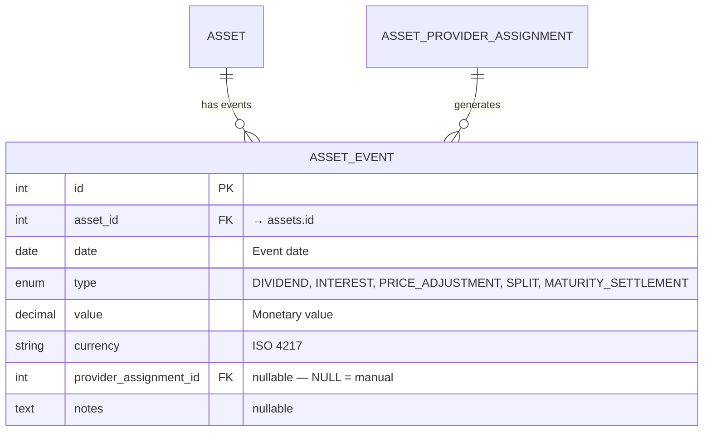

# 📅 Asset Events

Asset events represent significant occurrences that affect an asset's price or generate distributions. They live in the **asset domain**, not the portfolio/transaction domain.

## 📋 Event Types

| &nbsp; | Event Type                    | Effect on Price                    | Who Generates                                        | Description                                    |
|:------:|:------------------------------|:-----------------------------------|:-----------------------------------------------------|:-----------------------------------------------|
| 💰     | **DIVIDEND**                  | Price drops by event value (ex-date) | Provider (yfinance, justetf) or manual              | Cash distribution from equity/ETF              |
| 📈     | **INTEREST**                  | Price drops by event value         | Scheduled Investment (`generate_interest`) or manual | Interest payment from debt/loan. Resets accrued interest |
| 📊     | **PRICE_ADJUSTMENT**          | Algebraic change (+/−)             | Manual, or listed in a Scheduled Investment schedule | Non-cash value change (write-down, haircut)    |
| ✂️     | **SPLIT**                     | Changes quantity, not total value  | Provider (yfinance) or manual                        | Stock/unit split                               |
| 🏁     | **MATURITY_SETTLEMENT**       | Final capital return               | Scheduled Investment (`generate_interest`) or manual | Asset reaches maturity — no further calculations |

The type is always one of these five values (`AssetEventType`). `FAAssetEventPoint`
(`schemas/assets/events.py`), the event point of the API, of the provider output and of the
Scheduled Investment `asset_events`, trims and upper-cases it (`normalize_type()`: `dividend`
becomes `DIVIDEND`) and refuses anything else: `POST /api/v1/assets/events` answers 422. Until 1.3
a type was stored as it came (a hand-written CSV could store `dividend`), and one the enum does not
know broke every later read of the asset's events (`LookupError`, a 500). The post-migration fix
`event_types` repairs the rows stored that way, once, at the first start after the upgrade
(decision 23 of release 1.3; see
[Post-migration fixes](../../architecture/database/index.md#post-migration-fixes)).

---

## 🗃️ Database Model



**No UniqueConstraint** on `(asset_id, date, type)` — auto-generated and manual events can coexist on the same date and type. Nothing forbids two rows of the **same** source on one key either: the upsert below collapses such legacy duplicates when a batch brings fewer events for that key.

**Indexes**: `(asset_id, date)`, `(asset_id, type, date)`, `(provider_assignment_id)`.

---

## 🔄 Dedup Strategy

`_write_asset_events()` (`assets/event_store.py`) writes both kinds of events **in place**,
one source per call: a sync passes the assignment's id through `_upsert_asset_events()`, which
returns their count; the manual upsert passes `None` and gets back the id of the row each event
wrote. It groups the incoming events by `(date, type)` and matches each key against the stored rows
of the **same** source only (same `asset_id` and `provider_assignment_id`, `IS NULL` for manual
events):

```python
# Simplified logic of _write_asset_events() and _write_event_group(), for each (date, type) key
stored = rows on the key with this asset_id and provider_assignment_id, ORDER BY id
for row, evt in zip(stored, incoming):  # paired lowest id first: updated, id kept
    row.value, row.currency = evt.value.amount, evt.value.code or default_currency
    row.notes, row.updated_at = evt.notes, now
session.add_all(incoming[len(stored):])  # extra incoming events are inserted
surplus = stored[len(incoming):]  # legacy same-key duplicates of this source
# UPDATE transactions SET asset_event_id = stored[0].id WHERE asset_event_id IN surplus
# DELETE FROM asset_events WHERE id IN surplus
```

A key thus ends with as many rows as the batch brings, the lowest ids kept, and the transactions of
a collapsed duplicate move to the row that stays. Rows of another source on that key are never
touched, and a stored key the batch does not mention is kept. Keys are written in slices of
`PRICE_UPSERT_CHUNK_SIZE` (1,000), each one flushed: a sync commits every slice (`commit=True`,
the default of `_upsert_asset_events()`), while the manual upsert (`commit=False`) leaves the
commit to `bulk_upsert_events()`, which commits once for the whole request.

The upsert used to DELETE the stored rows of each key and INSERT the new ones. But
`transactions.asset_event_id` is `ON DELETE RESTRICT`, so that failed as soon as a transaction
realised the event: a provider refresh of such an event reported *Event upsert failed*, and editing
a linked manual event answered HTTP 500. A row updated in place keeps its id, so the transactions
linked to it stay linked.

### 🤖 Auto-Generated Events (`provider_assignment_id IS NOT NULL`)

A sync passes the assignment's id. This ensures:

- An event the provider returns again updates the stored one of the same date and type, which keeps its id: a transaction linked to it stays linked
- Events from **different** providers for the same asset are independent, and manual events are never touched
- A stored event the provider no longer returns is kept: the upsert only touches the date and type pairs of its batch

A parametric provider (Scheduled Investment) derives its whole series from its parameters. When they
change, or when the asset leaves it for another provider, `provider_management.py` deletes the
asset's prices and that assignment's events, first unlinking the transactions that pointed to them
(`asset_event_id = NULL`); manual events stay. While a `SPLIT` among those events has linked
incoming adjustments without a cost, the change is refused with a 409 and nothing is deleted
([Parametric Provider Change](#parametric-provider-change)).

Removing the asset's provider (**No Provider**) deletes the assignment and, with it, every event it
generated, whatever the provider; manual events stay. It unlinks nothing: while a transaction is
linked to one of those events, the removal is refused with a 409 and nothing is deleted
([Provider Removal](#provider-removal)).

The data editor shows these events read-only: the events of `POST /assets/prices/query` carry
`is_auto` (`provider_assignment_id IS NOT NULL`). An edit would be overwritten by the next sync.
The editor can still delete one, through `delete_ids` like a manual event (below), but the
deletion lasts only until the provider returns the event again.

### ✋ Manual Events (`provider_assignment_id IS NULL`)

`POST /api/v1/assets/events` (`bulk_upsert_events()`) takes a list of `FAEventUpsert` items,
`{asset_id, mode, events, delete_ids}`, whose points are `FAEventUpsertPoint`: an
`FAAssetEventPoint` with an optional `id` (`schemas/assets/events.py`).

The request is **all or nothing** (decision 22 of release 1.3). Its items run in order in one
transaction: `_write_manual_item()` checks an item, then writes and flushes it, so a later item
sees what the earlier ones wrote, and a single commit closes the request. Any refusal rolls the
whole request back, the items before it included: nothing of it is stored.

An item's `mode` (decision 20) is `"upsert"` by default; the data editor and its CSV import send
none:

- An event **with `id`** edits that manual row in place, every field included (`date`, `type`,
  value and currency, `notes`), and the row keeps its id. The data editor sends the id of every
  saved row, so changing the Type of a saved event no longer adds a second event.
- Events **without `id`** go through `_write_asset_events(provider_assignment_id=None)`: matched
  on `(date, type)` among the manual rows and updated in place, so a manual event still replaces
  the manual event of the same date and type, keeping its id.

With `mode: "create"`, an item only adds events, and none of them may carry an `id`. An event on a
`(date, type)` the asset already has, manual **or** from a provider, is refused with
`EVENT_EXISTS` (`_reject_existing_events()`): a new event never overwrites another one. The
transaction form's **+ New event** (`EventCreateMiniModal`) sends this mode. On `EVENT_EXISTS` it
shows `params.existing` (`EventExistsPanel`): **Use this** links the stored event and writes
nothing; **Edit this**, for a manual event only, loads it into the form, which then saves it by
`id` in an `upsert` item.

`delete_ids` (`upsert` items only) lists events of the item's asset to delete, manual or from a
provider: a provider's event comes back at the provider's next sync.
`_delete_item_events()` runs first in `_write_manual_item()`, right after the asset lookup and
before every other check, and flushes: an edit of the item may then take the `(date, type)` of an
event the item deletes. Every id must be an event of the item's asset (`EVENT_NOT_DELETABLE`), and
none may be linked to a transaction (`EVENT_IN_USE`). An item may only delete, with no `events`.
The data editor saves its Events tab this way, in one request: the rows marked deleted in
`delete_ids`, the edited and new rows in `events`.

In both modes, an event in a currency other than the asset's is refused
(`EVENT_CURRENCY_MISMATCH`), and so is a value with more than 12 digits before the decimal
point, 6 decimal places or 15 significant digits, or one that is not finite, which is never
rounded (`EVENT_TOO_MANY_DIGITS`, C-97; the digits before the point since W-B58). So is a
`SPLIT` whose ratio, its value, is not a number above 0 (`EVENT_INVALID_SPLIT_RATIO`, X-R47),
however it is written: added, matched on its date and type, or edited by `id`, including an edit
that turns another type into a `SPLIT`. Until X-R47 such a split was stored, and as soon as a
transaction linked it the portfolio engine raised (`financial_math/portfolio/engine.py`): the
Dashboard report answered 500. Since lot MF-D4 a split stored that way counts as missing. Only
its ratio is dropped: the linked `ADJUSTMENT` rows stay the split's rescale, with their cost
kept. No trade price before the split is restated by that ratio, the FIFO lots skip it, and the
Dashboard names the asset in an `INVALID_SPLIT_RATIO` warning (see
[DataQualityBanner](../../frontend/data-quality-banner.md)). The user fixes the ratio here.

Each result carries `event_ids`: the id of the event each point of
the item wrote, in request order. An edit keeps its id, an event matched on its date and type gets
the id of the row it updated, and an added event the id of its new row. `deleted_ids` lists the
ids of `delete_ids`, all deleted, in request order; `success_count` also counts an item that only
deletes.

A provider's event never meets these refusals: `_upsert_asset_events()`, which a sync calls,
first drops every event whose value `asset_events.value` cannot hold — not finite, or past 12
digits before the decimal point (`_storable_events()`, `storable_value()`) — and writes each of
the others as the column keeps it: truncated (ROUND_DOWN) to 6 decimals, then to 15 significant
digits, like a provider's price, and only when that changes it, so a value that fits keeps its
form (W-B68: written whole, a value read back rounded, `784.0774475` as `784.077448`, so what was
read differed from what was written). Among those, it drops every `SPLIT` whose ratio, as
truncated, is not above 0 (`is_valid_split_ratio()`, X-R47; a ratio of `1E-7` truncates to 0), then
writes the rest (W-B58: a value past a double's range, stored as a REAL inf, broke every response of
the asset's events, for every user). A raw event the event schema itself refuses — a value that
is no number, or whose exponent is past ±100 (`check_decimal_exponent()`, R13-SEC7-3) — is
dropped the same way, one event at a time: parsed in one go, it made the sync lose every event
it fetched. A dropped event is only logged, as a warning: the sync
result does not report it, and its `events_fetched` still counts it. A call logs at most one
warning per reason, *Events skipped: no event value can keep them* for the values and *Splits
skipped: a split's ratio must be a number above 0* for the splits, each with `asset_id`, `count`
and the first five dropped (`events`); an event the schema refused is listed by its date and
type only, as *(refused by the schema)*, never with its value, which can be of any length.

Every refusal below stops the whole request:

| Refused | Answer |
|---|---|
| A `type` that, trimmed and upper-cased, is not one of the five [event types](#event-types) | HTTP 422, from `FAAssetEventPoint.normalize_type()` |
| The same `id` twice in one item | HTTP 422 *Duplicate event id in one upsert item*, from the `FAEventUpsert` validator |
| An `id` in a `create` item | HTTP 422 *A create item cannot name an event id*, from the `FAEventUpsert` validator |
| `delete_ids` in a `create` item | HTTP 422 *A create item cannot delete events*, from the `FAEventUpsert` validator |
| The same id twice in `delete_ids` | HTTP 422 *Duplicate id in delete_ids*, from the `FAEventUpsert` validator |
| An id both in `delete_ids` and on an event of the same item | HTTP 422 *An event cannot be deleted and edited in one item*, from the `FAEventUpsert` validator |
| An item with neither `events` nor `delete_ids` | HTTP 422 *An upsert item needs at least one event or one id to delete*, from the `FAEventUpsert` validator |
| An item whose asset does not exist | HTTP 400 `EVENT_ASSET_NOT_FOUND` (until 1.3, a 200 whose result had `count` 0) |
| An id of `delete_ids` that is not an event of the item's asset: unknown, already gone, or another asset's | HTTP 400 `EVENT_NOT_DELETABLE`; `params.ids`: those ids |
| An id of `delete_ids` whose event a transaction is linked to | HTTP 409 `EVENT_IN_USE`; `params.events`: one `{id, date, type, linked_transactions}` per such event, ordered by date, type and id. Counts only, no transaction id: the transactions may belong to other users |
| An event in a currency other than the asset's | HTTP 400 `EVENT_CURRENCY_MISMATCH`; `params`: `expected` (the asset's currency) and `events`, one `{event_index, date, type, currency}` per such event of the item |
| An event whose value has more than 12 digits before the decimal point, more than 6 decimal places or more than 15 significant digits, trailing zeros not counted, or is not finite (`_reject_too_many_digits()`, the limits of `asset_events.value`) | HTTP 400 `EVENT_TOO_MANY_DIGITS`; `params`: `max_integer_digits` (12), `max_decimal_places` (6), `max_significant_digits` (15) and `events`, one `{event_index, date, type}` per such event of the item |
| A `SPLIT` whose ratio, its value, is not a number above 0: new, matched on its date and type, or edited by `id`, another type the edit turns into a `SPLIT` included (`_reject_invalid_split_ratios()`; the rule is `is_valid_split_ratio()` of `financial_math/splits.py`, the portfolio engine's own) | HTTP 400 `EVENT_INVALID_SPLIT_RATIO`; `params.events`: one `{event_index, date, type, ratio}` per such split of the item, in request order, `type` always `SPLIT` and `ratio` the value sent, as a string. A value that is not finite or has too many digits is refused first, with `EVENT_TOO_MANY_DIGITS` |
| An `id` that is unknown, belongs to another asset, or names a provider event | HTTP 400 `EVENT_NOT_EDITABLE`; `params.ids`: those ids |
| An edit that changes its date or type (a *mover*) landing on a key another edit of the item ends on, or on a key held by a manual row the item does not edit | HTTP 400 `EVENT_KEY_CONFLICT`; `params`: the `date` and `type` of the key |
| An event without `id` on a key an edit of the item ends on | HTTP 400 `EVENT_KEY_CONFLICT`; `params`: `date` and `type` |
| An edit that changes the type of a `SPLIT` while a linked incoming `ADJUSTMENT` (quantity above 0) has no `cost_basis_override` (`_reject_split_retype_without_costs()`; `costless_incoming_split_adjustments()` of `financial_math/splits.py` finds those rows). Without the split, such a row would be an acquisition of unknown cost: the rule of P-10 (decision 27). An edit that keeps the type, or an outgoing row, is never refused | HTTP 409 `EVENT_SPLIT_ADJUSTMENTS_WITHOUT_COST`; `params`: the first such edit in request order, `event_id`, `date` (the stored event's), `transaction_ids` (sorted, only the transactions the caller can see: a `BrokerUserAccess` row for their broker) and `hidden_transactions_count` (the others). The message names no transaction, only their count |
| In a `create` item, an event on a `(date, type)` the asset already has, manual or from a provider | HTTP 409 `EVENT_EXISTS`; `params.existing`: the stored events on every such key of the item, ordered by date, type and id, each `{id, date, type, value: {code, amount}, notes, is_auto, linked_transactions}`, the last one the number of transactions linked to the event |

A 400 or a 409 answers `detail = {error_code, message, params}` (`_REFUSAL_STATUS` in
`api/v1/assets/events.py`): `message` is the English text, which starts with the code, and
`params` always holds `item_index` (the item's position in the request, from 0) and `asset_id`,
plus the fields above. Any other `AssetSourceError` stays a 500 with a string `detail`. A 422 is
FastAPI's validation error: nothing has run, and its `loc` points at the item, or at the event for
a type. `_split_manual_events()` also raises `EVENT_KEY_CONFLICT`, with `params.ids`, for an id
repeated in one item: over HTTP the 422 comes first, so only a caller that skips the schema meets
it.

Allowed: two edits swapping their keys, edits that keep a shared key (legacy duplicates stay
editable), an event without `id` on a key a mover vacates, and an edit landing on the key of an
event the item deletes: that deletion is flushed before the checks run. These checks only cover
keys an edit ends on: in an `upsert` item, an event without `id` on the key of a manual row the
item does not edit updates that row, and two events without `id` on one key are both stored.

A type change is allowed even when a transaction is linked to the event: the link stays, and the
transaction is then read according to the new type. `compute_wac_iterative()`
(`portfolio_service.py`) counts an `ADJUSTMENT` as split-linked only while its event is a `SPLIT`:
the type is joined live, and the split-linked set is part of the WAC cache fingerprint. Once the
event is retyped to `PRICE_ADJUSTMENT`, a +qty adjustment becomes an acquisition at its cost basis
and a −qty one a plain reduction that takes its share of the cost away (in the test, the total cost
halves from 1,500 to 750). A +qty adjustment without a cost basis (the Auto mode stores none on a
split-linked row) would become an acquisition of unknown cost (`MISSING_COST_BASIS`): that retype is
refused, `EVENT_SPLIT_ADJUSTMENTS_WITHOUT_COST` above (P-10). The forward case, refused and then
accepted once the adjustment has a cost (40 a share: WAC 70), is pinned by
`test_forward_split_whose_adjustment_has_no_cost_is_retyped_only_once_the_adjustment_has_one`, the
reverse one by `test_reverse_split_relabelled_as_price_adjustment_becomes_a_reduction`, both in
`test_scripts/test_api/test_portfolio_wac.py`.

Manual events are **never deleted** by the sync process. They survive provider re-syncs, provider
changes, and bulk refreshes. Only an explicit user deletion removes them, or the market-data wipe
of a currency change (`POST /api/v1/assets/{asset_id}/market-data/wipe`), which deletes every event
of the asset, except while a `SPLIT` of the asset has linked incoming adjustments without a cost:
then it refuses with a 409 and deletes nothing ([Market-Data Wipe](#market-data-wipe)). A user
deletes events in two ways:

- **`delete_ids` of `POST /api/v1/assets/events`**, the data editor's save: all or nothing, so an
  event a transaction uses stops the whole request (`EVENT_IN_USE`). Until 1.3 the editor sent the
  deletions apart, through the `DELETE` below, after the upsert: the rest of the save was stored,
  the used event was skipped with a warning, and an edit could not take the key of an event deleted
  in the same save.
- **`DELETE /api/v1/assets/events?asset_id=…&ids=…`**, which the frontend no longer calls: per id,
  `deleted`, `not_found` or `in_use` (an event a transaction uses is reported, not deleted), and
  the deletable ones are committed even when others are blocked.

Both are scoped to one asset (decision 21 of release 1.3). The `DELETE` requires `asset_id`, so a
request with `ids` alone, the form API clients sent before, is now a 422, and an id of another
asset answers `not_found` and leaves its event alone; in `delete_ids`, such an id is
`EVENT_NOT_DELETABLE`.

### 🧹 Market-Data Wipe {: #market-data-wipe }

The first step of a currency change, `POST /api/v1/assets/{asset_id}/market-data/wipe`
(`wipe_market_data_for_currency_change()` in `assets/currency_change.py`), unlinks every
transaction from the asset's events (`asset_event_id = NULL`), deletes every event of the asset,
manual and from a provider, and every price, commits, then drops the history and current cache
entries of the asset's provider assignment. Its dry run,
`GET /api/v1/assets/{asset_id}/market-data/summary`, returns the same counts without writing, and
the rule below never refuses it.

The wipe refuses while a `SPLIT` of the asset, manual or from a provider, has a linked incoming
`ADJUSTMENT` (quantity above 0) without a `cost_basis_override`; a cost of 0 is a cost. Linked to
the split, such a row only rescales the position; unlinked and with the split deleted, it would be
an acquisition of unknown cost (`MISSING_COST_BASIS`). This is the rule of P-10, which refuses a
retype of such a split (`EVENT_SPLIT_ADJUSTMENTS_WITHOUT_COST`, above).
`_reject_wipe_of_costless_split_adjustments()` finds and names the rows through
`splits_with_costless_adjustments()` of `assets/split_guard.py`, built on the retype's own
function, `costless_incoming_split_adjustments()`, and shared with the
[parametric provider change](#parametric-provider-change). It runs before any write, so a refused
wipe writes nothing. It answers HTTP 409 with `detail = {error_code, message, params}`:

- `error_code`: `MARKET_DATA_SPLIT_ADJUSTMENTS_WITHOUT_COST`;
- `params.splits`: one `{event_id, date, transaction_ids, hidden_transactions_count}` per such
  split, ordered by date, then id. An asset is shared by every user, so `transaction_ids` lists,
  sorted, only the adjustments the caller can see (a `BrokerUserAccess` row for the transaction's
  broker), and `hidden_transactions_count` counts the others. The route passes the caller; the
  service called without `current_user_id` names none and counts them all;
- `message`: the English text, which starts with the code and gives only the totals, how many
  splits and how many adjustments.

The wipe's other errors keep their answer, as the summary's: 404 `ASSET_NOT_FOUND` for an unknown
asset, with a string `detail`. The currency-change dialog the asset form opens
(`AssetCurrencyChangeModal.svelte`, in `frontend/src/lib/components/assets/`) shows the refusal as
an error toast, one sentence in the interface language built by `wipeRefusalMessage()`
(`currencyChangeErrors.ts`): the first split's date, its adjustments without a cost, the hidden
ones among them, and how many more splits have some. Then it stops: no `PATCH /assets`, no sync,
and the dialog stays open. Any other error keeps the dialog's generic message.

### 🔁 Parametric Provider Change {: #parametric-provider-change }

`POST /api/v1/assets/provider` (`assign_providers_bulk()` in `api/v1/assets/providers.py`,
`bulk_assign_providers()` in `assets/provider_management.py`) saves its items in order and commits
once, after the last. For an asset that already has an assignment, an item that gives a parametric
provider (`FAProviderKind.PARAMETRIC_GENERATION`: today only Scheduled Investment) new
`provider_params`, or moves the asset away from one, wipes the asset's market data (#R3-4, #R6-4):
every price of the asset, manual ones included, and every event of the assignment
(`provider_assignment_id` its id), after unlinking their transactions (`asset_event_id = NULL`),
then the cache entries of the old parameters. Manual events (`provider_assignment_id IS NULL`)
survive, and new parameters of an online provider wipe nothing. `_wipe_reason()` decides, one answer for the write loop and for the
check below: `"params changed"`, `"provider changed"`, or `""` for no wipe.
The dry run [`POST /assets/provider/impact`](#provider-change-impact) counts what such an item
would delete before it is sent.

Among those events can be a `SPLIT`. The plan editor (`ScheduledInvestmentEditor.svelte`) offers
only Interest, Price Adjustment and Maturity Settlement events, but the schema
(`FAScheduledInvestmentSchedule.asset_events`) accepts a `SPLIT`, so a plan's split comes through
the API; the sync stores it under the assignment, as the plan's other events. Its linked incoming
`ADJUSTMENT`s (quantity above 0) without a `cost_basis_override` (a cost of 0 is a cost) would be
acquisitions of unknown cost once the wipe deletes it: the rule of P-10, as in the
[Market-Data Wipe](#market-data-wipe). Before the request's first write,
`_reject_wipes_of_costless_split_adjustments()` follows the items in order, as the write loop does
(an asset named twice is compared with its previous item), and for each item that would wipe reads
the events of that assignment and passes them to `split_guard.splits_with_costless_adjustments()`.
Manual events are not read: they survive the wipe. When a `SPLIT` among them has such adjustments,
the whole request is refused and nothing of it is written, the items before the refused one
included. The route answers HTTP 409 with `detail = {error_code, message, params}`:

- `error_code`: `PROVIDER_WIPE_SPLIT_ADJUSTMENTS_WITHOUT_COST`;
- `params.asset_id` and `params.item_index`: the refused item's asset and its position in the
  request, from 0. The market-data wipe has neither: its request names a single asset;
- `params.splits`: exactly as the market-data wipe's, one
  `{event_id, date, transaction_ids, hidden_transactions_count}` per such split, ordered by date,
  then id; `transaction_ids` lists, sorted, only the adjustments the caller can see (a
  `BrokerUserAccess` row for the transaction's broker), and `hidden_transactions_count` counts the
  others. The route passes `current_user_id=_current_user.id`; the service called without
  `current_user_id` names none and counts them all;
- `message`: the English text, which starts with the code and gives only the totals, how many
  splits and how many adjustments.

Any other error of the endpoint keeps its answer, a 500 with a string `detail`.

In the asset form (`AssetModal.svelte`, in `frontend/src/lib/components/assets/`), `saveEdit()`
first PATCHes the asset's fields (step 1), then assigns the provider (step 2). A step-2 refusal with this code is shown inline, in the form's
error banner (`formError`, `data-form-error`): one sentence in the interface language built by
`wipeRefusalMessage()` (`currencyChangeErrors.ts`, which maps each code to its key:
`MARKET_DATA_SPLIT_ADJUSTMENTS_WITHOUT_COST` to
`assetDetail.currencyChange.splitAdjustmentsWithoutCost`,
`PROVIDER_WIPE_SPLIT_ADJUSTMENTS_WITHOUT_COST` to `assets.modal.planSplitAdjustmentsWithoutCost`):
the first split's date, its adjustments without a cost, the hidden ones among them, and how many
more splits have some. Then it stops: no toast, no automatic sync, the form stays open, and the
next save asks its confirmation again. What step 1 saved stays saved: only the provider and its
parameters are unchanged, as the sentence says. The `catch` sits in `saveEdit()` itself, so the
sentence is the same on every way in: after the [impact confirmation](#provider-change-impact)
(new parameters or another provider) and on the plain save, where `doSave()` would read the
409 as a duplicate name. Any other error keeps its handling.

Tests: `backend/test_scripts/test_services/test_provider_wipe_split_guard.py`
(`./dev.py test services provider-wipe-split-guard`); in the frontend,
`currencyChangeErrors.test.ts` and `AssetModal.providerLifecycle.test.ts`, in the same folder.

### 🗑️ Provider Removal {: #provider-removal }

`DELETE /api/v1/assets/provider?asset_ids=…` (`remove_providers_bulk()` in
`api/v1/assets/providers.py`, `bulk_remove_providers()` in `assets/provider_management.py`), which
the asset form's **No Provider** calls, deletes the assignments of the listed assets in one
`DELETE`, then commits. `asset_events.provider_assignment_id` is `ON DELETE CASCADE`
(`db/models.py`), so the events each assignment generated go with it, whatever their type: a
market provider's dividends and splits, a Scheduled Investment plan's coupons (`INTEREST` events).
Manual events (`provider_assignment_id IS NULL`) stay, with their links, and so do the prices: the
removal never touches `prices`, unlike a [parametric change](#parametric-provider-change).

`transactions.asset_event_id` is `ON DELETE RESTRICT`. Until X-R62 the `DELETE` therefore failed
with an `IntegrityError` as soon as a transaction was linked to a generated event (HTTP 500 with
the SQL text), X-R62 replaced that with a 409 that asked the user to unlink the transactions
first, and X5-1 replaced the 409: the removal now does what a change of provider has always done
(Policy D). In the same transaction as the `DELETE`, `bulk_remove_providers()` sets
`transactions.asset_event_id` to `NULL` for every transaction linked to an event of the removed
assignments (`_unlink_transactions_of()`, one `UPDATE`), whoever owns the broker, and only then
deletes the assignments. The transactions are kept; only the link is lost. Every asset of the request
is answered a success (`deleted_count` 1), one without an assignment included.

The one refusal left is the rule of X-R49, here for the removal too. Before the request's only
write, `_reject_removals_of_costless_splits()` follows `asset_ids` in order (an asset named twice
is read once, at its first position; an asset without an assignment is skipped), reads the events
of the asset's assignment (`_assignment_event_rows()`) and passes them to
`split_guard.splits_with_costless_adjustments()`, as the [parametric change](#parametric-provider-change)
does. With the generated `SPLIT` gone, its linked incoming adjustments without a purchase cost
would be acquisitions of unknown cost, so when such a split exists the whole request is refused
and nothing of it is removed, the assets before the refused one included. The route answers HTTP
409 with `detail = {error_code, message, params}`:

- `error_code`: `PROVIDER_WIPE_SPLIT_ADJUSTMENTS_WITHOUT_COST`, the code of the change, not a code
  of its own;
- `params.asset_id` and `params.item_index`: the refused asset and its first position in
  `asset_ids`, from 0;
- `params.splits`: one `{event_id, date, transaction_ids, hidden_transactions_count}` per such
  split, as in the market-data wipe: `transaction_ids` lists, sorted, only the adjustments the
  caller can see (a `BrokerUserAccess` row for the transaction's broker), and
  `hidden_transactions_count` counts the others. The route passes
  `current_user_id=_current_user.id`; the service called without it names none and counts them all;
- `message`: the English text, which starts with the code and gives only the totals, how many
  splits and how many adjustments.

The check, the unlinking and the `DELETE` are separate statements, so a transaction linked to one of
those events after the service read their ids can still make the `DELETE` fail. `bulk_remove_providers()` then rolls the session back, logs a server-side
warning and raises `PROVIDER_REMOVAL_CONFLICT`, which the route also answers HTTP 409, with empty
`params` and a `message` without SQL: nothing was removed. Any other error of the service keeps
its answer, a 500 with a string `detail`.

!!! note "History: X-R62 is gone"

    `PROVIDER_REMOVAL_LINKED_TRANSACTIONS` (X-R62: a removal refused while any transaction was
    linked to a generated event) is no longer raised and has no sentence in the frontend
    catalogue; a client that still handles it can drop the branch.

In the asset form (`AssetModal.svelte`, in `frontend/src/lib/components/assets/`), `saveEdit()`
removes the provider in step 2, the `providerNoProvider` branch, once step 1 has PATCHed the
asset's fields. Before step 1 it asks the [dry run](#provider-change-impact) what the removal
deletes and, when something goes, shows one confirmation (below). Its `catch` mirrors the assign
branch's, just below it (X-R49): a refusal with either code is shown inline, in the form's error
banner (`formError`, `data-form-error`), one sentence in the interface language built by
`wipeRefusalMessage()` (`currencyChangeErrors.ts`):

- `PROVIDER_WIPE_SPLIT_ADJUSTMENTS_WITHOUT_COST` maps to `assets.modal.planSplitAdjustmentsWithoutCost`
  (read from `params.splits`, as for a change; its sentence says the provider was not changed
  *or removed*);
- `PROVIDER_REMOVAL_CONFLICT` maps to `assets.modal.providerRemovalConflict`, which takes no values
  and names nothing: the provider was not removed, some data still refers to the events it
  generated; reload the page and try again.

Then the save stops there: `pendingSaveAssetId` is reset and the banner scrolled into view; no
toast is shown, and the form stays open on the draft, still set to **No Provider**, so the save can
be tried again. What step 1 saved stays saved: only the provider is unchanged. Without the `catch`,
`doSave()` would read the 409 as a duplicate name. Any other error is thrown on and keeps its
handling (`trySave()`).

Tests: `backend/test_scripts/test_services/test_provider_removal_link_guard.py`
(`./dev.py test services provider-removal-link-guard`); in the frontend,
`currencyChangeErrors.test.ts` and `AssetModal.providerLifecycle.test.ts`, in the same folder.

### 🔎 Provider Change Impact (Dry Run) {: #provider-change-impact }

`POST /api/v1/assets/provider/impact` (`provider_change_impact()` in `api/v1/assets/providers.py`,
`AssetSourceManager.provider_change_impact()` in `assets/provider_management.py`) tells, before
anything is done, what the [change](#parametric-provider-change) or the [removal](#provider-removal)
would delete. It writes nothing and needs a signed-in user (the caller's view decides which
transactions are named, as in the refusals). The body is `FAProviderImpactRequest`
(`schemas/provider.py`): `assignments`, the items `POST /assets/provider` takes
(`FAProviderAssignmentItem`), and `removals`, the asset ids `DELETE /assets/provider` takes; both
default to an empty list, and unknown keys are a 422. The answer holds one `FAProviderImpactResult`
per assignment, then one per removal, in the order of the request:

| Field | Meaning |
|-------|---------|
| `asset_id`, `action` | The asset, and `assign` or `remove` |
| `reason` | `none`: nothing is lost (a change between market providers, the same provider and parameters, an asset without an assignment). `params_changed`: a parametric provider with new parameters. `provider_changed`: the asset leaves a parametric provider. `provider_removed`: a removal of an existing assignment |
| `prices_deleted` | Every price of the asset for `params_changed` and `provider_changed` (manual ones included); always 0 for a removal, which keeps the prices |
| `events_deleted` | The events the stored assignment generated; manual events are not counted |
| `transactions_unlinked` | The transactions linked to those events, in total: the ones on brokers the caller cannot see are counted too, and none is ever named |
| `blocking_splits` | The `SPLIT`s among those events with linked incoming adjustments without a purchase cost, as the refusals name them (`event_id`, `date`, `transaction_ids`, `hidden_transactions_count`). Not empty: the real operation is refused |

The rule is the same as the operations': `_wipe_reason()` decides `reason` for an assignment, as it
decides the write loop's wipe, and a removal measures the events of the assignment it would delete.
`reason` follows the items in order, as the write does (an asset named twice is compared with its
previous item), while the counts are always read from what is stored now. A removal of an asset
without an assignment answers `none` with zeros.

**Parity rule.** The dry run's numbers are what the operation then does: the prices, events and
transactions it counts are the ones the real change or removal deletes and unlinks, and a non-empty
`blocking_splits` is the 409 the real call answers. A new way for either operation to delete or
unlink something must change both together;
`test_parity_the_dry_runs_numbers_are_what_the_operation_then_does` and
`test_parity_a_blocking_split_is_the_refusal_the_operation_answers` in
`backend/test_scripts/test_services/test_provider_change_impact.py` pin it
(`./dev.py test services provider-change-impact`).

The asset form (`AssetModal.svelte`) is the only client. `saveEdit()` asks it through
`loadProviderImpact()` of `providerImpact.ts`, for an existing asset that had a provider when the
modal opened, in two cases: the user chose **No Provider** (one removal), or kept a provider whose
code or parameters changed (one assignment). `loadProviderImpact()` is advice, never a gate. It
returns nothing, and the save goes on without a dialog, when the request fails (a warning in the
console), when `reason` is `none`, when every count is 0, or when `blocking_splits` is not empty:
the real call is then made and refused, and the refusal is shown inline as above. Otherwise
`saveEdit()` opens one `ConfirmModal` that states the server's counts: the prices and the provider
events that go (`impactValues()`), and how many transactions lose their link (they are kept). The
`reason` picks the dialog (`IMPACT_DIALOG`): `params_changed` the regenerate dialog,
`provider_changed` the switch one, `provider_removed` the removal one, each with its own
`data-testid` (`asset-scheduled-regen-confirm`, `asset-parametric-switch-confirm`,
`asset-provider-remove-confirm`). Confirming re-enters `saveEdit()` with `pendingSaveAssetId` set,
which skips the question; cancelling resets it and saves nothing. This one dialog replaced the two
older ones (regenerate on new parameters, and discard-the-series on leaving a parametric provider),
whose counts came from the market-data summary; the keys live under `assets.modal.providerImpact.*`.

Tests: `backend/test_scripts/test_services/test_provider_change_impact.py`; in the frontend,
`providerImpact.test.ts` and `AssetModal.providerLifecycle.test.ts`, in the same folder.

---

## 🔧 Auto-Generated Events

### 📈 Yahoo Finance: Dividends & Splits

During sync, the Yahoo Finance provider generates:

- **`DIVIDEND` events** from `ticker.dividends` — ex-dividend dates with the per-share payout value and currency.
- **`SPLIT` events** from `ticker.splits` — split dates with the split ratio as the event value (e.g., `4.0` for a 4:1 split).

Both are written by the standard `_upsert_asset_events()` pipeline, scoped by `provider_assignment_id`.

Their dates are the exchange's own day, as the prices' (`_normalize_yahoo_date()`). An event an
older version stored a day early stays, so a sync that fetches it again stores a second one on its
day ([Dates on the Exchange's Own Day](architecture.md#exchange-timezone)).

### 🔍 JustETF: Dividends from Chart Data

During sync, the JustETF provider parses dividend data from `load_chart()` response. Distribution dates and amounts are extracted and stored as **`DIVIDEND` events**.

### 📊 Scheduled Investment: `generate_interest`

When a schedule period has `generate_interest = True`, the Scheduled Investment provider auto-generates:

1. **`INTEREST` events** at each maturation date within the period
2. After each INTEREST event, accrued interest resets: `total_interest = 0`, `event_adjustment = 0` → value returns to `initial_value`

The maturation frequency is controlled by `maturation_frequency` on each interest rate period (DAILY, WEEKLY, MONTHLY, QUARTERLY, SEMIANNUAL, ANNUAL).

The events entered in the schedule itself (`asset_events` in the provider parameters, **Add Event**
in the asset form) travel the same way: `get_history_value()` returns them with the generated ones,
so the sync stores them under the assignment and the data editor shows them read-only.

### 🏁 `MATURITY_SETTLEMENT`

Auto-generated when:

- The schedule ends **and** `generate_interest = True` on the last period
- **Or** late interest is configured with `generate_interest = True`

After settlement, the engine is "off" — `get_current_value()` returns the settlement value for all future dates.

---

## 📐 Event Impact on Pricing

The Scheduled Investment engine's pricing formula incorporates events:

```
price(d) = initial_value + accrued_interest - Σ(INTEREST events) + Σ(PRICE_ADJUSTMENT events)
```

- Interest is always calculated on `initial_value` (not running value)
- INTEREST events **subtract** from the running price (coupon paid out)
- PRICE_ADJUSTMENT events are **algebraic** (can add or subtract)
- After `MATURITY_SETTLEMENT`, no further calculations occur

---

## 🔗 Related Documentation

- 📊 [Assets & Pricing ER Diagram](../../architecture/database/assets_pricing.md) — Database schema
- 💰 [Asset Architecture](architecture.md) — Sync pipeline and price queries
- 📅 [Scheduled Investment Provider](provider_scheduled_investment.md) — Interest schedule and auto-events
- 📐 [Day Count Conventions](../../../financial-theory/fundamentals/day-count.md) — ACT/365, ACT/360, 30/360
