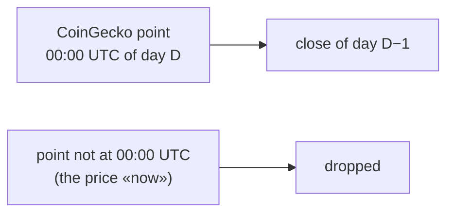

# 🦎 CoinGecko Provider (`coingecko`)

The CoinGecko provider prices cryptocurrencies from [CoinGecko](https://www.coingecko.com/), through its official
Python SDK, `coingecko-sdk`, pinned at **5.1.0** in the `Pipfile`. It gives the current price, in bulk too, the daily
history, search, metadata and the coin's page. It needs an API key: the free Demo plan is enough (project 76).

📖 **User Guide**: [CoinGecko — User Manual](../../../user/assets/providers/coingecko.md)

The code lives in `backend/app/services/asset_source_providers/coingecko/`:

| File | What it holds |
|---|---|
| `plugin.py` | The provider: settings, identifiers, prices, history, search, metadata, page, attribution |
| `i18n/` | The plugin's own interface texts |

What it shares with the CoinGecko enricher lives in the core, in `backend/app/services/coingecko/`, because a plugin
never imports another:

| File | What it holds |
|---|---|
| `sdk.py` | The one door to the SDK: the client's rules, the call, the translation of its errors, the coin id |
| `currencies.py` | The 45 `vs_currency` values (`VS_CURRENCIES`) and the default (`EUR`) |

🪪 **The enricher** that reads a coin's profile on the same account: [CoinGecko, a Shared Account](../../architecture/patterns/enricher_plugin_guide.md#coingecko).

---

## ⚙️ Settings and Identifiers

- **The shared group `coingecko`** (`plugin_settings/groups/coingecko.py`) holds the account: `api_key` (secret,
  system, **required**) and `plan` (`demo` or `pro`). Without a key the provider is «to configure»: every call answers
  `NOT_CONFIGURED` and asks nothing ([Shared Groups](../../architecture/patterns/plugin_settings.md#groups)).
    - The group has `shares_credits`: every call of a plugin that reads it is counted, and limited, on the group, since
        they spend one account's credits ([Call Limits](../../architecture/patterns/plugin_settings.md#call-limits)).
    - Its variables are `LIBREFOLIO_PLUGIN_GROUP_COINGECKO_API_KEY` and `…_PLAN` (`.env.example`).
- **The plugin's own fields:**
    - `current_refresh_minutes`: system, 10, 15, **30**, 60, 120 or 240. It sets `current_min_refresh_seconds`, how
        long the core keeps a current price before asking again.
    - `preferred_currency`: the user's own, default EUR. It is the currency of the search's rows, and nothing else.
- **The identifier** is CoinGecko's own id (`bitcoin`, `usd-coin`, `pepe`), not a ticker. Its input type is
  `COINGECKO_ID`, which reaches the plugin as `IdentifierType.OTHER`.
    - A search row is typed `OTHER`. Choosing it gives the assignment `COINGECKO_ID` and adds `coingecko:<id>` to the
        asset's other identifiers.
    - The asset's ticker is the coin's symbol (`BTC`), from the metadata.
    - An id that does not start with a letter or a digit, holds anything but letters, digits, dots, dashes and
        underscores, or contains `..`, is `NOT_FOUND` and asks nothing (`_coin_id`).
- **`provider_params`**: `{"vs_currency": "EUR"}`, required, one of `VS_CURRENCIES` (national currencies that are
  active ISO 4217 codes; no crypto, no metal).
    - It **must be the asset's currency**: the core discards a point in another currency.

## 🚪 The SDK's Door (`services/coingecko/sdk.py`)

The P0 trial (journal `76_cryptoPrices/prove/`) fixed four rules:

1. **No retry, no sleep.** The SDK retries twice by default and sleeps a 429's `Retry-After` (60 s measured) inside the
   provider's thread. `max_retries=0`: a refusal leaves at once as `AssetRateLimitedError` with its `Retry-After`, and
   the call boundary pauses the provider.
2. **The plan picks the root.** A Demo key answers on `api.coingecko.com`, a paid key on `pro-api.coingecko.com`. A key
   on the other root is refused (10010 or 10011).
3. **The error code hides in three shapes of body:** 10012 under `error.status`, 10005 under `status`, 10011 at the
   top. `coingecko_error_code` looks in all three.
4. **The key never leaves.** The SDK sends it in a header. No message built here contains it, and any text taken from a
   response is scrubbed of it. `get_asset_url` and the attribution never carry it.

Each request may take **8 s** (`REQUEST_TIMEOUT_SECONDS`), below the core's shortest price call (10 s). A client the
provider builds is closed after each call. The SDK is imported when a client is built, never at discovery.

| What happens | The provider's error |
|---|---|
| HTTP 429 | `AssetRateLimitedError`, with its `Retry-After` |
| 10012 (a range beyond 365 days on Demo), 10005 (an endpoint of the paid plans) | `PLAN_REQUIRED` |
| 10010, 10011 (a key on the other plan's root) | `WRONG_PLAN` |
| another 401 or 403 | `INVALID_API_KEY` |
| any other status | `PROVIDER_ERROR`, with `detail` `CoinGecko HTTP <status>`, never the body's own words |
| the request's time runs out | `TIMEOUT` |
| no answer | `FETCH_ERROR` |

The interface translates `PLAN_REQUIRED`, `WRONG_PLAN` and `INVALID_API_KEY` (`providerErrors.*`).

## 💰 Current Prices

- **One coin** (`get_current_value`): `/simple/price` with `ids`, `vs_currencies` in lower case,
  `include_last_updated_at=true` and **`precision=full`**.
    - The value is read **as a decimal from the response's text** (`json.loads(…, parse_float=Decimal)` on
        `with_raw_response`): no float ever holds it, so a price of 23 digits comes back whole.
    - The day is the UTC day of `last_updated_at`.
    - An unknown id is `NOT_FOUND`; a coin without that currency, `NO_DATA`.
- **In bulk** (`supports_bulk_current = True`, at most 100 items): **one request** for every item, each id and currency
  once, one credit for all of them. Each item is answered under its key, with its own error for itself only. A 429
  refuses the whole call.

## 📈 Daily History

`/coins/{id}/market_chart/range` with `interval=daily` and `precision=full`.

- **The point at 00:00 UTC of day D is the close of day D−1.** Each becomes the close of the day before, in the asset's
  currency, with no volume (`supports_meaningful_volume = False`: CoinGecko's volume is a 24-hour aggregate over every
  exchange).
- A point not at midnight, and a day outside `start`…`end`, are dropped.
- **The window asked runs one hour past each edge's midnight** (`_EDGE_SECONDS`): both edges' points come whether
  CoinGecko's ends are inclusive or not. The midnight and range filters drop what the margin adds.
- **The Demo plan's year.** A start before today − 364 (`"min"` included) moves there, with one `info` log line: the
  request never meets 10012. A range wholly before that day asks nothing.
    - The answer says that first day in `FAHistoricalData.history_starts`. The refresh reports it when the range asked
        started earlier, and the interface tells the user to load the days before with *Import CSV* in the asset's price
        editor ([The Source's First Day](architecture.md#history-starts)).
    - The Pro plan asks from the start it was given; `"min"` is 28/04/2013, CoinGecko's first day (`COINGECKO_FIRST_DAY`).
- **Very small prices.** The `close` column keeps 12 decimal places, so PEPE (3.5e-06 €) keeps 7 significant digits:
  an error under 0.1 % down to about 1e-9. A price below 1e-12 becomes 0 and is discarded.

## 🔎 Search, Metadata, Page

- **Search** (`search`): `/search?query=…`. Only its coins are kept, never its NFTs, exchanges or categories.
    - The coins are ordered by `market_cap_rank`; a coin without a rank comes last, in CoinGecko's order.
    - A row is `identifier=<id>`, `identifier_type=OTHER`, the coin's name alone (TL40: the name its metadata gives,
        so «Ask the provider» offers no rename; the symbol is the ticker), `type` CRYPTO, with the user's
        `preferred_currency` as `currency` and as `vs_currency`. A blank query asks nothing.
    - The row's `icon_url` is the coin's logo, `large` of the answer (S3): the very image the metadata gives the asset,
        so the browser asks it once.
    - `test_search_query` is `"bitcoin"`, so search is on. Without a key it answers `NOT_CONFIGURED`.
- **Metadata** (`fetch_asset_metadata`): `/coins/{id}` with no localization, tickers, market data, community or
  developer data, and no sparkline. It gives:
    - the name and CRYPTO;
    - the logo (`image.large`, linked from CoinGecko's image host as any icon set by URL);
    - the symbol in upper case as the ticker, left out when longer than 20 characters;
    - `coingecko:<id>` among the other identifiers.
- **The page** (`get_asset_url`): `https://www.coingecko.com/en/coins/<id>`, built from the id alone, with no I/O; an
  id CoinGecko cannot have has none.

## 🖼️ The Provider's Icon

`get_icon` is CoinGecko's own favicon by URL, `https://www.coingecko.com/favicon.ico`, as Yahoo's, justETF's and Borsa
Italiana's icons are theirs: it follows CoinGecko's own updates, and no file is bundled (the developer's choice, P1b-b).

- **What it costs:** a browser that shows the icon asks coingecko.com for that image, as it asks the other providers'
  hosts for theirs.
- **The coins' logos are another thing:** the metadata links each coin's logo from CoinGecko's image host (above).
- **In the gallery** the CoinGecko search shot lets that one image through; any other request to a CoinGecko host is
  still aborted and fails the shot (`e2e/fixtures/galleryCoinGecko.ts`).

## 🏷️ Attribution

CoinGecko's terms ask for its data to be shown with «Powered by CoinGecko», linked to its site. `attribution` returns
it as a constant `FAProviderAttribution`. `GET /assets/provider` exposes it.

Where it is shown is the developer's decision (TL42, 23/11/2026): on CoinGecko's own pages only, its card in Settings ›
Plugins (`ProviderAttributionNote`) and its user-guide page. The screens that show its prices or its profile (the asset page, its Profile tab, the asset
list, the Dashboard positions, the search, «Provider Data Comparison») carry no line: the asset shows CoinGecko's icon,
and its page links to the coin on coingecko.com.

The brand phrase is shown as CoinGecko writes it, in every language.

## 🧪 Tests

No suite a lane runs reaches the real CoinGecko: the real SDK runs on an `httpx.MockTransport` with the P0 trial's
recorded bodies (`backend/test_scripts/fixtures/coingecko/`, no key in them). Only the generic external tests can, with
the key in the environment.

| Suite | What it pins |
|---|---|
| `services coingecko-provider` | The group, the settings, the currencies, the SDK's door and its errors |
| `services coingecko-prices` | Current prices, in bulk, the history and its edges, the Demo year, freshness, the real path's count on the group |
| `services coingecko-search` | `COINGECKO_ID`, search, metadata, page; an assignment saved and priced through the real path |
| `services refresh-history-starts` | The first day in the refresh's outcome |
| `services provider-attribution` | The attribution model and CoinGecko's |
| `external asset-providers --providers coingecko` | The generic external tests. They skip without a key, and reach the real CoinGecko only with the key in the environment |
