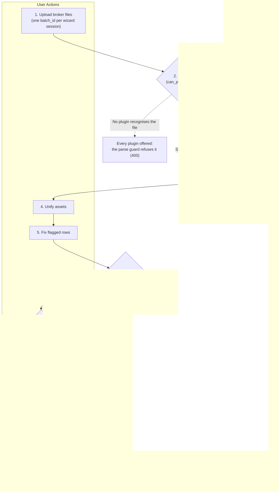

# 📥 BRIM Architecture

**BRIM (Broker Report Import Manager)** is the system responsible for importing transaction data from broker export files (CSV, XLSX, PDF, or another format supported by a plugin). It is designed to be robust, user-friendly, and extensible.

## 🔄 The BRIM Workflow

The import process follows a clear, multi-step wizard designed to give the user full control and visibility.



The wizard steps are `upload → select → analyze → assets → fix → duplicates → review → gapFix`.
**`assets`, `fix`, `duplicates` and `gapFix` are conditional**: each is skipped entirely when it has
nothing to ask (no merged extractions, no flagged rows, no cross-file collisions, no difference with
the bank's truth points), so a clean single-file import is still a three-click flow. `gapFix` is
reached only from the review's **Import**, and only for a [report set](#report-sets).

### 🪜 Step-by-step

1. **Upload** — The user uploads one or more broker export files. They can be dragged into the broker page or accessed from the Files tab. The wizard sends every file of one session with the same `batch_id`: the files uploaded together for one broker form a [report set](#report-sets) when a report-set plugin reads them.

2. **Plugin Detection** — BRIM auto-discovers `BRIMProvider` classes from the plugin folders of `backend/app/services/brim_providers/` (`<code>/plugin.py`, see [Plugin layout and translations](#plugin-layout)) and asks every plugin's `can_parse(file_path)`; the plugins that accept the file are stored in its sidecar as `compatible_plugins`, highest `detection_priority` first. The wizard pre-selects a plugin per file: the report-set plugin that recognises it, else the broker's `default_import_plugin` when compatible, else the first compatible plugin. The Generic CSV provider (`broker_generic_csv`, `detection_priority` 0) is not a catch-all: it recognises columns from their header names and aliases (`HEADER_MAPPINGS`, no manual mapping), and its `can_parse` accepts only a `.csv` whose header row names both a date and a type column. A file that no plugin recognises is offered every plugin; parsing it with a single-file plugin re-runs that plugin's `can_parse`, whose refusal answers HTTP 400 with the plugin's reason ([`cannot_parse_reason`](../../architecture/patterns/brim_plugin_guide.md#cannot-parse-reason)) and moves the file to `failed/`. The file's list of compatible plugins is stored with the app version that detected it (`plugins_signature`): after an update, the first read of an original detected by another version detects it again and saves the new list, so a plugin added or changed since the upload is offered for older files (combined files are never detected again). See [The lifecycle of `compatible_plugins`](../../architecture/patterns/brim_plugin_guide.md#compatible-plugins-lifecycle).

3. **Parse & Preview** — The selected plugin's `parse()` method returns a `BRIMParseOutput` containing standardized `TXCreateItem` objects, warnings, extracted assets, optional field TODOs, and optional per-asset notices. **Nothing is saved yet.** The user sees a table of parsed transactions before proceeding. A report set is first combined into one file (step 3a, see [Report sets](#report-sets)), and that combined file is what gets parsed; its parse also returns the bank's truth points (`checkpoints`, `verifications`) and the broker's `history_start`.

4. **Unify assets** — When several files (or several rows) describe the same security under different spellings, the extractions are merged into one group with one elected primary identifier. Only shown when there is something to merge.

5. **Fix flagged rows** — The rows the plugin booked but could not fully understand: its `field_todos`. The user settles each one — correct it, split it, or keep it as read — grouped into three foldable panels by the nature of the question (misread trade / bundled amount / charge with no instrument).

    **This step runs before the duplicate check on purpose.** A purchase the plugin could only record as a cash withdrawal would be compared against cash withdrawals: a real duplicate is missed, an imaginary one invented. Correcting afterwards cannot repair that.

6. **Duplicate Detection** — Each parsed transaction is compared against existing rows by `(broker_id, date, type, amount, quantity)`. Matches are flagged with a confidence level so the user can skip or force-import them. Cross-file collisions (the same movement in two files being imported together) get their own arbitration step; database collisions simply arrive deselected at the review.

7. **Opening-date gate** — In the frontend wizard only, rows whose transaction date is strictly earlier than the broker `opened_at` date are classified with the status key `before_opening`, deselected, and made non-importable. The exact shipped comparison is `txDate < info.openedAt`, so the opening day itself is valid. There is no backend enum for this status.

8. **Review & Confirm** — The user reviews the final list. Importing is blocked while any selected row still points at an unresolved asset. On **Import**, the wizard hands the selected rows to the bulk transaction editor (`TransactionBulkModal`), whose save (`POST /api/v1/transactions/commit`) goes through the standard `TransactionService`.

9. **Align with the bank (`gapFix`)** — Report sets only. Before the hand-off, the wizard sends the truth points to `POST /api/v1/brokers/import/gap-fix` (`backend/app/services/brim/brim_gap_fix.py`). For each checkpoint, in date order, the backend compares the cash balance and positions the bank states with what LibreFolio will know at that date — the saved transactions, minus the ones the bulk editor is deleting, plus its unsaved rows, the wizard's selection and the corrections of the earlier checkpoints — and proposes only the difference, as ordinary transactions tagged `gap_fix`. Verifications are compared, never corrected, and the endpoint writes nothing. The step opens only when there is something to show (a correction, a failed verification, an error); every correction starts selected, and the ones the user keeps join the review's rows in the editor.

### 🧺 Report sets {: #report-sets }

Some banks split one account across several exports — Danske Bank (`broker_danske_bank/plugin.py`) is read
from a custody export and a cash export. A **report-set plugin** declares the export roles it combines
(`report_roles`; `is_report_set_plugin` is true when the list is not empty), and its exports are
imported as one set:

- **Membership** — the set is the original files of one upload batch (`batch_id`) for one broker that
  the plugin can read (`collect_members` in `backend/app/services/brim/brim_report_sets.py`). The plugin
  never parses an original on its own: that request answers 422 `set_required`, and the file is
  **not** moved to `failed/`.
- **Preview** — `POST /api/v1/brokers/import/sets/preview` reads the members through the plugin
  (`detect_role`, `describe_member`, `describe_set`) and reports roles, missing roles, coverage,
  segments, gaps and the broker history already in LibreFolio. It writes nothing.
- **Combine** — `POST /api/v1/brokers/import/sets/combine` refuses an incomplete set (422 with the
  missing roles), then reuses the combined file already built from exactly these members by this
  plugin version, or calls the plugin's pure `combine()` and saves the result next to the originals as
  an ordinary BRIM file with `kind = "combined"`. The analysis step then parses that combined file.
- **History and gap-fix** — the parse of a combined file applies the broker history already in
  LibreFolio (`apply_history`): checkpoints older than the eve of the history start are dropped,
  because what precedes the history is already represented; on a later import, a checkpoint from the
  history start on closes a gap ([The history start (H0)](../../architecture/patterns/brim_plugin_guide.md#report-set-history)).
  The review then continues to the `gapFix` step described above.

The plugin contract and the API payloads are in
[Multi-report plugins (report sets)](../../architecture/patterns/brim_plugin_guide.md#report-sets).

---

## 📂 File Lifecycle

```text
backend/data/{prod|test}/broker_reports/
├── .locks/      ← broker_<id>.lock — the cross-process metadata lock
├── uploaded/    ← new files awaiting processing
│   └── broker_<id>/   ← {file_id}.{ext} + {file_id}.json sidecar (same layout under parsed/ and failed/)
├── parsed/      ← successfully parsed files, ready for review/import
└── failed/      ← files that failed parsing or were rejected
```

Each file is stored with a companion `.json` metadata sidecar recording status, original filename, and any errors encountered. A file keeps its `broker_<id>/` folder for its whole life: a move changes only the status folder.

Deleting a broker clears its storage. Its files live on disk, outside the ORM cascade, so
`delete_files_for_brokers` (`backend/app/services/brim/brim_provider.py`) runs after the commit that
deleted the broker — `DELETE /brokers`, the last owner leaving it, an account deletion — and removes
its files, then (`_remove_broker_storage`, under the broker's metadata lock) its empty
`uploaded|parsed|failed/broker_<id>/` folders and its `.locks/broker_<id>.lock`, unlinked while held.
`rmdir` keeps a folder that still holds a file the store did not write, with a warning in the log.
Broker ids are never reused (`AUTOINCREMENT`), so these leftovers used to pile up; the in-process
re-entrant lock in `_BROKER_LOCKS` stays on purpose, because dropping it could hand a second lock for
the same key to a thread already waiting on the first.

### 🗂️ Sidecar fields

| Field | Written by | Meaning |
|-------|------------|---------|
| `status`, `uploaded_at`, `processed_at`, `error_message` | Upload, moves | Where the file is in its lifecycle |
| `uploaded_by_user_id`, `target_broker_id` | Upload, combine | Who uploaded the file (for a combined file, who combined it) and its broker: they decide [who reaches the file](#file-access). A sidecar written before uploads required a broker (late January 2026, before any tagged version) has neither |
| `compatible_plugins`, `plugins_signature` | Upload; re-detection on read | The plugins whose `can_parse` accepted the file, and the app version that detected them (`detection_signature()`). A combined file lists only the plugin that built it and is never detected again |
| `batch_id` | Upload | The upload batch: the files of one wizard session, which a report-set plugin reads as one set |
| `kind` | Combine | `combined` for a file built by a report-set plugin; absent means `original` |
| `derived_from` | Combine | On a combined file: the originals it was built from (`file_id`, `role`, `filename`; `deleted: true` once the original is deleted) |
| `combined_into` | Combine | On an original: the combined files built from it |
| `combine_plugin_code`, `combine_plugin_version`, `combine_summary` | Combine | The plugin version that built a combined file, and its summary |
| `members_key` | Combine | SHA-256 of the sorted member ids: the order-insensitive identity of a set, used to find a reusable combined file |
| `last_parse_result`, `parsed_plugin_code`, `parsed_plugin_version` | Parse | The cached preview; a plugin version bump since then marks it stale (`parse_is_stale`) |

A combined file keeps working when one of its originals is deleted, because it carries the values it
was built from; deleting a combined file removes it from its originals' `combined_into`.

### 🔐 Who reaches a report file {: #file-access }

Every per-file route, `/api/v1/brokers/import/files/{file_id}…`, starts with
`_get_brim_file_with_access` (`backend/app/api/v1/brokers.py`), which reads the file's sidecar and
lets through only the users of the table below (decision 36 of release 1.3; the roles are those of
[Broker Access Control](../../architecture/access_control.md)). The administrator (`is_superuser`)
reaches every file; anyone else gets 403.

| Route | A file of a broker | A file with no broker |
|-------|--------------------|-----------------------|
| `GET /files/{file_id}`, `…/preview`, `…/download`, `…/last-parse`, `…/plugin-check` | Any role on that broker (VIEWER+) | Its uploader |
| `POST /files/{file_id}/parse`, `DELETE /files/{file_id}` | EDITOR or OWNER of that broker | Its uploader |

- **On a file of a broker, the role decides alone**: having uploaded the file grants nothing, so an
  uploader who is now a VIEWER of its broker reads it but neither parses nor deletes it.
- **A file with no broker** (`target_broker_id` null) sits in the root of its status folder
  (`<status>/{file_id}.{ext}` and its `.json`, not under `broker_<id>/`). Uploads have required a
  broker since late January 2026, before any tagged version, so only a development build of that
  time wrote one, and its sidecar records no uploader either: such a file is the administrator's
  alone. Nothing migrates these files; they stay where they are. Before 1.3 any signed-in user could
  list, read, parse and delete them (W-B3).
- **The id is checked first** (`_is_brim_file_id`, W-B4): a `file_id` that is not a UUID in the
  canonical lower-case 8-4-4-4-12 form an upload writes (`str(uuid.uuid4())`) answers 404 before any
  lookup; an upper-case id too, which a case-insensitive disk would otherwise still find. An id of 300
  characters used to answer 500 (the file system refuses so long a name), and a file named `<uuid>-1`
  used to be served.
- **The parse checks the broker it imports into.** `POST /files/{file_id}/parse` imports into the
  `broker_id` of its body (`BRIMParseRequest`) and compares the duplicates and the report-set history
  against that broker, so the caller must also be its EDITOR or OWNER (`_require_broker_editor`, the
  check of `/duplicates`, `/sets/preview`, `/sets/combine` and `/gap-fix`): otherwise 403, before
  anything is parsed. The administrator passes. Before 1.3 an EDITOR of the file's broker could parse
  it into a broker they could not see.

**The list.** `GET /api/v1/brokers/import/files` gives a regular user the files of the brokers they
hold a role on, plus the files with no broker they uploaded; the administrator gets every file, as
before. With `broker_ids`, intersected with a regular user's brokers, the list holds only those
brokers' files, for the administrator too: the route drops the files with no broker, which
`brim_provider.list_files` keeps, so they come only without the filter, on the Files page. Before
1.3 they came with any filter, and a broker's *Uploaded Reports* (`broker_ids=<its id>`) listed them
under every broker, where its bulk delete could remove them (W-B32). Each item is a
`BRIMFileListItem`, a `BRIMFileInfo` plus `can_delete`, which says what
`DELETE /files/{file_id}` would answer: true for the administrator, for an EDITOR or OWNER of the
file's broker and for the uploader of a file with no broker; false otherwise, a VIEWER included.

Tests: `./dev.py test api brim`, Category 18 of `backend/test_scripts/test_api/test_brim_api.py`.

---

## ⚡ Concurrency & off-loading

Uploading and parsing are the two hottest paths in BRIM, and both used to do **blocking
synchronous work directly inside `async def` handlers**. While one file parsed, the whole
application — prices, FX, navigation — stood still, and concurrent requests from the browser were
serialised by the server no matter how parallel the client was.

| Layer | What runs where |
|---|---|
| **Upload** | `save_uploaded_file` runs in `asyncio.to_thread`. A thread is enough: the transfer itself is the OS's work; we only write the file and re-read it to sniff compatible plugins |
| **Plugin discovery** | `auto_discover()` (`backend/app/services/provider_registry.py`) imports the plugin modules once, under the registry's own `RLock`, and marks discovery done only after every module has run. The first uploads after a start run on worker threads: one that arrives mid-discovery waits for the full catalogue instead of detecting against a half-filled one |
| **Parse** | `backend/app/services/brim/brim_parse_pool.py` — a **lazy** `ProcessPoolExecutor`, `min(cpu_count, 4)` workers. Parsing is CPU work: a thread would leave it serialised by the GIL. With the opt-in [warm-up](#parse-pool-warm-up), its forkserver starts at application startup preloaded with the BRIM module and every plugin, so each worker is born with them; with it off nothing is preloaded, and each worker imports them at its first parse |
| **Sidecar writes** | Every write of a broker's sidecars holds that broker's lock (`broker_metadata_lock`: a re-entrant thread lock plus an advisory `flock` on `broker_reports/.locks/broker_<id>.lock`, created `0600` and opened with `O_NOFOLLOW` — a symbolic link in its place makes the lock raise `OSError` as it is entered, and the write it guards does not run). `combine_set` holds it, in a worker thread, from the reuse check to the save of the combined file: analysing the same set twice — a double click, two tabs — reuses the first combined file instead of building a second one. See [The broker metadata lock](../../architecture/patterns/brim_plugin_guide.md#broker-metadata-lock) |
| **File reads** | The preview and download routes (`get_brim_file_preview`, `download_file` in `backend/app/api/v1/brokers.py`) resolve the file's path in a worker thread, `await asyncio.to_thread(brim_provider.get_file_path, file_id)`: `get_file_path` finds and reads the sidecar. `./dev.py test utils gate-event-loop-io` fails on any direct call of a synchronous `brim_provider.py` function inside an `async def` of `backend/app/api/v1/`. See the [Event Loop Blocking Rule](../../architecture/patterns/async.md) |
| **Candidate search** | `search_asset_candidates_bulk` issues **one** query per file instead of up to five per extracted asset — one per chunk of 500 conditions, each name's seven identifier `ILIKE`s counted one by one (MF-SEC9a) — then applies the same five priorities in memory, in a worker thread (`_classify_candidates` over plain `_CandidateView`s, `asyncio.to_thread`; MF-SEC9g): exact ISIN and ticker through an index that keeps the universe's order, each needle's `LIKE` pattern compiled once. On the event loop, a large universe with generic names held it for seconds to minutes |
| **Frontend** | `lib/utils/core/requestConcurrency.ts` — `mapWithConcurrency` bounds the upload and parse loops instead of awaiting one file at a time |

### 🧵 Why `forkserver`/`spawn`, never `fork`

This process owns an event loop and a thread pool. Forking them is the classic way to produce
deadlocks that only appear in production. The pool prefers `forkserver` and falls back to
`spawn`; `parse_file` is DB-free (filesystem + registry only), so it is safe to run in a child.

!!! warning "Two decisions that look like bugs and are not"

    **The fallback is permanent.** If the pool cannot start — or a worker dies taking a
    segfaulting C parser with it — BRIM falls back to a thread *for the rest of the process
    lifetime*. A degraded parse is a slow parse; a failed one is a lost import. And an
    environment that cannot spawn workers will not start being able to halfway through an
    import: retrying per file would pay the start-up cost again for nothing.

    **A parser error is not a broken pool.** A failure at *submit* is always ours; while
    awaiting, **only** `BrokenProcessPool` counts. Everything else — `ValueError` for the wrong
    plugin, `FileNotFoundError`, `BRIMParseError` — propagates intact. Treating `OSError` as pool
    trouble would disable the pool forever on the first missing file, and turn the one useful
    message the user gets ("this layout is not supported") into a spinner.

!!! danger "`%` in bond names"

    The bulk search reproduces in Python predicates that were SQL, and `LIKE` reads `%` as a
    **wildcard**. Security names are full of them (`BTP Valore 3,35%`), so a naive Python `in`
    would be *stricter* than the SQL it replaces and would drop candidates silently.
    `_like_to_regex` translates `%`→`.*` and `_`→`.` with everything else escaped. It is the most
    likely way the two paths can diverge, and therefore the central case of the equivalence test.

The pool is shut down from the FastAPI `lifespan`, next to the other pools.

### 🔥 Preload and warm-up {: #parse-pool-warm-up }

With `forkserver`, every worker of the pool is forked from one forkserver process. With the
warm-up on (below), that forkserver preloads `brim_parse_preload` (`set_forkserver_preload`):
`prewarm()` sets the preload at startup, and `_get_pool()` sets it too, which counts only
while the forkserver has not started. That module, imported only by the forkserver, imports
`brim_provider` and runs `BRIMProviderRegistry.auto_discover()`: every worker is born with
the BRIM module and every plugin imported and discovered, sharing those pages with the
forkserver, instead of importing them itself at its first parse.

With the warm-up off, nothing is preloaded (W-B59): `_get_pool()` sets the preload only when
`_prewarm_enabled()` answers true, that is `brim_prewarm_enabled()` with an invalid value
counting as off. The first parse starts the forkserver with nothing preloaded, and each
worker imports the BRIM module and its plugins itself, at its first parse, away from the
event loop. A preload has no place on that lazy path: on Python 3.13 the first
`run_in_executor()` waits, on the event loop's thread, for the new worker's pid, which a
preloading forkserver sends only once the preload is done. When `_get_pool()` preloaded
whatever the setting, the first parse after every start held every request for the whole
import, even with the warm-up off (decision N56, below).

So, with the warm-up off, the first parse waits for its worker to load them: about 4 s on an
idle machine, 30-50 s on an overloaded test machine, longer than the 30-second request
timeout of `backend/test_scripts/test_api/test_brim_api.py`. The **warm-up** (W-B53) takes
that wait away: the `brim-parse-pool` step of the
[startup sequence](../../architecture/overview.md#server-startup) runs `prewarm()` in a
worker thread, in the background. `prewarm()` sets the preload, calls
`multiprocessing.forkserver.ensure_running()` and returns at once; the forkserver loads the
preload in its own process, and the first parse forks a ready worker (a parse that comes
sooner waits, on the event loop's thread, only for what is left of the preload). The pool
and its workers stay lazy.

The warm-up is **opt-in** (decision N56): it holds about 80 MB from the start and costs about 1.4 s
of CPU at every start of the server, to make the first import after a start about 4 s faster, a bad
trade for a small cloud machine. The step asks `brim_prewarm_enabled()`
(`backend/app/config/brim.py`), which reads `LIBREFOLIO_BRIM_PREWARM` at each call, ignoring case and
spaces around the value:

| `LIBREFOLIO_BRIM_PREWARM` | Warm-up |
| --- | --- |
| unset or blank | Off, except in test mode (`is_test_mode()`) |
| `1`, `true`, `yes`, `on` | On |
| `0`, `false`, `no`, `off` | Off |
| anything else | Off: `brim_prewarm_enabled()` raises `BrimConfigError`, which names the variable; the step logs the warning `BRIM parse pool prewarm off: invalid setting` and the startup goes on, and `_get_pool()` reads it as off too |

Off, nothing is preloaded, at startup or at the first parse.

`configure_test_runtime()` (`scripts/cli_base.py`), which `./dev.py server --test` and the test
runner call, drops the variable with the other `LIBREFOLIO_*` names a test lane does not keep, and
sets `LIBREFOLIO_TEST_MODE=1`: a test server always warms up. For operators, the variable is one line
of [Configuration](../../../admin/configuration.md).

- **Never fatal.** `prewarm()` never raises: a failure is logged as
  `BRIM parse pool prewarm failed; the first parse will start the pool`, and the first parse
  starts everything, the forkserver preloaded since the warm-up is on: on that lazy path, it
  holds the event loop for the import, as described above. It does nothing where the platform
  offers only `spawn`, or once the pool has been given up.
- **A discovery failure** is logged inside the forkserver
  (`BRIM plugin discovery failed in the parse pool's forkserver; the first parse reports it`) and goes
  no further: a forkserver survives only an `ImportError` in a preload, so `brim_parse_preload` lets
  nothing escape. The worker's first parse reports it, as it always did.
- **One forkserver per process.** The preload list and the forkserver belong to the whole process,
  and the BRIM pool is their only user: the Tools, the risk worker pools and the market calendar
  spawn their processes. A new user of the forkserver would get this preload too, with the
  warm-up on.
- **Single-threaded.** The workers are forks of the forkserver, and forking a process that runs
  threads is what the pool avoids (see above): once preloaded, the forkserver must still run one
  thread, so importing the BRIM module or a plugin must not start one.

Tests: `./dev.py test services brim-parse-pool` (the preload with the warm-up on, none with it
off or invalid, `prewarm()`, the single-thread guard),
`./dev.py test services config-brim` (the variable) and `./dev.py test services app-lifecycle` (the
step: on, off, invalid).

### 🌐 The browser connection limit

No web API exposes the per-host connection cap. `navigator.connection` describes link *quality*
(Chromium only); `navigator.hardwareConcurrency` counts CPU cores. HTTP/1.1 settles by convention
on 6 per host; HTTP/2 multiplexes over one connection. So the frontend limit is a **declared
heuristic, not a measurement**:

```ts
max(2, min(6 - 1, navigator.hardwareConcurrency ?? 4))
```

One slot is always left free: an import that starves the rest of the application of connections
looks like a freeze, and the user has no way to tell "busy" from "broken".

---

## 🔍 Deduplication Logic

Before final import, BRIM compares each parsed transaction against the database on:

| Field | Used in match |
|-------|--------------|
| `broker_id` | ✅ |
| `date` | ✅ |
| `type` | ✅ — a `DEPOSIT` or `WITHDRAWAL` also meets saved transfer and exchange legs ([below](#dedup-merged-legs)) |
| `quantity` | ✅ — the same once both are rounded half-up to the decimals of the less precise one, and never more than 0.0001 apart (`_same_quantity`, W-B51): a report that rounds still meets the stored value, two crypto buys of one day stay two rows; a stored quantity that reads back unreadable matches nothing |
| `amount` | ✅ — within 0.01, same currency |
| `description` | Used for confidence upgrade |
| `asset_id` | Used for confidence upgrade |

Confidence levels:

| Level | Meaning |
|-------|---------|
| `POSSIBLE` | Key fields match |
| `LIKELY` | Key fields + description match |
| `POSSIBLE_WITH_ASSET` | Key fields + asset resolved |
| `LIKELY_WITH_ASSET` | Key fields + description + asset all match |

### 🔗 Merged transfers and exchanges {: #dedup-merged-legs }

An incoming `DEPOSIT` or `WITHDRAWAL` is also compared with the saved legs of `CASH_TRANSFER` and
`FX_CONVERSION` pairs (`_MERGED_LEG_TYPES`, read by `detect_tx_duplicates` in
`backend/app/services/brim/brim_provider.py`): same broker, date and quantity, same amount — sign
included — and currency. A deposit thus meets the leg that received the money, a withdrawal the
leg that sent it.

On such a merged leg, the description matches when it **contains** the incoming one (both
normalised by `_description_key`: whitespace removed, upper case), since merging a pair joins the
descriptions of its two sides with a newline. The row is then a `LIKELY` duplicate, so it arrives
unticked.

Why: an export "since the last one" — the Scalable exporter's, for one — starts on the last day it
covered, so it delivers that day again. Matched on its own type only, a transfer already merged
would come back as new; matched without the containment, as a `POSSIBLE` duplicate, which is ticked
by default. Either way, its cash would count twice.

---

## 🧩 Plugin System

Every BRIM plugin is a `BRIMProvider` subclass registered via the provider registry. Key contract:

```python
class MyBrokerProvider(BRIMProvider):
    @property
    def provider_code(self) -> str:
        return "broker_mybroker"

    @property
    def detection_priority(self) -> int:
        return 100  # Higher = tried first

    def can_parse(self, file_path) -> bool:
        """Return True when this file belongs to this broker."""
        ...

    def parse(self, file_path, broker_id) -> BRIMParseOutput:
        """Convert broker rows into TXCreateItem objects inside BRIMParseOutput."""
        ...
```

### 📤 What a parse returns

`BRIMParseOutput` has four channels, and choosing between them is what shapes the wizard:

| Channel | Meaning | Rendered as |
|---------|---------|-------------|
| `transactions` | rows the plugin read | review table |
| `validation_issues` | rows the schema refused | parse-detail modal, red |
| `warnings` (`BRIMNotice`) | a statement about the **file** — `info` (blue) or `warning` (amber) | parse-detail + confirmation modal |
| `field_todos` (`BRIMFieldTodo`) | a **field** of one accepted row is a guess | the *Fix flagged rows* step |
| `extracted_assets[].notices` (`BRIMAssetNotice`) | something about the **instrument** | amber banner in the asset-create modal |

Notices and todos can both carry `BRIMEvidence` — the source rows as a small table, with
1-based line numbers that render a jump into the file preview. `BRIMFieldTodo.context` also
carries a small set of keys the correction step reads directly (`split_hint`,
`split_suggestions`, `compare_nominal`, …).

The full contract, with worked examples from `broker_credit_agricole/plugin.py`, is in
[Talking to the import wizard](../../architecture/patterns/brim_plugin_guide.md#talking-to-the-import-wizard).

Plugins are auto-discovered once per process, the first time the registry is used (see *Plugin discovery* under *Concurrency & off-loading* above). See the [BRIM Plugin Guide](../../architecture/patterns/brim_plugin_guide.md) for a complete walkthrough of creating a new plugin.

### 🗂️ Plugin layout and translations {: #plugin-layout }

Each plugin is a folder of `backend/app/services/brim_providers/`, named after its `provider_code`:

```text
backend/app/services/brim_providers/
├── __init__.py                                   ← the family's docstring
├── _brim_io.py, _brim_output.py, _scalable.py    ← helpers shared by the plugins (discovery skips them)
├── static/                                       ← icons, served under /api/v1/uploads/plugin/brim/…
├── sample_reports/                               ← every plugin's sample exports, read by the tests
└── broker_directa/
    ├── __init__.py   ← its docstring and nothing else
    ├── plugin.py     ← the code, loaded as backend.app.services.brim_providers.broker_directa.plugin
    └── i18n/         ← en.json, it.json, fr.json, es.json: brimPlugins.broker_directa.name and .description
```

The package re-exports nothing: code and tests import a plugin's names from its `plugin` module,
and patch them there. The UI shows a plugin's name and description in the user's language, from
`brimPlugins.<code>.name` and `.description`, and falls back to its English `provider_name` and
`description` when a key is missing. Those two keys live in the plugin's own `i18n/` fragment,
which the frontend build merges into the translation catalogue;
`./dev.py test utils gate-plugin-i18n-ownership` keeps them there, and every plugin's code equal
to its folder's name.
A plugin mounted into a container with a docker-compose volume therefore has its code but not its
translations, and shows the English fallback (post-1.2 backlog, U-B1). The wizard's wording of a
plugin's notices and refusals (`importWizard.brimNotice.<code>`, `importWizard.brimEvidence.<code>`,
`importWizard.parseRefusal.<code>`) belongs to no plugin: it lives in the `importWizard` subsystem.

How to write the folder and its keys: [BRIM Plugin Guide → Auto-Discovery](../../architecture/patterns/brim_plugin_guide.md#auto-discovery)
and [Register the name and description](../../architecture/patterns/brim_plugin_guide.md#plugin-name-i18n).

---

## 🗒️ Plugin notes {: #plugin-notes }

What the user pages of the import plugins leave out. The richest plugins have a page of their
own: [Crédit Agricole](credit_agricole.md), [Danske Bank](danske_bank.md) and
[Scalable Capital](scalable.md).

### 🇳🇱 DEGIRO {: #plugin-degiro }

`broker_degiro/plugin.py` reads the **Account Statement** CSV in any language. Its message language, its
linked `FX_CONVERSION` pairs and the orders list it claims without importing are in the
[BRIM Plugin Guide](../../architecture/patterns/brim_plugin_guide.md#linked-pairs); this is the
layout behind them.

- **Twelve columns, read by position**, the same in every language: date · time · value date ·
  product · ISIN · description · FX rate · currency · amount (unnamed) · balance currency ·
  balance (unnamed, ignored) · Order Id.
- **Detection** (`_layout`, behind `can_parse` and `cannot_parse_reason`): the first data row has
  a `DD-MM-YYYY` date and an `HH:MM` time. With the ninth and eleventh header cells unnamed, 12
  cells (13 when the last is empty) and `ISIN` fifth is the statement; 16 cells or more and `ISIN`
  fourth is the orders list.
- **Continuation lines.** A line with no date and no time continues the row above: DEGIRO wraps a
  long description or Order Id, and its cells are appended verbatim.
- **Numbers.** A value's decimal mark is read from the value when it is certain. Only one separator
  followed by exactly three digits (`1.000`, `49,785`) is ambiguous: it takes the mark voted by the
  file's certain amounts and balances.
- **Classification**, first match wins: no amount → skipped; a paired FX leg → `FX_CONVERSION`; an
  unreadable amount or date, or no currency → `degiro_unknown_rows`; an FX rate without a partner →
  `degiro_unpaired_fx`; a trade (ISIN, Order Id and `<verb> <quantity> …@<price>`, or the old
  German `zu je`) → `BUY` or `SELL` by sign (`degiro_quantity_unreadable` when its quantity cannot
  be read), the same after a `PREFIX:` → corporate action (`degiro_not_imported`); FX words without a
  partner → `degiro_unpaired_fx`; another negative row of an order → `FEE`, or `TAX` for a
  transaction tax; a zero amount → `degiro_not_imported` with an ISIN, skipped without; then the
  multilingual word table (`_WORD_RULES`), all languages on every row.
- **Signs are checked, never flipped**: a dividend, interest or deposit must be positive, a tax,
  fee or withdrawal negative, else `degiro_unexpected_sign`; negative interest is a `FEE`. Trades,
  dividends, taxes and fees get one fake asset per ISIN (the product name when there is none).
- **Notices**: one `warning` per code, with its rows as evidence under the file's own header (an
  unnamed column takes the previous name plus `#`). Tests: `./dev.py test external brim-degiro`.

### 🇮🇹 Intesa Sanpaolo {: #plugin-intesa }

`broker_intesa/plugin.py` reads two exports, CSV or XLSX (`_brim_io.read_rows`), told apart by content:

- **Portfolio snapshot** (*patrimonio*), when the first 40 rows contain
  `controvalore di carico fiscale`. A row with `Descrizione` and `ISIN` cells opens a section
  (*Fondi e Sicav*, *Titoli di stato*); a row starting with `Totale`, `Liquidità` or `Saldo` closes
  it. Each holding with an ISIN and a positive `Numero Quote` or `Quantità` becomes a cashless
  `ADJUSTMENT` with `cost_basis_mode="manual"` and a per-unit `cost_basis_override` in EUR: the
  total `Controvalore di carico fiscale €` divided by the quantity (no override, and a warning,
  when the cost is missing). The first non-zero figure of the `Saldo totale` or
  `Saldo disponibilità` row becomes one EUR `DEPOSIT`. All are dated the latest
  `Data Ultima Quota` or `Data-Ora` of the holdings (today, with a warning, when there is none) and
  tagged `snapshot-seed`.
- **Movements list**, when a header row holds `Operazione`, `Dettagli` and `Importo`; it reads
  `Data`, `Operazione`, `Dettagli`, `Valuta` (the currency, EUR when empty) and `Importo`.
  `Operazione` maps by lower-cased substring: `cedol` → `INTEREST`, `dividend` → `DIVIDEND`,
  `commission` → `FEE`, `ritenut`, `imposta` or `bollo` → `TAX`. Any other row is skipped with a
  warning, so no `BUY` or `SELL` is ever produced. Income is linked to an asset named from
  `Dettagli` (the `Cedole Su <CCY> <nominal>` prefix removed) and keyed by that name, with no ISIN;
  fees and taxes carry no asset. Only this layout calls `attach_maturity_notices`.
- Warnings are plain Italian strings (coerced to `warning` notices with code `legacy`), and there
  are no field todos. Holding back the movements that predate the snapshot is the wizard's
  opening-date gate (step 7 above), not the plugin's.

### 📊 eToro {: #plugin-etoro }

`broker_etoro/plugin.py` reads the **Account Activity** sheet of the eToro account statement, saved as CSV:
eToro itself downloads the statement as XLS.

- **Detection**: a `.csv` whose first line contains `date`, `type`, `details`, `amount`, `units`
  and `realized equity`, in any case. Columns are read by name (`csv.DictReader`).
- **Type**, by lower-cased substring: `open position` → `BUY`, `position closed` → `SELL`,
  `dividend` → `DIVIDEND`, `interest payment` → `INTEREST`, `withdraw request` → `WITHDRAWAL`,
  `deposit` → `DEPOSIT`. `withdraw fee`, `withdrawal conversion fee` and `conversion fee` are a
  `FEE` when the amount is not zero and skipped silently when it is; `overnight fee`,
  `overnight refund` and `sdrt` are always skipped silently; any other type → warning.
- **Asset and currency** come from `Details` (`SYMBOL/CCY`, such as `NKE/USD`): the symbol is the
  fake asset's `extracted_symbol` (no ISIN, no name), and the three letters after the slash are the
  currency of the row's `Amount`. Without that shape, the whole text is the symbol and the currency
  is USD. `BUY`, `SELL` and `DIVIDEND` without a symbol are skipped with a warning.
- **Known gap**: eToro states `Amount` in the account currency. In the sample, the `Amount` of each
  `KER/EUR` dividend equals its `Realized Equity Change`, yet the row is tagged EUR; the user page
  asks the user to check such rows.
- **Quantity** from `Units` (`-` reads as 0, and a `FEE` always has 0); signs are set by type
  (`SELL` quantity, `BUY` and `FEE` amounts negative). **Numbers**: parentheses mean negative;
  with both `.` and `,` the last one is the decimal mark; a lone `,` is decimal when at most two
  digits follow it. **Dates**: `DD/MM/YYYY HH:MM:SS` or `DD/MM/YYYY`, else a warning and the row is
  skipped. Warnings are plain English strings.

### 🏛️ Fineco {: #plugin-fineco }

`broker_fineco/plugin.py` reads the *Movimenti Dossier Titoli* report, CSV only.

- **Detection**: within the first 15 lines, `operazione`, `data valuta`, `isin`, `controvalore`
  and the `dossier` metadata marker. The header is the first row whose first cell is `Operazione`;
  the metadata above it (`Dossier:`, `Intestatario:`, `Titoli e operazioni`) is skipped.
- **Columns by position**: 0 `Operazione` (trade date) · 1 `Data valuta` · 2 `Descrizione` ·
  3 `Titolo` · 4 `Isin` · 5 `Segno` · 6 `Quantita` · 7 `Divisa` · 8 `Prezzo` · 9 `Cambio`
  (ignored) · 10 `Controvalore`. A header longer than 11 cells is the layout with commissions:
  columns 11 to 14 are summed (absolute values) into one `FEE` in EUR (`FEE_CURRENCY`, tag `fee`)
  when the sum is positive. A data row shorter than 11 cells is skipped with a warning.
- **Type**, by lower-cased substring of `Descrizione`: `compravendita` with `Segno` `A` or `V` →
  `BUY` or `SELL` (another `Segno` → warning), `dividendo` → `DIVIDEND`, `cedol` → `INTEREST`,
  `rimborso` → `SELL`, `aumento capitale` → cashless `ADJUSTMENT`; anything else → warning.
- **Date**: `Data valuta`, else `Operazione` (`DD/MM/YYYY`). **Currency**: `Divisa`, EUR when
  empty. **Numbers**: a value containing `,` is Italian (`.` thousands), otherwise a dot decimal.
- **Above par**: a `rimborso` `SELL` whose `Titolo` passes `_brim_io.looks_like_bond` (`BTP`,
  `BOT`, `CCT`, `CTZ`, `BUND`, `OAT`, `OBBLIG`, `CCTEU`, `BOND`), with `Prezzo` above 100, goes
  through `model_bond_maturity(ctv=Controvalore, price=Prezzo, held_qty=|Quantita|)`: a `SELL` of
  the par principal and an `INTEREST` for the surplus (tag `maturity_premium`).
- **Assets** are keyed by `Isin`; a row without one gets an asset of its own (`UNKNOWN_ROW_<n>`).
  Every transaction, `FEE` included, carries the row's asset.
- Warnings are plain English strings, although the module docstring says Italian; only the
  descriptions of the generated legs (`Commissioni: …`,
  `Rimborso a scadenza — premio/rivalutazione oltre la pari: …`) are Italian.

---

## 🔗 Related

- **[Crédit Agricole Importer](credit_agricole.md)** — Layouts, causale registry, account trades and maturities
- **[Generic CSV Provider](generic_csv.md)** — Format reference + sign conventions + LLM tip
- **[Providers List](providers_list.md)** — All currently supported brokers
- **[BRIM Plugin Guide](../../architecture/patterns/brim_plugin_guide.md)** — How to write a new broker plugin
- **[Multi-report plugins (report sets)](../../architecture/patterns/brim_plugin_guide.md#report-sets)** — The report-set contract, its API and the gap-fix
