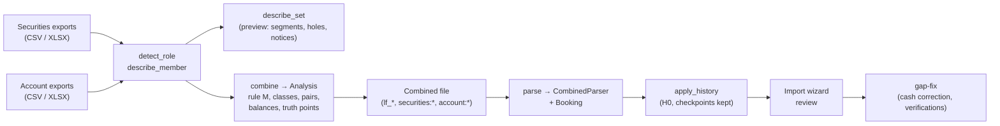
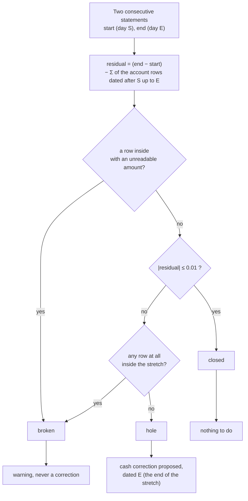

# 🏦 Crédit Agricole Importer

`broker_credit_agricole` imports the two Italian exports of Crédit Agricole as one **report set**
(version **2.0.0**):

- the securities movements, *Lista Movimenti Deposito Titoli* (role `securities`);
- the account movements, *Lista Movimenti Conto* (role `account`).

Each export is a CSV or an XLSX, and each may be downloaded several times. The plugin lives in
`backend/app/services/brim_providers/broker_credit_agricole/` and is the **second** report-set plugin after
[Danske Bank](danske_bank.md). It shares its core with Danske
([`brim_report_set_core.py`](../../architecture/patterns/brim_plugin_guide.md#report-set-core)) and keeps
the richest wizard integration of the family — a causale registry, evidence tables, blocking and
splitting field todos — which the
[BRIM Plugin Guide](../../architecture/patterns/brim_plugin_guide.md#talking-to-the-import-wizard) uses as
its reference.

This page covers what is specific to Crédit Agricole. The user's view is
[Crédit Agricole](../../../user/transactions/import/credit_agricole.md), where the plugin's `docs_url`
points.

!!! info "Why a set"

    The two exports show the same facts twice: a coupon, a purchase, a fund redemption or a maturity is a
    row in each. Read apart (what versions up to 1.5.0 did) every such fact is counted twice, and the
    securities export, which has no cash of its own, needed an automatic counter-entry for each row.
    From 2.0.0 the set is paired row by row and one transaction is imported per fact, with the cash the
    account states.

---

## 🗺️ The flow



`combine` is a pure function of the files (`Analysis` in `_report_set.py`, written out by `TableBuilder` in
`_combined.py`). `parse` reads **only** the combined file (`CombinedParser`, then `Booking` in
`_booking.py`). The files of the plugin:

| Module | Content |
|---|---|
| `plugin.py` | The contract: roles, `detect_role`, `describe_member`, `describe_set`, `combine`, `parse` |
| `_rows.py` | Reading the exports as rows and the XLSX header (*testata*) |
| `_classify.py` | The causale registry and the pure functions that name a row (unchanged since 1.5.0) |
| `_report_set.py` | The analysis: rule M, classes, pairs, balances, truth points, `describe_member`, `describe_set` |
| `_combined.py` | The combined file (`TableBuilder`) and its parse (`CombinedParser`) |
| `_booking.py` | From one line of the combined file to transactions, todos and notices |

---

## 🗂️ Roles, formats and detection

| Role | Export | Dated by | Settled on | Extensions | Can be several files |
|---|---|---|---|---|---|
| `securities` | *Lista Movimenti Deposito Titoli* (**Portafoglio → Lista Movimenti**) | `Data operazione` | `Data valuta` | `.csv`, `.xlsx` | yes |
| `account` | *Lista Movimenti Conto* (**Conti → Lista movimenti**) | `Data Op.` | `Data Val.` | `.csv`, `.xlsx` | yes |

Both roles are required. The `account` role declares `must_cover="securities"` (the preview warns when
the account starts after the securities period or ends before it) and `max_history="P2Y"`, the two years
the bank allows for it.

- **Detection** (`detect_role` in `_rows.py`): a `.csv` or `.xlsx` whose first 60 rows contain the
  securities header (`Data operazione` + `Causale` + `Quantità`) is `securities`; the account header
  (`Data Op.` + `Descrizione` + `Importo`) makes it `account`. A file that has a column `lf_row_kind` is a
  combined file of this plugin and has **no** role. Anything else has none.
- **`can_parse`** is true for a member (so that the wizard can say which export is missing) and for a
  combined file.
- **Columns** are mapped by label (`build_col_index`), so the XLSX preamble and extra leading columns do
  not matter. The securities amount column is `Controvalore in Euro` (or `Ctv in Eur`).
- **Rows that are not rows**: blank rows, the recap footer (a row without a date whose label starts with
  `TOTALE`, `RIEPILOGO` or `SALDO FINALE`), a row without a date or a causale, and account rows whose amount
  is zero. An account amount that cannot be read as a number is kept as class `invalid`.
- **Numbers.** `Prezzo`, `Controvalore`, `Importo` and the figures inside descriptions (`NOMINALE:`,
  `RITENUTA:`) are Italian-formatted; `Quantità` is plain (dotted decimals for fund units, integers for
  bond nominals).
- **Currency.** Account rows take `Divisa`, EUR when empty. Securities rows take the first three-letter
  code among the columns whose header contains `Divisa`. `Cambio` is never read.

### 🧾 The header of the XLSX (*testata*) {: #testata }

Only the XLSX has a header above the table, and **only the XLSX of the account carries the balances**:

| Label | Meaning |
|---|---|
| `Saldo Iniziale` | The balance at the end of the **eve** of `Data dal` |
| `Saldo Finale` | The balance at the end of `Data al` |
| `Data dal`, `Data al` | The period the export was asked for (can be wider than its rows: the bank cuts old rows) |

Both balances are on the **operation-date axis** and are the only true cash numbers the bank gives. The
reader accepts the label and its value in one cell (`Saldo Iniziale 1000,00 EUR`) or in two neighbouring
cells. The securities XLSX header holds the dossier and the supporting account (`Dossier n.`,
`C/C di appoggio`), the cash (`Liquidità`) and its date (`Data Aggiornamento`). The dossier and the account
numbers are used for one thing — an opaque fingerprint compared in memory — and are never copied into any
output, the combined file included.

A five-digit year (`25/07/02026`) is read in the header only, never in a row.

---

## 📚 Several downloads of one export: rule M {: #rule-m }

The same role may come in several files (blocks of a long period, the CSV and the XLSX of the same
export, an export asked again). `RoleMerge` of the shared core joins them **day by day**, with the Crédit
Agricole policy `owner="most_rows"`, `contradiction="not_contained"`:

1. Two copies of the same bank row have the same `signature` (CSV and XLSX included), and **identical rows
   count once**.
2. For a day covered by several files, the **file with the most rows that day** owns it (ties go to the
   file that ends last). A bank can cut an export short, never add a row.
3. The rows of a file that does not own the day are dropped silently when they are the same rows as the
   owner's, and otherwise become `excluded` with the reason `superseded`.
4. A day is a **contradiction** (`overlap_mismatch` in `describe_set`) only when a file has a row that the
   owner does **not** have (`not_contained`). A file cut halfway through the day, whose rows are all in the
   owner, is not a contradiction.

The coverage used by rule M is the days of the **rows** of each file. The period a header declares is
used elsewhere, for the cash coverage of the account (below).

---

## 🏷️ Row classes

`classify_securities` and `classify_account` (in `_report_set.py`) give every row a class; the class
decides what it can be paired with.

| Securities causale | Class | Carries cash |
|---|---|---|
| `CEDOLA` | `coupon` | yes |
| `ACQ.CONT.SU MERC.`, `SICAV: SOTTOSCR` | `buy` | yes |
| `FONDI: RIMBORSO` | `redeem` | yes |
| `TITOLI SCADUTI` | `matured` | yes |
| `GIRO ALTRO DOSSIER`, `VERS.TITOLI` | `transfer_in` | no |
| anything else | `unknown` | — |

| Account row | Class |
|---|---|
| amount that cannot be read | `invalid` |
| `TITOLI SCADUTI O ESTRATTI`, positive | `maturity` |
| `COMPRAVENDITA TITOLI/FONDI/OPZIONI`, direction found from the description | `trade_buy` (negative amount) or `trade_sell` |
| the same causale, direction not found | `trade_unknown` |
| `GIROCONTO/BONIFICO`, positive, that is a fund redemption | `redemption` |
| `CEDOLE, DIVIDENDI, PREMI ESTRATTI`, positive, with the word `DIVIDEND` and a named security | `dividend` |
| the same causale otherwise | `coupon` |
| anything else | `standalone` |

A `dividend` is never paired: it must not be matched with a bond coupon of the securities export that
happens to have the same amount and value date.

---

## 🔗 Pairing securities and account rows {: #pairing }

A securities row and an account row are the **same fact** when they have:

- the same **kind of fact** (`coupon`, `buy` ↔ `trade_buy`, `redeem` ↔ `redemption`, `matured` ↔
  `maturity`);
- the same **amount to the cent**, rounded half-up on both sides (`1000,005` = `1000,01`; known limit:
  `1000,015` ≠ `1000,01`);
- the **same value date** (`Data valuta` against `Data Val.`);
- the same currency.

The operation date is **not** in the key: the securities row and the account row of one fact often have
different operation dates (an order on the 17th, the debit on the 25th). A row without a value date, an
amount or a pairing class takes part in no pair.

Rows that share a key are paired by `core.assign`:

- one against one is a pair;
- identical twins (the same signature) pair without ambiguity, in file order;
- larger groups pair when one assignment wins on the names (one name is a prefix of the other: the bank
  truncates labels); the assignments are compared by **what each pair would import** (ISIN, withholding,
  name on the account side), and candidates that would import different things are **ambiguous** — every
  row of the group is left out of the pairs and flagged `ambiguous`;
- more than 8 candidates on a side are ambiguous without trying.

Nothing is guessed. A pair whose names are not compatible still pairs (the key is unique) and raises a
`name_mismatch` notice.

---

## 🧭 Outcomes and zones {: #outcomes }

Every row gets exactly one outcome (`pair`, `standalone` or `excluded`), a zone and, when it is not a plain
pair, a reason.

**Zones** are on the operation-date axis of the account and exist only when the set states a balance that
opens the history: `before` (up to the opening balance's day), `gap` (inside a [hole](#balances)) and
`window` (everything else). A set with no usable balance has no zone (empty `lf_zone`). A pair takes the
zone of its **account** row.

| Row | Outcome | Reason |
|---|---|---|
| Securities + account, paired | `pair` | — |
| Securities `transfer_in` | `standalone` | — |
| Securities with cash, **both** dates (operation and value) inside one hole | `standalone` | `in_gap` |
| Securities with cash, several account candidates and no certainty | `excluded` | `ambiguous` |
| Securities with cash, no account file at all | `excluded` | `outside_cash_coverage` |
| Securities with cash, settling after the last day the account covers | `excluded` | `not_yet_settled` |
| Securities with cash, settling on a day no account file covers | `excluded` | `outside_cash_coverage` |
| Securities with cash, the account covers its day and has no matching row | `excluded` | `no_counterpart` |
| Securities, causale not in the table | `excluded` | `unknown_type` |
| Account row, amount unreadable | `excluded` | `invalid` |
| Account row, several securities candidates and no certainty | `standalone` | `ambiguous` |
| Account coupon, dividend, redemption, maturity or ordinary row with no securities row | `standalone` | — |
| Account `COMPRAVENDITA` with no securities row | `standalone` | `no_counterpart` |
| A row of a file that lost rule M for that day | `excluded` | `superseded` |

The rule behind the asymmetry: **an account row is cash the bank really moved**, so it is never dropped
for lack of a pair — only for being unreadable. A securities row with cash and no counterpart cannot be
imported alone without counting the money twice or leaving it without cash, so it is left out and said so.

The **cash coverage** of the account (`cash_spans`) is the union of the periods the account files cover:
a file whose balances add up (`opening + Σ rows = closing`, to the cent) covers the period its header
declares (it may hold no row on the last day); any other file covers the days from its first to its last
row. The day compared is the securities **value** date against the account's operation-date days, so it
can be wrong by a day at the borders.

---

## ⚖️ Balances, intervals and holes {: #balances }

The account XLSX states two balances per file. Taken together, in date order, they cut the timeline in
**intervals**; each is classified by `explained_by_rows` (a pure function):



| Interval | Meaning | Effect |
|---|---|---|
| `closed` | The rows between the two balances explain the change (within a cent) | none |
| `hole` | The change is **not** explained and **no row at all** lies in the stretch: no file covers it, so the difference is money the files do not show | a cash correction, proposed by the gap-fix, dated at the end of the stretch; warning `account_gap` |
| `broken` | The change is not explained **but rows are there** (or a row cannot be summed): the files say something that does not add up | warning `balance_chain_broken`; never a correction |

Only a `hole` becomes a correction because a correction placed on a covered stretch could hide a row that
is missing inside it. Example with invented numbers: the balance is 1,000.00 on 30 June and 900.00 on 31
July and no row falls in July — a hole of −100.00, corrected at 31 July with a true cash of 900.00. If a
file with the July rows arrives, the interval becomes `closed` and the correction disappears by itself.

A few details:

- Two statements on the same day (the `Saldo Finale` of a file and the `Saldo Iniziale` of the next, one day
  later) must agree within a cent; if not, the day is conflicting and the chain is reported as broken.
- The **opening** is the earliest `Saldo Iniziale` (by date) whose interval is `closed` or `hole`. If the
  first interval is `broken` — for instance a lone file whose bank cut the old rows — there is no
  opening and that balance is only a verification.
- After the opening, a `broken` interval keeps the opening and the holes already found, and adds its
  warning. A hole *after* a broken one is reported (`account_gap` with `corrected: false`) and its end
  balance is compared, never corrected: the difference is no longer the hole's alone.
- A set whose files state no balance (CSV only) has no opening and no hole, and the set notice `no_balance`
  says the cash is not compared with the bank.

---

## 📍 Truth points {: #truth-points }

`Analysis` turns the statements into the truth points the gap-fix compares with LibreFolio:

| Truth | Where it comes from | Becomes |
|---|---|---|
| **Opening** | The opening statement | a checkpoint (`opening`), with the cash and the opening positions |
| **End of a hole** | The `Saldo Iniziale` that closes a corrected hole | a checkpoint (`gap`), cash only |
| **Verification** | Every `Saldo Finale`; a `Saldo Iniziale` that could not open or that closes a hole not corrected; the `Liquidità` of the securities header at its `Data Aggiornamento`, only when an account file covers that day | a verification: compared, **never corrected** |

The **opening positions** are the quantity of each title that the transfers from another dossier prove
(`exact:transfer_in`), brought to the opening day the way LibreFolio records it: the transfers up to the
day, plus the purchases and redemptions of the pairs recorded by then. A title with a maturity among its
pairs has no proof (the file says quantity 0). Until the optional `portfolio` role exists they are the
same rows that are imported, so they are a check on a re-import rather than independent evidence.

### ✈️ Cash in flight {: #in-flight }

A pair is **recorded** by LibreFolio with the operation date of the **securities** row and **booked** by the
bank with the operation date of the **account** row. At the end of a day `D` the ledger holds the pair when
`securities date ≤ D`, the bank when `account date ≤ D`. A truth point is therefore stated in the terms of
the ledger:

```text
cash(D) = bank balance(D)
          + Σ amount of the pairs in the ledger and not yet in the bank   (order on the 17th, debit on the 25th, balance of the 20th)
          − Σ amount of the pairs in the bank and not yet in the ledger   (account row before the securities row)
```

The symmetric case exists in the real data (the account row one or two days before the securities row).
`CashTruth.amount = stated + in_flight`.

---

## 📄 The combined file {: #combined-file }

`combine` writes one line per fact (a pair is one line with both halves) plus the truth lines, sorted by
operation date (a pair by the securities date) and then the truth lines of that day. Cells are the file's
own, but **rewritten to a form the parse can read back**: dates as `dd/mm/yyyy`, amounts in the Italian form
(`1234,56`), quantities with a dot (`1867.178`), even when the XLSX cell was numeric or a date.

Columns, in order: `lf_row_kind`, `lf_zone`, `lf_reason`, `lf_checkpoint`, `lf_source`, `lf_match_key`,
`lf_value`, `lf_currency`, `lf_proof`, then `securities:<column>` for each securities column
(`Data operazione`, `Data valuta`, `Nome`, `Causale`, `Prezzo`, `Quantità`, `Controvalore`, `Divisa`) and
`account:<column>` for each account column (`Data Op.`, `Data Val.`, `Causale`, `Descrizione`, `Importo`,
`Divisa`).

| `lf_row_kind` | When | Notes |
|---|---|---|
| `pair` | securities + account, paired | `lf_zone` is the zone of the account row; `lf_match_key` is `value date\|amount\|currency` |
| `standalone` | an account row on its own; a transfer from another dossier; a securities row `in_gap` | `lf_reason`: `in_gap`, `no_counterpart` or `ambiguous` |
| `excluded` | an unpaired securities row, an unreadable row, a superseded row | `lf_reason`: `outside_cash_coverage`, `not_yet_settled`, `no_counterpart`, `ambiguous`, `unknown_type`, `invalid`, `superseded` |
| `truth_cash` | the opening (`lf_zone=before`) and the end of each corrected hole (`lf_zone=gap`) | `lf_checkpoint` is the day, `lf_value` the cash in the ledger's terms, `lf_source` e.g. `account#1:start` |
| `truth_position` | the opening positions | `lf_value` is the quantity, `lf_proof` is `exact:transfer_in` |
| `verification` | see [Truth points](#truth-points) | never a correction |

`lf_source` names the role and the line of the source, with the file number when the role has several files:
`securities:12`, `account#2:7`, `securities:12 + account#2:7` for a pair.

The `summary` of the table (kept in the file's sidecar and read by the wizard's analysis detail) holds the
rows per role, the outcomes, zones and reasons, the segments, the holes, the checkpoints, the verifications,
`balance_chain` (`ok`, `broken` or `none`) and the number of days with an `overlap_mismatch`.

The dossier and account numbers are never copied; the combined file gets a generated name, not an
original's.

---

## 🧾 What the parse writes {: #parse }

`parse(combined)` books each line; the arms are in `_booking.py`. **Every transaction is dated with the
operation date** — the securities `Data operazione` for a pair, `Data Op.` for an account row on its own —
**never with the value date** (the value date only pairs the rows). There is **no `auto_cash` leg anywhere**
in a combined file: the real cash is the account's.

| Line | Transactions |
|---|---|
| `pair`, coupon | `INTEREST`, quantity 0, on the asset named by the securities row; cash = the account amount **plus** the withholding when the account description spells it (`RITENUTA: 13,36`), and then a `TAX` of minus the withholding tagged `withholding_tax`. Tags `import`, `credit_agricole`; description `CEDOLA: <name>` |
| `pair`, purchase (`ACQ.CONT.SU MERC.`, `SICAV: SOTTOSCR`) | `BUY` of the securities quantity; cash = minus the absolute account amount; no `DEPOSIT` |
| `pair`, fund redemption | `SELL` of minus the securities quantity; cash = the account amount |
| `pair`, maturity (`TITOLI SCADUTI`) | The shared `model_bond_maturity` with the securities price and the position held by the other securities rows: a `SELL` at par and, when the amount exceeds par, an `INTEREST` tagged `maturity_premium`; the cash is the account's; a `derived_quantity` todo when the nominal is derived |
| `standalone`, securities `transfer_in` | `ADJUSTMENT`, cashless, with `cost_basis_override` (a bond's `Prezzo` / 100, otherwise `Prezzo`), description `[CAUSALE — successione / transfer-in] …`; one `ca_succession_transfer_in` info notice for all |
| `standalone`, securities `in_gap` | the same arm as a pair, with the cash of the `Controvalore` (coupon `+`, purchase `−`, redemption `+`) and no counter-leg |
| `standalone`, account | the account arm as it has been since 1.0 ([below](#account-arm)) |
| `excluded` | no transaction; one notice per reason with the rows as evidence |
| `truth_cash`, `truth_position`, `verification` | `checkpoints` and `verifications` of the output (`kind` is `opening` when `lf_zone` is `before`, else `gap`) |

An asset is a **fake id** keyed by the lower-cased security name (the securities export has no ISIN); the
ISIN that the account row of a pair names links to the same asset, so a coupon seen only on the account,
with that ISIN, uses the same id. The number of `INTEREST` of a set is the number of its coupons, never the
double.

`pre_checkpoint_policy` is `"import"`: the rows before the opening balance are positions (transfers) and
cash that belongs to the history, not cash to summarise, so a checkpoint absorbs nothing
(`absorbed.count == 0`, `opening_cash == []`). On a first import `apply_history` sets H0 to the date of the
oldest parsed transaction. The tag of the plugin (`history_tag`) is `credit_agricole`, the same as before
2.0.0, so H0 is computed on the rows already saved with it.

The warnings of a parse are in **Italian** (the language of the export); the notices of a set
(`describe_set`) are in English and localised by the wizard.

---

## 💳 Account rows on their own {: #account-arm }

The account arm (`Booking.book_account_row`) is the one the plugin has always had, run row by row over the
rows that are `standalone`. Transactions keep the bank's description verbatim (up to 500 characters;
maturities compose their own) and are tagged `import`, `credit_agricole` and the causale's slug
(`slug_causale`: `CEDOLE, DIVIDENDI, PREMI ESTRATTI` → `cedole_dividendi_premi_estratti`).

### 🗃️ The causale registry

`classify_account_row` returns `(type, cash, tier)`. Tiers 2 to 4 all book a `DEPOSIT` or a `WITHDRAWAL`
by sign — the cash is always right — and differ only in what the plugin declares about the row.

| Tier | Causali | Result |
|---|---|---|
| 1 typed | `COMMISS./SPESE SU OPERAZ. TITOLI`, `COMMISSIONI/SPESE`, and `INTERESSI/COMPETENZE` debits | `TAX` when the description contains `CAPITAL GAIN`, `D.LGS 461`, `461/97`, `IMPOSTA`, `BOLLO` or `RITENUTA`, else `FEE`; a positive amount is a refund → `DEPOSIT` |
| 1 typed | `CEDOLE, DIVIDENDI, PREMI ESTRATTI`, and `INTERESSI/COMPETENZE` credits | `DIVIDEND` when the description says `DIVIDEND` and carries an ISIN, else `INTEREST`; a negative amount is a clawback → `WITHDRAWAL` |
| 1 typed | `TITOLI SCADUTI O ESTRATTI` credits | see [Matured securities](#matured-securities) |
| 2 unresolved | `COMPRAVENDITA TITOLI/FONDI/OPZIONI` rows not booked as a trade; `GIROCONTO/BONIFICO` credits that are fund redemptions | by sign, plus a `ca_account_trade_unresolved` blocker |
| 3 declared cash | `PAGAMENTO TRAMITE POS`, `PAGAMENTO UTENZE`, `PRELIEVO SPORT. AUTOM. ALTRA BANCA`, `PRELIEVO NOSTRO SPORTELLO AUTOM.`, `ACCREDITO EMOLUMENTI`, `GIROCONTO/BONIFICO` | by sign, silently |
| 4 unknown | anything else | by sign, plus one `ca_unknown_causale` info notice for all such rows |

### 🔗 Linking rows to a security

- **Income** that names an ISIN (`[A-Z]{2}[A-Z0-9]{9}[0-9]`) is linked to an asset keyed `isin:<ISIN>`,
  named after the text before the ISIN, without a leading `CEDOLA` or `DIVIDENDO`.
- **Securities charges** that name an ISIN (`SPESE STACCO CEDOLA … TIT: <ISIN> <name> MOV:…`) get the same
  key, named after the text between the ISIN and `MOV:`. The bank prints that name in full while coupon
  lines cut it at 19 characters, so `asset_id_for` keeps the longer name when one is the other cut short
  (`is_truncation_of`).
- A `COMMISS./SPESE SU OPERAZ. TITOLI` fee or tax that names no ISIN gets a `ca_account_charge_unallocated`
  warning todo on `asset_id`, shown in the charges panel of the correction step: the user assigns it or
  keeps it on the account.
- **Withholding.** An income credit whose description spells `RITENUTA: <x>` is imported gross (the
  credited amount plus x), with a separate `TAX` of −x on the same asset (tag `withholding_tax`): the two
  sum back to the credited amount. A clawback is never grossed up. A coupon that is part of a pair gets the
  same treatment from `book_movement`.

### 🔁 Trades on the account

A `COMPRAVENDITA TITOLI/FONDI/OPZIONI` row carries the money, not the instrument or the quantity. With no
securities row to pair with, `try_account_trade` books a real `BUY` or `SELL` only when the file proves it:

1. **Direction** — buy words (`NOTA INF. ACQ`, `ACQUIST`, `SOTTOSC`…) or sell words (`NOTA INF. VEND`,
   `VENDIT`, `VEND.`, `DISINVEST`, `RIMBORS`), exactly one family, confirmed by the sign: a buy spends, a
   sale cashes in. Otherwise the reason is `no_keyword` or `sign_mismatch`.
2. **Name** — after `TIT:` (bonds) or after the order reference `ORD.:<ref>` (funds), cut before
   `DOSSIER:`, `RUB:`, `DATA:` or `MOV:`. Otherwise `no_name`.
3. **Quantity** — the `NOMINALE` stated by the coupons of that security among the account rows of the
   file, indexed by a prepass (`build_identity_indexes`) and matched by name prefix in either direction,
   on at least 6 characters. No such coupon → `no_quantity`; several securities → `ambiguous_name`;
   several nominals → `ambiguous_nominal`.

A resolved trade takes the nominal as its quantity, the coupon's ISIN as its asset key and the tag
`account_trade`. It always gets a `ca_account_trade_bundled_amount` warning todo on `cash` with
`split_hint: "trade_charges"`, because this layout never separates the price from the charges:
`compare_nominal` is set on buys only, and the `split_suggestions` name the securities charges booked
within ±3 days. A sale also gets `ca_account_trade_sell_quantity_presumed` on `quantity`, because the
coupon nominal is the whole position.

An unresolved row stays cash (tier 2) with a `ca_account_trade_unresolved` blocker on `asset_id`, whose
message and evidence comment depend on the reason (`trade_fallback_message`). It keeps the `split_hint`, so
the split zone opens as soon as the user types the row into a `BUY` or `SELL`. In a set, such a row has the
outcome `standalone` with the reason `no_counterpart`: no securities row was found for it, so the
trade is not known from the securities export either.

### 🏦 Fund redemptions paid by transfer

A fund pays a redemption by wire, so it arrives as a `GIROCONTO/BONIFICO` credit, like a salary.
`sct_fund_redemption_name` calls it a redemption only when three signals agree:

1. the ordering party (`ORD:<party> DT.ORD:`) has at least 8 letters and digits;
2. the operation text after it contains `RIMBORS`, `DISINVEST` or `LIQUIDAZ`;
3. the party is named again inside that text — compared on letters and digits only, so a name wrapped
   across the column width (`AMUNDI PRIMO INVES TIMENTO`) still matches.

The third signal keeps a tax refund (`RIMBORSO IRPEF`) or a utility refund out. In a set such a credit is
class `redemption` and pairs with the `FONDI: RIMBORSO` row of the securities export. Alone, it becomes a
tier-2 `DEPOSIT` whose blocker has the reason `fund_redemption`: the user turns it into a `SELL` and enters
the units, which the file does not state.

### 🪦 Matured securities {: #matured-securities }

An account row `TITOLI SCADUTI O ESTRATTI` reads `RIMB.TIT. <name> (<code>)`. When it has no securities
row, the digits of `<code>` are matched against the ISIN digits of the coupons paid **the same day** that
state a `NOMINALE`:

- **found** → `model_bond_maturity(ctv, held_qty=nominal)`: a `SELL` of the nominal at par (tag
  `account_maturity`) and an `INTEREST` for the surplus (tag `maturity_premium`), on the `isin:<ISIN>`
  asset;
- **not found** → a `ca_account_maturity_unlinked` warning, and the whole amount as one `SELL` at par 100
  (nominal = cash) on an asset keyed `maturity:<code or name>` — never a `DEPOSIT`, so the proceeds close a
  position instead of inflating paid-in capital.

A paired maturity ([above](#parse)) uses the securities row instead. Both arms call
`attach_maturity_notices`, which puts the amber maturity banner on the asset-create modal.

---

## 🔔 Notices and todos

| Code | Channel | Severity | Raised when |
|---|---|---|---|
| `excluded_<reason>` | notice | warning (`info` for `not_yet_settled` and `superseded`) | rows left out of the set: one notice per reason, the rows as evidence (reasons in the [outcomes table](#outcomes)) |
| `name_mismatch` | notice | warning | a pair whose two names are not compatible |
| `ca_securities_unknown_causale` | notice | warning | a securities causale is not in the table (reason `unknown_type`) |
| `ca_account_invalid_amount` | notice | warning | an account amount cannot be read (row skipped) |
| `ca_succession_transfer_in` | notice | info | transfers from another dossier (one notice for all) |
| `ca_account_maturity_unlinked` | notice | warning | an account maturity has no same-day coupon nominal |
| `ca_unknown_causale` | notice | info | tier-4 rows (one notice for all) |
| `ca_securities_empty` | notice | warning | the parse produced no transaction and no other notice |
| `derived_quantity` | todo on `quantity` | warning | a maturity nominal was derived from `Controvalore` / `Prezzo` |
| `ca_account_trade_unresolved` | todo on `asset_id` | blocker | every tier-2 row |
| `ca_account_trade_bundled_amount` | todo on `cash` | warning | every resolved account trade (`split_hint`) |
| `ca_account_trade_sell_quantity_presumed` | todo on `quantity` | warning | every resolved account sale |
| `ca_account_charge_unallocated` | todo on `asset_id` | warning | a securities charge names no ISIN |

`ca_securities_unknown_causale`, `ca_account_invalid_amount` and `ca_unknown_causale` carry
`context.report_issue`, so the wizard shows the link *open an issue on GitHub* under them: they are rows the
importer does not know or cannot read ([Rows left out](architecture.md#brim-row-skips)).

The notices of the **set** (`describe_set`, English, localised by the wizard as
`importWizard.reportSet.warning.<code>`):

| Code | Raised when |
|---|---|
| `empty_member` | an export has no rows |
| `overlap_mismatch` | two downloads of one role contradict each other on a day ([rule M](#rule-m)) |
| `account_gap` | a [hole](#balances); `corrected` says whether a cash correction is proposed |
| `balance_chain_broken` | a `broken` interval or two statements of one day that disagree |
| `ambiguous` | rows that could not be paired with certainty (`context.rows`) |
| `no_counterpart` | rows with no matching row in the other export (`context.rows`) |
| `no_balance` | an account export is there and none states a balance (info) |

The `segments` of the set shape are the periods the securities exports cover; its `gaps` are the days of
the holes.

---

## 🔖 Versions

| Version | What changed |
|---|---|
| 1.0 – 1.5.0 | **Single-file plugin.** Each export was imported on its own. The securities export booked, for every buy, sale, coupon or premium, an automatic counter-entry (`auto_cash`) because it has no cash; the account export booked the real cash. Read together the two exports counted each fact twice |
| **2.0.0** | **Report-set plugin.** Both exports are uploaded together; one transaction per fact with the cash of the account; no `auto_cash` leg; the balances of the XLSX open the cash and a hole becomes a proposed correction. A file read alone raises `BRIMSetRequiredError` (HTTP 422 `set_required`), naming the missing role |

The tag `credit_agricole` is unchanged. There is no warning and no clean-up for transactions already
imported with 1.x (developer decision, 25/10/2026).

---

## 🧪 Samples and tests

- `backend/app/services/brim_providers/sample_reports/` holds the synthetic members of two sets, declared in
  `test_sample_sets`:
    - `credit_agricole-securities.csv` + `credit_agricole-account.xlsx`: a closed month with every kind of
      fact (a coupon with withholding, a purchase, a placement, a fund redemption, a maturity, a transfer
      in) and a securities row with no counterpart;
    - `credit_agricole-gap-securities.xlsx` + `credit_agricole-gap-account-1.xlsx` +
      `credit_agricole-gap-account-2.xlsx`: two account exports with a month in between, which is a hole.
- `backend/test_scripts/test_external/test_brim_credit_agricole.py` (`./dev.py test external
  brim-credit-agricole`) pins the plugin's rules, with files written under a temporary folder: reading,
  detection, rule M, classes, pairing, balances and holes, in-flight cash, zones, `describe_set`, then the
  combined file and its parse.
- The generic suite of report-set plugins (`./dev.py test external brim-providers`) combines every
  declared set and parses the combined file; a member alone must raise `BRIMSetRequiredError`.

## 🔗 Related

- [Crédit Agricole — user guide](../../../user/transactions/import/credit_agricole.md)
- [BRIM Plugin Guide → Multi-report plugins](../../architecture/patterns/brim_plugin_guide.md#report-sets)
- [Danske Bank Importer](danske_bank.md)
- [BRIM Architecture](architecture.md)
- [BRIM Providers List](providers_list.md)
