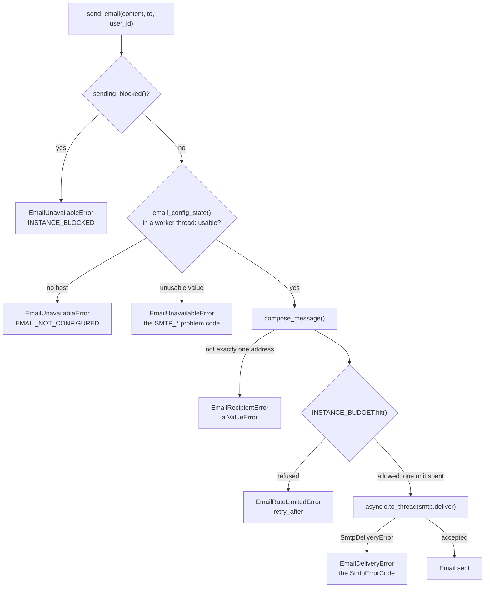

# 📧 Email Service (SMTP)

The email service sends LibreFolio's transactional emails through an SMTP server that the administrator names in
environment variables. It can write six kinds — a password-reset link, an invitation, an address to confirm, the
activation link of the first administrator, a test message, and the notice that an account's email address changed.
The service lives in `backend/app/services/email/`, its configuration in `backend/app/config/email.py`, and its
hourly budget counts with the sliding-window limiter of `backend/app/utils/runtime/rate_window.py`. Its routes
(`backend/app/api/v1/email.py`) give administrators the state of email, a test email and the emailing of the links
they create; one more lets anyone ask for a reset link for a forgotten password; two more spend
the link of a verification email and send it again. The Email tab of the settings
(`frontend/src/lib/features/email/`) shows the state and sends the test email; the same folder holds the page of a
verification link and the sign-in's notice, «Send by email» and the «forgot password» form. The administrator's
guide is [Email](../../admin/email.md).

!!! note "Status: lots E1 to E5 of release 1.3"

    Every email has a caller: the test email ([`POST /api/v1/email/test`](#api-test)), the links an
    administrator emails ([`POST /api/v1/email/links`](#api-links)), a reset link for a forgotten password
    ([`POST /api/v1/email/password-reset`](#api-password-reset)), the verification email of a new account
    ([Email Verification](#verification)), the [notice of an email change](#flow-email-changed), and the setup
    link of the initial administrator: workstream A's `deliver_setup_link()`
    (`backend/app/services/accounts/bootstrap_admin_service.py`, lot A7a) sends `build_admin_setup()` for a link
    the instance generated itself.

---

## 🎯 Purpose and Rules {: #purpose-and-rules }

Email is optional (feature F04 of the release 1.3 plan). Four rules shape the whole package:

1. **Optional.** With `LIBREFOLIO_SMTP_HOST` unset or blank, email is off and nothing changes for a self-hosted
   install: nothing is sent, the other `LIBREFOLIO_SMTP_*` variables are not even validated, and the configuration
   check reports `ok`. "Email off" is the default state, so a caller handles `EmailUnavailableError` as a normal
   outcome, not as a fault.
2. **Environment only.** The configuration comes only from the `LIBREFOLIO_SMTP_*` variables, and the password also
   from a secret file (`LIBREFOLIO_SMTP_PASSWORD_FILE`). It is never written anywhere, so it is never in the
   database and never in a backup; it is never shown in the interface either.
   [`GET /api/v1/email/status`](#api-status) answers with the state, the problem and the variable at fault, the
   checks' i18n keys and `detail`, the hourly budget and the state of the links: never the host, the port, the user,
   the sender, the Reply-To or the password. The `detail` of a check, the part meant for the interface, never holds
   the host, the user or the sender either. The public [`GET /api/v1/system/instance`](#instance-email) says only
   whether email is usable and whether emails can carry links.
3. **Read at every call.** The accessors read the process environment each time, nothing is cached, and they are
   the only readers of these variables, as the [config package rule](../architecture/settings.md) requires. The
   variables are documented, commented, in the «Email» section of `.env.example`.
4. **Links from `LIBREFOLIO_PUBLIC_URL` alone** (developer decision 45). Every link an email carries, the ones an
   administrator sends included, is that variable followed by the path of the page that takes the token, never
   anything taken from a request ([Links](#links)). Without the variable, no email with a link goes out.

| Module | Role |
|--------|------|
| `backend/app/config/email.py` | The `LIBREFOLIO_SMTP_*` accessors and `EmailConfigError` |
| `services/email/smtp.py` | The transport: `deliver()`, `SmtpServer`, `SmtpErrorCode`, `SmtpDeliveryError` |
| `services/email/delivery.py` | `email_config_state()`, the hourly budget (`INSTANCE_BUDGET`, `budget_status()`), `send_email()`, the `EmailError` family, and `mailbox_budget_key()`, the key of the per-mailbox limits ([The Key of a Mailbox](#mailbox-key)) |
| `services/email/messages.py` and `templates/` | `EmailKind`, `email_language()`, the six builders and `compose_message()`; the texts in four languages and the HTML layout. Nothing here sends, reads the configuration or logs |
| `services/email/checks.py` | `check_smtp_configuration()`, `check_smtp_encryption()`, `check_email_links()`, `EMAIL_CONFIG_CHECKS`, which closes the platform's `CONFIG_CHECKS` |
| `services/email/links.py` | `links_state()`, `require_links()`, `email_link()`, `email_instance_config()` and `EmailLinksUnavailableError`: every emailed link from `LIBREFOLIO_PUBLIC_URL` ([Links](#links)) |
| `services/email/flows.py` | What an action of the application sends, to whom and in which language: the test email, a link an administrator emails, a forgotten password and its limits, the notice of an email change ([Flows](#flows)); `require_email()` and `link_ttl()`, which `verification.py` reuses |
| `services/email/verification.py` | Email verification at sign-up (developer decision 44): the wait, the emailed link, its confirmation, «send the link again», and the place a waiting account holds ([Email Verification](#verification)) |
| `backend/app/api/v1/email.py` and `backend/app/schemas/email.py` | `GET /email/status`, `POST /email/test` and `POST /email/links` for administrators, `POST /email/password-reset`, `POST /email/verification/confirm` and `POST /email/verification/resend` for anyone, and their models ([The API](#api)); `EmailInstanceConfig`, the `email` field of `GET /system/instance` |
| `backend/app/utils/runtime/rate_window.py` | `SlidingWindowLimiter` and `RateDecision`, the [sliding-window limiter](#rate-window) |
| `frontend/src/lib/features/email/` and `frontend/src/lib/i18n/email/` | The Email tab of the settings, its seam over the API client, the check of the links' base from the browser, and its texts ([The Email Tab](#email-tab)); the frontend of email verification ([In the Frontend](#verification-frontend)); «Send by email» and the «forgot password» form ([Links by Email in the Interface](#link-actions)) |
| `frontend/src/routes/verify-email/+page.svelte` | The page of a verification link ([In the Frontend](#verification-frontend)) |

`services/email/__init__.py` holds only the package docstring.

---

## ⚙️ Configuration {: #configuration }

### 📋 The Variables

| Variable | Unset or blank | Accepted | Code when unusable |
|----------|----------------|----------|--------------------|
| `LIBREFOLIO_SMTP_HOST` | Email off | A host name or an IP address, IPv6 without brackets: letters, digits, `.`, `-`, `_` and `:`; no scheme, user, port, path, bracket or space | `SMTP_HOST_INVALID` |
| `LIBREFOLIO_SMTP_TLS` | `starttls` | `starttls`, `tls` or `none`, in any case | `SMTP_TLS_INVALID` |
| `LIBREFOLIO_SMTP_PORT` | The port of the mode: 587 (`starttls`), 465 (`tls`), 25 (`none`) | ASCII digits, 1–65535 | `SMTP_PORT_INVALID` |
| `LIBREFOLIO_SMTP_USER` | No authentication | Any text, stripped | `SMTP_CREDENTIALS_INCOMPLETE` without a password |
| `LIBREFOLIO_SMTP_PASSWORD`, or `LIBREFOLIO_SMTP_PASSWORD_FILE` | No password | `env_secret("LIBREFOLIO_SMTP_PASSWORD")`: the value as written, otherwise the content of the file | `SMTP_PASSWORD_UNREADABLE` (a `_FILE` that cannot give it); `SMTP_CREDENTIALS_INCOMPLETE` without a user |
| `LIBREFOLIO_SMTP_FROM` | Required with a host | One mailbox: `Name <address>` or `address` | `SMTP_FROM_MISSING`, `SMTP_FROM_INVALID` |
| `LIBREFOLIO_SMTP_REPLY_TO` | Replies go to the sender | One mailbox | `SMTP_REPLY_TO_INVALID` |
| `LIBREFOLIO_SMTP_MAX_PER_HOUR` | 50 | ASCII digits, at least 1 | `SMTP_MAX_PER_HOUR_INVALID` |

- **Blank is unset**, and values are stripped — except the password, which `env_secret()` takes as written, spaces
  included ([Secrets from Files](../architecture/security.md#secrets-from-files)).
- **The modes**: `starttls` upgrades a plain connection before anything else is sent and refuses to go on without
  the upgrade; `tls` is TLS from the first byte (SMTPS); `none` sends in clear, meant for a relay on the same machine
  or the local network (the [encryption check](#configuration-checks) warns otherwise).
- **ASCII digits** is literal: a sign, a decimal, `2_525` or fullwidth digits, all of which `int()` would take, are
  refused.
- **A mailbox** is exactly one address, with a non-empty local part and domain and no whitespace inside; a comma
  inside a quoted display name belongs to the name. A CR or LF anywhere in the raw value is refused, even where
  stripping would remove it: no header injection reaches a message.
- **The `:` of the host** is there for IPv6 literals, written without brackets (`::1`, `fd00::25`); `[::1]` is
  refused. A value with exactly one colon, such as `smtp.example.com:587`, is a name with its port and is refused
  too, with a message saying that the port goes in `LIBREFOLIO_SMTP_PORT`: an IPv6 address always has at least two
  colons.

### 🧾 `EmailConfigError`

`EmailConfigError` is a `ValueError` with two attributes, `variable` and `code`. Its message is
`<VARIABLE>: <rule>`, for example `LIBREFOLIO_SMTP_PORT: expected a whole number from 1 to 65535`: it never holds
the value of a variable, so never a secret. The accessors raise it for the six `*_INVALID` codes. The other three
codes combine several variables, so `email_config_state()` decides them: `SMTP_PASSWORD_UNREADABLE`,
`SMTP_CREDENTIALS_INCOMPLETE` and `SMTP_FROM_MISSING`.

### 🔌 Email Off, Usable or Unusable {: #config-state }

`email_config_state()` (in `delivery.py`) reads every variable through its accessor and **never raises**. It
returns a frozen `EmailConfigState`:

| State | `configured` | `problem`, `variable` | `server`, `sender`, `reply_to`, `max_per_hour` | `usable` |
|-------|--------------|-----------------------|-----------------------------------------------|----------|
| Off: no host | `False` | `None` | Unset; `max_per_hour` 50 | `False` |
| Unusable | `True` | The code and the variable at fault | Unset; `max_per_hour` 50 | `False` |
| Usable | `True` | `None` | The `SmtpServer`, the two mailboxes as `(display name, address)`, the hourly limit | `True` |

The first fault wins, in this order: the host; then the TLS mode, the port, the user, the password, the sender, the
Reply-To and the hourly limit (an `EmailConfigError`, or a `SecretFileError` reported as `SMTP_PASSWORD_UNREADABLE`
on `LIBREFOLIO_SMTP_PASSWORD_FILE`); then the credentials, which come in pairs (`SMTP_CREDENTIALS_INCOMPLETE` on
whichever of `LIBREFOLIO_SMTP_USER` and `LIBREFOLIO_SMTP_PASSWORD` is set without the other); then the sender
(`SMTP_FROM_MISSING`).

An unusable value **turns email off**: `send_email()` raises `EmailUnavailableError` with the problem code, and
the check `email.smtp` reports an `error`. The fault is logged **once per process**: `_report_invalid()` is a
`functools.cache` keyed by `variable`, `problem` and `reason`, so the event
`Email configuration cannot be used: email stays off`, with those three fields, appears the first time a fault is
read, not at every send. A different reason is new information and is logged again, such as a password file that
was missing and is now empty. The `reason` is the accessor's message or the `SecretFileError` message, which names
the variable and the path of the file, never its content: no secret reaches the log.

The server starts either way. The startup audit reads the configuration at every start of every process, through
the [configuration checks](#configuration-checks): an unusable value is logged there, first by
`_report_invalid()`, then as the `email.smtp` error of the audit. Later reads in the process log it again only for a
new reason. `log_configuration_audit()` never stops a start for email, only for the platform's own secrets and
settings ([Configuration Checks](../architecture/security.md#configuration-checks)).

---

## 📡 Transport (`smtp.py`) {: #transport }

`deliver(server, message)` sends one `EmailMessage` through one `SmtpServer` with the standard library's
`smtplib`: no third-party SMTP client. It **blocks**, so it runs in a worker thread: `send_email()` calls it
through `asyncio.to_thread()`, as the [Event Loop Blocking Rule](../architecture/patterns/async.md) requires, and a
test checks that the connection is opened on a thread without a running event loop.

`SmtpServer` is a frozen dataclass: `host`, `port`, `tls` (`starttls`, `tls` or `none`), `user`, `password` (kept
out of `repr`) and `timeout`. `email_config_state()` builds it with `SMTP_TIMEOUT_SECONDS`, **20 s**, read at call
time. It is the socket timeout to connect and for each exchange with the server, not a deadline for the whole
conversation.

The conversation:

1. **Connect**: `smtplib.SMTP_SSL` in `tls` mode, `smtplib.SMTP` otherwise; then `EHLO`.
2. **`starttls` mode**: `STARTTLS`, then `EHLO` again. A server that does not offer STARTTLS is refused with
   `TLS_FAILED` before the password or the message is sent: the mode never falls back to plain text.
3. **Authentication**, only with a user: `login()`.
4. **The message**: `send_message()`; the envelope sender is the From address, the recipient the To address.
5. **`QUIT`**. Once the server has accepted the message, a failure here — a `QUIT` answered badly, a dropped
   connection — is not a failure of the delivery: the email counts as sent.

Both TLS modes use `ssl.create_default_context()`, which **verifies** the certificate and the host name.
`smtplib`'s own default for `starttls()` and `SMTP_SSL` is an unverified context (`ssl._create_stdlib_context()`),
which is why `deliver()` always passes its own.

A failure raises `SmtpDeliveryError` with a code from `SmtpErrorCode`, a `StrEnum` whose values are the names:

| Code | When |
|------|------|
| `CONNECTION_FAILED` | The connection could not be opened or was lost: nothing listening, a name that does not resolve, a refused greeting, a network error outside the TLS step |
| `TLS_FAILED` | STARTTLS not offered or refused, a failed handshake, a certificate that does not verify (`ssl.SSLError` at any step) |
| `AUTH_FAILED` | The credentials were refused, or another SMTP error ended the login step (a server without `AUTH`, for one) |
| `SENDER_REFUSED` | `MAIL FROM` refused |
| `RECIPIENT_REFUSED` | `RCPT TO` refused |
| `TIMEOUT` | A `TimeoutError` anywhere in the exception chain: `smtplib` turns a read that timed out into `SMTPServerDisconnected` |
| `SEND_FAILED` | `DATA` refused, or another protocol error while sending; also an address with letters outside ASCII towards a server that does not advertise `SMTPUTF8`, which `smtplib` refuses on the client side (`SMTPNotSupportedError`, before `MAIL`). With `SMTPUTF8` advertised, `smtplib` sends `MAIL FROM:<…> SMTPUTF8 BODY=8BITMIME` and the message in UTF-8; for ASCII addresses it adds neither |

`str()` of the error is the code alone, for the interface. `detail` holds what the server said (such as
`550 5.1.1 <alice@example.com>: Recipient address rejected`), or the exception's text, **raw**: the transport adds no
password and masks nothing. It leaves the process only through the `Email not sent` log, which masks it
([What Is Logged](#logs)). The original exception is dropped (`raise … from None`).

---

## 📤 Delivery (`delivery.py`) {: #delivery }

### ⏳ The Hourly Budget {: #hourly-budget }

`INSTANCE_BUDGET` is a `SlidingWindowLimiter` over 3600 s (`BUDGET_WINDOW_SECONDS`) with a single key, shared by
every send of the process. `send_email()` hits it with `limit=` the configured `LIBREFOLIO_SMTP_MAX_PER_HOUR`,
read at call time; `budget_status(max_per_hour=None)` peeks it with the limit it is given (the status passes the one
of the state it has just read) or else the configured one, and returns its `RateDecision` (`allowed`, `remaining`,
`retry_after`) without spending anything, for [`GET /api/v1/email/status`](#api-status).

- **One unit per attempt.** An attempt that passes the configuration and recipient checks spends one unit before
  any connection, whether the server then accepts the message or not.
- **Refusal before any connection.** With the budget spent, `send_email()` raises `EmailRateLimitedError` without
  opening a connection; its `retry_after` is the number of seconds until the oldest send of the hour leaves the
  window. A refused attempt is not recorded, so it never pushes that moment further.

!!! warning "Per process, not per instance"

    The budget lives in the memory of each process: with N worker processes the instance may send N times
    `LIBREFOLIO_SMTP_MAX_PER_HOUR` emails an hour, and a restart starts from zero. `.env.example` says so: the limit
    is per server process. `GET /api/v1/email/status` shows the budget of the process that answers it.

### 📨 `send_email()` {: #send-email }

`async def send_email(content, *, to, user_id=None)` sends one `EmailContent` to one address. A blocked instance
sends nothing (decision D-E13): `sending_blocked()` is true while the hosting provider sets `LIBREFOLIO_BLOCKED`, and
also when that variable cannot be read, which the startup checks stop the server on. The `/api/v1` guard already
refuses the email routes on a blocked instance ([Instance Block](../architecture/security.md#instance-block)); the
check here holds for any other caller. Then `send_email()` reads the configuration with
`asyncio.to_thread(email_config_state)`: with `LIBREFOLIO_SMTP_PASSWORD_FILE` that read opens a file, and no file is
read on the event loop.



| Raised | `code` | When | Budget |
|--------|--------|------|--------|
| `EmailUnavailableError` | `INSTANCE_BLOCKED`, `EMAIL_NOT_CONFIGURED`, or the problem code of the configuration | A blocked instance, no host, or an unusable value | Not spent |
| `EmailRecipientError` (a `ValueError`) | — | `to` is not exactly one address | Not spent |
| `EmailRateLimitedError` | `EMAIL_RATE_LIMITED`; `retry_after` in seconds | The hourly budget is spent | Not spent; no connection |
| `EmailDeliveryError` | A `SmtpErrorCode` value | The server did not take the message | Spent |

The three `Email*Error` classes derive from `EmailError`, which carries `code`: a caller needs a single
`except EmailError`. `EmailRecipientError`, from `messages.py`, is not part of the family: it subclasses
`ValueError`, and a caller that maps it to an answer catches it by name, never as any `ValueError`.

### 📝 What Is Logged {: #logs }

| Event | Level | Fields |
|-------|-------|--------|
| `Email sent` | `info` | `kind`, `language`, `user_id`, `recipient_domain` |
| `Email not sent` | `warning` | `kind`, `code`, `detail` (masked), `user_id`, `recipient_domain` |
| `Email not sent: the hourly limit of the instance is reached` | `warning` | `kind`, `user_id`, `recipient_domain`, `retry_after` (rounded) |
| `Email configuration cannot be used: email stays off` | `error` | `variable`, `problem`, `reason`; once per process for each combination of the three |
| `Test email sent by an administrator` | `info` | `admin_id`, `language`: logged by [`POST /email/test`](#api-test) after `Email sent` |
| `Link emailed by an administrator` | `info` | `admin_id`, `purpose`, `token_id`, `user_id` (a reset link's account, `None` for an invitation), `language`: logged by [`send_link_email()`](#flow-link) after `Email sent` |
| `Forgotten password: reset link emailed` | `info` | `user_id`, `token_id`, `language`: logged by [`forgotten_password_work()`](#flow-forgot) after `Email sent` |
| `Forgotten password: no active account matches, nothing sent` | `info` | None: the identifier is never logged |
| `Forgotten password: the account had a reset link moments ago, nothing sent` | `info` | `user_id`: past a per-account limit |
| `Forgotten password: an administrator's reset link is still live, nothing sent` | `info` | `user_id`: a request never cancels an administrator's link |
| `Forgotten password: the hourly limit of the instance is reached, nothing sent` | `warning` | `user_id`: the budget, peeked again in the work |
| `Forgotten password: the mailbox had reset emails moments ago, nothing sent` | `info` | `user_id`: past the per-mailbox limit |
| `Forgotten password: another request won the race, nothing sent` | `info` | `user_id`: the recount inside the write transaction |
| `Forgotten password: no email sent` | `warning` | `reason` (the exception's class) and `code`: the configuration changed after the answer, or a refusal; a link created for it is revoked |
| `Forgotten password: the request failed` | `error` | `error`, the exception's class, and no traceback: a database error would print its SQL parameters, the identifier among them |
| `Email change notice sent to the previous address` | `info` | `user_id`, `language`: logged by [`email_changed_work()`](#flow-email-changed) after `Email sent` |
| `Email change notice: email is off, nothing sent` | `info` | `user_id`: no host is set, the default of a self-hosted instance, so never a warning |
| `Email change notice: past its limits, nothing sent` | `info` | `user_id`: the account, or the old mailbox, had 3 notices in the hour (`EMAIL_CHANGE_NOTICES_BY_ACCOUNT`, `EMAIL_CHANGE_NOTICES_BY_MAILBOX`) |
| `Email change notice: the account no longer exists, nothing sent` | `info` | `user_id` |
| `Email change notice: not sent` | `warning` | `user_id`, `reason` (the exception's class) and `code`: email set but unusable, a blocked instance, the hourly budget spent, an old address that is not exactly one address, a message the server did not take |
| `Email change notice: the request failed` | `error` | `user_id`, `error`, the exception's class, and no traceback |

Each reset link also leaves workstream A's `Password reset link created` event (`create_password_reset()`), with
`user_id`, `token_id` and `created_by_user_id`, `None` for a forgotten password. The events of email verification
have a table of their own: [What Is Logged](#verification-logs).

**Never logged** by these events: the body (text and HTML), the link it carries and its token, the SMTP password, the
recipient's full address, the new address of an email change (not even its domain), the identifier of a «forgot
password» request or of a «send the link again». The recipient appears as the domain of its address and as the
`user_id` the caller passes; a link, as the `token_id` of its row. Outside this module, workstream A's
`deliver_setup_link()` writes the setup link of the initial administrator to the log once, on purpose: without email,
the log is how it reaches whoever runs the server.

That holds for the server's own words too. Servers quote the address they refuse, so before `detail` reaches the
`Email not sent` event, `_redacted()` replaces the SMTP password with `***` and the recipient's address with
`***@<domain>`, both matched case-insensitively: `550 5.1.1 <alice@example.com>: Recipient address rejected` is
logged as `550 5.1.1 <***@example.com>: Recipient address rejected`.

An unavailable email or a malformed recipient raises without an event of its own, beyond the one-time configuration
error.

### 🏷️ The Key of a Mailbox {: #mailbox-key }

`mailbox_budget_key(address)` is the key of the three per-mailbox limiters, each still 3 emails an hour:
`FORGOT_BY_MAILBOX` ([A Forgotten Password](#flow-forgot)), `EMAIL_CHANGE_NOTICES_BY_MAILBOX`
([An Email Address Changes](#flow-email-changed)) and `VERIFICATION_BY_MAILBOX`
([Sending the Link Again](#verification-resend)). The aliases of one mailbox give one key, so they share its budget
(backlog E-9):

1. The address stripped and case-folded. A value without `@` stops here.
2. Split at the last `@`, the local part cut at its first `+`, on every domain, unless nothing would be left before
   it.
3. For Gmail, `googlemail.com` becomes `gmail.com`, and every dot of the local part goes.

| Address | Key |
|---------|-----|
| `Victim.Name+News@GoogleMail.com` | `victimname@gmail.com` |
| `first.last+x@example.org` | `first.last@example.org` |
| `first.last@outlook.com` | `first.last@outlook.com`: outside Gmail a dot is part of the mailbox |
| `a.b@mail.gmail.com` | `a.b@mail.gmail.com`: a subdomain of Gmail is not Gmail |
| `+tag@example.org` | `+tag@example.org`: nothing before the `+` |

- **Only a key.** It is never stored, logged or shown, and the email still goes to the address as stored, tag and
  dots included.
- **No IDNA.** A domain beyond ASCII is case-folded, never encoded.
- **The other limits are unchanged**: per account, per client address and per identifier. `FORGOT_BY_IDENTIFIER`
  still counts the identifier as typed, stripped and case-folded: it limits whoever asks, while the mailbox's key
  protects whoever receives.
- **What it cannot see**: a catch-all domain, or Fastmail-style subdomain addresses (`anything@user.fastmail.com`),
  give a new key for each local part. Only the hourly budget of the instance bounds them
  ([Coming Next](#coming-next)).

---

## ✉️ Messages (`messages.py` and `templates/`) {: #messages }

### 🗂️ The Six Kinds {: #kinds }

Each kind of email has a keyword-only builder that returns an `EmailContent`, a frozen dataclass with `kind`,
`language`, `subject`, `text` (the plain-text part) and `html`:

| `EmailKind` | Builder | Arguments | Greeting | Link |
|-------------|---------|-----------|----------|------|
| `password_reset` | `build_password_reset()` | `language`, `link`, `ttl`, `instance` | Anonymous | Yes |
| `invite` | `build_invite()` | `language`, `link`, `ttl`, `instance`, `inviter=None`, `grants_admin=False` | Anonymous | Yes |
| `email_verification` | `build_verification()` | `language`, `link`, `ttl`, `instance` | Anonymous | Yes |
| `admin_setup` | `build_admin_setup()` | `language`, `username`, `link`, `ttl`, `instance` | By username | Yes |
| `test` | `build_test_message()` | `language`, `username`, `instance` | By username | No |
| `email_changed` | `build_email_changed()` | `language`, `instance` | Anonymous | No |

- The greeting is the catalogue's `common.greeting_anonymous`, «Hello,», or `common.greeting`, «Hello $username,»,
  for the two kinds whose sender is trusted ([No Stranger's Text](#no-strangers-text)).
- The four link kinds share their values with the purposes of the
  [single-use account tokens](../architecture/security.md#account-tokens), but the builders issue no token: the
  caller passes the finished link and its lifetime (`ttl`).
- A link must start with `http://` or `https://` and hold no whitespace; anything else (`javascript:`, `data:`,
  `mailto:`, a relative path) is a `ValueError`. Plain `http://` is accepted for an instance on a home network.
- An invitation opens without a name (the account does not exist yet), names the inviter only when `inviter` is
  given, and adds one sentence when `grants_admin` is true.
- The notice of an email change says only that the address changed, with no part of the new one
  ([No Stranger's Text](#no-strangers-text)). It goes to the old address and carries no link
  ([An Email Address Changes](#flow-email-changed)).
- `instance` names the instance in the body and in the footer. The test email passes the host the request was sent
  to ([`POST /email/test`](#api-test)); an email with a link passes the host of `LIBREFOLIO_PUBLIC_URL`, port
  included (`LinksState.instance`, [Links](#links)); the notice of an email change passes that host too when the
  variable is usable, else «LibreFolio».

`build_test_message()`, `build_invite()` and `build_password_reset()` have callers ([Flows](#flows));
`build_verification()` has one in [`verification.py`](#verification-email);
`build_email_changed()` has one in [`email_changed_work()`](#flow-email-changed);
`build_admin_setup()` has one since workstream A's lot A7a: `deliver_setup_link()` in
`backend/app/services/accounts/bootstrap_admin_service.py`, for a link the instance generated (a token from the
hosting panel is the panel's to deliver, decision D-E11).

### 🚫 No Stranger's Text {: #no-strangers-text }

Three kinds can go to an address chosen by someone who is neither an administrator nor the operator: a password
reset, an email verification and the notice of an email change. None of them carries text that person chose (night
decision N62 of 17/10, to be reviewed):

- **No username.** `build_password_reset()` and `build_verification()` take no `username` and open with
  `common.greeting_anonymous`, as the invitation does. A reset link an administrator emails
  ([A Link an Administrator Emails](#flow-link)) shares the builder, so it greets nobody by name either.
- **Nothing of the new address.** `build_email_changed()` takes neither a `username` nor a new address, and
  `email_changed.intro` has no `$address`: «The email address of your account on $instance was changed. This message
  goes to the address it had before.» No mask would do: nothing looks the domain up in the DNS, so even its last
  label is free text, which mail clients turn into a link. `masked_address()`, whose only use was the notice, is
  gone; the log's own mask of an address an SMTP server quotes, `_redacted()`, stays ([What Is Logged](#logs)).
- **Pinned by tests** (EMM-036…041): a username or a new address cannot even be passed to these builders, a
  `TypeError`, and no text of their catalogue sections holds `$username`.

`build_admin_setup()` and `build_test_message()` still greet by username: their sender is trusted, the operator or
an administrator writing to themselves. The username still shows once a link is opened, on pages of the instance:
the reset page names the account from the `username` of `POST /auth/tokens/inspect`, and the sign-in names it after
a verification, from the `username` of [`POST /email/verification/confirm`](#api-verification-confirm).

### 🌍 Languages

`EMAIL_LANGUAGES` is `("en", "it", "fr", "es")`, exactly the choices of the `default_language` setting (a test
compares the two), so no account can pick a language its emails lack. `email_language(tag)` lowercases the tag,
keeps its primary subtag and falls back to English: `it-IT`, `it_IT` and `IT` give `it`; `de`, an empty tag or
`None` give `en`. Every builder passes its `language` through it.

### 🛡️ Rendering Rules

- **Placeholders**: the texts use `string.Template` placeholders — `$username` (in `common.greeting` alone),
  `$instance`, `$inviter`, `$duration` — filled with `substitute()`.
- **One line per value**: before they fill a placeholder, `_render()` puts every value on one line (`_one_line()`).
  Control characters (Unicode category `Cc`) and line and paragraph separators (`Zl`, `Zp`) become spaces, and the
  bidirectional embeddings, overrides and isolates (U+202A to U+202E, U+2066 to U+2069) are removed. A username may
  hold any character: without this it could add lines of its own to the plain-text part, or reorder the text around
  it.
- **Escaping**: every line of the HTML part is escaped (`html.escape`) after it is filled, so a value that comes
  from a person — a user name, the name of the instance, the inviter — stays text, never
  markup. The link is escaped in its `href` and in the visible fallback address.
- **Subjects**: the subject is the catalogue's text, never filled: no user value and no link reaches it, and it
  stays on one line. Every relay and every notification sees it.
- **Durations**: `$duration` is `babel.dates.format_timedelta(ttl, locale=language)`, Babel's default wording:
  30 minutes in Italian gives «30 minuti», 7 days in English "1 week", 72 hours in Italian «3 giorni».
- **The two parts**: the plain text holds the greeting, the body lines, for a link kind the action followed by the
  link verbatim on its own line, the closing lines, then a `-- ` signature line and the footer. The HTML part fills
  `templates/layout.html` (`$lang`, `$subject`, `$body`, `$footer`): a table-based layout with inline styles, a
  button for the link and, below it, the address to copy (`common.button_fallback`); `<html lang="…">` declares the
  language.
- The catalogues and the layout are read once, when `messages.py` is imported.

### 📚 The Catalogue {: #catalogue }

`templates/en.json`, `it.json`, `fr.json` and `es.json` share one structure: a `common` section (`greeting`,
`greeting_anonymous`, `button_fallback`, `footer`) and one section per `EmailKind` value, holding `subject`,
`intro` and, for the link kinds, `action`, `expiry` and `ignore`; `invite` adds `intro_anonymous` and
`admin_role`; `test` has `outro` instead, and `email_changed` `advice`.

`./dev.py test services email-messages` guards the catalogue:

- the four JSON files and `layout.html` exist in `templates/`, beside `messages.py`;
- each file parses as UTF-8 JSON, with an object at its root;
- every file has exactly the nested keys of `en.json`: a text missing in one language is a gap, an extra one is
  dead;
- every leaf is a non-empty string;
- for each key, the `$placeholders` are the same set as in English: a translation neither drops a value nor
  invents one;
- every text is valid `string.Template` syntax: no stray `$` (write `$$` for a literal dollar sign).

These texts are the backend's own catalogue: the frontend i18n sources and the `dev.py i18n` commands do not
include them.

### ➕ Adding a Text or a Kind {: #adding-a-text-or-a-kind }

**A text**: add the key to the same section of the four JSON files in one change, with the same `$placeholders`
in every language, then list it in the builder (the `before` or `after` keys that `_render()` assembles).

**A kind**:

1. a value in `EmailKind`, which is also the name of its catalogue section;
2. that section in the four JSON files, with a `subject` free of placeholders;
3. a keyword-only `build_*` builder that passes the language through `email_language()`, the link through
   `_checked_link()` and the lifetime through `_duration()`, and puts user values only into body placeholders —
   none at all when someone other than an administrator or the operator can choose its recipient
   ([No Stranger's Text](#no-strangers-text));
4. the tests of `backend/test_scripts/test_services/test_email_messages.py`, which pin every kind and the
   signature of each builder.

### 📬 Composing the Message {: #composing }

`compose_message(content, *, to, sender, reply_to=None, now=None)` returns the `EmailMessage` to send:

| Header | Value |
|--------|-------|
| `Subject` | `content.subject` |
| `From` | `sender`, a `(display name, address)` tuple; a non-ASCII name is encoded as RFC 2047 words |
| `To` | `to`, exactly one bare address |
| `Reply-To` | Only when `reply_to` is given |
| `Date` | `now`, or the current time, in GMT |
| `Message-ID` | `make_msgid()` in the domain of the sender's address, never the name of the machine |
| `Auto-Submitted` | `auto-generated`: auto-responders do not answer (RFC 3834) |
| `X-Auto-Response-Suppress` | `All`: Exchange and Outlook send no automatic reply |
| `Content-Language` | `content.language` |

The body is `multipart/alternative`, the plain text first and the HTML last: a client shows the last alternative it
can display. `Content-Language` is set **after** the body, because `set_content()` clears every `Content-*` header
and turning the message into a multipart moves them into its first part.

`to` must be **exactly one** bare address: one `@` with something on both sides, and no whitespace (not even a
trailing line break: nothing is trimmed), comma, `<`, `>` or `"`. Anything else is an `EmailRecipientError` (a
`ValueError`), so no message is composed for a second, hidden recipient.

---

## 🩺 Configuration Checks (`checks.py`) {: #configuration-checks }

The email section has three checks in the shape of the platform's `ConfigCheck`
([Configuration Checks](../architecture/security.md#configuration-checks)). Like every configuration check, they
read the configuration through `email_config_state()`, and `links_state()` for the third, change nothing, never
raise and never put a secret in their result:

| `check_id` | Severity | `i18n_key` | When |
|------------|----------|------------|------|
| `email.smtp` | `ok` | `email.checks.smtp.off` | No host: email is optional |
| `email.smtp` | `ok` | `email.checks.smtp.ok` | The configuration is usable |
| `email.smtp` | `error` | `email.checks.smtp.invalid` | A value cannot be used: `detail` is `{"problem": <code>, "variable": <name>}`; the summary names the variable and says that email stays off |
| `email.smtp_encryption` | `ok` | `email.checks.smtpEncryption.ok` | Email is not usable, or the mode is `starttls` or `tls` |
| `email.smtp_encryption` | `ok` | `email.checks.smtpEncryption.localPlain` | `none` towards a local host |
| `email.smtp_encryption` | `warning` | `email.checks.smtpEncryption.plain` | `none` towards any other host: emails, their links and the SMTP password travel unencrypted. Empty `detail` |
| `email.links` | `ok` | `email.checks.links.ok` | Email is not usable (off included), or `LIBREFOLIO_PUBLIC_URL` is ready |
| `email.links` | `info` | `email.checks.links.missing` | Email is usable and `LIBREFOLIO_PUBLIC_URL` is not set: no email with a link can go out. Empty `detail` |
| `email.links` | `warning` | `email.checks.links.invalid` | Email is usable and `LIBREFOLIO_PUBLIC_URL` cannot start a link: [`_usable_base()`](#links) refuses it (not `http` or `https`, no host, a user name or a password, a `?` or `#`, whitespace, a bad port, or not parsable at all). Empty `detail` |

**What counts as local**: an IP address that `classify_ip()` (`backend/app/utils/runtime/network.py`) classes as
`loopback` (127.0.0.0/8, `::1`), `lan` (the private, link-local and unique-local ranges) or `vpn` (100.64.0.0/10
and Tailscale's `fd7a:115c:a1e0::/48`); or a name that is `localhost`, has a single label (a Docker service such as
`postfix`, a host of the LAN) or ends with `.localhost`, `.local`, `.lan`, `.home.arpa` or `.internal`. Names are
judged as written, nothing is resolved: a tailnet name such as `relay.tailnet.ts.net` gets the warning, while its
`100.x` address would not.

The `detail` travels to the admin interface as the parameters of a translated message, so it never names the host,
the user or the sender. The English `summary` is for the log only, and the plain-text warning's summary does name
the host. [`GET /api/v1/email/status`](#api-status) never returns a `summary`. The keys are written whole, like the
platform's; their messages are in the `email` i18n source of the frontend ([The Email Tab](#email-tab)). The «Security»
tab of Settings › Administration lists the three checks too, from `GET /api/v1/security/checks`, with the platform's,
and links a finding of theirs to the Email tab
([SecurityTab](../frontend/components/features/settings.md#securitytab)).

`EMAIL_CONFIG_CHECKS = (check_smtp_configuration, check_smtp_encryption, check_email_links)` closes the platform's
`CONFIG_CHECKS` (`*EMAIL_CONFIG_CHECKS` at the end of the tuple in `backend/app/services/platform/config_audit.py`),
so the three checks run in two places:

- **At startup**, `log_configuration_audit()` logs every check that is not `ok`, with its `summary` as the message
  and `check` and `detail` as fields. For email that is the `email.smtp` error,
  `<variable> cannot be used (<problem>): email stays off until it is fixed`; the plain-text warning,
  `LIBREFOLIO_SMTP_TLS=none with <host>: emails, their links and the SMTP password travel unencrypted; use starttls or tls`;
  and the `email.links` line, at `info`
  `LIBREFOLIO_PUBLIC_URL is not set: emails work, but none with a link (forgotten password, invitation, reset) can go out`
  or at `warning`
  `LIBREFOLIO_PUBLIC_URL cannot start a link (it needs http:// or https:// and a host, with no user name, password, ? or #): no email with a link (forgotten password, invitation, reset) can go out`.
  None of them stops the start. An unusable configuration thus gives two lines:
  `Email configuration cannot be used: email stays off` from `_report_invalid()`, while the check reads the state,
  then the audit's summary.
- **On demand**, [`GET /api/v1/email/status`](#api-status) evaluates `EMAIL_CONFIG_CHECKS` at every call and
  returns each result without its `summary`.

`config_audit` imports `EMAIL_CONFIG_CHECKS` at module level to build its tuple, before it defines `ConfigCheck`.
A module-level `from backend.app.services.platform.config_audit import ConfigCheck` in `checks.py` would therefore
fail whenever `config_audit` is imported first, on a half-initialized module. So `checks.py` imports `ConfigCheck`
inside each check, when the check runs, and under `TYPE_CHECKING` for its annotations (the module has
`from __future__ import annotations`): either module can be imported first. `check_email_links()` imports
`links_state()` the same way: `links.py` brings in the accounts services, which `config_audit` then does not load at
import time.

---

## ⛓️ Links (`links.py`) {: #links }

Every link an email carries, the ones an administrator sends included, is built from `LIBREFOLIO_PUBLIC_URL` alone
(developer decision 45): the variable, then the path of the page that takes the token, the token in the fragment
(`token_service.token_path()`, such as `/reset-password#token=…`). Nothing in a request — its host, its `Origin`, a
link the browser sends — becomes part of an emailed link: otherwise a stranger could have a real token sent to a user
inside a link to a site of theirs. Without the variable, no email with a link goes out; the links an administrator
copies stay as they are (`registration_service.public_link()`, the path alone without the variable).

| Member | Contract |
|--------|----------|
| `links_state()` | `LinksState(base, problem)`, read now, never raises. `base` is `LIBREFOLIO_PUBLIC_URL` as `public_url()` (`backend/app/config/accounts.py`) gives it, one trailing slash removed, once `_usable_base()` accepts it: `http` or `https`, a host, a valid port, no user name or password (they would travel in every link), no whitespace, and no `?` or `#` at all (even an empty one would swallow the path that follows). `problem` is `PUBLIC_URL_MISSING` (unset or blank) or `PUBLIC_URL_INVALID` (anything else, an address `urlsplit()` cannot parse, such as `https://[::1`, included). `ready` is a `base` without a `problem`; `instance` is the host of `base`, port included, the name an email gives the instance |
| `require_links()` | The `LinksState` when ready, else `EmailLinksUnavailableError`, its `code` the problem |
| `email_link(purpose, token)` | `require_links()`, then `public_link(token_path(purpose, token))`; `EmailLinksUnavailableError` without a usable base |
| `email_instance_config()` | The `email` field of `GET /system/instance`: `available` is `email_config_state().usable` and not [`sending_blocked()`](#send-email), `links` is `available` and `links_state().ready` ([below](#instance-email)) |
| `EmailLinksUnavailableError` | An `EmailError`: no email with a link can go out |

With email usable, a missing or invalid variable is reported by the [`email.links` check](#configuration-checks): in
the start log and as a notice of the Email tab. Nothing here checks that the address reaches this instance: the
server cannot know how its users reach it. The Email tab checks it from the administrator's browser
([The Email Tab](#email-tab)).

---

## 🔀 Flows (`flows.py`) {: #flows }

`services/email/flows.py` has one function per email that an action of the application sends. A flow decides the
content, the recipient and the language; `send_email()` checks the configuration and the budget, sends and logs.

| Function | What it does |
|----------|--------------|
| `async account_language(session, user_id)` | The language of every email of an account: its own `user_settings.language`, else the instance's `default_language` global setting, else English. It reads the `language` column alone and `get_setting_value()`: a settings row that no longer validates (a theme outside light/dark/auto, say) never stops an email, and an account without a `user_settings` row is left without one |
| `async instance_language(session)` | The instance's `default_language`, else English: the language of an email to someone without an account, an invitation |
| `async send_test_email(session, user, *, instance)` | `build_test_message()` in the account's language, with `user.username` and `instance`, sent to `user.email` with `user_id`; returns the language. Raises what `send_email()` raises |
| `async send_link_email(session, *, admin, purpose, token, to=None, language=None, now=None)` | A link an administrator has just created, by email: [A Link an Administrator Emails](#flow-link). Returns `LinkEmailSent(to, language)` |
| `async admit_forgotten_password(address, identifier)` | Whether a «forgot password» request may go on, before anything about the accounts is read: [A Forgotten Password](#flow-forgot) |
| `async forgotten_password_work(identifier, *, engine=None, now=None)` | The work of that request, after its answer; never raises |
| `async require_email()` | The configuration (`EmailConfigState`) when email can be used now, read in a worker thread; else `EmailUnavailableError`, its code `INSTANCE_BLOCKED` while the hosting provider blocks the instance ([`sending_blocked()`](#send-email)), `EMAIL_NOT_CONFIGURED` without a host, else the problem of the configuration. The flows with a link — `send_link_email()`, the «forgot password» flow and `verification.py` — call it before they create or send anything |
| `link_ttl(record, now)` | How long the link of a token row still works at `now`, never negative: the lifetime an email states. `verification.py` reuses it |
| `async email_changed_work(user_id, old_address, new_address, *, engine=None)` | The notice to the address an account had before its email changed, after the answer: [An Email Address Changes](#flow-email-changed). Never raises |
| `INSTANCE_FALLBACK` | `"LibreFolio"`: the name of the instance in an email without a link when `LIBREFOLIO_PUBLIC_URL` gives none |

- `supported_email_language()` reduces `it-IT`, `it_IT` and `IT` to `it`, and gives `None` for a language the emails
  do not speak or an empty value; `email_language()` is the same with `en` instead of `None`.
- An account whose own language is one the emails do not speak counts as an account without one: it gets the
  instance's `default_language`, then English. A missing `default_language` setting reads as `en`.
- The language rule holds for every email of an account, as the module's docstring says: a new flow for an account
  takes its language from `account_language()`.

### ✉️ A Link an Administrator Emails {: #flow-link }

`send_link_email()` emails the token that `POST /users/invites` or `POST /users/{id}/password-reset-link` has just
returned, in this order:

1. Email usable (`EmailUnavailableError`), then links ready (`EmailLinksUnavailableError`).
2. The token inspected for its purpose (`token_service.inspect_token()`): any status but `valid` raises
   `EmailLinkInvalidError`, its `code` the status, `expired`, `consumed`, `revoked` or `unknown`. A token of the
   other purpose is `unknown`.
3. The link, from the token alone: [`email_link()`](#links).
4. The recipient and the language:
    - **an invitation** goes to `to`, else to the address written in it (`EmailRecipientRequiredError` without
      either), in `language`, else the instance's ([`instance_language()`](#flows)). It names the administrator who
      sends it as the inviter (`inviter=admin.username`), and adds its sentence when `grants_admin` is set;
    - **a password-reset link** goes only to the address of its account, in the account's language: any `to`, the
      account's own address included, raises `EmailRecipientNotAllowedError`, and `language` is ignored. A token
      whose account no longer exists is `unknown`; an account that is not active raises
      `EmailAccountInactiveError`, since the password it would set could not be used yet.
5. `send_email()`, then the `Link emailed by an administrator` event ([What Is Logged](#logs)).

The lifetime the email states is what is left of the token's (`link_ttl()`): 7 days for an invitation just
created, 30 minutes for a reset link.

### 🔑 A Forgotten Password {: #flow-forgot }

!!! info "Open since lot E4, with the current password for an email change"

    «Forgot password» opened with lot E4, once changing an account's email asked for the current password
    (workstream A's lot A6e, [Changing the Email](../architecture/security.md#email-change)). Without that rule, a
    moment inside someone's session (a stolen cookie, an unlocked machine) would be enough to put one's own address on
    the account, then reset its password from it: a lasting takeover. The two go together: the hold the feature had
    since the security review of lot E3 is gone, with `FORGOT_PASSWORD_HELD` and `ForgottenPasswordHeldError`, and
    nothing in the code holds it any more (a night decision of 16/10, to be reviewed).

[`POST /api/v1/email/password-reset`](#api-password-reset) answers before it looks for the account, so that
nothing in the answer — its status, its body, its timing — tells which accounts exist:

1. **Admission**, `admit_forgotten_password(address, identifier)`, before the answer: email usable, links ready,
   the limiters per address and per identifier, then the hourly budget, peeked. Every refusal is the same for everyone
   and depends on no account.
2. **The answer**: 202, the same body for everyone.
3. **The work**, `forgotten_password_work(identifier)`, a FastAPI background task with a session of its own on the
   request's engine (the request's session ends with it), in this order:
    1. the account, looked up as the login does (`get_user_by_username_or_email()`, the identifier stripped);
       nothing for an unknown or inactive one;
    2. the per-account limits (`_reset_emails_allowed()`);
    3. nothing while a reset link an administrator created for the account is still live (`_admin_link_live()`): a
       request never cancels it;
    4. email, links and the hourly budget checked again, since the answer went out: nothing is created when the
       email cannot go;
    5. the per-mailbox limit;
    6. `create_password_reset()` (workstream A): a new link, valid 30 minutes, which revokes the account's earlier
       live reset links, by now only those of earlier requests;
    7. the per-account limits counted again inside the write transaction, the new link included: of two requests
       that passed the first count together, the second sees the first one's link and rolls back (SQLite writes one
       at a time), so they cannot both send;
    8. the commit, then the email, to the account's address in its language. If it does not go out, whatever the
       reason, the new link is revoked: it reached nobody.

Every outcome is a log event without the identifier ([What Is Logged](#logs)).

| Limit | Counted on | Past it |
|-------|------------|---------|
| `FORGOT_BY_ADDRESS`: 10 requests every 15 minutes | The client address, workstream H's `rate_limit_address(request)` ([Which client address](#flow-forgot)), through its `client_rate_key()`: an IPv6 client by its /64, which one subscriber usually holds whole; no count behind a reverse proxy LibreFolio does not trust, on a local address | 429 `EMAIL_RATE_LIMITED` |
| `FORGOT_BY_IDENTIFIER`: 3 requests an hour | The identifier stripped and case-folded, whether an account matches or not | 429 `EMAIL_RATE_LIMITED` |
| The hourly budget of the instance | `budget_status()`, peeked at the admission and again in the work: the email spends its unit | 429 `EMAIL_RATE_LIMITED` at the admission; nothing sent in the work |
| `FORGOT_BY_MAILBOX`: 3 emails an hour | The account's address through [`mailbox_budget_key()`](#mailbox-key), the aliases of one mailbox together, whatever account gives it | Nothing sent, in silence: the answer was already 202 |
| One email every 5 minutes, 3 an hour (`RESET_EMAIL_MIN_INTERVAL`, `RESET_EMAILS_PER_HOUR`) | The account's reset links created in the last hour, whoever created them, counted again inside the write transaction | Nothing sent, in silence |

The three limiters are `SlidingWindowLimiter`s in the memory of the process, like the budget: with N worker processes
they are N times as large, and a restart forgets them. The per-account limits read the database, so they hold across
processes. A request without a client address (a unix socket) skips the per-address limit: one shared count would let
a single client block the feature for everyone, and the other limits still apply.

**Which client address** (workstream H, decisions P17 and N70): the routes pass `rate_limit_address(request)` of
`backend/app/services/platform/client_address.py` (lot E-13). It is `None`, which every per-address limit here reads as
«no count» (a request without an address counts under no key), for a request that came through a reverse proxy
LibreFolio does not trust, on a local address (`forwarded_by_untrusted_proxy()`: an `X-Forwarded-For`, `Forwarded` or
`X-Real-IP` header from a loopback, private, link-local, unique-local or CGNAT peer, when neither
`LIBREFOLIO_CLIENT_IP_HEADER` nor uvicorn gave the visitor's address): every visitor shares that proxy's address, and
one count would let anyone block the feature for everyone. Otherwise it is `client_address(request)`: the address in
the header a trusted proxy sets, when
`LIBREFOLIO_CLIENT_IP_HEADER` names it (`Fly-Client-IP` on Fly.io, `X-Real-IP` from Nginx); otherwise the connection's
address as uvicorn gives it, which follows `X-Forwarded-For` only from the proxies listed in `FORWARDED_ALLOW_IPS`
(`127.0.0.1` by default). A client therefore cannot get a fresh key, and a fresh limit, by forging a header at every
request, as long as the variable is set only where every request crosses that proxy. `FORWARDED_ALLOW_IPS` must name
the proxy's addresses or networks, never `*`: with `*`, uvicorn takes the left-most `X-Forwarded-For` value, which the
client controls. The key is H's `client_rate_key()`, the one rule for every per-client limit (lot E4c removed the copy this
module had, `address_key()`). The older `client_address(forwarded_for, peer)` of `backend/app/utils/runtime/network.py`,
which takes the last `X-Forwarded-For` value whoever sent it, is advice for the connection indicator, never a key for a
limit. Behind a proxy LibreFolio does not trust on a local address the per-address limits do not count, and the limits
per identifier, per account and per mailbox, and the hourly budget, still hold; behind one on a public address (a CDN)
every client still shares the proxy's address and one count. The details:
[The Client's Address](../architecture/security.md#client-address).

### 🔔 An Email Address Changes {: #flow-email-changed }

`email_changed_work(user_id, old_address, new_address)` tells the address an account had before that its email
address changed. It runs after the answer, as a background task with a session of its own, and never raises.
`update_profile` (`PUT /api/v1/auth/profile`, `backend/app/api/v1/auth.py`) queues it on the request's engine
(`session.bind`) after a change of address — an `email` that differs from the stored one, compared exactly, saved
with the current password — with the address read before the change. A username-only change, or a refused one,
queues nothing. In this order:

1. The old and the new address the same, as workstream A's `user_service.same_email()` compares them (A–Z in any
   case, nothing else folded, decision P18): nothing, not even a log line. A's route already queues the notice only
   for a real change, so this is a second guard.
2. Email off — no host set, the default of a self-hosted instance — gives the `info` event
   `Email change notice: email is off, nothing sent`, never a warning. The configuration is read in a worker thread.
3. An account that no longer exists: the `info` event `Email change notice: the account no longer exists, nothing sent`.
4. Email usable now ([`require_email()`](#flows)): set but unusable, or the instance blocked, ends with the
   `warning` event `Email change notice: not sent`.
5. The limits, peeked: `EMAIL_CHANGE_NOTICES_BY_ACCOUNT` (3 an hour, by `user_id`) and
   `EMAIL_CHANGE_NOTICES_BY_MAILBOX` (3 an hour, by the old address through [`mailbox_budget_key()`](#mailbox-key)).
   Past either, the `info` event `Email change notice: past its limits, nothing sent`: nothing is composed, nothing is
   spent.
6. `build_email_changed()` in the [account's language](#flows), with the instance's name alone — no username and
   nothing of the new address ([No Stranger's Text](#no-strangers-text)) —, then `send_email()` to the **old**
   address and the `Email change notice sent to the previous address` event. Only then are both limits hit, so an
   email that did not go counts for neither. The email spends a unit of the hourly budget like any other; past it, or
   when the server does not take the message, the `warning` event says why.

The email carries no link, so it does not need `LIBREFOLIO_PUBLIC_URL`: the variable, when usable, only names the
instance (`LinksState.instance`), and `INSTANCE_FALLBACK`, «LibreFolio», does otherwise. Its own events hold neither
address; `Email sent` gives the domain of the old one, as for any email ([What Is Logged](#logs)).

Three decisions of the night of 15/10, to be reviewed, the first since replaced:

- **(a) The new address**: first shown masked, `***@domain`; since night decision N62 (17/10), not shown at all, nor
  the username ([No Stranger's Text](#no-strangers-text)).
- **(b) The instance's name**: the host of `LIBREFOLIO_PUBLIC_URL`, else «LibreFolio», never the host of a request,
  which whoever sends the request writes.
- **(c) The old address only**: the new address gets no email.

And one from the security review of lot E4b (16/10), to be reviewed:

- **(d) The limits.** Without them an account could point its email at any address, change it again, and so have
  the instance write to that address as often as the hourly budget allows. Per account they bound what one account
  sends; per mailbox they bound what one address receives, its aliases included. The cost: whoever sends 3 notices to
  a mailbox in the hour silences the fourth, but to do so they write to that mailbox three times, and taking an
  account over still needs its password.

---

## ✅ Email Verification (`verification.py`) {: #verification }

With the global setting `require_email_verification` on, an account created by signing up cannot sign in until its
owner opens the link of a verification email (developer decision 44). `backend/app/services/email/verification.py`
holds the email side of the feature — the wait, the emailed link, its confirmation, «send the link again» — and its
module docstring is the contract. Every link comes from [`email_link()`](#links), so from `LIBREFOLIO_PUBLIC_URL`
alone (developer decision 45).

The hooks in workstream A's files, written by workstream E:

- **Registration**: `register_user()` calls `hold_for_verification()` once the account, and the invitation it
  spends, are written (imported inside the function: `email` imports the accounts services). Its
  `RegistrationError` rolls the whole registration back, the invitation included, and `POST /auth/register`
  answers it with 409 `EMAIL_VERIFICATION_UNAVAILABLE` (`_REGISTRATION_REFUSALS`). Otherwise the answer carries
  `verification_required` (`AuthRegisterResponse`, `false` by default); when it is true, the route queues
  `registration_email_work()` on the request's engine (`session.bind`), and the `User registered` event has
  `waits_for_email`. Before it queues the email, the route asks
  [`registration_email_allowed()`](#verification-functions) with `client_address(http_request)`: past 10 registration emails
  an hour from the same client address, the account is created and waits all the same (201,
  `verification_required: true`), but no email is queued; the route logs
  `Verification email held: too many registrations from this address`, and the owner asks for the link again from
  the sign-in, under the [limits of «send the link again»](#verification-resend) (a night decision of 16/10, to be
  reviewed).
- **The user limit**: `user_usage()` also counts, once each, the inactive accounts holding a live verification
  token (`_live_verifications()`: not consumed, not revoked, not expired). Such an account already holds its place
  ([`holds_place()`](#verification-functions)): `PATCH /users/{id}` reactivates it on a full instance without 409
  `USER_LIMIT_REACHED`, and `user activate` without the limit warning. Once its link has expired, it needs a free
  place like any deactivated account. `GET /users` gives each account its `holds_place` (`place_holders()`, one
  query for the list), and so does the answer of `PATCH /users/{id}`; `UserRow` keeps **Reactivate** usable on a
  full instance for an account that holds its place.
- **The Users list** (lot E-7): `GET /users` gives each account its `pending_verification`
  (`AdminUserRead.pending_verification`, `false` by default): `email_verification.waiting_ids()`, one query for the
  list, the ids of the inactive accounts with a verification token neither consumed nor revoked, live **or
  expired**; the answer of `PATCH /users/{id}` gives it from `awaiting_verification()`, the criterion of the
  sign-in's 403. It tells a waiting account from a deactivated one, and is not `holds_place`: once the link expires
  the account still waits, but holds no place. An account deactivated while it waits has its links revoked, and
  stops waiting.
- **The login**: with the right password, a waiting account gets 403 `EMAIL_NOT_VERIFIED` and the event
  `Login refused: email not verified` (`user_id`); an account an administrator deactivated still gets
  `ACCOUNT_DISABLED`.
- **Status changes**: `update_user_status()` (the administrator API) revokes the account's verification tokens
  when it changes `is_active`; `set_user_active()` (`user activate`, `user deactivate`) whenever it runs. A `PATCH`
  with `is_active: false` on a waiting account, inactive already, ends the wait as `user deactivate` does: its
  links are revoked, its place is free, and the answer says `holds_place: false`; on an inactive account that does
  not wait, it still changes nothing. The Users tab offers no **Deactivate** for an inactive account: there, an
  administrator turns a waiting account away with **Delete**.
- **The option**: `update_global_settings()` checks an off-to-on change of `require_email_verification` with
  `ensure_verification_can_be_enabled()` (`_refuse_what_cannot_turn_on()`). A refusal is
  `GlobalSettingUnavailableError`, which `PATCH /api/v1/settings/global/bulk` answers with 409
  `EMAIL_VERIFICATION_UNAVAILABLE` and the `key`, saving none of the items. A save that sends the value already
  stored is not checked, so a bulk save keeps working while email is down.
- **The frontend**: [In the Frontend](#verification-frontend).

The coordinator's decisions:

- **Every account but the first** verifies its address, the ones opened by an invitation included:
  `hold_for_verification()` skips only the instance's first account.
- **The safe side**: with the option on and no email with a link possible (email off or not working, no usable
  `LIBREFOLIO_PUBLIC_URL`, a blocked instance), registration is refused with 409, rather than creating an account
  that would wait for a link nobody can send.
- **A waiting account takes a place** under `LIBREFOLIO_MAX_USERS` while its link is live
  ([The User Limit](../architecture/access_control.md#user-limit)). Once the link has expired the place is free
  again, and «send the link again» needs one.
- **«Send the link again» asks for the username (or the email address) and the password**, checked as the sign-in
  checks them.
- **Turning the option off** leaves the waiting accounts waiting: only `hold_for_verification()` reads the option, at
  registration, so their links and «send the link again» keep working.

### ⏳ The Wait and Its Tokens {: #verification-waiting }

An account **waits** when it is inactive and holds an email-verification token that is neither consumed nor revoked,
live or expired (`awaiting_verification()`): the wait has no column of its own. Every change of status an
administrator makes revokes those tokens (`update_user_status()`, `set_user_active()`), so a deactivated account
never waits, and an old link never wakes it up. `users.email_verified_at` (migration 005, `NULL` for every account that existed before) records
when a link was opened.

| Token | Created by | `email` | Role |
|-------|------------|---------|------|
| The hold | `hold_for_verification()`, inside the registration's transaction | `NULL` | Marks the wait and, while live, holds the account's place. Its text never leaves the server: the function keeps nothing of it, and `confirm_email()` refuses a token without `email`, without revoking it |
| An emailed link | [`_issue_and_send()`](#verification-email), after the registration's answer or for «send the link again» | The account's address | Replaces the account's other verification tokens, the hold included, and goes by email. It keeps the wait and, while live, the place. The per-account limits count these tokens alone. When its email does not go, it loses its address and stays as a hold ([Emailing a Link](#verification-email)) |

Both last 24 hours, the default lifetime of the `email_verification` purpose, and the link is
`/verify-email#token=…` ([Single-use Account Tokens](../architecture/security.md#account-tokens)).

### 🧩 The Functions {: #verification-functions }

| Function | What it does |
|----------|--------------|
| `async verification_required(session)` | Whether the global setting `require_email_verification` is on (`REQUIRE_EMAIL_VERIFICATION` of the settings registry, off by default) |
| `async links_can_go()` | Whether an email with a link can go out now: the instance not blocked ([`sending_blocked()`](#send-email)), email usable (`email_config_state()`, read in a worker thread) and `LIBREFOLIO_PUBLIC_URL` ready ([`links_state()`](#links)) |
| `async ensure_verification_can_be_enabled()` | `EmailVerificationUnavailableError` (code `EMAIL_VERIFICATION_UNAVAILABLE`) unless `links_can_go()`: the guard of the option |
| `async awaiting_verification(session, user)` | Whether the account waits: inactive, with an unspent verification token |
| `async holds_place(session, user, *, now=None)` | Whether an inactive account already holds a place under `LIBREFOLIO_MAX_USERS`: it waits with a live link, which `user_usage()` counts. `PATCH /users/{id}` and `user activate` reactivate such an account without counting a new place, and the `PATCH` answer carries the flag |
| `async place_holders(session, *, now=None)` | The ids of every account `holds_place()` would say yes to, in one query: the `holds_place` of each account in `GET /users` |
| `async waiting_ids(session)` | The ids of every account `awaiting_verification()` would say yes to, in one query: inactive, with an unspent verification token, live or expired. The `pending_verification` of each account in `GET /users` (lot E-7); the `PATCH` answer asks `awaiting_verification()` for its one account |
| `registration_email_allowed(address)` | Whether a registration from the client `address` may send its verification email now, counted when it may: `REGISTRATION_EMAILS_BY_ADDRESS`, 10 an hour per client address through workstream H's `client_rate_key()`, an IPv6 client by its /64. A request without an address is not limited here; the mailbox and the hourly budget still are. `POST /auth/register` asks it before it queues `registration_email_work()` |
| `async hold_for_verification(session, user, *, first, now=None)` | Inside `register_user()`'s transaction, once the account is written. `False` for the instance's first account or with the option off. Otherwise, unless `links_can_go()`, it raises `RegistrationError("EMAIL_VERIFICATION_UNAVAILABLE")`, imported inside the function since `registration_service` is its caller; else the account becomes inactive and gets the hold (flushed, not committed), and it returns `True` |
| `async registration_email_work(user_id, *, engine=None, now=None)` | The verification email of a registration, after the answer, with a session of its own. Nothing goes when the account no longer waits (an administrator changed its status meanwhile). It never raises: a refusal or a failure is logged, the account keeps waiting, and «send the link again» works, at once after a failed email |
| `async confirm_email(session, token, *, now=None)` | Spends a link and returns the account: [Confirming a Link](#verification-confirm) |
| `async resend_verification(session, *, identifier, password, address, now=None)` | «Send the link again», returning the email's language: [Sending the Link Again](#verification-resend) |

Its refusals are `EmailError`s, each with its `code`: `EmailVerificationUnavailableError`
(`EMAIL_VERIFICATION_UNAVAILABLE`), `EmailVerificationLinkInvalidError` (the token's status),
`EmailVerificationNotNeededError` (`EMAIL_VERIFICATION_NOT_NEEDED`), `VerificationCredentialsError`
(`INVALID_CREDENTIALS`), `VerificationAccountDisabledError` (`ACCOUNT_DISABLED`) and `VerificationUserLimitError`
(`USER_LIMIT_REACHED`).

### 📨 Emailing a Link {: #verification-email }

`_issue_and_send()` emails the account a new link, for `registration_email_work()` and `resend_verification()`, in
this order:

1. Email usable ([`require_email()`](#flows)), links ready (`require_links()`), the hourly budget peeked, then the
   recipient's mailbox (`VERIFICATION_BY_MAILBOX`, peeked on the address through
   [`mailbox_budget_key()`](#mailbox-key)): past either, `EmailRateLimitedError` with the wait. Nothing is created
   when the email cannot go.
2. The account's verification tokens revoked, the hold included. That first write takes SQLite's write lock, so what
   follows sees every request that wrote before it. When it revokes nothing, the account no longer waits — its link
   was opened, or an administrator activated or deactivated it meanwhile — and a new link would make it wait again:
   the transaction rolls back, with `EmailVerificationNotNeededError` for an active account and
   `VerificationAccountDisabledError` for an inactive one, and nothing is sent. Otherwise a new token is issued that
   carries the account's address.
3. The per-account limits counted again inside the write transaction, the new link included
   (`_emailed_in_last_hour()`): with more than 3 in the last hour, or more than one in the last 5 minutes, the
   transaction rolls back, the revocations with it, and it raises `EmailRateLimitedError` with a wait of 300 seconds.
   Of two requests that passed the first count together, the second stops here (SQLite writes one at a time).
4. With `needs_place` — «send the link again» for an account whose link has expired, which holds no place — the user
   limit counted again in the same transaction, the new link included, as `register_user()` counts it: over the
   limit, the transaction rolls back with `VerificationUserLimitError`. Of two requests that saw the same last free
   place, the second sees the first one's link here.
5. The commit, before the email.
6. `build_verification()` in the [account's language](#flows), with the link from [`email_link()`](#links), what is
   left of its lifetime ([`link_ttl()`](#flows)) and the instance's name (`LinksState.instance`), and no username
   ([No Stranger's Text](#no-strangers-text)); then `send_email()` to the account's address, as stored. Once the
   email went out, a hit on `VERIFICATION_BY_MAILBOX`, and the `Verification link emailed` event.
7. When anything after the commit raises (the language, the link, the message or `send_email()`, whatever the
   exception), the email did not go as far as LibreFolio knows: the token just committed loses its address (`email`
   set to `NULL`, committed) and the exception goes on to the caller.

The token stays as a hold, rather than being revoked as a forgotten password's link is: the account needs an unspent
token to keep waiting, and keeps it, with its place while the token is live. The link cannot be confirmed, since
`confirm_email()` refuses a token without `email` (without revoking it: [Confirming a Link](#verification-confirm)),
and it counts neither against the per-account limits, which count only tokens with an address, nor against the
mailbox, which counts only emails that went out: «send the link again» works at once. The same holds after a failed
background email, which `registration_email_work()` logs. A registration's email refused by the mailbox's limit
leaves the hold in place: the account waits, and its owner asks for the link again later.

### 🔓 Confirming a Link {: #verification-confirm }

`confirm_email()` spends a link for [`POST /email/verification/confirm`](#api-verification-confirm), in this order:

1. The token inspected for the purpose `email_verification` (`token_service.inspect_token()`): any status but
   `valid` raises `EmailVerificationLinkInvalidError`, its `code` the status, `expired`, `consumed`, `revoked` or
   `unknown`. A token whose account no longer exists is `unknown`.
2. A token without `email` — a hold, or a link whose email did not go out as far as LibreFolio knows — is refused
   with `revoked` but not revoked, and nothing is written: it may be the account's only unspent token, and revoking
   it would end the wait. The account keeps waiting and «send the link again» works. The
   `Email verification refused: the link's email did not go out` event is logged.
3. A token emailed to an address the account no longer has (compared with `user_service.same_email()`, decision
   P18) is revoked and committed, the `Email verification refused: the link was sent to another address` event is
   logged, and the refusal is `revoked`.
4. `consume_token()`: a link that another request spent meanwhile rolls back as `consumed`.
5. The account active, `email_verified_at` set, its other verification tokens revoked; the commit, then the
   `Email verified` event.

Why a link whose email «did not go out» can be opened at all: when the connection is lost, or the
[20 s timeout](#transport) runs out, after the message was sent (`DATA`) but before the server's answer, `deliver()`
reports a failure while the server may have queued the message. The email then arrives with a link that LibreFolio
counts as never sent.

### 🔁 Sending the Link Again {: #verification-resend }

`resend_verification()` is the sign-in's «send the link again», for
[`POST /email/verification/resend`](#api-verification-resend), in this order:

1. The per-address limit, before the password: the route checks a password, and the limit keeps it from becoming one
   more way to guess passwords. A request without a client address skips it.
2. The account, looked up as the sign-in does (`get_user_by_username_or_email()`), and the password checked with
   workstream A's `verify_password_or_dummy()` in a worker thread: an unknown account costs a dummy hash, and both
   log `Verification resend refused: wrong credentials`, then raise `VerificationCredentialsError`.
3. An active account raises `EmailVerificationNotNeededError`; an inactive one that does not wait,
   `VerificationAccountDisabledError`.
4. Email usable (`require_email()`) and links ready (`require_links()`).
5. The per-account limits, on the links already emailed: `EmailRateLimitedError` with the wait.
6. Without a live link, the account's place went with its link: if the instance is full now (`user_usage()`), it
   raises `VerificationUserLimitError`, and [emailing the link](#verification-email) counts again inside its write
   (`needs_place`).
7. [Emailing a link](#verification-email).

Since lot A8a, workstream A's [limit on failed sign-ins](../architecture/security.md#login-limit) sits between steps 1
and 2: when `login_throttle.refusal(identifier, address)` refuses, on the sign-in's own two counts, the request gets
`EmailRateLimitedError` with that wait, before the password is checked. In step 2, a wrong password or an unknown
account counts there (`record_failure()`), and the right password forgets the identifier's failures
(`record_success()`) before step 3, whatever follows.

| Limit | Counted on | Past it |
|-------|------------|---------|
| `RESEND_BY_ADDRESS`: 10 requests every 15 minutes | The client address, workstream H's `rate_limit_address(request)`, through its `client_rate_key()` ([Which client address](#flow-forgot)): an IPv6 client by its /64; no count behind a reverse proxy LibreFolio does not trust, on a local address. A request counts whatever its password | 429 `EMAIL_RATE_LIMITED` |
| Workstream A's limit on failed sign-ins: 10 failures every 15 minutes per identifier, 50 per client address (`login_throttle`) | The sign-in's own counts, shared both ways: the identifier as typed, A–Z folded, and the client address through `client_rate_key()`. Only a wrong password or an unknown account counts | 429 `EMAIL_RATE_LIMITED`, before the password |
| `REGISTRATION_EMAILS_BY_ADDRESS`: 10 registration emails an hour | The client address of `POST /auth/register`, `rate_limit_address(request)` through `client_rate_key()` as above, counted when the email may go ([`registration_email_allowed()`](#verification-functions)). Registrations only: «send the link again» has `RESEND_BY_ADDRESS` | For a registration, no email queued (`Verification email held: …`), and the account still waits |
| One email every 5 minutes, 3 an hour (`VERIFICATION_EMAIL_MIN_INTERVAL`, `VERIFICATION_EMAILS_PER_HOUR`) | The account's verification tokens that carry an address, created in the last hour: the links emailed, never a hold, so never a link whose email did not go out, which lost its address. «Send the link again» counts them first; every email counts them again inside the write transaction | 429 `EMAIL_RATE_LIMITED`, with the wait |
| `VERIFICATION_BY_MAILBOX`: 3 emails an hour | The recipient's address through [`mailbox_budget_key()`](#mailbox-key), the aliases of one mailbox together, whatever account gives it: the registration's email and «send the link again» alike. Peeked before anything is created, hit only once the email went out | 429 `EMAIL_RATE_LIMITED` for «send the link again», with the wait; for a registration, no email (`Verification email: not sent`), and the account still waits |
| The hourly budget of the instance | `budget_status()`, peeked before anything is created; the email spends its unit | 429 `EMAIL_RATE_LIMITED` |
| A place under `LIBREFOLIO_MAX_USERS` | Only when the account's link has expired: a live link keeps the place. Counted before, then again inside the write transaction | 409 `USER_LIMIT_REACHED` |

`RESEND_BY_ADDRESS`, `REGISTRATION_EMAILS_BY_ADDRESS` and `VERIFICATION_BY_MAILBOX` are `SlidingWindowLimiter`s in the
memory of the process, like the «forgot password» limiters (`VERIFICATION_BY_MAILBOX` is the counterpart of
`FORGOT_BY_MAILBOX`), with the same consequences; the two per-address limiters follow the same proxy rules
([A Forgotten Password](#flow-forgot)). The per-account limits and the place read the database.

### 📝 What Is Logged {: #verification-logs }

| Event | Level | Fields |
|-------|-------|--------|
| `Registration waits for email verification` | `info` | `user_id`: `hold_for_verification()` |
| `Verification email held: too many registrations from this address` | `info` | `user_id`: `POST /auth/register` (`api/v1/auth.py`), past `REGISTRATION_EMAILS_BY_ADDRESS`; the account waits without its email |
| `Verification link emailed` | `info` | `user_id`, `token_id`, `language`: after `Email sent` |
| `Verification email: the account no longer waits, nothing sent` | `info` | `user_id`: `registration_email_work()`, for an account whose status changed meanwhile, or that no longer exists, whether its first check or the first write of `_issue_and_send()` finds it |
| `Verification email: not sent` | `warning` | `user_id`, `reason` (the exception's class), `code`: a refusal or a failed delivery in `registration_email_work()`, such as email off, the hourly budget or the mailbox's limit spent, or a message the SMTP server did not take (its link lost its address); a waiting account keeps waiting |
| `Verification email: the request failed` | `error` | `user_id`, `error` (the exception's class), and no traceback: a database error would print its SQL parameters |
| `Email verified` | `info` | `user_id`, `token_id` |
| `Email verification refused: the link's email did not go out` | `info` | `user_id`, `token_id`: a token without `email`, refused but not revoked; the account keeps waiting |
| `Email verification refused: the link was sent to another address` | `info` | `user_id`, `token_id`: the link is revoked |
| `Login refused: email not verified` | `info` | `user_id`: the login route (`api/v1/auth.py`), for a waiting account that gave the right password |
| `Verification resend refused: wrong credentials` | `warning` | None: `resend_verification()`, for a wrong password or an unknown account. Logged as the login logs its failures, without the identifier, so that what watches those sees these too |

No event holds a token, an address or an identifier. The `User registered` event of workstream A has
`waits_for_email`, true when the new account waits for its link. Of the refusals of «send the link again», only the
wrong credentials leave an event; the answer says the others. The email itself leaves `Email sent` or `Email not sent`
([What Is Logged](#logs)), and workstream A's `token_service` logs each token it issues, consumes or revokes.

### 🖥️ In the Frontend {: #verification-frontend }

| File | Role |
|------|------|
| `features/email/verificationApi.ts` | The seam over the generated client, shared by the page and the notice. `confirmEmailVerification(token)` calls `confirm_email_verification_api_v1_email_verification_confirm_post` and gives `{username}`; `readLinkRefusal(error)` gives the status of a 400 `TOKEN_INVALID` (`expired`, `consumed`, `revoked`, and `unknown` for any other), `blocked` while the hosting provider blocks the instance (lot E-10: the 423 `instance_blocked` of a signed-in browser, recognised by workstream H's `isInstanceBlockedError()`, or the 401 of an anonymous one, the only 401 of this public route, which stays outside `ALLOWED_WHEN_BLOCKED`), and `null` for any other failure (no answer, a server error), which may be tried again. `resendEmailVerification(username, password)` calls `resend_email_verification_api_v1_email_verification_resend_post` and gives the email's language; `readResendFailure(error)` gives a `ResendFailure`, `{errorCode, retryAfter}`: `INVALID_CREDENTIALS` for the route's own 401, whose `detail` carries that code; `INSTANCE_BLOCKED` while the hosting provider blocks the instance (lot E-11: any other 401, the anonymous browser's, since this public route stays outside `ALLOWED_WHEN_BLOCKED` too, or the 423 `instance_blocked` that `isInstanceBlockedError()` recognises); else the `error_code` of the `detail`, `UNKNOWN` without one |
| `features/email/emailApi.ts` | Exports the readers of a refusal that `verificationApi.ts` shares with `readTestFailure()`: `refusalBody()`, `refusalStatus()` (the HTTP status, `undefined` without an answer), `refusalDetail()` (the `detail` object, `null` for a plain-text `detail` or none) and `retryAfterOf()` (a finite `retry_after`) |
| `features/email/emailText.ts` | `VerifyPageStatus` (`checking`, a refusal of the link, `blocked`, `missing`, `error`) and `VERIFY_PAGE_KEYS`, each status to its whole `email.verification.page.*` key. `resendFailureMessage()`: a key of `email.verification.resendErrors.*` of its own for `INVALID_CREDENTIALS`, `EMAIL_RATE_LIMITED` (with the minutes, `minutesUntil()`; one neutral text for every 429, whether the per-address limit, the limit on failed sign-ins, a per-account limit or the hourly budget), `EMAIL_VERIFICATION_NOT_NEEDED`, `USER_LIMIT_REACHED` and `ACCOUNT_DISABLED`; `INSTANCE_BLOCKED` with workstream A's `auth.instanceBlocked`, the text of lot A7b: E has no key of its own for it, so the sentence has one home; `unavailable` for `EMAIL_UNAVAILABLE`, `EMAIL_LINKS_UNAVAILABLE`, `EMAIL_DELIVERY_FAILED` and `EMAIL_RECIPIENT_INVALID`; `generic` for anything else |
| `features/email/VerifyEmailCard.svelte` | What the page of a link shows: the wait, why the link cannot be used, a blocked instance, or a check that failed, and the way back to the sign-in |
| `features/email/VerificationNotice.svelte` | The sign-in's notice for an account that waits: «verify your email», and «Send the link again» |
| `routes/verify-email/+page.svelte` | The page of the link, `/verify-email#token=…` |

- **The page** takes the token out of the address bar on mount, with workstream A's `takeLinkToken()` and
  `replaceAddress()` ([Account Link Pages](../frontend/components/features/auth.md#link-pages)), and spends it at
  once: there is nothing to fill in. Once the address is verified, it hands `email.verification.verified`, with the
  username, to the sign-in (`setAuthFlash()`) and goes to `/`. Without a token it shows `missing`; a refused link
  shows its status; a blocked instance shows `blocked`, without **Retry**: the block stopped the request before the
  route, so the link is untouched and works again once the instance is unblocked (an anonymous 401 reaches the page
  once workstream A's lot A7b keeps the link pages out of the interceptor's redirect to the sign-in); any other
  failure shows `error`, with **Retry**. A link pasted into a tab already on the page
  changes only the fragment, so a `hashchange` listener reads it, and a generation counter lets only the latest
  attempt write. Like the other link pages, it sets `<meta name="referrer" content="no-referrer">`.
- **`VerifyEmailCard`** sits on workstream A's `AuthCard`, not on its `LinkStatusCard`: that card sends the reader of
  a dead link to an administrator (`auth.link.askAdmin`), while a dead verification link is fixed by signing in, which
  offers a new one. No text of the page names an administrator.
- **`VerificationNotice`** takes the `username` and the `password` typed in the sign-in form and sends the link again
  with them. `LoginCard` shows it instead of its error line when the login answers 403 `EMAIL_NOT_VERIFIED`: the
  auth store's `loginErrorKey()` maps that answer to `email.verification.loginRequired` (a member of
  `AuthErrorKey`), and `LoginCard` passes the form's `username` and `password`. Its button is disabled while the
  request runs, and without a username or a password. The outcome is rendered from the stored outcome, so it follows
  a change of language, and each one is an app event through `notify()`, without a toast:
  `email.verification.resent` with the `language`, or `email.verification.resendFailed` with the failure fields.
  On a blocked instance the sign-in still answers (`auth.login` is in `ALLOWED_WHEN_BLOCKED`), so the notice shows;
  «send the link again» then gets the block's 401, which reaches the notice: the sign-in is `/`, where the
  interceptor does not redirect a 401. The notice says it as `INSTANCE_BLOCKED`, never as wrong credentials
  (lot E-11, the reasoning of the page's `blocked` in lot E-10). The block refuses the request before the route, so
  nothing is counted or sent; the button stays enabled, and a click after the unblock works.
- **In workstream A's components**: `RegisterCard` returns to the sign-in with `email.verification.registered` when
  the answer says `verification_required`; `describeRegistrationError()` turns 409
  `EMAIL_VERIFICATION_UNAVAILABLE` into `email.verification.signUpUnavailable`. The Global Settings tab
  (`GlobalSettingsTab.svelte`) disables the switch while its saved value is off and `email.links` of
  `GET /system/instance` is false, with the hint `email.verification.settingNeedsEmail` (once saved on, it can go
  off and on again until the next save), and shows a 409 `EMAIL_VERIFICATION_UNAVAILABLE` as
  `email.verification.settingUnavailable`; `PLACEHOLDER_KEYS` is empty. `UserRow` turns **Reactivate** off on a full
  instance only for an account without `holds_place` (`AdminAccount.holds_place`). Since lot E-7, `UserRow` shows the
  badge `users-badge-pending-verification`, **Waiting for verification** (`settings.usersTab.badges.pendingVerification`),
  in place of **Deactivated** (now `users-badge-inactive`) when `AdminAccount.pending_verification` is true, the
  account inactive and not `pending_setup`, the setup's wait winning: the badge stays once the link has expired. The
  badge has a hover hint, and the opened panel the hint `users-pending-verification-hint`, both
  `settings.usersTab.pendingVerificationHint` (the `settings` i18n source); the row publishes
  `data-pending-verification` with that derived state. The actions are those of any inactive account. The command
  line's `user list` marks nothing.
- **Test hooks**: `verify-email-page` (the page's `AuthPageFrame`), `verify-email-status` (the card, with
  `data-status`), `verify-email-message` (`aria-live="polite"`), `verify-email-retry` (on `error` only),
  `verify-email-goto-login` (once the check is over); `email-verification-notice` (with `data-busy` and
  `aria-busy`), `email-verification-resend`, `email-verification-outcome` (`aria-live="polite"`, `data-outcome`
  `sent` or `failed`).
- **The texts** are in the `email` i18n source, under `email.verification.*`: the page's (`page.*`, `verified`), the
  notice's (`loginRequired`, `resend`, `resending`, `resent`, `resendErrors.*`), and those of workstream A's
  components (`registered`, `signUpUnavailable`, `settingNeedsEmail`, `settingUnavailable`). For a blocked
  instance, the notice borrows `auth.instanceBlocked` from the `auth` source.

---

## 🌐 The API (`api/v1/email.py`) {: #api }

`backend/app/api/v1/email.py` is a router with `prefix="/email"` and the tag `Email`, which `api/v1/router.py`
mounts under `/api/v1`; its models, all `StrictModel`, are in `backend/app/schemas/email.py`. Three routes are for
administrators, `/status`, `/test` and `/links`: they depend on `require_admin` (`backend/app/api/v1/settings.py`),
401 without a session, 403 for an account that is not an administrator; then the email configuration is not read,
and nothing is sent or spent. `/password-reset`, `/verification/confirm` and `/verification/resend` need no session.
One more route, outside this router, publishes whether email is usable:
[`email` in `GET /api/v1/system/instance`](#instance-email).

### 📊 `GET /api/v1/email/status` {: #api-status }

A plain `def`: reading the configuration may read the password file, so FastAPI runs the route in its thread pool,
not on the event loop. Every call evaluates `EMAIL_CONFIG_CHECKS` and `email_config_state()` afresh; it opens no
connection and resolves no name. It answers an `EmailStatusResponse`:

| Field | Value |
|-------|-------|
| `state` | `off` (no host), `ready` (usable) or `invalid` (a value cannot be used: email stays off) |
| `problem`, `variable` | `invalid` only: the code and the variable at fault, as in [Email Off, Usable or Unusable](#config-state); `null` otherwise |
| `checks` | The three checks of `EMAIL_CONFIG_CHECKS`, in that order, each an `EmailCheckRead`: `check_id`, `severity`, `i18n_key`, `detail` |
| `budget` | `ready` only: an `EmailBudgetRead` from `budget_status()`, which spends nothing — `max_per_hour`, `remaining`, and `retry_after_seconds`, the limiter's `retry_after` rounded up, 0 while an email fits |
| `links` | Every state: an `EmailLinksRead` from [`links_state()`](#links) — `ready`, `base` (`LIBREFOLIO_PUBLIC_URL`, the base of every emailed link, which the Email tab checks from the browser) and `problem` (`PUBLIC_URL_MISSING` or `PUBLIC_URL_INVALID`) |

`EmailCheckRead` is a `ConfigCheck` without its `summary`, because the English log line of the plain-text warning
names the SMTP host. No state returns the host, the port, the user, the sender, the Reply-To, the password or the
path of a password file.

### 📮 `POST /api/v1/email/test` {: #api-test }

An `async def` without a body. It calls `flows.send_test_email(session, admin, instance=request.url.netloc)`: the
test email goes to the administrator's own address, in their language, and names the instance by the host the
request was sent to, port included (behind a reverse proxy, the `Host` header it forwards): a label in the text,
never a link. Like any [`send_email()`](#send-email), it spends one unit of the budget once the configuration and the
address pass.

| Status | Body | When | Budget |
|--------|------|------|--------|
| 200 | `EmailTestResponse`: `language` (`en`, `it`, `fr` or `es`) and `message`, `Test email sent` | The server accepted the message | Spent |
| 409 | `detail`: `error_code` `EMAIL_UNAVAILABLE`, `problem`, `message` | `EmailUnavailableError`: `problem` is `EMAIL_NOT_CONFIGURED` without a host, else the code of the configuration problem | Not spent; no connection |
| 422 | `detail`: `error_code` `EMAIL_RECIPIENT_INVALID`, `message` | The administrator's stored address is not exactly one address: the `EmailRecipientError` of `compose_message()`, caught by name (another `ValueError` is a 500) | Not spent; no connection |
| 429 | `detail`: `error_code` `EMAIL_RATE_LIMITED`, `retry_after`, `message`; the `Retry-After` header | `EmailRateLimitedError`: `retry_after` and `Retry-After` are the same whole number of seconds, at least 1 | Not spent; no connection |
| 502 | `detail`: `error_code` `EMAIL_DELIVERY_FAILED`, `smtp_code`, `message` | `EmailDeliveryError`: `smtp_code` is the [`SmtpErrorCode`](#transport) | Spent |

The rows follow the order of the checks in `send_email()`: an unusable configuration answers 409 even for an
address that is not one address. `message` is a fixed English sentence; the interface translates the codes. No
answer carries the server's own words, which reach only the log, masked ([What Is Logged](#logs)). After a 200 the
route logs `Test email sent by an administrator`, with `admin_id` and `language`.

### ✉️ `POST /api/v1/email/links` {: #api-links }

An `async def`. The body is an `EmailLinkRequest`: `purpose` (`invite` or `password_reset`), `token` (as the
creating route answered it, 1 to 512 characters, never logged), and for an invitation only `to` (an `EmailStr`) and
`language` (`en`, `it`, `fr` or `es`). It calls [`send_link_email()`](#flow-link) and answers an
`EmailLinkResponse`: `purpose`, `to` (where the email went) and `language`.

| Status | `detail` | When |
|--------|----------|------|
| 409 | `error_code` `EMAIL_UNAVAILABLE`, `problem` | Email is off or unusable |
| 409 | `error_code` `EMAIL_LINKS_UNAVAILABLE`, `problem` | `LIBREFOLIO_PUBLIC_URL` is missing, or cannot start a link ([Links](#links)) |
| 409 | `error_code` `EMAIL_LINK_INVALID`, `status` | The token is not a live link of that purpose: `expired`, `consumed`, `revoked` or `unknown` |
| 409 | `error_code` `EMAIL_ACCOUNT_INACTIVE` | A password-reset link of an account that is not active |
| 422 | `error_code` `EMAIL_RECIPIENT_REQUIRED` | An invitation without `to` and without an address written in it |
| 422 | `error_code` `EMAIL_RECIPIENT_NOT_ALLOWED` | A `to` for a password-reset link |
| 422 | `error_code` `EMAIL_RECIPIENT_INVALID` | The address the email would go to, written in the invitation or the account's, is not exactly one address |
| 429 | `error_code` `EMAIL_RATE_LIMITED`, `retry_after`; the `Retry-After` header | The hourly budget is spent |
| 502 | `error_code` `EMAIL_DELIVERY_FAILED`, `smtp_code` | The SMTP server did not take the message |

Each `detail` also has a fixed English `message`. A `to` that is not an email address fails the validation of the
body first, with FastAPI's own 422.

### 🔑 `POST /api/v1/email/password-reset` {: #api-password-reset }

An `async def`, without a session. The body is a `PasswordResetEmailRequest`: `identifier`, a username or an email
address, 1 to 254 characters. It runs [the admission](#flow-forgot) with
`rate_limit_address(request)`, queues `forgotten_password_work()` as a background task on the request's engine
(`session.bind`), and answers 202 `PasswordResetEmailAccepted`, whose `message` is the same for everyone: *If an
active account matches, its owner gets an email with a link to choose a new password*.

| Status | `detail` | When |
|--------|----------|------|
| 202 | — | Admitted: the work runs after the answer |
| 409 | `error_code` `EMAIL_UNAVAILABLE` | Email is off or unusable; no `problem`, unlike the administrators' routes |
| 409 | `error_code` `EMAIL_LINKS_UNAVAILABLE` | `LIBREFOLIO_PUBLIC_URL` is missing, or cannot start a link; no `problem` either |
| 429 | `error_code` `EMAIL_RATE_LIMITED`, `retry_after`; the `Retry-After` header | Past the limit per address or per identifier, or the hourly budget spent |

None of them depends on the accounts. `EMAIL_UNAVAILABLE` and `EMAIL_LINKS_UNAVAILABLE` say nothing that
`GET /system/instance` does not publish already (`email.available` and `email.links`).

### 🔓 `POST /api/v1/email/verification/confirm` {: #api-verification-confirm }

An `async def`, without a session: the link proves that its reader received the email. The body is an
`EmailVerificationConfirmRequest`: `token`, 1 to 256 characters, read from the fragment of the link. The route calls
[`confirm_email()`](#verification-confirm) and answers 200 `EmailVerificationConfirmResponse`: the `username` of the
account, for the sign-in, which names it in its confirmation ([In the Frontend](#verification-frontend)).

| Status | `detail` | When |
|--------|----------|------|
| 200 | — | The account is active, its address verified, its other verification links revoked |
| 400 | `error_code` `TOKEN_INVALID`, `status` | Not a live verification link: `expired`, `consumed`, `revoked` or `unknown`. `revoked` also for a link emailed to an address the account no longer has, which is revoked then, and for a link whose email did not go out, which is left as it is: the account keeps waiting |

The 400 also has a fixed English `message`. An expired link is not the end: signing in offers to send a new one
([`/verification/resend`](#api-verification-resend)).

### 🔁 `POST /api/v1/email/verification/resend` {: #api-verification-resend }

An `async def`, without a session: the credentials of the sign-in stand in for one. The body is an
`EmailVerificationResendRequest`: `username`, the username or the email address as at sign-in, 1 to 254 characters,
and `password`, 1 to 1024. The route calls [`resend_verification()`](#verification-resend) with
`rate_limit_address(request)` for the per-address limits, its own and the sign-in's, and answers 200
`EmailVerificationResendResponse`: the `language` of the email.

| Status | `detail` | When |
|--------|----------|------|
| 200 | — | A new link went to the account's address; the older ones no longer work |
| 401 | `error_code` `INVALID_CREDENTIALS` | A wrong password or an unknown account: one answer for both, at the same cost, with the sign-in's status, counted as a failed sign-in ([Failed Sign-in Limit](../architecture/security.md#login-limit)) |
| 403 | `error_code` `ACCOUNT_DISABLED` | An inactive account that does not wait: an administrator deactivated it |
| 409 | `error_code` `EMAIL_VERIFICATION_NOT_NEEDED` | The account is active: there is nothing to verify |
| 409 | `error_code` `EMAIL_UNAVAILABLE` | Email is off or unusable, or the instance is blocked |
| 409 | `error_code` `EMAIL_LINKS_UNAVAILABLE` | `LIBREFOLIO_PUBLIC_URL` is missing, or cannot start a link |
| 409 | `error_code` `USER_LIMIT_REACHED` | The account's link expired, and its place with it: the instance is full now |
| 429 | `error_code` `EMAIL_RATE_LIMITED`, `retry_after`; the `Retry-After` header | Past the per-address limit or the [limit on failed sign-ins](../architecture/security.md#login-limit) (both before the password), a per-account limit, or the hourly budget |
| 502 | `error_code` `EMAIL_DELIVERY_FAILED` | The SMTP server did not take the message: the new link lost its address, the account still waits, and a new request may follow at once |
| 422 | `error_code` `EMAIL_RECIPIENT_INVALID` | The account's address is not exactly one address |

Each `detail` object also has a fixed English `message`; a body that fails validation gets FastAPI's own 422. Only
the 401 and the two 429s before the password, the per-address limit and the limit on failed sign-ins, can answer
someone without the account's password. Like
[`/password-reset`](#api-password-reset)'s, the two `…_UNAVAILABLE` answers carry no `problem`, and the 502 carries
no `smtp_code`: whoever asks is not an administrator.

The 401 carries its code since lot E-11; before, it was the sign-in's plain string `Invalid credentials`. Any other
401 of this route is the [instance block](../architecture/security.md#instance-block)'s: like
`/verification/confirm`, the route is public and stays outside `ALLOWED_WHEN_BLOCKED`, so on a blocked instance the
block answers first. A caller without a session gets the 401 of `get_current_user`, a plain string; a signed-in one
gets the 423 `instance_blocked`. The web app reads both as the block ([In the Frontend](#verification-frontend)).

### 🌍 `email` in `GET /api/v1/system/instance` {: #instance-email }

The public configuration of the instance, which answers without a session
([Public instance configuration](../architecture/settings.md#public-instance-configuration)), has an `email` field:
an `EmailInstanceConfig` (`backend/app/schemas/email.py`) with two booleans. `get_instance_config()`
(`backend/app/api/v1/system/instance.py`) fills it with [`email_instance_config()`](#links), through
`asyncio.to_thread`: the read may open the password file.

- **`available`**: a server is set, every variable can be used, and the hosting provider does not block the instance
  ([`sending_blocked()`](#send-email)); with the instance not blocked, that is the state `ready` of
  [`GET /api/v1/email/status`](#api-status). Usable, not delivered: nothing is sent and no server is contacted to
  tell, so a server that refuses the login still counts as available.
- **`links`**: `available`, and `LIBREFOLIO_PUBLIC_URL` a usable base ([Links](#links)): emails with a link can go
  out. The server never checks that this address reaches the instance; only the Email tab does, from the
  administrator's browser.
- **Nothing more**: the answer is the same for whoever asks and never holds the configuration, the address or the
  budget. An unusable value read here is logged like any other read, at most once per process for the same reason.
- **Off by default**: both booleans default to `False`, and `InstanceConfigResponse` declares the field with
  `default_factory=EmailInstanceConfig`, so it is optional in the schema: an answer built without it, or read from
  an older server, says that nothing can be sent.

In the frontend, `email.links` decides three things: whether the share dialogs offer «Send by email»
(`sendByEmailVisible()`), whether the sign-in's **Forgot Password?** card shows the «forgot password» form
([Links by Email in the Interface](#link-actions)), and whether the Global Settings tab lets the switch of email
verification turn on ([In the Frontend](#verification-frontend)).

---

## 🖥️ The Email Tab {: #email-tab }

The tab is in `frontend/src/lib/features/email/`, its texts in `frontend/src/lib/i18n/email/`. The same folder holds
the frontend of email verification ([In the Frontend](#verification-frontend)), «Send by email» and the «forgot
password» form ([Links by Email in the Interface](#link-actions)).

| File | Role |
|------|------|
| `emailApi.ts` | The seam over the client that `./dev.py api sync` generates: `fetchEmailStatus()` and `sendTestEmail()` call `get_email_status_api_v1_email_status_get` and `send_test_api_v1_email_test_post`. `fetchEmailStatus()` narrows the answer into `EmailStatus`, its six keys present: the generated type of an optional field is wider than its runtime schema (`string \| null` also admits an array), so `problem` and `variable` become a string or `null`, `checks` a list, `budget` an object or `null`, and `links` an `EmailLinks` (`linksOf()`): ready only with a `base`, never a `base` when not ready, not ready when absent. `issueProbeNonce()` asks for a nonce of the address check (`issue_address_probe_api_v1_users_address_probe_post`, `POST /users/address-probe`, administrators only). `readTestFailure()` reads the `detail` of a refused test — from the `AxiosError` the generated client rejects with, or from an `ApiError` — into `{errorCode, problem, smtpCode, retryAfter}`; `errorCode` is `UNKNOWN` without a `detail` object, after a network error for one. It reads them with `refusalBody()`, `refusalStatus()`, `refusalDetail()` and `retryAfterOf()`, exported for [`verificationApi.ts`](#verification-frontend) |
| `emailLinks.ts` | The check of the links' base from the browser (developer decision 45). `probeEmailLinks(base, {pageProtocol, issueNonce, fetchImpl?, timeoutMs?})` never throws and gives a `LinksOutcome`: `invalid` when workstream A's `normalizeBase()` refuses the base, and `insecure` when the page is `https:` and the base `http:` (a browser blocks that mixed content), both before any request; otherwise A's `checkAddress()`, its verdict mapped: `match` to `match`, `mismatch` to `otherInstance`, `unverifiable` to `unreachable`. A's helper (`settings/users/addressProbe.ts`) is imported as it is, never copied; its nonce, its CORS simple request and its 8-second timeout are in [LinkShare](../frontend/components/features/settings.md#linkshare) and [Address Probe](../architecture/security.md#address-probe) |
| `emailText.ts` | Every code to a whole i18n key and every state to whole classes of the theme roles (`*-lf-*`), as string literals that the i18n audit and the colour gates can see: `STATE_LABEL_KEYS`, `STATE_BADGE_CLASSES`, `NOTICE_CLASSES`, `OUTCOME_CLASSES`. `problemKey()` falls back to `email.problems.unknown` (only the maps' own entries count: a code such as `constructor` finds nothing); `minutesUntil()` gives whole minutes, at least 1; `testFailureMessage()` falls back to `email.smtpErrors.SEND_FAILED` for an unknown `smtp_code` and to `email.test.errors.generic` for any other failure. For the check of the links: `LINKS_PROBE_KEYS` (each `LinksProbeState` to its `email.links.probe.*` key), `LINKS_PROBE_CLASSES` (a running check and a match as a line of text, any other outcome as a warning notice) and `linksProbeWarns()`, true for an outcome that is neither running nor a match. For email verification: `VERIFY_PAGE_KEYS` and `resendFailureMessage()` ([In the Frontend](#verification-frontend)). For the links by email: `linkSendFailureMessage()` and `forgotFailureMessage()` ([Links by Email in the Interface](#link-actions)) |
| `EmailSettingsTab.svelte` | The tab body, in Svelte 5 runes |

What the tab does:

- **On mount** it reads `GET /email/status`; a failure shows `email.loadError`, above the last state read if there
  is one. Only the latest read writes: an older answer never replaces a newer one. `data-busy` (and `aria-busy`) is
  `true` while a request runs, the status or the test email.
- **The state**: a badge (`email.state.*`), then the explanation for `off`; for `invalid`, the message of the
  problem with its `{variable}` and the reminder to restart; for `ready`, the budget — `email.budget.remaining`, or
  `email.budget.spent` with the minutes to wait when none is left.
- **The checks**: one line for each check that is not `ok`, except `email.smtp`, whose problem the state already
  explains. Today that leaves the plain-text warning and the `email.links` notice, `info` or `warning`.
- **The links' base**, when the state is `ready` and `links.ready`: the block `email-links` (`data-base`) shows
  `email.links.base` with the base (`email-links-base`), then the line of the check (`email-links-probe`,
  `aria-live="polite"`, `data-outcome` set to `checking` or the outcome). A warning outcome adds **Check again**
  (`email-links-recheck`), which runs the check once more. Without a base — email `off` or `invalid`, or `links` not
  ready — nothing is shown or checked. The check runs once per base: the status read again after a test email keeps
  the same base, and nothing is checked again. A generation counter lets only the latest check write: «Check again», a
  new base or leaving the tab drops an older one. Each finished check is notified as `email.links.checked` with
  `{outcome}`, without a toast. The block has its own `data-busy` and `aria-busy` while the check runs; the tab's
  `data-busy` covers the status and the test email only.
- **The test email**, in `ready` only. The button is disabled while any request runs, the status read again
  included, so one click sends one email. The outcome shows below it,
  `role="status"` or `role="alert"`, rendered from the stored outcome so that it follows a change of language; then
  the tab reads the status again, so the budget follows. Each outcome is also an app event, through `notify()`
  without a toast since the outcome is already on screen: `email.test.sent` with the `language`, or
  `email.test.failed` with the failure fields.
- **The guide**: the header's `DocsLink` opens `admin/email/`, the administrator's guide.
- **Test hooks**: a `data-testid` on each part (`email-tab`, `email-state`, `email-problem`, `email-budget`,
  `email-check`, `email-links`, `email-links-base`, `email-links-probe`, `email-links-recheck`, `email-test-button`,
  `email-test-outcome`…) and the values a test checks as `data-*` attributes: `data-state`, `data-problem`,
  `data-variable`, `data-remaining`, `data-max`, `data-check-id`, `data-severity`, `data-base`, `data-outcome`.

The texts are a subsystem source of the frontend catalogue ([The Sources](../frontend/i18n.md#sources)): its
`prefixes.txt` owns `email`, and the four languages hold the same keys. They cover the tab, the states, the nine
problem codes and `unknown`, the messages of the three checks (`email.checks.*`, the `i18n_key` values of
`checks.py`), the base of the links and the outcomes of its check (`email.links.*`), the budget, the test email and
its errors, the seven `SmtpErrorCode` values (`email.smtpErrors.*`), the page and the notice of email verification
(`email.verification.*`), «Send by email» (`email.sendLink.*`) and the «forgot password» form (`email.forgot.*`).
The emails' own texts stay in the backend catalogue ([The Catalogue](#catalogue)).

`SETTINGS_TABS`, the [tab registry](../frontend/components/features/settings.md#tab-registry) of the Settings page,
registers the tab:

```ts
{id: 'email', labelKey: 'email.tab.label', icon: Mail, order: 130, component: EmailSettingsTab, visible: (ctx) => ctx.isSuperuser, group: 'administration'},
```

`group` puts it in the «Administration» group, on the right of the bar on a wide screen: the tab is in the group's
second bar, where order 130 puts it after Global Settings (100), Users (110) and Backup (120), and `?tab=email` opens it
inside the group. `visible` keeps it for administrators: a regular user never sees it, and a `?tab=email` they open is
ignored.

---

## 📮 Links by Email in the Interface {: #link-actions }

Two components of `frontend/src/lib/features/email/` put the emailed links in front of people: «Send by email» in
the share dialogs of the Users tab, for an administrator ([`POST /email/links`](#api-links)), and the «forgot
password» form of the sign-in, for anyone ([`POST /email/password-reset`](#api-password-reset)).

Where they are hosted, in workstream A's files:

- **«Send by email»**: `{id: 'send-by-email', component: SendLinkByEmail, visible: () => sendByEmailVisible()}` in
  `LINK_SHARE_ACTIONS`
  ([Link-Share Actions Registry](../frontend/components/features/settings.md#link-share-actions)): both share
  dialogs draw it under the link while `email.links` is true. `SendLinkByEmail` imports only a type from the
  registry, so the two modules form no cycle.
- **The «forgot password» form**: `ForgotPasswordCard` calls `instanceConfig.load()` on mount and, while
  `email.links` of `GET /system/instance` is true, shows `ForgotPasswordEmailForm` in place of its warning
  (`forgot-email-unavailable`); on a self-hosted instance the box of server commands stays below it, in a panel
  closed by default (the developer's decision P1, 16/10), and on a managed one `forgot-ask-admin` takes its place
  (F05; [ForgotPasswordCard](../frontend/components/features/auth.md#forgotpasswordcard)). When the request fails
  before any answer (`instanceConfig.failed`, never `loaded`), `email.links` is unknown: the card shows only
  `forgot-ask-admin`, the advice that holds in both profiles (FPM-08, workstream A).
- **The email change notice**: `update_profile` (`PUT /api/v1/auth/profile`) queues
  [`email_changed_work()`](#flow-email-changed) after a change of address.

### 📧 Send by Email {: #send-by-email }

| File | Role |
|------|------|
| `sendLinkApi.ts` | `tokenFromLink(link)`: the `token` parameter of the link's `#token=` fragment, `null` without one. `sendByEmailVisible()`: whether `email.links` of the instance configuration (`GET /system/instance`, read through `instanceConfig`) is true, the condition of the action. `sendLinkByEmail({purpose, token, to, language})` calls `send_link_api_v1_email_links_post`, with `to` and `language` only when they are given, and gives `{to, language}`. `readLinkSendFailure(error)` gives a `LinkSendFailure`, `{errorCode, smtpCode, retryAfter}`. A 422 without a `detail` object is the request's own validation, and the only field an administrator types is the address: it reads as `EMAIL_RECIPIENT_INVALID`, so the specific text shows. Any other failure without one (no answer) is `UNKNOWN` |
| `SendLinkByEmail.svelte` | The action, with the props of workstream A's registry: `{link, purpose, context}` (`LinkShareActionProps`) |

- **Only the token travels.** The component takes the token out of the link the dialog shows and sends it alone: the
  email's link is built by the backend from `LIBREFOLIO_PUBLIC_URL` ([Links](#links)), whatever address the dialog
  shows, and a line above the button says so (`email.sendLink.publicUrlHint`). Without a token in the link, the
  button stays disabled.
- **The recipient.** An invitation goes to the address in the field, filled with the one the dialog knows
  (`context.email`, the address written in the invitation) and editable; left empty, the backend uses the address
  written in the invitation. A reset link has no field: a line says that it goes to the account's address, and no
  `to` is sent.
- **The language** (lot E-8, decision N69): an invitation has a selector under the address, the app's `SimpleSelect`
  labelled `email.sendLink.languageLabel` (also its `ariaLabel`). Its first option, chosen by default, is the
  instance's language (`email.sendLink.languageInstance`, value `''`), then the four languages of `LANGUAGE_OPTIONS`,
  each by its native name with its flag. On the default no `language` key is sent at all, so the backend writes in
  the instance's default language as before; a language chosen is sent as its code. Only the email's language: it
  does not become the language of the account the invitation creates, which would need the token to carry it
  (decision N69). A reset link has no selector and
  never sends a language: its email goes in the account's language
  ([A Link an Administrator Emails](#flow-link)).
- **The outcome** is rendered from the stored outcome, so it follows a change of language: `email.sendLink.sent`
  with the address the email went to and the language it was written in, from the answer (not from the choice), by
  its native name (`LOCALE_NAMES`; a code the interface does not know, as it is), or `linkSendFailureMessage()` — a text for each `error_code` of
  [`POST /email/links`](#api-links), the `email.smtpErrors.*` text of the `smtp_code` for `EMAIL_DELIVERY_FAILED`
  (`SEND_FAILED` for an unknown one) except `RECIPIENT_REFUSED`, which has its own
  `email.sendLink.errors.RECIPIENT_REFUSED` (the refused address is the invitee's or the account's, not the
  administrator's own as for the test email), and `email.sendLink.errors.generic` for anything else. Each outcome is an app
  event through `notify()`, without a toast: `email.link.sent` with `purpose` and `language`, or
  `email.link.sendFailed` with `purpose` and the failure fields.
- **Test hooks**: `send-link-email` (`data-purpose`, `data-busy`, `aria-busy`), `send-link-email-to` (an
  invitation's field), `send-link-email-language` (an invitation's language selector: its trigger
  `send-link-email-language-button`, its options `send-link-email-language-option-<code>`, the default one
  `send-link-email-language-option-instance`), `send-link-email-target` (a reset link's line),
  `send-link-email-button`, `send-link-email-outcome` (`aria-live="polite"`, `data-outcome` `sent` or `failed`,
  and on `sent` `data-language`, the code the email was written in).

### 🔑 The «Forgot Password» Form {: #forgot-form }

| File | Role |
|------|------|
| `forgotPasswordApi.ts` | `requestPasswordResetEmail(identifier)` calls `request_password_reset_email_api_v1_email_password_reset_post`; `readForgotFailure(error)` gives a `ForgotFailure`, `{errorCode, retryAfter}`: `INVALID` for a 422, else the `error_code` of the `detail`, `UNKNOWN` without one |
| `ForgotPasswordEmailForm.svelte` | The form: a username or an email address, then a reset link by email if an active account matches |

- **The same answer for everyone.** The 202 never says whether an account matches, and the form shows it as
  information (`email.forgot.accepted`, in the colours of an `info` notice), never as «sent»: check the inbox and
  the spam folder, the link works for 30 minutes.
- **A refusal**: `forgotFailureMessage()` gives `unavailable` for `EMAIL_UNAVAILABLE` and `EMAIL_LINKS_UNAVAILABLE`,
  `EMAIL_RATE_LIMITED` with the minutes, and `generic` for anything else.
- The identifier is trimmed and at most 254 characters long; the button is disabled while it is empty or while the
  request runs. Each outcome is an app event through `notify()`, without a toast: `email.forgot.accepted`, or
  `email.forgot.refused` with the failure fields.
- **Test hooks**: `forgot-email-form` (`data-busy`, `aria-busy`), `forgot-email-identifier`, `forgot-email-submit`,
  `forgot-email-outcome` (`aria-live="polite"`, `data-outcome` `accepted` or `failed`).

---

## 🪟 The Sliding-Window Limiter {: #rate-window }

`backend/app/utils/runtime/rate_window.py` is the one primitive for every limit that counts events in a moving
window: the hourly email budget, the «forgot password» limits of [`flows.py`](#flow-forgot) and the per-address limit
of «send the link again» ([`verification.py`](#verification-resend)) use it, and so does workstream A's
[limit on failed sign-ins](../architecture/security.md#login-limit) (lot A8a), which «send the link again» consults
too. A new limit of this kind uses it too, instead of a counter of its own.

| Member | Contract |
|--------|----------|
| `SlidingWindowLimiter(limit, window_seconds, *, max_keys=10_000, clock=time.monotonic)` | `ValueError` when `limit < 1`, `window_seconds <= 0` or `max_keys < 1`; `limit` and `window_seconds` are properties |
| `peek(key=None, *, limit=None)` | The `RateDecision` a hit would get now; counts nothing and never creates a key |
| `hit(key=None, *, limit=None)` | The same decision; records the hit only when it is allowed |
| `count(key=None)` | How many hits of `key` are in the window now |
| `reset(key=None)`, `clear()` | Forget one key, or every key |
| `len(limiter)` | The number of keys holding a hit still in the window |
| `RateDecision(allowed, remaining, retry_after)` | Frozen |

- **The window**: a hit at `t` counts while `clock() - t < window_seconds`; exactly `window_seconds` later it no
  longer does.
- **Allowed** while the count is below the limit: `remaining` is `limit - count` for a peek and `limit - (count + 1)`
  after an allowed hit; `retry_after` is 0.
- **Refused**: `remaining` is 0 and `retry_after = ts[count - limit] + window_seconds - now`, where `ts` are the
  live hits, oldest first: the wait until enough of them leave. With a limit of 3 and a 60 s window, hits at 1000,
  1001 and 1002 make a fourth at 1003 wait 57 s.
- **A refused hit is not recorded**: a caller that keeps knocking does not push its own unlock further away.
- **Per-call limit**: `limit=` replaces the default for that call only (below 1, a `ValueError`); lowered below the
  count, the wait is for enough hits to expire.
- **Keys** are any hashable value, and `None`, the default, is a key like any other.
- **Bounded memory**: at most `max_keys` keys, always, and a new key is never refused for want of room. A new key
  beyond them evicts the key with the fewest hits still in the window at that moment, and among those the one used or
  regrouped longest ago: a key goes to the end of its group when it is peeked, hit or counted, and when one of its hits
  leaves the window. No limit, the limiter's own or a call's, enters the choice.
  The new key is never the one evicted, and an evicted key's hits are forgotten with it. Only an allowed hit creates
  a key, and a key whose hits have all left the window is dropped at the next call, read or not.
- **Why the fewest hits go** (lot E-14, from workstream E's review of decision N70): a key sprayed to make room holds
  one hit, so a spray of fresh keys never frees a key that holds more, locked or not. To free a key with n hits,
  every other key must hold n hits too: for workstream A's
  [limit on failed sign-ins](../architecture/security.md#login-limit) per identifier (10 in 15 minutes, 10,000
  keys), about 90,000 failures within the window buy 9 more guesses. Measured on the limiter, the cheapest attack
  costs about 10,000 requests per extra guess. N70's eviction (the first key not full among the 32 least recently
  used, as `eviction_scan`) cost about 1,100, no better than plain least-recently-used eviction: an identifier
  stopped one failure short of the lock is never full, so a spray of 10,000 fresh ones freed it.
- **Exact expiry**: a heap holds, for each key, when its oldest hit leaves the window, and every call first takes the
  hits that have left out of their keys. A key whose hits have left keeps no protection, read or not: with expiry
  only on reading, a crowd of keys kept at a count they no longer hold would let a key with fewer hits go for one
  request each.
- **No search**: the keys are grouped by count, each group oldest first, so a new key costs the same
  however many keys there are: about 30 µs for a new key and its 10 hits beside 10,000 full keys, where a walk of
  every key costs about 7 ms. The «forgot password» limits are hit at every request, before anything else is read
  ([`admit_forgotten_password()`](#flow-forgot)), so a walk would make a cheap request a CPU amplifier. The heap keeps
  at most two entries per key plus 64, and is rebuilt from the keys past that: memory stays bounded whatever the
  rate of requests.
- **Injectable clock**: tests move a fake clock instead of waiting.
- **Thread-safe**: one lock; threads hitting a key with a limit of N get exactly N hits allowed.
- **Per process**, in memory: with N worker processes a limit is N times the configured one, and a restart forgets
  every count.

---

## 🧪 Testing {: #testing }

| Selector | File (IDs) | What it pins |
|----------|------------|--------------|
| `./dev.py test services email-config` | `test_services/test_email_config.py` (EMC-001…019) | The accessors: blank as unset, the three modes and their ports, the port and the hourly limit in ASCII digits, one mailbox for From and Reply-To (no CR or LF, no second address), the password exactly as `env_secret()` gives it, `EmailConfigError` naming the variable and never the password, nothing cached |
| `./dev.py test services email-messages` | `test_services/test_email_messages.py` (EMM-001…041) | Languages and kinds, keyword-only builders, `http(s)` links only, escaping, no user value in a subject, Babel durations, the administrator invitation's extra sentence, the catalogue guard, the headers and parts of `compose_message()`, exactly one recipient; every shown value on one line in both parts (control characters and line or paragraph separators to spaces, the nine bidirectional controls removed), markup split across lines still escaped; the sixth kind `email_changed` in the four languages, without a link and without any part of the new address, which `build_email_changed()` cannot even receive, `masked_address()` gone (EMM-034…038); the three kinds a stranger can address taking no `username` and opening with `common.greeting_anonymous`, no `$username` in their sections, while `build_admin_setup()` and `build_test_message()` still greet by name (EMM-039…041) |
| `./dev.py test services email-delivery` | `test_services/test_email_delivery.py` (EMD-001…051) | The fake server itself and `closed_port()`; `deliver()` and its error codes (TLS never falls back to plain text, a bad `QUIT` is a success, the certificate is verified, an address outside ASCII goes with `SMTPUTF8` and is `SEND_FAILED` without it); `email_config_state()` and its one-time log; the budget; `send_email()` off the event loop; a blocked instance (or an unreadable `LIBREFOLIO_BLOCKED`) refused before anything else, `sending_blocked()`; no secret and no full recipient address in the logs; `mailbox_budget_key()`: the `+tag` cut on every domain unless nothing is left before it, the dots of a Gmail local part removed, `googlemail.com` as `gmail.com`, dots kept on any other domain (a Gmail subdomain or look-alike included), a domain beyond ASCII case-folded and never IDNA-encoded, the aliases of one mailbox one key (EMD-050, EMD-051) |
| `./dev.py test services email-checks` | `test_services/test_email_checks.py` (EMK-001…017) | The three checks in every state (`email.smtp`, `email.smtp_encryption` with local and public hosts, `email.links` off/ready/missing/invalid, invalid including an empty `?`, credentials and a bad port), `EMAIL_CONFIG_CHECKS`, no password in any field and no host, user or sender in a `detail`; the three checks closing the platform's `CONFIG_CHECKS` and `run_config_checks()`; the import orders, each in a fresh interpreter; the startup audit: one `email.smtp` error and no exception for an unusable configuration, one `email.smtp_encryption` warning for plain text to a public host, the `email.links` `info` and `warning`, nothing when email is off, never the password |
| `./dev.py test utils rate-window` | `test_utilities/test_rate_window.py` (RWL-001…029) | The window edge, `peek` never counting, refused hits not recorded, `retry_after`, the per-call limit, independent keys, `len` counting only the keys with a hit in the window (RWL-029), the eviction at `max_keys` of the key with the fewest hits still in the window, the least recently used among them (RWL-014…016, RWL-018…028: no limit enters the choice, the lightest key wherever it stands, never the new key, never more than `max_keys`, a locked identifier kept through 1,000 fresh ones, one a hit short of its limit too, a locked one behind 31 full ones too, expired hits protecting nothing even on a key read since, the expiry heap within two entries per key plus 64), exactly N allowed under concurrent threads |
| `./dev.py test services email-links` | `test_services/test_email_links.py` (EML-001…012) | `links_state()` (ready, missing, invalid: no host, whitespace, a `?` or `#` even empty, an invalid port, an unclosed IPv6 bracket, credentials; an IPv6 literal and a capitalised scheme ready), `require_links()`, `email_link()` (the base plus the page path, the token in the fragment), `LinksState.instance`, `email_instance_config()` in every combination, a blocked instance included |
| `./dev.py test services email-flows` | `test_services/test_email_flows.py` (EMF-001…062) | `supported_email_language()` and `account_language()` (the account's own language when the emails speak it, else `default_language`, else English, never creating a row, a row that no longer validates still giving its language); `send_test_email()`; `send_link_email()`: the order of its refusals, live tokens of the right purpose only, recipients and languages per purpose, a reset link of an inactive account refused, the link from `LIBREFOLIO_PUBLIC_URL` only; «forgot password» open as shipped, with nothing left to hold it (EMF-053); one home for the per-client key, workstream H's `client_rate_key()`, with no copy in `flows` (EMF-036); admission (configuration, 10 per address with an IPv6 client by its /64 and an IPv4 address sharing its count with its mapped form, 3 per identifier, the budget, no address no shared count), the background work (lookup as the login, active accounts only, nothing while an administrator's reset link is live, 3 emails an hour per mailbox, one reset every 5 minutes and 3 an hour per account, counted again inside the write transaction against a rival link made meanwhile, the link created only when the email can go and revoked when it does not, a blocked instance creating nothing, never raising, a failure logged with its type and without traceback or identifier); the email change notice (`email_changed_work()`: the old address only, the account's language, no username and no part of the new address, the public host or «LibreFolio», nothing for the same address, an `info` line with email off and a warning when configured but unusable, 3 an hour per account and per old mailbox in any letter case with a failed email counted for neither, no address in a log, never raising); the aliases of one mailbox — `+tag`s, Gmail's dots, `googlemail.com` — sharing the budget of the reset emails and of the notices, each email still at the address as stored, and two Outlook mailboxes apart in a dot keeping a budget each (EMF-060…062) |
| `./dev.py test api email` | `test_api/test_email_api.py` (EMA-001…052) | Admin only: 401 without a session, 403 for a member, nothing sent or spent; the status in its three states with the three checks, `links` and, when ready, the budget, never the SMTP configuration or a check's `summary`, without a connection or a name lookup; the test email (409, 422 only for `EmailRecipientError`, 429 with `Retry-After`, 502 with the `SmtpErrorCode`); `POST /email/links` with every answer, `EMAIL_ACCOUNT_INACTIVE` included; `POST /email/password-reset` open as shipped, with every answer, the same 202 for any identifier, IPv6 clients counted by their /64, and one email to a member with a live reset link (EMA-049); every link equal to the `LIBREFOLIO_PUBLIC_URL` one whatever Host, Origin, X-Forwarded-Host or Referer the request forges, and an unparsable `LIBREFOLIO_PUBLIC_URL` never a 500; `GET /system/instance`: `email` exactly `{available, links}`, false on a blocked instance, never a value of the configuration; both routes reading the configuration off the event loop; behind a reverse proxy LibreFolio does not trust (lot E-13): two visitors through one local proxy share no per-address count and the limiter holds no key, while a public peer's own forwarding header or a LAN client without one is still counted |
| `./dev.py test services email-verification` | `test_services/test_email_verification.py` (EMV-001…050) | The option and `links_can_go()`; `hold_for_verification()` (never the first account, the option off, 409 code when no email with a link can go, the account inactive with a hold token, nothing committed); `awaiting_verification()` (inactive with an unspent token, live or expired; not after a revocation or a use); the registration email (a token with the address replaces the hold, the link from `LIBREFOLIO_PUBLIC_URL`, the account's language, no username, never raising); a failed email after the commit, six ways, leaving a hold that still waits, refused at confirmation without being revoked, and an immediate resend; the timeout after `DATA`; `confirm_email()` (active, `email_verified_at`, the other links revoked, a link sent to another address revoked); resend (the address limit before the password, the same refusal for an unknown account and a wrong password, active, deactivated, the per-account limits on emailed links only and recounted in the write transaction, a place again after an expired link, counted again inside the write); the mailbox limit across accounts, its aliases folded — a Gmail mailbox under four addresses, `+tag`s outside Gmail, each link still at the address as stored (EMV-049, EMV-050) —, a failed email not counted; an account that stopped waiting meanwhile gets no new link; a wrong password logged without what was typed; no token, address or identifier in a log |
| `./dev.py test api email-verification` | `test_api/test_email_verification_api.py` (EVA-001…020) | Both routes without a session, none set; every status and body; the 401 coded `INVALID_CREDENTIALS`, one answer for an unknown account and a wrong password, with the sign-in's status and content type; the 403 byte for byte the sign-in's; the 409s and the 502 without `problem` or `smtp_code`; `Retry-After`, for the mailbox limit too; neither route in `ALLOWED_WHEN_BLOCKED` (EVA-017). The module mounts the routers without the block, so its blocked cases read the routes' own answers; behind a reverse proxy LibreFolio does not trust (lot E-13): two visitors through one local proxy share no per-address count and the limiter holds no key, while a public peer's own forwarding header or a LAN client without one is still counted |
| `./dev.py test services email-verification-hooks` | `test_services/test_email_verification_hooks.py` (EVK-001…010) | The hooks in workstream A's services: `user_usage()` counts an inactive account with a live verification link once (not one whose link expired, was revoked or used; an active account once); `register_user()` holds the account and the limit counts it, or rolls everything back on `EMAIL_VERIFICATION_UNAVAILABLE`, the invitation still live; `update_user_status()` revokes the verification links on a change of `is_active`, and on deactivating an account already inactive that waits (a regular inactive account unchanged, nothing committed), `set_user_active()` either way (deactivating ends the wait); `registration_email_allowed()`: 10 an hour per client address, an IPv6 /64 one client, none without an address; `holds_place()` and `place_holders()`: inactive with a live link, `now` deciding; `_refuse_what_cannot_turn_on()`: only `require_email_verification` off to on, without an email with a link |
| `./dev.py test api email-verification-hooks` | `test_api/test_email_verification_hooks_api.py` (EVH-001…016) | In process, on the real auth, users, settings and email routers, with the option on: a registration answers 201 `verification_required`, the account inactive and the email's link from `LIBREFOLIO_PUBLIC_URL`; the login 403 `EMAIL_NOT_VERIFIED`, a wrong password the 401 of an unknown account; resend, the link opened, the login 200; the first account never waits; an invited one waits and spends its invitation; no email with a link: 409 `EMAIL_VERIFICATION_UNAVAILABLE`, nothing created, the invitation live; the option off as before. A waiting account takes a place while its link is live (`usage`, `holds_place`, a registration refused when full), none once expired; a reactivation on a full instance accepted while the link is live, refused once expired, the old link then revoked; `is_active: false` on a waiting account ends the wait (its link revoked, its place freed, the login then `ACCOUNT_DISABLED`); the `PATCH` answer and `GET /users` carry `holds_place`, true while the link is live and false once it has expired or the wait has ended; past the per-client limit a registration still waits, without its email, and its resend goes. Settings: off to on 409 without email, nothing saved, 200 with email; on again, or off, always saved; behind a reverse proxy LibreFolio does not trust (lot E-13): two visitors through one local proxy share no per-address count and the limiter holds no key, while a public peer's own forwarding header or a LAN client without one is still counted |
| `./dev.py test api email-change-notice` | `test_api/test_email_change_notice_api.py` (ECN-001…009) | The hook in `PUT /api/v1/auth/profile`: the notice queued only after a change of address, with the old and the new address, and sent without the username or any part of the new address; nothing for a username-only change, and nothing sent for the same address in other capitals A–Z, while `é` in another case is a change, with its notice; the answer and the cookie unchanged; past the account's 3 notices in the hour, the change still answers 200 with a new cookie, and only the `info` line is logged |
| `./dev.py test front-utility core-unit` | `frontend/src/lib/features/email/emailText.test.ts` (ETX-01…14), `emailApi.test.ts` (EAP-01…11), `emailLinks.test.ts` (ELK-01…09), `verificationApi.test.ts` (VFA-01…26), `sendLinkApi.test.ts` (SLA-01…16), `forgotPasswordApi.test.ts` (FPA-01…10) | The code-to-key maps (own entries only), the minutes, the failure messages and their keys in the four catalogues, the role classes (no palette class, no hex, no `dark:`); the links' keys and classes, `linksProbeWarns()`; `fetchEmailStatus()` narrowing the answer, `links` included; `issueProbeNonce()`; `readTestFailure()` on an `AxiosError` and on an `ApiError`, with the real client and a fake transport; `probeEmailLinks()` through workstream A's real `checkAddress()` and a fake fetch: `invalid` and `insecure` before any request, the normalized base probed, every verdict mapped, a timeout, never a rejection; the exported refusal helpers; the verification page keys and `resendFailureMessage()` (`INSTANCE_BLOCKED` with `auth.instanceBlocked`); `confirmEmailVerification()`, `resendEmailVerification()`, `readLinkRefusal()` (the block's 401 and 423 `instance_blocked` as `blocked`, not any other 423) and `readResendFailure()` (`INVALID_CREDENTIALS` only for the route's coded 401; any other 401 and the 423 `instance_blocked` as `INSTANCE_BLOCKED`, not any other 423) with the real client; `tokenFromLink()`, `sendByEmailVisible()`, `sendLinkByEmail()` and `readLinkSendFailure()` (a 422 of the request's validation read as an invalid address); `requestPasswordResetEmail()` and `readForgotFailure()`; `linkSendFailureMessage()` and `forgotFailureMessage()` |
| `./dev.py test front-utility component-unit` | `frontend/src/lib/features/email/EmailSettingsTab.test.ts` (ETB-01…10 for the links), `VerifyEmailCard.test.ts` (VEC-01…08), `VerificationNotice.test.ts` (VNT-01…08), `frontend/src/routes/verify-email/page.test.ts` (VEP-01…12), `SendLinkByEmail.test.ts` (SLE-01…17), `ForgotPasswordEmailForm.test.ts` (FPF-01…06) | The tab in jsdom: each state, the notices, the budget, `data-busy` over every request, one email per click, the outcome after 200, 409, 422, 429, 502 and a network error, a failed read keeping the last state; the links' base checked only when ready, once per base (not after a test email), every outcome and **Check again**, an overtaken or unmounted check writing nothing, the block's own `data-busy`. jsdom pages are `http:`: the https case is pinned in `emailLinks.test.ts`. The verification card in each state; the sign-in's «send the link again» and its outcomes, the block's 401 said as `auth.instanceBlocked` with the button still enabled; the `/verify-email` page: the token out of the address bar, success to the sign-in with a message, each refusal, a blocked instance (401 and 423) without a retry, a missing token, a retry, `hashchange`, a late answer dropped. «Send by email» on its own (an invitation's editable address sent trimmed or not at all, a reset link without one, every failure, the busy state); the «forgot password» form on its own (the same answer as information, each refusal) |
| `./dev.py test front-utility core-unit` | `frontend/src/lib/stores/app/auth.verification.test.ts` (AVR-01…05), `frontend/src/lib/features/auth/registrationErrors.verification.test.ts` (RVR-01…03) | The hooks in workstream A's modules: a 403 `EMAIL_NOT_VERIFIED` read as `email.verification.loginRequired`, `ACCOUNT_DISABLED` still `auth.accountDisabled`, any other 403 still `auth.loginFailed`, the code on a 401 changing nothing; a 409 `EMAIL_VERIFICATION_UNAVAILABLE` read as `email.verification.signUpUnavailable`, the other refusals keeping their keys; both texts sentences in the four catalogues |
| `./dev.py test front-utility component-unit` | `frontend/src/lib/features/auth/LoginCard.verification.test.ts` (LVR-01…04), `RegisterCard.verification.test.ts` (RCV-01…03), `frontend/src/lib/features/settings/tabs/GlobalSettingsTab.verification.test.ts` (GVR-01…05), `frontend/src/lib/features/settings/users/UserRow.verification.test.ts` (UVR-01…11) | The hooks in workstream A's components, in jsdom: the sign-in shows the verification notice instead of its danger box and sends the typed credentials; the registration's message with `verification_required`, the usual one without, and the sign-up refusal; the switch greyed out with its hint while off without `email.links`, usable with it, usable once saved on (the saved value decides, not the edited one), the 409 message, no «coming soon» badge; **Reactivate** usable on a full instance for an account that holds its place, off with the limit reason otherwise, usable whatever `holds_place` says with a free place; the badge **Waiting for verification** with its hover hint in place of **Deactivated**, a live link, an expired one and `holds_place` absent alike, and `data-pending-verification` as the derived state (UVR-04…11, lot E-7): an inactive account without the flag keeping **Deactivated**, the panel's hint with **Reactivate** still offered, usable on a full instance only with a live link, `pending_setup` winning over the flag, an active account with the flag shown as nothing |
| `./dev.py test front-utility component-unit` | `frontend/src/lib/features/email/linkShareRegistration.test.ts` (LSR-01…03), `frontend/src/lib/features/auth/ForgotPasswordCard.email.test.ts` (FCE-01…07) | The hooks of E4b in workstream A's components: `LINK_SHARE_ACTIONS` holds `send-by-email`, visible only while `email.links` is true; the **Forgot Password?** card with `email.links` showing the form above the box of server commands, in a panel closed by default that a click opens, and without it the warning `forgot-email-unavailable` with the box open |
| `./dev.py test front-utility email-send-link` | `frontend/e2e/settings/email-send-link.spec.ts` (ESL-E-01…05) | In the browser: «Send by email» in the invitation and reset dialogs, with `email.links` true in `GET /system/instance` and `POST /email/links` simulated; no `language` by default, `language: it` chosen in the invitation's selector (ESL-E-05), the answered language in `data-language`; absent without `email.links` |
| `./dev.py test front-utility forgot-password-email` | `frontend/e2e/auth-forgot-password-email.spec.ts` (FPE-E-01…03) | In the browser, signed out: the sign-in's **Forgot Password?** card with and without `email.links`, the form against a simulated `POST /email/password-reset` |
| `./dev.py test front-utility email-tab` | `frontend/e2e/settings/email-tab.spec.ts` | In the browser: an administrator's tab on the real backend in the `off` state, hidden from a member; the test email against a simulated API (200, 502, 429) |
| `./dev.py test front-utility email-verification` | `frontend/e2e/auth-email-verification.spec.ts` (EVE-E-01…05) | In the browser, signed out on simulated answers: a sign-up that must wait goes back to the sign-in with a line of its own and signs nobody in; `EMAIL_VERIFICATION_UNAVAILABLE` keeps the register card with words of its own; `EMAIL_NOT_VERIFIED` draws the verification notice instead of the error box, and «send the link again» goes with the typed credentials. As an administrator, with `GET /system/instance` simulated: the switch of Settings › Administration › Global Settings off while `email.links` is false, usable when it is true; nothing saved |

The backend files are under `backend/test_scripts/`. All thirteen backend entries are `pure` in the runner catalogue:
no lane database, no server. The two E2 files build their database as a private SQLite file under `tmp_path`, and
`api email` mounts the real auth and email routers under the API prefix in an app of its own: its accounts sign in
through `POST /auth/login`, over `httpx.ASGITransport`. `api email-verification-hooks` does the same with the auth,
users, settings and email routers, on a private SQLite file. The Settings tab registry's own test
(`settingsTabs.test.ts`) pins the Email tab: administrators only, no props, in the «Administration» group after
Backup. The gallery has a `settings/email` shot, with the state answered `ready` by the test.

- **No inherited configuration.** Every module, the rate window's included, starts with an autouse fixture that
  removes every `LIBREFOLIO_SMTP_*` variable; each test then sets only what it needs with `monkeypatch`, and
  password files live in `tmp_path`. A test lane already drops them: `configure_test_runtime()`
  (`scripts/cli_base.py`) removes every variable `.env.example` documents and every `LIBREFOLIO_*` name, so the
  lane's server runs without email. The fixture keeps a run outside a lane honest too: a new email test follows the
  same rule and never reads the lane's environment.
- **Never a real network.** `FakeSmtpServer` (`backend/test_scripts/fixtures/email/fake_smtp.py`) is written with
  the standard library and listens on 127.0.0.1, on a port the OS picks. It speaks the part of SMTP that `smtplib`
  uses (`EHLO` with `AUTH PLAIN LOGIN`, then `8BITMIME` and `SMTPUTF8` unless `smtputf8=False`, `STARTTLS` only when
  given a `tls_context`, `MAIL`, `RCPT`, `DATA`, `QUIT`), can refuse at each step (`credentials`, `refuse_sender`,
  `refuse_recipients`, `refuse_data`, `quit_code`, `greet=False`), and records `messages`, `auth_attempts` and
  `connections`; each message keeps its `mail_options`, the parameters after `MAIL FROM:<…>`. `SMTPUTF8` lets an
  address with letters outside ASCII through, as real servers do: without it, `smtplib` refuses such an address on
  the client side, `SEND_FAILED` (EMD-047). Read such an address from `rcpt_tos` or `data`, never from the parsed
  `message`, whose parser turns those bytes into escapes. A refused recipient is named in the
  `550` reply, as Postfix does, so the masking of the log meets a real server's habit. As a context manager it
  closes every socket, joins every thread and fails the test on a defect of its own. `closed_port()`, also a context
  manager, yields a port of 127.0.0.1 that refuses connections and holds it for the whole block, so no listener
  started meanwhile can take it. In `api email`, `socket.getaddrinfo` resolves the loopback only and records any
  other name, which proves that the status never looks up the configured host.
- **No waiting.** The delivery, flows and API tests replace `delivery.INSTANCE_BUDGET` with a limiter on a fake
  clock, clear the cache of `_report_invalid()` around each test, and lower `smtp.SMTP_TIMEOUT_SECONDS` to 5 s as a
  bound for a hang; both are module attributes read at call time for that purpose. The only real wait is the timeout
  test, 0.2 s.
- **«Forgot password» as shipped.** Since lot E4 nothing holds it: `test_email_flows.py` and `test_email_api.py` run
  the admission, the route and the work as the modules ship them, without a fixture to lift anything, and check that
  no hold is left (EMF-053, EMA-049).
- **TLS tests.** EMD-017 (STARTTLS against a certificate the client trusts) and EMD-018 (an untrusted
  certificate refused: the verification is real) build their certificates with `cryptography`, a dependency of the
  `Pipfile` since release 1.3; `pytest.importorskip` still skips them in an environment without it.

---

## 🔭 Coming Next {: #coming-next }

Not in release 1.3: a choice of language for «Send by email» (backlog E-8).

The per-mailbox limits fold the aliases they can see ([The Key of a Mailbox](#mailbox-key), backlog E-9), not those
of a catch-all domain or of Fastmail-style subdomain addresses (`anything@user.fastmail.com`): there each local part
gives a new key, and only the hourly budget of the instance bounds them.

---

## 🔗 Related

* 📧 **[Email](../../admin/email.md)** — The administrator's guide: the variables, the Email tab, what to check
  when email does not work
* 📝 **[Configuration](../../admin/configuration.md)** — `LIBREFOLIO_PUBLIC_URL`, in its «Accounts and Sign-ups»
  section
* 🔐 **[Secrets from Files](../architecture/security.md#secrets-from-files)** — `env_secret()` and the `_FILE` form
  of a secret
* 🩺 **[Configuration Checks](../architecture/security.md#configuration-checks)** — `ConfigCheck`, `CONFIG_CHECKS`
  and the startup audit
* 🎟️ **[Single-use Account Tokens](../architecture/security.md#account-tokens)** — the tokens behind the links these
  emails carry
* ⚡ **[Asynchronous Architecture](../architecture/patterns/async.md)** — the Event Loop Blocking Rule
* ⚙️ **[Settings System](../architecture/settings.md)** — the `backend/app/config/` package and `.env.example`
* 🌍 **[Internationalization](../frontend/i18n.md#sources)** — the i18n sources, the `email` subsystem among them
* 🗂️ **[Tab registry](../frontend/components/features/settings.md#tab-registry)** — `SETTINGS_TABS`, the tabs of
  the Settings page
