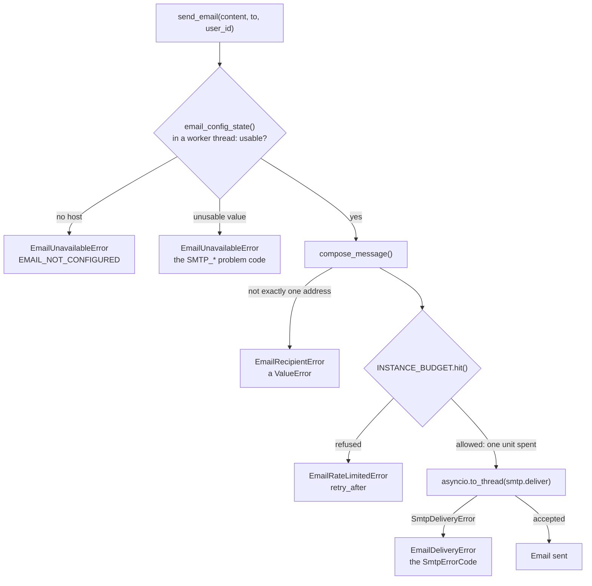

# 📧 Email Service (SMTP)

The email service sends LibreFolio's transactional emails through an SMTP server that the administrator names in
environment variables. It can write five kinds — a password-reset link, an invitation, an address to confirm, the
activation link of the first administrator, a test message. The service lives in `backend/app/services/email/`, its
configuration in `backend/app/config/email.py`, and its hourly budget counts with the sliding-window limiter of
`backend/app/utils/runtime/rate_window.py`. Its routes (`backend/app/api/v1/email.py`) give administrators the state
of email, a test email and the emailing of the links they create, and let anyone ask for a reset link for a
forgotten password; the Email tab of the settings (`frontend/src/lib/features/email/`) shows the state and sends the
test email. The administrator's guide is [Email](../../admin/email.md).

!!! note "Status: lots E1 to E3 of release 1.3"

    Three emails have a caller: the test email ([`POST /api/v1/email/test`](#api-test)), an invitation or a
    password-reset link an administrator emails ([`POST /api/v1/email/links`](#api-links)), and a reset link for a
    forgotten password ([`POST /api/v1/email/password-reset`](#api-password-reset)). No page calls the last two
    routes yet, and `build_verification()` and `build_admin_setup()` have no caller. See [Coming Next](#coming-next).

---

## 🎯 Purpose and Rules {: #purpose-and-rules }

Email is optional (feature F04 of the release 1.3 plan). Four rules shape the whole package:

1. **Optional.** With `LIBREFOLIO_SMTP_HOST` unset or blank, email is off and nothing changes for a self-hosted
   install: nothing is sent, the other `LIBREFOLIO_SMTP_*` variables are not even validated, and the configuration
   check reports `ok`. "Email off" is the default state, so a caller handles `EmailUnavailableError` as a normal
   outcome, not as a fault.
2. **Environment only.** The configuration comes only from the `LIBREFOLIO_SMTP_*` variables, and the password also
   from a secret file (`LIBREFOLIO_SMTP_PASSWORD_FILE`). It is never written anywhere, so it is never in the
   database and never in a backup; it is never shown in the interface either.
   [`GET /api/v1/email/status`](#api-status) answers with the state, the problem and the variable at fault, the
   checks' i18n keys and `detail`, the hourly budget and the state of the links: never the host, the port, the user,
   the sender, the Reply-To or the password. The `detail` of a check, the part meant for the interface, never holds
   the host, the user or the sender either. The public [`GET /api/v1/system/instance`](#instance-email) says only
   whether email is usable and whether emails can carry links.
3. **Read at every call.** The accessors read the process environment each time, nothing is cached, and they are
   the only readers of these variables, as the [config package rule](../architecture/settings.md) requires. The
   variables are documented, commented, in the «Email» section of `.env.example`.
4. **Links from `LIBREFOLIO_PUBLIC_URL` alone** (developer decision 45). Every link an email carries, the ones an
   administrator sends included, is that variable followed by the path of the page that takes the token, never
   anything taken from a request ([Links](#links)). Without the variable, no email with a link goes out.

| Module | Role |
|--------|------|
| `backend/app/config/email.py` | The `LIBREFOLIO_SMTP_*` accessors and `EmailConfigError` |
| `services/email/smtp.py` | The transport: `deliver()`, `SmtpServer`, `SmtpErrorCode`, `SmtpDeliveryError` |
| `services/email/delivery.py` | `email_config_state()`, the hourly budget (`INSTANCE_BUDGET`, `budget_status()`), `send_email()` and the `EmailError` family |
| `services/email/messages.py` and `templates/` | `EmailKind`, `email_language()`, the five builders and `compose_message()`; the texts in four languages and the HTML layout. Nothing here sends, reads the configuration or logs |
| `services/email/checks.py` | `check_smtp_configuration()`, `check_smtp_encryption()`, `check_email_links()`, `EMAIL_CONFIG_CHECKS`, which closes the platform's `CONFIG_CHECKS` |
| `services/email/links.py` | `links_state()`, `require_links()`, `email_link()`, `email_instance_config()` and `EmailLinksUnavailableError`: every emailed link from `LIBREFOLIO_PUBLIC_URL` ([Links](#links)) |
| `services/email/flows.py` | What an action of the application sends, to whom and in which language: the test email, a link an administrator emails, a forgotten password and its limits ([Flows](#flows)) |
| `backend/app/api/v1/email.py` and `backend/app/schemas/email.py` | `GET /email/status`, `POST /email/test` and `POST /email/links` for administrators, `POST /email/password-reset` for anyone, and their models ([The API](#api)); `EmailInstanceConfig`, the `email` field of `GET /system/instance` |
| `backend/app/utils/runtime/rate_window.py` | `SlidingWindowLimiter` and `RateDecision`, the [sliding-window limiter](#rate-window) |
| `frontend/src/lib/features/email/` and `frontend/src/lib/i18n/email/` | The Email tab of the settings, its seam over the API client and its texts ([The Email Tab](#email-tab)) |

`services/email/__init__.py` holds only the package docstring.

---

## ⚙️ Configuration {: #configuration }

### 📋 The Variables

| Variable | Unset or blank | Accepted | Code when unusable |
|----------|----------------|----------|--------------------|
| `LIBREFOLIO_SMTP_HOST` | Email off | A host name or an IP address, IPv6 without brackets: letters, digits, `.`, `-`, `_` and `:`; no scheme, user, port, path, bracket or space | `SMTP_HOST_INVALID` |
| `LIBREFOLIO_SMTP_TLS` | `starttls` | `starttls`, `tls` or `none`, in any case | `SMTP_TLS_INVALID` |
| `LIBREFOLIO_SMTP_PORT` | The port of the mode: 587 (`starttls`), 465 (`tls`), 25 (`none`) | ASCII digits, 1–65535 | `SMTP_PORT_INVALID` |
| `LIBREFOLIO_SMTP_USER` | No authentication | Any text, stripped | `SMTP_CREDENTIALS_INCOMPLETE` without a password |
| `LIBREFOLIO_SMTP_PASSWORD`, or `LIBREFOLIO_SMTP_PASSWORD_FILE` | No password | `env_secret("LIBREFOLIO_SMTP_PASSWORD")`: the value as written, otherwise the content of the file | `SMTP_PASSWORD_UNREADABLE` (a `_FILE` that cannot give it); `SMTP_CREDENTIALS_INCOMPLETE` without a user |
| `LIBREFOLIO_SMTP_FROM` | Required with a host | One mailbox: `Name <address>` or `address` | `SMTP_FROM_MISSING`, `SMTP_FROM_INVALID` |
| `LIBREFOLIO_SMTP_REPLY_TO` | Replies go to the sender | One mailbox | `SMTP_REPLY_TO_INVALID` |
| `LIBREFOLIO_SMTP_MAX_PER_HOUR` | 50 | ASCII digits, at least 1 | `SMTP_MAX_PER_HOUR_INVALID` |

- **Blank is unset**, and values are stripped — except the password, which `env_secret()` takes as written, spaces
  included ([Secrets from Files](../architecture/security.md#secrets-from-files)).
- **The modes**: `starttls` upgrades a plain connection before anything else is sent and refuses to go on without
  the upgrade; `tls` is TLS from the first byte (SMTPS); `none` sends in clear, meant for a relay on the same machine
  or the local network (the [encryption check](#configuration-checks) warns otherwise).
- **ASCII digits** is literal: a sign, a decimal, `2_525` or fullwidth digits, all of which `int()` would take, are
  refused.
- **A mailbox** is exactly one address, with a non-empty local part and domain and no whitespace inside; a comma
  inside a quoted display name belongs to the name. A CR or LF anywhere in the raw value is refused, even where
  stripping would remove it: no header injection reaches a message.
- **The `:` of the host** is there for IPv6 literals, written without brackets (`::1`, `fd00::25`); `[::1]` is
  refused. A value with exactly one colon, such as `smtp.example.com:587`, is a name with its port and is refused
  too, with a message saying that the port goes in `LIBREFOLIO_SMTP_PORT`: an IPv6 address always has at least two
  colons.

### 🧾 `EmailConfigError`

`EmailConfigError` is a `ValueError` with two attributes, `variable` and `code`. Its message is
`<VARIABLE>: <rule>`, for example `LIBREFOLIO_SMTP_PORT: expected a whole number from 1 to 65535`: it never holds
the value of a variable, so never a secret. The accessors raise it for the six `*_INVALID` codes. The other three
codes combine several variables, so `email_config_state()` decides them: `SMTP_PASSWORD_UNREADABLE`,
`SMTP_CREDENTIALS_INCOMPLETE` and `SMTP_FROM_MISSING`.

### 🔌 Email Off, Usable or Unusable {: #config-state }

`email_config_state()` (in `delivery.py`) reads every variable through its accessor and **never raises**. It
returns a frozen `EmailConfigState`:

| State | `configured` | `problem`, `variable` | `server`, `sender`, `reply_to`, `max_per_hour` | `usable` |
|-------|--------------|-----------------------|-----------------------------------------------|----------|
| Off: no host | `False` | `None` | Unset; `max_per_hour` 50 | `False` |
| Unusable | `True` | The code and the variable at fault | Unset; `max_per_hour` 50 | `False` |
| Usable | `True` | `None` | The `SmtpServer`, the two mailboxes as `(display name, address)`, the hourly limit | `True` |

The first fault wins, in this order: the host; then the TLS mode, the port, the user, the password, the sender, the
Reply-To and the hourly limit (an `EmailConfigError`, or a `SecretFileError` reported as `SMTP_PASSWORD_UNREADABLE`
on `LIBREFOLIO_SMTP_PASSWORD_FILE`); then the credentials, which come in pairs (`SMTP_CREDENTIALS_INCOMPLETE` on
whichever of `LIBREFOLIO_SMTP_USER` and `LIBREFOLIO_SMTP_PASSWORD` is set without the other); then the sender
(`SMTP_FROM_MISSING`).

An unusable value **turns email off**: `send_email()` raises `EmailUnavailableError` with the problem code, and
the check `email.smtp` reports an `error`. The fault is logged **once per process**: `_report_invalid()` is a
`functools.cache` keyed by `variable`, `problem` and `reason`, so the event
`Email configuration cannot be used: email stays off`, with those three fields, appears the first time a fault is
read, not at every send. A different reason is new information and is logged again, such as a password file that
was missing and is now empty. The `reason` is the accessor's message or the `SecretFileError` message, which names
the variable and the path of the file, never its content: no secret reaches the log.

The server starts either way. The startup audit reads the configuration at every start of every process, through
the [configuration checks](#configuration-checks): an unusable value is logged there, first by
`_report_invalid()`, then as the `email.smtp` error of the audit. Later reads in the process log it again only for a
new reason. `log_configuration_audit()` never stops a start for email, only for the platform's own secrets and
settings ([Configuration Checks](../architecture/security.md#configuration-checks)).

---

## 📡 Transport (`smtp.py`) {: #transport }

`deliver(server, message)` sends one `EmailMessage` through one `SmtpServer` with the standard library's
`smtplib`: no third-party SMTP client. It **blocks**, so it runs in a worker thread: `send_email()` calls it
through `asyncio.to_thread()`, as the [Event Loop Blocking Rule](../architecture/patterns/async.md) requires, and a
test checks that the connection is opened on a thread without a running event loop.

`SmtpServer` is a frozen dataclass: `host`, `port`, `tls` (`starttls`, `tls` or `none`), `user`, `password` (kept
out of `repr`) and `timeout`. `email_config_state()` builds it with `SMTP_TIMEOUT_SECONDS`, **20 s**, read at call
time. It is the socket timeout to connect and for each exchange with the server, not a deadline for the whole
conversation.

The conversation:

1. **Connect**: `smtplib.SMTP_SSL` in `tls` mode, `smtplib.SMTP` otherwise; then `EHLO`.
2. **`starttls` mode**: `STARTTLS`, then `EHLO` again. A server that does not offer STARTTLS is refused with
   `TLS_FAILED` before the password or the message is sent: the mode never falls back to plain text.
3. **Authentication**, only with a user: `login()`.
4. **The message**: `send_message()`; the envelope sender is the From address, the recipient the To address.
5. **`QUIT`**. Once the server has accepted the message, a failure here — a `QUIT` answered badly, a dropped
   connection — is not a failure of the delivery: the email counts as sent.

Both TLS modes use `ssl.create_default_context()`, which **verifies** the certificate and the host name.
`smtplib`'s own default for `starttls()` and `SMTP_SSL` is an unverified context (`ssl._create_stdlib_context()`),
which is why `deliver()` always passes its own.

A failure raises `SmtpDeliveryError` with a code from `SmtpErrorCode`, a `StrEnum` whose values are the names:

| Code | When |
|------|------|
| `CONNECTION_FAILED` | The connection could not be opened or was lost: nothing listening, a name that does not resolve, a refused greeting, a network error outside the TLS step |
| `TLS_FAILED` | STARTTLS not offered or refused, a failed handshake, a certificate that does not verify (`ssl.SSLError` at any step) |
| `AUTH_FAILED` | The credentials were refused, or another SMTP error ended the login step (a server without `AUTH`, for one) |
| `SENDER_REFUSED` | `MAIL FROM` refused |
| `RECIPIENT_REFUSED` | `RCPT TO` refused |
| `TIMEOUT` | A `TimeoutError` anywhere in the exception chain: `smtplib` turns a read that timed out into `SMTPServerDisconnected` |
| `SEND_FAILED` | `DATA` refused, or another protocol error while sending |

`str()` of the error is the code alone, for the interface. `detail` holds what the server said (such as
`550 5.1.1 <alice@example.com>: Recipient address rejected`), or the exception's text, **raw**: the transport adds no
password and masks nothing. It leaves the process only through the `Email not sent` log, which masks it
([What Is Logged](#logs)). The original exception is dropped (`raise … from None`).

---

## 📤 Delivery (`delivery.py`) {: #delivery }

### ⏳ The Hourly Budget {: #hourly-budget }

`INSTANCE_BUDGET` is a `SlidingWindowLimiter` over 3600 s (`BUDGET_WINDOW_SECONDS`) with a single key, shared by
every send of the process. `send_email()` hits it with `limit=` the configured `LIBREFOLIO_SMTP_MAX_PER_HOUR`,
read at call time; `budget_status(max_per_hour=None)` peeks it with the limit it is given (the status passes the one
of the state it has just read) or else the configured one, and returns its `RateDecision` (`allowed`, `remaining`,
`retry_after`) without spending anything, for [`GET /api/v1/email/status`](#api-status).

- **One unit per attempt.** An attempt that passes the configuration and recipient checks spends one unit before
  any connection, whether the server then accepts the message or not.
- **Refusal before any connection.** With the budget spent, `send_email()` raises `EmailRateLimitedError` without
  opening a connection; its `retry_after` is the number of seconds until the oldest send of the hour leaves the
  window. A refused attempt is not recorded, so it never pushes that moment further.

!!! warning "Per process, not per instance"

    The budget lives in the memory of each process: with N worker processes the instance may send N times
    `LIBREFOLIO_SMTP_MAX_PER_HOUR` emails an hour, and a restart starts from zero. `.env.example` says so: the limit
    is per server process. `GET /api/v1/email/status` shows the budget of the process that answers it.

### 📨 `send_email()` {: #send-email }

`async def send_email(content, *, to, user_id=None)` sends one `EmailContent` to one address. It reads the
configuration with `asyncio.to_thread(email_config_state)`: with `LIBREFOLIO_SMTP_PASSWORD_FILE` that read opens a
file, and no file is read on the event loop.



| Raised | `code` | When | Budget |
|--------|--------|------|--------|
| `EmailUnavailableError` | `EMAIL_NOT_CONFIGURED`, or the problem code of the configuration | No host, or an unusable value | Not spent |
| `EmailRecipientError` (a `ValueError`) | — | `to` is not exactly one address | Not spent |
| `EmailRateLimitedError` | `EMAIL_RATE_LIMITED`; `retry_after` in seconds | The hourly budget is spent | Not spent; no connection |
| `EmailDeliveryError` | A `SmtpErrorCode` value | The server did not take the message | Spent |

The three `Email*Error` classes derive from `EmailError`, which carries `code`: a caller needs a single
`except EmailError`. `EmailRecipientError`, from `messages.py`, is not part of the family: it subclasses
`ValueError`, and a caller that maps it to an answer catches it by name, never as any `ValueError`.

### 📝 What Is Logged {: #logs }

| Event | Level | Fields |
|-------|-------|--------|
| `Email sent` | `info` | `kind`, `language`, `user_id`, `recipient_domain` |
| `Email not sent` | `warning` | `kind`, `code`, `detail` (masked), `user_id`, `recipient_domain` |
| `Email not sent: the hourly limit of the instance is reached` | `warning` | `kind`, `user_id`, `recipient_domain`, `retry_after` (rounded) |
| `Email configuration cannot be used: email stays off` | `error` | `variable`, `problem`, `reason`; once per process for each combination of the three |
| `Test email sent by an administrator` | `info` | `admin_id`, `language`: logged by [`POST /email/test`](#api-test) after `Email sent` |
| `Link emailed by an administrator` | `info` | `admin_id`, `purpose`, `token_id`, `user_id` (a reset link's account, `None` for an invitation), `language`: logged by [`send_link_email()`](#flow-link) after `Email sent` |
| `Forgotten password: reset link emailed` | `info` | `user_id`, `token_id`, `language`: logged by [`forgotten_password_work()`](#flow-forgot) after `Email sent` |
| `Forgotten password: no active account matches, nothing sent` | `info` | None: the identifier is never logged |
| `Forgotten password: the account had a reset link moments ago, nothing sent` | `info` | `user_id`: past a per-account limit |
| `Forgotten password: no email sent` | `warning` | `reason` (the exception's class) and `code`: the configuration changed after the answer, the budget, or a refusal |
| `Forgotten password: the request failed` | `error` | The traceback of an unexpected error (`logger.exception`) |

Each reset link also leaves workstream A's `Password reset link created` event (`create_password_reset()`), with
`user_id`, `token_id` and `created_by_user_id`, `None` for a forgotten password.

**Never logged**: the body (text and HTML), the link it carries and its token, the SMTP password, the recipient's
full address, the identifier of a «forgot password» request. The recipient appears as the domain of its address and
as the `user_id` the caller passes; a link, as the `token_id` of its row.

That holds for the server's own words too. Servers quote the address they refuse, so before `detail` reaches the
`Email not sent` event, `_redacted()` replaces the SMTP password with `***` and the recipient's address with
`***@<domain>`, both matched case-insensitively: `550 5.1.1 <alice@example.com>: Recipient address rejected` is
logged as `550 5.1.1 <***@example.com>: Recipient address rejected`.

An unavailable email or a malformed recipient raises without an event of its own, beyond the one-time configuration
error.

---

## ✉️ Messages (`messages.py` and `templates/`) {: #messages }

### 🗂️ The Five Kinds

Each kind of email has a keyword-only builder that returns an `EmailContent`, a frozen dataclass with `kind`,
`language`, `subject`, `text` (the plain-text part) and `html`:

| `EmailKind` | Builder | Arguments | Link |
|-------------|---------|-----------|------|
| `password_reset` | `build_password_reset()` | `language`, `username`, `link`, `ttl`, `instance` | Yes |
| `invite` | `build_invite()` | `language`, `link`, `ttl`, `instance`, `inviter=None`, `grants_admin=False` | Yes |
| `email_verification` | `build_verification()` | `language`, `username`, `link`, `ttl`, `instance` | Yes |
| `admin_setup` | `build_admin_setup()` | `language`, `username`, `link`, `ttl`, `instance` | Yes |
| `test` | `build_test_message()` | `language`, `username`, `instance` | No |

- The four link kinds share their values with the purposes of the
  [single-use account tokens](../architecture/security.md#account-tokens), but the builders issue no token: the
  caller passes the finished link and its lifetime (`ttl`).
- A link must start with `http://` or `https://` and hold no whitespace; anything else (`javascript:`, `data:`,
  `mailto:`, a relative path) is a `ValueError`. Plain `http://` is accepted for an instance on a home network.
- An invitation opens without a name (the account does not exist yet), names the inviter only when `inviter` is
  given, and adds one sentence when `grants_admin` is true.
- `instance` names the instance in the body and in the footer. The test email passes the host the request was sent
  to ([`POST /email/test`](#api-test)); an email with a link passes the host of `LIBREFOLIO_PUBLIC_URL`, port
  included (`LinksState.instance`, [Links](#links)).

`build_test_message()`, `build_invite()` and `build_password_reset()` have callers ([Flows](#flows));
`build_verification()` and `build_admin_setup()` have none yet ([Coming Next](#coming-next)).

### 🌍 Languages

`EMAIL_LANGUAGES` is `("en", "it", "fr", "es")`, exactly the choices of the `default_language` setting (a test
compares the two), so no account can pick a language its emails lack. `email_language(tag)` lowercases the tag,
keeps its primary subtag and falls back to English: `it-IT`, `it_IT` and `IT` give `it`; `de`, an empty tag or
`None` give `en`. Every builder passes its `language` through it.

### 🛡️ Rendering Rules

- **Placeholders**: the texts use `string.Template` placeholders — `$username`, `$instance`, `$inviter`,
  `$duration` — filled with `substitute()`.
- **Escaping**: every line of the HTML part is escaped (`html.escape`) after it is filled, so a value that comes
  from a person — a user name, the name of the instance, the inviter — stays text, never markup. The link is
  escaped in its `href` and in the visible fallback address.
- **Subjects**: the subject is the catalogue's text, never filled: no user value and no link reaches it, and it
  stays on one line. Every relay and every notification sees it.
- **Durations**: `$duration` is `babel.dates.format_timedelta(ttl, locale=language)`, Babel's default wording:
  30 minutes in Italian gives «30 minuti», 7 days in English "1 week", 72 hours in Italian «3 giorni».
- **The two parts**: the plain text holds the greeting, the body lines, for a link kind the action followed by the
  link verbatim on its own line, the closing lines, then a `-- ` signature line and the footer. The HTML part fills
  `templates/layout.html` (`$lang`, `$subject`, `$body`, `$footer`): a table-based layout with inline styles, a
  button for the link and, below it, the address to copy (`common.button_fallback`); `<html lang="…">` declares the
  language.
- The catalogues and the layout are read once, when `messages.py` is imported.

### 📚 The Catalogue {: #catalogue }

`templates/en.json`, `it.json`, `fr.json` and `es.json` share one structure: a `common` section (`greeting`,
`greeting_anonymous`, `button_fallback`, `footer`) and one section per `EmailKind` value, holding `subject`,
`intro` and, for the link kinds, `action`, `expiry` and `ignore`; `invite` adds `intro_anonymous` and
`admin_role`; `test` has `outro` instead.

`./dev.py test services email-messages` guards the catalogue:

- the four JSON files and `layout.html` exist in `templates/`, beside `messages.py`;
- each file parses as UTF-8 JSON, with an object at its root;
- every file has exactly the nested keys of `en.json`: a text missing in one language is a gap, an extra one is
  dead;
- every leaf is a non-empty string;
- for each key, the `$placeholders` are the same set as in English: a translation neither drops a value nor
  invents one;
- every text is valid `string.Template` syntax: no stray `$` (write `$$` for a literal dollar sign).

These texts are the backend's own catalogue: the frontend i18n sources and the `dev.py i18n` commands do not
include them.

### ➕ Adding a Text or a Kind {: #adding-a-text-or-a-kind }

**A text**: add the key to the same section of the four JSON files in one change, with the same `$placeholders`
in every language, then list it in the builder (the `before` or `after` keys that `_render()` assembles).

**A kind**:

1. a value in `EmailKind`, which is also the name of its catalogue section;
2. that section in the four JSON files, with a `subject` free of placeholders;
3. a keyword-only `build_*` builder that passes the language through `email_language()`, the link through
   `_checked_link()` and the lifetime through `_duration()`, and puts user values only into body placeholders;
4. the tests of `backend/test_scripts/test_services/test_email_messages.py`, which pin the five kinds and the
   signature of each builder.

### 📬 Composing the Message {: #composing }

`compose_message(content, *, to, sender, reply_to=None, now=None)` returns the `EmailMessage` to send:

| Header | Value |
|--------|-------|
| `Subject` | `content.subject` |
| `From` | `sender`, a `(display name, address)` tuple; a non-ASCII name is encoded as RFC 2047 words |
| `To` | `to`, exactly one bare address |
| `Reply-To` | Only when `reply_to` is given |
| `Date` | `now`, or the current time, in GMT |
| `Message-ID` | `make_msgid()` in the domain of the sender's address, never the name of the machine |
| `Auto-Submitted` | `auto-generated`: auto-responders do not answer (RFC 3834) |
| `X-Auto-Response-Suppress` | `All`: Exchange and Outlook send no automatic reply |
| `Content-Language` | `content.language` |

The body is `multipart/alternative`, the plain text first and the HTML last: a client shows the last alternative it
can display. `Content-Language` is set **after** the body, because `set_content()` clears every `Content-*` header
and turning the message into a multipart moves them into its first part.

`to` must be **exactly one** bare address: one `@` with something on both sides, and no whitespace (not even a
trailing line break: nothing is trimmed), comma, `<`, `>` or `"`. Anything else is an `EmailRecipientError` (a
`ValueError`), so no message is composed for a second, hidden recipient.

---

## 🩺 Configuration Checks (`checks.py`) {: #configuration-checks }

The email section has three checks in the shape of the platform's `ConfigCheck`
([Configuration Checks](../architecture/security.md#configuration-checks)). Like every configuration check, they
read the configuration through `email_config_state()`, and `links_state()` for the third, change nothing, never
raise and never put a secret in their result:

| `check_id` | Severity | `i18n_key` | When |
|------------|----------|------------|------|
| `email.smtp` | `ok` | `email.checks.smtp.off` | No host: email is optional |
| `email.smtp` | `ok` | `email.checks.smtp.ok` | The configuration is usable |
| `email.smtp` | `error` | `email.checks.smtp.invalid` | A value cannot be used: `detail` is `{"problem": <code>, "variable": <name>}`; the summary names the variable and says that email stays off |
| `email.smtp_encryption` | `ok` | `email.checks.smtpEncryption.ok` | Email is not usable, or the mode is `starttls` or `tls` |
| `email.smtp_encryption` | `ok` | `email.checks.smtpEncryption.localPlain` | `none` towards a local host |
| `email.smtp_encryption` | `warning` | `email.checks.smtpEncryption.plain` | `none` towards any other host: emails, their links and the SMTP password travel unencrypted. Empty `detail` |
| `email.links` | `ok` | `email.checks.links.ok` | Email is not usable (off included), or `LIBREFOLIO_PUBLIC_URL` is ready |
| `email.links` | `info` | `email.checks.links.missing` | Email is usable and `LIBREFOLIO_PUBLIC_URL` is not set: no email with a link can go out. Empty `detail` |
| `email.links` | `warning` | `email.checks.links.invalid` | Email is usable and `LIBREFOLIO_PUBLIC_URL` is not an http(s) address. Empty `detail` |

**What counts as local**: an IP address that `classify_ip()` (`backend/app/utils/runtime/network.py`) classes as
`loopback` (127.0.0.0/8, `::1`), `lan` (the private, link-local and unique-local ranges) or `vpn` (100.64.0.0/10
and Tailscale's `fd7a:115c:a1e0::/48`); or a name that is `localhost`, has a single label (a Docker service such as
`postfix`, a host of the LAN) or ends with `.localhost`, `.local`, `.lan`, `.home.arpa` or `.internal`. Names are
judged as written, nothing is resolved: a tailnet name such as `relay.tailnet.ts.net` gets the warning, while its
`100.x` address would not.

The `detail` travels to the admin interface as the parameters of a translated message, so it never names the host,
the user or the sender. The English `summary` is for the log only, and the plain-text warning's summary does name
the host. [`GET /api/v1/email/status`](#api-status) never returns a `summary`. The keys are written whole, like the
platform's; their messages are in the `email` i18n source of the frontend ([The Email Tab](#email-tab)).

`EMAIL_CONFIG_CHECKS = (check_smtp_configuration, check_smtp_encryption, check_email_links)` closes the platform's
`CONFIG_CHECKS` (`*EMAIL_CONFIG_CHECKS` at the end of the tuple in `backend/app/services/platform/config_audit.py`),
so the three checks run in two places:

- **At startup**, `log_configuration_audit()` logs every check that is not `ok`, with its `summary` as the message
  and `check` and `detail` as fields. For email that is the `email.smtp` error,
  `<variable> cannot be used (<problem>): email stays off until it is fixed`; the plain-text warning,
  `LIBREFOLIO_SMTP_TLS=none with <host>: emails, their links and the SMTP password travel unencrypted; use starttls or tls`;
  and the `email.links` line, at `info`
  `LIBREFOLIO_PUBLIC_URL is not set: emails work, but none with a link (forgotten password, invitation, reset) can go out`
  or at `warning`
  `LIBREFOLIO_PUBLIC_URL is not an http(s) address: no email with a link (forgotten password, invitation, reset) can go out`.
  None of them stops the start. An unusable configuration thus gives two lines:
  `Email configuration cannot be used: email stays off` from `_report_invalid()`, while the check reads the state,
  then the audit's summary.
- **On demand**, [`GET /api/v1/email/status`](#api-status) evaluates `EMAIL_CONFIG_CHECKS` at every call and
  returns each result without its `summary`.

`config_audit` imports `EMAIL_CONFIG_CHECKS` at module level to build its tuple, before it defines `ConfigCheck`.
A module-level `from backend.app.services.platform.config_audit import ConfigCheck` in `checks.py` would therefore
fail whenever `config_audit` is imported first, on a half-initialized module. So `checks.py` imports `ConfigCheck`
inside each check, when the check runs, and under `TYPE_CHECKING` for its annotations (the module has
`from __future__ import annotations`): either module can be imported first. `check_email_links()` imports
`links_state()` the same way: `links.py` brings in the accounts services, which `config_audit` then does not load at
import time.

---

## ⛓️ Links (`links.py`) {: #links }

Every link an email carries, the ones an administrator sends included, is built from `LIBREFOLIO_PUBLIC_URL` alone
(developer decision 45): the variable, then the path of the page that takes the token, the token in the fragment
(`token_service.token_path()`, such as `/reset-password#token=…`). Nothing in a request — its host, its `Origin`, a
link the browser sends — becomes part of an emailed link: otherwise a stranger could have a real token sent to a user
inside a link to a site of theirs. Without the variable, no email with a link goes out; the links an administrator
copies stay as they are (`registration_service.public_link()`, the path alone without the variable).

| Member | Contract |
|--------|----------|
| `links_state()` | `LinksState(base, problem)`, read now, never raises. `base` is `LIBREFOLIO_PUBLIC_URL` as `public_url()` (`backend/app/config/accounts.py`) gives it: an `http://` or `https://` address, one trailing slash removed. `problem` is `PUBLIC_URL_MISSING` (unset or blank) or `PUBLIC_URL_INVALID` (not http or https). `ready` is a `base` without a `problem`; `instance` is the host of `base`, port included, the name an email gives the instance |
| `require_links()` | The `LinksState` when ready, else `EmailLinksUnavailableError`, its `code` the problem |
| `email_link(purpose, token)` | `public_link(token_path(purpose, token))`; `EmailLinksUnavailableError` without the variable |
| `email_instance_config()` | The `email` field of `GET /system/instance`: `available` is `email_config_state().usable`, `links` is `available` and `links_state().ready` ([below](#instance-email)) |
| `EmailLinksUnavailableError` | An `EmailError`: no email with a link can go out |

With email usable, a missing or invalid variable is reported by the [`email.links` check](#configuration-checks): in
the start log and as a notice of the Email tab. Nothing here checks that the address reaches this instance: the
server cannot know how its users reach it ([Coming Next](#coming-next)).

---

## 🔀 Flows (`flows.py`) {: #flows }

`services/email/flows.py` has one function per email that an action of the application sends. A flow decides the
content, the recipient and the language; `send_email()` checks the configuration and the budget, sends and logs.

| Function | What it does |
|----------|--------------|
| `async account_language(session, user_id)` | The language of every email of an account: its own `user_settings.language`, else the instance's `default_language` global setting, else English. It reads the `language` column alone and `get_setting_value()`: a settings row that no longer validates (a theme outside light/dark/auto, say) never stops an email, and an account without a `user_settings` row is left without one |
| `async instance_language(session)` | The instance's `default_language`, else English: the language of an email to someone without an account, an invitation |
| `async send_test_email(session, user, *, instance)` | `build_test_message()` in the account's language, with `user.username` and `instance`, sent to `user.email` with `user_id`; returns the language. Raises what `send_email()` raises |
| `async send_link_email(session, *, admin, purpose, token, to=None, language=None, now=None)` | A link an administrator has just created, by email: [A Link an Administrator Emails](#flow-link). Returns `LinkEmailSent(to, language)` |
| `async admit_forgotten_password(address, identifier)` | Whether a «forgot password» request may go on, before anything about the accounts is read: [A Forgotten Password](#flow-forgot) |
| `async forgotten_password_work(identifier, *, engine=None, now=None)` | The work of that request, after its answer; never raises |

- `supported_email_language()` reduces `it-IT`, `it_IT` and `IT` to `it`, and gives `None` for a language the emails
  do not speak or an empty value; `email_language()` is the same with `en` instead of `None`.
- An account whose own language is one the emails do not speak counts as an account without one: it gets the
  instance's `default_language`, then English. A missing `default_language` setting reads as `en`.
- The language rule holds for every email of an account, as the module's docstring says: a new flow for an account
  takes its language from `account_language()`.

### ✉️ A Link an Administrator Emails {: #flow-link }

`send_link_email()` emails the token that `POST /users/invites` or `POST /users/{id}/password-reset-link` has just
returned, in this order:

1. Email usable (`EmailUnavailableError`), then links ready (`EmailLinksUnavailableError`).
2. The token inspected for its purpose (`token_service.inspect_token()`): any status but `valid` raises
   `EmailLinkInvalidError`, its `code` the status, `expired`, `consumed`, `revoked` or `unknown`. A token of the
   other purpose is `unknown`.
3. The link, from the token alone: [`email_link()`](#links).
4. The recipient and the language:
    - **an invitation** goes to `to`, else to the address written in it (`EmailRecipientRequiredError` without
      either), in `language`, else the instance's ([`instance_language()`](#flows)). It names the administrator who
      sends it as the inviter (`inviter=admin.username`), and adds its sentence when `grants_admin` is set;
    - **a password-reset link** goes only to the address of its account, in the account's language: any `to`, the
      account's own address included, raises `EmailRecipientNotAllowedError`, and `language` is ignored. A token
      whose account no longer exists is `unknown`.
5. `send_email()`, then the `Link emailed by an administrator` event ([What Is Logged](#logs)).

The lifetime the email states is what is left of the token's (`_remaining()`): 7 days for an invitation just
created, 30 minutes for a reset link.

### 🔑 A Forgotten Password {: #flow-forgot }

[`POST /api/v1/email/password-reset`](#api-password-reset) answers before it looks for the account, so that nothing
in the answer — its status, its body, its timing — tells which accounts exist:

1. **Admission**, `admit_forgotten_password(address, identifier)`, before the answer: email usable, links ready,
   the two limiters below, then the hourly budget, peeked. Every refusal is the same for everyone and depends on no
   account.
2. **The answer**: 202, the same body for everyone.
3. **The work**, `forgotten_password_work(identifier)`, a FastAPI background task with a session of its own on the
   request's engine (the request's session ends with it). It looks the account up as the login does
   (`get_user_by_username_or_email()`, the identifier stripped), stops for an unknown or inactive account, applies
   the per-account limits, then calls `create_password_reset()` (workstream A): the account's earlier live reset
   links are revoked, those an administrator created included, and a new one, valid 30 minutes, is committed.
   Then the email, to the account's address in its language. Every outcome is a log event without the identifier
   ([What Is Logged](#logs)).

| Limit | Counted on | Past it |
|-------|------------|---------|
| `FORGOT_BY_ADDRESS`: 5 requests every 15 minutes | The client address, `request.client.host` (`unknown` without one) | 429 `EMAIL_RATE_LIMITED` |
| `FORGOT_BY_IDENTIFIER`: 3 requests an hour | The identifier stripped and case-folded, whether an account matches or not | 429 `EMAIL_RATE_LIMITED` |
| The hourly budget of the instance | `budget_status()`, peeked: the email spends its unit later | 429 `EMAIL_RATE_LIMITED` |
| One email every 5 minutes, 3 an hour (`RESET_EMAIL_MIN_INTERVAL`, `RESET_EMAILS_PER_HOUR`) | The account's reset links created in the last hour, whoever created them | Nothing sent, in silence: the answer was already 202 |

The two limiters are `SlidingWindowLimiter`s in the memory of the process, like the budget: with N worker processes
they are N times as large, and a restart forgets them. The link is committed before the email goes out, so a refused
email still leaves the new link live and the earlier ones revoked.

**Why `request.client.host`**: it is the address uvicorn gives the request, and uvicorn follows `X-Forwarded-For`
only from the proxies it trusts (`FORWARDED_ALLOW_IPS`, `127.0.0.1` by default). A client therefore cannot get a
fresh key, and a fresh limit, by forging the header at every request. `client_address()`
(`backend/app/utils/runtime/network.py`), which takes the last `X-Forwarded-For` value whoever sent it, is advice for
the connection indicator, never a key for a limit. Behind a proxy uvicorn does not trust, every visitor shares the
proxy's address, and its limit.

---

## 🌐 The API (`api/v1/email.py`) {: #api }

`backend/app/api/v1/email.py` is a router with `prefix="/email"` and the tag `Email`, which `api/v1/router.py`
mounts under `/api/v1`; its models, all `StrictModel`, are in `backend/app/schemas/email.py`. Three routes are for
administrators, `/status`, `/test` and `/links`: they depend on `require_admin` (`backend/app/api/v1/settings.py`),
401 without a session, 403 for an account that is not an administrator; then the email configuration is not read,
and nothing is sent or spent. `/password-reset` needs no session. One more route, outside this router, publishes
whether email is usable: [`email` in `GET /api/v1/system/instance`](#instance-email).

### 📊 `GET /api/v1/email/status` {: #api-status }

A plain `def`: reading the configuration may read the password file, so FastAPI runs the route in its thread pool,
not on the event loop. Every call evaluates `EMAIL_CONFIG_CHECKS` and `email_config_state()` afresh; it opens no
connection and resolves no name. It answers an `EmailStatusResponse`:

| Field | Value |
|-------|-------|
| `state` | `off` (no host), `ready` (usable) or `invalid` (a value cannot be used: email stays off) |
| `problem`, `variable` | `invalid` only: the code and the variable at fault, as in [Email Off, Usable or Unusable](#config-state); `null` otherwise |
| `checks` | The three checks of `EMAIL_CONFIG_CHECKS`, in that order, each an `EmailCheckRead`: `check_id`, `severity`, `i18n_key`, `detail` |
| `budget` | `ready` only: an `EmailBudgetRead` from `budget_status()`, which spends nothing — `max_per_hour`, `remaining`, and `retry_after_seconds`, the limiter's `retry_after` rounded up, 0 while an email fits |
| `links` | Every state: an `EmailLinksRead` from [`links_state()`](#links) — `ready`, `base` (`LIBREFOLIO_PUBLIC_URL`, the base of every emailed link) and `problem` (`PUBLIC_URL_MISSING` or `PUBLIC_URL_INVALID`) |

`EmailCheckRead` is a `ConfigCheck` without its `summary`, because the English log line of the plain-text warning
names the SMTP host. No state returns the host, the port, the user, the sender, the Reply-To, the password or the
path of a password file.

### 📮 `POST /api/v1/email/test` {: #api-test }

An `async def` without a body. It calls `flows.send_test_email(session, admin, instance=request.url.netloc)`: the
test email goes to the administrator's own address, in their language, and names the instance by the host the
request was sent to, port included (behind a reverse proxy, the `Host` header it forwards): a label in the text,
never a link. Like any [`send_email()`](#send-email), it spends one unit of the budget once the configuration and the
address pass.

| Status | Body | When | Budget |
|--------|------|------|--------|
| 200 | `EmailTestResponse`: `language` (`en`, `it`, `fr` or `es`) and `message`, `Test email sent` | The server accepted the message | Spent |
| 409 | `detail`: `error_code` `EMAIL_UNAVAILABLE`, `problem`, `message` | `EmailUnavailableError`: `problem` is `EMAIL_NOT_CONFIGURED` without a host, else the code of the configuration problem | Not spent; no connection |
| 422 | `detail`: `error_code` `EMAIL_RECIPIENT_INVALID`, `message` | The administrator's stored address is not exactly one address: the `EmailRecipientError` of `compose_message()`, caught by name (another `ValueError` is a 500) | Not spent; no connection |
| 429 | `detail`: `error_code` `EMAIL_RATE_LIMITED`, `retry_after`, `message`; the `Retry-After` header | `EmailRateLimitedError`: `retry_after` and `Retry-After` are the same whole number of seconds, at least 1 | Not spent; no connection |
| 502 | `detail`: `error_code` `EMAIL_DELIVERY_FAILED`, `smtp_code`, `message` | `EmailDeliveryError`: `smtp_code` is the [`SmtpErrorCode`](#transport) | Spent |

The rows follow the order of the checks in `send_email()`: an unusable configuration answers 409 even for an
address that is not one address. `message` is a fixed English sentence; the interface translates the codes. No
answer carries the server's own words, which reach only the log, masked ([What Is Logged](#logs)). After a 200 the
route logs `Test email sent by an administrator`, with `admin_id` and `language`.

### ✉️ `POST /api/v1/email/links` {: #api-links }

An `async def`. The body is an `EmailLinkRequest`: `purpose` (`invite` or `password_reset`), `token` (as the
creating route answered it, 1 to 512 characters, never logged), and for an invitation only `to` (an `EmailStr`) and
`language` (`en`, `it`, `fr` or `es`). It calls [`send_link_email()`](#flow-link) and answers an
`EmailLinkResponse`: `purpose`, `to` (where the email went) and `language`.

| Status | `detail` | When |
|--------|----------|------|
| 409 | `error_code` `EMAIL_UNAVAILABLE`, `problem` | Email is off or unusable |
| 409 | `error_code` `EMAIL_LINKS_UNAVAILABLE`, `problem` | `LIBREFOLIO_PUBLIC_URL` is missing or not an http(s) address |
| 409 | `error_code` `EMAIL_LINK_INVALID`, `status` | The token is not a live link of that purpose: `expired`, `consumed`, `revoked` or `unknown` |
| 422 | `error_code` `EMAIL_RECIPIENT_REQUIRED` | An invitation without `to` and without an address written in it |
| 422 | `error_code` `EMAIL_RECIPIENT_NOT_ALLOWED` | A `to` for a password-reset link |
| 422 | `error_code` `EMAIL_RECIPIENT_INVALID` | The address the email would go to, written in the invitation or the account's, is not exactly one address |
| 429 | `error_code` `EMAIL_RATE_LIMITED`, `retry_after`; the `Retry-After` header | The hourly budget is spent |
| 502 | `error_code` `EMAIL_DELIVERY_FAILED`, `smtp_code` | The SMTP server did not take the message |

Each `detail` also has a fixed English `message`. A `to` that is not an email address fails the validation of the
body first, with FastAPI's own 422.

### 🔑 `POST /api/v1/email/password-reset` {: #api-password-reset }

An `async def`, without a session. The body is a `PasswordResetEmailRequest`: `identifier`, a username or an email
address, 1 to 254 characters. The route runs [the admission](#flow-forgot) with `request.client.host`, queues
`forgotten_password_work()` as a background task on the request's engine (`session.bind`), and answers 202
`PasswordResetEmailAccepted`, whose `message` is the same for everyone: *If an active account matches, its owner gets
an email with a link to choose a new password*.

| Status | `detail` | When |
|--------|----------|------|
| 202 | — | Admitted: the work runs after the answer |
| 409 | `error_code` `EMAIL_UNAVAILABLE` | Email is off or unusable; no `problem`, unlike the administrators' routes |
| 409 | `error_code` `EMAIL_LINKS_UNAVAILABLE` | `LIBREFOLIO_PUBLIC_URL` is missing or invalid; no `problem` either |
| 429 | `error_code` `EMAIL_RATE_LIMITED`, `retry_after`; the `Retry-After` header | Past the limit per address or per identifier, or the hourly budget spent |

None of them depends on the accounts, and the two 409 say nothing that `GET /system/instance` does not publish
already (`email.available` and `email.links`).

### 🌍 `email` in `GET /api/v1/system/instance` {: #instance-email }

The public configuration of the instance, which answers without a session
([Public instance configuration](../architecture/settings.md#public-instance-configuration)), has an `email` field:
an `EmailInstanceConfig` (`backend/app/schemas/email.py`) with two booleans. `get_instance_config()`
(`backend/app/api/v1/system/instance.py`) fills it with [`email_instance_config()`](#links), through
`asyncio.to_thread`: the read may open the password file.

- **`available`**: a server is set and every variable can be used, the state `ready` of
  [`GET /api/v1/email/status`](#api-status). Usable, not delivered: nothing is sent and no server is contacted to
  tell, so a server that refuses the login still counts as available.
- **`links`**: `available`, and `LIBREFOLIO_PUBLIC_URL` set to an http(s) address: emails with a link can go out.
  Whether that address reaches this instance is not checked.
- **Nothing more**: the answer is the same for whoever asks and never holds the configuration, the address or the
  budget. An unusable value read here is logged like any other read, at most once per process for the same reason.
- **Off by default**: both booleans default to `False`, and `InstanceConfigResponse` declares the field with
  `default_factory=EmailInstanceConfig`, so it is optional in the schema: an answer built without it, or read from
  an older server, says that nothing can be sent.

Nothing in the frontend reads it yet.

---

## 🖥️ The Email Tab {: #email-tab }

The tab is in `frontend/src/lib/features/email/`, its texts in `frontend/src/lib/i18n/email/`.

| File | Role |
|------|------|
| `emailApi.ts` | The seam over the client that `./dev.py api sync` generates: `fetchEmailStatus()` and `sendTestEmail()` call `get_email_status_api_v1_email_status_get` and `send_test_api_v1_email_test_post`. `fetchEmailStatus()` narrows the answer into `EmailStatus`, its five keys present and `links` left out: the generated type of an optional field is wider than its runtime schema (`string \| null` also admits an array), so `problem` and `variable` become a string or `null`, `checks` a list, `budget` an object or `null`. `readTestFailure()` reads the `detail` of a refused test — from the `AxiosError` the generated client rejects with, or from an `ApiError` — into `{errorCode, problem, smtpCode, retryAfter}`; `errorCode` is `UNKNOWN` without a `detail` object, after a network error for one |
| `emailText.ts` | Every code to a whole i18n key and every state to whole classes of the theme roles (`*-lf-*`), as string literals that the i18n audit and the colour gates can see: `STATE_LABEL_KEYS`, `STATE_BADGE_CLASSES`, `NOTICE_CLASSES`, `OUTCOME_CLASSES`. `problemKey()` falls back to `email.problems.unknown` (only the maps' own entries count: a code such as `constructor` finds nothing); `minutesUntil()` gives whole minutes, at least 1; `testFailureMessage()` falls back to `email.smtpErrors.SEND_FAILED` for an unknown `smtp_code` and to `email.test.errors.generic` for any other failure |
| `EmailSettingsTab.svelte` | The tab body, in Svelte 5 runes |

What the tab does:

- **On mount** it reads `GET /email/status`; a failure shows `email.loadError`, above the last state read if there
  is one. Only the latest read writes: an older answer never replaces a newer one. `data-busy` (and `aria-busy`) is
  `true` while a request runs, the status or the test email.
- **The state**: a badge (`email.state.*`), then the explanation for `off`; for `invalid`, the message of the
  problem with its `{variable}` and the reminder to restart; for `ready`, the budget — `email.budget.remaining`, or
  `email.budget.spent` with the minutes to wait when none is left.
- **The checks**: one line for each check that is not `ok`, except `email.smtp`, whose problem the state already
  explains. Today that leaves the plain-text warning and the `email.links` notice, `info` or `warning`.
- **The test email**, in `ready` only. The button is disabled while any request runs, the status read again
  included, so one click sends one email. The outcome shows below it,
  `role="status"` or `role="alert"`, rendered from the stored outcome so that it follows a change of language; then
  the tab reads the status again, so the budget follows. Each outcome is also an app event, through `notify()`
  without a toast since the outcome is already on screen: `email.test.sent` with the `language`, or
  `email.test.failed` with the failure fields.
- **The guide**: the header's `DocsLink` opens `admin/email/`, the administrator's guide.
- **Test hooks**: a `data-testid` on each part (`email-tab`, `email-state`, `email-problem`, `email-budget`,
  `email-check`, `email-test-button`, `email-test-outcome`…) and the values a test checks as `data-*` attributes:
  `data-state`, `data-problem`, `data-variable`, `data-remaining`, `data-max`, `data-check-id`, `data-severity`,
  `data-outcome`.

The texts are a subsystem source of the frontend catalogue ([The Sources](../frontend/i18n.md#sources)): its
`prefixes.txt` owns `email`, and the four languages hold the same keys. They cover the tab, the states, the nine
problem codes and `unknown`, the messages of the three checks (`email.checks.*`, the `i18n_key` values of `checks.py`),
the budget, the test email and its errors, and the seven `SmtpErrorCode` values (`email.smtpErrors.*`). The emails'
own texts stay in the backend catalogue ([The Catalogue](#catalogue)).

`SETTINGS_TABS`, the [tab registry](../frontend/components/features/settings.md#tab-registry) of the Settings page,
registers the tab:

```ts
{id: 'email', labelKey: 'email.tab.label', icon: Mail, order: 130, component: EmailSettingsTab, visible: (ctx) => ctx.isSuperuser},
```

Order 130 puts it after Admin (100), so in the right-hand group on a wide screen, and `visible` keeps it for
administrators: a regular user never sees it in the bar, and a `?tab=email` they open is ignored.

---

## 🪟 The Sliding-Window Limiter {: #rate-window }

`backend/app/utils/runtime/rate_window.py` is the one primitive for every limit that counts events in a moving
window: the hourly email budget and the «forgot password» limits of [`flows.py`](#flow-forgot) use it, and the
login limits of workstream A (lot A8) are planned to reuse it. A new limit of this kind uses it too, instead of a
counter of its own.

| Member | Contract |
|--------|----------|
| `SlidingWindowLimiter(limit, window_seconds, *, max_keys=10_000, clock=time.monotonic)` | `ValueError` when `limit < 1`, `window_seconds <= 0` or `max_keys < 1`; `limit` and `window_seconds` are properties |
| `peek(key=None, *, limit=None)` | The `RateDecision` a hit would get now; counts nothing and never creates a key |
| `hit(key=None, *, limit=None)` | The same decision; records the hit only when it is allowed |
| `count(key=None)` | How many hits of `key` are in the window now |
| `reset(key=None)`, `clear()` | Forget one key, or every key |
| `len(limiter)` | The number of keys tracked |
| `RateDecision(allowed, remaining, retry_after)` | Frozen |

- **The window**: a hit at `t` counts while `clock() - t < window_seconds`; exactly `window_seconds` later it no
  longer does.
- **Allowed** while the count is below the limit: `remaining` is `limit - count` for a peek and `limit - (count + 1)`
  after an allowed hit; `retry_after` is 0.
- **Refused**: `remaining` is 0 and `retry_after = ts[count - limit] + window_seconds - now`, where `ts` are the
  live hits, oldest first: the wait until enough of them leave. With a limit of 3 and a 60 s window, hits at 1000,
  1001 and 1002 make a fourth at 1003 wait 57 s.
- **A refused hit is not recorded**: a caller that keeps knocking does not push its own unlock further away.
- **Per-call limit**: `limit=` replaces the default for that call only (below 1, a `ValueError`); lowered below the
  count, the wait is for enough hits to expire.
- **Keys** are any hashable value, and `None`, the default, is a key like any other.
- **Bounded memory**: at most `max_keys` keys. A new key beyond them evicts the least recently used one — used meaning
  peeked, hit or counted — and its hits are forgotten with it, so an evicted full key is allowed again. Only an
  allowed hit creates a key, and a key whose hits have all expired is dropped when it is next read.
- **Injectable clock**: tests move a fake clock instead of waiting.
- **Thread-safe**: one lock; threads hitting a key with a limit of N get exactly N hits allowed.
- **Per process**, in memory: with N worker processes a limit is N times the configured one, and a restart forgets
  every count.

---

## 🧪 Testing {: #testing }

| Selector | File (IDs) | What it pins |
|----------|------------|--------------|
| `./dev.py test services email-config` | `test_services/test_email_config.py` (EMC-001…019) | The accessors: blank as unset, the three modes and their ports, the port and the hourly limit in ASCII digits, one mailbox for From and Reply-To (no CR or LF, no second address), the password exactly as `env_secret()` gives it, `EmailConfigError` naming the variable and never the password, nothing cached |
| `./dev.py test services email-messages` | `test_services/test_email_messages.py` (EMM-001…030) | Languages and kinds, keyword-only builders, `http(s)` links only, escaping, no user value in a subject, Babel durations, the administrator invitation's extra sentence, the catalogue guard, the headers and parts of `compose_message()`, exactly one recipient |
| `./dev.py test services email-delivery` | `test_services/test_email_delivery.py` (EMD-001…045) | The fake server itself and `closed_port()`; `deliver()` and its error codes (TLS never falls back to plain text, a bad `QUIT` is a success, the certificate is verified); `email_config_state()` and its one-time log; the budget; `send_email()` off the event loop; a blocked instance (or an unreadable `LIBREFOLIO_BLOCKED`) refused before anything else, `sending_blocked()`; no secret and no full recipient address in the logs |
| `./dev.py test services email-checks` | `test_services/test_email_checks.py` (EMK-001…017) | The three checks in every state (`email.smtp`, `email.smtp_encryption` with local and public hosts, `email.links` off/ready/missing/invalid), `EMAIL_CONFIG_CHECKS`, no password in any field and no host, user or sender in a `detail`; the three checks closing the platform's `CONFIG_CHECKS` and `run_config_checks()`; the import orders, each in a fresh interpreter; the startup audit: one `email.smtp` error and no exception for an unusable configuration, one `email.smtp_encryption` warning for plain text to a public host, the `email.links` `info` and `warning`, nothing when email is off, never the password |
| `./dev.py test utils rate-window` | `test_utilities/test_rate_window.py` (RWL-001…017) | The window edge, `peek` never counting, refused hits not recorded, `retry_after`, the per-call limit, independent keys, LRU eviction, exactly N allowed under concurrent threads |
| `./dev.py test services email-links` | `test_services/test_email_links.py` (EML-001…012) | `links_state()` (ready, missing, invalid: no host, whitespace, a `?` or `#` even empty, an invalid port, credentials; an IPv6 literal and a capitalised scheme ready), `require_links()`, `email_link()` (the base plus the page path, the token in the fragment), `LinksState.instance`, `email_instance_config()` in every combination, a blocked instance included |
| `./dev.py test services email-flows` | `test_services/test_email_flows.py` (EMF-001…034) | `supported_email_language()` and `account_language()` (the account's own language when the emails speak it, else `default_language`, else English, never creating a row, a row that no longer validates still giving its language); `send_test_email()`; `send_link_email()`: the order of its refusals, live tokens of the right purpose only, recipients and languages per purpose, the link from `LIBREFOLIO_PUBLIC_URL` only; «forgot password»: admission (configuration, the limits per address and per identifier, the budget, no address no shared count), the background work (lookup as the login, active accounts only, one reset every 5 minutes and 3 an hour per account, the link created only when the email can go and revoked when it does not, a blocked instance creating nothing, never raising) |
| `./dev.py test api email` | `test_api/test_email_api.py` (EMA-001…045) | Admin only: 401 without a session, 403 for a member, nothing sent or spent; the status in its three states with the three checks, `links` and, when ready, the budget, never the SMTP configuration or a check's `summary`, without a connection or a name lookup; the test email (409, 422 only for `EmailRecipientError`, 429 with `Retry-After`, 502 with the `SmtpErrorCode`); `POST /email/links` and `POST /email/password-reset` with every answer, the same 202 for any identifier, every link equal to the `LIBREFOLIO_PUBLIC_URL` one whatever Host, Origin, X-Forwarded-Host or Referer the request forges; `GET /system/instance`: `email` exactly `{available, links}`, false on a blocked instance, never a value of the configuration; both routes reading the configuration off the event loop |
| `./dev.py test front-utility core-unit` | `frontend/src/lib/features/email/emailText.test.ts`, `emailApi.test.ts` | The code-to-key maps (own entries only), the minutes, the failure messages and their keys in the four catalogues, the role classes (no palette class, no hex, no `dark:`); `fetchEmailStatus()` narrowing the answer; `readTestFailure()` on an `AxiosError` and on an `ApiError`, with the real client and a fake transport |
| `./dev.py test front-utility component-unit` | `frontend/src/lib/features/email/EmailSettingsTab.test.ts` | The tab in jsdom: each state, the notices, the budget, `data-busy` over every request, one email per click, the outcome after 200, 409, 422, 429, 502 and a network error, a failed read keeping the last state |
| `./dev.py test front-utility email-tab` | `frontend/e2e/settings/email-tab.spec.ts` | In the browser: an administrator's tab on the real backend in the `off` state, hidden from a member; the test email against a simulated API (200, 502, 429) |

The backend files are under `backend/test_scripts/`. All eight backend entries are `pure` in the runner catalogue:
no lane database, no server. The two E2 files build their database as a private SQLite file under `tmp_path`, and
`api email` mounts the real auth and email routers under the API prefix in an app of its own: its accounts sign in
through `POST /auth/login`, over `httpx.ASGITransport`. The Settings tab registry's own test
(`settingsTabs.test.ts`) pins the Email tab: administrators only, no props, after Admin. The gallery has a
`settings/email` shot, with the state answered `ready` by the test.

- **No inherited configuration.** Every module, the rate window's included, starts with an autouse fixture that
  removes every `LIBREFOLIO_SMTP_*` variable; each test then sets only what it needs with `monkeypatch`, and
  password files live in `tmp_path`. A test lane already drops them: `configure_test_runtime()`
  (`scripts/cli_base.py`) removes every variable `.env.example` documents and every `LIBREFOLIO_*` name, so the
  lane's server runs without email. The fixture keeps a run outside a lane honest too: a new email test follows the
  same rule and never reads the lane's environment.
- **Never a real network.** `FakeSmtpServer` (`backend/test_scripts/fixtures/email/fake_smtp.py`) is written with
  the standard library and listens on 127.0.0.1, on a port the OS picks. It speaks the part of SMTP that `smtplib`
  uses (`EHLO` with `AUTH PLAIN LOGIN`, `STARTTLS` only when given a `tls_context`, `MAIL`, `RCPT`, `DATA`, `QUIT`),
  can refuse at each step (`credentials`, `refuse_sender`, `refuse_recipients`, `refuse_data`, `quit_code`,
  `greet=False`), and records `messages`, `auth_attempts` and `connections`. A refused recipient is named in the
  `550` reply, as Postfix does, so the masking of the log meets a real server's habit. As a context manager it
  closes every socket, joins every thread and fails the test on a defect of its own. `closed_port()`, also a context
  manager, yields a port of 127.0.0.1 that refuses connections and holds it for the whole block, so no listener
  started meanwhile can take it. In `api email`, `socket.getaddrinfo` resolves the loopback only and records any
  other name, which proves that the status never looks up the configured host.
- **No waiting.** The delivery, flows and API tests replace `delivery.INSTANCE_BUDGET` with a limiter on a fake
  clock, clear the cache of `_report_invalid()` around each test, and lower `smtp.SMTP_TIMEOUT_SECONDS` to 5 s as a
  bound for a hang; both are module attributes read at call time for that purpose. The only real wait is the timeout
  test, 0.2 s.
- **TLS tests.** EMD-017 (STARTTLS against a certificate the client trusts) and EMD-018 (an untrusted
  certificate refused: the verification is real) build their certificates with `cryptography`, a dependency of the
  `Pipfile` since release 1.3; `pytest.importorskip` still skips them in an environment without it.

---

## 🔭 Coming Next {: #coming-next }

Still open in lot E3:

- the Email tab's check that `LIBREFOLIO_PUBLIC_URL` reaches this instance, in the administrator's browser with the
  address probe of workstream A, after A's lot A6b;
- the activation email of the first administrator, after A's lot A7.

Planned in later lots of workstream E; none of it is in the code yet:

- **E4**: «Send by email» in the invitation and reset dialogs, and the «forgot password» of the login page;
- **E5**: email verification, whose meaning is still a decision of the developer.

---

## 🔗 Related

* 📧 **[Email](../../admin/email.md)** — The administrator's guide: the variables, the Email tab, what to check
  when email does not work
* 📝 **[Configuration](../../admin/configuration.md)** — `LIBREFOLIO_PUBLIC_URL`, in its «Accounts and Sign-ups»
  section
* 🔐 **[Secrets from Files](../architecture/security.md#secrets-from-files)** — `env_secret()` and the `_FILE` form
  of a secret
* 🩺 **[Configuration Checks](../architecture/security.md#configuration-checks)** — `ConfigCheck`, `CONFIG_CHECKS`
  and the startup audit
* 🎟️ **[Single-use Account Tokens](../architecture/security.md#account-tokens)** — the tokens behind the links these
  emails carry
* ⚡ **[Asynchronous Architecture](../architecture/patterns/async.md)** — the Event Loop Blocking Rule
* ⚙️ **[Settings System](../architecture/settings.md)** — the `backend/app/config/` package and `.env.example`
* 🌍 **[Internationalization](../frontend/i18n.md#sources)** — the i18n sources, the `email` subsystem among them
* 🗂️ **[Tab registry](../frontend/components/features/settings.md#tab-registry)** — `SETTINGS_TABS`, the tabs of
  the Settings page
