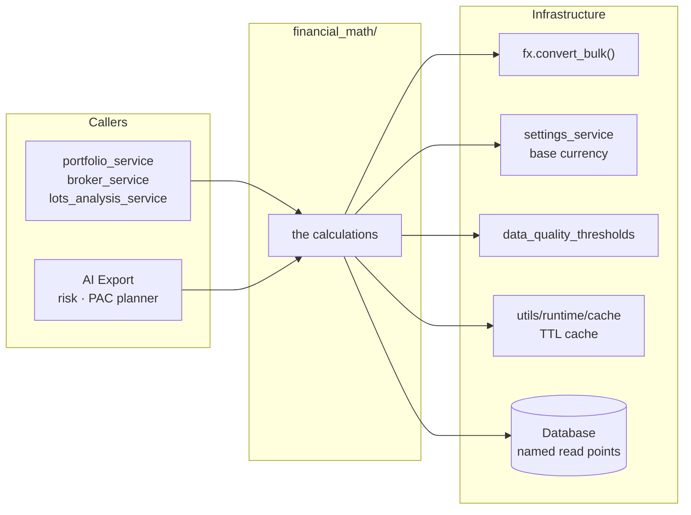

# 🧮 Financial Math Layer

Every financial calculation in LibreFolio — purchase cost, P&L, capital, NAV, returns, FX
value, yields — has exactly **one implementation**, and its home is
`backend/app/services/financial_math/`. The services, AI Export, the risk engine and the PAC
planner call this layer; the frontend shows the fields it computes.

This page is for developers who add or change a calculation: the rule, the package map, the
boundaries of the layer, how to add a calculation, and the guards that keep each calculation in
one place. The details of each engine are on the pages listed under [Deep Pages](#deep-pages).

!!! info "Where the rule is written"

    The rule is decision 10 of `.github/copilot-instructions.md` (developer decision of
    2026-10-11). Two instruction files carry it for coding agents:
    `.github/instructions/backend.instructions.md`, section «Financial Math — One Home», maps
    where each calculation lives; `.github/instructions/financial-math.instructions.md`, loaded
    for every file of the layer, holds its rules and its guards.

---

## 🎯 The Rule {: #rule }

1. **Search before writing.** Before computing anything financial, look in `financial_math/`.
   If the calculation exists, call it — with parameters when your case differs — instead of
   deriving it again.
2. **Add there.** A new calculation goes into `financial_math/`, next to the ones it relates
   to, with its unit tests.
3. **No local or partial copies.** A loop over transactions that recomputes cost, capital, NAV
   or P&L outside these engines is a defect, even when it serves a single card or export: read
   the engine's output instead.
4. **Report copies.** Report any copy you meet, old or new. Before closing work that touched
   financial math, search the project for copies of what you changed.

The technical indicators (`services/signal_plugins/`, `services/signal_runtime.py`), the
[risk engine](risk/architecture.md) (`services/risk/`) and the PAC allocator
(`services/pac_allocator/`) stay where they are, but take the common math — returns,
annualization, conversions, average cost, valuation — from the layer. FX conversion itself stays
in the FX service: `convert_bulk()` in `services/fx.py` is the primitive the calculations call.

---

## 🗺️ Package Map {: #package-map }

```text
backend/app/services/financial_math/
├── __init__.py              docstring only: the rule and the module map
├── average_cost.py          average purchase cost (WAC): pools, cost steps, missing conversions
├── native_cash.py           cash per broker and currency: balances, daily value, flows, FX result
├── returns.py               simple ROI, TWRR, MWRR (values and daily series), annualization
├── valuation.py             holding value from quantity, price and quote_base_quantity
├── price_marks.py           daily mark of an asset: MARKET, TRADE_AVG, CARRIED or MISSING
├── yield_on_cost.py         Yield on Cost of holdings, replayed from the transaction ledger
├── fifo/                    FIFO lots
│   ├── __init__.py          docstring only
│   ├── models.py            input transactions, events, lots, fragments, closures, result
│   ├── eligibility.py       eligible_income_quantity(): D-1 eligibility, shared with Yield on Cost
│   └── engine.py            FifoLotEngine, run_fifo_lot_engine()
├── portfolio/               daily portfolio state and the views derived from it
│   ├── __init__.py          docstring only
│   ├── models.py            classified transactions, daily states, contributions, results
│   ├── classifier.py        ScopeAwareTransactionClassifier: internal, external, in transit
│   ├── daily_state.py       DailyStateBuilder: the daily state vector, without I/O
│   ├── derived_views.py     DerivedViewsBuilder (history, P&L, allocation…), cost positions
│   ├── data_quality.py      FX pair slug, configured pair sets, build_data_quality_report()
│   └── engine.py            PortfolioCalculationEngine: loads a scope, runs the steps, caches
└── lots/                    lots analysis math, called by lots_analysis_service.py
    ├── __init__.py          docstring only
    ├── prices.py            PriceHistoryLookup, opening_reference_price()
    ├── conversions.py       FxRateResolver and the conversions each view needs
    ├── economic_events.py   income and FEE/TAX as engine inputs, their outputs, what is withheld
    ├── histories.py         value, return, price and performance histories
    └── average_cost_lines.py  per-broker and cumulative WAC history points
```

`fifo/models.py` also holds the engine's economic allocations (events, groups, per-lot
accumulators); `portfolio/models.py` holds `ValuationSource`, `EngineEndState` and
`PortfolioCalculationResult`.

### ⚙️ The Portfolio Package at Work {: #portfolio-package }

The portfolio engine has no developer page of its own: its cost side is in
[WAC & Cost Basis](transactions/wac.md#portfolio-engine), its valuation in
[Price Resolver](transactions/price_resolver.md), and its model in the theory page
[Portfolio Engine — Mathematical Model](../../financial-theory/technical-analysis/performance-metrics/portfolio-engine/index.md).
One call of `PortfolioCalculationEngine.calculate()` (`portfolio/engine.py`):

1. resolves the target currency (by default `get_effective_base_currency()`) and the broker
   scope, each broker at its `effective_share()`;
2. loads the scope's transactions and their split links, and classifies them
   (`ScopeAwareTransactionClassifier`, `classifier.py`);
3. returns the cached `PortfolioCalculationResult` when the `portfolio_blob` cache holds one for
   the same key — scope, currency, options and data fingerprints — that starts on or before the
   requested start and ends on the requested end date;
4. loads the prices, `quote_base_quantity`, currencies, types and classifications of the held
   assets, and preloads the FX rates in one `convert_bulk()` call (`_preload_fx_rates()`);
5. computes the average cost of every position (`compute_average_costs()` over
   `build_cost_positions()`), one `AssetPriceSeries` per held asset
   (`build_asset_price_series()`) and the native cash (`compute_native_cash()`);
6. runs `DailyStateBuilder` (`daily_state.py`) and stores its result in the cache.

Callers derive their views from the result with `DerivedViewsBuilder` (`derived_views.py`) —
history, per-broker P&L, candles, acquisition funding, performance inputs, allocation — and the
data-quality report with `build_data_quality_report()` (`data_quality.py`).

---

## 🧱 Layer Rules {: #layer-rules }



1. **A calculation owns its whole problem.** It takes the plain data of the problem —
   movements, currencies, dates — and calls the infrastructure it needs to complete it:
   `fx.convert_bulk()` for conversions, the base currency from `settings_service`, the
   thresholds of `data_quality_thresholds`, the cache. Its caller does not prepare values for
   it: `compute_average_costs()` receives the amounts actually paid and converts each
   acquisition itself, at its own date, in one batched call. A calculation reads its own data
   from the database only at named points: the portfolio engine (`portfolio/engine.py`, with
   `load_configured_fx_pair_sets()` in `portfolio/data_quality.py` for the configured FX
   routes) and the Yield on Cost loaders (`yield_on_cost.py`).
2. **Callers call the layer, never the other way round.** The layer never imports the
   orchestration services (`portfolio_service`, `broker_service`, `transaction_service`,
   `lots_analysis_service`), the API, AI Export, risk, PAC or signals: they call it.
3. **No silent fallback.** A missing rate, price or cost is reported — `MissingConversion`
   (average cost), `MissingCashConversion` (native cash), `PortfolioCalculationResult.missing_fx`
   (portfolio engine), a data-quality issue — and the value is unavailable: never a number,
   never the unconverted amount.
4. **No re-exports.** Every `__init__.py` of the layer holds only its docstring. Import a name
   from the module that defines it:

    ```python
    # ✅ From the module that defines the name
    from backend.app.services.financial_math.fifo.engine import run_fifo_lot_engine
    from backend.app.services.financial_math.fifo.models import FifoLot
    from backend.app.services.financial_math.portfolio.engine import PortfolioCalculationEngine

    # ❌ Not from the package: its __init__.py exports nothing
    from backend.app.services.financial_math.portfolio import PortfolioCalculationEngine
    ```

    Tests replace module globals — `convert_bulk` above all — on the module that reads them.
    `from … import …` binds the name in the importing module when it loads: replacing it
    anywhere else, in the FX service or in a package that re-exported it, leaves that binding
    untouched, and the patch is mute.
5. **One implementation.** Before writing a calculation, search the layer. If it exists, call
   it, with parameters when your case differs: `cumulative_to_annualized(total_return, days,
   min_days=…)` takes its 30-day floor as a parameter. Never keep a local or partial copy
   elsewhere, and report any copy you find.
6. **The frontend computes none of these quantities.** It shows the fields the backend
   computes. Interactive measures are the only exceptions — the chart measuring tool
   (`MeasureSignal.ts`) and the what-if curves of the
   [synthetic benchmarks](../../financial-theory/technical-analysis/synthetic-benchmarks/index.md)
   (`CompoundSignal.ts`, `LinearSignal.ts`, `SineSignal.ts`), all in
   `frontend/src/lib/charts/signals/` — and each exception must be declared where it lives.

---

## ➕ Adding a Calculation {: #adding-a-calculation }

1. **Search.** Look in the [package map](#package-map) and grep the layer, for example
   `grep -rn "annualiz" backend/app/services/financial_math/`. If the calculation exists, call
   it.
2. **Place it.** Put it next to the calculations it relates to. A new problem gets a new
   module; a large engine becomes a sub-package with one module per step, like `fifo/` and
   `portfolio/`.
3. **Keep the boundaries.** Import only the infrastructure and the layer's own modules, and
   report what cannot be computed instead of returning a number (see
   [Layer Rules](#layer-rules)).
4. **Test it.** Write its unit tests, pure where possible: no database, the session `None`, and
   `convert_bulk` replaced on the module that reads it. Adapted from `TestFxRateResolverLoad`
   in `backend/test_scripts/test_services/test_lots_analysis_pure.py`:

    ```python
    from datetime import date
    from decimal import Decimal

    import pytest

    import backend.app.services.financial_math.lots.conversions as conversions_module
    from backend.app.services.financial_math.lots.conversions import FxRateResolver


    @pytest.mark.asyncio
    async def test_a_day_with_no_published_rate_is_left_unresolved(monkeypatch):
        async def fake_convert_bulk(_session, conversions, raise_on_error=False):
            return [None] * len(conversions), []

        # Replaced where conversions.py reads it, not in backend.app.services.fx
        monkeypatch.setattr(conversions_module, "convert_bulk", fake_convert_bulk)
        resolver = FxRateResolver("EUR")
        resolver.need("USD", date(2024, 1, 10))
        await resolver.load(None)
        assert resolver.convert(Decimal("100"), "USD", date(2024, 1, 10)) is None
    ```

    The modules that read `convert_bulk` are `average_cost.py`, `native_cash.py`,
    `yield_on_cost.py`, `lots/conversions.py` and `portfolio/engine.py`. A pure test of a layer
    module can live in `backend/test_scripts/test_services/test_financial_math/`, which
    `services financial-math` runs as a whole, as a pure unit.
5. **Update the maps.** The module map in the docstring of `financial_math/__init__.py` (and of
   the sub-package, for a module of `fifo/`, `portfolio/` or `lots/`), the table in
   `.github/instructions/financial-math.instructions.md`, the map in
   `.github/instructions/backend.instructions.md` (section «Financial Math — One Home»), and the
   [package map](#package-map) on this page.
6. **Look for copies.** Before closing, search the project for copies of what you changed, and
   report them.

---

## 🛡️ Guards and Tests {: #guards-and-tests }

### 🚧 The Layer Guard {: #layer-guard }

`backend/test_scripts/test_services/test_financial_math/test_layer_boundaries.py` parses the
source of every module of the layer with `ast` — it imports none of them: no database, no
server — and fails when:

- a module imports an orchestration service, the API, AI Export, risk (`risk_plugins`
  included), PAC (`pac_allocator`, its planner source in `pac_allocator/source/` included) or signals (every `signal*`
  module), [rule 2](#layer-rules). Every import counts, a lazy one inside a function or one
  under `if TYPE_CHECKING:` included; the infrastructure (`fx`, `settings_service`,
  `data_quality_thresholds`, `utils`, `db`, `schemas`) and the layer's own modules stay
  allowed;
- an `__init__.py` holds anything besides its docstring — an import, an assignment, `__all__` —
  [rule 4](#layer-rules);
- one of the old homes below exists again, for example after merging a branch older than the
  move. A `__pycache__` folder left behind by git does not count.

Each detector first proves, on synthetic sources, that it sees what it looks for, and the scan
must reach the layer's known modules: a rule that asserts an absence never passes on an empty
scan. The guard runs with the layer's tests:

```bash
./dev.py test services financial-math
```

| Old home (removed) | Now in `financial_math/` |
|--------------------|--------------------------|
| `backend/app/utils/financial/roi_utils.py` | `returns.py` |
| `backend/app/utils/financial/valuation_utils.py` | `valuation.py` |
| `backend/app/utils/financial/__init__.py` (lazy re-export barrel) | Nothing: import from the module that defines the name |
| `backend/app/services/price_resolver.py` | `price_marks.py` |
| `backend/app/services/yield_on_cost.py` | `yield_on_cost.py` |
| `backend/app/services/fifo_lot_engine.py` | `fifo/`: `models.py`, `eligibility.py`, `engine.py` |
| `backend/app/services/portfolio_engine.py` | `portfolio/`: `models.py`, `classifier.py`, `daily_state.py`, `derived_views.py`, `data_quality.py`, `engine.py` |

The sync builders of `LotsAnalysisService` that never touched the database moved too, as
functions of `lots/`; the service keeps the orchestration, the database loaders, the response
builders and the analysis' data-quality report (see
[Lots Analysis Service](transactions/lots_analysis_service.md#code-layout)).

### 🎯 Targeted Test Selectors {: #test-selectors }

| Command | Runs (under `backend/test_scripts/`) | Covers |
|---------|--------------------------------------|--------|
| `./dev.py test services financial-math` | `test_services/test_financial_math/` | `average_cost.py`, `native_cash.py` and the layer guard; a pure unit |
| `./dev.py test services roi-fifo-utils` | `test_services/test_financial/` | Returns, FIFO lots, price marks, Yield on Cost, the portfolio engine (`test_portfolio_engine/`), and the portfolio and lots services that call them |
| `./dev.py test services portfolio-engine` | `test_services/test_portfolio_engine_vnext.py` | `DailyStateBuilder` |
| `./dev.py test services lots-analysis-pure` | `test_services/test_lots_analysis_pure.py` | `lots/` and the service's sync builders; a pure unit |
| `./dev.py test utils roi-utils` | `test_utilities/test_roi_utils.py` | `returns.py` |

!!! note "Test files keep their historical names"

    The move changed no test path: `test_roi_utils.py`, `test_fifo_lot_engine.py`,
    `test_price_resolver.py` and the `test_portfolio_engine/` folder keep the names of the
    modules they were written for, and import from the new homes.

---

## 📚 Deep Pages {: #deep-pages }

| Modules | Developer page | Theory |
|---------|----------------|--------|
| `average_cost.py`, `native_cash.py` | [WAC & Cost Basis](transactions/wac.md) | [Weighted Average Cost](../../financial-theory/technical-analysis/performance-metrics/weighted-average-cost.md) |
| `fifo/` | [FIFO Lot Engine](transactions/fifo_lot_engine.md) | [FIFO Engine](../../financial-theory/technical-analysis/performance-metrics/fifo-engine/index.md) |
| `lots/` | [Lots Analysis Service](transactions/lots_analysis_service.md) | [FIFO Lot Analysis](../../financial-theory/technical-analysis/performance-metrics/fifo-engine/fifo-lot-analysis.md) |
| `price_marks.py` | [Price Resolver](transactions/price_resolver.md) | [Price Resolution](../../financial-theory/technical-analysis/performance-metrics/portfolio-engine/price-resolution.md) |
| `portfolio/` | [The portfolio package at work](#portfolio-package); its data-quality report in [Data Quality Banner](../frontend/data-quality-banner.md); its cache in [FX Architecture](fx/architecture.md#portfolio-cache-invalidation) | [Portfolio Engine — Mathematical Model](../../financial-theory/technical-analysis/performance-metrics/portfolio-engine/index.md) |
| `returns.py` | — | [ROI](../../financial-theory/technical-analysis/performance-metrics/portfolio-engine/roi.md), [TWRR](../../financial-theory/technical-analysis/performance-metrics/portfolio-engine/twrr.md), [MWRR](../../financial-theory/technical-analysis/performance-metrics/portfolio-engine/mwrr.md) |
| `yield_on_cost.py` | — | [Yield on Cost](../../financial-theory/technical-analysis/performance-metrics/portfolio-engine/yield-on-cost.md) |

---

## 🔗 Related

- ⚖️ **[WAC & Cost Basis](transactions/wac.md)** — The average-cost and native-cash functions, and every caller
- 🧬 **[FIFO Lot Engine](transactions/fifo_lot_engine.md)** — The event-sourced lot replay
- 📊 **[Lots Analysis Service](transactions/lots_analysis_service.md)** — The orchestration over `fifo/` and `lots/`
- 📈 **[Price Resolver](transactions/price_resolver.md)** — The single daily valuation mark
- 📉 **[Risk Engine](risk/architecture.md)** — Risk analytics, a caller of the layer
