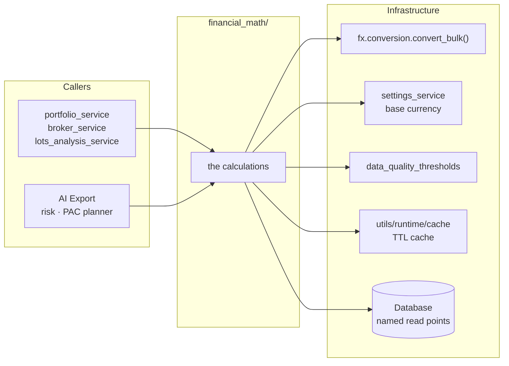

# 🧮 Financial Math Layer

Every financial calculation in LibreFolio — purchase cost, P&L, capital, NAV, returns, FX
value, yields — has exactly **one implementation**, and its home is
`backend/app/services/financial_math/`. The services, AI Export, the risk engine and the PAC
planner call this layer; the frontend shows the fields it computes.

This page is for developers who add or change a calculation: the rule, the package map, the
boundaries of the layer, how to add a calculation, and the guards that keep each calculation in
one place. The details of each engine are on the pages listed under [Deep Pages](#deep-pages).

!!! info "Where the rule is written"

    The rule is decision 10 of `.github/copilot-instructions.md` (developer decision of
    2026-10-11). Two instruction files carry it for coding agents:
    `.github/instructions/backend.instructions.md`, section «Financial Math — One Home», maps
    where each calculation lives; `.github/instructions/financial-math.instructions.md`, loaded
    for every file of the layer, holds its rules and its guards.

---

## 🎯 The Rule {: #rule }

1. **Search before writing.** Before computing anything financial, look in `financial_math/`.
   If the calculation exists, call it — with parameters when your case differs — instead of
   deriving it again.
2. **Add there.** A new calculation goes into `financial_math/`, next to the ones it relates
   to, with its unit tests.
3. **No local or partial copies.** A loop over transactions that recomputes cost, capital, NAV
   or P&L outside these engines is a defect, even when it serves a single card or export: read
   the engine's output instead.
4. **Report copies.** Report any copy you meet, old or new. Before closing work that touched
   financial math, search the project for copies of what you changed.

The technical indicators (`services/signal_plugins/`, `services/signals/runtime.py`), the
[risk engine](risk/architecture.md) (`services/risk/`) and the PAC allocator
(`services/pac_allocator/`) stay where they are, but take the common math — returns,
annualization, conversions, average cost, valuation — from the layer. FX conversion itself stays
in the FX service: `convert_bulk()` in `services/fx/conversion.py` is the primitive the calculations call.

### 🪞 Declared Float Twins {: #float-twins }

Four float functions of `backend/app/services/risk/metrics.py` have a counterpart in `returns.py`.
They are declared twins, not copies, and they stay in `risk/metrics.py` on purpose: series
statistics live there (`.github/instructions/backend-risk.instructions.md`). The layer's versions
take and return `Decimal`: NAV snapshots and cash flows for the TWRR, a rate over a span of days
for the conversions. The twins run on the float return series of the risk analytics.

- `compounded_return(returns)` — Π(1 + r) − 1, the geometric chaining that `calculate_twrr()`
  applies to its sub-period returns.
- `wealth_index(returns)` — 1, then Π(1 + r) after each return: the float form of the
  `wealth_index` of `calculate_twrr_period_series()`.
- `period_returns_from_cumulative(cumulative_returns)` — (1 + cₜ) / (1 + cₜ₋₁) − 1, which takes a
  cumulative return series back to period returns: the inverse of chaining the TWRR.
- `daily_risk_free_rate(annual_rate, periods_per_year)` — `expm1(log1p(R) / f)`, an annual rate
  per observation, the same compounding as `annualized_to_cumulative()` and
  `cumulative_to_annualized()`.

---

## 🗺️ Package Map {: #package-map }

```text
backend/app/services/financial_math/
├── __init__.py              docstring only: the rule and the module map
├── average_cost.py          average purchase cost (WAC): pools, cost steps, missing conversions
├── native_cash.py           cash per broker and currency: balances, daily value, flows, FX result
├── ledger_totals.py         control totals of the ledger for backups: cash per broker and currency, quantity per position
├── returns.py               simple ROI, TWRR, MWRR (values and daily series; the Dashboard's rule in period_mwrr*), annualization, period rebasing, G/L ratio (holding or group), change ratio, timing effect, realized gain, price return (also as a float for a return series), observed annualization of a return series, fixed-period changes of a price or rate (1D … 5Y, both orientations) and its change over a whole range, recovery from a drawdown
├── valuation.py             holding value from quantity, price and quote_base_quantity
├── interest.py              day count conventions (ACT/365, ACT/360, ACT/ACT, 30/360), simple interest and daily compounding over a span in closed form, at a cost independent of the span (compound_growth, memoized): the primitives the Scheduled Investment provider builds its accrual on
├── price_marks.py           daily mark of an asset: MARKET, TRADE_AVG, CARRIED or MISSING
├── yield_on_cost.py         Yield on Cost of holdings, replayed from the transaction ledger
├── weights.py               a share of a total (none on a total ≤ 0), allocation slices, gross weights, concentration (largest weight, HHI)
├── splits.py                stock splits in the ledger: the ADJUSTMENT rows linked to a SPLIT asset event (one query), the ids an average-cost replay rescales, the usable-ratio rule, the incoming adjustments without a cost that a SPLIT retype must not orphan
├── holding_window.py        how long a position has been held at its broker: oldest open lot, a closed position's window, its exits
├── fifo/                    FIFO lots
│   ├── __init__.py          docstring only
│   ├── models.py            input transactions, events, lots, fragments, closures, result
│   ├── eligibility.py       eligible_income_quantity(): D-1 eligibility, shared with Yield on Cost
│   └── engine.py            FifoLotEngine, run_fifo_lot_engine()
├── portfolio/               daily portfolio state and the views derived from it
│   ├── __init__.py          docstring only
│   ├── models.py            classified transactions, daily states, contributions, results
│   ├── classifier.py        ScopeAwareTransactionClassifier: internal, external, in transit
│   ├── daily_state.py       DailyStateBuilder: the daily state vector, without I/O
│   ├── derived_views.py     DerivedViewsBuilder (history, P&L, allocation…), cost positions
│   ├── data_quality.py      FX pair slug, configured pair sets, build_data_quality_report()
│   ├── period.py            a period's boundary states, its P&L and the identity that closes it; the day's P&L change
│   ├── contributions.py     a position's row in the Dashboard's Performance table: return on the start value, annualized returns, the internal-transfer split (P22)
│   └── engine.py            PortfolioCalculationEngine: loads a scope, runs the steps, caches
└── lots/                    lots analysis math, called by lots_analysis_service.py
    ├── __init__.py          docstring only
    ├── prices.py            from the asset's AssetPriceSeries: a lot's reference price at its opening, the last day valued at cost
    ├── conversions.py       FxRateResolver, a closure's legs at their own dates, and the conversions each view needs
    ├── economic_events.py   income and FEE/TAX as engine inputs, their outputs, what is withheld
    ├── histories.py         value, return, price, market price and performance histories
    ├── summary.py           a lot's figures: the cost of its open quantity, value and P&L by direction, the lot summary
    ├── scope_boundary.py    transfer legs whose partner sits outside the scope, read at its edge: in at their cost, out at market
    └── average_cost_lines.py  per-broker and cumulative WAC history points
```

`fifo/models.py` also holds the engine's economic allocations (events, groups, per-lot
accumulators); `portfolio/models.py` holds `ValuationSource`, `EngineEndState` and
`PortfolioCalculationResult`.

`period_mwrr()` and `period_mwrr_series()` (`returns.py`) hold the Dashboard's MWRR rule, one rule for the card and for
every point of the line (developer decision D-MF5): no rate when the value is zero or less, or when the net invested
capital up to that day — the first snapshot's value plus the flows after it (decision N54) — is zero or less; the
series' last point is the card. `calculate_mwrr()` and `calculate_mwrr_series()` remain the bare solves, without that
rule, and every point of the series is the single solve ending on its snapshot (one starting guess).

`float_price_return()` and `observed_annualization()` (`returns.py`) serve the float return series that the risk and
signal statistics read. `market_series.py`, which prepares those series, takes both from here and keeps no return
or annualization formula of its own.

- `float_price_return(start, end)` is `price_return()` as a float. It raises `ValueError` on a missing price or a zero
  start: a series never carries an unavailable return.
- `observed_annualization(n_observations, baseline_date, final_date)` returns the series' calendar span and its
  [observed annualization factor](../../financial-theory/technical-analysis/risk-metrics/observed-annualization.md#formula),
  observations × 365 / days. An empty series gives `(0, None)`; a span of zero days or less raises `ValueError`. A
  caller that can meet a zero-day span picks its own fallback before calling: `portfolio_twrr_returns()`
  (`risk/results.py`) leaves the factor `None`, the `comparison` analytic takes the context's factor.
- `observations_per_year(n_observations, calendar_days)` is the formula itself, the one home that
  `observed_annualization()` computes with and that the risk contracts check a factor against: the validators of
  `schemas/risk.py` import it (MF-D3), the one kind of import a schema may make from the layer — a pure function, never
  a service (rule 8 of `.github/instructions/financial-math.instructions.md`).

`fixed_period_dates()` and `fixed_period_changes()` (`returns.py`) hold the change of a price or rate over the fixed
periods of the Assets and FX tables (developer decision D-MF6 b). `FIXED_PERIODS` lists their keys and calendar days,
in display order: 1D 1, 1W 7, 1M 30, 3M 91, 6M 182, 1Y 365, 2Y 730, 3Y 1095, 5Y 1825. `fixed_period_dates(as_of)`
names the days to value: `as_of`, then `as_of − days` for each period. The caller values those days: the last stored
price on or before each ([`POST /assets/prices/period-changes`](assets/architecture.md#fixed-period-changes)), or
the rate `convert_bulk()` gives on it ([`POST /fx/currencies/period-changes`](fx/architecture.md#fixed-period-changes)).
`fixed_period_changes(values, as_of)` then gives each period both orientations, as fractions: `change_ratio`,
`value(as_of) / value(as_of − days) − 1`, and `inverse_change_ratio`, `value(as_of − days) / value(as_of) − 1`, the
change of the inverted quote. Each period is the house's `range_change()` (below) between the two values: None when
either is missing, the earlier one ≤ 0 or the one on `as_of` negative, and −1 (−100 %) with no inverse when the value
on `as_of` is exactly 0.
{: #fixed-period-changes }

`range_change(reference, anchor)` (`returns.py`) holds the change of a price or rate over the whole range a page
shows, from its first point to its last (X-R59, decision N80): the whole-range Δ of the Assets cards and the Δ Abs /
Δ % of the FX pages. The browser no longer computes them: the web app reads the endpoints' `range_change`
(`assetRangeDelta()` and `fxRangeDeltas()` in `frontend/src/lib/utils/rangeChange.ts`); the asset detail page reads it
from `POST /assets/prices/period-changes` for its stored series and `POST /assets/prices/current` for a live quote. The
function returns a frozen `RangeChange` of unrounded Decimals: `change_abs`, `anchor − reference`; `change_ratio`,
`anchor / reference − 1`; and the same for the inverted quote (an FX pair read the other way round),
`inverse_change_abs`, `1 / anchor − 1 / reference`, and `inverse_change_ratio`, `reference / anchor − 1`. All four are
None when either value is missing, the reference ≤ 0 or the anchor < 0. An anchor of exactly 0 over a positive
reference is a price written down to nothing (a defaulted loan, a delisted share): `change_abs` is −reference and
`change_ratio` −1 (−100 %), as the Assets cards showed it, while the inverse fields stay None (X's review of X-R59).
The period columns showed «—» for it and now show −100 % too. An FX pair never meets it: `convert_bulk()` skips a
stored rate of 0. The same two endpoints value the ends, for an item that sends a
`range_start`: the anchor is the value on `as_of`, as for the periods; the reference is the value on `range_start`
(backward-filled), or, when there is none on or before it, the first value inside the range — the first point of the
page's series. `POST /assets/prices/current?range_start=…` applies the same function to the current price, live or
stored, as the anchor, for an asset page whose range ends on a live quote
([Current Quotes and Today's OHLC](assets/architecture.md#current-quotes-range-change)).

### ⚙️ The Portfolio Package at Work {: #portfolio-package }

The portfolio engine has no developer page of its own: its cost side is in
[WAC & Cost Basis](transactions/wac.md#portfolio-engine), its valuation in
[Price Resolver](transactions/price_resolver.md), and its model in the theory page
[Portfolio Engine — Mathematical Model](../../financial-theory/technical-analysis/performance-metrics/portfolio-engine/index.md).
One call of `PortfolioCalculationEngine.calculate()` (`portfolio/engine.py`):

1. resolves the target currency (by default `get_effective_base_currency()`) and the broker
   scope, each broker at its `effective_share()`;
2. loads the scope's transactions and their split links (`load_split_links()`, `splits.py`),
   and classifies them
   (`ScopeAwareTransactionClassifier`, `classifier.py`). A split whose stored ratio fails `is_valid_split_ratio()`
   (missing, not finite, or not above 0) counts as missing, never an exception (lot MF-D4; before, a `ValueError`).
   Its linked rows stay in `split_linked_tx_ids`, the split's rescale with their cost kept. Only the ratio is dropped:
   the event adds no `SplitRecord` to `split_history`, and goes once into `PortfolioCalculationResult.invalid_split_events`
   (`InvalidSplitEvent`, sorted by event id), which the data-quality report turns into `INVALID_SPLIT_RATIO`.
   The range of daily states it computes starts no earlier than the first
   transaction and ends no later than `latest_range_end()` (tomorrow, `utils/datetime_utils.py`): the replay walks every
   day, and an end far in the future held the instance (R13-SEC7-1). Nor does it start before `EARLIEST_RANGE_START`
   (1 January 1900, same module, R13-SEC8): a transaction stored before it is still replayed on its own date (see
   [The Days the Engine Recomputes](#recomputed-days)), but no state is emitted for a day before it, and none of the
   per-day rates of steps 4 and 5 is asked before it — a movement's own conversion is still asked at its date. A
   range that ends before the first transaction gives an empty result;
3. returns the cached `PortfolioCalculationResult` when the `portfolio_blob` cache holds one for
   the same key — scope, currency, options, data fingerprints and the day of
   `position_states_start` — that starts on or before the requested start and ends on the
   requested end date;
4. loads the prices, `quote_base_quantity`, currencies, types and classifications of the held
   assets, and preloads the FX rates in one `convert_bulk()` call (`_preload_fx_rates()`);
5. computes the average cost of every position (`compute_average_costs()` over
   `build_cost_positions()`), one `AssetPriceSeries` per held asset
   (`build_asset_price_series()`) and the native cash (`compute_native_cash()`);
6. runs `DailyStateBuilder` (`daily_state.py`) in a worker thread, [off the event loop](#off-the-event-loop), and
   stores its result in the cache.

`position_states_start` holds the positions at the end of `calculate(period_start=…)` — the caller's period start, while
the daily states run from `date_from` (t=0 for the Dashboard) — or of `date_from` when it is not named.
`internal_asset_transfers` lists each linked TRANSFER of a security between two brokers of the scope, with its value on
arrival and the cost the sender moved: the Performance table's transfer split (`contributions.py`, developer decision P22).

Callers derive their views from the result with `DerivedViewsBuilder` (`derived_views.py`) —
history, per-broker P&L, candles, acquisition funding, performance inputs, allocation — and the
data-quality report with `build_data_quality_report()` (`data_quality.py`).

#### 🧵 Off the Event Loop {: #off-the-event-loop }

`DailyStateBuilder.build()` is pure CPU, and a wide range makes it long: run on the event loop, one user's wide
report held every other request until it ended (finding R13-SEC7, lot J-45). `calculate()` hands it to a worker
thread instead, `await loop.run_in_executor(_engine_executor(), contextvars.copy_context().run, builder.build)`:

- **A dedicated executor.** `_engine_executor()`, in `portfolio/engine.py`, gives the module's
  `ThreadPoolExecutor(max_workers=2, thread_name_prefix="portfolio-engine")`, created on first use, not the default
  executor that every `asyncio.to_thread()` call of the backend shares. The app's shutdown step `portfolio-engine`
  (`app_lifespan.SHUTDOWN_STEPS`, after `quant-pools`) calls `shutdown_engine_executor()` (MF-J45a): a replay still
  queued is cancelled, nothing is waited for, and a later start in the same process makes a new executor. Its two workers bound how many replays run at once; a third waits
  in its queue. The GIL still runs one replay at a time, but the loop gets its turn in between: the interpreter
  switches threads every 5 ms (`sys.getswitchinterval()`, which the backend leaves at its default).
- **The copied context.** Unlike `asyncio.to_thread()`, `run_in_executor()` does not copy the context variables:
  `copy_context().run` runs the replay in a copy of the request's context. Today that copy carries the secrets
  `secrets_in_flight()` masks in log lines, and the `decimal` context, which `decimal` keeps in a context variable:
  the replay computes with the precision and rounding of the request that started it. No code binds a structlog
  context today (`merge_contextvars` in `logging_config.py` merges nothing); one bound later reaches the replay too.
- **What crosses the thread.** The builder reads loaded data only: the maps the earlier steps built, and the column
  attributes of the `Transaction` rows (`id`, `date`, `type`, `broker_id`, `asset_id`, `quantity`, `amount`,
  `currency`, `cost_basis_currency`, `cost_basis_override`). It reads no relationship: `related_transaction` loads
  lazily, and the builder never touches it. `Transaction` defers no column, and the builder reads only rows that
  `calculate()`'s own queries loaded, which never commits, rolls back or expires: no attribute reloads. No session
  enters the thread: every query of `calculate()` runs before the await, and no caller runs another task on the
  engine's session meanwhile. The replay's modules hold no mutable state, only constants and a logger. The
  `portfolio_blob` cache is written on the loop, after the await.
- **Cancellation.** A thread cannot be cancelled. When the request is cancelled while its replay runs — its client
  disconnected — the replay runs to its end and its result is dropped, since the cache write comes after the
  await; a replay still waiting in the queue is cancelled before it starts. The range bounds of step 2
  (R13-SEC7-1, R13-SEC8) bound the work.

When you give the builder a new input, give it loaded data — a column already read, or a value an earlier step
computed — never a lazy relationship or an expired attribute. The worker thread would try to load it outside the
event loop, and the replay would fail with `MissingGreenlet`. `test_engine_off_the_loop.py`
(`test_financial/test_portfolio_engine/`) pins the worker thread, the loop running meanwhile, the parity with a replay
on the loop, the copied context, and a guard that fails on any lazy load during the replay.

**One build per key at a time** (MF-J45b). Two identical requests that miss the cache together — the same user in two
tabs, a refresh during a cold build, the PAC planner's allocation source beside the report — used to pay the reads and
one of the two workers each. `calculate()` now keeps the builds in flight in `_IN_FLIGHT`, by blob key and exact range
(`(blob_key, actual_from, actual_to)`). The cache also answers a request whose start is later than a stored blob's, but a
flight does not: an identical request with a later start builds on its own.

- the first request builds (`_compute_uncached()`: steps 6–12 above, unchanged), stores the result in the cache and
  hands it to the requests that arrived meanwhile, which `await asyncio.shield()` it: they get the same object, as a
  cache hit does, read-only;
- if the build fails, every waiting request gets the same error at once (MF-J45d): the same data fails the same way,
  and retrying it one request after another made the k-th wait k builds before failing;
- if the build's request is cancelled, the `finally` settles the entry with `_LeaderGone` **before** it removes it, so
  no request waits on a build nobody will finish: the first waiting request to resume builds for itself, the others
  wait for it;
- a waiting request that is cancelled leaves the build alone (`shield`); other keys or ranges never wait for each
  other. The map is per process, like the cache.
{: #single-flight }

#### 📅 The Days the Engine Recomputes {: #recomputed-days }

`DailyStateBuilder.build()` runs one replay, with the same rules every day, from the earliest
movement (or `date_from`, when it is earlier) to `date_to`: a movement dated before `date_from`
moves the cash, the quantities, the cost pools, the capital and the K/R/W pools like any other —
the pool rules of a cash movement that reduces no position are one static method,
`_apply_pool_rule()`. A linked-internal CASH_TRANSFER or FX_CONVERSION leg goes through
`_move_linked_cash()` (developer decision D-MF4): the departure records its `(from R, amount)`
split in `transfer_splits`, keyed by its transaction id, and its arrival takes it up once,
bringing back what the departure took from K and R. The gap between the two legs — a
conversion's spread, the rate move while the cash travels, two brokers owned at different shares —
is already in the engine's P&L, since no leg is an external flow: it is booked as a result (a gain
to R, a loss out of R then K). An arrival whose departure is unknown arrives in K, and one whose
departure is on the same day is applied last on that day. The replay emits one
`DailyPortfolioState` for every day of `[date_from, date_to]`,
so a later `date_from` gets for its days exactly the states of the full replay. It evaluates only
the **dirty** days, which `_collect_dirty_days()` lists: any other day carries the previous state
(`dataclasses.replace()`, its containers copied), dated that day, with no external flow and no
acquisition funding. The rule is developer decision 28 of release 1.3, «recompute whenever a term
of the formula changes». A replayed day is dirty when it has:

- a cash movement, a transaction that moves a quantity, an external flow, or an internal flow
  between two brokers;
- a change in the rate of a foreign currency held as cash, its first rate included
  (`NativeCash.rate_change_days()`);
- a change from the day before in a rate the day reads to value it
  (`_valuation_rate_change_days()`): the rate of every non-report currency of the assets and of
  their quotes, which values the securities, held and in transit, and the exchange part of the
  [unrealized split](transactions/wac.md#unrealized-split); and, on the days of its transit, the
  rate of the departure currency of cash in transit. A rate that appears or disappears counts;
- the departure day of a transit, its last day in transit, or its arrival day;
- a market quote, even one equal to the previous close: the mark may have come from a trade the
  day before, and a new quote restarts the price's age;
- the first day a carried price turns stale: each observation day — a quote, or a transaction
  that moves a quantity — plus `STALE_PRICE_THRESHOLD_DAYS` + 1, since a price is stale when it
  is carried more than `STALE_PRICE_THRESHOLD_DAYS` days;
- a split;
- or it is the first replayed day, `date_from`, or `period_start` when it falls in the replay.

Before `date_from` a quiet day is not even visited: no state is emitted there, and it would only
carry the previous one, so the loop jumps straight to the next dirty day (`bisect.bisect_right()`
over the sorted dirty days; `date_from` is always one). The output is the one a day-by-day walk
gives, and the part of the replay before `date_from` costs its dirty days, not its calendar days.

A movement stored before `EARLIEST_RANGE_START` (1 January 1900, `utils/datetime_utils.py`) is
replayed exactly, on its own date and in its own order, never moved onto 1900; `calculate()` never
passes a `date_from` before that floor, so the replay crosses the years between such a movement
and `date_from` from dirty day to dirty day. `calculate()` counts those rows into
`PortfolioCalculationResult.rows_before_floor` (`RowsBeforeFloor(count, earliest)`), which the
data-quality report turns into the warning `TRANSACTIONS_BEFORE_FLOOR` (MF-SEC8-2a; see
[Data Quality Banner](../frontend/data-quality-banner.md)).

!!! info "Why: R13-SEC8"

    A transaction stored with a date far in the past — year 1, say — made every replay walk every
    calendar day since: a state carried on each quiet day, a rate calendar for each currency, a rate
    request for each day of each foreign currency it values (finding R13-SEC8, lot MF-SEC8-2). A row
    dated `0001-01-01` could even raise `OverflowError`: a rate calendar starts the day before the
    replay, and `date.min` has none.

Both rate rules take their days from one pure function, the one home of «the day a rate changes»:
`native_cash.change_days(read, currencies, days)` returns the days of the calendar `days`, in its
order, on which `read(currency, day)` gives one of `currencies` another rate than on the
calendar's previous day; a rate on the calendar's first day counts. The caller chooses the reading
and the calendar. The native cash reads the last rate known on or before the day, on the calendar
of its rate points. The engine reads the rate `fx_rate_map` holds for that exact day
(`_read_rate()`), on every replayed day — or day of the transit, for cash in transit — each
compared with the day before (`_calendar()` starts one day early); its calendars start on
`EARLIEST_RANGE_START` at the earliest, since no rate is loaded before it. `_read_rate()` reads only the
map, which `_preload_fx_rates()` already fills for these currencies on every day of
`[date_from, date_to]` (a day replayed before a later `date_from` may find none there, and its
state is not emitted), and for cash in transit on every day of its transit from
`EARLIEST_RANGE_START` on: the rule asks the FX service for nothing more.

When you add an input that can change a day's value — a rate, a price, a mark's source, an age —
add its days to the dirty days, or show that the day cannot change.
`test_fx_only_days.py` (`test_services/test_financial/test_portfolio_engine/`, run by
`./dev.py test services roi-fifo-utils`) moves one term at a time on an otherwise quiet day,
checks with its guards that a day whose terms do not move keeps its values, and tests
`change_days()` under both readings.

!!! note "Before release 1.3"

    Until lot CP-6 (backlog B11), a day on which only a foreign security's rate moved (or the rate
    of cash in transit in a currency the native cash did not hold), a quote equal to the previous
    close replaced a trade mark or restarted the price's age, or a carried price turned stale, was
    a copy of the last dirty day. The series derived from the daily states carried that copy, and
    so did the summary when that day was `date_to`: it reads that day's state for NAV, P&L and
    returns. Only the end positions (`position_states_end`) were valued afresh at `date_to`.

### 🧾 Ledger Control Totals {: #ledger-totals }

`ledger_totals.py` reduces the transaction ledger to its control totals — the cash of every
broker in each currency and the quantity of every position — read from the rows alone, with no
price, rate, cost, setting or clock. The instance backup writes them into a backup's manifest.
The check of a restore recomputes them on the archive's copy, once upgraded to the app's schema,
and compares them before the restore is confirmed. A difference is a warning in the check's
report, never a refusal: a migration may correct data.

| Name | Contract |
|------|----------|
| `CONTROL_TOTALS_VERSION` | `1`. It names the method — what is summed and how it is written — so a change to either bumps it: totals of another version are not comparable |
| `ControlTotals(version, cash, quantities)` | Frozen dataclass with slots, compared by value. `cash` holds `(broker_id, currency, balance)` lines and `quantities` `(broker_id, asset_id, quantity)` lines, each sorted by its key, with no zero line: an absent line is zero |
| `position_quantities(transactions, as_of=None)` | Pure. `{broker_id: {asset_id: quantity}}` over the rows dated on or before `as_of` (every row when `None`), by the portfolio engine's rule: every row with an asset and a non-zero quantity, whatever its type. Like `native_balances()`, it keeps a line whose rows cancel out, at zero |
| `control_totals(transactions)` | Pure. The cash is `native_balances()` over `cash_movement_from_transaction()` of every row (a row without a currency moves no cash), the quantities are `position_quantities()`. The sums are exact: they run in a local decimal context that raises `decimal.Inexact` instead of rounding, and leave the caller's context as it was |
| `compute_control_totals(session)` | Async. The totals of the whole ledger `session` reads: a named read point of the layer ([rule 1](#layer-rules)) |

`compute_control_totals()` reads through the session it is given and nothing else: only the
columns the totals need (`id`, `type`, `date`, `broker_id`, `asset_id`, `currency`, `amount`,
`quantity`), in keyset blocks of `_BLOCK_SIZE` (5,000) rows by primary key. It sums in Python,
never with an SQL `SUM`: on SQLite a `Numeric` column goes through a float. It reads no price,
rate or setting, makes no network call, never asks for today's date and keeps no module cache,
so it can run on a session opened on another SQLite file — a backup's copy of the database — in
the same process as the live one.

`to_json()` writes the version, then the lines in order, with the keys below; for the reference
ledger of the tests:

```json
{
  "version": 1,
  "cash": [
    {"broker_id": 1, "currency": "EUR", "balance": "278.5"},
    {"broker_id": 1, "currency": "USD", "balance": "545.5"},
    {"broker_id": 2, "currency": "EUR", "balance": "107"},
    {"broker_id": 2, "currency": "USD", "balance": "510"}
  ],
  "quantities": [
    {"broker_id": 1, "asset_id": 10, "quantity": "1"},
    {"broker_id": 2, "asset_id": 10, "quantity": "4"},
    {"broker_id": 2, "asset_id": 11, "quantity": "0.000001"}
  ]
}
```

Every amount is canonical decimal text — plain notation without trailing zeros (`"510"`, not
`"510.000000"`; `"100"`, not `"1E+2"`), `"0"` for zero, never `"-0"` — so one ledger has one
text. `ControlTotals.from_json(data)` is the inverse of `to_json()` and raises `ValueError` for
another version or a malformed document. Read `version` before calling it: totals of another
version are not comparable, which is not the same as a difference.

`from_json()` reads an amount only as `to_json()` writes it.

- **Accepted:** an optional `-`, then at most 60 ASCII digits before the point and 60 after it,
  the precision of the exact context.
- **Refused with `ValueError`:** everything else that `Decimal` would also take — an exponent
  (`"1E+9"`), a `+`, spaces, `_`, other scripts' digits.
- **Why:** a manifest written by hand, or damaged, could otherwise make `_canonical()` write an
  exponent out in full; `"1E+50000000"` alone costs about 121 MB.
- **Round trip:** it holds for every total within that bound, and every ledger the database can
  hold stays within it (amounts `RealDecimal(18, 6)`, quantities `RealDecimal(22, 10)`).

What the totals promise their caller:

- **The whole instance.** Every broker at 100% and every row, whatever its date: no user, share
  or scope.
- **Blind to the row type.** A migration that reclassifies the halves of a `TRANSFER` as
  `ADJUSTMENT`s, or those of a `CASH_TRANSFER` as a `WITHDRAWAL` and a `DEPOSIT`, changes
  nothing; nor do a row's date, its transaction id or the order the rows are read in.
- **A difference means a row lost, added or altered** in broker, asset, currency, amount or
  quantity.
- **Dust is kept.** A quantity at or below `QUANTITY_DUST_THRESHOLD`
  (`services/platform/data_quality_thresholds.py`), which the Dashboard does not list as a
  holding, keeps its line: a control total sees every unit.
- **No cost basis.** `cost_basis_override` is never read: a cost basis depends on rates and on
  the WAC and FIFO rules, and carrying it would bump the version at every change of those rules.
- **Ids local to the instance.** Lines are keyed by `broker_id` and `asset_id`, which mean
  something only inside one instance: the totals compare a restore of the whole instance with
  its own backup.

`test_ledger_totals.py`, in `test_services/test_financial_math/` (`services financial-math`),
pins this contract on a reference ledger — each promise above, the canonical text, the exact
sums, the parity with the average-cost fold and `native_balances()` — and runs
`compute_control_totals()` on private SQLite files under `tmp_path`, several in one process, as
a restore check reads them. Its static guard parses the module's source: no SQL `SUM`, no
settings, module cache, FX service, price, rate or clock.

---

## 🧱 Layer Rules {: #layer-rules }



1. **A calculation owns its whole problem.** It takes the plain data of the problem —
   movements, currencies, dates — and calls the infrastructure it needs to complete it:
   `fx.conversion.convert_bulk()` for conversions, the base currency from `settings_service`, the
   thresholds of `data_quality_thresholds`, the cache. Its caller does not prepare values for
   it: `compute_average_costs()` receives the amounts actually paid and converts each
   acquisition itself, at its own date, in one batched call. A calculation reads its own data
   from the database only at named points: the portfolio engine (`portfolio/engine.py`, with
   `load_configured_fx_pair_sets()` in `portfolio/data_quality.py` for the configured FX
   routes), the Yield on Cost loaders (`yield_on_cost.py`), the
   [ledger control totals](#ledger-totals) (`compute_control_totals()`, through the session it
   is given) and the split links (`splits.load_split_links()` and `splits.split_linked_ids()`,
   the rows of the transactions it is given; `splits.costless_incoming_split_adjustments()`, the
   rows linked to the events it is given).
2. **Callers call the layer, never the other way round.** The layer never imports the
   orchestration services (`portfolio_service`, `broker_service`, `transaction_service`,
   `lots_analysis_service`), the API, AI Export, risk, PAC or signals: they call it.
3. **No silent fallback.** A missing rate, price or cost is reported — `MissingConversion`
   (average cost), `MissingCashConversion` (native cash), `PortfolioCalculationResult.missing_fx`
   (portfolio engine), a data-quality issue — and the value is unavailable: never a number,
   never the unconverted amount.
4. **No re-exports.** Every `__init__.py` of the layer holds only its docstring. Import a name
   from the module that defines it:

    ```python
    # ✅ From the module that defines the name
    from backend.app.services.financial_math.fifo.engine import run_fifo_lot_engine
    from backend.app.services.financial_math.fifo.models import FifoLot
    from backend.app.services.financial_math.portfolio.engine import PortfolioCalculationEngine

    # ❌ Not from the package: its __init__.py exports nothing
    from backend.app.services.financial_math.portfolio import PortfolioCalculationEngine
    ```

    Tests replace module globals — `convert_bulk` above all — on the module that reads them.
    `from … import …` binds the name in the importing module when it loads: replacing it
    anywhere else, in the FX service or in a package that re-exported it, leaves that binding
    untouched, and the patch is mute.
5. **One implementation.** Before writing a calculation, search the layer. If it exists, call
   it, with parameters when your case differs: `cumulative_to_annualized(total_return, days,
   min_days=…)` takes its 30-day floor as a parameter. Never keep a local or partial copy
   elsewhere, and report any copy you find.
6. **The frontend computes none of these quantities.** It shows the fields the backend
   computes. Interactive measures are the only exceptions — the chart measuring tool
   (`MeasureSignal.ts`) and the what-if curves of the
   [synthetic benchmarks](../../financial-theory/technical-analysis/synthetic-benchmarks/index.md)
   (`CompoundSignal.ts`, `LinearSignal.ts`, `SineSignal.ts`), all in
   `frontend/src/lib/charts/signals/`; and the lot measures shaped by the user's choices (D-MF6(b)):
   the lots table footer over the selection, else the filtered rows (`unifiedLotsTableHelpers.ts`),
   the comparison chart's aggregate of the selected lots (`lotComparisonChartHelpers.ts`) and the
   WAC chart's percentage view (`lotWacPriceChartHelpers.ts`), all in
   `frontend/src/lib/features/brokers/lots/` — and each exception must be declared where it lives.
   The measuring tool takes the backend's annualization floor: `MIN_ANNUALIZATION_DAYS` in
   `MeasureSignal.ts` is held to `_MIN_ANNUALIZATION_DAYS` of `returns.py` by a parity test in
   `measureSignal.test.ts`, so changing one without the other fails that test. Its `changePct` (null on a zero
   start, N65) is also the one Δ% rule of the chart tooltip (`priceChartHelpers.ts::buildDeltaHtml`, J-44), which
   imports it rather than keeping a copy.
   The declaration is the tag `@financial-math-exception` in the file's leading JSDoc block,
   followed by what the exception computes and why it stays in the browser. The [gate](#frontend-exceptions-gate)
   (`frontend/src/financialMathExceptions.gate.test.ts`) holds the list of declared files and
   fails when a listed file lacks the tag, an unlisted file carries it, or an annualizing
   exponent with 365 (`Math.pow(…, …365…)`, `** …365…` or `**= …365…`) appears outside the listed
   files that annualize:
   adding an exception means extending that list on purpose; otherwise, use the backend's field.

---

## ➕ Adding a Calculation {: #adding-a-calculation }

1. **Search.** Look in the [package map](#package-map) and grep the layer, for example
   `grep -rn "annualiz" backend/app/services/financial_math/`. If the calculation exists, call
   it.
2. **Place it.** Put it next to the calculations it relates to. A new problem gets a new
   module; a large engine becomes a sub-package with one module per step, like `fifo/` and
   `portfolio/`.
3. **Keep the boundaries.** Import only the infrastructure and the layer's own modules, and
   report what cannot be computed instead of returning a number (see
   [Layer Rules](#layer-rules)).
4. **Test it.** Write its unit tests, pure where possible: no database, the session `None`, and
   `convert_bulk` replaced on the module that reads it. Adapted from `TestFxRateResolverLoad`
   in `backend/test_scripts/test_services/test_lots_analysis_pure.py`:

    ```python
    from datetime import date
    from decimal import Decimal

    import pytest

    import backend.app.services.financial_math.lots.conversions as conversions_module
    from backend.app.services.financial_math.lots.conversions import FxRateResolver


    @pytest.mark.asyncio
    async def test_a_day_with_no_published_rate_is_left_unresolved(monkeypatch):
        async def fake_convert_bulk(_session, conversions, raise_on_error=False):
            return [None] * len(conversions), []

        # Replaced where conversions.py reads it, not in backend.app.services.fx.conversion
        monkeypatch.setattr(conversions_module, "convert_bulk", fake_convert_bulk)
        resolver = FxRateResolver("EUR")
        resolver.need("USD", date(2024, 1, 10))
        await resolver.load(None)
        assert resolver.convert(Decimal("100"), "USD", date(2024, 1, 10)) is None
    ```

    The modules that read `convert_bulk` are `average_cost.py`, `native_cash.py`,
    `yield_on_cost.py`, `lots/conversions.py` and `portfolio/engine.py`. A pure test of a layer
    module can live in `backend/test_scripts/test_services/test_financial_math/`, which
    `services financial-math` runs as a whole, as a pure unit.
5. **Update the maps.** The module map in the docstring of `financial_math/__init__.py` (and of
   the sub-package, for a module of `fifo/`, `portfolio/` or `lots/`), the table in
   `.github/instructions/financial-math.instructions.md`, the map in
   `.github/instructions/backend.instructions.md` (section «Financial Math — One Home»), and the
   [package map](#package-map) on this page.
6. **Look for copies.** Before closing, search the project for copies of what you changed, and
   report them.

---

## 🛡️ Guards and Tests {: #guards-and-tests }

### 🚧 The Layer Guard {: #layer-guard }

`backend/test_scripts/test_services/test_financial_math/test_layer_boundaries.py` parses with
`ast` the source of every module of the layer and, for the two rules at the end of this section,
of every module of `backend/app`. It imports none of them — no database, no server — and fails
when:

- a module imports an orchestration service, the API, AI Export, risk (`risk_plugins`
  included), PAC (`pac_allocator`, its planner source in `pac_allocator/source/` included) or signals (every `signal*`
  module), [rule 2](#layer-rules). Every import counts, a lazy one inside a function or one
  under `if TYPE_CHECKING:` included; the infrastructure (`fx`, `settings_service`,
  `data_quality_thresholds`, `utils`, `db`, `schemas`) and the layer's own modules stay
  allowed;
- an `__init__.py` holds anything besides its docstring — an import, an assignment, `__all__` —
  [rule 4](#layer-rules);
- one of the old homes below exists again, for example after merging a branch older than the
  move. A `__pycache__` folder left behind by git does not count.

Each detector first proves, on synthetic sources, that it sees what it looks for, and each scan
must reach the modules it knows of, in the layer or in `backend/app`: a rule that asserts an
absence never passes on an empty scan. The guard runs with the layer's tests:

```bash
./dev.py test services financial-math
```

| Old home (removed) | Now in `financial_math/` |
|--------------------|--------------------------|
| `backend/app/utils/financial/roi_utils.py` | `returns.py` |
| `backend/app/utils/financial/valuation_utils.py` | `valuation.py` |
| `backend/app/utils/financial/__init__.py` (lazy re-export barrel) | Nothing: import from the module that defines the name |
| `backend/app/services/price_resolver.py` | `price_marks.py` |
| `backend/app/services/yield_on_cost.py` | `yield_on_cost.py` |
| `backend/app/services/fifo_lot_engine.py` | `fifo/`: `models.py`, `eligibility.py`, `engine.py` |
| `backend/app/services/portfolio_engine.py` | `portfolio/`: `models.py`, `classifier.py`, `daily_state.py`, `derived_views.py`, `data_quality.py`, `engine.py` |

The sync builders of `LotsAnalysisService` that never touched the database moved too, as
functions of `lots/`; the service keeps the orchestration, the database loaders, the response
builders and the analysis' data-quality report (see
[Lots Analysis Service](transactions/lots_analysis_service.md#code-layout)).

The day count conventions and simple interest of the Scheduled Investment provider moved too,
unchanged (lot CP-14a, U10, developer decision D-8): `calculate_day_count_fraction()` with its
three helpers (`_calculate_act_fixed()` for ACT/365 and ACT/360, `_calculate_act_act()`,
`_calculate_30_360()`), and `calculate_simple_interest()`, now in `interest.py`. The provider
imports them from there and keeps `_compute_maturation_dates()`, which reads the domain's
maturation frequency, and its accrual walk (see
[Scheduled Investment Provider](assets/provider_scheduled_investment.md#accrual-walk)). Its file
stays, so the guard follows the names rather than a file: it fails when one of the five is not
defined exactly once in `interest.py`, or is defined anywhere else in `backend/app` — a method,
a nested function or a fallback under `except ImportError` included.

Lots R13-SEC7-2 and MF-SI1 added `compound_growth()` to `interest.py`: the growth factor of
daily compounding over a span, `Π (1 + r × Δt(d − 1, d))` over its days, in closed form and at a
cost that does not grow with the span — one power under ACT/365 and ACT/360; under ACT/ACT the
first and last years' days, and one power each for the whole common and the whole leap years
between; under 30/360 one power per step size (0, 1, 2 or 3 days over 360), from exact integer
step counts. It is memoized (`_compound_growth`, an LRU cache of 4 096 entries) on the rate as
written and the caller's `Decimal` precision and rounding; `_calculate_act_act()` memoizes its
full-year prefix the same way (`_act_act_years_before`), with the digits of the per-year sum.
Its one caller is COMPOUND late interest (see
[Scheduled Investment Provider](assets/provider_scheduled_investment.md#late-interest)). The
guard's five names do not include it.

The other rule over `backend/app` keeps one question in one place, «which rows are linked to a
SPLIT asset event», and fails when:

- a module of `backend/app` names `AssetEventType.SPLIT` anywhere but its two allowed homes:
  `services/financial_math/splits.py`, the one loader of those rows, and
  `services/transactions/event_suggestions.py`, a UI mapping of event type to transaction type
  that loads nothing, [rule 5](#layer-rules). Every shape that reaches the member counts —
  `AssetEventType.SPLIT`, `models.AssetEventType.SPLIT`, an alias bound by
  `from … import AssetEventType as X`, `AssetEventType("SPLIT")`, `AssetEventType["SPLIT"]`,
  `getattr(AssetEventType, "SPLIT")` — and nothing else does: a comment, a docstring, another
  enum's `SPLIT` member, the string `"SPLIT"` on its own. Read the linked rows through
  `splits.py` instead: `split_linked_ids()`, or `load_split_links()` when the ratio, the event
  or the dates matter; the event store, before a SPLIT changes type, asks
  `costless_incoming_split_adjustments()`. Before lot MF-I2 the WAC preview
  (`portfolio_service.py`), the broker summary (`brokers/summary.py`) and the auto cost
  (`transactions/auto_cost.py`) each wrote the join again. An allowed home that no longer names
  the member is a stale entry, and fails too.

### 🚦 The Frontend Exceptions Gate {: #frontend-exceptions-gate }

`frontend/src/financialMathExceptions.gate.test.ts` guards [rule 6](#layer-rules) over the `.ts`
and `.svelte` sources of `frontend/src` — tests, mocks and generated API clients aside — and
fails when:

- a file of its list, `DECLARED_EXCEPTIONS`, lacks `@financial-math-exception` in its leading
  JSDoc block, followed by a description of at least 20 characters;
- any other source contains the tag, even in a comment or a string;
- a power whose exponent holds 365 (`Math.pow(…, …365…)`, `**`, `**=`) appears outside the listed
  files that annualize, flagged `annualizes: true` — the measuring tool and the compound curve.
  Powers are found with the TypeScript and Svelte parsers, so comments and strings never count.

As in the layer guard, each detector proves, on synthetic sources, that it sees what it looks
for. The gate runs with the chart-safety unit tests:
`./dev.py test front-portfolio chart-safety-unit`.

### 🎯 Targeted Test Selectors {: #test-selectors }

| Command | Runs (under `backend/test_scripts/`) | Covers |
|---------|--------------------------------------|--------|
| `./dev.py test services financial-math` | `test_services/test_financial_math/` | `average_cost.py`, `native_cash.py`, `ledger_totals.py`, `splits.py` (`test_splits.py`), `returns.py` (the period rebase and the return ratios, `test_returns_rebase_and_ratios.py`; the verified MWRR root, `test_mwrr_verified_root.py`; the Dashboard's MWRR rule, `period_mwrr()` and `period_mwrr_series()`, `test_period_mwrr.py`; the gain that recovers a drawdown, `required_recovery_return()`, `test_required_recovery_return.py`; the float price return and the observed annualization of a return series, `float_price_return()` and `observed_annualization()`, `test_series_returns.py`; the fixed-period changes of the Assets and FX tables, `fixed_period_dates()` and `fixed_period_changes()`, `test_fixed_period_changes.py`), `portfolio/period.py` (`test_period_and_unit_costs.py`, with `movement_unit_costs()` of `average_cost.py`), `compound_growth()` of `interest.py` (`test_compound_growth.py`, against the day-by-day product in a 60-digit context), its ACT/ACT fraction across years, digit for digit with the year loop, and its memo (`test_act_act_fraction.py`), and the layer guard; a pure unit — the file tests of `test_ledger_totals.py` and the loader tests of `test_splits.py` open private SQLite files under `tmp_path`: no shared database, no server |
| `./dev.py test services roi-fifo-utils` | `test_services/test_financial/` | Returns, FIFO lots, price marks, Yield on Cost, the portfolio engine (`test_portfolio_engine/`), and the portfolio and lots services that call them |
| `./dev.py test services portfolio-engine` | `test_services/test_portfolio_engine_vnext.py` | `DailyStateBuilder` |
| `./dev.py test services lots-analysis-pure` | `test_services/test_lots_analysis_pure.py` | `lots/` and the service's sync builders; a pure unit |
| `./dev.py test utils roi-utils` | `test_utilities/test_roi_utils.py` | `returns.py` |
| `./dev.py test utils day-count` | `test_utilities/test_day_count_conventions.py` | `interest.py`: the four day count conventions (`calculate_day_count_fraction()`) and simple interest (`calculate_simple_interest()`) |

!!! note "Test files keep their historical names"

    The move changed no test path: `test_roi_utils.py`, `test_fifo_lot_engine.py`,
    `test_price_resolver.py` and the `test_portfolio_engine/` folder keep the names of the
    modules they were written for, and import from the new homes.

---

## 📚 Deep Pages {: #deep-pages }

| Modules | Developer page | Theory |
|---------|----------------|--------|
| `average_cost.py`, `native_cash.py` | [WAC & Cost Basis](transactions/wac.md) | [Weighted Average Cost](../../financial-theory/technical-analysis/performance-metrics/weighted-average-cost.md) |
| `fifo/` | [FIFO Lot Engine](transactions/fifo_lot_engine.md) | [FIFO Engine](../../financial-theory/technical-analysis/performance-metrics/fifo-engine/index.md) |
| `lots/` | [Lots Analysis Service](transactions/lots_analysis_service.md) | [FIFO Lot Analysis](../../financial-theory/technical-analysis/performance-metrics/fifo-engine/fifo-lot-analysis.md) |
| `price_marks.py` | [Price Resolver](transactions/price_resolver.md) | [Price Resolution](../../financial-theory/technical-analysis/performance-metrics/portfolio-engine/price-resolution.md) |
| `portfolio/` | [The portfolio package at work](#portfolio-package); its data-quality report in [Data Quality Banner](../frontend/data-quality-banner.md); its cache in [FX Architecture](fx/architecture.md#portfolio-cache-invalidation) | [Portfolio Engine — Mathematical Model](../../financial-theory/technical-analysis/performance-metrics/portfolio-engine/index.md) |
| `returns.py` | — | [ROI](../../financial-theory/technical-analysis/performance-metrics/portfolio-engine/roi.md), [TWRR](../../financial-theory/technical-analysis/performance-metrics/portfolio-engine/twrr.md), [MWRR](../../financial-theory/technical-analysis/performance-metrics/portfolio-engine/mwrr.md); the gain that recovers a drawdown in [Max Drawdown](../../financial-theory/technical-analysis/risk-metrics/max-drawdown.md#recovery-time) and [Current Drawdown](../../financial-theory/technical-analysis/risk-metrics/current-drawdown.md#what-it-takes-to-get-back); the factor of a return series in [Observed Annualization](../../financial-theory/technical-analysis/risk-metrics/observed-annualization.md) |
| `yield_on_cost.py` | — | [Yield on Cost](../../financial-theory/technical-analysis/performance-metrics/portfolio-engine/yield-on-cost.md) |
| `splits.py` | — | [Split](../../financial-theory/instruments/asset-events/split.md) |
| `ledger_totals.py` | [Ledger control totals](#ledger-totals) | — |
| `interest.py` | [Scheduled Investment Provider](assets/provider_scheduled_investment.md#accrual-walk), its only consumer; `compound_growth()` in its [late interest](assets/provider_scheduled_investment.md#late-interest) | [Day Count Conventions](../../financial-theory/fundamentals/day-count.md); simple interest in [Interest](../../financial-theory/instruments/asset-events/interest.md) |

---

## 🔗 Related

- ⚖️ **[WAC & Cost Basis](transactions/wac.md)** — The average-cost and native-cash functions, and every caller
- 🧬 **[FIFO Lot Engine](transactions/fifo_lot_engine.md)** — The event-sourced lot replay
- 📊 **[Lots Analysis Service](transactions/lots_analysis_service.md)** — The orchestration over `fifo/` and `lots/`
- 📈 **[Price Resolver](transactions/price_resolver.md)** — The single daily valuation mark
- 📉 **[Risk Engine](risk/architecture.md)** — Risk analytics, a caller of the layer
