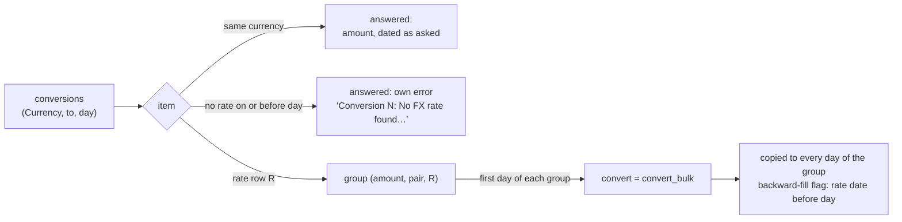

# 💱 FX Architecture

The Foreign Exchange (FX) system is responsible for fetching, storing, and providing exchange rates for currency conversion.

## 🔌 Multi-Provider Support

LibreFolio supports multiple FX rate providers (e.g., ECB, FED). This ensures redundancy and allows users to choose the source that best fits their needs (e.g., a US user might
prefer FED rates, while a European user prefers ECB).

### 📋 The `FXRateProvider` Interface

All providers must implement the `FXRateProvider` abstract base class:

```python
class FXRateProvider(ABC):
    @property
    def base_currency(self) -> str:
        """The provider's base currency (e.g., 'EUR' for ECB)."""
        pass

    async def fetch_rates(self, date_range, currencies) -> dict:
        """Fetch rates from the external API."""
        pass
```

## 📐 Normalization and Storage

Providers typically return rates relative to a specific base currency (e.g., ECB returns `1 EUR = X USD`).

To simplify storage and querying, LibreFolio normalizes all rates before saving them to the database. The rule is: **Base currency is always alphabetically smaller than Quote
currency.**

- **Input**: `EUR/USD` (EUR < USD) -> Stored as `base='EUR', quote='USD', rate=1.08`
- **Input**: `USD/GBP` (USD > GBP) -> Stored as `base='GBP', quote='USD', rate=1/0.78`

This ensures that we only need to store one rate per pair, and we can easily calculate the inverse if needed.

Rate writes keep to the [last storable date](../assets/architecture.md#stored-date-bounds) of the
prices: tomorrow by the server's calendar (`latest_stored_date()`; X-R65, night decision N83),
with no first date since the developer lifted the 1900-01-01 floor on 19/10 (N83's revision).
`POST /api/v1/fx/currencies/rate` (`upsert_rates_endpoint()`) checks every item's `date` before
its loop: a single date after tomorrow refuses the whole request with the same 422
`date_out_of_range` (`date_out_of_range_detail()`, `params` `{"max"}`), its `items`
`{"index", "date"}` (the item's 0-based index; at most ten), its `count` all of them. Nothing is
written, not even the valid items, unlike the endpoint's
[per-item errors](configuration.md#chain-dates-writes-and-counters). An earlier date, 0001-01-01
included, passes. The provider sync has no floor either: in `sync_pairs_bulk()`, the live sync
path, `_is_date_within_sync_range()` (`backend/app/services/fx/sync.py`) keeps the dates of the
requested range and nothing else, so a provider's rate dated before 1900 inside it,
`start: "min"` included, is kept like any other; its end stays the requested one, today at the
latest. Before N83's revision it was false before `EARLIEST_RANGE_START` (1900-01-01), whatever
the start.
{: #stored-rate-dates }

## 🔢 Priority System

When converting currency, the system needs to decide which rate to use if multiple providers have data for the same pair and date.

`fx_rates` holds **one rate per pair and date**, so the decision is taken when the rate is fetched, not
when it is read. Each pair has one or more **routes** in `fx_conversion_routes`, ranked by `priority`
(1 = primary). `sync_pairs_bulk()` — the live sync path, called by `POST /api/v1/fx/currencies/sync`
and by the scheduler's history-sync job — walks a pair's routes in priority order and falls back to the
next one when a route fails. See [FX Configuration & Routing](configuration.md) for routes, chains and
the `MANUAL` sentinel.

`ensure_rates_multi_source()` is an older single-provider orchestrator with no production caller: it is
kept, unwired, as the extension point for future multi-base providers.

### 🆕 A new pair syncs its full history

Saving a new pair does not sync it on the server: the frontend does it right after the save.
`finishFxPairCreation()` (`frontend/src/lib/services/fxCreationSync.ts`) calls
`POST /api/v1/fx/currencies/sync` with `start: "min"` and `end` = today when the new pair has a
non-`MANUAL` provider. `"min"` is the backend's sentinel for "everything the provider publishes": the
request's `start` is a `SyncStartDate` (`date | Literal["min"]`, `backend/app/schemas/refresh.py`), and
the sync passes it to the providers as an `FXProviderStartDate` (`backend/app/services/fx/base.py`). Asking
for the whole history, rather than the period of the page that opened the dialog, gives older
transactions a rate too. A full history can outlast the client's default timeout, so this request waits
up to 120 s (`FX_SYNC_TIMEOUT_MS`), like the Dashboard's rate sync. The sync windows (`FxSyncModal`,
`AssetSyncModal`, `PageSyncModal`) instead give each request the limit of their **Timeout** field
(`SyncModalBase`, default `max(20, item count)` s): `syncRequestTimeoutMs()`
(`frontend/src/lib/utils/sync/syncHelpers.ts`) returns `max(120 s, field + 5 s)`, so a larger field
lengthens the request and a smaller one keeps the 120 s floor.

The request carries the new pair and the intermediate pairs saved with
**Also create intermediate pairs**. A pair saved with no route (the `MANUAL` sentinel only) starts
no sync and gets a `Created` success toast instead; saving the routes of an existing pair (edit
mode) starts none either. After the sync, `classifyFxSyncOutcome()` grades the response:

| Outcome | When | Toast |
|:--------|:-----|:------|
| `failed` / `transport-error` | The request failed, a requested pair is missing from the response, the response has operation errors, or any pair is `failed` | error |
| `skipped` | Every pair is `skipped` | info |
| `partial` | Any pair is not `ok` | warning |
| `ok` | Every pair is `ok` | success |

A refresh callback that fails turns a success or info toast into a warning. Both toasts link the
pair name to its detail page (`fxPairHtml(…, {linkToDetail: true})`).

## 🔄 Conversion Logic

`convert_bulk()` (`backend/app/services/fx/conversion.py`) is the shared conversion function:
`POST /api/v1/fx/currencies/convert`, the portfolio engine and service, lots analysis, Yield on Cost,
asset price queries, the [fixed-period changes](#fixed-period-changes) of the Assets and FX tables, risk eligibility
and AI Export components call it with a list of `(Currency, to_currency, date)` items. For each item:

1. **Identity**: same currency in and out — the amount is returned as is, with no lookup.
2. **Stored pair**: the pair is normalized alphabetically, the way rates are stored. The amount is
   multiplied by the rate when converting from the stored base, divided by it otherwise.
3. **Backward fill**: the rate is the latest usable one on or before the requested date, with no time
   limit. The result carries the rate's date and whether backward fill applied; the convert endpoint
   turns them into `backward_fill_info` (`actual_rate_date`, `days_back`).
4. **No rate**: when the pair has no usable rate on or before the date, the item fails —
   `RateNotFoundError` with `raise_on_error=True`, or a `None` result plus an error message otherwise
   (*No FX rate found for B/Q on or before D*).

A usable rate is one `fx_rates.rate` can keep (X-R38, see
[Chain Dates, Writes and Counters](configuration.md#chain-dates-writes-and-counters)). A row the
column cannot keep, written by an older release (an infinite rate, 0, 20 digits before the decimal
point), is a missing rate for its date: backward-filled from the latest usable rate before it, as a
date without a row would be, or the missing-rate error. A conversion never divides by zero nor
returns an infinite amount. Read through the model, such a row still gives `Decimal('Infinity')` for
a stored inf (see [Decimal Columns](../../architecture/database/index.md#decimal-columns)); the FX
writers no longer send one.

There is no triangulation at conversion time. A pair that no provider quotes directly gets its rates at
sync time from a multi-step chain route, which stores the composite rate under the pair itself
(`source = "CHAIN:…"`) — see [Direct vs. Chain Routes](configuration.md#direct-vs-chain-routes).

`POST /api/v1/fx/currencies/convert` expands each conversion's `date_range` into one `convert_bulk()`
item per day, both ends included; with signals, a second series of one-unit items runs from the start
of their warm-up to the same end. An amount of 0 is sent as one unit too, so its results answer 0 with the
day's real `rate` instead of dividing 0 by 0 (X-R41). Both ends have a limit (X-R55). The end is cut at tomorrow by the
server's calendar (`datetime_utils.latest_range_end()`, the helper
[R13-SEC7-1](../financial_math.md#portfolio-package) also uses), a day of margin for a user whose
today is already the server's tomorrow. The start, the warm-up included, goes back at most
`RANGE_SPAN_LIMIT_DAYS` (36,525 days, 100 years) before that end (`range_span_floor()`, never before
`date.min`; both in `backend/app/utils/date_range_limits.py`). A conversion that starts after the cut
asks for nothing: no result, no error, and its signals run on an empty series; the other conversions
are unaffected. The `date_range` of each `signal_results` item (`FXSignalQueryResult`) is the range
its signals cover, the cut one; a conversion that starts after the cut echoes its requested range
there, with no points. Before, nothing bounded the expansion: from 0001-01-01 to
9999-12-31 it built about 3.65 million items, then failed with a 500 (`OverflowError`). The ceiling is
the endpoint's: `convert_bulk()` itself, which the other callers use directly, has none.
{: #convert-range-ceiling }

The endpoint also caps each request (Z-25, night decision N77), as `POST /assets/prices/query`
does ([bulk request limits](../assets/architecture.md#bulk-request-limits)): X-R55 bounds each
conversion, not how many one request holds, and 1,000 conversions of 100 years would build about
36.5 million daily items. More than `MAX_BULK_ITEMS` (1,000) conversions get a 422
`{"code": "bulk_too_many_items", "message", "max_items", "items"}` before any work, nothing
converted; exactly 1,000 pass. The handler then plans the conversions one by one — each one's cut
range, signal plan and warm-up — and counts the daily items and the one-unit signal items, warm-up
included, that each would build; a conversion that starts after the cut counts zero, and its
signals still run on an empty series. At the end of a conversion, a running total over
`MAX_BULK_ITEM_DAYS` (1,000,000, lowered by R13-SEC9-2) gets a 422
`{"code": "bulk_too_many_days", "message", "max_item_days", "item_days"}`, `item_days` being the
count through that conversion: more than the budget, a lower bound of the request's total. The
`message` says so, «this one would build at least N» (`bulk_too_many_days_detail()` with
`at_least=True`), where the price route's says «would build N»: its count is exact. No item
is built or converted until the whole request is within the budget; only then are the planned
blocks expanded day by day, in request order and each conversion's daily items before its signal
items, and converted in one `convert_bulk()` call. A refused request costs its planning, not its
items. Like the ceiling, the caps are the endpoint's: `convert_bulk()` has none. The FX list sends
its conversions in batches under both (Z-27,
[Bulk requests in batches](../../frontend/state/registries.md#bulk-requests-in-batches)).
{: #convert-request-limits }

### 🗜️ Sampled conversions {: #convert-sampling }

A card of the FX list draws a few hundred points at most. `POST /api/v1/fx/currencies/convert` can
answer a conversion with the results of one day a week or a month instead of every day (Z-29fx),
with the rule of the asset price query
([Sampled Price Series](../assets/architecture.md#price-query-sampling)):

- **The fields.** `FXConversionRequest` takes `key`, `max_points` (1 … 10,000), `resolution`
  (`daily`, `weekly`, `monthly`) and `sample_like`: at most one of the last three, none of them with
  `annotation_requests`. `key` and `sample_like` take 1 to 64 characters among ASCII letters,
  digits, `_`, `.`, `:` and `-` (`SAMPLE_KEY_PATTERN`).
- **The step.** A conversion's fill starts on its first day F, the first day of its cut range that
  converts: the range's start when a rate precedes it, else the pair's first rate in the range.
  With `max_points` the step is `choose_resolution(F, end, max_points)`, the finest of daily,
  weekly (ISO, Monday to Sunday) and monthly whose count fits, monthly the floor; with `resolution`
  the one asked. A `sample_like` follower takes the step of the conversion it names, on that
  conversion's own fill (on its own fill when the named one has none), from the later of the two
  first days. `plan_conversion_samples()` in `backend/app/services/fx/sampling.py` plans them; the
  dates are `sample_dates()`, the last day of each bucket, the last one cut at the range's end.
- **The results.** The conversion is still computed day by day — its signals and the day budget
  need every day — and a weekly or monthly one keeps, in `results`, only the daily results on its
  dates, each unchanged (amount, rate, backward fill). A daily one answers every day, a follower
  from its later first day. Every result carries `request_index`, the position of its conversion in
  the request.
- **`samples`.** One `FXConversionSample` per conversion, in request order: its `resolution`
  (`daily` by default) and, weekly or monthly, `sample_bounds` (`FXSampleBounds`): the daily result
  on F (`first`, the base of a card's percentage view and of its line's colour) and on the end
  (`last`). A conversion with nothing to fill answers no result and a daily step.
- **References.** `resolve_sample_references()` checks every `sample_like` before anything runs:
  a fault is the price query's 422 `{"code": "sample_reference", "reason", "item", "key",
  "message"}` (`unknown_key`, `duplicate_key`, `chained`, `range_mismatch`).
- **Signals.** Computed every day, as without the fields; on a weekly or monthly conversion each
  series is then reduced onto its dates by its output's `aggregation_profile` and the series of one
  signal aligned, through `sample_signal_result()` (`backend/app/services/signals/sampling.py`), the
  function the price query uses too. The calendar rolling return (`ASSET_CALENDAR_ROLLING_RETURN`)
  is offered in the FX domain: its points are the elements themselves (`last_with_range`), with
  their provenance.
- **Budget.** A sampled conversion costs the days of its fill, as the daily one does
  ([request limits](#convert-request-limits)).

Tests: `backend/test_scripts/test_api/test_fx_convert_sampling.py`
(`./dev.py test api fx-convert-sampling`, PURE: the handler in process, `convert_bulk()` replaced
by a double). The web app's FX list does not send these fields yet (the FX half of Y-40).

### 🪟 Loading only the usable rate window {: #convert-bulk-window }

Calculations call `convert_bulk()` with thousands of items (before P3 the portfolio engine preloaded a rate
for every non-reporting currency and every day of the range, and before L1b the lots analysis asked one conversion
per day of its market price series; both now read [steps](#unit-rate-steps)). So the
function reads only the rows the batch can
use, in one query for up to `FX_PAIRS_PER_QUERY` (500) pairs — more pairs take several queries
(R13-SEC9-2: SQLite refuses an `OR` of about a thousand terms, «Expression tree is too large», and a
request of some 990 pairs answered 500; `_first_rate_days_inside()` of the fixed-period changes reads
in the same chunks):

- for each pair it tracks the earliest (`min_date`) and latest (`max_date`) requested dates;
- it loads the rows from the **backward-fill anchor** — the last rate on or before `min_date`, a
  `MAX(date)` scalar subquery — up to `max_date`. The anchor keeps the unlimited backward fill exact:
  the earliest item still finds its rate, however old;
- it reads only the usable rates (X-R38): `rate >= 1E-10 AND rate < 1E+14`, the bounds of
  `usable_fx_rate_bounds()` (`backend/app/db/precision.py`), in the anchor subquery as in the window,
  so a legacy unusable row neither anchors the window nor is loaded. There is no per-row check in
  Python: any double within those bounds reads back as a rate `storable_fx_rate()` keeps, and this
  path is hot;
- it selects plain columns (`base`, `quote`, `date`, `rate`), not ORM objects;
- each item finds its rate with `bisect_right` over the pair's ascending dates.

The read — the anchor, the usable filter, the chunks, the plain columns — is the private helper `_usable_rates()`,
shared with [`unit_rate_steps()`](#unit-rate-steps), so the two never diverge.

The writers keep to the same upper bound (X-R50). SQLite keeps the rate as a double, so a rate within
about 0.008 of `1E+14` with more digits than a double holds (`99999999999999.995`) has 14 digits
before the point but would be stored as `1E+14`: `storable_fx_rate()` refuses it too, so a manual one
is refused and a provider's skipped, as for any rate the column cannot keep (`99999999999999.99`
stays the double `99999999999999.98` and is kept). Before, the limit was on the digits alone, as for
W-B58: the writers accepted `99999999999999.999`, stored it as `1E+14`, and these bounds then
skipped it as unusable.

Apart from the unusable rates left out, return values and errors are those of the full-history version
this replaced, which loaded every pair's whole history up to the latest requested date and scanned it
linearly for each item (PR #30 by Martin Sova, commit `5aa267f11`).

### 🪜 One unit's rate as steps {: #unit-rate-steps }

The [portfolio engine](../financial_math.md#portfolio-package) (`_preload_fx_rates()`) and the
[native cash](../transactions/wac.md#compute-native-cash) (`compute_native_cash()`) need one unit of each foreign
currency on every day of long ranges: asked of `convert_bulk()`, one item per currency and per day. A rate only changes on the
days a row is stored, so `unit_rate_steps(session, requests)`, in the same module (P3 of MF's fast-formulas plan),
answers the same values as steps, with far fewer items. Since MF's P3 both read it: the engine in a map that answers
on the asked days only (`financial_math/fx_rates.AskedDayRates`), the native cash through the steps themselves. Since
lot L1b the [lots analysis](../transactions/lots_analysis_service.md#fx-conversion) reads it too: its `FxRateResolver`
asks one window per currency of the market price series, and keeps the rates in the same `AskedDayRates`.

`requests` maps `(source, destination)`, two currency codes as stored, whichever of them is the stored base, to its
windows `(first_day, last_day)`, both days included; the windows of a pair may touch, overlap or lie apart. Every pair
asked gets an entry, a frozen `UnitRateSteps`: `source`, `destination` and three tuples of one length, `days`, `values`
and `rate_days`. From `days[i]` on, one unit of `source` is worth `values[i]` in `destination`, read from the stored
row of `rate_days[i]`. The entry is empty when the pair has no usable rate for any day of its windows. The steps of a
pair are:

- the first day of each window, with the rate of the backward-fill anchor, the last usable row on or before it; no
  step when the pair has no usable row by then;
- every day inside a window that has a usable row of the pair. Two rows with the same rate are two steps, each with
  its own rate date.

Rows between two windows are no steps. With rows on 1, 5, 9, 11 and 15 March and the windows 3–7 and 13–17 March, the
steps are 3 March (the row of 1 March), 5 March, 13 March (the row of 11 March) and 15 March.

`at(day)` and `rate_day_at(day)` read the last step on or before `day`, `None` before the first. On every day of the
windows, `at(day)` is exactly the amount `convert_bulk()` gives for `Currency(code=source, amount=Decimal("1"))` on
that day, to the digit and the exponent, and `rate_day_at(day)` is its rate date; both are `None` where
`convert_bulk()` has no rate. It holds because the two functions read and compute through the same private helpers,
`convert_bulk()` with its behaviour unchanged:

- `_usable_rates()`, the read: the same rows, from each pair's backward-fill anchor up to its last date, the same X-R38
  usable filter in the anchor and in the window, the same chunks, one statement per `FX_PAIRS_PER_QUERY` (500) stored
  pairs ([above](#convert-bulk-window));
- `_converted()`, the arithmetic: the amount times the rate when it is in the stored base, divided by it otherwise.

Outside the windows, `at(day)` still reads the last step on or before the day, which is how `NativeCash._rate_at()`
reads its rates. That is not `convert_bulk()`'s answer there: in the example, on 10 March `at()` gives the step of
5 March and `convert_bulk()` the row of 9 March; on 2 March, `None` and the row of 1 March. Which days a value is asked
for stays with the caller.

`ValueError` refuses the whole call, before any read. It is part of the contract agreed with MF, who owns the engine
and the native cash:

- a pair of one currency: `convert_bulk()` answers it with the amount itself and no rate, dated the day asked, a rate
  date that moves with the day, which no step can express;
- a window whose last day comes before its first.

Tests: `./dev.py test services fx-rate-steps` (`backend/test_scripts/test_services/test_fx_rate_steps.py`, 63 cases,
isolation `pure`) pins the match with an oracle against `convert_bulk()` on every day of every window.

### 🧩 Converting once for each stretch {: #convert-by-stretch }

A rate row stays in force until the next one is stored, so the days of a long range between two rows
convert the same amount under the same rate. `convert_by_stretch()`
(`backend/app/services/fx/stretch_conversion.py`, X-Q3) answers a list exactly as
`convert_bulk(session, conversions, raise_on_error=False)` does (same results to the digit, same errors),
but hands `convert` one conversion for each distinct (amount as printed, pair, rate row), on the first day
it meets it, and copies the answer to the other days of the stretch.



- **The rate row** of each day comes from `unit_rate_steps()` ([above](#unit-rate-steps)), which reads the
  same usable rows as `convert_bulk()`.
- **Per item, as in `convert_bulk()`:** an identity (the amount, dated as asked, no backward fill); a day
  with no usable rate (its own error, numbered by its position in the list, never asked of `convert`);
  the backward-fill flag (`rate date < day`).
- **The amount counts as printed.** `Decimal("1.0")` and `Decimal("1")` convert to different exponents,
  so they are different groups.
- **A failure of `convert`** for a group fails each of its days, each error numbered by its own item.
- **The seams** are the keyword arguments `convert` (default `convert_bulk`) and `steps` (default
  `unit_rate_steps`), so a test can stand in for either read.

`POST /api/v1/fx/currencies/convert` (`convert_currency_bulk()` in `backend/app/api/v1/fx/currencies.py`)
calls it for its daily and signal blocks, so the expansion into one item per day is unchanged while
`convert_bulk()` receives fewer items. The [price query](../assets/architecture.md#price-query-observation)
applies the same idea to a price series through `observed_prices.py`, which asks `convert_bulk()` itself for
each (price row, rate row) pair. Measured on a 10-year USD asset asked in EUR (3,650 points, rates on every
weekday): 2,608 conversions instead of 3,650 with identical points, in the same time (0.26 s against 0.25 s),
so it saves conversions, not time.

Tests: `./dev.py test services fx-stretch-conversion`
(`backend/test_scripts/test_services/test_fx_stretch_conversion.py`, isolation `pure`): item-for-item parity
with `convert_bulk()` (direct, inverse, identity, no rate, gap, amount exponent), `convert` handed stretches
and not days, and the handler answering what it answered with every day converted, signals and samples
included.

### 📅 Fixed-Period Changes {: #fixed-period-changes }

`POST /api/v1/fx/currencies/period-changes` returns the fixed-period changes of the FX table: 1D, 1W, 1M, 3M, 6M,
1Y, 2Y, 3Y and 5Y (developer decision D-MF6 b). `get_fx_period_changes_bulk()` in
`backend/app/services/fx/period_changes.py` values the days. The change itself is the house's
`fixed_period_changes()` ([Financial Math Layer](../financial_math.md#fixed-period-changes)).

- **Request**: a list of `{base, quote, as_of, range_start?}`. From the schema, 422 when `base` and `quote` are the
  same, when `as_of` or `range_start` falls before `EARLIEST_RANGE_START` (1 January 1900; up to 0005-12-30 the 5Y
  day fell before year 1, a 500), or when `range_start` is after `as_of`. The route then checks the request with
  `period_changes_request_refusal()` (`backend/app/schemas/common.py`), before any conversion (MF-P2b, finding
  R13-SEC8, aligned with Z-25):
    - more than `MAX_BULK_ITEMS` (1,000) pairs get the 422 `{"code": "bulk_too_many_items", "message", "max_items",
      "items"}` of `POST /api/v1/fx/currencies/convert` ([request limits](#convert-request-limits)); exactly 1,000
      pass;
    - more than `PERIOD_CHANGES_MAX_AS_OF_DAYS` (5) distinct `as_of` days, or as many distinct `range_start` days, get
      the 422 `{"code": "period_changes_too_many_days", "message", "field", "max_days", "days"}`, `field` naming the
      one over the limit (`as_of` checked first).
- **Rate on a day**: the conversion of 1 `base` into `quote` on that day by `convert_bulk()`, with its unlimited
  backward fill. It is the rate `POST /api/v1/fx/currencies/convert` returns for that day, up to that endpoint's
  [ceiling](#convert-range-ceiling): `as_of` has none. One `convert_bulk()` batch serves every pair and day of the
  request.
- **Response**: `items[]`, in request order, of `{base, quote, as_of, periods[], range_change, errors[]}`. Each period
  is `{key, days, change_ratio, inverse_change_ratio}`. `range_change` is null unless the item sends a `range_start`
  (below).
- **`change_ratio`**: `rate(as_of) / rate(as_of − days) − 1`, the pair as asked (quote per base).
- **`inverse_change_ratio`**: `rate(as_of − days) / rate(as_of) − 1`, the change of the inverted pair (base per
  quote).

Both are fractions, null when either rate is missing. A rate is never 0 here: the API keeps rates > 0, and
`convert_bulk()` skips a stored rate below its [usable bound](#convert-bulk-window) (X-R38), so the house's −100 %
for a value written down to 0 never reaches an FX pair. A day without a rate adds *No B/Q rate on or before D* to
`errors`.

An item may also send `range_start`, the first day of the range the page shows, for the whole-range Δ Abs and Δ % of
the FX pages (X-R59, decision N80); its limits are in the **Request** bullet above.

- **`range_change`**: `{reference_date, change_abs, change_ratio, inverse_change_abs, inverse_change_ratio}`, the
  house's `range_change()` ([Financial Math Layer](../financial_math.md#fixed-period-changes)), with `reference` the
  reference rate: `change_abs = rate(as_of) − reference` and `change_ratio = rate(as_of) / reference − 1`, the pair as
  asked (quote per base); `inverse_change_abs = 1 / rate(as_of) − 1 / reference` and
  `inverse_change_ratio = reference / rate(as_of) − 1`, the inverted pair (base per quote). All four are null when
  either rate is missing.
- **Reference**: the rate on `range_start`, one more item per request in the same `convert_bulk()` batch, with its
  unlimited backward fill, and `reference_date = range_start`. A pair with no rate on or before `range_start` takes its
  first stored rate inside the range, after `range_start` and up to `as_of`, converted on its own day, with that day
  as `reference_date`. Its day comes from one query per distinct `(range_start, as_of)` window, for those pairs only:
  `MIN(FxRate.date) … GROUP BY base, quote` over the pairs as `fx_rates` stores them (alphabetical order), within the
  [usable bounds](#convert-bulk-window) of X-R38; a second `convert_bulk()` batch then reads those days' rates. Either
  way it is the first point of the series `POST /api/v1/fx/currencies/convert` returns for the range, which drops the
  days without a rate. A pair with no rate up to `as_of` gets a `range_change` with every field null,
  `reference_date` included; a missing reference adds nothing to `errors`. The anchor is the rate on `as_of`, as for
  the periods.

The change is on this endpoint, not on `POST /api/v1/fx/currencies/convert`: the FX store composes a pair's series
from the gaps it loads separately (`ensureFxRangeLoaded()`), so a change attached to a series response would not be
the visible range's. The web app sends it: `fetchFxPeriodChanges(pairs, asOf, rangeStart)`
(`frontend/src/lib/utils/periodChanges.ts`) gives each item the first day of the range on screen, raised
to 1 January 1900 by `rangeStartFor()` (`frontend/src/lib/utils/rangeChange.ts`), none for a day the backend would
refuse (after `as_of`, or not a calendar day), and reads `range_change` both ways with `fxRangeDeltas()`. The FX table's
Δ Abs and Δ % columns, the FX card's Δ % and the pair page's summary show it, from the `inverse_*` fields for a pair
shown the other way round; the browser no longer computes it (`displayFxDelta()` is gone). The FX list keeps those
values with a `PeriodChangesLedger` of their own, which marks each request with the whole range rather than its last
day, so a failed request keeps only the values of the same range; the pair page asks for its one pair on load, on a
range change and after a refresh (a sync ends with one).

The FX list calls the endpoint through `fetchFxPeriodChanges()` (`frontend/src/lib/utils/periodChanges.ts`): one
request for every configured pair, with `as_of` the end of the selected range, and one for a single pair when that pair
reloads on its own (its **Reload**, or after its **Sync**: `fetchPairData()`). A pair shown swapped (⇄) reads
`inverse_change_ratio`, the others `change_ratio`. Besides its fixed 1D column, the table shows each period whose
`days` fit in the range's whole calendar days (`visiblePeriodColumns()`). Past 1,000 configured pairs that request
goes in batches (X-R64): the function hands the pairs to `sendBulkBatches(items, () => 0, send)`
(`frontend/src/lib/api/bulkBatches.ts`, Z-27,
[Bulk requests in batches](../../frontend/state/registries.md#bulk-requests-in-batches)), which sends consecutive
batches of at most `BULK_MAX_ITEMS` (1,000) pairs, in the order given, one request after the other. There is no day
estimate: the endpoint has the item cap, not the item-days budget of the [conversions](#convert-request-limits), and
every batch asks up to the same `as_of`. The answers merge as if one request had answered, the periods taken from the
first item that has any; up to 1,000 pairs it is one request, as before. All or nothing: a batch that fails rejects
the whole call with its own error and nothing is sent after it, so the list never shows a partial answer.

Several of these requests can be in flight at once, a pair's **Sync** during a range change for instance: the list
keeps a `PeriodChangesLedger` (`periodChanges.ts`, X-R60) that says which answer it keeps.

- A full request, for every pair (the first load, a range change, a refresh), replaces every request before it: an
  older answer that lands later is not kept.
- A single pair's own request (`loadPairPeriodChanges()`, run by `fetchPairData()`) is fresher, for that pair, than a
  full request begun before it, whichever answer lands first. One begun before a newer full request is moot.
- The page's `data-busy` (`data-testid="fx-page"`) stays true while any request whose answer would still be kept is
  in flight, a single pair's included.
- A failed full request keeps the Δ computed up to the same `as_of` (the end of the range) and drops the others; it
  is logged to the browser console, unless a newer full request has replaced it. A failed single-pair request is
  logged and changes nothing.
- The signals' retry, a chart-settings save and swapping a pair (⇄) reload only the rates and signals
  (`fetchAllPairSeries()`; a save, only when it changes the backend signals), never the period changes: the Δ come
  both ways and do not depend on the signals.

## 🧹 Rate writes clear the portfolio caches {: #portfolio-cache-invalidation }

Every write that changes stored rates drops the two portfolio cache layers, `portfolio_layer2` and
`portfolio_blob`, through `clear_cache()`, so the next report recomputes with the new rates:

| Write | Function | Clears when |
|-------|----------|-------------|
| Provider sync (`POST /api/v1/fx/currencies/sync`, scheduler) | `sync_pairs_bulk()` | At least one rate point changed |
| Manual rates (`POST /api/v1/fx/currencies/rate`) | `upsert_rates_bulk()` | After the commit (any non-empty batch) |
| Rate deletion (`DELETE /api/v1/fx/currencies/rate`) | `delete_rates_bulk()` | At least one row was deleted |

**Limits and chunks** (MF-SEC9a, from E's review of R13-SEC9). `POST` and `DELETE /api/v1/fx/currencies/rate` take at
most `MAX_BULK_WRITE_ITEMS` (10,000) rates or deletions, a 422 `bulk_too_many_items` before any write: the FX page
saves a CSV import in one request, and daily rates since 1999 are about 7,000 rows. The statements behind them hold
one `OR` term per rate or deletion, so they run in chunks of `OR_TERMS_PER_QUERY` (500, `utils/sql_chunks.py`, the
value of `FX_PAIRS_PER_QUERY`), in the same transaction: the read of the stored rates and the
`INSERT … ON CONFLICT` of `upsert_rates_bulk()`, the read of the matching rates of `delete_rates_bulk()` (a deletion
of more than 1,000 separate days, which the FX page sends as as many ranges, answered 500; each deletion then takes
its rates by bisection over its pair's sorted dates, not by a scan of them, which at the cap held the event loop for
seconds), and the read of the
stored rates a provider sync compares with (`_stored_rates()`; refused, it was taken for a missing table and every
rate counted as new). An error answers with a fixed message, never the database's, and is logged.
{: #rate-write-limits }

Both layers also key their entries on an FX fingerprint of the scope
(`compute_portfolio_fx_cache_identity()` in `financial_math/portfolio/engine.py`); the explicit clear drops entries
right away instead of leaving them to their TTL. See [Cache Registry & Admin Endpoints](../../architecture/settings_cache.md)
for the caches themselves.
