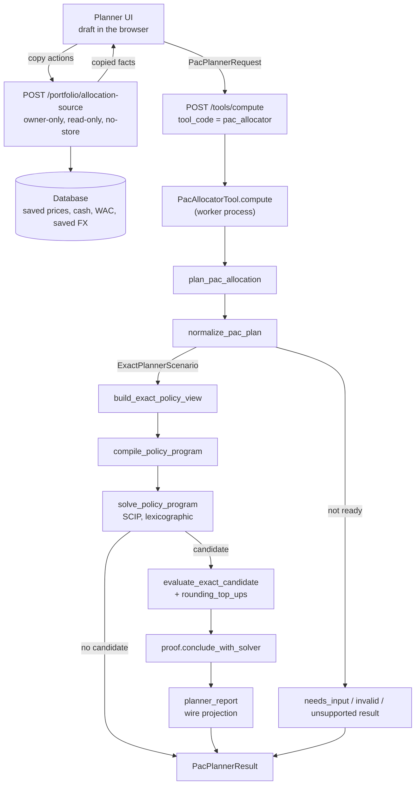

# 🧮 PAC Allocator Engine

The **PAC allocator** plans one contribution cycle: given the cash the user chooses to spend, the
Assets they may buy, the Brokers that sell them and the target weights, it answers *which orders
bring the result as close as possible to the target*. It places no order and reads no portfolio:
it is an atomic [Tool](../architecture/patterns/tool_plugins.en.md) that computes a plan from the
scenario it is handed, and the plan is a proposal to evaluate.

This page is for developers who change the engine, its contract or the surfaces around it. It
describes what the code does today. What the user sees is in the
[PAC allocator user guide](../../user/tools/pac-allocator/index.md).

!!! info "Scope today"

    Only the **PAC** product exists on the wire: one operation (`plan`), one policy
    (`proportional`), BUY orders only, starting from an empty portfolio. The exact domain
    (`models.py`, the evaluator) still carries the Rebalancer vocabulary (holdings, SELL routes,
    other policies and purposes), and `schemas/pac_allocator/request.py` defines the Rebalancer
    requests, but no operation, plugin service or compiler path reaches them:
    `compiler.compile_policy_program` raises `PolicyProgramScopeError` for anything but PAC
    `proportional` in the `primary` purpose, and `planner.py` exports `plan_pac_allocation` only.

---

## 🗺️ Package Map {: #package-map }

| Path | Role |
|---|---|
| `backend/app/schemas/pac_allocator/` | The wire contract: `request.py` (input), `results.py`, `solutions.py`, `evidence.py`, `issues.py`, `rows.py`, `exact.py`, `base.py` (shared types) |
| `backend/app/services/tool_plugins/pac_allocator/plugin.py` | `PacAllocatorTool`: registers the service `pac_allocator`, owns the timeout envelope and dispatches `compute` |
| `backend/app/services/pac_allocator/planner.py` | `plan_pac_allocation`, the one orchestration function |
| `backend/app/services/pac_allocator/normalize.py`, `issues.py` | Wire request → exact scenario; the closed issue taxonomy |
| `backend/app/services/pac_allocator/models.py` | Exact domain records (scenario, policy view, candidate, evaluation) |
| `backend/app/services/pac_allocator/evaluation/` | The exact evaluator: policy view, bounds, reachability, economics, constraint facts, objective values |
| `backend/app/services/pac_allocator/compiler.py`, `constraints.py`, `objectives.py` | Policy view → SCIP model: variables, hard constraints, objective stages |
| `backend/app/services/pac_allocator/solver.py` | The lexicographic SCIP search |
| `backend/app/services/pac_allocator/proof.py` | The only place that turns SCIP statuses into a proof conclusion |
| `backend/app/services/pac_allocator/ledger.py`, `numeric.py` | Broker × currency postings; `ExactRatio` and the plan's money formulas |
| `backend/app/services/pac_allocator/planner_report.py`, `wire_numbers.py` | Exact evaluation → wire result; exact number → wire number |
| `backend/app/services/pac_allocator/source/` | The read-only **planner source** behind the copy actions (the only part that touches the database) |
| `backend/app/api/v1/portfolio_api.py` | `POST /api/v1/portfolio/allocation-source` |
| `backend/app/api/v1/tools.py` | `POST /api/v1/tools/compute`, `GET /api/v1/tools/catalog` (generic, not PAC-specific) |
| `frontend/src/lib/features/tools/pac-allocator/planner/` | The planner UI: draft, copies, request builder, result views |

---

## 🔀 Data Flow {: #data-flow }



Two boundaries shape the design:

- **The engine is pure computation over its request.** A plan depends on the request alone, never
  on what the tables hold when it runs. The guard
  `backend/test_scripts/test_services/test_pac_planner_engine_boundaries.py` fails if any engine
  module (everything under `pac_allocator/` except `source/`, and the Tool plugin) imports
  `pac_allocator.source`, `sqlalchemy`, `sqlmodel` or `backend.app.db`.
- **The database is read only by the source.** Filling the draft from the user's own data is a
  separate, explicit step before the calculation (see [Planner Source](#planner-source)).

!!! note "The browser computes no result"

    The request builder (`planner/request.ts`) checks shape and same-unit problems only; every
    economic rule (reachability, fees, FX closure, minimums, feasibility) stays in the backend, and
    a missing price or rate is answered by the backend with `needs_input`.

---

## 🧰 The Tool Envelope {: #tool-envelope }

`PacAllocatorTool` (`tool_plugins/pac_allocator/plugin.py`) declares one `ToolService`:
`tool_code="pac_allocator"`, `contract_version` and `implementation_version` `1.0.0`, input
`PacPlannerRequest`, output `PacPlannerResult`, UI `component_key="pac-allocator"`. Its one
operation `plan` is `pure` and `deterministic`, with no deduplication.

| Policy field | Value |
|---|---|
| `max_parameter_bytes` | 262 144 |
| `max_result_bytes` | 524 288 (512 KiB) |
| `queue_timeout_ms` | 5 000 |
| `engine_timeout_ms` | 30 000 (the one product decision) |
| `soft_timeout_ms` | 44 000 |
| `job_timeout_ms` | 45 000 |
| `cleanup_timeout_ms` | 5 000 |
| `request_timeout_ms` | 59 000 |
| `client_timeout_ms` | 65 000 |

All values but `engine_timeout_ms` are derived from identities the platform validators impose
(`soft ≥ engine + reserve`, `job = soft + output reserve`, and so on). The margin of `request_timeout_ms`
is zero: raising `queue`, `cleanup` or `job` by one millisecond makes the operation policy invalid, and an
invalid policy removes the **whole tool** from the catalog. The 30 s is provisional and was not measured at
representative scale (see the module header of `plugin.py`).

`compute` claims the engine window with `context.claim_engine_window(post_engine_reserve_ms=2_000)`
and passes `window.timeout_ms / 1000` to the solver as its time budget, together with the executor's
`checkpoint`. The 2 s reserve is a deliberate over-reserve for the exact replay and the report. An
unexpected exception is logged by `_log_engine_failure` (exception class and code location only, never
the message or amounts) and re-raised, so the platform answers `execution_failed`.

The generic transport (executor, worker process, codecs, `tools.py` routes) is described in
[Tool plugins](../architecture/patterns/tool_plugins.en.md).

---

## ⚙️ The Pipeline {: #pipeline }

`plan_pac_allocation(request, *, checkpoint=None, solver_time_budget_seconds=None)` in
`backend/app/services/pac_allocator/planner.py`:

```text
normalize → build_exact_policy_view → compile → SCIP
          → evaluate_exact_candidate replay → proof → planner_report
```

It never raises on a planning outcome (infeasible, budget exhausted): those are results. Two defects
of the search do raise: `ExactReplayRejectedError` and `SolverInfeasibilityContradictedError`
(see [Replay and rounding](#replay)).

!!! warning "No package-level export"

    `plan_pac_allocation` is deliberately not re-exported from `pac_allocator/__init__.py`. The import
    chain `planner → compiler → pyscipopt` would load SCIP into every consumer of the package. Import it by
    module path. A subprocess test pins that importing the package leaves `pyscipopt` out of `sys.modules`
    (`test_pac_planner_planner.py::test_scip_import_isolation_in_subprocess`).

### 1. Normalize {: #normalize }

`normalize_pac_plan` runs `_PlannerV2Normalizer.run`, which validates in this order: snapshot and
provenance, assets, brokers, holdings, cash and contributions, order routes, FX rates, targets,
sell context, current portfolio, FX pair closure, FX coherence. Every finding is a `PlannerIssue`
with a code from a closed taxonomy (77 codes, `PlannerIssueCode` in `schemas/pac_allocator/base.py`; a module-level check in
`issues.py` fails the import if the count changes). Issues are de-duplicated and sorted
canonically (`canonicalize_issues`), and the **availability** is the strongest error kind present:

| Error kind present | Availability | Result |
|---|---|---|
| `missing` | `needs_input` | `PacPlannerNeedsInputResult` |
| `invalid` (no `missing`) | `invalid` | `PacPlannerInvalidResult` |
| `unsupported` (neither) | `unsupported` | `PacPlannerUnsupportedResult` |
| none | `ready` | the scenario is built and the search runs |

A failure result must carry at least one error issue of the matching kind (schema validator
`validate_controlling_issue`). On `ready`, `build_scenario` produces the immutable
`ExactPlannerScenario`: every decimal string becomes an `ExactRatio` (a rational on Python integers),
fee schedules are instantiated per route currency, and the currency minor unit is **derived from CLDR
through babel** (`currency_minor_unit`), never read from the request.

Checks worth knowing before touching the contract:

- **Targets**: every Asset needs a weight, each in `[0, 1]`, and the sum must be exactly one
  (`allocation.target_weight_missing`, `target_weight_out_of_range`, `target_total_not_one`).
- **Quote**: a missing quote is `allocation.price_missing` plus `quote_base_quantity_missing`
  (both `missing`, hence `needs_input`); a non-positive price or quote basis is `invalid`.
- **FX map**: `fx_rates` is one map keyed by an alphabetically sorted pair `"AAA/BBB"`, the value being units of
  `BBB` per unit of `AAA`; a rate must be positive, the spread must lie in `[0, 1)`.
  `fx_spread_rate` is one spread for the whole scenario, applied once to every actual conversion.
- **FX closure**: a pair is required between every referenced currency and the valuation currency, and between every
  cash-pool currency of a Broker and the quote currency of each Asset it can buy (`allocation.fx_rate_missing`).
  Conversions are always direct: no chains.
- **FX coherence** (`validate_fx_coherence`): a buy conversion whose path through the valuation currency would beat
  the direct rate is refused (`allocation.fx_rate_inconsistent`). Rates carry ten decimals, so the check tolerates the
  first-order storage error of the three rates; inside that band the evaluator plans the conversion at the triangle
  (see [Where each calculation lives](#math-home)).
- **Implicit zeros**: an absent fixed fee or fee floor is zero; a BUY route without a `fee_schedule_id` pays no
  commission (the normalizer instantiates an implicit zero schedule whose id contains `~`, a character forbidden in
  caller ids, so ids cannot collide); an absent `transfer_cap` transfers the whole selected amount.

### 2. Policy view {: #policy-view }

`evaluation/evaluator.build_exact_policy_view(scenario, purpose="primary")` fixes the **decisions** the
solver may take. All are non-negative integers ("quanta"), mutable in the PAC primary purpose, with
finite bounds from `evaluation/bounds.py`:

| Decision id | Family | One quantum is | Upper bound |
|---|---|---|---|
| `funding:<funding_route_id>` | `funding_transfer` | the currency's minor unit | `min(transfer_cap, selected)` floored to the unit; `0` when the source Broker equals the destination Broker |
| `fx:<order_route>…<currency>` | `fx_debit` | the source currency's minor unit | the resource bound, converted to that currency |
| `buy:<route_id>` | `buy_quantum` | the capability's `order_step` (units, or an amount) | resource bound over the execution price (whole quantity) or the resource bound (amount), capped by the route `cap` |

The *resource bound* is the value already invested plus the selected funding plus a small rounding margin,
all in the valuation currency. An `fx_debit` decision exists for each BUY route and each other currency that holds,
or can receive, cash at that Broker and has a direct FX pair with the route's quote currency
(`reachability.buy_pool_currencies`).

The view also lists the **objectives** in cascade order and one canonical **tie-break** vector (decision ids sorted by
Asset, Broker, currency, side, route), so that, among equal plans, the choice is unique.

### 3. Compile {: #compile }

`compile_policy_program(scenario, view)` builds one SCIP model with an integer variable per decision (bounds from the
view), the hard constraints of `constraints.py` and the objective stages of `objectives.py`. The constants
`fixed_reference` and per-Asset `target_value` are not re-derived: the compiler gets them from **one probe call** of the
public `evaluate_exact_candidate` with the do-nothing candidate.

The constraints that become live rows are the cross-decision or semi-continuous ones of the evaluator's catalogue
(`ExactConstraintCode` in `models.py`):

| Code | Meaning in the model |
|---|---|
| `FUNDING_WITHIN_SELECTED` | the transfers out of one source do not exceed what was selected |
| `NO_SHORT_OR_LEVERAGE` (with `FX_SOURCE_CASH`) | each Broker × currency ledger stays non-negative |
| `FX_CREDIT_POSITIVE` | an active conversion posts a non-zero credit |
| `ORDER_REQUIRED_MIN` | an unconditional floor on the route's measure |
| `ORDER_MIN_IF_ACTIVE` | the route's measure is zero or at least `max(order_step, minimum_if_active)` (a `buy_active` binary) |
| fee epigraph | linearizes the fee `fixed + clamp(rate·notional, floor, cap)`; a `fee_capped` binary exists where the cap can bind |

Caps, quantization and disabled decisions are variable bounds. Every Big-M is derived from a route's own bounds
(`order_step × upper_quanta`), never an arbitrary constant. The model's rounded postings follow the same direction
rules as the replay (see [Rounding](#rounding)), and only `fx_credit`, `buy_debit` and `buy_fee` are modelled
(`_MODELLED_ROUNDED_FAMILIES`); a scenario that would post another rounded family fails closed with `LedgerPostingScopeError`.

!!! note "The SCIP fee variable never reaches the result"

    The model may leave the fee variable above its minimum where no stage presses it down. Every fee the result
    shows comes from the exact replay (`numeric.calculate_fee`), not from SCIP.

### 4. The objective: a lexicographic cascade {: #objective }

"As close as possible to the target" is **not** a weighted sum. The stages are minimized in order; a stage is solved,
its optimum is pinned as a hard constraint, and the next stage runs on that face:


(`references._objective_codes` for the PAC `proportional` policy; `objectives.build_objective_cascade`; the stage order is
read from the view's ordinals, never hard-coded in `solver.py`.)

| Stage | Value (valuation currency unless noted) |
|---|---|
| `fixed_l2` | `Σ (final value of Asset − target value)²` over the Assets |
| `shortfall` | `F_ref − final invested value`: the money left unspent |
| `route_priority` | sum of the `priority` of every active funding transfer and order (lower is preferred) |
| `explicit_cost` | buy fees + sell fees + FX spread loss + execution-margin loss + taxes |
| `active_order_rows` | number of orders with non-zero quantum |
| `tie:*` | one integer stage per decision of the canonical vector |

The fixed reference is `F_ref = invested value + reachable funding` (`economics.py`; in the PAC the invested value is
zero), where *reachable* excludes funding that no funding route can bring to a Broker able to buy a positive-weight
Asset ("trapped" cash). The target of an Asset is `w_a · F_ref`. Percentages and the largest deviation are not
optimized.

!!! info "Why the reference is fixed"

    With a moving reference, a plan could look closer to the target by spending less. Using `F_ref`
    makes `fixed_l2` comparable across plans, and `shortfall` then prefers the plan that spends more
    among equally close ones.

### 5. Solve {: #solve }

`solver.solve_policy_program` runs the cascade with SCIP (`ENGINE_NAME = "SCIP"`), re-arming `limits/time` and
`limits/nodes` before each stage from the remaining budget. Behaviours that matter:

- **It decides nothing about proof.** It returns a candidate plus SCIP's floating facts (statuses, bounds, gaps) in report
  vocabulary (`reported_infeasible`, never `infeasibility_proven`).
- **A pin never sits below the exact value** of the best plan so far: a stage is frozen at the larger of SCIP's value and
  the exact value, plus a relative slack `STAGE_PIN_RELATIVE_SLACK = 1e-12` (never applied to the integral stages
  `route_priority`, `active_order_rows` and `tie:*`).
- **A limit does not end the search.** Stage 1 holds back a reserve (10 % of the budget, capped at 3 s). When a stage
  stops on a limit with a plan, the plan is pinned and the later stages run inside the pins, each reported
  `unfinished` on the `incumbent_face`; a plan they find replaces the best only if at least as good, stage by stage, in
  exact arithmetic. If stage 1 stops on the clock with no plan, the reserve pays one more attempt.
- **A contradiction is flagged** as `anomaly` when the returned plan's exact value strays from a finished stage's reported
  bound beyond SCIP's tolerance (`_BOUND_CHECK_TOLERANCE = 1e-6`); `proof.py` then refuses `optimal_proven`.
- The time budget is `DEFAULT_SOLVER_TIME_BUDGET_SECONDS = 3.5` only for callers with no window to claim (tests, probes);
  the Tool always passes its 30 s.

### 6. Replay and rounding {: #replay }

`evaluate_exact_candidate` is **always on the path** and its verdict is final: SCIP's incumbent is a floating proposal, and
nothing is published until exact arithmetic has re-derived it. The replay walks the decision vector and posts the
movements to Broker × currency ledgers (`ledger.py`): funding in/out, FX debit/credit, buy debit, buy fee. Per order:

- the measure is `order_step × quanta`; for a whole-quantity capability that is the quantity and the cash is
  `quantity × execution price`; for an amount capability the cash is the amount and the quantity is
  `amount / execution price`;
- the execution price is `mid · (1 + execution_margin_rate)` for a buy (`order_prices`);
- the fee is `calculate_fee(notional=cash, …)`; cash and fee are posted rounded.

<span id="rounding"></span>

!!! note "Rounding against the plan"

    Every posting rounds **once**, on its exact final amount, **against the plan**: a credit posts its floor and a
    debit its ceiling on the currency's minor unit (`_PLAN_ROUNDING` in `ledger.py`: `fx_credit` and
    `gross_sell_credit` floor; `buy_debit`, `buy_fee`, `sell_fee` and the two tax families ceiling). `funding_in`,
    `funding_out`, `fx_debit` and `initial_selected` are exact flows. Each adjustment lies in `[0, q)`, so rounding
    never creates value, and, since a sum of floors is at most the floor of the sum, splitting a movement never pays.
    `ledger._validate_posting` rejects a posting with the wrong rule.

One deficit is tolerated. `rounding_top_ups` classifies a non-feasible replay: if the only violations are
`SPENDABLE_CASH_NONNEGATIVE` (and codes it explains: `FX_SOURCE_CASH`, `NO_SHORT_OR_LEVERAGE`, `ROUNDING_BOUND`) and each
negative pool is short by at most *N × minor unit* (N = the pool's postings that carry a quantum), the plan is published with
one **rounding top-up** per pool: "this Broker/currency needs D more". Anything else raises `ExactReplayRejectedError`, which
the Tool reports as `execution_failed`; messages name rules and pools, never amounts.

### 7. Proof {: #proof }

`proof.conclude_with_solver` is the only place that reads a proof out of SCIP's statuses (D-X1: SCIP searches and its
status is the proof):

| Conclusion | When |
|---|---|
| `optimal_proven` | every stage, tie-breaks included, closed `optimal`, no anomaly, and the published candidate is SCIP's own |
| `infeasibility_proven` | the first, still-global stage closed `infeasible`; nothing is published |
| `not_proven` | everything else: a limit, an anomaly, or a candidate that is not SCIP's |

A `solver_status` proof means what SCIP means by `optimal` and `infeasible`, within the tolerances the evidence publishes
(`numerics/feastol`, `limits/gap`). One check stands between SCIP and `infeasibility_proven`: doing nothing is a plan too. If
the exact replay accepts the do-nothing candidate, SCIP's verdict is contradicted and
`SolverInfeasibilityContradictedError` is raised (also reported as `execution_failed`).

The exhaustive oracle that used to sit before SCIP is now a **test instrument**
(`backend/test_scripts/test_services/_pac_exhaustive_oracle.py`); production cannot reach it.

### 8. Report {: #report }

`planner_report.py` projects the exact evaluation onto the wire. It computes no economics, with one exception: the
exposure tables aggregate quantities the solve already decided, so that each dimension closes to exactly one. One
`_SequenceAllocator` numbers funding, manual conversions and orders in execution order. Conversions are aggregated into
one row per Broker and currency pair. `wire_numbers.py` turns an `ExactRatio` into a `finite_decimal` when it terminates in
base 10 and keeps an `exact_ratio` otherwise: never lossy, one spelling per value.

---

## 📥 Inputs and Outputs {: #contract }

### Request {: #request }

`PacPlannerRequest` (`schemas/pac_allocator/request.py`), strict (extra fields refused), money and rates as decimal strings:

| Field | Meaning |
|---|---|
| `operation` | always `"plan"` |
| `policy` | always `"proportional"` (`min_fragmentation` is deferred: the exact model keeps it, the wire does not accept it) |
| `snapshot`, `as_of`, `valuation_currency`, `provenance` | scenario identity, reference date, the currency in which amounts are compared, and the provenance records every fact points to |
| `assets[]` | identity, `quote` (`amount`, `currency`, `quote_base_quantity`, or `null`), optional `exposures` (`asset_type`, `sector`, `geography`) |
| `brokers[]` | identity, `capabilities` (`whole_quantity` with `quantity_step`, or `monetary_amount` with `order_amount_step`), `fee_schedules` (`fixed_fee`, `rate`, `variable_floor`, `variable_cap`), `conversion_mode` (`manual` or `automatic`) |
| `existing_cash[]`, `contributions[]` | what can be spent: cash on a Broker (`available`, `selected`) and new money |
| `funding_routes[]` | which source reaches which Broker and currency, with `priority` and an optional `transfer_cap` |
| `order_routes[]` | per (Asset, Broker): `capability_id`, `priority`, `minimum_if_active`, `required_minimum`, `cap`, `execution_margin_rate`, optional `fee_schedule_id`; BUY only |
| `target_weights[]` | one weight per Asset, summing to one |
| `fx_rates`, `fx_spread_rate` | the one rate map and the one spread |

`conversion_mode` changes only how the plan is presented (numbered steps the user performs, or conversions the Broker performs when the
orders execute); it changes no figure. The wire is **compact**: defaults live in the schema as `Field(default=…)` (never
`default_factory`, which emits no `default` in the JSON Schema), and the normalizer, evaluator and oracle see the request with
every default filled. The contract is at version `1.0.0`; the codecs are generated from the Pydantic models
(see [Tool plugins](../architecture/patterns/tool_plugins.en.md)).

### Result {: #result }

`PacPlannerResult` is a discriminated union on `result_state`:

| `result_state` | `outcome` | Proof | Carries |
|---|---|---|---|
| `needs_input` / `invalid` / `unsupported` | n/a | none | `snapshot`, `issues` |
| `ready_incumbent` | `incumbent_found` | `optimal_proven` or `not_proven` | `primary_solution` (`PacIncumbentSolution`: at least one order row) |
| `ready_no_op` | `no_op` | `optimal_proven` or `not_proven` | `primary_solution` (`PacNoOpSolution`: every action list empty) |
| `ready_infeasible` | `infeasible_proven` | `infeasibility_proven` | no solution |
| `ready_no_incumbent` | `no_incumbent` | `not_proven` | no solution (a limit left none) |

Every ready result also carries `snapshot` (with the scenario fingerprint), `catalogs`, `provenance`, `scenario_basis`, `stop_reason`,
`solver_evidence` and `issues`. A solution has `asset_rows`, `funding_actions`, `fx_actions`, `conversions`, `order_rows`,
`ledger_rows`, `rounding_top_ups`, `exposure_rows`, `accounting`, `costs` and `objectives`, with `validation="decimal_verified"`.
`deployment` is always `unavailable` (`allocation.deployment_omitted`): no second "deploy the remainder" optimization runs.

`stop_reason` is `completed` only when no stage is `unfinished`; otherwise `time_limit` or `node_limit`. It doubles as the
reproducibility statement: SCIP is deterministic here (seeds 0, no concurrent solve), so with `completed` the same input gives the same
plan on any machine, whereas after a limit *how far the cascade got* depends on machine speed, and the plan is valid and replayed
but not guaranteed reproducible.

---

## 📥 Planner Source {: #planner-source }

`POST /api/v1/portfolio/allocation-source` (`portfolio_api.py::get_portfolio_allocation_source`) serves the planner's explicit copy
actions. It is **owner-only** (administrators included, no bypass), read-only and answered with `Cache-Control: no-store`. The
request (`PortfolioPlannerSourceRequest`) names `as_of`, `target_currency`, `requested_sections`, `broker_ids`, `asset_ids` and `fx_pairs`;
sections are `assets`, `brokers`, `holdings`, `cash_balances`, `prices`, `classifications`, `wac_contexts`, `fx_quotes` and
`current_distribution`. A broker the caller does not own, in any position of the selection, gives **403** before any private read
(`portfolio_planner_source_broker_forbidden`); an unknown Asset gives **404** (`portfolio_planner_source_asset_not_found`).
It never calls a provider: prices are the last saved ones, FX the latest saved direct pair on or before the date.

The modules in `source/` build the sections (`entities.py`, `classifications.py`, `fx_quotes.py`, `wac.py`, `distribution.py`,
reads in `loaders.py`). The response carries no target, route or order, and every fact keeps a `provenance_id`.
In the UI each copy shows **Copied**, **Manual** or **Modified**, does not follow its source, and pressing **Calculate plan**
re-reads the copied-and-unchanged facts first (`refreshCopiedFacts` in `planner/copies.ts`).

---

## 🧮 Where Each Calculation Lives {: #math-home }

The repository rule is one implementation per financial calculation, in
[`services/financial_math/`](financial_math.md); PAC "stays where it is" but takes the common math from there
(`.github/instructions/backend.instructions.md`, «Financial Math — One Home»). Today:

| Calculation | Home |
|---|---|
| Orientation of a stored FX pair (`rate` or its inverse) | `financial_math/fx_rates.oriented_rate`, called by `evaluation/scenario.py` and `source/wac.py` (the normalizer has its own `fx_rate`/`_stored_fx_rate`, see below) |
| Position quantities and native cash of the selected brokers | `financial_math/ledger_totals.position_quantities`, `financial_math/native_cash` (`source/loaders.py`) |
| Current distribution (valued by the portfolio engine) | `financial_math/portfolio/engine.PortfolioCalculationEngine` (`source/distribution.py`, lazy import) |
| Average cost shown in the copies | `compute_wac_iterative` through `source/wac.py` |
| Exact rationals, quantum posting (`post_floor`, `post_ceiling`, `ceil_to_quantum_units`) | `pac_allocator/numeric.py` |
| Order fee `fixed + clamp(rate·notional, floor, cap)` | `numeric.calculate_fee` (the model's epigraph linearizes it; only the replay's value is published) |
| FX: effective rate `rate·(1 − spread)`, the planning rate capped at the triangle through the valuation currency, the credit | `numeric.calculate_effective_fx_rate`, `calculate_planning_fx_rate`, `calculate_fx_credit` |
| Taxable gain and tax reserve (SELL side, unused by the PAC wire) | `numeric.calculate_taxable_gain`, `calculate_tax_reserve` |
| Valuation, targets, objective values, accounting identity | `evaluation/economics.py`, `evaluation/facts.py`, `evaluation/scenario.py` |
| Exposure aggregation of the report | `planner_report.build_exposure_rows` (the one arithmetic in the projection) |

The layer boundary test `test_services/test_financial_math/test_layer_boundaries.py` lists `backend.app.services.pac_allocator` among the packages
the layer must not import: the dependency runs from the PAC to `financial_math/`, never the other way.

---

## 🧯 Edge Cases {: #edge-cases }

| Situation | What the code does |
|---|---|
| No quote for an Asset | `allocation.price_missing` (`missing`) → `needs_input`; nothing is calculated |
| FX pair missing between two currencies the scenario needs | `allocation.fx_rate_missing` → `needs_input` |
| Triangle that would create money | `allocation.fx_rate_inconsistent` → `invalid` |
| Targets not summing to one, or missing | `allocation.target_total_not_one`, `target_weight_missing` |
| Funding cannot reach any Broker that buys a positive-weight Asset | that cash is "trapped": excluded from `F_ref`, so it does not distort the target |
| Source Broker equals destination Broker of a funding route | its decision is bounded at `0` |
| Minimum above what the cash allows (`required_minimum`, or `minimum_if_active`) | the model is infeasible → `ready_infeasible` if SCIP proves it, never a silent smaller order |
| Fee floor above fee cap | `allocation.fee_floor_exceeds_cap` (and `numeric.calculate_fee` raises `InvalidEconomicInputError`) |
| Nothing worth buying | `ready_no_op` with empty action lists |
| Budget exhausted | `ready_incumbent` with `not_proven` and `stop_reason` `time_limit`/`node_limit`, or `ready_no_incumbent` when no plan was found |
| Plan leaves a pool a few minor units short after rounding | published with `rounding_top_ups` |
| Replay rejects anything else | `ExactReplayRejectedError` → `execution_failed` (a defect, never a result) |
| SCIP "infeasible" while do-nothing is valid | `SolverInfeasibilityContradictedError` → `execution_failed` (float precision, e.g. amounts around ten billion units) |

---

## 🧪 Tests {: #tests }

| Suite (under `backend/test_scripts/`) | Covers |
|---|---|
| `test_schemas/test_pac_planner_schemas.py` | The wire contract, defaults, discriminators, cross-field validators |
| `test_services/test_pac_planner_normalize.py` | Normalizer checks, issue precedence and availability |
| `test_services/test_pac_planner_exact.py` | `ExactRatio` and the money formulas |
| `test_services/test_pac_planner_evaluator.py` | Policy view, evaluator, ledgers, rounding top-ups |
| `test_services/test_pac_planner_policies.py` | `constraints.py`, `objectives.py`, `compiler.py` |
| `test_services/test_pac_planner_solver.py` | The lexicographic search |
| `test_services/test_pac_planner_proof.py` | Proof conclusions |
| `test_services/test_pac_planner_oracle.py` | The test-only exhaustive oracle, cross-checking SCIP and the evaluator on small domains |
| `test_services/test_pac_planner_planner.py` | `plan_pac_allocation` end to end, including the SCIP-import isolation |
| `test_services/test_pac_planner_report.py`, `test_pac_planner_wire_numbers.py` | The wire projection |
| `test_services/test_pac_planner_engine_boundaries.py` | No database import in the engine |
| `test_services/test_portfolio_allocation_source.py`, `test_api/test_portfolio_api.py` | The planner source and its endpoint |
| `test_api/test_pac_planner_tool_api.py` | `POST /api/v1/tools/compute` for the PAC, and the failure log |
| `test_services/test_tools_registry.py` | Tool discovery |
| `diagnostics/pac_solver_robustness_probe.py` | Probe for solver robustness (not a test) |

Synthetic requests are built by `test_services/_pac_synthetic_requests.py`. The frontend side is covered by Vitest next to the code under
`frontend/src/lib/features/tools/pac-allocator/planner/`. Run the backend suites with `./dev.py test` (see the `testing-backend` skill).

---

## 🔌 Extension Points {: #extension }

- **A new field on the request.** Add it to `schemas/pac_allocator/request.py` with a schema default if optional, validate it in
  `normalize.py` (register any new issue code in `issues.py` and `PlannerIssueCode`; the 77-code check will fail until you do), carry it
  in the `Exact*` records of `models.py`, then run `./dev.py api sync` for the generated codecs and bump the contract deliberately
  (the fingerprint changes).
- **A new economic rule.** Implement it once: the exact value in `evaluation/` (and `numeric.py` for a pure formula), then the same rule in
  `constraints.py`/`objectives.py`. The replay is the referee; the model only has to stay close enough that an incumbent survives it.
  A formula that is general (needed outside the PAC) belongs in `financial_math/` instead.
- **A new objective stage or policy.** Add the code to `ExactObjectiveCode`, to the cascade in `references._objective_codes`, a builder in
  `objectives.py` mirroring `facts.objective_value_map`, and extend the scope check in `compiler.py`. The wire accepts `proportional` only today.
- **The Rebalancer.** The exact domain, the schemas and the evaluator already model holdings and SELL; missing are the compiler/solver
  scope, the SELL verifier and a plugin service. Do not add a function that always fails: an absent one fails at import where the missing work is
  obvious (the stance of `planner.py`).
- **A rounding family.** Add it to `_FAMILY_DIRECTIONS`/`_PLAN_ROUNDING` in `ledger.py`, then to the model's `_MODELLED_ROUNDED_FAMILIES`
  or the scenario will fail closed.
- **Timeouts.** Change `engine_timeout_ms` only; the other values are derived. Move extra cleanup time out of the job budget.

---

## 🔗 Related {: #related }

- 🧰 [Tool plugins](../architecture/patterns/tool_plugins.en.md): the generic Tool platform
- 🧮 [Financial Math Layer](financial_math.md): the one-home rule
- 📘 User manual: [PAC allocator](../../user/tools/pac-allocator/index.md)
