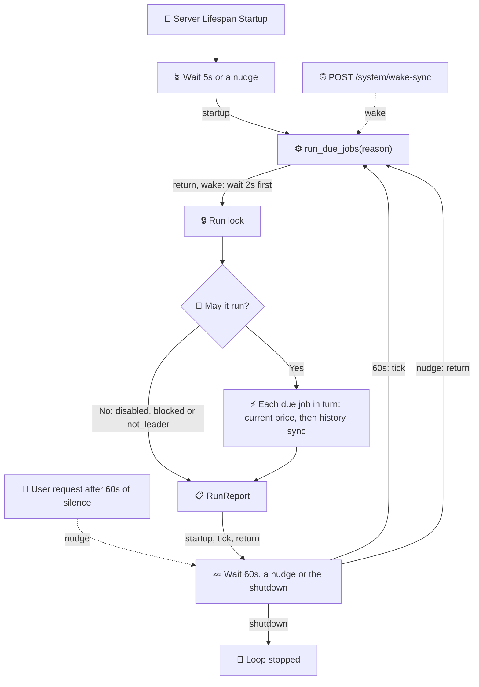

# 🕐 Market Data Scheduler

LibreFolio embeds an automatic background daemon to fetch current prices, historical pricing, and exchange rates without requiring external scheduler systems (like crontab or Celery).

---

## 🏗️ Overview

The scheduler runs as an independent `asyncio.Task` inside the FastAPI lifespan. Every run goes through one function, `run_due_jobs(reason)`, which checks whether the configured sync jobs are due and runs those that are: at startup, at each 60-second tick, when a user comes back after a silence, and on a scheduled wake-up, when a hosting panel or a cron job calls `POST /api/v1/system/wake-sync` (see [Scheduled Wake-up](../../admin/sleep_wake.md#wake-sync)).

---

## 🔄 Async Loop Daemon (`scheduler.py`)

The main entry point is `scheduler_loop()` located in `backend/app/services/platform/scheduler/scheduler.py`. Every run of the jobs goes through `run_due_jobs(reason)`, in the same module: the loop calls it, and so does the scheduled wake-up route (`backend/app/api/v1/system/wake.py`).

* **Lifespan Task:** The `scheduler` startup step, the last of `STARTUP_STEPS` in `backend/app/services/platform/app_lifespan.py`, spawns it with `asyncio.create_task()`. On shutdown, the `scheduler` step, the first of `SHUTDOWN_STEPS`, sets the shutdown event and awaits the task before the providers are shut down, a run in progress included; when the shutdown deadline cuts the step, the task is cancelled (see the [lifecycle contract](../architecture/overview.md#lifecycle-contract)).
* **Shutdown Event:** The loop waits on `shutdown_event: asyncio.Event`, its timer and the return nudge at once, so a shutdown ends a wait immediately. The event does not interrupt a run: the loop stops once the run in progress is over, then removes its return listener.
* **Environment Bypass:** Any non-empty value of `LIBREFOLIO_NO_SCHEDULER` keeps the loop from starting and from registering its return listener; a run asked for anyway answers `disabled`. `./dev.py server --no-scheduler` and the gallery screenshot generation set it to `1`.

### ⏰ When a Run Happens {: #run-reasons }

Each run has a reason (`RunReason`), which its log line carries; any other value is refused with `ValueError` before anything happens.

| Reason | When |
|---|---|
| `startup` | The first run, `FIRST_RUN_DELAY_SECONDS` (5 s) after the loop starts, while the application finishes starting. A nudge brings it forward; a shutdown in the meantime ends the loop without it. |
| `tick` | `TICK_SECONDS` (60 s) after the end of the previous run. |
| `return` | At once, when a user's request comes after at least `CATCH_UP_AFTER_SECONDS` (60 s) of silence: see the nudge below. |
| `wake` | A call to the scheduled wake-up route, `POST /api/v1/system/wake-sync`, which streams the run's report back to its caller: see [Scheduled Wake-up](../../admin/sleep_wake.md#wake-sync). |

**The nudge on return.** The loop registers a return listener, `scheduler-catch-up` (`CATCH_UP_LISTENER`), on the process's activity record (`current_activity()`, in `backend/app/services/platform/sleep_wake/activity.py`). The record calls it at the start of a user's request that comes after at least 60 seconds without one; the health and readiness probes do not count. The listener only sets the loop's nudge event, with `loop.call_soon_threadsafe()` so that it works from any thread, and the waiting loop runs `return` at once. The record measures the silence on the wall clock, so the time a machine spends suspended counts; the loop's own timer runs on the monotonic clock, which does not count it, so after a resume the next tick could still be up to a minute away. The nudge is cleared when a run starts: nudges that arrive during a run make one `return` run right after it.

### 🔒 One Run at a Time {: #run-lock }

* **Run lock:** `run_due_jobs()` takes an `asyncio.Lock`, one per event loop, for its checks and its jobs, so two runs of the process never overlap. The second one waits, then loads the state the first one saved, and does not run again what the first one just ran.
* **Busy work:** from its start to its end — the clock settle and the wait for the lock included, whether it returns, raises or is cancelled — the run is busy work on the activity record (`current_activity().busy("scheduler")`), so that the idle suspension (sleep and wake), when it comes, never stops the machine in the middle of a run.
* **Clock settle:** a `return` or `wake` run first waits `CLOCK_SETTLE_SECONDS` (2 s), before the lock and before it reads the time; `startup` and `tick` never wait. After a Fly.io resume the wall clock is corrected within a few hundred milliseconds, and a request may be served before that: the wait lets the due checks read the corrected time.

### 🚦 Inside a Run {: #run-checks }

Under the lock, a run checks four things, in this order. The first one that stops it gives the run's status: no job runs, and the state is not loaded.

1. The scheduler is off, `LIBREFOLIO_NO_SCHEDULER` (`scheduler_disabled()`): `disabled`.
2. The instance is blocked, `LIBREFOLIO_BLOCKED` (`instance_blocked()`): `blocked`. A blocked instance runs no job at all, so its prices and exchange rates are not updated; once the block is lifted (a restart), the first run catches up the history-sync slot missed in the meantime (decision D-Z3-4, and [missed slots](#history-sync)).
3. This process is not the leader worker (`am_i_leader()`, see [Leader Election](#leader-election)): `not_leader`.
4. The `scheduler_enabled` setting is off: `disabled`. The settings are read from the database (`load_scheduler_settings()`) at each run that gets this far.

Otherwise the run loads the state (`load_state()`), reads the wall clock once (`utc_now()`) for both due checks, and takes the jobs of `JOBS` in order, `current_price` then `history_sync`. A job that is not due is reported `not_due`. A due job runs on the loaded state, and the state is saved right after it (`save_state()`). `am_i_leader()`, `load_state()` and `save_state()` block on the process table or on the disk, so they run off the event loop (`asyncio.to_thread()`).

Each job runs in its own `try`:

* A job that raises, or the save after it, is reported `error` with the exception's class name only. The message and the traceback stay in the server log (`Scheduler job failed`, with `job` and `reason`), never in the outcome, which a caller may pass on. The next job still runs. The failure is recorded in the job's state, saved at once: the job keeps the `last_run_at` of its last run that ended, so its regular rule still finds it due, but it is not tried again before a wait that doubles at each failure in a row (see [Provider Pauses and Failures](#pauses-and-failures)).
* A cancellation is not caught: it goes through, and the run releases its lock and its busy span. It records no failure, so no wait. A job it cuts before its state is saved stays due, so after a shutdown the next start runs it again.
* An exception outside the jobs — the settings or the state cannot be read — leaves `run_due_jobs()`: the loop logs it (`Scheduler run failed`) and goes on.

### ⏸️ Provider Pauses and Failures {: #pauses-and-failures }

Two things move a job's next run, in opposite directions. A price provider that pauses after «too many requests» defers some of the job's items, and the job is retried as soon as the first pause is over, unless its regular round comes first. A job that raises is held back, for a wait that doubles at each failure in a row.

**Deferred items.** The provider-call boundaries, `call_provider()` for the assets and `call_fx_provider()` for the exchange rates, pause a provider after it answers «too many requests» (HTTP 429), and until the pause ends refuse every call to it at once, without reaching the provider. A pause lasts 60 s by default and doubles at each refusal in a row, up to 1 h; a `Retry-After` sent by the provider is honoured, up to one day. `LIBREFOLIO_PROVIDER_COOLDOWN_BASE_SECONDS` and `LIBREFOLIO_PROVIDER_COOLDOWN_MAX_SECONDS` tune them (`.env.example`, section «Sleep and Wake»); [Provider Pauses](assets/architecture.md#provider-pauses) and [Paused Providers](fx/configuration.md#paused-providers) tell the rest. An item refused that way comes back with `error_code="RATE_LIMITED"` and `retry_after`, the seconds until the provider may be called again, and the jobs (`jobs.py`) count it as **deferred**, whatever its status or value: neither ok nor failed. A current price that fell back on the last stored price is deferred, and so is a history item that saved some prices anyway, even one marked `ok`; an FX pair carries `RATE_LIMITED` only when it ended `failed` or `partial`, not when another route served it.

* **Status.** `_classify_job_status(ok, total, deferred)` gives `ok` when every item succeeded (or there was none), `error` when none did and none was deferred, and `partial` otherwise: a job with deferred items is `partial`, even when all of them were deferred.
* **`retry_at`.** At its end, the job records when to retry them: now, in UTC, plus the shortest `retry_after` among its deferred items, by when the first pause is over. An item that does not know its wait (with the pauses turned off, a refusal that sent no `Retry-After`) does not count; when none knows it, `retry_at` stays `null` and the deferred items wait for the regular round.

**The due rules.** `_retry_rule()` comes first in both `due_current_price()` and `due_history_sync()`, each on its own job's state:

1. A `next_attempt_at` still ahead holds the job back: it is not due, whatever the reason of the run, a wake-up included.
2. A `retry_at` that has come makes it due: before the regular round, never after. When the regular round comes first, the job runs then, and the items whose provider is still paused are deferred again, without a call.
3. Otherwise the regular rule applies: the frequency for the current price, the slots for the [history sync](#history-sync).

A timestamp that cannot be read counts as none. No timer waits for these moments: the loop sees them at its next run, within a tick (60 s). A machine that sleeps runs nothing, so the [answer of the scheduled wake-up](../../admin/sleep_wake.md#wake-sync-answer) reports `retry_at`, for a hosting panel to plan its next wake-up.

**Failures.** A job that raises, or whose state cannot be saved after it, goes through `_record_failure()`:

* `consecutive_failures` grows by one;
* `next_attempt_at` is now, in UTC, plus 60 s × 2^(failures − 1) (`FAILURE_BACKOFF_BASE_SECONDS`), capped at 3600 s for the history sync (`FAILURE_BACKOFF_MAX_SECONDS`) and at its own frequency for the current price (`scheduler_current_price_frequency_minutes` × 60), so a failing refresh is never tried less often than its schedule asks. With the default settings, the current price waits 60, 120, 240 and 480 s, then 10 minutes at each further failure; the history sync waits 60 s doubling up to 1920 s, then an hour;
* `last_status` becomes `"error"` and `last_error` the exception's class name; the rest of the state is kept, a pending `retry_at` included;
* `last_run_at` and `last_duration_s` stay those of the last run that ended, so a missed slot stays due: the job is normally due again as soon as its wait is over;
* the state is saved at once; a save that fails again is only logged (`Scheduler state not saved after a failed job`).

A job that ends — that returns instead of raising — writes a new `JobState`, whatever its status, `error` included, with `consecutive_failures` back to 0 and no `next_attempt_at`. Only a job that raises waits: items that fail do not hold a job back.

**Where it shows.**

| Where | Fields |
|---|---|
| `scheduler_state.json` (`JobState`, `state.py`) | `last_items_deferred` and `retry_at`, written by the job at its end; `consecutive_failures` and `next_attempt_at`, written by `_record_failure()` and reset by a job that ends. `retry_at` and `next_attempt_at` are ISO 8601 in UTC. `load_state()` ignores the keys it does not know, so a state file written by a newer version does not reset the state, and a file without the new keys loads with their defaults |
| Job log (`joblog.py`) | `deferred: true` and `retry_after` on a deferred item, `deferred` (or `assets_deferred` and `fx_deferred`) in `summary`, with `err` counting the failed items only, and `retry_at` on the entry: see [Execution Logs](#execution-logs) |
| Run report (`JobOutcome`) | `items_deferred`, and `retry_at` as a `datetime` in UTC: see [The Run Report](#run-report). The scheduled wake-up passes both on to its caller (`WakeSyncJob`) |

### 📋 The Run Report {: #run-report }

Each run returns a `RunReport(reason, status, started_at, finished_at, jobs)`. It is generic: a future job — notifications, say — is one more entry of `JOBS`, and one more outcome.

* `status`: `ok` when no job ran or every job that ran is `ok`, `error` when every job that ran is `error`, `partial` otherwise; or the check that stopped the run, `disabled`, `blocked` or `not_leader`, with `jobs` empty.
* `started_at` and `finished_at`: in UTC, from the moment the run holds the lock.
* `jobs`: one `JobOutcome(name, status, started_at, duration_s, items_ok, items_err, error, items_deferred, retry_at)` per job, in order, with `status` `ok`, `partial`, `error` or `not_due`. A job that ran reports what its `JobState` holds after it: status (`ok` when it wrote none), duration, item counts (the deferred ones in `items_deferred`), error and `retry_at`. A job that raised reports `error`, its duration, the exception's class name in `error`, and the end of its wait (`next_attempt_at`) in `retry_at`. A job not due reports its name, `not_due` and, in `retry_at`, the end of a wait after a failure if it is still ahead, else a deferred retry still ahead, else `None`. `retry_at` is a `datetime` in UTC (see [Provider Pauses and Failures](#pauses-and-failures)).

The loop logs each report, `Scheduler run finished` with the reason, the status and the jobs that ran: at INFO when a job ran, at DEBUG otherwise, so the runs with nothing due stay out of an INFO log.

---

## 👑 Leader Election (`leader.py`) {: #leader-election }

To prevent multiple processes from running duplicate sync jobs when uvicorn runs several workers, only one process — the leader — executes the jobs. `am_i_leader()` decides at every run with `psutil`, without any lock file; it reads the process table, so `run_due_jobs()` calls it off the event loop (`asyncio.to_thread()`):

* Among the running, non-zombie children of the uvicorn master, the process with the **lowest PID** is the leader. If it dies, the next run promotes the new lowest PID.
* Fast paths return `True`: no parent process (e.g. PID 1 in a container), a parent started with `--reload` (one logical worker), a single sibling, or any introspection error — safe because the jobs are idempotent.
* Another worker answers `not_leader` and runs no job. Each worker has its own loop and its own activity record, so a return nudges only the worker that served the request: when that one is not the leader, the catch-up waits for the leader's next tick, within 60 seconds. A lock shared between the processes is in the backlog (Z-11). The Docker image runs a single worker (its `CMD` starts `uvicorn` without `--workers`); `./dev.py server --workers N` starts several.

---

## 💼 Job Definitions (`jobs.py`)

The scheduler runs two types of background synchronization jobs defined in `backend/app/services/platform/scheduler/jobs.py`:

### ⏱️ 1. Current Price Refresh

* **Purpose:** Keeps the current prices of all active assets that have a price provider up-to-date. This updates the local pricing cache, feeding the frontend's [live prices](../frontend/components/features/live-ticker.md#polling) on the Assets list and the asset detail page.
* **Frequency:** Defined by `scheduler_current_price_frequency_minutes` (default: every 10 minutes).
* **Execution:** Calls `AssetSourceManager.get_current_prices_bulk()` (concurrency 3) on every active asset that has a provider assignment.

### 📅 2. History Sync {: #history-sync }

* **Purpose:** Synchronizes historical price series (closing prices) for assets and FX rates.
* **Frequency:** Configured for specific days of the week (e.g., `mon,tue,wed,thu,fri,sat`) and times of the day (e.g., `06:00` and `23:00`), as local wall-clock values in `scheduler_timezone` (see [Configuration Integration](#configuration-integration)).
* **Missed slots:** After a previous run, the most recent slot of a configured day — today or up to `MISSED_SLOT_LOOKBACK_DAYS` (7) days back, in `scheduler_timezone` — is due when it fell after that run (decision D-Z3-1). A week holds every configured day, so the most recent slot is always found: a slot missed while the server was off, asleep or [blocked](#run-checks) runs at the next run — startup, tick, return or wake-up — instead of at the next slot (after a failure, at the first run once its [wait](#pauses-and-failures) is over), and several missed slots make one run. Without a previous run (no `last_run_at`, or one that cannot be read), only today's slots count. An always-on instance, which runs every minute, sees no difference.
* **Example:** slots `06:00` and `23:00`, days Monday to Saturday. The history sync last ran on Saturday at 06:00, and the server was off from Saturday 20:00 to Sunday 10:00. When it starts on Sunday, the `startup` run syncs the history, because Saturday's 23:00 slot fell after the last run; with today's slots only, it would have waited for Monday 06:00, Sunday not being a configured day.
* **Execution:** Calls `AssetSourceManager.bulk_refresh_prices()` for the same assets over `[today − horizon, today]` (`scheduler_history_sync_horizon_days`, default: 14 days), then `sync_pairs_bulk()` for every FX conversion route except those with a `MANUAL` step.

Both jobs classify their run as `ok` (every item succeeded, or there was nothing to process), `error` (no item succeeded, and none was [deferred](#pauses-and-failures)), or `partial` otherwise, a run whose items were all deferred included.

---

## 📜 Execution Logs (`joblog.py`) {: #execution-logs }

Every job run that completes is appended to `logs/scheduler_jobs.jsonl` in the data directory, one JSON object per run:

* **Header fields:** `ts` (ISO timestamp with offset), `job` (`current_price` or `history_sync`), `duration_s`, `status` (`ok`, `partial` or `error`), and `retry_at` (when the [deferred](#pauses-and-failures) items are retried, ISO 8601 in UTC; `null` when there is none).
* **`summary`:** `ok`, `err` and `deferred` counts for the current-price refresh; `assets_ok`, `assets_err`, `assets_deferred`, `fx_ok`, `fx_err` and `fx_deferred` for the history sync. A deferred item counts in neither `ok` nor `err`.
* **Per-item detail:** `items` for the current-price refresh (asset, `ok`, `error`); `assets` and `fx` for the history sync (status, `provider`, `errors`, and `prices_changed`/`events_changed` or `points_changed`). A deferred item adds `deferred: true`, and `retry_after` (seconds) when it knows its wait: a history item keeps its `status`, a current-price item has `ok` set to `false`.
* **Rotation:** after each append, the file is trimmed to its last 500 entries (`MAX_ENTRIES`).

A job that raises appends no entry: its failure is in the server log, `Scheduler job failed` (see [Inside a Run](#run-checks)), and in its state (see [Provider Pauses and Failures](#pauses-and-failures)).

The state of each job — its last run that ended, the deferred retry and the wait after a failure — is also kept in `scheduler_state.json` at the root of the data directory (`state.py`, atomic write-then-rename). The admin UI reads both through admin-only endpoints: `GET /api/v1/settings/scheduler/state` (last runs, `scheduler_timezone`, the server's UTC clock) and `GET /api/v1/settings/scheduler/log?since=ISO` (newest first). Neither passes on the fields of the pauses and failures: the state route returns a fixed set of fields, and the response models of the log route (`SchedulerLog*`, in `backend/app/schemas/settings.py`) do not declare them.

---

## ⚙️ Configuration Integration

Scheduler options are fully integrated into LibreFolio's database-backed Global Settings system. When an administrator modifies settings in the UI:

1. Settings are saved to the `GlobalSetting` table.
2. The frontend triggers a settings reload.
3. The backend scheduler loop loads the settings dynamically on the next loop iteration (every 60 seconds), adapting the polling frequency and execution times instantly without requiring a server restart.

History-sync times and days are stored as local wall-clock values in `scheduler_timezone`. `due_history_sync()` builds each slot in that timezone, on its own local date, and converts it to a UTC instant only when deciding whether it is due, so the slots follow daylight saving time. A slot is due once its instant has passed and the last history run is older than it; [History Sync](#history-sync) says which slots count. A timezone that `zoneinfo` cannot load falls back to UTC (`_scheduler_zoneinfo()`). `zoneinfo` reads the system's time zone database, since the PyPI `tzdata` package is not a dependency: the Docker image installs Debian's `tzdata` and `tzdata-legacy`, which holds old names such as `Asia/Calcutta` and `US/Eastern` (see [Docker Image](../architecture/overview.md#docker-image)). An empty or invalid day list falls back to Monday–Saturday. The backend does not validate these values: the configuration dialog enforces the ranges (1–1440 minutes, 1–365 days, at least one time and one day).

---

## 🔗 Related

* 📡 **[Live Prices](../frontend/components/features/live-ticker.md)** — How the Assets list and the asset detail page poll current prices
* 💰 **[Asset Architecture](assets/architecture.md)** — Pricing provider pipelines and sync steps
* ⚙️ **[Settings System](../architecture/settings.md)** — Dynamic global configuration variables
