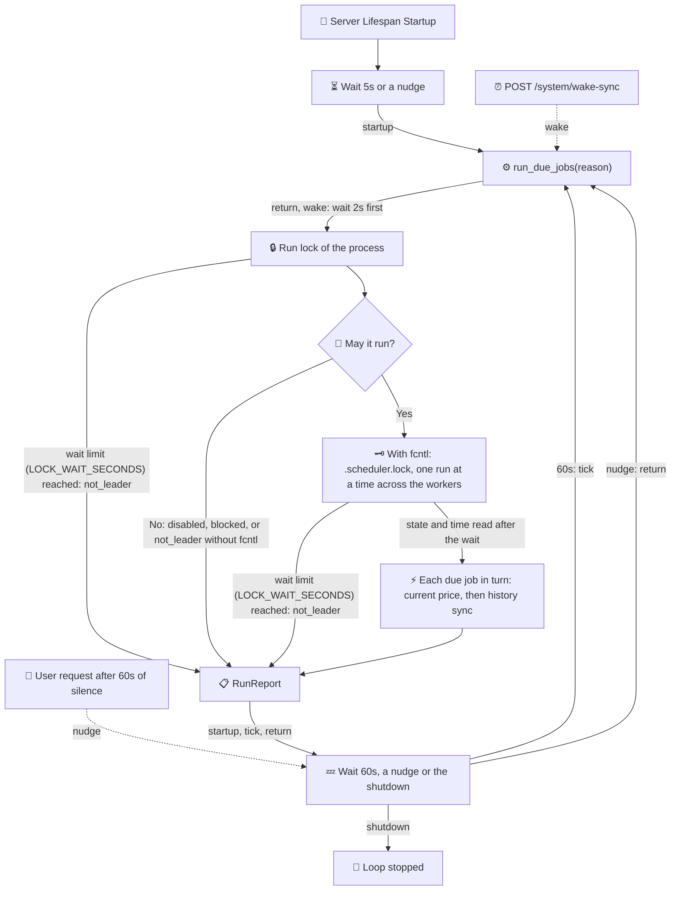
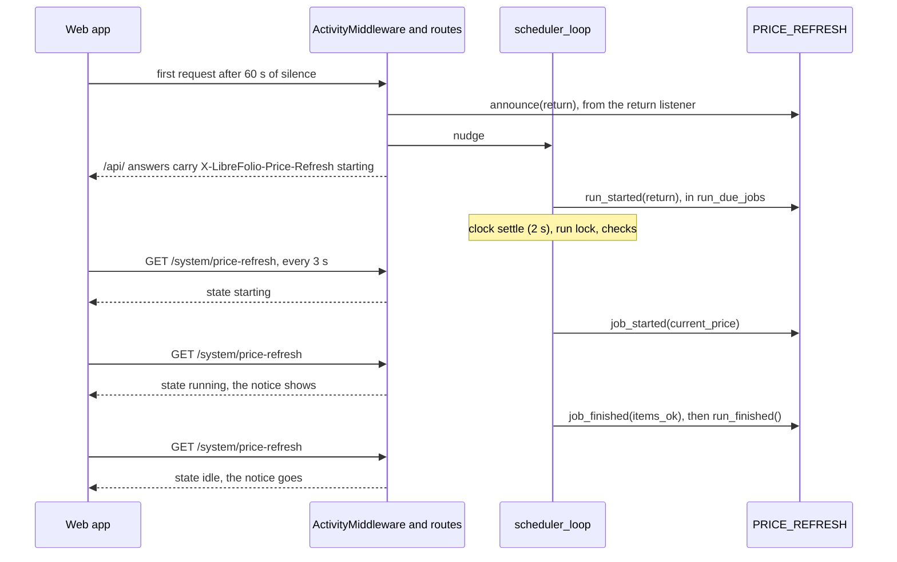

# 🕐 Market Data Scheduler

LibreFolio embeds an automatic background daemon to fetch current prices, historical pricing, and exchange rates without requiring external scheduler systems (like crontab or Celery).

---

## 🏗️ Overview

The scheduler runs as an independent `asyncio.Task` inside the FastAPI lifespan. Every run goes through one function, `run_due_jobs(reason)`, which checks whether the configured sync jobs are due and runs those that are: at startup, at each 60-second tick, when a user comes back after a silence, and on a scheduled wake-up, when a hosting panel or a cron job calls `POST /api/v1/system/wake-sync` (see [Scheduled Wake-up](../../admin/sleep_wake.md#wake-sync)). A run at startup, on a return or for a wake-up is a catch-up, which the web app shows as **Updating prices…** while one of its jobs runs (see [Catch-up Progress](#price-refresh)).



---

## 🔄 Async Loop Daemon (`scheduler.py`)

The main entry point is `scheduler_loop()` located in `backend/app/services/platform/scheduler/scheduler.py`. Every run of the jobs goes through `run_due_jobs(reason)`, in the same module: the loop calls it, and so does the scheduled wake-up route (`backend/app/api/v1/system/wake.py`).

* **Lifespan Task:** The `scheduler` startup step, followed only by `idle-monitor` in `STARTUP_STEPS` (`backend/app/services/platform/app_lifespan.py`), spawns it with `asyncio.create_task()`. On shutdown, the `scheduler` step, right after `idle-monitor` at the head of `SHUTDOWN_STEPS`, sets the shutdown event and awaits the task before the providers are shut down, a run in progress included; when the shutdown deadline cuts the step, the task is cancelled (see the [lifecycle contract](../architecture/overview.md#lifecycle-contract)).
* **Shutdown Event:** The loop waits on `shutdown_event: asyncio.Event`, its timer and the return nudge at once, so a shutdown ends a wait immediately. The event does not interrupt a run: the loop stops once the run in progress is over, then removes its return listener and its response header, and resets the catch-up tracker (see [Catch-up Progress](#price-refresh)).
* **Environment Bypass:** Any non-empty value of `LIBREFOLIO_NO_SCHEDULER` keeps the loop from starting and from registering its return listener and its response header; a run asked for anyway answers `disabled`. `./dev.py server --no-scheduler` and the gallery screenshot generation set it to `1`.

### ⏰ When a Run Happens {: #run-reasons }

Each run has a reason (`RunReason`), which its log line carries; any other value is refused with `ValueError` before anything happens.

| Reason | When |
|---|---|
| `startup` | The first run, `FIRST_RUN_DELAY_SECONDS` (5 s) after the loop starts, while the application finishes starting. A nudge brings it forward; a shutdown in the meantime ends the loop without it. |
| `tick` | `TICK_SECONDS` (60 s) after the end of the previous run. |
| `return` | At once, when a user's request comes after at least `CATCH_UP_AFTER_SECONDS` (60 s) of silence: see the nudge below. |
| `wake` | A call to the scheduled wake-up route, `POST /api/v1/system/wake-sync`, which streams the run's report back to its caller: see [Scheduled Wake-up](../../admin/sleep_wake.md#wake-sync). |

**The nudge on return.** The loop registers a return listener, `scheduler-catch-up` (`CATCH_UP_LISTENER`), on the process's activity record (`current_activity()`, in `backend/app/services/platform/sleep_wake/activity.py`). The record calls it at the start of a user's request that comes after at least 60 seconds without one; the health and readiness probes do not count. The listener announces the catch-up (`PRICE_REFRESH.announce("return")`, see [Catch-up Progress](#price-refresh)) and sets the loop's nudge event, with `loop.call_soon_threadsafe()` so that it works from any thread; the waiting loop runs `return` at once. The record measures the silence on the wall clock, so the time a machine spends suspended counts; the loop's own timer runs on the monotonic clock, which does not count it, so after a resume the next tick could still be up to a minute away. The nudge is cleared when a run starts: nudges that arrive during a run make one `return` run right after it.

### 🔒 One Run at a Time {: #run-lock }

* **Run lock:** `run_due_jobs()` takes an `asyncio.Lock`, one per event loop, for its checks and its jobs, so two runs of the process never overlap. The second one waits, then loads the state the first one saved, and does not run again what the first one just ran; past the [wait limit](#cross-process-lock), ten minutes, it gives up instead.
* **Across processes:** where Python has `fcntl`, the runs of different worker processes take turns the same way, on an exclusive `flock` of `.scheduler.lock` in the data directory, which a run takes after its [checks](#run-checks): one run at a time for the data directory, in whichever worker it starts. See [Several Workers](#leader-election).
* **Busy work:** from its start to its end — the clock settle and the waits for both locks included, whether it returns, raises or is cancelled — the run is busy work on the activity record (`current_activity().busy("scheduler")`): for the [idle suspension](../../admin/sleep_wake.md#idle-suspend), a scheduler run is work in progress, so the idle monitor never suspends the machine in the middle of a run.
* **Clock settle:** a `return` or `wake` run first waits `CLOCK_SETTLE_SECONDS` (2 s), before the locks and before it reads the time; `startup` and `tick` never wait. After a Fly.io resume the wall clock is corrected within a few hundred milliseconds, and a request may be served before that: the wait lets the due checks read the corrected time.

### 🚦 Inside a Run {: #run-checks }

Under the run lock of its process, a run goes through these checks, in this order. The first one that stops it gives the run's status: no job runs, and the state is not loaded. A run that waits too long for a lock stops the same way, with `not_leader`: the [wait limit](#cross-process-lock), `LOCK_WAIT_SECONDS` (ten minutes, counted after the clock settle), bounds its wait for the run lock of its process and, after these checks, for the lock across processes.

1. The scheduler is off, `LIBREFOLIO_NO_SCHEDULER` (`scheduler_disabled()`): `disabled`.
2. The instance is blocked, `LIBREFOLIO_BLOCKED` (`instance_blocked()`): `blocked`. A blocked instance runs no job at all, so its prices and exchange rates are not updated; once the block is lifted (a restart), the first run catches up the history-sync slot missed in the meantime (decision D-Z3-4, and [missed slots](#history-sync)).
3. Only where Python has no `fcntl` (Windows): this process is not the leader worker (`am_i_leader()`, see [Leader Election](#leader-election-fallback)): `not_leader`. With `fcntl` (Linux, macOS) this check does not exist and `am_i_leader()` is never called: any worker may run the jobs.
4. The `scheduler_enabled` setting is off: `disabled`. The settings are read from the database (`load_scheduler_settings()`) at each run that gets this far.

Otherwise, where Python has `fcntl`, the run takes the [lock across processes](#cross-process-lock) (`scheduler_run_lock()`), waiting while another worker's run holds it; without `fcntl` there is no such lock. Then, holding it where there is one, the run loads the state (`load_state()`), reads the wall clock once (`utc_now()`) for both due checks, and takes the jobs of `JOBS` in order, `current_price` then `history_sync`. A job that is not due is reported `not_due`. A due job runs on the loaded state, and the state is saved right after it (`save_state()`). So a run that waited for another worker's run reads the state that run saved, and the time after the wait: what that run just did is `not_due`. `am_i_leader()`, each attempt at the lock across processes, `load_state()` and `save_state()` block on the process table or on the disk, so they run off the event loop (`asyncio.to_thread()`).

Each job runs in its own `try`:

* A job that raises, or the save after it, is reported `error` with the exception's class name only. The message and the traceback stay in the server log (`Scheduler job failed`, with `job` and `reason`), never in the outcome, which a caller may pass on. The next job still runs. The failure is recorded in the job's state, saved at once: the job keeps the `last_run_at` of its last run that ended, so its regular rule still finds it due, but it is not tried again before a wait that doubles at each failure in a row (see [Provider Pauses and Failures](#pauses-and-failures)).
* A cancellation is not caught: it goes through, and the run releases its locks, the one across processes included, and its busy span. It records no failure, so no wait. A job it cuts before its state is saved stays due, so after a shutdown the next start runs it again.
* An exception outside the jobs — the settings or the state cannot be read, or the lock across processes cannot be taken (a symlink in its place, a permission problem) — leaves `run_due_jobs()`: the loop logs it (`Scheduler run failed`) and goes on, and the [scheduled wake-up](../../admin/sleep_wake.md#wake-sync-answer) answers `status: "error"` with its class name.

### ⏸️ Provider Pauses and Failures {: #pauses-and-failures }

Two things move a job's next run, in opposite directions. A price provider that pauses after «too many requests» defers some of the job's items, and the job is retried as soon as the first pause is over, unless its regular round comes first. A job that raises is held back, for a wait that doubles at each failure in a row.

**Deferred items.** The provider-call boundaries, `call_provider()` for the assets and `call_fx_provider()` for the exchange rates, pause a provider after it answers «too many requests» (HTTP 429), and until the pause ends refuse every call to it at once, without reaching the provider. A pause lasts 60 s by default and doubles at each refusal in a row, up to 1 h; a `Retry-After` sent by the provider is honoured, up to one day. `LIBREFOLIO_PROVIDER_COOLDOWN_BASE_SECONDS` and `LIBREFOLIO_PROVIDER_COOLDOWN_MAX_SECONDS` tune them (`.env.example`, section «Sleep and Wake», and for administrators [Sleep and Wake › Provider Pauses](../../admin/sleep_wake.md#provider-pauses)); [Provider Pauses](assets/architecture.md#provider-pauses) and [Paused Providers](fx/configuration.md#paused-providers) tell the rest. An item refused that way comes back with `error_code="RATE_LIMITED"` and `retry_after`, the seconds until the provider may be called again, and the jobs (`jobs.py`) count it as **deferred**, whatever its status or value: neither ok nor failed. A current price that fell back on the last stored price is deferred, and so is a history item that saved some prices anyway, even one marked `ok`; an FX pair carries `RATE_LIMITED` only when it ended `failed` or `partial`, not when another route served it.

* **Status.** `_classify_job_status(ok, total, deferred)` gives `ok` when every item succeeded (or there was none), `error` when none did and none was deferred, and `partial` otherwise: a job with deferred items is `partial`, even when all of them were deferred.
* **`retry_at`.** At its end, the job records when to retry them: now, in UTC, plus the shortest `retry_after` among its deferred items, by when the first pause is over. An item that does not know its wait (with the pauses turned off, a refusal that sent no `Retry-After`) does not count; when none knows it, `retry_at` stays `null` and the deferred items wait for the regular round.

**The due rules.** `_retry_rule()` comes first in both `due_current_price()` and `due_history_sync()`, each on its own job's state:

1. A `next_attempt_at` still ahead holds the job back: it is not due, whatever the reason of the run, a wake-up included.
2. A `retry_at` that has come makes it due: before the regular round, never after. When the regular round comes first, the job runs then, and the items whose provider is still paused are deferred again, without a call.
3. Otherwise the regular rule applies: the frequency for the current price, the slots for the [history sync](#history-sync).

A timestamp that cannot be read counts as none. No timer waits for these moments: the loop sees them at its next run, within a tick (60 s). A machine that sleeps runs nothing, so the [answer of the scheduled wake-up](../../admin/sleep_wake.md#wake-sync-answer) reports `retry_at`, for a hosting panel to plan its next wake-up.

**Failures.** A job that raises, or whose state cannot be saved after it, goes through `_record_failure()`:

* `consecutive_failures` grows by one;
* `next_attempt_at` is now, in UTC, plus 60 s × 2^(failures − 1) (`FAILURE_BACKOFF_BASE_SECONDS`), capped at 3600 s for the history sync (`FAILURE_BACKOFF_MAX_SECONDS`) and at its own frequency for the current price (`scheduler_current_price_frequency_minutes` × 60), so a failing refresh is never tried less often than its schedule asks. With the default settings, the current price waits 60, 120, 240 and 480 s, then 10 minutes at each further failure; the history sync waits 60 s doubling up to 1920 s, then an hour;
* `last_status` becomes `"error"` and `last_error` the exception's class name; the rest of the state is kept, a pending `retry_at` included;
* `last_run_at` and `last_duration_s` stay those of the last run that ended, so a missed slot stays due: the job is normally due again as soon as its wait is over;
* the state is saved at once; a save that fails again is only logged (`Scheduler state not saved after a failed job`).

A job that ends — that returns instead of raising — writes a new `JobState`, whatever its status, `error` included, with `consecutive_failures` back to 0 and no `next_attempt_at`. Only a job that raises waits: items that fail do not hold a job back.

**Where it shows.**

| Where | Fields |
|---|---|
| `scheduler_state.json` (`JobState`, `state.py`) | `last_items_deferred` and `retry_at`, written by the job at its end; `consecutive_failures` and `next_attempt_at`, written by `_record_failure()` and reset by a job that ends. `retry_at` and `next_attempt_at` are ISO 8601 in UTC. `load_state()` ignores the keys it does not know, so a state file written by a newer version does not reset the state, and a file without the new keys loads with their defaults |
| Job log (`joblog.py`) | `deferred: true` and `retry_after` on a deferred item, `deferred` (or `assets_deferred` and `fx_deferred`) in `summary`, with `err` counting the failed items only, and `retry_at` on the entry: see [Execution Logs](#execution-logs) |
| Run report (`JobOutcome`) | `items_deferred`, and `retry_at` as a `datetime` in UTC: see [The Run Report](#run-report). The scheduled wake-up passes both on to its caller (`WakeSyncJob`) |

### 📋 The Run Report {: #run-report }

Each run returns a `RunReport(reason, status, started_at, finished_at, jobs)`. It is generic: a future job — notifications, say — is one more entry of `JOBS`, and one more outcome.

* `status`: `ok` when no job ran or every job that ran is `ok`, `error` when every job that ran is `error`, `partial` otherwise; or, with `jobs` empty, the check that stopped the run, `disabled`, `blocked` or, without `fcntl` only, `not_leader`; `not_leader` too, with or without `fcntl`, for a run that gave up at the [wait limit](#cross-process-lock).
* `started_at` and `finished_at`: in UTC, from the moment the run holds the run lock of its process, before its checks: a wait for another worker's run falls between them. A run that gave up waiting for the run lock of its process has both at the moment it gave up; one that gave up at the lock across processes has them as any run, its wait between them.
* `jobs`: one `JobOutcome(name, status, started_at, duration_s, items_ok, items_err, error, items_deferred, retry_at)` per job, in order, with `status` `ok`, `partial`, `error` or `not_due`. A job that ran reports what its `JobState` holds after it: status (`ok` when it wrote none), duration, item counts (the deferred ones in `items_deferred`), error and `retry_at`. A job that raised reports `error`, its duration, the exception's class name in `error`, and the end of its wait (`next_attempt_at`) in `retry_at`. A job not due reports its name, `not_due` and, in `retry_at`, the end of a wait after a failure if it is still ahead, else a deferred retry still ahead, else `None`. `retry_at` is a `datetime` in UTC (see [Provider Pauses and Failures](#pauses-and-failures)).

The loop logs each report, `Scheduler run finished` with the reason, the status and the jobs that ran: at INFO when a job ran, at DEBUG otherwise, so the runs with nothing due stay out of an INFO log.

---

## ⏳ Catch-up Progress {: #price-refresh }

A run at startup, on a return or for a wake-up is a **catch-up** (`CATCH_UP_REASONS`): the run a user may be waiting for, after the server started, woke up or went a minute without requests. While one of its jobs runs, the web app shows the notice **Updating prices…**: [Updating prices…](../frontend/components/features/live-ticker.md#price-refresh) tells the web app's side, and [While Prices Catch Up](../../admin/sleep_wake.md#price-refresh) what users see. A `tick` is never a catch-up: the notice would come back every few minutes. The server tells the web app in two ways, both read from one tracker, `PRICE_REFRESH`:

* the header `X-LibreFolio-Price-Refresh` (`PRICE_REFRESH_HEADER`), `starting` or `running`, on every `/api/` answer while a catch-up is pending;
* `GET /api/v1/system/price-refresh`, which the web app asks every 3 s once it has seen the header, until the answer is `idle`.



### 🧮 The Tracker {: #price-refresh-tracker }

`PRICE_REFRESH` is a `PriceRefreshTracker` (`scheduler.py`): one per process, in memory, behind a `threading.Lock`, since the loop, the activity record and the route (a plain `def`, which FastAPI runs in its thread pool) reach it from different threads. `price_refresh_progress()` returns its state now, a `PriceRefreshProgress(state, reason, job, since, last_finished_at, last_refreshed)`.

* **Pending.** A catch-up is pending from `announce(reason)` or `run_started(reason)`, whichever comes first, until the last run counted by `run_started()` has ended (`run_finished()`). The loop announces `startup` as it starts, `FIRST_RUN_DELAY_SECONDS` (5 s) before its first run; the return listener announces `return` on the request's thread, before the request runs. `run_due_jobs()` calls `run_started(reason)` for a catch-up reason before the clock settle, and `run_finished()` in a `finally`, so also when the run raises or is cancelled: that is how a wake-up begins one. Runs overlap: a wake-up during a return run is a second counted run, and the catch-up ends with the last of them. A catch-up announced while another is pending changes nothing: the first reason and its start (`since`) stay.
* **States.** `starting` while a catch-up is pending and no job runs: from the announcement through the settle, the [checks](#run-checks) and the waits for the locks, another worker's run included, and between two jobs. `running` while it is pending and a job runs, with the job's name. `idle` otherwise.
* **Jobs.** `_run_job()` calls `job_started(name)` before each job of every run, and `job_finished(items_ok)` after it, `None` when the job is cancelled. A job that finishes while a catch-up is pending counts for it, a tick's included: the user waits for the prices, whatever run brings them. So when a user comes back while a tick's job runs, the state is `running` at once, with that job.
* **The end.** When the last counted run ends, the catch-up is over and the state is `idle`. If at least one job finished while it was pending, the tracker keeps when the catch-up ended (`last_finished_at`) and whether one of those jobs brought an item up to date (`last_refreshed`: an `items_ok` above 0; a job that raised reports 0, and a [deferred](#pauses-and-failures) item is not brought up to date). A catch-up that ran no job — nothing due, or a run stopped by its checks with `disabled`, `blocked` or `not_leader` — leaves both as they were.
* **Guards.** `announce()` and `run_started()` refuse a reason outside `CATCH_UP_REASONS`, `tick` included, with `ValueError`; `run_finished()` without a counted run does nothing. `reset()` forgets everything: the loop calls it as it stops.

### 📨 The Header {: #price-refresh-header }

As it starts, the loop registers `PRICE_REFRESH.header_value` for `X-LibreFolio-Price-Refresh` on the activity record, with `current_activity().register_response_header()`, and removes it as it stops (`remove_response_header()`). `ActivityMiddleware` (`backend/app/services/platform/sleep_wake/activity.py`) adds every registered header to each answer whose path starts with `/api/` (`API_PATH_PREFIX`), the probes excepted, the answer of `wake-sync` included:

* **Read when the answer starts**, on its `http.response.start` message, not when the request arrives. The return listener runs before the request, so the answer to the request that ended the silence, when it is an `/api/` one, already says `starting`, although the run starts at least 2 s later ([clock settle](#run-lock)).
* **Only while a catch-up is pending.** `header_value()` gives `starting` or `running`, and `None` while idle: a provider that returns `None` or an empty string adds nothing. Without a catch-up no answer carries the header, so the web app asks nothing.
* **The route's own header wins.** A header of the same name that the answer already has is kept. Names are compared in any case, and the header goes out with its name in lower case.
* **A provider that fails** — it raises, or returns a value a header cannot carry (a line break, a character beyond Latin-1) — is skipped while the others still answer, and its first failure in a row is logged as a warning, `Response header provider failed`.

The mechanism is generic: `activity.py` imports nothing from the scheduler, and `MIDDLEWARE_STACK` does not change. The web app is served from the same origin, so it reads the header without any CORS setting.

### 🛰️ The Route {: #price-refresh-route }

`GET /api/v1/system/price-refresh` (`backend/app/api/v1/system/price_refresh.py`, one module of the `system` package, like `wake.py`) answers the tracker's state, `PriceRefreshResponse` (`backend/app/schemas/sleep_wake.py`). It reads the same tracker as the header, so the two agree.

* **Signed-in users only**, any role: `get_current_user` answers `401` without a valid session, and the answer tells nothing about anyone's data. On a blocked instance the route is not on the allow-list: a signed-in user gets the `423` of the [Instance Block](../architecture/security.md#instance-block). The web app stops asking at the first `4xx` ([After a 4xx](../frontend/components/features/live-ticker.md#price-refresh-4xx)).
* **A request of the user.** For the activity record it counts like any route but the probes and the wake-up: while the web app asks, the [idle suspension](../../admin/sleep_wake.md#idle-suspend) sees a user.

| Field | What it holds |
|---|---|
| `state` | `idle`, `starting` or `running` |
| `reason` | Why the pending catch-up runs: `startup`, `return` or `wake`; `null` when idle |
| `job` | The job running now, `current_price` or `history_sync`; only while `running` |
| `since` | When the pending catch-up began, in UTC; `null` when idle |
| `last_finished_at` | When the last catch-up that ran a job ended, in UTC; `null` before the first |
| `last_refreshed` | Whether that catch-up brought at least one item up to date |

The last two describe the last catch-up that ran a job, also while another one is pending: the web app reads them once the answer is `idle`. An answer during the history sync of a return, indented here for reading:

```json
{
  "state": "running",
  "reason": "return",
  "job": "history_sync",
  "since": "2026-10-16T07:12:03.120044Z",
  "last_finished_at": "2026-10-16T05:00:14.611230Z",
  "last_refreshed": true
}
```

### 👥 One Process, Several Workers {: #price-refresh-workers }

The tracker belongs to its process, like the loop and the activity record. With several workers, each one runs its loop and announces its own catch-ups, and the jobs run in the worker whose run holds the [lock across processes](#cross-process-lock): the notice shows on that worker's answers only, as it did on the leader's. Another worker's catch-up stays `starting` while its run waits for that lock, ten minutes at most (the [wait limit](#cross-process-lock)), then finds its jobs `not_due`, or gives up, and goes back to `idle` without ever answering `running`; a worker with no catch-up pending answers `idle`. A question that one of these workers answers may end the web app's tracking early: the notice may be missing, never stuck. Without `fcntl`, only the [leader](#leader-election-fallback) runs the jobs, and the other workers' runs end `not_leader` within seconds. The Docker image runs one worker.

With the scheduler off there is no notice either. With `LIBREFOLIO_NO_SCHEDULER` the loop does not start, so the header is never registered and the web app never asks: the test runner's server and the gallery, both started without the scheduler, never show the notice. With the **Scheduler Enabled** setting off, the loop still announces its catch-ups, whose runs end `disabled` without a job: the answers say `starting` for a few seconds, and the notice never shows.

Tests: `./dev.py test services scheduler-price-refresh` (the tracker, the wiring of `run_due_jobs()` and of the loop, the header through `ActivityMiddleware`), `./dev.py test services sleep-wake-activity` (the response headers of the activity record) and `./dev.py test api system-price-refresh` (the route).

---

## 🔐 Several Workers (`run_lock.py`, `leader.py`) {: #leader-election }

With several uvicorn workers (`./dev.py server --workers N`), each worker is a process of its own, with its own loop, its own run lock and its own activity record. Two mechanisms keep their runs from doing the same jobs at once, and `cross_process_lock_available()` (`run_lock.py`) says which one applies: it is true where Python has `fcntl`.

* **With `fcntl`** (Linux and macOS, so the Docker image too): a [lock across processes](#cross-process-lock). Any worker runs the jobs, one run at a time for the data directory.
* **Without `fcntl`** (Windows): the [leader election](#leader-election-fallback). One worker, the leader, runs the jobs; the others answer `not_leader`.

### 🗝️ The Lock Across Processes (`run_lock.py`) {: #cross-process-lock }

`scheduler_run_lock()` (`backend/app/services/platform/scheduler/run_lock.py`), an async context manager, holds an exclusive `flock` on `.scheduler.lock`, at the root of the data directory next to `scheduler_state.json` (`run_lock_path()`). `_run_locked()` takes it after its [checks](#run-checks), and holds it while it loads the state, reads the time and runs the due jobs, each one saving the state after it.

* **The wait.** Each attempt opens the file and tries the lock without blocking, in a thread (`asyncio.to_thread()`); while another process holds it, the run tries again every `POLL_SECONDS` (0.2 s), up to the wait limit below. No thread stays blocked on the lock, and the wait can be cancelled — at shutdown, when the shutdown deadline cuts the `scheduler` step — without leaving the lock held: an attempt still running when the wait is cancelled releases the lock if it got it. The release, in a `finally`, runs in a thread too.
* **The wait limit.** A run waits for other runs ten minutes at most: `LOCK_WAIT_SECONDS` (600 s), a constant of `run_lock.py` with no environment variable (Z-26, night decision N79). Without it, a stuck job would hold back for good every run waiting behind it, in its own worker or in another, a `wake-sync` included. After the [clock settle](#run-lock), `_run_within_deadline()` fixes the run's own wait deadline once, `time.monotonic()` + `LOCK_WAIT_SECONDS`, and that one instant ends both waits: first the one for the run lock of the process (`acquire()` under `asyncio.timeout()`), then the one for this lock (`scheduler_run_lock(deadline=…)`), so the time spent in the first is taken from the second. Without `fcntl` only the first exists. `scheduler_run_lock()` always makes at least one attempt, so a free lock is taken even past its `deadline`; while another process holds the lock, the next attempt comes `min(POLL_SECONDS, time left)` later, and an attempt refused at or past the `deadline` raises `SchedulerRunLockTimeout` (a `TimeoutError`), with no attempt in flight and its descriptor closed. With `deadline=None`, the default, it waits as long as needed. The jobs have no limit: a run that holds its locks runs its jobs to the end.
* **Giving up.** A run that reaches the wait limit runs no job and neither loads nor saves the state: `_run_within_deadline()` catches the `TimeoutError` of the first wait, `_run_locked()` the `SchedulerRunLockTimeout` of the second. `_log_gave_up()` logs a WARNING, `Scheduler run gave up waiting for another run`, with `reason`, `lock` (`process` or `data_dir`, the lock it was waiting for), `waited_s` (the seconds since its wait began) and `limit_s`, and the run reports `not_leader`, with no jobs. It closes like any run: its busy span ends, it releases the run lock of its process if it got it, and a catch-up calls `PRICE_REFRESH.run_finished()`. The run that holds the locks goes on untouched, and the next tick (60 s) tries again. The Docker image, and so a Fly.io machine, runs one worker ([Per Process, Either Way](#workers-per-process)): there only the first wait can reach the limit, a run — a wake-up, say — behind a stuck run of the same process. Several workers come from `./dev.py server --workers N`, or from a command of one's own.
* **Whoever comes second.** A run that waited for another worker's run reads the state that run saved, and the time after the wait: what that run just did is `not_due`, and only what is still due runs.
* **Where the jobs run.** In any worker: the one whose loop ticks, the one that received `wake-sync`, or the one that served a user's return, which runs the catch-up at once (after the [clock settle](#run-lock)) instead of waiting for another worker's tick. A `wake-sync` that reaches a worker while another one runs the jobs waits for that run, at most ten minutes (the wait limit, above), then answers, its jobs `not_due`; past that limit it gives up and answers `not_leader`, with no jobs. Its `409` (`wake_in_progress`) stays per process: a second call that reaches another worker is not refused, it waits for the run in progress. A call that gave up has ended its wake-up, so the next call to its worker is accepted, not answered `409`.
* **The file.** Hidden and empty, created with mode `0600` and opened with `O_NOFOLLOW`: a symlink in its place is refused with an `OSError`, and nothing behind the link is created or locked. It is never deleted: a worker that opened the file before its removal and another that created it again after would hold two different locks, and two runs would overlap. Leave it in place, and never delete it while LibreFolio runs ([Data Directory on Disk](../architecture/database/index.md#data-directory)).
* **A crash.** The kernel releases a `flock` when its process dies: a worker killed in the middle of a run leaves no stale lock. The next run, in any worker, goes ahead, and runs again a job whose state the dead worker did not save.
* **An error.** A lock that cannot be taken (a symlink, a permission problem) raises like any other error outside the jobs: the loop logs it and goes on, and `wake-sync` answers `status: "error"` with the class name ([Inside a Run](#run-checks)).

### 👑 Without `fcntl`: Leader Election (`leader.py`) {: #leader-election-fallback }

Where Python has no `fcntl`, `_run_locked()` asks `am_i_leader()` instead, right after the `blocked` check, and only the leader runs the jobs; with `fcntl`, `am_i_leader()` is never called. It decides at every run with `psutil`, without any lock file; it reads the process table, so it runs off the event loop (`asyncio.to_thread()`):

* Among the running, non-zombie children of the uvicorn master, the process with the **lowest PID** is the leader. If it dies, the next run promotes the new lowest PID.
* Fast paths return `True`: no parent process (e.g. PID 1 in a container), a parent started with `--reload` (one logical worker), a single sibling, or any introspection error — safe because the jobs are idempotent.
* Another worker answers `not_leader` and runs no job. A return nudges only the worker that served the request: when that one is not the leader, the catch-up waits for the leader's next tick, within 60 seconds.

### 🧩 Per Process, Either Way {: #workers-per-process }

The catch-up tracker (`PRICE_REFRESH`, and its header `X-LibreFolio-Price-Refresh`), the activity record and the idle monitor stay per process. With several workers, the notice **Updating prices…** shows on the answers of the worker that runs the jobs, as it did on the leader's, and may be missing ([One Process, Several Workers](#price-refresh-workers)); each worker counts only its own requests for the [idle suspension](../../admin/sleep_wake.md#idle-suspend-timing). The Docker image runs a single worker (its `CMD` starts `uvicorn` without `--workers`), and so does a Fly.io machine that runs it; `./dev.py server --workers N` starts several.

---

## 💼 Job Definitions (`jobs.py`)

The scheduler runs two types of background synchronization jobs defined in `backend/app/services/platform/scheduler/jobs.py`:

### ⏱️ 1. Current Price Refresh

* **Purpose:** Keeps the current prices of all active assets that have a price provider up-to-date. This updates the local pricing cache, feeding the frontend's [live prices](../frontend/components/features/live-ticker.md#polling) on the Assets list and the asset detail page.
* **Frequency:** Defined by `scheduler_current_price_frequency_minutes` (default: every 10 minutes).
* **Execution:** Calls `AssetSourceManager.get_current_prices_bulk()` (concurrency 3) on every active asset that has a provider assignment.

### 📅 2. History Sync {: #history-sync }

* **Purpose:** Synchronizes historical price series (closing prices) for assets and FX rates.
* **Frequency:** Configured for specific days of the week (e.g., `mon,tue,wed,thu,fri,sat`) and times of the day (e.g., `06:00` and `23:00`), as local wall-clock values in `scheduler_timezone` (see [Configuration Integration](#configuration-integration)).
* **Missed slots:** After a previous run, the most recent slot of a configured day — today or up to `MISSED_SLOT_LOOKBACK_DAYS` (7) days back, in `scheduler_timezone` — is due when it fell after that run (decision D-Z3-1). A week holds every configured day, so the most recent slot is always found: a slot missed while the server was off, asleep or [blocked](#run-checks) runs at the next run — startup, tick, return or wake-up — instead of at the next slot (after a failure, at the first run once its [wait](#pauses-and-failures) is over), and several missed slots make one run. Without a previous run (no `last_run_at`, or one that cannot be read), only today's slots count. An always-on instance, which runs every minute, sees no difference.
* **Example:** slots `06:00` and `23:00`, days Monday to Saturday. The history sync last ran on Saturday at 06:00, and the server was off from Saturday 20:00 to Sunday 10:00. When it starts on Sunday, the `startup` run syncs the history, because Saturday's 23:00 slot fell after the last run; with today's slots only, it would have waited for Monday 06:00, Sunday not being a configured day.
* **Execution:** Calls `AssetSourceManager.bulk_refresh_prices()` for the same assets, one `FARefreshItem` per asset with its own window, then `sync_pairs_bulk()` once, for the pairs of every FX conversion route without a `MANUAL` step, all over one window. Every window ends today.
* **Window:** `_history_sync_start(today, horizon_days, last_saved)` is the one place a window's start is decided. The window always covers the horizon: it starts at `today − horizon` (`scheduler_history_sync_horizon_days`, 1–365, default 14: the **Lookback horizon** of the [schedule](../../admin/settings.md#market-data-scheduler)), or earlier when the item's last saved value is older than that — the day after it, but not before `today − HISTORY_CATCH_UP_MAX_DAYS`, 365 days, the horizon's own maximum. Without a saved value, or with one dated in the future, the start stays at the horizon: the scheduler never fetches a whole history, which stays with the syncs a user starts (with `start="resume"`, `backend/app/services/assets/refresh.py` falls back to the provider's full history when nothing is saved). So an instance that is up to date syncs exactly the horizon, and one that was off, asleep, suspended or [blocked](#run-checks) for longer than the horizon fills its gap at its first history sync, whichever [run](#run-reasons) brings it: `JOBS` always calls `run_history_sync()` with the horizon of the settings. The reach back has no setting or environment variable: `HISTORY_CATCH_UP_MAX_DAYS` is a constant of `jobs.py`.
* **Last saved values:** `_last_price_dates()` reads `max(PriceHistory.date)` per asset, and `_last_fx_dates()` `max(FxRate.date)` per pair, one grouped `SELECT` each. `FxRate` stores a pair in alphabetical order (`base < quote`), so the lookup sorts the pair first: `USD-EUR` reads the rows of `EUR-USD`. Each asset gets its own window; the FX pairs share their single `sync_pairs_bulk()` call, which starts at the earliest of their starts. The providers fetch by currency, so a pair behind widens the days of the call, not the number of requests, and every pair of the call gets the wider window.
* **In the server log:** when at least one asset or pair starts before the horizon, the job logs `Scheduler: history sync reaches back` at INFO, just before its closing `Scheduler: history sync` line, with `assets_behind` and `fx_pairs_behind` (how many assets and pairs start before the horizon) and `earliest_start` (the earliest start of all, an ISO date). Nothing else records the window: neither the [job log entry](#execution-logs) nor `scheduler_state.json`, so the admin panel does not show it. An item that stays behind — an asset its provider no longer quotes, a pair it no longer serves — is asked again for its gap, up to a year, at every history sync, and the line comes back each time; a pair behind also widens the window of every other pair.

Both jobs classify their run as `ok` (every item succeeded, or there was nothing to process), `error` (no item succeeded, and none was [deferred](#pauses-and-failures)), or `partial` otherwise, a run whose items were all deferred included.

---

## 📜 Execution Logs (`joblog.py`) {: #execution-logs }

Every job run that completes is appended to `logs/scheduler_jobs.jsonl` in the data directory, one JSON object per run:

* **Header fields:** `ts` (ISO timestamp with offset), `job` (`current_price` or `history_sync`), `duration_s`, `status` (`ok`, `partial` or `error`), and `retry_at` (when the [deferred](#pauses-and-failures) items are retried, ISO 8601 in UTC; `null` when there is none).
* **`summary`:** `ok`, `err` and `deferred` counts for the current-price refresh; `assets_ok`, `assets_err`, `assets_deferred`, `fx_ok`, `fx_err` and `fx_deferred` for the history sync. A deferred item counts in neither `ok` nor `err`.
* **Per-item detail:** `items` for the current-price refresh (asset, `ok`, `error`); `assets` and `fx` for the history sync (status, `provider`, `errors`, and `prices_changed`/`events_changed` or `points_changed`). A deferred item adds `deferred: true`, and `retry_after` (seconds) when it knows its wait: a history item keeps its `status`, a current-price item has `ok` set to `false`.
* **Rotation:** after each append, the file is trimmed to its last 500 entries (`MAX_ENTRIES`).

A job that raises appends no entry: its failure is in the server log, `Scheduler job failed` (see [Inside a Run](#run-checks)), and in its state (see [Provider Pauses and Failures](#pauses-and-failures)). An entry does not say which days a history sync covered: a run that reached back past the horizon says so only in the server log, `Scheduler: history sync reaches back` (see [History Sync](#history-sync)).

The state of each job — its last run that ended, the deferred retry and the wait after a failure — is also kept in `scheduler_state.json` at the root of the data directory (`state.py`, atomic write-then-rename). The admin UI reads both through admin-only endpoints: `GET /api/v1/settings/scheduler/state` (last runs, `scheduler_timezone`, the server's UTC clock) and `GET /api/v1/settings/scheduler/log?since=ISO` (newest first). Both pass on the fields of the [pauses and failures](#pauses-and-failures): the state route gives each job its `last_items_deferred`, `retry_at`, `consecutive_failures` and `next_attempt_at` (`SchedulerJobStateInfo`), and the log route returns the entries with every field listed above, the deferred ones included (`SchedulerLog*`); both response models are in `backend/app/schemas/settings.py`. For a state file or a log entry written before these fields, the routes return their defaults: `0`, `false` or `null`.

The admin panel shows them (see [Market Data Scheduler](../../admin/settings.md#market-data-scheduler)). The **Scheduler Status** row adds a line with the current-price job's `next_attempt_at` if it is still ahead as the tab loads the state, else its `retry_at` if that one is (`pendingSchedulerRetry()`). The log marks each deferred item with a pause icon, counts them with ⏸ in the entry's summary and shows the entry's `retry_at` (**Retry at**) in its header. The code is in `frontend/src/lib/features/settings/`: `tabs/GlobalSettingsTab.svelte` and `schedulerRetry.ts` for the row, `SchedulerLogModal.svelte` for the log.

---

## ⚙️ Configuration Integration

Scheduler options are fully integrated into LibreFolio's database-backed Global Settings system. When an administrator modifies settings in the UI:

1. Settings are saved to the `GlobalSetting` table.
2. The frontend triggers a settings reload.
3. The backend scheduler loop loads the settings dynamically on the next loop iteration (every 60 seconds), adapting the polling frequency and execution times instantly without requiring a server restart.

History-sync times and days are stored as local wall-clock values in `scheduler_timezone`. `due_history_sync()` builds each slot in that timezone, on its own local date, and converts it to a UTC instant only when deciding whether it is due, so the slots follow daylight saving time. A slot is due once its instant has passed and the last history run is older than it; [History Sync](#history-sync) says which slots count. A timezone that `zoneinfo` cannot load falls back to UTC (`_scheduler_zoneinfo()`). `zoneinfo` reads the system's time zone database, since the PyPI `tzdata` package is not a dependency: the Docker image installs Debian's `tzdata` and `tzdata-legacy`, which holds old names such as `Asia/Calcutta` and `US/Eastern` (see [Docker Image](../architecture/overview.md#docker-image)). An empty or invalid day list falls back to Monday–Saturday. The backend also refuses such values when they are saved: `PATCH /api/v1/settings/global/bulk` checks each one with `validate_global_setting_value()` against `GLOBAL_SETTINGS_CONSTRAINTS` (`backend/app/schemas/settings.py`): 1–1440 minutes, 1–365 days, at least one `HH:MM` time and one day, a timezone the server knows. One refusal answers 422, listing every refused value, and writes nothing. The fallbacks remain for values stored before that check existed, or written to the database by hand.

---

## 🔗 Related

* 📡 **[Live Prices](../frontend/components/features/live-ticker.md)** — How the Assets list and the asset detail page poll current prices
* ⏳ **[Updating prices…](../frontend/components/features/live-ticker.md#price-refresh)** — How the web app follows a catch-up, and its notice
* 🛠️ **[While Prices Catch Up](../../admin/sleep_wake.md#price-refresh)** — What users see during a catch-up
* 💰 **[Asset Architecture](assets/architecture.md)** — Pricing provider pipelines and sync steps
* ⚙️ **[Settings System](../architecture/settings.md)** — Dynamic global configuration variables
