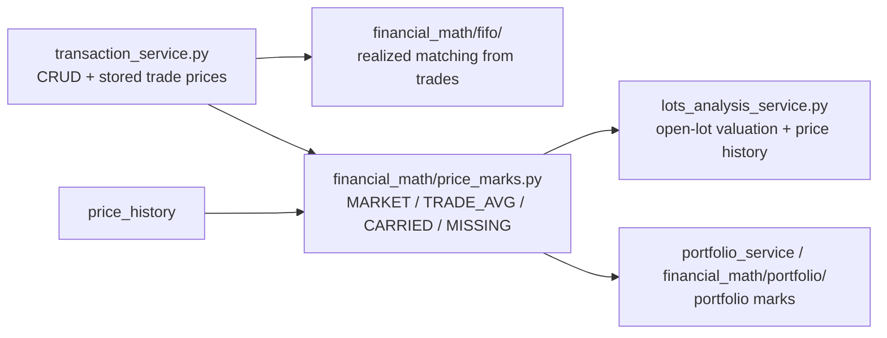

# 🧾 Transaction Service Architecture

Transaction batch execution is split across these source modules, in `backend/app/services/transactions/`:

| File | Responsibility |
|------|----------------|
| `backend/app/services/transactions/transaction_service.py` | `TransactionService`: the `execute_batch()` orchestrator and `delete_by_broker()`, composed of the mixins below |
| `backend/app/services/transactions/access.py` | `TransactionAccessMixin`: broker access checks, once per broker a batch touches |
| `backend/app/services/transactions/validation.py` | `TransactionValidationMixin`: asset event links, the rows that require a cost basis, linked-pair rules |
| `backend/app/services/transactions/queries.py` | `TransactionQueryMixin`: the transaction query, partner brokers, rows by id |
| `backend/app/services/transactions/balances.py` | `TransactionBalancesMixin`: the balance replay and the balances at a date |
| `backend/app/services/transactions/event_suggestions.py` | `TransactionEventSuggestionsMixin`: asset events a transaction can link to |
| `backend/app/services/transactions/promotion.py` | `TransactionPromotionMixin`: transfer promotion, the split and promote type maps, promote suggestions |
| `backend/app/services/transactions/auto_cost.py` | `TransactionAutoCostMixin`: WAC dispatch for the Auto cost basis |
| `backend/app/services/transactions/transaction_batch_context.py` | `TransactionBatchContext` and the balance-replay exception shared across stages |
| `backend/app/services/transactions/transaction_batch_stages.py` | The stages that open and close a batch: parse, preload/access, balance replay, response |
| `backend/app/services/transactions/batch_edits.py` | Deletes, splits, updates, and the check of updated linked pairs |
| `backend/app/services/transactions/batch_creates.py` | Creates, promotes, and the links between the legs of new pairs |
| `backend/app/services/transactions/batch_costs.py` | WAC and FX issues, and the required cost basis |

The former 637-line `execute_batch()` C901 hotspot has been decomposed. The public
orchestrator is now approximately 50 source lines and makes the execution order
explicit.

---

## 🧰 Responsibilities

| Area | Current owner |
|------|---------------|
| **CRUD and pair helpers** | `TransactionService` |
| **Batch inputs and cross-stage state** | `TransactionBatchContext` |
| **Access scope and ordered mutations** | `transaction_batch_stages.py` (access), `batch_edits.py` and `batch_creates.py` (mutations) |
| **Linked-pair persistence** | Stage code writes reciprocal `related_transaction_id` values |
| **WAC** | `_compute_wac_for_auto_items()` delegates to `compute_wac_iterative()` |
| **Balance validation** | The final mutation stage flushes, then replays each affected broker from its earliest affected date |
| **Transaction completion** | The API caller commits or rolls back; the service does neither |

---

## 🚪 Entry Point — `execute_batch()`

The `/transactions/validate` and `/transactions/commit` routes call the same method:

```python
async def execute_batch(
    self,
    creates_raw: List[dict],
    updates_raw: List[dict],
    deletes: List[int],
    splits_raw: List[dict] | None = None,
    promotes_raw: List[dict] | None = None,
    user_id: Optional[int] = None,
    commit: bool = False,
) -> TXBatchResponse:
```

Its order is contractual:

| # | Stage call | Purpose |
|---|------------|---------|
| 1 | `parse_inputs()` | Parse create, update, split, and promote rows independently |
| 2 | `preload_and_authorize()` | Load referenced rows, collect touched brokers, and require `EDITOR` access |
| 3 | `apply_deletes()` | Stage valid deletions |
| 4 | `apply_splits()` | Split linked pairs before any dependent update |
| 5 | `apply_updates()` | Apply and validate merged update state |
| 6 | `validate_updated_pairs()` | Re-check shared description/tags on updated linked pairs |
| 7 | `apply_creates()` | Add and flush valid creates so generated IDs are available |
| 8 | `apply_promotes()` | Resolve saved or same-batch rows and promote them in place |
| 9 | `resolve_create_links()` | Resolve unconsumed create correlation groups into reciprocal database links |
| 10 | `compute_wac_and_fx_issues()` | Run create/update auto-WAC and convert missing FX data into issues |
| 11 | `validate_cost_basis()` | Flush and enforce required cost basis after WAC and promote handling |
| 12 | `validate_balances()` | Flush and replay end-of-day balances from each broker's earliest affected date |
| 13 | `finalize_response()` | Derive `committed`, result statuses, counts, and WAC output |

### 🧳 Shared batch context

`TransactionBatchContext.from_inputs()` normalizes optional split/promote lists and
stores all state that must survive across stages. This includes:

- parsed rows with their original per-operation indices;
- `issues` and per-operation `results`;
- preloaded transactions and the touched-broker set;
- the earliest affected date per broker;
- transient create-correlation groups and the groups consumed by promote;
- optional inline `wac_results`; and
- `commit_requested`, which affects only final response semantics.

Keeping this state explicit lets each stage remain independently readable without
changing the single-session behavior of the old implementation.

### 🧯 Error collection boundaries

Raw create, update, split, and promote rows are parsed leniently, and the mutation
loops append row-level failures while continuing with other rows. This is not a
promise that every possible error is collected:

- any `accessDenied` issue causes an early response before mutation stages run;
- inline WAC is skipped when a non-balance issue already exists; and
- balance replay catches the first balance exception and does not continue through
  the remaining broker/date replays.

### 📏 Per-type rules {: #per-type-rules }

`validate_transaction_business_rules()` (`backend/app/schemas/transactions/transactions.py`)
checks the final state of each created, updated and promoted row. Its callers are
`TXCreateItem.validate_transaction_rules` (after the create-only rules 1–4),
`_validate_updated_final_state()` (`batch_edits.py`) and `_promoted_state_issues()`
(`batch_creates.py`). Rules 5–12 read the type's row of `TX_TYPE_METADATA`
(`get_tx_type_metadata()`), the table `GET /transactions/types` serves to the
frontend, each time they run, so they follow any change to it:

| Rule | Reads | Refuses |
|------|-------|---------|
| 5 | `asset_mode`: `required` | A missing asset (`assetRequired`); `optional` (rule 6) checks nothing, and `forbidden` is left to a create's rules 3, 3b and 4 (an update or a promote cannot set an asset) |
| 7, 8 | `cash_mode`: `required`, `forbidden` | Missing cash (`cashRequired`); a cash movement (`cashForbidden`) |
| 9 | `event_compatible()` | An asset event link on another type (`eventTypeIncompatible`, its `allowed` param from `event_compatible_types()`) or without an asset (`eventRequiresAsset`) |
| 10, 11 | `quantity_sign`, `cash_sign` | A quantity, or a non-zero cash amount, of the wrong sign (`qtyPositive`, `qtyNegative`, `qtyZero`, `qtyNonzero`; `cashSignPositive`, `cashSignNegative`) |
| 12 | `cost_basis_allowed()` | A `cost_basis_mode` where the type and side take no cost basis (`costBasisModeIncompatible`; see [Persisted Cost Basis](wac.md#persisted-cost-basis)) |

Until the developer's pending decision P6 (2026-10-16), rules 5–11 leave unchecked four
points where the table is stricter: a `TRANSFER`'s cash, `FX_CONVERSION`'s zero quantity,
`TRANSFER`'s non-zero quantity, and the non-zero cash of `FX_CONVERSION` and
`CASH_TRANSFER` (`_P6_CASH_FORBIDDEN_UNCHECKED`, `_P6_QUANTITY_SIGN_UNCHECKED`; rule 11
does not read `nonzero`). Only a create refuses them, with its rules 2, 3 and 3b; an
update or a promote does not.

---

## 🔁 Session and Response Semantics

`execute_batch()` mutates and flushes the `AsyncSession` supplied to
`TransactionService`. It never calls `commit()`, `rollback()`, `begin()`, creates a
savepoint, or opens a replacement session. The `commit` argument only selects the
response that `finalize_response()` builds.

| Caller | Service response | Caller action |
|--------|------------------|---------------|
| `/transactions/validate` (`commit=False`) | `committed=False`, whether clean or not | Always `session.rollback()` |
| `/transactions/commit` (`commit=True`), no issues | `committed=True` | `session.commit()` |
| `/transactions/commit` (`commit=True`), any issue | `committed=False`; successfully staged results become `simulated` | `session.rollback()` |

`TXBatchResponse` has no `rolled_back` field. Its transaction-specific contract is:

| Field | Meaning |
|-------|---------|
| `committed` | Whether the commit route is allowed to commit this batch |
| `issues` | Structured `TXValidationIssue` entries |
| `results` | Per-operation `operation`, original `index`, affected `ids`, optional create `link_uuid`, and `status` |
| `success_count` | Number of operations staged successfully; this is not proof that their rows persisted |
| `wac_results` | Optional WAC output for create/update rows using `auto` or `auto-detail` |

The response also inherits `errors` from `BaseBulkResponse`; transaction validation
failures are reported through `issues`. On a dry run, a successfully staged result
keeps status `success` even though the route rolls back. On a failed commit request,
those same staged results are marked `simulated`.

**Multi-broker atomicity at the route boundary** means a batch may span brokers, but
the commit route persists none of it when `committed=False`.

---

## 🔐 Access Control

`preload_and_authorize()` derives the access scope from parsed creates and from
database rows referenced by updates, deletes, splits, and saved promote references.
`_denied_brokers()` calls `_check_broker_access(..., min_role=UserRole.EDITOR)` once
per distinct touched broker. `_append_access_issues()` then refuses each row that
touches a denied broker, on that row's own coordinates: one `accessDenied` issue, with
params `{"brokerId": id}`, per row and denied broker.

| Row | Issue `operation`, `index` | `ref_id` |
|-----|----------------------------|----------|
| Create on a denied broker | `create`, the row's index | `None` |
| Update or delete | `update` / `delete`, the row's index | The saved transaction it names |
| Split or promote | `split` / `promote`, the row's index | The saved leg on the denied broker: two issues when the two legs sit on two denied brokers |
| Promote leg named by `link_uuid` | — | None added: the create it names already carries the refusal |
| No row (fallback) | `create`, `-1` | `None` |

A row that touches the same denied broker twice, such as a split of an intra-broker
`FX_CONVERSION`, gets one issue. The fallback covers a denied broker that no row
explains, so a denial is never silent. The bulk editor maps `operation:index` back to
its rows, so the refusal lands on the row that caused it — for example the receiving
leg (`1b`) of a new `TRANSFER` whose destination is a broker the user can only view —
and labels an issue with a negative index by the broker in `params.brokerId`.

When a broker is denied, `preload_and_authorize()` returns `True` and
`execute_batch()` responds before any delete, split, update, create, or promote is
applied.

Role hierarchy is `OWNER > EDITOR > VIEWER`; mutation requires at least `EDITOR`.

---

## 🔗 Linked Pairs

`TRANSFER`, `FX_CONVERSION`, and `CASH_TRANSFER` are two-row composite
transactions. A create request uses `link_uuid` only as transient correlation:

1. `apply_creates()` records each flushed row in `context.link_uuid_map`;
2. `resolve_create_links()` validates each unconsumed two-row group; and
3. the stage writes reciprocal `related_transaction_id` values.

`Transaction` has no persisted `link_uuid` column. The durable relationship is
`A.related_transaction_id = B.id` and `B.related_transaction_id = A.id`.

`_validate_linked_pair()` requires equal pair types (`pairTypeMismatch`), distinct
brokers for `TRANSFER` and `CASH_TRANSFER` (`pairSameBroker`), and allows an
intra-broker `FX_CONVERSION`. A `TRANSFER` pair must also move one asset
(`pairAssetMismatch`, params `assetA`/`assetB`) by exactly opposite quantities,
compared as `Decimal` (`pairQuantityMismatch`, params `qtyA`/`qtyB`): what leaves one
broker arrives at the other, and no unit is created or lost. The first rule that
fails is the group's only issue, on operation `create` at the first leg's index, and
the two rows stay unlinked. Pair description and tags are checked separately by
`_validate_pair_description_tags()`.

---

## ✂️ Split Type Map

The split stage re-types the negative/source and positive/destination legs
deterministically:

| Paired type | From leg | To leg |
|-------------|----------|--------|
| `CASH_TRANSFER` | `WITHDRAWAL` | `DEPOSIT` |
| `TRANSFER` | `ADJUSTMENT` | `ADJUSTMENT` |
| `FX_CONVERSION` | `WITHDRAWAL` | `DEPOSIT` |

See [Split & Promote](split_promote.md) for the in-place mutation rules and the
separate legacy promote endpoint.

---

## 🗑️ Broker Deletion {: #broker-deletion }

`delete_by_broker(broker_id)` deletes every transaction of a broker and returns how
many it deleted. Its callers are in `BrokerService`:

| Caller | When |
|--------|------|
| `delete_bulk()` | `DELETE /brokers?ids=…&force=true` on a broker that still has transactions; it requires `OWNER` on the broker. An administrator may pass `as_user_id` (403 for anyone else): `all` skips the role check, `<id>` checks that user's role instead |
| `leave_broker()` | The last `OWNER` leaves (`DELETE /brokers/{broker_id}/access/me`): it calls `delete_bulk()` with `force`. Account deletion (`delete_user()`, `accounts/user_service.py`) calls `leave_broker()` on every broker of the account |

The method checks neither access nor balances. The broker's own pairs, both halves
on it (an intra-broker `FX_CONVERSION`), go whole: their links are cleared, then
every row of the broker is deleted. A pair with **another** broker loses one half.
The other half — on that broker, whatever the caller's role there — becomes the
standalone row a split of the pair leaves (backlog V-3; D-J4, decisions of
2026-10-13 and 2026-10-15), instead of a linked type without its partner, which
the FIFO lots refuse for a `TRANSFER` (`TRANSFER_PAIR_MISSING`). Two cases only
lose the link: the giving leg of a `TRANSFER`, and a link no split knows.

| Surviving half | Becomes |
|----------------|---------|
| Received `TRANSFER` (quantity > 0) | `ADJUSTMENT` with the same quantity, asset, cost basis and its currency, cash currency, date, description and tags; first given its sender's Auto cost when it has no cost basis (below) |
| `CASH_TRANSFER`, `FX_CONVERSION` | `WITHDRAWAL` when its amount is negative, `DEPOSIT` otherwise, without asset |
| Giving `TRANSFER` (quantity < 0) | Still a `TRANSFER`, without its link — for now (below) |
| Any other type carrying a link (an `ADJUSTMENT` can) | The same type, without its link |

Each of these rows loses its `related_transaction_id` and gets a new `updated_at`,
so the caches fingerprinted on it — the portfolio engine's
(`_compute_tx_fingerprint()`) and the WAC facade's (`compute_wac_iterative()`) —
compute again. No quantity or amount changes: the other broker's balances stay as
they were.

The side rule and the per-half conversion are the split's own helpers in
`batch_edits.py`, shared with `apply_splits()`: `pair_sides()` returns the giving
and the receiving half (by quantity for a `TRANSFER`, by amount otherwise), and
`make_standalone()` re-types one half in place, clears its link — and its asset,
unless it becomes an `ADJUSTMENT` — and sets `updated_at`.

**A received `TRANSFER` without a cost basis.** One is required today — a batch
that creates such a leg without it is refused with `costBasisRequired` (see
[Persisted Cost Basis](wac.md#persisted-cost-basis)) — but older data can lack it.
Such a leg first gets its sender's **Auto cost**, computed while the sender's rows
still exist: `_auto_cost_source()` names the pool — the sender's broker up to the
date the units left, without the outgoing leg — `_auto_cost()` runs
`compute_wac_iterative()` on it, and `_write_auto_cost()` writes
`cost_basis_override` and `cost_basis_currency` together; all three helpers come
from `_compute_wac_for_auto_items()` (`auto_cost.py`), which uses them too. Every
cost is computed before any row changes, so a computation that fails leaves every
row as it was (`delete_bulk()` reports that broker as failed). An
empty pool gives what Auto gives, a zero cost (backlog P-1); a missing conversion
writes nothing, and the `ADJUSTMENT` stays without a cost basis (see
[WAC & Cost Basis — Diagnostics](wac.md#diagnostics)).

**The giving leg of a `TRANSFER`** only loses its link, for now. The outgoing side
of a `TRANSFER` takes no cost basis (`cost_basis_pair` in `TX_TYPE_METADATA` marks
it `forbidden`), so the split's conversion would leave an `ADJUSTMENT` taking units
out without a cost, which reads the units it moved as destroyed. Its conversion
waits for the developer's answer to point 47 of release 1.3.

What the conversion changes in the figures:

- **Received asset.** The receiving broker's lots open a **new** lot on the
  transfer date, at the cost basis (`ADJUSTMENT_IN` in
  `financial_math/fifo/engine.py`): the holding period restarts, since the
  sender's lots can no longer move there with their own dates. On the Dashboard,
  the receiving broker's capital takes the units at their cost, as for any priced
  in-kind `ADJUSTMENT` (`_is_capital_adjustment()`), instead of their market value
  at arrival (`DailyStateBuilder._transfer_leg_capital()`): its gain also counts
  what the units gained before the transfer.
- **Cash halves.** Capital and P&L do not change: an unlinked `CASH_TRANSFER` or
  `FX_CONVERSION` already counted as an external cash flow
  (`ScopeAwareTransactionClassifier`), as the `DEPOSIT` or `WITHDRAWAL` it becomes
  does. What reads the type now counts the converted row: the cash pools that fund
  purchases from new capital or from reinvested returns (`K_b`, `R_b`, `W` of the
  [Three-Pool Cash Model](../../../financial-theory/technical-analysis/performance-metrics/portfolio-engine/index.md#6-three-pool-cash-model-per-broker-k_b-r_b-w)),
  which ignored the unlinked leg; the portfolio summary's `total_deposited`,
  `total_withdrawn` and `net_deposited_capital`; and the deposits series of
  `get_deposit_history()` (`DEPOSIT` only).

**One savepoint per broker.** `delete_bulk()` deletes each broker of a request in a
savepoint of its own (`self.session.begin_nested()`) through `_delete_one()`, which
flushes its writes, the broker's own delete included, while the savepoint is open: a
write error surfaces before the savepoint is released. A broker whose deletion fails
at any point — even after `delete_by_broker()` wrote the Auto cost on a receiving
half or unlinked the broker's own pairs — leaves every row as it was, its own and the
other halves on other brokers. Its result has `success=False` and the error as
`message`; the brokers before and after it in the request are still deleted.
`delete_bulk()` never commits; its caller does:

- `DELETE /brokers` commits when `response.errors` is empty, which `delete_bulk()`
  never fills: a broker that fails is reported in `results`;
- `DELETE /brokers/{broker_id}/access/me` commits when `leave_broker()` succeeds;
- account deletion (`delete_user()`) is all or nothing: it rolls everything back when
  a broker cannot be released, and the savepoints nest inside its transaction.

Nesting needs an open transaction, and pysqlite defers `BEGIN` until the first write:
a savepoint opened after reads alone is SQLite's outermost transaction, and its
`RELEASE` commits — the caller's later rollback can no longer bring that broker back.
So `delete_bulk()` first calls `begin_writes(self.session, Broker)`
(`backend/app/db/session.py`), which runs an `UPDATE` of that table matching no row
(`where(false())`): pysqlite emits `BEGIN` before it, and inside an open transaction
it changes nothing. A write path that opens per-item savepoints after reads must call
`begin_writes()` first; `AssetCRUDService.delete_assets_bulk()` (`assets/crud.py`)
runs its own no-op `UPDATE` for the same reason. A global SQLAlchemy `begin` listener
emitting `BEGIN` up front is ruled out: a session that reads, sees another writer
commit, then writes, fails at once with `SQLITE_BUSY_SNAPSHOT`.

Tests: `./dev.py test services broker` (`TestDeleteBulkOneSavepointPerBroker`,
BR-U-081…085) and `./dev.py test services user-profile` (`TestDeleteUser`, the two
`test_delete_user_is_all_or_nothing_*` cases); BR-U-082 and those two fail without
`begin_writes()`.

---

## ⚖️ Balance Queries

The service exposes two public query methods (`TransactionBalancesMixin`,
`balances.py`), used by the broker summary:

```python
await svc.get_cash_balances(broker_id, as_of=None)   # Dict[currency, Decimal]
await svc.get_asset_holdings(broker_id, as_of=None)  # Dict[asset_id, Decimal]
```

Both count the broker's rows dated up to `as_of`, inclusive, and every row when
`as_of` is `None`.

- **Cash** comes from the layer, the one home of cash per broker and currency:
  `cash_movement_from_transaction(tx)` turns each row with an amount and a
  currency into a movement at share 1 — the broker's own cash, not a user's
  share — and `financial_math.native_cash.native_balances()`, the function behind
  `NativeCash.balances()`, sums them by currency without any rate (see
  [The Native-Cash Function](wac.md#compute-native-cash)). A currency whose
  movements cancel out keeps its line, at zero.
- **Holdings** stay a SQL sum of `quantity` per asset, with the same date cut:
  the layer has no home for a broker's quantities at a date.

The holdings' cost no longer comes from this service: the broker summary computes
it with the shared average cost, on the same `as_of` (see
[WAC & Cost Basis](wac.md#broker-summary)).

---

## 🧭 Valuation Boundary

`TransactionService` does **not** build market marks, portfolio NAV, or lot valuation. Its transaction prices are persisted facts; valuation consumers later feed those facts into `build_asset_price_series()` together with `price_history`.

Current flow:



So the transaction layer can affect marks only by storing transaction facts (BUY/SELL amounts, priced ADJUSTMENT cost basis). It never reads current prices and never performs estimated-at-cost valuation.

---

## 🔗 Related

- ⚖️ **[WAC & Cost Basis](wac.md)** — Cost basis computation engine
- ✂️ **[Split & Promote](split_promote.md)** — Composite transaction operations
- 🔒 **[Balance Validation](balance_validation.md)** — Cash/asset balance enforcement
- 📖 **[Access Control (RBAC)](../../architecture/access_control.md)** — Role model
