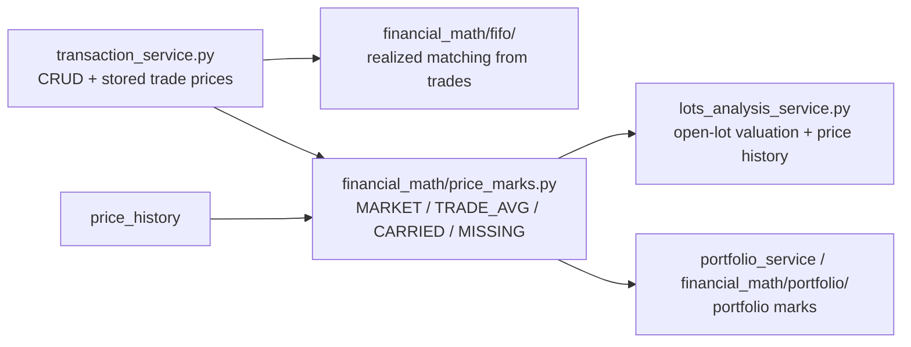

# 🧾 Transaction Service Architecture

Transaction batch execution is split across these source modules, in `backend/app/services/transactions/`:

| File | Responsibility |
|------|----------------|
| `backend/app/services/transactions/transaction_service.py` | `TransactionService`: the `execute_batch()` orchestrator and `delete_by_broker()`, composed of the mixins below |
| `backend/app/services/transactions/access.py` | `TransactionAccessMixin`: broker access checks, once per broker a batch touches |
| `backend/app/services/transactions/validation.py` | `TransactionValidationMixin`: asset event links, the rows that require a cost basis, linked-pair rules |
| `backend/app/services/transactions/queries.py` | `TransactionQueryMixin`: the transaction query, partner brokers, rows by id |
| `backend/app/services/transactions/balances.py` | `TransactionBalancesMixin`: the balance replay and the balances at a date |
| `backend/app/services/transactions/event_suggestions.py` | `TransactionEventSuggestionsMixin`: asset events a transaction can link to |
| `backend/app/services/transactions/promotion.py` | `TransactionPromotionMixin`: transfer promotion, the split and promote type maps, promote suggestions |
| `backend/app/services/transactions/auto_cost.py` | `TransactionAutoCostMixin`: WAC dispatch for the Auto cost basis |
| `backend/app/services/transactions/unreadable_rows.py` | `count_unreadable_rows()` and `UnreadableLedgerError`: the transactions whose stored value cannot be read, counted before the Auto cost's pool (W-B69) and a broker's balances (W-B74) |
| `backend/app/services/transactions/transaction_batch_context.py` | `TransactionBatchContext` and the balance-replay exception shared across stages |
| `backend/app/services/transactions/transaction_batch_stages.py` | The stages that open and close a batch: parse, the decimal-limit and date checks, preload/access, balance replay, response |
| `backend/app/services/transactions/batch_edits.py` | Deletes, splits, updates, and the check of updated linked pairs |
| `backend/app/services/transactions/batch_creates.py` | Creates, promotes, and the links between the legs of new pairs |
| `backend/app/services/transactions/batch_costs.py` | WAC and FX issues, and the required cost basis |

The former 637-line `execute_batch()` C901 hotspot has been decomposed. The public
orchestrator is now approximately 50 source lines and makes the execution order
explicit.

---

## 🧰 Responsibilities

| Area | Current owner |
|------|---------------|
| **CRUD and pair helpers** | `TransactionService` |
| **Batch inputs and cross-stage state** | `TransactionBatchContext` |
| **Access scope and ordered mutations** | `transaction_batch_stages.py` (access), `batch_edits.py` and `batch_creates.py` (mutations) |
| **Linked-pair persistence** | Stage code writes reciprocal `related_transaction_id` values |
| **WAC** | `_compute_wac_for_auto_items()` delegates to `compute_wac_iterative()` |
| **Balance validation** | The final mutation stage flushes, then replays each affected broker from its earliest affected date |
| **Transaction completion** | The API caller commits or rolls back; the service does neither |

---

## 🚪 Entry Point — `execute_batch()`

The `/transactions/validate` and `/transactions/commit` routes call the same method:

```python
async def execute_batch(
    self,
    creates_raw: List[dict],
    updates_raw: List[dict],
    deletes: List[int],
    splits_raw: List[dict] | None = None,
    promotes_raw: List[dict] | None = None,
    user_id: Optional[int] = None,
    commit: bool = False,
) -> TXBatchResponse:
```

Its order is contractual:

| # | Stage call | Purpose |
|---|------------|---------|
| 1 | `parse_inputs()`, then `check_decimal_limits()` and `check_dates()` | Parse create, update, split, and promote rows independently; then refuse a quantity, cash amount, manual cost basis or the cost basis a promote resolves over its column's limit (C-97, see [Decimal limits](#decimal-limits)), and a date outside 1900-01-01 … tomorrow by the server's calendar (N74, see [Transaction dates](#transaction-dates)) |
| 2 | `preload_and_authorize()` | Load referenced rows, collect touched brokers, and require `EDITOR` access |
| 3 | `apply_deletes()` | Stage valid deletions |
| 4 | `apply_splits()` | Split linked pairs before any dependent update |
| 5 | `apply_updates()` | Apply and validate merged update state. An explicit `cost_basis_override: null` removes the row's cost basis where its type and side take one, unless the update is in Auto; step 11 then refuses the update where one is required (decision P5, see [Persisted Cost Basis](wac.md#persisted-cost-basis)) |
| 6 | `validate_updated_pairs()` | Re-check shared description/tags on updated linked pairs |
| 7 | `apply_creates()` | Add and flush valid creates so generated IDs are available |
| 8 | `apply_promotes()` | Resolve saved or same-batch rows and promote them in place |
| 9 | `resolve_create_links()` | Resolve unconsumed create correlation groups into reciprocal database links |
| 10 | `compute_wac_and_fx_issues()` | Run create/update auto-WAC, then give the giving leg of each split `TRANSFER` pair the Auto cost of its own broker ([Split & Promote](split_promote.md#transfer-giving-leg)); convert missing FX data into issues, and refuse an Auto row whose average of 0 comes from a pool with nothing to average (`autoCostEmptyPool`, `autoCostUnknownPool`, N88: [Nothing to average](wac.md#nothing-to-average)) |
| 11 | `validate_cost_basis()` | Flush and enforce required cost basis after WAC and promote handling |
| 12 | `validate_balances()` | Flush and replay end-of-day balances from each broker's earliest affected date |
| 13 | `finalize_response()` | Derive `committed`, result statuses, counts, and WAC output |

### 🧳 Shared batch context

`TransactionBatchContext.from_inputs()` normalizes optional split/promote lists and
stores all state that must survive across stages. This includes:

- parsed rows with their original per-operation indices;
- `issues` and per-operation `results`;
- preloaded transactions and the touched-broker set;
- the earliest affected date per broker;
- every row `apply_creates()` flushed, by its create index (`created_by_index`):
  the row a create's Auto cost is written on (W-B67);
- transient create-correlation groups and the groups consumed by promote;
- the giving legs of the `TRANSFER` pairs the batch splits, each with its split's
  index (`handover_rows`), which the WAC stage prices;
- optional inline `wac_results`; and
- `commit_requested`, which affects only final response semantics.

Keeping this state explicit lets each stage remain independently readable without
changing the single-session behavior of the old implementation.

### 🧯 Error collection boundaries

Raw create, update, split, and promote rows are parsed leniently, and the mutation
loops append row-level failures while continuing with other rows. This is not a
promise that every possible error is collected:

- any `accessDenied` issue, a checked value past its column's digits before the
  decimal point (see [Decimal limits](#decimal-limits)), or a date out of range (see
  [Transaction dates](#transaction-dates)), causes an early response right after the
  access check, before the mutation stages run: `committed=False`, the issues
  collected so far, empty results;
- inline WAC, and with it the cost of a split's giving leg, is skipped when a
  non-balance issue already exists; and
- balance replay catches the first balance exception and does not continue through
  the remaining broker/date replays.

### 📏 Per-type rules {: #per-type-rules }

`validate_transaction_business_rules()` (`backend/app/schemas/transactions/transactions.py`)
checks the final state of each created, updated and promoted row. Its callers are
`TXCreateItem.validate_transaction_rules` (after the create-only rules 1–4),
`_validate_updated_final_state()` (`batch_edits.py`) and `_promoted_state_issues()`
(`batch_creates.py`). Rules 5–12 read the type's row of `TX_TYPE_METADATA`
(`get_tx_type_metadata()`), the table `GET /transactions/types` serves to the
frontend, each time they run, so they follow any change to it:

| Rule | Reads | Refuses |
|------|-------|---------|
| 5 | `asset_mode`: `required` | A missing asset (`assetRequired`); `optional` (rule 6) checks nothing, and `forbidden` is left to a create's rules 3, 3b and 4 (an update or a promote cannot set an asset) |
| 7, 8 | `cash_mode`: `required`, `forbidden` | Missing cash (`cashRequired`); a cash movement (`cashForbidden`) |
| 9 | `event_compatible()` | An asset event link on another type (`eventTypeIncompatible`, its `allowed` param from `event_compatible_types()`) or without an asset (`eventRequiresAsset`) |
| 10, 11 | `quantity_sign`, `cash_sign` | A quantity, or a non-zero cash amount, of the wrong sign (`qtyPositive`, `qtyNegative`, `qtyZero`, `qtyNonzero`; `cashSignPositive`, `cashSignNegative`); a zero cash amount where `cash_sign` is `nonzero` (`cashNonzero`; see below for when) |
| 12 | `cost_basis_allowed()` | A `cost_basis_mode` where the type and side take no cost basis (`costBasisModeIncompatible`; see [Persisted Cost Basis](wac.md#persisted-cost-basis)) |
| 12b | `cost_basis_allowed()`, `cost_basis_set` | A non-null `cost_basis_override` the request sets without a `cost_basis_mode` where the type and side take no cost basis, except on an `ADJUSTMENT` taking units out (`costBasisNotAllowed`; see below) |

Decision P6 (the developer's, 2026-10-16) sets when four of these refusals hold: a
`TRANSFER`'s cash (`cashForbidden`), `FX_CONVERSION`'s non-zero quantity (`qtyZero`),
`TRANSFER`'s zero quantity (`qtyNonzero`), and the zero cash of `FX_CONVERSION` and
`CASH_TRANSFER` (`cashNonzero`). In an update, each holds only when its field changes:
the cash for the first and the last, the quantity for the middle two.
`changed_rule_fields()` compares the row by value with `stored_rule_values`, the row as
stored before the batch, so a row stored outside the table stays editable: its notes,
tags or date, or the field re-sent as stored. A promote changes the type, which counts as
a changed cash and quantity, so it checks all four. A create (`changed_fields=None`)
keeps them in its own rules 2, 3 and 3b. This mirrors N2's cost check, which judges only
an update that touches the cost (see [Persisted Cost Basis](wac.md#persisted-cost-basis)).

Rule 12b (W-B72; night decision N78, as the coordinator refined it on 17/10, pending the
developer's review) reads `cost_basis_set`: whether the request sets a non-null
`cost_basis_override`. The create passes it from `TXCreateItem.validate_transaction_rules`,
the update from `_validate_updated_final_state()`; `_promoted_state_issues()` leaves it
false, as a promote's resolved cost basis has its own check (`_resolved_cost_issues()`, see
[Request shape](split_promote.md#promote-request-shape)). Where `cost_basis_allowed()` is
false, the cost basis is refused with `costBasisNotAllowed`, params `{type, qty}`, except on
an `ADJUSTMENT` taking units out: its cost is decision 47's handover cost, which an update of
the split's own batch may set without a mode (decision 4, see
[The giving leg of a `TRANSFER`](split_promote.md#transfer-giving-leg)). Rule 12b is rule
12's `elif`: a request that names a mode gets `costBasisModeIncompatible` alone. It
judges only a cost basis the request sets: never one the row already stores — a notes-only
edit of an older row carrying a stray one commits and keeps it — and never an explicit
`null`. Before W-B72, a cost basis sent without a mode was stored on any type. Tests:
`./dev.py test services transaction-cost-basis-rule` (`TestN78*`).

A create meets its business rules at the lenient parse (`_parse_lenient()`,
`transaction_batch_stages.py`): `TXCreateItem` raises a lone business-rule error as it is,
and packs several into `multipleBusinessRuleErrors`, which the parse unpacks into one issue
each. The parse takes each issue's `params` from `error_params()` and an error's `field`
from `loc_to_field()` (a packed sub-error has none), both in
`backend/app/utils/pydantic_errors.py`: the one home of the rule (W-B77), which the broker
import's `BRIMProvider._create_transaction()` shares, so a row the import's parse refuses
and the same row the batch refuses carry the same `field` and `params`. `params` is a copy
of the error's context when every value is plain data (`PLAIN_PARAM_TYPES`: str, int,
float, bool or `None`), `null` otherwise, whatever the error: a lone business rule
(`{type}`, `{type, qty}`; since W-B72, before which its message lost the `{type}` it
names), each sub-error of a packed one, filtered one by one (W-B70; before, each context
was copied as it came), and a field's error (W-B70), so the app's message can name the
limit (`transactions.pydantic.stringTooLong` for `string_too_long`, in
`resolveValidationMessage.ts`): `string_too_long` keeps `{max_length: 500}` on a
description, `greater_than` `{gt: 0}` on an id, `greater_than_equal` `{ge: 0}` on an
update's `asset_event_id`, a date's parsing error pydantic's `{error: <text>}`,
`model_type` `{class_name}`. A `value_error`, whose context holds the exception itself, a
bound held as a `Decimal`, and an error without context (`missing`, `extra_forbidden`,
`string_type`) keep `params` null. An update's and a promote's rule errors, raised after
the parse, already carried their context.

The frontend reads the two codes as `transactions.errors.costBasisNotAllowed` and
`transactions.errors.costBasisModeIncompatible`, messages that name the type and leave
`qty` out. The second had no message before W-B72, so the app showed the backend's
English. `TestN78TheMessages` (`test_transaction_cost_basis_rule.py`) holds every
business-rule code of `backend/app/schemas/transactions/transactions.py` — the literal first
argument of each `PydanticCustomError`, the `multipleBusinessRuleErrors` wrapper aside — to
a message in English, Italian, French and Spanish.

### 🔢 Decimal limits {: #decimal-limits }

`check_decimal_limits()` (`transaction_batch_stages.py`; C-97, issue #43) reads every
parsed create and update, and the cost basis each promote resolves
(`resolved_fields.cost_basis_override`, a merged value only an API client sends: see
[Request shape](split_promote.md#promote-request-shape)), on the
same `cost_basis_override` column: until W-B58 a promote's cost skipped the check, and the
REAL rounded it in silence. A `quantity` keeps 10 decimal places, a `cash.amount` 6 and a
manual `cost_basis_override` — a per-unit price — 12, the scales of their `transactions`
columns; any of them at most 15 significant digits; and at most 15 digits before the
decimal point for a quantity or a cash amount (decision N63), 12 for a cost basis:
`decimal_limit_issue()` (`backend/app/db/precision.py`) takes the scale and the digits
before the point (`max_integer_digits()`) from the model, and does not count trailing
zeros. An Auto cost basis (`cost_basis_mode` `auto` or `auto-detail`) is not
checked: the batch recomputes its amount and reads only its currency (`auto_cost.py`),
so the preview's average the Form sends back, 100 / 3 in full, is no value of the user's.
A value over a limit
is refused, never rounded: one issue per field, with code `decimalPlacesExceeded`,
`significantDigitsExceeded` or `integerDigitsExceeded` (all three in `TXValidationCode`,
listed by `GET /transactions/types` → `validation_codes`), the first in that order when a
value is over several, `integerDigitsExceeded` also for a value that is not finite;
params `{"max": N}` and `field` (`quantity`, `cash.amount` or `cost_basis_override`). A
promote's issue has `operation` `promote` and the promote's index. The English `error`
names the field and the limit, such as *Quantity: at most 15 digits before the decimal
point*. The frontend puts the field label in front of the three codes, listed with
`dateOutOfRange` in `FIELD_PREFIXED_CODES` (`resolveValidationMessage.ts`; the third is
`transactions.errors.integerDigitsExceeded`, *At most {max} digits before the decimal
point*): *Quantity: At most 10 decimal places*.

The issue keeps the batch from being committed, but the row stays in it: the later
stages still apply it, so a linked pair is not broken by it, and the batch's other
issues are reported with it (the inline WAC is skipped, as for any non-balance issue).
Not so when a checked value has more digits before the decimal point than its column
takes, or is not finite, whatever code its issue got (a quantity of 400 digits keeps
`significantDigitsExceeded`, the first in order): `check_decimal_limits()` then returns
`True`, and `execute_batch()` stops right after `preload_and_authorize()`, step 2 above,
with the early response of a denied access: `committed=False`, the issues collected so
far, no results. The stages after it compute with the values (products, averages, the
double a REAL stores), and a value that large broke them with a 500 where the user is
owed the issue (W-B58).
The check runs when a batch is confirmed (`/transactions/validate`,
`/transactions/commit`), not when a broker import builds its rows (decision D2): the
import hands its rows to the bulk workspace, which shows the refusal with the batch's
other issues. A figure a plugin computes instead of reading it, such as a per-unit cost
from a total, is rounded by the plugin (decision D6, see
[Decimal places](../../architecture/patterns/brim_plugin_guide.md#decimal-places)): on a
`RealDecimal` column, a quantity, a cash amount (since W-B60) or a per-unit cost, it then
meets neither of the first two refusals; no rounding takes away digits before the decimal
point, which are checked as for any other value. The column types are in
[Decimal Columns](../../architecture/database/index.md#decimal-columns).

Above these limits sits the exponent bound of the currency schema (R13-SEC7-3, see
[Decimal Columns](../../architecture/database/index.md#decimal-columns)): a `Currency`
amount — a cash amount, a cost basis, the cost basis a promote resolves (typed since
H-41) — whose exponent (`Decimal.adjusted()`) is outside ±100, `0E-999999999` included,
never reaches `check_decimal_limits()`. The lenient parse refuses its row, or its
promote: a `value_error` issue on the field (`cash.amount`, `cost_basis_override.amount`),
no `params`. As with any parse refusal, the batch's other operations are still checked,
and nothing is committed. A quantity is no `Currency`: `1E+1000000` units still get
`integerDigitsExceeded`. Before R13-SEC7-3, a promote's resolved cost basis that the
currency schema refused, such as an amount that is no number, reached the promotion,
whose `Currency.model_validate()` raised out of the batch: a 500.

### 📅 Transaction dates {: #transaction-dates }

`check_dates()` (`transaction_batch_stages.py`; decision N74 of R13-SEC7-3) runs right
after `check_decimal_limits()`. A transaction's date must lie between 1900-01-01
(`EARLIEST_RANGE_START`, `utils/datetime_utils.py`: the floor every replay and history walk
starts from too) and tomorrow by the server's calendar (`latest_range_end()`, same module:
`server_today()`, the server's local date, plus one day). `transaction_date_bounds()`
returns that pair. The last day is also the last one a price or a rate written by hand may
carry (N83). The stage reads:

- the `date` of every parsed create;
- the `date` of an update that sets one: an update that leaves an older row's date alone
  is not refused for it;
- the date a promote resolves (`resolved_fields.date`): typed since H-41, so one that is
  no date, or an explicit `null`, is already refused at the parse (see
  [Request shape](split_promote.md#promote-request-shape)).

Out of the range, the row gets one issue: code `dateOutOfRange`
(`TXValidationCode.DATE_OUT_OF_RANGE`, listed by `GET /transactions/types` →
`validation_codes`), `field` `date`, `params` `{"min", "max"}` as ISO dates, and the
English `error` *Date: between 1900-01-01 and 2026-10-20* on a server whose today is
19 October 2026. A promote's issue has `operation` `promote` and the promote's index; an
update's has the row's id as `ref_id`.
`check_dates()` then returns `True`, and `execute_batch()` stops right after
`preload_and_authorize()`, as for the integer digits: the batch's usual 200, with
`committed=False`, the issues collected so far and no results. It stops because the stages
after it replay a broker's days and look rates up at a row's date. A broker import (BRIM)
confirms through this batch, so its rows are checked here too, when the bulk workspace
validates or saves them (as for the decimal limits, decision D2).

The bound is tomorrow, not today, as slack for a user east of the server, whose today can
already be the server's tomorrow. No legitimate date goes further: the interface never
offers a future date (`SingleDatePicker`, whose `allowFuture` is false by default), and a
broker import keeps only settled rows (the rule *The operation date, and only settled rows* of
the [plugin guide](../../architecture/patterns/brim_plugin_guide.md#import-philosophy-currency-rules)),
so a later date is a typing error. Lot N74 set the bound there; before, it was a year
after today, for the settlement dates a broker's report puts ahead: under that rule, a
plugin now leaves such a row out until it has settled. The frontend reads the code as
`transactions.errors.dateOutOfRange`, *Between {min} and {max}*, behind the field label
(`FIELD_PREFIXED_CODES`): *Date: Between 1900-01-01 and 2026-10-20*.

---

## 🔁 Session and Response Semantics

`execute_batch()` mutates and flushes the `AsyncSession` supplied to
`TransactionService`. It never calls `commit()`, `rollback()`, `begin()`, creates a
savepoint, or opens a replacement session. The `commit` argument only selects the
response that `finalize_response()` builds.

| Caller | Service response | Caller action |
|--------|------------------|---------------|
| `/transactions/validate` (`commit=False`) | `committed=False`, whether clean or not | Always `session.rollback()` |
| `/transactions/commit` (`commit=True`), no issues | `committed=True` | `session.commit()` |
| `/transactions/commit` (`commit=True`), any issue | `committed=False`; successfully staged results become `simulated` | `session.rollback()` |

`TXBatchResponse` has no `rolled_back` field. Its transaction-specific contract is:

| Field | Meaning |
|-------|---------|
| `committed` | Whether the commit route is allowed to commit this batch |
| `issues` | Structured `TXValidationIssue` entries |
| `results` | Per-operation `operation`, original `index`, affected `ids`, optional create `link_uuid`, and `status` |
| `success_count` | Number of operations staged successfully; this is not proof that their rows persisted |
| `wac_results` | Optional WAC output for create/update rows using `auto` or `auto-detail` |

The response also inherits `errors` from `BaseBulkResponse`; transaction validation
failures are reported through `issues`. On a dry run, a successfully staged result
keeps status `success` even though the route rolls back. On a failed commit request,
those same staged results are marked `simulated`.

**Multi-broker atomicity at the route boundary** means a batch may span brokers, but
the commit route persists none of it when `committed=False`.

---

## 🔐 Access Control

`preload_and_authorize()` derives the access scope from parsed creates and from
database rows referenced by updates, deletes, splits, and saved promote references.
`_denied_brokers()` calls `_check_broker_access(..., min_role=UserRole.EDITOR)` once
per distinct touched broker. `_append_access_issues()` then refuses each row that
touches a denied broker, on that row's own coordinates: one `accessDenied` issue, with
params `{"brokerId": id}`, per row and denied broker.

| Row | Issue `operation`, `index` | `ref_id` |
|-----|----------------------------|----------|
| Create on a denied broker | `create`, the row's index | `None` |
| Update or delete | `update` / `delete`, the row's index | The saved transaction it names |
| Split or promote | `split` / `promote`, the row's index | The saved leg on the denied broker: two issues when the two legs sit on two denied brokers |
| Promote leg named by `link_uuid` | — | None added: the create it names already carries the refusal |
| No row (fallback) | `create`, `-1` | `None` |

A row that touches the same denied broker twice, such as a split of an intra-broker
`FX_CONVERSION`, gets one issue. The fallback covers a denied broker that no row
explains, so a denial is never silent. The bulk editor maps `operation:index` back to
its rows, so the refusal lands on the row that caused it — for example the receiving
leg (`1b`) of a new `TRANSFER` whose destination is a broker the user can only view —
and labels an issue with a negative index by the broker in `params.brokerId`.

When a broker is denied, `preload_and_authorize()` returns `True` and
`execute_batch()` responds before any delete, split, update, create, or promote is
applied.

Role hierarchy is `OWNER > EDITOR > VIEWER`; mutation requires at least `EDITOR`.

---

## 🔗 Linked Pairs

`TRANSFER`, `FX_CONVERSION`, and `CASH_TRANSFER` are two-row composite
transactions. A create request uses `link_uuid` only as transient correlation:

1. `apply_creates()` records each flushed row by its create index in
   `context.created_by_index` (where the Auto cost finds it, see
   [Inline Batch Auto Modes](wac.md#inline-batch-auto-modes)), and one carrying a
   `link_uuid` in `context.link_uuid_map` too;
2. `resolve_create_links()` validates each unconsumed two-row group; and
3. the stage writes reciprocal `related_transaction_id` values.

`Transaction` has no persisted `link_uuid` column. The durable relationship is
`A.related_transaction_id = B.id` and `B.related_transaction_id = A.id`.

`_validate_linked_pair()` requires equal pair types (`pairTypeMismatch`), distinct
brokers for `TRANSFER` and `CASH_TRANSFER` (`pairSameBroker`), and one broker for
both legs of an `FX_CONVERSION` (`pairBrokerMismatch`, params `brokerA`/`brokerB`).
A `TRANSFER` pair must also move one asset
(`pairAssetMismatch`, params `assetA`/`assetB`) by exactly opposite quantities,
compared as `Decimal` (`pairQuantityMismatch`, params `qtyA`/`qtyB`): what leaves one
broker arrives at the other, and no unit is created or lost. The first rule that
fails is the group's only issue, on operation `create` at the first leg's index, and
the two rows stay unlinked. Pair description and tags are checked separately by
`_validate_pair_description_tags()`.

---

## ✂️ Split Type Map

The split stage re-types the negative/source and positive/destination legs
deterministically:

| Paired type | From leg | To leg |
|-------------|----------|--------|
| `CASH_TRANSFER` | `WITHDRAWAL` | `DEPOSIT` |
| `TRANSFER` | `ADJUSTMENT` | `ADJUSTMENT` |
| `FX_CONVERSION` | `WITHDRAWAL` | `DEPOSIT` |

See [Split & Promote](split_promote.md) for the in-place mutation rules and the
separate legacy promote endpoint.

---

## 🗑️ Broker Deletion {: #broker-deletion }

`delete_by_broker(broker_id)` deletes every transaction of a broker and returns how
many it deleted. Its callers are in `BrokerService`:

| Caller | When |
|--------|------|
| `delete_bulk()` | `DELETE /brokers?ids=…&force=true` on a broker that still has transactions; it requires `OWNER` on the broker. An administrator may pass `as_user_id` (403 for anyone else): `all` skips the role check, `<id>` checks that user's role instead |
| `leave_broker()` | The last `OWNER` leaves (`DELETE /brokers/{broker_id}/access/me`): it calls `delete_bulk()` with `force`. Account deletion (`delete_user()`, `accounts/user_service.py`) calls `leave_broker()` on every broker of the account |

The method checks neither access nor balances. The broker's own pairs, both halves
on it (an intra-broker `FX_CONVERSION`), go whole: their links are cleared, then
every row of the broker is deleted. A pair with **another** broker loses one half.
The other half — on that broker, whatever the caller's role there — becomes the
standalone row a split of the pair leaves (backlog V-3; D-J4, decisions of
2026-10-13 and 2026-10-15), instead of a linked type without its partner, which
the FIFO lots refuse for a `TRANSFER` (`TRANSFER_PAIR_MISSING`). Two cases only
lose the link: a link no split knows, and the giving leg of a `TRANSFER` whose cost
needs a missing conversion (below).

| Surviving half | Becomes |
|----------------|---------|
| Received `TRANSFER` (quantity > 0) | `ADJUSTMENT` with the same quantity, asset, cost basis and its currency, cash currency, date, description and tags; first given its sender's Auto cost when it has no cost basis (below) |
| `CASH_TRANSFER`, `FX_CONVERSION` | `WITHDRAWAL` when its amount is negative, `DEPOSIT` otherwise, without asset |
| Giving `TRANSFER` (quantity < 0) | `ADJUSTMENT` with the same quantity, asset, cash currency, date, description and tags, and the Auto cost of **its own** broker as its cost basis (below); still a `TRANSFER`, without its link, when that cost needs a missing conversion |
| Any other type carrying a link (an `ADJUSTMENT` can) | The same type, without its link |

Each of these rows loses its `related_transaction_id` and gets a new `updated_at`,
so the caches fingerprinted on it — the portfolio engine's
(`_compute_tx_fingerprint()`) and the WAC facade's (`compute_wac_iterative()`) —
compute again. No quantity or amount changes: the other broker's balances stay as
they were.

The side rule and the per-half conversion are the split's own helpers in
`batch_edits.py`, shared with `apply_splits()`: `pair_sides()` returns the giving
and the receiving half (by quantity for a `TRANSFER`, by amount otherwise), and
`make_standalone()` re-types one half in place, clears its link — and its asset,
unless it becomes an `ADJUSTMENT` — and sets `updated_at`.

**A received `TRANSFER` without a cost basis.** One is required today — a batch
that creates such a leg without it is refused with `costBasisRequired` (see
[Persisted Cost Basis](wac.md#persisted-cost-basis)) — but older data can lack it.
Such a leg first gets its sender's **Auto cost**, computed while the sender's rows
still exist: `_auto_cost_source()` names the pool — the sender's broker up to the
date the units left, without the outgoing leg — `_auto_cost()` runs
`compute_wac_iterative()` on it, and `_write_auto_cost()` writes
`cost_basis_override` and `cost_basis_currency` together; all three helpers come
from `_compute_wac_for_auto_items()` (`auto_cost.py`), which uses them too. Every
cost is computed before any row changes, so a computation that fails leaves every
row as it was (`delete_bulk()` reports that broker as failed). An
empty pool gives what Auto gives, a zero cost (backlog P-1); a missing conversion
writes nothing, and the `ADJUSTMENT` stays without a cost basis (see
[WAC & Cost Basis — Diagnostics](wac.md#diagnostics)).

**The giving leg of a `TRANSFER`** (decision 47 of release 1.3). The outgoing side
of a `TRANSFER` takes no cost basis (`cost_basis_pair` in `TX_TYPE_METADATA` marks
it `forbidden`), and an `ADJUSTMENT` taking units out without one reads the units
it moved as destroyed: a write-off in the FIFO lots. So the leg leaves at the
**Auto cost of its own broker**, at which the lots hand its units over (see
[Hand-over at cost](fifo_lot_engine.md#handover-at-cost)). `_handover_cost()`
(`auto_cost.py`) computes it: `_auto_cost()` on the leg's broker, up to its date,
without the leg itself — not `_auto_cost_source()`, which for a `TRANSFER` still
linked names the partner's broker, here the one being deleted. Like the receiving
legs' costs, it is computed before any row changes, so a computation that fails
leaves every row as it was. Then `make_standalone()` turns the leg into an
`ADJUSTMENT` and `_write_auto_cost()` writes `cost_basis_override` and
`cost_basis_currency`; an empty pool gives a zero cost there too. When the cost
needs a missing conversion (no `wac`), the leg stays a `TRANSFER` and only loses
its link: the lots refuse it (`TRANSFER_PAIR_MISSING`) and the Dashboard counts it
at market value, as before decision 47, rather than read an `ADJUSTMENT` without a
cost as units destroyed.

**An unreadable pool** (W-B69). Either cost raises `UnreadablePoolError` when its
pool — the deleted broker's for a receiving leg, the leg's own broker for a giving
one — holds a row whose quantity, amount or cost basis cannot be read (see
[Unreadable pool](wac.md#unreadable-pool)). The deletion of that broker then fails
whole: `delete_bulk()` rolls back its savepoint and reports it failed with the
error's message, which gives the number of such rows and never an id; nothing of
that broker changes, and the other brokers of the request go on.

The same cost is written wherever else a giving leg leaves its pair: on a split of
the pair, in the batch's WAC stage (see
[Split & Promote](split_promote.md#transfer-giving-leg)), and, on the legs that a
deletion before 1.3 left as a `TRANSFER` without its partner, by the
`lone-transfer-legs` step that runs right after the post-migration fixes (see
[Lone giving legs](../../architecture/database/index.md#lone-transfer-legs)).
Tests: `./dev.py test services broker` (`TestDeleteBulkCrossBrokerPair`: BR-U-073,
076, 078 and 086–088) and `./dev.py test services orphan-transfer-numbers`
(`TestOrphanOutgoingTransfer`: the sending broker's lots and Dashboard once the
receiver is deleted).

What the conversion changes in the figures:

- **Received asset.** The receiving broker's lots open a **new** lot on the
  transfer date, at the cost basis (`ADJUSTMENT_IN` in
  `financial_math/fifo/engine.py`): the holding period restarts, since the
  sender's lots can no longer move there with their own dates. On the Dashboard,
  the receiving broker's capital takes the units at their cost, as for any priced
  in-kind `ADJUSTMENT` (`_is_capital_adjustment()`), instead of their market value
  at arrival (`DailyStateBuilder._transfer_leg_capital()`): its gain also counts
  what the units gained before the transfer.
- **Given asset.** The sending broker's lots no longer fail on
  `TRANSFER_PAIR_MISSING`: the `ADJUSTMENT_OUT` closes its FIFO lots at the row's
  cost, the value handed over counting as their proceeds, and the asset's
  performance history counts that value as money out (see
  [Lots Analysis Service](lots_analysis_service.md#history-builders)). On the
  Dashboard the units leave the sending broker's capital at their average cost
  (`_is_capital_adjustment()`), instead of their market value on the transfer date
  (`_transfer_leg_capital()`). The price marks also read the row's cost as an
  observed `TRADE` price: an interplay still open, pending the developer's J-17
  (see [Price Resolver](price_resolver.md#design-contract)).
- **Cash halves.** Capital and P&L do not change: an unlinked `CASH_TRANSFER` or
  `FX_CONVERSION` already counted as an external cash flow
  (`ScopeAwareTransactionClassifier`), as the `DEPOSIT` or `WITHDRAWAL` it becomes
  does. What reads the type now counts the converted row: the cash pools that fund
  purchases from new capital or from reinvested returns (`K_b`, `R_b`, `W` of the
  [Three-Pool Cash Model](../../../financial-theory/technical-analysis/performance-metrics/portfolio-engine/index.md#6-three-pool-cash-model-per-broker-k_b-r_b-w)),
  which ignored the unlinked leg; the portfolio summary's `total_deposited`,
  `total_withdrawn` and `net_deposited_capital`; and the deposits series of
  `get_deposit_history()` (`DEPOSIT` only).

**One savepoint per broker.** `delete_bulk()` deletes each broker of a request in a
savepoint of its own (`self.session.begin_nested()`) through `_delete_one()`, which
flushes its writes, the broker's own delete included, while the savepoint is open: a
write error surfaces before the savepoint is released. A broker whose deletion fails
at any point — even after `delete_by_broker()` wrote an Auto cost on a surviving
half or unlinked the broker's own pairs — leaves every row as it was, its own and the
other halves on other brokers. Its result has `success=False` and the error as
`message`; the brokers before and after it in the request are still deleted.
`delete_bulk()` never commits; its caller does:

- `DELETE /brokers` commits when `response.errors` is empty, which `delete_bulk()`
  never fills: a broker that fails is reported in `results`;
- `DELETE /brokers/{broker_id}/access/me` commits when `leave_broker()` succeeds;
- account deletion (`delete_user()`) is all or nothing: it rolls everything back when
  a broker cannot be released, and the savepoints nest inside its transaction.

Nesting needs an open transaction, and pysqlite defers `BEGIN` until the first write:
a savepoint opened after reads alone is SQLite's outermost transaction, and its
`RELEASE` commits — the caller's later rollback can no longer bring that broker back.
So `delete_bulk()` first calls `begin_writes(self.session, Broker)`
(`backend/app/db/session.py`), which runs an `UPDATE` of that table matching no row
(`where(false())`): pysqlite emits `BEGIN` before it, and inside an open transaction
it changes nothing. A write path that opens per-item savepoints after reads must call
`begin_writes()` first; `AssetCRUDService.delete_assets_bulk()` (`assets/crud.py`)
runs its own no-op `UPDATE` for the same reason. A global SQLAlchemy `begin` listener
emitting `BEGIN` up front is ruled out: a session that reads, sees another writer
commit, then writes, fails at once with `SQLITE_BUSY_SNAPSHOT`.

Tests: `./dev.py test services broker` (`TestDeleteBulkOneSavepointPerBroker`,
BR-U-081…085) and `./dev.py test services user-profile` (`TestDeleteUser`, the two
`test_delete_user_is_all_or_nothing_*` cases); BR-U-082 and those two fail without
`begin_writes()`.

---

## ⚖️ Balance Queries

The service exposes two public query methods (`TransactionBalancesMixin`,
`balances.py`), used by the broker summary:

```python
await svc.get_cash_balances(broker_id, as_of=None)   # Dict[currency, Decimal]
await svc.get_asset_holdings(broker_id, as_of=None)  # Dict[asset_id, Decimal]
```

Both count the broker's rows dated up to `as_of`, inclusive, and every row when
`as_of` is `None`.

- **Cash** comes from the layer, the one home of cash per broker and currency:
  `cash_movement_from_transaction(tx)` turns each row with an amount and a
  currency into a movement at share 1 — the broker's own cash, not a user's
  share — and `financial_math.native_cash.native_balances()`, the function behind
  `NativeCash.balances()`, sums them by currency without any rate (see
  [The Native-Cash Function](wac.md#compute-native-cash)). A currency whose
  movements cancel out keeps its line, at zero.
- **Holdings** come from the layer too: `financial_math.ledger_totals.position_quantities()`
  sums the `quantity` of the broker's rows per asset, with the same date cut (see
  [Ledger Control Totals](../financial_math.md#ledger-totals)). It skips a row of
  quantity 0, so an asset whose rows all have quantity 0 has no line: the broker
  summary reads a missing line as zero.

Both sums run in Python, exactly, over the rows the query returns; the query keeps
only the filters. `get_balances_at_end_of()` sums the same way, through
`_get_balances_before_date(..., through=True)` — the rows dated up to `as_of` included, never
the eve of `as_of` + 1 day, which the calendar's last day does not have (W-B71); first it counts
those whose quantity or amount cannot be read and raises `UnreadableLedgerError` for any (W-B74) — the starting
balances of the
[end-of-day replay](balance_validation.md), and LibreFolio's side of the BRIM gap-fix,
without its excluded ids — and so does the asset list's set of held assets
(`AssetCRUDService.list_assets()`, then `> QUANTITY_DUST_THRESHOLD`). Never an SQL
`SUM` (C-97): SQLite stores these columns as doubles, and `SUM` adds the doubles, not
the decimals — `0.1 + 0.2 − 0.3` gives `2.8e-17`, not 0 — an error the read at 6
decimals used to hide. Summed in Python, a zero balance is exactly zero.

The holdings' cost no longer comes from this service: the broker summary computes
it with the shared average cost, on the same `as_of` (see
[WAC & Cost Basis](wac.md#broker-summary)).

---

## 🧭 Valuation Boundary

`TransactionService` does **not** build market marks, portfolio NAV, or lot valuation. Its transaction prices are persisted facts; valuation consumers later feed those facts into `build_asset_price_series()` together with `price_history`.

Current flow:



So the transaction layer can affect marks only by storing transaction facts: the amounts and quantities of `BUY` and `SELL` rows. An `ADJUSTMENT`'s cost basis is a cost, never a mark — it reaches valuation only as the book cost of a holding the resolver cannot mark at all (see [Price Resolver — No observation: valued at cost](price_resolver.md#valued-at-cost)). The layer never reads current prices and never performs estimated-at-cost valuation.

---

## 🔗 Related

- ⚖️ **[WAC & Cost Basis](wac.md)** — Cost basis computation engine
- ✂️ **[Split & Promote](split_promote.md)** — Composite transaction operations
- 🔒 **[Balance Validation](balance_validation.md)** — Cash/asset balance enforcement
- 📖 **[Access Control (RBAC)](../../architecture/access_control.md)** — Role model
