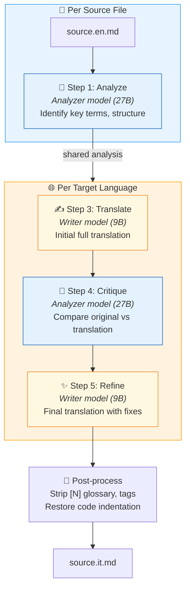
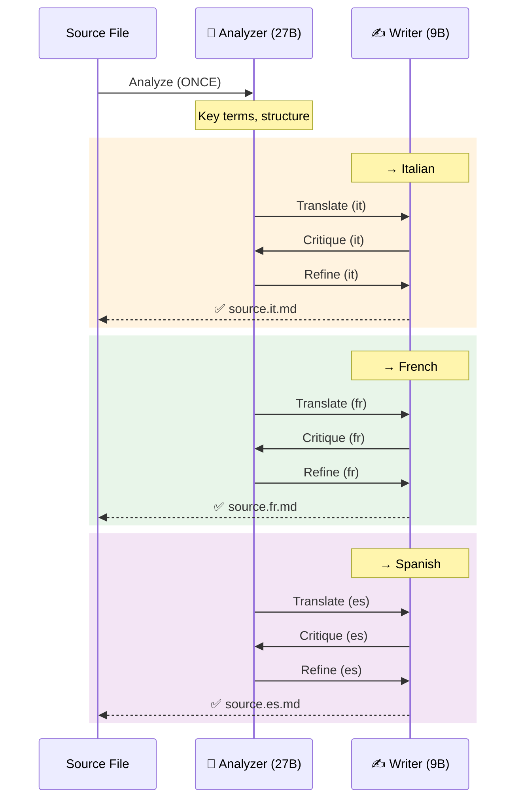
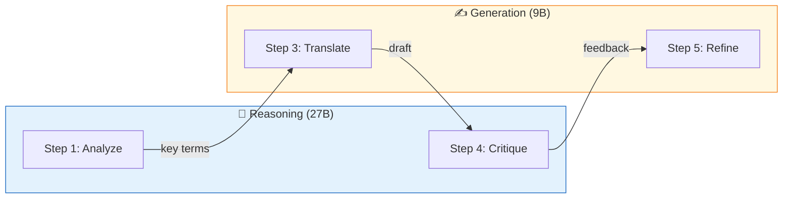
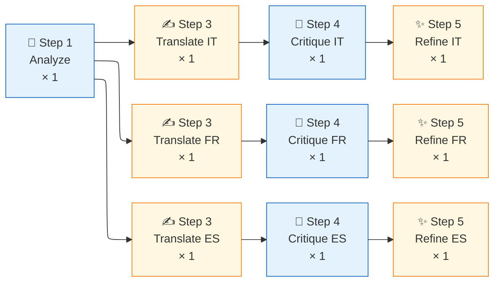

# 🌐 Translation Pipeline

Automated translation of LibreFolio MkDocs documentation into multiple languages using [Aphra](https://github.com/DavidLMS/aphra) — an LLM-based agentic translation workflow. Supports both **cloud** (OpenRouter) and **local** (Ollama) LLM backends.

---

## Overview

The pipeline translates `*.en.md` source files into `it`, `fr`, `es`. The translated files (`*.it.md`, `*.fr.md`, `*.es.md`) are picked up by `mkdocs-static-i18n` (suffix strategy) to build a multilingual documentation site.

| Scope | Files | Translated? |
|-------|-------|:-----------:|
| User Manual | 94 files | ✅ |
| Admin Manual | 8 files | ✅ |
| Financial Theory | 99 files (LaTeX) | ✅ |
| Gallery | 3 files | ✅ |
| Root and Community (Home, FAQ, Contribute, Credits) | 4 files | ✅ |
| Developer Manual | 114 files | ❌ EN-only |

**Total**: 208 source files → 624 translated files (3 languages)

Besides the documentation, the pipeline translates the repository's `CHANGELOG.md`, which the app's changelog modal shows, into `CHANGELOG.it.md`, `CHANGELOG.fr.md` and `CHANGELOG.es.md` beside it: see [The CHANGELOG](#changelog).

---

## Architecture

```
mkdocs_src/aphra-pipeline/
├── .env                    # API key + model config (gitignored)
├── .env.example            # Template for contributors
├── .gitignore              # Ignores .env, config.toml, Python caches
├── .translate-hashes.json  # Translation cache, tracked in git (see Caching)
├── README.md               # Quick-start guide
├── changelog.py            # CHANGELOG.md units, pieces and release policy (see The CHANGELOG)
├── code_blocks.py          # Fenced-block pairing + code indentation restore (shared helper)
├── glossaries/             # glossary.json: term mappings per language (Critique + Refine)
├── page_anchors.py         # Anchor ids of a page's MkDocs render (anchor-missing, check-links)
├── prompts/short_article/  # Aphra prompt overrides (see 7. Prompt overrides)
├── translate_docs.py       # Orchestration script (integrated with dev.py)
└── validate_translations.py # translate-validate checks (integrated with dev.py)
```

The two scripts integrate with `dev.py` via their `register_subparser()` (`translate_docs.py`
for the first five, `validate_translations.py` for `translate-validate`), adding:

- `./dev.py mkdocs translate` — translate docs via Aphra (LLM agent)
- `./dev.py mkdocs translate-check` — check translation pipeline setup
- `./dev.py mkdocs translate-diff` — structural diff: compare EN vs translated files
- `./dev.py mkdocs translate-stamp` — mark file(s) as already translated in the cache (no LLM call)
- `./dev.py mkdocs translate-inspect` — inspect saved translation artifacts (analysis, critique, diff)
- `./dev.py mkdocs translate-validate` — validate translated docs (structural cross-check)

---

## Workflow: Shared Analysis

The key optimization over vanilla Aphra: **Step 1 (Analyze) runs once per source file** and its result is shared across all target languages. This saves ~25% of LLM calls when translating to 3 languages.



!!! note "Step 2 (Search) skipped by default"

    Aphra's optional web search step adds cost ($4/1000 queries via OpenRouter `:online` plugin) and latency. It's disabled by default for technical documentation where terms are well-known.

### Multi-language flow

When translating to 3 languages, the full flow for one file is:



**Savings**: 1 Analyze call instead of 3 = **−67% analyze calls** across 3 languages.

---

## Model Roles

The pipeline splits LLM work into two categories, allowing different models for different tasks:

| Category | Steps | Env Variable | Recommended |
|----------|-------|-------------|-------------|
| **Reasoning** | Analyze + Critique | `APHRA_ANALYZER` | Larger model (27B) |
| **Generation** | Translate + Refine | `APHRA_MODEL` / `APHRA_WRITER` | Faster model (9B) |



### Priority hierarchy

```
APHRA_ANALYZER  → defaults to APHRA_WRITER → APHRA_MODEL → hardcoded default
APHRA_WRITER    → defaults to APHRA_MODEL → hardcoded default
APHRA_CRITIQUER → defaults to APHRA_ANALYZER (reasoning task)
APHRA_SEARCHER  → defaults to APHRA_MODEL → hardcoded default
```

---

## How We Customized Aphra

Aphra is used as a library, not via its CLI. We bypass `aphra.translate()` to gain control over several aspects:

### 1. Config path injection

Aphra's `translate()` passes `config.toml` to `LLMModelClient` (API key) but **not** to `workflow.load_config()`. Without our fix, the workflow loads its internal `default.toml` with expensive defaults (Claude Sonnet 4 + Perplexity Sonar).

**Fix**: Call `workflow.load_config(global_config_path=config_path)` directly.

### 2. Base URL override (Ollama support)

`LLMModelClient.__init__` hardcodes `base_url="https://openrouter.ai/api/v1"`. We patch `model_client.client.base_url` after construction to point to Ollama or any OpenAI-compatible endpoint.

### 3. Shared analysis across languages

Vanilla Aphra analyzes the source text once per translation call. We extract the Analyze step and reuse its result across all target languages for the same file.

### 4. Per-step model swapping

We modify `workflow_config['writer']` at runtime between steps:

- Before **Analyze**: set to `models['analyzer']` (27B reasoning)
- Before **Translate/Refine**: set to `models['writer']` (9B generation)
- **Critique** uses `models['critiquer']` (defaults to analyzer)

### 5. Web search bypass

Step 2 (Search) uses OpenRouter's `:online` plugin which costs $4/1000 results. We skip it entirely for technical docs via `APHRA_WEB_SEARCH=false`.

### 6. Post-processing cleanup

Aphra's output contains artifacts we strip automatically:

- `<translation>` / `</translation>` wrapper tags
- Inline glossary markers `[N]` (preserving markdown links)
- Glossary definition blocks at the end of the file
- Translator notes the LLM adds on its own (a trailing "Translator's Notes" section, `[^N]` footnotes)

Removing an inline marker leaves a double space behind. The cleanup collapses runs of two
or more spaces to one only **between non-space characters** and only **outside fenced code
blocks**: leading indentation (nested lists, admonition and content-tab bodies), Markdown
hard breaks (two trailing spaces) and every line of a code block stay as they are. An
earlier version collapsed every run of spaces in the whole document, which flattened code
indentation to 0–1 space (a `docker-compose` example in the IT/FR/ES admin manual was no
longer a valid compose file), pushed nested fences out of their list items and content
tabs (numbered lists split, tabs rendered empty) and removed hard breaks. The step that
re-pads `!!!` admonition bodies from 1 to 4 spaces stays as a safety net.

The file written by `_translate_one_lang()` is the output of `_finalize_translation()`:
`_clean_translation()` followed by `restore_code_indent()`, which gives every translated
code block the indentation of its English block back (see below). When something was
restored, the run log shows `🧹 Restored the source indentation on N code line(s)`.

#### Code block indentation

Translation never has a reason to move code, so the English indentation of every fenced
block is the reference. The helpers live in `mkdocs_src/aphra-pipeline/code_blocks.py`
(standard library only) and are shared by the pipeline and the validator. They see
backtick and tilde fences at any indentation (list items, content tabs, admonitions):

- `pair_blocks()` pairs each translated block with its English block **by content**: the
  same code pairs even when its `#`/`//` comments or `<placeholders>` are translated, so a
  block added or missing on one side does not shift the others. Blocks left over in a
  stretch that differs (e.g. Mermaid with translated labels) pair in order when language
  and line count match.
- `restore_code_indent()` gives each paired block the English leading whitespace back, line
  by line, fences included. A line whose tokens equal the English line becomes the English
  line; any other line keeps its translated text (comments, labels) behind the English
  indentation, and gets the English gap before an inline comment back when its code part
  is identical. Blank lines, prose, unpaired blocks, blocks with a different line count
  and unclosed fences are left alone.
- `code_indent_issues()` lists the translated lines whose indentation still differs from
  the English block.

`./dev.py mkdocs translate-validate` re-checks every translation with the
`code-block-indent` check (❌ ERROR, non-zero exit). It pairs blocks the same way and
reports each drifted block once: first drifted line, line range of the translated block,
how many of its lines are off, and the relative indentation levels of the English block
versus the translation. The positional `code-block-modified` notice (🌐 LOCALIZED)
attributes a changed code line to translated comments only: indentation drift is never
treated as an intentional localization.

In the release workflow (`.github/workflows/release.yml`, step *Validate broken MkDocs
translation links*) the command runs with `--hide-localized`. The step is
`continue-on-error` only on `dev`, where the nightly run lists it as a soft failure in the
job summary; on any other run, a published release included, an ERROR fails the pipeline.

Tests: `./dev.py test utils translation-code-blocks`
(`backend/test_scripts/test_utilities/test_translation_code_blocks.py`). Besides the unit
cases, a corpus guard checks that every up-to-date translation (English MD5 equal to the
cached one and language in `langs_done`, the rule `translate` uses to skip a page) keeps
the English code indentation.

### 💬 7. Prompt overrides

The generated `config.toml` points Aphra's `prompts_dir` at
`mkdocs_src/aphra-pipeline/prompts/short_article/`. A file there named like an Aphra prompt
replaces it (`step1_system.txt` and the system and user prompts of steps 3, 4 and 5), and
`step1_user_append.txt` is added after Aphra's own Step 1 user prompt.

For HTML, the three prompts that write or judge the translation share one rule:

- tags, attribute names and technical attribute values (`src`, `href`, `class`, `id`,
  `style`, and `data-*` other than `data-title`, such as `data-category` or `data-name`)
  are copied character for character;
- the human-readable values of `alt`, `title`, `aria-label` and `data-title` (the carousel
  caption) are prose: Translate (`step3_user.txt`) and Refine (`step5_user.txt`) translate
  them, keeping any HTML inside a `data-title` unchanged, and Critique (`step4_user.txt`)
  checks that they were not left in English.

The earlier wording asked to copy every HTML attribute, which left image descriptions in
English. The `text-untranslated` check ([Validation Checks](#validation-checks)) reports the
values of three words or more still in English.

---

## Configuration

### Local mode (Ollama)

```env
APHRA_BASE_URL=http://localhost:11434/v1
APHRA_ANALYZER=kwangsuklee/Qwen3.5-27B-Claude-4.6-Opus-Reasoning-Distilled-GGUF
APHRA_MODEL=kwangsuklee/Qwen3.5-9B-Claude-4.6-Opus-Reasoning-Distilled-GGUF
APHRA_WEB_SEARCH=false
```

Install Ollama and pull models:

```bash
brew install ollama   # macOS
ollama pull kwangsuklee/Qwen3.5-27B-Claude-4.6-Opus-Reasoning-Distilled-GGUF
ollama pull kwangsuklee/Qwen3.5-9B-Claude-4.6-Opus-Reasoning-Distilled-GGUF
```

### Cloud mode (OpenRouter)

```env
# APHRA_BASE_URL=        ← commented out = cloud mode
OPENROUTER_API_KEY=sk-or-v1-your-key-here
APHRA_MODEL=google/gemini-2.5-flash
```

### Usage

```bash
# Check setup
./dev.py mkdocs translate-check

# Dry run (shows plan + estimated tokens)
./dev.py mkdocs translate --dry-run

# Translate specific files
./dev.py mkdocs translate --file faq.en.md --lang it

# Translate entire folder (glob)
./dev.py mkdocs translate --file 'user/**/*.en.md' --lang it fr es

# Translate only the repository CHANGELOG (see The CHANGELOG)
./dev.py mkdocs translate --file CHANGELOG.md

# Translate all (skips cached)
./dev.py mkdocs translate
```

### 🦋 Cloud mode — Doubleword.ai (Autobatcher / Flex Queue)

[Doubleword.ai](https://app.doubleword.ai) provides an OpenAI-compatible API with a
**flex queue** pricing model: requests are batched and processed at reduced rates during
off-peak periods, making it significantly cheaper than synchronous cloud inference.

Configure `.env`:

```env
APHRA_BASE_URL=https://api.doubleword.ai/v1
DOUBLEWORD_API_KEY=dw-your-key-here
APHRA_MODEL=google/gemma-4-31B-it

# Optional: lower from 4h default if you prefer faster failure + retry
# DOUBLEWORD_QUEUE_TIMEOUT=14400
```

Run with parallel language branches for maximum throughput:

```bash
./dev.py mkdocs translate --workers 3
```

!!! info "Model recommendation"

    `google/gemma-4-31B-it` is the recommended model for Doubleword — it balances
    translation quality and cost. Because Doubleword uses flex pricing, you can use a
    single model for all 4 roles without worrying about per-step cost differences.

#### How queue scheduling works with the 4-step pipeline

Aphra's workflow makes **one LLM call per step**. Each call to `DoublewordClient.call_model()`
becomes one independent request submitted to Doubleword's flex queue via `autobatcher`.

For a single file translated into 3 languages, the pipeline submits **10 requests total**:



!!! tip "Greedy parallel execution with `--workers`"

    Use `--workers 3` to translate IT, FR, ES **in parallel** via independent threads.
    Each language branch advances to its next step as soon as it finishes the current
    one — without waiting for the other languages:

    ```
    Thread IT: [Translate]──→[Critique]──→[Refine]     ← finishes first
    Thread FR:    [Translate]────→[Critique]──→[Refine]
    Thread ES:       [Translate]──────→[Critique]──→[Refine]
    ```

    Each step is a **new, independent conversation** — Doubleword has no context window
    continuity between steps. This is by design: Aphra's prompts are self-contained and
    include all necessary context (source text, analysis, prior translation) in each
    individual request.

#### Technical: sync shim over async autobatcher (thread-safe)

Aphra's `call_model()` interface is fully synchronous. `autobatcher.AsyncOpenAI` is async.
`DoublewordClient` bridges both while remaining thread-safe for `--workers`:

```python
# In translate_docs.py — DoublewordClient.call_model()
# A new AsyncOpenAI client is created per call so each thread
# gets its own event loop + client (httpx.AsyncClient is not
# safe to share across asyncio.run() boundaries).
async def _call() -> str:
    client = AsyncOpenAI(api_key=api_key, base_url=base_url)  # per-call
    response = await client.chat.completions.create(
        model=writer_model,
        messages=[{"role": "user", "content": prompt}],
    )
    return response.choices[0].message.content or ""

# asyncio.wait_for enforces DOUBLEWORD_QUEUE_TIMEOUT (default 4h)
result = asyncio.run(asyncio.wait_for(_call(), timeout=timeout_s))

```

`asyncio.run()` creates a fresh event loop per call, which is safe in Python 3.10+.
The `autobatcher` library handles queue submission and polling transparently.

---

## Caching

`mkdocs_src/aphra-pipeline/.translate-hashes.json` (tracked in git) records which languages
of each English page are up to date, and for which version of the English. Only the English
side is hashed: translated files never enter the decision, so a manual repair of a
translation (a whitespace-only fix, for example) neither triggers a re-translation nor needs
a stamp.

### 🗃️ Entries and the skip rule

One entry per English page, keyed by its path under `mkdocs_src/docs/` (for example
`user/assets/create-edit.en.md`):

| Field | Content |
|-------|---------|
| `md5` | MD5 of the English version the languages in `langs_done` were translated or stamped from |
| `langs_done` | The languages up to date for that version |
| `langs.<lang>` | The language's record: `translated_at` with the run's `models`, `critique`, `structural_diff`, `structural_issues` and `elapsed_s` after a translation (plus `final_structural_diff` and `final_structural_issues` when the written file has structural issues); `stamped_at` and `stamped_by` after a stamp; `failed`, `failed_at`, `failure_reason` and `failed_models` after a failure |
| `last_translated` | Time of the last successful translation; a stamp that creates the entry sets it to the stamp time |
| `analysis`, `analysis_model` | The Step 1 (Analyze) output shared by the languages, and the model that wrote it |

`translate` plans each page and language for which `_needs_translation()` holds: a language
is skipped only when the English MD5 equals the entry's `md5` **and** the language is in
`langs_done`. The records under `langs` are history: the skip rule reads only those two
fields. Use `--force` to ignore the cache and re-translate every page and language in scope
(`--file`, `--lang`).

### 🔄 Transitions

Every write to an entry goes through one of four functions of `translate_docs.py`, so a
language counts as done only for the English text it was translated or stamped from.
Before them, an analysis moved `md5` to the new English and kept `langs_done`, so a language
that then failed, or was never reached, stayed done and its stale translation was never
offered again.

| Event | Function | Effect on the entry |
|-------|----------|---------------------|
| The analysis of the page succeeds (a failed one writes nothing) | `_cache_mark_analyzed()` | Sets `md5` to the analyzed version, with `analysis` and `analysis_model`. A changed `md5` empties `langs_done`, the same `md5` keeps it. The `langs` records stay: they still describe the files on disk |
| A language succeeds | `_cache_mark_translated()` | Adds the language to `langs_done`, sets `last_translated` and replaces the language's record with a fresh one (`translated_at`, `models`, …), which drops any failure or stamp fields |
| A language fails | `_cache_mark_failed()` | Never marks the language done. Adds `failed`, `failed_at`, `failure_reason` and `failed_models` to its record and keeps its last `translated_at`: a translation file is written only on success, so the old file is left as it was |
| `./dev.py mkdocs translate-stamp` | `_cache_stamp()` | Moves `md5` to the current English and adds the stamped languages to `langs_done`. The other languages stay done only if `md5` did not change; otherwise the command lists them as `pending again`. Records `stamped_at` and `stamped_by` and clears the failure fields of the stamped languages |

A failed `--force` retry of an up-to-date page leaves the language done, since its file
still translates that version. `translate-stamp` skips an entry already current for the
stamped languages (`Already stamped, skipping`), so it does not clear that failure record;
the next successful translation does.

The MD5 recorded is the one of the text translated: `_read_source()` reads the English page
once and returns its text with the MD5 of the same bytes, and the analysis records that MD5.
An English edit saved after that read, while the analysis or the translation steps run (on
the Doubleword flex queue a step can wait hours), is therefore translated by the next run
instead of being recorded as done.

So after a failure, an interruption or a `--lang` subset, the next run, and
`translate --dry-run`, which prints the same plan, offer exactly the page and language pairs
not yet done for the current English.

Tests: `./dev.py test utils translation-cache`
(`backend/test_scripts/test_utilities/test_translation_cache.py`), next to
`translation-code-blocks` ([Code block indentation](#code-block-indentation)). It drives the
real `run_translate` and `run_stamp`, on the parallel (`--workers 3`) and the sequential
path, over a docs tree and a cache in a temporary directory with the LLM calls faked, and
checks `_needs_translation()` and the four transitions directly.

---

## 📜 The CHANGELOG {: #changelog }

The pipeline also translates the repository's `CHANGELOG.md`, the file the app's changelog
modal renders. The English file, at the repository root, is written by the release
coordinator only; the pipeline writes `CHANGELOG.it.md`, `CHANGELOG.fr.md` and
`CHANGELOG.es.md` beside it. The rules are pure functions (no LLM, no cache writes) in
`mkdocs_src/aphra-pipeline/changelog.py`, shared by `translate_docs.py` and
`validate_translations.py`; both read the file's path from `DOCS_DIR` at call time
(`_changelog_source()`), so a test that points `DOCS_DIR` at a temporary tree never sees the
repository's CHANGELOG.

- **Chapter lines are copied.** A translation holds the translated preamble, then the
  chapters in the English order, each opened by its English `## [x.y.z] - date` line, byte
  for byte (`assemble()`). The app splits a changelog at these lines and reads each chapter
  by the version between the brackets (`parseChangelog()` in
  `frontend/src/lib/features/changelog/changelog.ts`, whose foldable sections are the `###`
  and `####` headings). The French chapters are shown with French spacing, applied when the
  app loads `CHANGELOG.fr.md` ([French Typography](#french-typography)).
- **A chapter not translated yet is absent**, never an English copy: for that version, the
  app shows the English chapter.
- **Structure never reaches the model.** The chapter line and the `---` rule that closes a
  unit are copied from the English.

### ✂️ Units, pieces and keys {: #changelog-pieces }

The preamble (the text before the first chapter line) and each chapter are **units**. A unit
of up to `PIECE_THRESHOLD` (30,000) characters is one **piece**, keyed
`CHANGELOG.md#<version>` (`CHANGELOG.md#preamble` for the preamble). A longer unit is cut at
its `###` and `####` lines, outside fenced code (`cut_parts()`):

- the intro, before the first heading, is a piece of its own;
- a part that is only its heading joins the part that follows: `### 🐛 Fixed`, directly
  followed by `#### 🔒 Security`, opens the `fixed/security` piece;
- each piece is keyed by its headings' words (`part_ids()`), the `###` in force and then its
  `####`, as in `CHANGELOG.md#1.2.0/fixed/documentation`; the intro is `intro`, and a
  repeated key gets `-2`, `-3`.

An added `####` therefore shifts no other key, and a line added under a heading changes only
the piece that holds it. On 12 October 2026, [1.2.0] (74,510 characters) is cut into 21
pieces: `intro`, `added`, thirteen `fixed/…`, `changed`, four `changed/…` and
`breaking-changes`; the preamble, [1.1.0] (26,120 characters), [1.0.1] and [1.0.0] are one
piece each. A chapter whose length crosses the threshold, either way, gets new keys and is
translated again as a whole, once.

### 🔑 Cache entries {: #changelog-cache }

- Each piece has its own entry in `.translate-hashes.json`, keyed by the piece key, with the
  fields and the four transitions of a page ([Caching](#caching)); its `md5` is the MD5 of
  the piece's English text.
- One field is added, `langs.<lang>.index`: the piece's position (from 0) in the translated
  chapter when that chapter was last written or stamped. A run cuts the translated chapter by
  the same rule and pairs its parts with the keys through these indexes (`locate()`), or by
  position before any index exists, so it finds each piece's translated part even after
  pieces were added, removed or moved in the English. When the number of parts does not
  match, the whole chapter is translated again.
- The entry of a piece gone from the English is dropped by a `translate` run
  (`_changelog_prune()`) once no language records an `index` for it any more.

### ⌨️ Commands {: #changelog-commands }

- `./dev.py mkdocs translate` with no `--file` translates the nav pages, then the CHANGELOG
  (`run_translate()`); `--file CHANGELOG.md` alone translates only the CHANGELOG. A piece goes
  to the model when it is not done for its current text (`_needs_translation()`: new,
  changed, or not done in that language) or when its translated part cannot be found in the
  file; `--force`, `--lang` and `--dry-run` work as for a page. Each piece goes through the
  page steps (one Analyze, then Translate, Critique and Refine per language) from a temporary
  `piece-NNN.en.md`, and `--workers N` translates N pieces at a time.
- The files are written at the end of the run, once every piece has been tried: an
  interrupted run writes none, and the next one translates the same pieces again. A chapter
  is rewritten only when every piece of it has a translation, new or found in the file;
  otherwise it stays as it was (absent, if it was), and its pieces translated in that run are
  not recorded as done: the next run offers them again.
- `./dev.py mkdocs translate-stamp --file CHANGELOG.md` stamps the CHANGELOG; never by
  default, since without `--file` the command stamps the pages only. In each language, every
  chapter present whose translated parts, cut by the same rule, match the English pieces in
  number has each piece stamped at its current MD5, with its `index`; a chapter whose parts
  differ in number is named (`N translated parts for M pieces, not stamped`) and left as it
  is, and the command exits 1.
- `./dev.py mkdocs translate-diff` and `./dev.py mkdocs translate-validate` check the
  CHANGELOG with no `--file`, as the release workflow runs them, or when `--file` names
  `CHANGELOG.md` (see [The open chapter](#changelog-open-chapter)).
  `./dev.py mkdocs translate-inspect --file CHANGELOG.md` shows the pieces' analyses and
  critiques.

### 🚦 The open chapter {: #changelog-open-chapter }

`released()` names the units whose translation must be complete: the preamble, every chapter
but the newest (the first in the file), and the newest once its tag, `v<version>` or
`<version>` (the two forms the release workflow's tag guard accepts), exists in the
repository or is the ref of the CI run (`GITHUB_REF` is `refs/tags/v1.2.0` on the release
run of 1.2.0). Until then the newest chapter is the **open** one, still being written; a
release candidate's tag (`v1.2.0-rc.1`) leaves it open. An empty newest chapter still counts
as the newest: a fresh `## [1.3.0]` line with nothing under it yet (its closing `---` aside)
makes the chapter below it, [1.2.0], released, for `translate-validate` and `translate-diff`
alike; the empty chapter has no piece to translate or check.

| Finding | Released chapter | Open chapter |
|---------|------------------|--------------|
| `changelog-missing`: the file, or the chapter, is not translated yet | ❌ ERROR | ℹ️ INFO |
| `changelog-stale`: pieces changed since their translation (from the cache), named | ❌ ERROR | ℹ️ INFO |
| `changelog-chapter`: the chapter line differs from the English one | ❌ ERROR | ℹ️ INFO |
| The page checks ([Validation Checks](#validation-checks)) on each chapter present, through `validate_text()` | As for a page | ERROR and WARN become ℹ️ INFO |
| `translate-diff`: a chapter's structural anomalies, a missing chapter | Counted (exit 1) | Printed as `ℹ️`, not counted |
| `changelog-chapter`: a line that is no English chapter, a chapter written twice, chapters out of the English order | ❌ ERROR | ❌ ERROR |

The open chapter's findings carry `(open chapter)` (`_open()`). Both commands run in the
release workflow (`.github/workflows/release.yml`), `continue-on-error` only on `dev`
([Release gate and nightly tolerance](release-pipeline.md#release-gate-and-nightly-tolerance)):
a translation of the open chapter that is incomplete or behind the English fails no check
before the release, while the release run, on its tag, fails on a missing, stale or wrong
chapter, the newest included.

### ➕ Adding a line to a chapter {: #changelog-append }

When the release coordinator adds a line to `CHANGELOG.md`, only the piece that holds it
changes: `./dev.py mkdocs translate --dry-run --file CHANGELOG.md` lists it, once per
language. Then either:

1. **Translate it**: `./dev.py mkdocs translate --file CHANGELOG.md` sends only that piece
   to the model and rewrites the three files, the other pieces as they were; or
2. **Port it by hand** into `CHANGELOG.it.md`, `CHANGELOG.fr.md` and `CHANGELOG.es.md`, at
   the same place and with the same `###` and `####` lines as the English, then run
   `./dev.py mkdocs translate-stamp --file CHANGELOG.md`.

`./dev.py mkdocs translate-validate --file CHANGELOG.md` then reports no `changelog-stale`. A
fix inside a translated chapter that keeps its `###` and `####` lines needs no stamp: as for
a page, only the English is hashed.

!!! warning "The stamp covers every chapter present"

    `translate-stamp --file CHANGELOG.md` stamps each piece not yet done of every chapter
    present in each `CHANGELOG.<lang>.md`, in every language unless `--lang` narrows it, not
    only the piece you ported. Port the line into the three files, or stamp only the
    languages ported, and preview with `--dry-run`: it must name only the pieces you ported.
    A wrong stamp records a stale translation as done, and `changelog-stale` no longer
    reports it until its English piece changes again.

---

## 🔎 Validation Checks {: #validation-checks }

`./dev.py mkdocs translate-validate` (`validate_translations.py`) compares each translation
with its English page, for every target language, and exits non-zero on any ❌ ERROR, which
fails the release workflow outside `dev` (see
[Code block indentation](#code-block-indentation)). Among its checks (`code-block-indent` is
described above, `admonition-empty-line` under
[Prettier Compatibility](#prettier-compatibility)), four catch what a translation can break
while the structure stays intact:

- `text-untranslated` (⚠️ WARN): an `alt`, `title`, `aria-label` or `data-title` value (in
  double quotes), or the alt text of a Markdown image, of at least three words (two letters
  or more each) that is identical to one of the English page's values, so left in English.
  Code is ignored, and the name "Buy Me a Coffee" is allowed. The `html-attrs` check skips
  these attributes, whose translation is expected; this one checks that it happened.
- `anchor-missing` (❌ ERROR): a Markdown link to `page.md#anchor` or `#anchor` in a
  translation (code ignored) must land on an anchor of the page it opens: the translated
  target `page.<lang>.md`, or the English page when no translation exists. A page's anchors
  are the ids of its own MkDocs render with the site configuration (`page_anchors.py`),
  exactly the ids `mkdocs build --strict` checks a link against: heading ids (an explicit
  `{: #id }` replaces the text slug), raw-HTML `id`s and `<a name>`; the front matter is not
  rendered. The strict build stops at the first language with a warning, so it surfaces
  these links one language at a time; this check reports every language in one pass.
- `inline-code-missing` (⚠️ WARN): every inline code span of the English must appear
  verbatim in the translation, as many times; digit grouping is ignored, so `1,000.50`
  matches `1.000,50`, but the message names a missing span as the English writes it.
  Identifiers, enum values and parameters are never translated.
- `html-asset-depth` (❌ ERROR): a relative file path in raw HTML (`src`, `srcset`,
  `poster`, an `href` to a file rather than a page) that the translation copied unchanged
  from the English page; code is ignored. A translated page is built one folder deeper,
  under `site/<lang>/`, which holds only HTML pages and no other file; MkDocs rewrites the
  paths of Markdown images and links, not those of raw HTML, so the English path is one
  `../` short. The message gives the translation's line and the path to write, `../`
  followed by the English path. Whether a corrected path resolves is left to
  `./dev.py mkdocs build`, which afterwards resolves every relative file URL of the built
  site (images, video and audio, links to files) and exits 1 on a broken one.

The HTML checks (`html-tag-mismatch`, `html-attr-missing`, `html-attr-mismatch`) read only
rendered HTML: fenced code (any fence, found by `code_line_mask()` in `code_blocks.py`) and
inline code are removed first, so inline code such as `EUR<USD` is no longer taken for a
tag.

The structural diff, `_structural_diff()` in `translate_docs.py`, runs on each draft before
the Critique step (its report goes to Critique and Refine), on every file a run writes, and
in `./dev.py mkdocs translate-diff`, which exits non-zero on any issue or missing
translation. Its `LINE_COUNT` check compares blank-line-separated blocks, not lines, and
flags a difference of more than max(3, 15% of the English blocks): the English wraps at
about 80 columns while a translation often keeps a paragraph on one line, but a dropped or
truncated section still removes blocks.

Tests: `./dev.py test utils translation-validator`
(`backend/test_scripts/test_utilities/test_translation_validator.py`). It covers the four
checks above, `page_anchors.py` included, the code stripping of the HTML checks and the
block-based `LINE_COUNT`, on pages in memory and on a docs tree in a temporary directory.
`./dev.py test utils gate-docs-links`
(`backend/test_scripts/test_utilities/test_docs_links_gate.py`) covers the build's check of
the relative file URLs.

---

## 🇫🇷 French Typography {: #french-typography }

French keeps a sign or a unit with the word before it: a non-breaking space stands before
`:` `;` `?` `!` `%` and a currency symbol, inside « », and between the groups of a number.
The French translations, as the pipeline writes them, use plain spaces, so a line could
break before a colon or inside an amount like `28 398 €`; fixing the `*.fr.md` sources
would not last, since the next run writes plain spaces again. The hook
`mkdocs_src/hooks/fr_typography.py`, listed under `hooks:` in `mkdocs_src/mkdocs.yml`,
therefore applies the French spacing at build time, to the rendered HTML of the French
pages: the sources are never changed.

`typeset()` only replaces whitespace that is already there and never inserts a space, so
`16:9`, `https://`, `Next: Select Files` (an English UI label) and `«sans»` stay as
written:

| Plain whitespace | Becomes |
|------------------|---------|
| Before `:` | U+00A0 (no-break space) |
| Before `;` `?` `!` | U+202F (narrow no-break space) |
| Before `%`, and before `€` `$` `£` `¥` after a digit | U+202F |
| After `«` and before `»` | U+00A0 |
| Between the groups of a number (`28 398`) | U+202F |

`:` `;` `?` `!` count only when they close a phrase, that is when followed by a space, the
end of the text, closing punctuation or an entity.

`typeset_html()` reads text only: tags and their attributes (URLs, `alt`, `title` and
`data-title` texts) pass through byte for byte, and so do comments and the content of
`code`, `pre`, `kbd`, `samp`, `var`, `svg`, `math`, of the raw-text elements (`script`,
`style`, `textarea`, `iframe`, `noembed`, `noframes`, `xmp`, skipped up to their end tag,
so a `<!--` inside them opens no comment) and of any element of class `arithmatex`
(formulas).

`on_page_content` typesets a page only when `page.file.locale` is `fr`: mkdocs-static-i18n
sets it to the language of the source file, so an English page shown in the French build
(the Developer Manual, English only) keeps its English text. The page's table-of-contents
titles (`page.toc`) get the same treatment. `on_nav` runs at `event_priority(-110)`, after
the `on_nav` of mkdocs-static-i18n (`-100`) has applied `nav_translations`; in the French
build only, it typesets the navigation titles that are French labels (values of the French
`nav_translations`). The sidebar, the tabs, the header and the browser tab title show these
titles; a front-matter `title:`, which the hook leaves as written, replaces them in the
header and the browser tab.

Measured on two builds, with and without the hook: every English, Italian and Spanish file
is byte-identical (only the search indexes differ, as they hold the French text); the
322 French pages differ only in whitespace, with identical start tags and identical code
and formula content; plain whitespace before `: ; ? ! %` in their French text (sidebar
included) drops from 6,580 to 0, while the 28 in the English text of the English fallback
pages stay, by design.

The hook does not reach the app's changelog modal, which renders `CHANGELOG.fr.md` with
`marked`, outside MkDocs. `frontend/src/lib/features/changelog/changelog.ts` therefore
exports `typesetFrench()`, the hook's `typeset()` ported with the same rules and the same
characters (the table above), and `typesetFrenchMarkdown()`, which applies it to the prose
of a Markdown text. In `createLocalizedChangelog()`, `load()` typesets the French file
before `parseChangelog()` cuts it into chapters, through `TYPESETTERS`, a per-language table
in which only `fr` has an entry. The English chapters the French UI shows for versions not
translated yet, and the Italian, Spanish and English changelogs, stay as written;
`CHANGELOG.fr.md` itself keeps the plain spaces the pipeline writes.

- **What stays byte for byte**: fenced code, backtick or tilde, at any indentation (a fence
  inside a list item included); inline code spans, which never cross into another block;
  link destinations with their titles; inline images whole (``), since
  in HTML the alt is an attribute; reference definitions and autolinks; HTML comments, tags
  with their attributes, and the content of `code`, `pre`, `kbd`, `samp`, `var`, `svg`,
  `math`, `script`, `style` and `textarea`; bare URLs.
- **A marker ends a run of text**, as a tag does in the hook's HTML: `:` `;` `?` `!` also
  count before an emphasis, code, link or tag marker (`*` `_` `~` `` ` `` `[` `<`), so
  `*Mot de passe oublié ?*` gets the narrow no-break space the hook gives
  `<em>Mot de passe oublié ?</em>`.
- **Measured** on 12 October 2026 with a Node probe against the hook, on the real
  `CHANGELOG.fr.md` (4 chapters, 7 italic questions like the one above): `typesetFrench()`
  equals `typeset()` on all 617 prose runs, and for each chapter the HTML `marked` renders
  from the typeset Markdown is byte-identical to `typeset_html()` applied to the HTML of the
  plain chapter (197 no-break and 178 narrow no-break spaces); the same holds on a synthetic
  document covering every construct above.

Tests: `./dev.py test utils docs-fr-typography`
(`backend/test_scripts/test_utilities/test_docs_fr_typography.py`) for the hook, and
`./dev.py test front-utility core-unit` for the changelog
(`frontend/src/lib/features/changelog/changelog.test.ts`, with the hook's `typeset()` cases
ported as tables).

---

## 🔎 Search by Language {: #search-by-language }

MkDocs builds one search index, `search/search_index.json`, for every language of the site,
so a visitor reading Italian downloaded the English, French and Spanish pages too (10.58 MB
on the current build) and found the four versions of a page together in the results. Two
pieces make the search follow the language of the page being read:

- **The hook** `mkdocs_src/hooks/search_language_split.py`, listed under `hooks:` in
  `mkdocs_src/mkdocs.yml`. Its `on_post_build` (`event_priority(-100)`, after the search
  plugin and the merge of `mkdocs-static-i18n`) reads the full index and writes one file per
  language next to it: `search/search_index.en.json`, `.it.json`, `.fr.json` and `.es.json`.
  Each has the same `config` as the full index and only the entries written in that language.
  The full `search_index.json` is left as it is.
- **The script** `mkdocs_src/docs/javascripts/search-language.js`, loaded from `<head>` by
  `mkdocs_src/overrides/main.html` (block `extrahead`), not through `extra_javascript`: it
  must run **before** Material's bundle, which starts loading the index as soon as it loads.
  Material 9.7.7 loads it with `XMLHttpRequest` (the browser lists the request as `xmlhttprequest`,
  not `fetch`), so the script wraps `XMLHttpRequest.prototype.open`, and `fetch` too in case a later
  Material changes. The wrapped call sends the request for `search/search_index.json` to
  `search/search_index.<lang>.json`, where `<lang>` is the primary subtag of `<html lang>`
  (English when the site has no such language). Any other request is untouched.

A page belongs to the language its address starts with (`it/`, `fr/`, `es/`); every other
address, the default language having no prefix, is English. A page that exists only in
English, such as the whole Developer Manual, has therefore **no copy in the other languages'
index**: a reader of Italian finds it only with the checkbox below. The hook skips the
intermediate builds that `mkdocs-static-i18n` runs for each non-default language (their
index is merged into the main one afterwards, and the main one is what is split); if the
full index is missing or unreadable it logs a warning and writes nothing.

**The checkbox.** The script adds a checkbox as the first child of the result area of the
search dialog (`data-testid="docs-search-all-languages"`), labelled «Search the other
languages too» in the language of the page (`LABELS`, English, Italian, French and Spanish).
Checking or unchecking it stores the choice in `localStorage` (key
`lf-docs-search-all-languages`, value `1`, removed when off), keeps the typed query in
`sessionStorage` (key `lf-docs-search-query`) and reloads the page, because Material prepares
its search once per page. After the reload the search opens again with the query in the
field. With the choice on, the script leaves the request for the full index alone, so the
results come from all four languages, on every page. Every access to a storage is in a `try`:
where there is none (a private window, a blocked storage) the page searches its own language
only. The style is the `.lf-search-language` rule at the end of
`mkdocs_src/docs/static/extra.css`.

| Index | Entries | Size |
|-------|--------:|-----:|
| English (`search_index.en.json`) | 3911 | 5.98 MB |
| Italian | 1843 | 1.36 MB |
| French | 1840 | 1.44 MB |
| Spanish | 1844 | 1.38 MB |
| Full (`search_index.json`) | all | 10.58 MB |

Measured on the build of 23 October 2026. By default a reader of Italian, French or Spanish
downloads about 1.4 MB, a reader of English about 6 MB, instead of 10.5 MB.

**Adding a language.** Add it to the `LANGUAGES` tuple of the hook and to the `LANGUAGES`
array and the `LABELS` table of the script (the label in the new language), keeping the
default language first in the tuple. The site's own language list in `mkdocs.yml` is the
other place that must already know it.

**Tests**:

- `./dev.py test utils docs-search-split`
  (`backend/test_scripts/test_utilities/test_docs_search_split.py`): the language of an entry,
  the split (every entry in exactly one file, the input untouched), the files `on_post_build`
  writes, the real built index, the hook and the script in the configuration and in
  `main.html`, and the built site (four files, the script in the head before Material's
  bundle).
- `./dev.py test front-utility core-unit`: the Vitest files `searchLanguage.test.ts` and
  `searchLanguage.dom.test.ts` in `frontend/src/lib/utils/docs/` (the rewriting of the
  request, the storage failures, the checkbox and the reopening of the search).
- `./dev.py test front-utility docs-search-language`: the Playwright spec
  `frontend/e2e/docs/search-language.spec.ts`, which searches the built documentation in the
  four languages and with the checkbox on and off. It needs `./dev.py mkdocs build` first: a
  site built before this feature answers 404 for `search_index.<lang>.json`.

---

## Prettier Compatibility

### The Problem

Prettier uses the **remark** parser (CommonMark). In CommonMark, `!!! info "title"` is an unknown construct — admonitions don't exist. Prettier treats the 4-space indented body as "continuation text" and **strips the indentation**, breaking the admonition box:

```markdown
<!-- BEFORE Prettier -->
!!! note "Title"
    Content inside the box.     ← 4 spaces (INSIDE the box)

<!-- AFTER Prettier — BROKEN -->
!!! note "Title"
Content inside the box.         ← 0 spaces (OUTSIDE the box)
```

`tabWidth: 4` does NOT fix this — it only controls tab→space conversion, not paragraph indentation preservation.

### The Solution

Add an **empty line** between the directive and the indented body. With the empty line, Prettier leaves the block completely untouched, and MkDocs renders identically:

```markdown
<!-- ✅ CORRECT — survives Prettier unchanged -->
!!! note "Title"

    Content inside the box.
    Second line.

<!-- ❌ WRONG — Prettier will strip indentation -->
!!! note "Title"
    Content inside the box.
    Second line.
```

This applies to both `!!!` (admonitions) and `???` (collapsible details).

### Automated Checks

The empty-line rule is enforced at three levels:

| Check | Where | Severity | Description |
|-------|-------|----------|-------------|
| **Pre-build warning** | `dev.py` → `_check_admonition_empty_lines()` | ⚠️ Warning | Runs before every `./dev.py mkdocs build`. Scans all `.md` files and warns if any admonition is missing the empty line. |
| **Translation validation** | `validate_translations.py` → `admonition-empty-line` | ⚠️ WARN | Checks translated files during `./dev.py mkdocs translate-validate`. |
| **Structural diff (critic)** | `translate_docs.py` → `_structural_diff()` → `ADMONITION_EMPTY_LINE` | Info to LLM | Injected into the Step 4 (Critique) context so the critic LLM can flag and fix the issue during refinement. |

