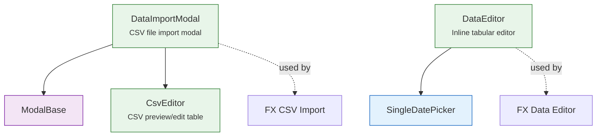

# ✏️ Datapoint Editor Components

Inline editing and CSV import components for financial datapoints. Located in `lib/components/ui/data-editor/`.

---

## ✏️ DataEditor

An **inline tabular editor** for structured data (add, edit, delete rows).

- Editable cells with type-aware inputs (text, number, date)
- Add row button with empty row template
- A new row's date is chosen with `SingleDatePicker`, which disables the dates the row may not take:
  those of the other rows, or, with `importMatchKeys`, only those of the rows with the same values
  for those keys, so a new event moves to a day that holds only an event of another type
  (`takenDates`; the move itself is checked the same way)
- Delete row: the row is only marked deleted, and its **Undo** action restores a deleted or edited
  row and removes a new one; selected rows can be deleted together. Nothing is written until the
  owner saves
- Validation per cell with error highlighting
- Toolbar counters: *N modified*, *N deleted*, *N new*
- Rows carry a `staleDays` count (backward-filled points); when any exist, a switch with a `⚠️ N`
  counter hides them (`dataEditor.staleTooltip`)
- `readonly` rows (with a `readonlyReason` tooltip) can be deleted but not edited
- Optional numeric columns flagged `erasable` render `ErasableNumberCell`: its eraser (or `Delete`
  in an empty input) sets `CLEARED_CELL` (`'clear'`, exported by `DataEditorTypes.ts`; N92) without
  a confirmation, since the row's **Undo** covers a slip, and the cell shows it as cleared,
  *Not set* in red italics. The asset wrapper sends `'clear'`, which the backend price upsert
  writes as `NULL` ([the F.4 merge](../../../backend/assets/architecture.md#price-write-merge)). A
  number is always a number, `-1` included, shown in the field (a typed negative is clamped to
  the column's `min`, 0 for prices), and an erased cell sorts and filters as an empty one. Only
  the eraser sets `'clear'`: the CSV parser refuses a text. Before N92, the eraser set the sentinel
  `-1`
- **Import CSV** merges each parsed line into the row with the same date and the same values for
  the `importMatchKeys` columns (prop, default `[]`: the date alone, as for prices and FX rates; the
  asset events editor passes `['type']`). Among several matches an editable row wins over a
  read-only one, and a line whose every match is read-only is skipped; only non-empty values are
  merged. An unmatched line is appended under a unique `rowId`, the date then `date#2`,
  `date#3`…, so two new rows can share a date
- `scrollToDate(date)` scrolls to a row

**Used by**: the FX detail page (`fx/FxDataEditorSection.svelte`) and the asset detail page
(`assets/AssetDataEditorSection.svelte`), below.

### 💾 Saving: the FX and asset wrappers

`DataEditor` never writes: its wrapper collects the dirty rows and saves them on **Save**.

| | FX (`FxDataEditorSection`) | Asset (`AssetDataEditorSection`) |
|---|---|---|
| Tables and columns | one table: `rate` | **Prices**: `close` (required), `open`, `high`, `low`, `volume` (erasable). **Events**: `type` (one of the five event types) and `amount` (required), `notes` |
| Written through | `POST /api/v1/fx/currencies/rate`; a pair shown inverted (its base after its quote in alphabetical order) stores `1 / rate` under the alphabetical pair | `POST /api/v1/assets/prices`; for events, **one** `POST /api/v1/assets/events` per save, with one item `{asset_id, delete_ids, events}`: a saved event with its `id` (edited in place, type included), a new one without |
| Deleted through | `DELETE /api/v1/fx/currencies/rate` | `DELETE /api/v1/assets/prices`; events in that same POST: the ids of the saved rows marked deleted, as `delete_ids`, which the server deletes first. No `DELETE` is sent during a save, and an event row never saved is not sent at all |
| Rows not sent | A rate that is not a number above 0, counted as *skipped (invalid)*. When every row is invalid and none is deleted, the save stops with *Rate must be strictly greater than zero (0 is not allowed).* | A price whose close is not a number above 0, or whose open, high, low or volume is a negative number (N92; only an imported CSV can bring one), counted as *skipped (invalid)* (`pricesSkipped`); an event without a type or a numeric amount |

Both wrappers:

- merge consecutive deleted dates into ranges;
- draw the pending values as a purple preview line (`__preview__`, `#a855f7`) until saved or
  cancelled; the FX one draws only rates above 0;
- after a save that appended rows outside the loaded range, hand the page the widened range
  through `onsave`, and the page moves its period there;
- expose `scrollToDate(date)`: with the editor open, a double-click on the chart (a long press of
  about 0.8 s on touch) scrolls to that date.

**What the server refused** (X-R46) is worded by `frontend/src/lib/api/writeRefusal.ts`, in the
interface language, with ISO dates, the same way in both wrappers:

- **A save refused whole**: the `catch` shows `saveErrorText(error, t)`. `writeRefusalMessage()`
  words the coded refusals: 422 `date_out_of_range` (the dates and the bounds), 422
  `price_currency_mismatch` (the dates and both currencies; the editor sends no currency, so its
  own saves never meet it), 422 `bulk_too_many_items` (`common.writeRefusal.tooManyItems`: the
  maximum, the count, *Save them in smaller parts*) and 400 `fx_rates_refused` (each date with
  its reason, through `rejectedMessage()`). Any other error falls back to `extractErrorMessage()`,
  which prefers the server's own `detail` (its `message`, for an object) to Axios's *Request failed
  with status code …*; an events refusal, already worded by `eventSaveErrorMessage()`, keeps its
  sentence. The sentence fills the *Failed to save: …* banner and the error toast (*FX save
  failed: …* on the FX page), and `onsave` is not called: the editor stays open with the pending
  rows.
- **A save taken in part**: a 200 names the dates it left out in `rejected` (FX) or in its asset's
  `results[].rejected` (asset), and the counts come from the answer: `results.length` saved and
  `rejected.length` refused for FX (`fxDetail.refusedCount`), the asset's `count` saved and its
  `rejected` as `pricesRefused` for the asset (`assets.dataEditor.pricesRefused`, and in the
  `assets.data.saved` event). `rejectedMessage()` names up to five refused dates, then
  *and N more*, each with its reason (`common.writeRefusal.reason.*`), and the summary toast is a
  **warning** that stays 20 s (`REFUSAL_TOAST_MS`) instead of a success. The asset wrapper adds
  its result's `message` when the result accounts for fewer prices than were sent (the asset
  deleted meanwhile).

Asset only:

- **Two tabs**, **Prices** and **Events**, whose badges count the dirty rows, share one
  **Save (n)** / **Cancel** bar. The chart jump picks the Events tab when the date has an event
  marker, the Prices tab otherwise.
- **No currency column.** The backend rejects a price in a currency other than the asset's (HTTP
  422 `price_currency_mismatch`, the whole request) and such an event (HTTP 400); the editor sends
  no currency with prices, and a label beside the tabs reads
  *Prices in USD* / *Events in USD*. An event goes with its row's `currency` when it has one, the
  value an imported CSV line brought, and with the asset's otherwise: a line in another currency is
  refused with its row (`EVENT_CURRENCY_MISMATCH`), not relabelled with an amount that would be
  wrong.
- **Auto events** (`is_auto`) are `readonly`: a provider rewrites them at its next sync (see
  [Asset Events](../../../backend/assets/events.md#dedup-strategy)).
- **Saved events travel with their id.** A saved event row's `rowId` is its DB id, read back by
  `dbEventId(row)` (`null` for a row never saved, whose `rowId` is a date: `2026-03-15`,
  `2026-03-15#2`). The upsert sends that `id`, so the server edits the row in place, its type
  included: changing the Type of a saved event no longer adds an event and leaves the old one. A
  row deleted before its first save is not sent. Since the server deletes first, one save can
  delete an event and retype another onto its date and type. The events `DataEditor` gets
  `importMatchKeys={['type']}`: an imported line merges into the row of the same date and type,
  under the Import CSV rules above, and a line of another type on that date is added.
- **A refused save** keeps no event change, its deletions included: the events request is one
  transaction (decision 22). `eventSaveErrorMessage()` (`transactions/events/eventSaveError.ts`,
  keys `events.saveError.*`) turns the refusal into one sentence in the user's language, which
  names the row at fault when the refusal points at one: its date and type, with the currency for
  `EVENT_CURRENCY_MISMATCH`, the number of linked transactions for `EVENT_IN_USE`, the three
  maxima of `params` (decimal places, significant digits, digits before the decimal point) for
  `EVENT_TOO_MANY_DIGITS` (`events.saveError.tooManyDigits`: the first event at fault, and how many
  more), the split's ratio for `EVENT_INVALID_SPLIT_RATIO` (`events.saveError.invalidSplitRatio`:
  the first split at fault, and how many more), and the value typed for a 422 on a type
  (`EVENT_NOT_EDITABLE`, `EVENT_NOT_DELETABLE` and `EVENT_ASSET_NOT_FOUND` ask for a reload
  instead). It shows as a *Failed to save: …* toast and a
  banner above the tabs, and `onsave` is not called: the editor stays open with the pending rows.
  Prices are sent before events, so the prices of that save may already be stored.
- **Refresh while editing**: a `chartData` or `events` refresh that lands while a tab has dirty
  rows is held back until it is clean, so pending edits are never discarded. The FX wrapper
  rebuilds its rows on every refresh.

The asset import modals wrap `DataImportModal`, each with a format banner and a 📖 button that
opens the user page (`user/assets/detail/data-editor/` and `user/assets/detail/events/`, with the
locale prefix):

- `PriceDataImportModal` — header `date;currency;close`, optional `open;high;low;volume`.
  `currency` is a required column for the parser but is not sent: the save uses the asset's.
- `EventDataImportModal` — header `date;currency;type;amount;notes`, with `currency` and `notes`
  optional. `amount` also reads a `value` column (an alias), the name the events export
  (`GET /api/v1/backup/asset/{id}/events?format=csv`) gives it, so an exported events file imports
  back with its other columns ignored. Its `notes` column has a `parse`, `unescapeFormulaText`
  (exported from the modal's `<script module>`), which drops the one leading apostrophe the export
  puts in front of a note that starts, after any apostrophes, with `=`, `+`, `-`, `@`, a tab or a
  carriage return, so that such a note imports back exactly as it was (lot B-39,
  [Output Escaping](../../../architecture/security.md#output-escaping)). Its `source` column is not read (every row becomes a manual
  event). Its `type` column is a `matchKey`: two rows are duplicates only when they share the date
  and the type, so a dividend and a split of one day import together.

---

## 📄 CsvEditor

A **CSV preview and editor** with column detection and per-row validation.

- Parses CSV content and displays as table
- Detects the separator, `;` or `,`, from the first non-empty line (a line starting with `date;`
  or `date,` decides at once, otherwise the first of the two to appear), and reads quoted fields
  RFC 4180-style. No other separator is recognised
- Requires a header on the first non-empty line and matches it **by column name**,
  case-insensitively and in any order: extra columns are ignored, missing required ones produce
  one consolidated error. A column may list `aliases` (`CsvColumnDef.aliases`), tried after its
  label: with both present, the label wins. A token `A<B` reads as `B>A`, so an FX header can name
  its direction either way
- The identity column is `date` (`YYYY-MM-DD`) unless the caller passes another, such as a
  distribution's `name`
- Numbers (`parseNumber`): `_` is dropped as a thousands separator; with both `.` and `,`, the
  last one is the decimal separator and the other is dropped; a lone `,` is the decimal separator
  (a second one makes the value invalid). What remains must be a plain number (sign, digits,
  optional decimals and exponent), so an inner space or a letter is invalid. A column may also
  pass its own `parse` and `validate`
- Highlights rows with errors (red) or warnings (yellow), such as a duplicate: two lines with the
  same identity value and the same values in every column flagged `matchKey`
  (`CsvColumnDef.matchKey`; only the events import flags one, `type`)
- Editable cells for manual correction

Its messages, one per invalid line:

| Where | Message |
|---|---|
| Header | `Missing required columns: <labels>`, or `Expected header: <identity>;<labels…>` when the first line has no identity column; every data row then reads `Fix header first` |
| Row | `Invalid quoted CSV field` |
| Row | `Invalid date format: "<value>". Use YYYY-MM-DD`, `Invalid date: "<value>"`, or `Invalid <identity>: "<value>"` for another identity column |
| Row | `Required column "<label>" is empty` |
| Row | `Invalid number in "<label>": "<value>"`, or `Invalid value in "<label>": "<value>"` when a column's `parse` rejects it |
| Row | The column's own `validate` message, such as *Weight must be between 0 and 100* |
| Duplicates | `Duplicate <identity>: <value>` on every row sharing that value, or `Duplicate date · type: <date> · <type>` with a `matchKey` column; none of them is imported |

**Used by**: `DataImportModal` (FX CSV import preview and the asset price, event and distribution
imports).

---

## 📥 DataImportModal

A **modal for importing data from CSV files**. Extends [ModalBase](modals.md).

- Drag & drop file upload zone
- Direction bar for FX pair direction (with swap button)
- Uses `CsvEditor` for preview
- Validation summary before import: *N valid row(s)*, the error count, and *duplicates*
- **Import (N)** imports the valid rows only, by default: rows with errors and every duplicated
  row stay out. A `strict` caller (the distribution import) allows the import only with no error
  and no duplicate, and a `validateRows` check on the whole set (the distribution total) blocks it
  with its message
- Closing after typing, pasting or dropping data asks to confirm (*Discard import?*)

**Used by**: FX detail page — "Import CSV" action, and the asset wrappers `PriceDataImportModal`,
`EventDataImportModal` and `DistributionDataImportModal`. See
[FX CSV Import](../../../../user/fx/detail/data-editor.md) and
[Asset Data Editor](../../../../user/assets/detail/data-editor.md) for user documentation.
